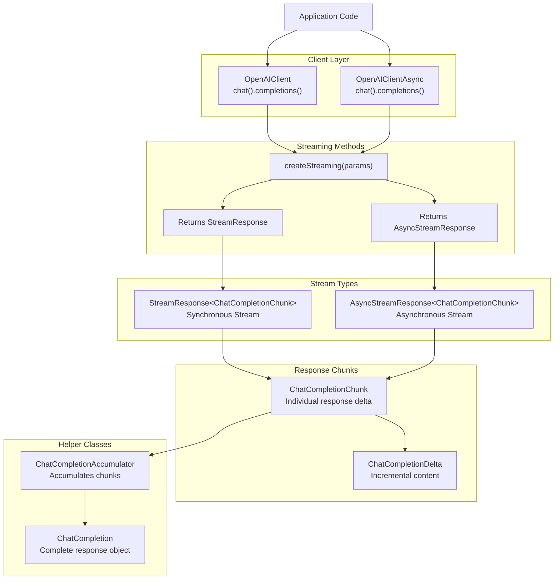
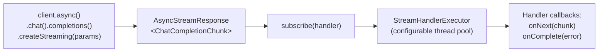
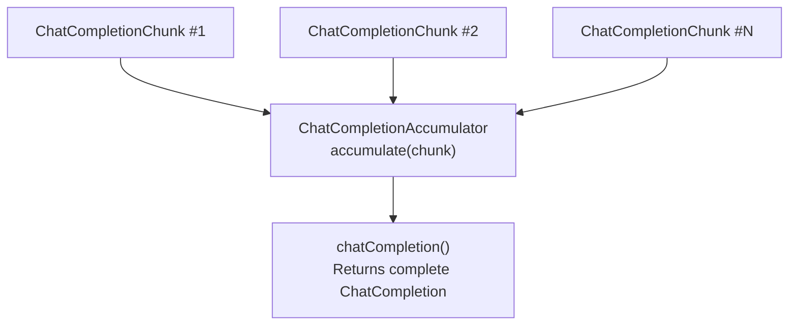
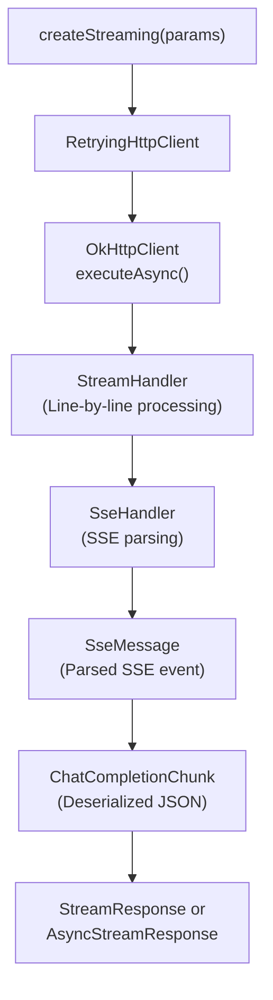

<!-- source: DeepWiki mcp.deepwiki.com · repo openai/openai-java · page 4.2 Streaming Chat Completions · fetched 2026-10-26 -->

# Streaming Chat Completions

<details>
<summary>Relevant source files</summary>

The following files were used as context for generating this wiki page:

- [openai-java-core/src/main/kotlin/com/openai/core/handlers/SseHandler.kt](openai-java-core/src/main/kotlin/com/openai/core/handlers/SseHandler.kt)
- [openai-java-core/src/main/kotlin/com/openai/core/handlers/StreamHandler.kt](openai-java-core/src/main/kotlin/com/openai/core/handlers/StreamHandler.kt)
- [openai-java-core/src/main/kotlin/com/openai/core/http/HttpResponse.kt](openai-java-core/src/main/kotlin/com/openai/core/http/HttpResponse.kt)
- [openai-java-core/src/main/kotlin/com/openai/core/http/HttpResponseFor.kt](openai-java-core/src/main/kotlin/com/openai/core/http/HttpResponseFor.kt)
- [openai-java-core/src/main/kotlin/com/openai/core/http/LoggingHttpClient.kt](openai-java-core/src/main/kotlin/com/openai/core/http/LoggingHttpClient.kt)
- [openai-java-core/src/main/kotlin/com/openai/core/http/SseMessage.kt](openai-java-core/src/main/kotlin/com/openai/core/http/SseMessage.kt)
- [openai-java-core/src/main/kotlin/com/openai/helpers/ChatCompletionAccumulator.kt](openai-java-core/src/main/kotlin/com/openai/helpers/ChatCompletionAccumulator.kt)
- [openai-java-core/src/main/kotlin/com/openai/services/blocking/CompletionService.kt](openai-java-core/src/main/kotlin/com/openai/services/blocking/CompletionService.kt)
- [openai-java-core/src/main/kotlin/com/openai/services/blocking/chat/ChatCompletionService.kt](openai-java-core/src/main/kotlin/com/openai/services/blocking/chat/ChatCompletionService.kt)
- [openai-java-core/src/test/kotlin/com/openai/core/handlers/SseHandlerTest.kt](openai-java-core/src/test/kotlin/com/openai/core/handlers/SseHandlerTest.kt)
- [openai-java-core/src/test/kotlin/com/openai/core/handlers/SseTerminalEventTest.kt](openai-java-core/src/test/kotlin/com/openai/core/handlers/SseTerminalEventTest.kt)
- [openai-java-core/src/test/kotlin/com/openai/core/handlers/StreamHandlerTest.kt](openai-java-core/src/test/kotlin/com/openai/core/handlers/StreamHandlerTest.kt)
- [openai-java-core/src/test/kotlin/com/openai/core/http/HttpResponseForTest.kt](openai-java-core/src/test/kotlin/com/openai/core/http/HttpResponseForTest.kt)
- [openai-java-core/src/test/kotlin/com/openai/core/http/LoggingHttpClientTest.kt](openai-java-core/src/test/kotlin/com/openai/core/http/LoggingHttpClientTest.kt)
- [openai-java-core/src/test/kotlin/com/openai/helpers/ChatCompletionAccumulatorTest.kt](openai-java-core/src/test/kotlin/com/openai/helpers/ChatCompletionAccumulatorTest.kt)
- [openai-java-core/src/test/kotlin/com/openai/helpers/FragmentedCompletionTextTest.kt](openai-java-core/src/test/kotlin/com/openai/helpers/FragmentedCompletionTextTest.kt)
- [openai-java-example/src/main/java/com/openai/example/StructuredOutputsStreamingExample.java](openai-java-example/src/main/java/com/openai/example/StructuredOutputsStreamingExample.java)

</details>


This page documents the streaming capabilities of the Chat Completions API in the OpenAI Java SDK. Streaming allows you to process chat completion responses incrementally as they are generated, rather than waiting for the complete response. This enables real-time user experiences and lower perceived latency.

For information about non-streaming (blocking) chat completions, see [Basic Chat Completions](#4.1). For streaming with the Responses API instead of Chat Completions, see [Response Streaming](#5.2).

---

## Overview

The SDK provides streaming support for chat completions through specialized response types and helper classes. Streaming methods are identified by the `Streaming` suffix in their method names, such as `createStreaming()`.

### Streaming Architecture



**Sources:** [README.md:219-282](), [openai-java-core/src/main/kotlin/com/openai/core/http/StreamResponse.kt](), [openai-java-core/src/main/kotlin/com/openai/core/http/AsyncStreamResponse.kt]()

---

## Synchronous Streaming

Synchronous streaming returns a `StreamResponse<ChatCompletionChunk>` that wraps a Java `Stream` API for processing chunks sequentially. This approach blocks the current thread while processing each chunk.

### Core Components

| Component | Type | Purpose |
|-----------|------|---------|
| `StreamResponse` | Wrapper class | Provides Java Stream API access to chunks |
| `ChatCompletionChunk` | Data class | Individual delta in the streaming response |
| `stream()` | Method | Returns `Stream<ChatCompletionChunk>` |

### Using Synchronous Streaming

The synchronous streaming method `createStreaming()` is called on `client.chat().completions()`. The returned `StreamResponse` must be closed after use (it implements `AutoCloseable`):

```java
try (StreamResponse<ChatCompletionChunk> streamResponse =
        client.chat().completions().createStreaming(params)) {
    streamResponse.stream().forEach(chunk -> {
        System.out.println(chunk);
    });
    System.out.println("No more chunks!");
}
```

### Processing Stream Content

Each `ChatCompletionChunk` contains a `delta` field with incremental content. To extract text content from the stream:

```java
try (StreamResponse<ChatCompletionChunk> streamResponse =
        client.chat().completions().createStreaming(params)) {
    streamResponse.stream()
        .flatMap(completion -> completion.choices().stream())
        .flatMap(choice -> choice.delta().content().stream())
        .forEach(System.out::print);
}
```

This pattern:
1. Flattens choices from each chunk
2. Extracts the delta content from each choice
3. Prints each content piece as it arrives

**Sources:** [README.md:225-237](), [openai-java-core/src/main/kotlin/com/openai/core/http/StreamResponse.kt]()

---

## Asynchronous Streaming

Asynchronous streaming returns an `AsyncStreamResponse<ChatCompletionChunk>` that uses callbacks and a dedicated executor for non-blocking stream processing.

### Async Stream Processing Flow



### Basic Callback Pattern

The simplest async streaming pattern uses a lambda that processes each chunk:

```java
client.async().chat().completions().createStreaming(params).subscribe(chunk -> {
    System.out.println(chunk);
});
```

### Advanced Handler Pattern

For handling completion and errors, implement the `AsyncStreamResponse.Handler` interface:

```java
client.async().chat().completions().createStreaming(params)
    .subscribe(new AsyncStreamResponse.Handler<>() {
        @Override
        public void onNext(ChatCompletionChunk chunk) {
            System.out.println(chunk);
        }

        @Override
        public void onComplete(Optional<Throwable> error) {
            if (error.isPresent()) {
                System.out.println("Something went wrong!");
                throw new RuntimeException(error.get());
            } else {
                System.out.println("No more chunks!");
            }
        }
    });
```

### Using CompletableFuture

The async stream can be converted to a `CompletableFuture` for integration with async pipelines:

```java
client.async().chat().completions().createStreaming(params)
    .subscribe(chunk -> {
        System.out.println(chunk);
    })
    .onCompleteFuture()
    .whenComplete((unused, error) -> {
        if (error != null) {
            System.out.println("Something went wrong!");
            throw new RuntimeException(error);
        } else {
            System.out.println("No more chunks!");
        }
    });
```

### Custom Executor Configuration

By default, async streaming uses a cached thread pool. To configure a custom executor:

**Per-request configuration:**
```java
Executor executor = Executors.newFixedThreadPool(4);
client.async().chat().completions().createStreaming(params)
    .subscribe(chunk -> System.out.println(chunk), executor);
```

**Global client configuration:**
```java
OpenAIClient client = OpenAIOkHttpClient.builder()
    .fromEnv()
    .streamHandlerExecutor(Executors.newFixedThreadPool(4))
    .build();
```

**Sources:** [README.md:239-309](), [openai-java-core/src/main/kotlin/com/openai/core/http/AsyncStreamResponse.kt]()

---

## ChatCompletionAccumulator

The `ChatCompletionAccumulator` is a helper class that reconstructs a complete `ChatCompletion` object from streaming chunks. This is useful when you need both real-time streaming and the final complete response.

### Accumulator Architecture



The `ChatCompletionAccumulator` manages the state of the accumulating chat completion. It maintains internal builders for the `ChatCompletion`, its `Choice` elements, `ChatCompletionMessage`s, and `Logprobs` [openai-java-core/src/main/kotlin/com/openai/helpers/ChatCompletionAccumulator.kt:25-65](). It also tracks the accumulated content and refusal for each message using `StringBuilder` [openai-java-core/src/main/kotlin/com/openai/helpers/ChatCompletionAccumulator.kt:51-58](). Tool calls and their arguments are also accumulated incrementally [openai-java-core/src/main/kotlin/com/openai/helpers/ChatCompletionAccumulator.kt:70-90](). The `isFinished` map tracks the completion status of each choice [openai-java-core/src/main/kotlin/com/openai/helpers/ChatCompletionAccumulator.kt:97-99]().

### Using with Synchronous Streams

The accumulator is added to the stream pipeline using `Stream.peek()`:

```java
import com.openai.helpers.ChatCompletionAccumulator;
import com.openai.models.chat.completions.ChatCompletion;

ChatCompletionAccumulator chatCompletionAccumulator =
    ChatCompletionAccumulator.create();

try (StreamResponse<ChatCompletionChunk> streamResponse =
        client.chat().completions().createStreaming(createParams)) {
    streamResponse.stream()
            .peek(chatCompletionAccumulator::accumulate)
            .flatMap(completion -> completion.choices().stream())
            .flatMap(choice -> choice.delta().content().stream())
            .forEach(System.out::print);
}

ChatCompletion chatCompletion = chatCompletionAccumulator.chatCompletion();
```

Key points:
- `peek()` is used for side effects without modifying the stream
- The accumulator builds up the complete response as chunks arrive
- After stream processing, `chatCompletion()` returns the reconstructed object

### Using with Asynchronous Streams

For async streams, pass the accumulator's `accumulate` method to the subscribe callback:

```java
ChatCompletionAccumulator chatCompletionAccumulator =
    ChatCompletionAccumulator.create();

client.chat()
        .completions()
        .createStreaming(createParams)
        .subscribe(chunk -> chatCompletionAccumulator.accumulate(chunk)
                .choices().stream()
                .flatMap(choice -> choice.delta().content().stream())
                .forEach(System.out::print))
        .onCompleteFuture()
        .join();

ChatCompletion chatCompletion = chatCompletionAccumulator.chatCompletion();
```

### Accumulator with Structured Outputs

When using structured outputs with streaming (see [Structured Outputs](#6)), the accumulator can convert the accumulated result to a typed `StructuredChatCompletion`:

```java
ChatCompletionAccumulator accumulator = ChatCompletionAccumulator.create();

// ... stream and accumulate chunks ...

StructuredChatCompletion<BookList> structured =
    accumulator.chatCompletion(BookList.class);
```

The `chatCompletion(Class<T>)` method deserializes the accumulated JSON content into instances of the specified class [openai-java-core/src/main/kotlin/com/openai/helpers/ChatCompletionAccumulator.kt:139-141]().

**Sources:** [README.md:311-361](), [openai-java-core/src/main/kotlin/com/openai/helpers/ChatCompletionAccumulator.kt]()

---

## Stream Options Configuration

The `ChatCompletionStreamOptions` parameter controls streaming-specific behavior and is only applicable when streaming is enabled.

### Available Stream Options

| Option | Type | Purpose |
|--------|------|---------|
| `includeUsage` | Boolean | Include token usage statistics in the final chunk |

### Setting Stream Options

Stream options are set on the `ChatCompletionCreateParams` using the `streamOptions()` builder method:

```java
ChatCompletionCreateParams params = ChatCompletionCreateParams.builder()
    .addUserMessage("Tell me a story")
    .model(ChatModel.GPT_4_1)
    .streamOptions(ChatCompletionStreamOptions.builder()
        .includeUsage(true)
        .build())
    .build();
```

When `includeUsage(true)` is set, the final chunk in the stream will include a `usage` field with token counts for the complete response.

**Sources:** [openai-java-core/src/main/kotlin/com/openai/models/chat/completions/ChatCompletionCreateParams.kt:379-384]()

---

## Relationship to Non-Streaming API

The streaming and non-streaming chat completions APIs share the same parameter structure through `ChatCompletionCreateParams`, but differ in their method invocation and return types.

### Comparison Table

| Aspect | Non-Streaming | Streaming |
|--------|---------------|-----------|
| Method | `create(params)` | `createStreaming(params)` |
| Return Type (Sync) | `ChatCompletion` | `StreamResponse<ChatCompletionChunk>` |
| Return Type (Async) | `CompletableFuture<ChatCompletion>` | `AsyncStreamResponse<ChatCompletionChunk>` |
| Response Model | Complete response | Incremental deltas |
| Latency | Higher (waits for completion) | Lower (first chunk arrives quickly) |
| Use Case | Simple requests | Real-time UX, long responses |

### Parameter Compatibility

Both streaming and non-streaming modes use the same `ChatCompletionCreateParams` builder. The only streaming-specific parameter is `streamOptions()`, which is ignored in non-streaming mode.

**Sources:** [README.md:70-88](), [README.md:219-282](), [openai-java-core/src/main/kotlin/com/openai/models/chat/completions/ChatCompletionCreateParams.kt]()

---

## Error Handling

### Synchronous Stream Errors

Errors in synchronous streams are thrown as exceptions during stream processing. Always use try-with-resources to ensure proper cleanup:

```java
try (StreamResponse<ChatCompletionChunk> streamResponse =
        client.chat().completions().createStreaming(params)) {
    streamResponse.stream().forEach(chunk -> {
        // Process chunk
    });
} catch (OpenAIException e) {
    // Handle API errors
} catch (IOException e) {
    // Handle network errors
}
```

The `StreamResponse` implements `AutoCloseable`, ensuring that underlying resources are released even if an exception occurs.
The `SseHandler` [openai-java-core/src/main/kotlin/com/openai/core/handlers/SseHandler.kt:20-55]() is responsible for parsing SSE messages. If an `error` property is found in the JSON payload, it throws an `SseException` [openai-java-core/src/main/kotlin/com/openai/core/handlers/SseHandler.kt:38-51](). Network I/O errors during stream processing are wrapped in `OpenAIIoException` by `IOExceptionWrappingSequence` [openai-java-core/src/main/kotlin/com/openai/core/handlers/StreamHandler.kt:89-90]().

### Asynchronous Stream Errors

Errors in asynchronous streams are delivered through the `onComplete()` callback:

```java
client.async().chat().completions().createStreaming(params)
    .subscribe(new AsyncStreamResponse.Handler<>() {
        @Override
        public void onNext(ChatCompletionChunk chunk) {
            // Process chunk
        }

        @Override
        public void onComplete(Optional<Throwable> error) {
            if (error.isPresent()) {
                Throwable throwable = error.get();
                if (throwable instanceof OpenAIException) {
                    // Handle API errors
                } else if (throwable instanceof IOException) {
                    // Handle network errors
                }
            }
        }
    });
```

When using `CompletableFuture`, errors propagate through the future's exception handling:

```java
client.async().chat().completions().createStreaming(params)
    .subscribe(chunk -> { /* process */ })
    .onCompleteFuture()
    .exceptionally(throwable -> {
        // Handle errors
        return null;
    });
```

**Sources:** [openai-java-core/src/main/kotlin/com/openai/core/http/StreamResponse.kt](), [openai-java-core/src/main/kotlin/com/openai/core/http/AsyncStreamResponse.kt](), [openai-java-core/src/main/kotlin/com/openai/core/handlers/SseHandler.kt:38-51](), [openai-java-core/src/main/kotlin/com/openai/core/handlers/StreamHandler.kt:89-90]()

---

## HTTP Layer Implementation

The streaming implementation relies on the underlying HTTP client's support for server-sent events (SSE). The SDK uses OkHttp as the default HTTP client implementation.

### Streaming Request Flow



### Key Implementation Details

- **SSE Protocol**: Streaming responses use the SSE (Server-Sent Events) format, where each chunk is a separate JSON object. The `SseHandler` [openai-java-core/src/main/kotlin/com/openai/core/handlers/SseHandler.kt:20-55]() is responsible for decoding raw SSE lines into `SseMessage` objects [openai-java-core/src/main/kotlin/com/openai/core/handlers/SseHandler.kt:65-129]().
- **Line-by-line Processing**: The `StreamHandler` [openai-java-core/src/main/kotlin/com/openai/core/handlers/StreamHandler.kt:16-73]() reads the HTTP response body line by line and passes them to the `SseHandler`. It wraps the underlying `InputStream` with `IOExceptionWrappingSequence` to catch and rethrow `IOException` as `OpenAIIoException` [openai-java-core/src/main/kotlin/com/openai/core/handlers/StreamHandler.kt:76-98]().
- **JSON Parsing**: Each `SseMessage` contains a `data` field, which is then parsed into a `ChatCompletionChunk` using `jsonMapper` [openai-java-core/src/main/kotlin/com/openai/core/http/SseMessage.kt:42-55]().
- **Terminal Event**: The `SseHandler` recognizes `data: [DONE]` as a terminal event, marking the body as complete and closing the response [openai-java-core/src/main/kotlin/com/openai/core/handlers/SseHandler.kt:26-29]().
- **Retry Support**: The `RetryingHttpClient` layer does **not** retry streaming requests by default.
- **Connection Pooling**: The underlying `OkHttpClient` maintains connection pools for efficiency.
- **Logging**: The `LoggingHttpClient` can log streaming requests and responses at various levels. At `DEBUG` level, it logs request and response headers and body content [openai-java-core/src/main/kotlin/com/openai/core/http/LoggingHttpClient.kt:110-111]().

**Sources:** [openai-java-client-okhttp/src/main/kotlin/com/openai/client/okhttp/OkHttpClient.kt](), [README.md:219-222](), [openai-java-core/src/main/kotlin/com/openai/core/handlers/SseHandler.kt](), [openai-java-core/src/main/kotlin/com/openai/core/handlers/StreamHandler.kt](), [openai-java-core/src/main/kotlin/com/openai/core/http/SseMessage.kt:42-55](), [openai-java-core/src/main/kotlin/com/openai/core/handlers/SseHandler.kt:26-29](), [openai-java-core/src/main/kotlin/com/openai/core/http/LoggingHttpClient.kt:110-111]()

---

