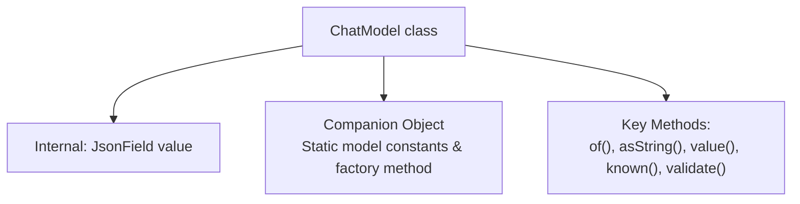
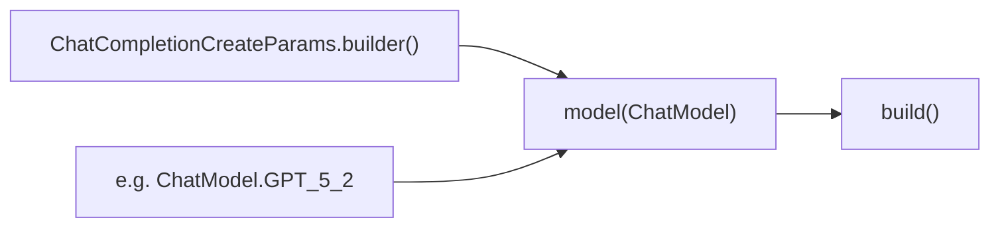
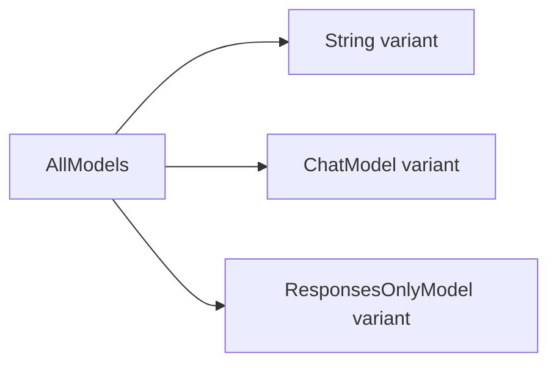
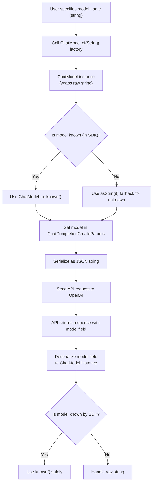

<!-- source: DeepWiki mcp.deepwiki.com · repo openai/openai-java · page 4.3 Chat Models · fetched 2026-10-26 -->

# Chat Models

<details>
<summary>Relevant source files</summary>

The following files were used as context for generating this wiki page:

- [.castiron.stats.yml](.castiron.stats.yml)
- [api_reference/openapi.transformed.yml](api_reference/openapi.transformed.yml)
- [openai-java-core/src/main/kotlin/com/openai/models/AllModels.kt](openai-java-core/src/main/kotlin/com/openai/models/AllModels.kt)
- [openai-java-core/src/main/kotlin/com/openai/models/ChatModel.kt](openai-java-core/src/main/kotlin/com/openai/models/ChatModel.kt)
- [openai-java-core/src/main/kotlin/com/openai/models/ResponsesModel.kt](openai-java-core/src/main/kotlin/com/openai/models/ResponsesModel.kt)
- [openai-java-core/src/main/kotlin/com/openai/models/beta/responses/BetaResponse.kt](openai-java-core/src/main/kotlin/com/openai/models/beta/responses/BetaResponse.kt)
- [openai-java-core/src/main/kotlin/com/openai/models/beta/responses/BetaResponsesClientEvent.kt](openai-java-core/src/main/kotlin/com/openai/models/beta/responses/BetaResponsesClientEvent.kt)
- [openai-java-core/src/main/kotlin/com/openai/models/beta/responses/ResponseCompactParams.kt](openai-java-core/src/main/kotlin/com/openai/models/beta/responses/ResponseCompactParams.kt)
- [openai-java-core/src/main/kotlin/com/openai/models/beta/responses/ResponseCreateParams.kt](openai-java-core/src/main/kotlin/com/openai/models/beta/responses/ResponseCreateParams.kt)
- [openai-java-core/src/main/kotlin/com/openai/models/responses/ResponseCompactParams.kt](openai-java-core/src/main/kotlin/com/openai/models/responses/ResponseCompactParams.kt)

</details>


This page documents the `ChatModel` class and its role in representing OpenAI's chat models within the OpenAI Java SDK. It covers the detailed implementation of `ChatModel` as an extensible enum class, the union types `AllModels` and `ResponsesModel` which encapsulate `ChatModel` among others, and outlines the model families and their specific capabilities.

For usage of chat models in request parameters, see section [Basic Chat Completions](#4.1). For details on models specific to the Responses API, see section [Responses API](#5).

---

## Overview

The `ChatModel` class acts as a robust, type-safe enumeration representing OpenAI chat models. Unlike a traditional Java `enum`, it utilizes a custom pattern based on the SDK's `Enum` interface and wraps a `JsonField<String>`. This approach enables forward compatibility by allowing unknown model identifiers (e.g., models released in the future) to be safely handled without breaking existing client code.

The class includes a large set of static final constants for all known chat models at the time of SDK generation, including latest GPT-5 variants, GPT-4o optimized models, O-series reasoning models, GPT-4 legacy models, and GPT-3.5 models.

In addition to `ChatModel`, the SDK defines union types like `AllModels` and `ResponsesModel` which can hold either a `ChatModel` or other model types (e.g., `ResponsesOnlyModel`) or plain strings, enabling flexible API model identification.

**Sources:** [openai-java-core/src/main/kotlin/com/openai/models/ChatModel.kt:1-552](), [openai-java-core/src/main/kotlin/com/openai/models/AllModels.kt:1-193](), [openai-java-core/src/main/kotlin/com/openai/models/ResponsesModel.kt:1-198]()

---

## ChatModel Implementation Details

The `ChatModel` class wraps a `JsonField<String>` which holds the raw model identifier value. It exposes a rich companion object filled with predefined static constants for known models:

- Examples include `GPT_5_2` for "gpt-5.2", `GPT_4O` for "gpt-4o", and `O1` for "o1".
- It provides a factory method `of(String)` to create instances from arbitrary strings, enabling representation of unknown or custom models.

### Core Methods

- `_value()`: Returns the internal raw `JsonField<String>`.
- `asString()`: Get the raw string value.
- `value()`: Returns a `Value` enum which is either a known model constant or `_UNKNOWN` if not recognized.
- `known()`: Returns a `Known` enum for known models or throws `OpenAIInvalidDataException` for unknown.
- `validate()`: Invokes `known()` internally to assert the model is recognized.
- `isValid()`: Boolean check if model is known.
- `validity()`: Returns an integer score (1 for known, 0 for unknown).

### Static Constants Overview

The companion object defines over 70 models, grouped by families. See the next section for details.



**Sources:** [openai-java-core/src/main/kotlin/com/openai/models/ChatModel.kt:10-552]()

---

## Model Families

The `ChatModel` class defines multiple model families, each catering to different use cases, capabilities, or optimization goals.

### GPT-5 Series

Latest generation models with various versions and sizes:

| Constant                  | Identifier                 | Description                       |
|--------------------------|----------------------------|---------------------------------|
| `GPT_5_2`                | `"gpt-5.2"`                | Latest GPT-5.2 model             |
| `GPT_5_2_2025_12_11`     | `"gpt-5.2-2025-12-11"`     | Dated snapshot release           |
| `GPT_5_2_CHAT_LATEST`     | `"gpt-5.2-chat-latest"`     | Chat-optimized variant           |
| `GPT_5_2_PRO`             | `"gpt-5.2-pro"`             | Pro version                     |
| `GPT_5_1`                | `"gpt-5.1"`                | GPT-5.1 base                    |
| `GPT_5_1_CODEX`           | `"gpt-5.1-codex"`           | Code-specialized model           |
| `GPT_5_1_MINI`            | `"gpt-5.1-mini"`            | Small variant                   |
| `GPT_5`                   | `"gpt-5"`                   | Base GPT-5                     |
| `GPT_5_MINI`              | `"gpt-5-mini"`              | Mini variant                    |
| `GPT_5_NANO`              | `"gpt-5-nano"`              | Nano-sized model                |

### GPT-4.1 Series

Next generation in GPT-4 line, with mini & nano sizes:

| Constant                  | Identifier                 |
|--------------------------|----------------------------|
| `GPT_4_1`                | `"gpt-4.1"`                |
| `GPT_4_1_MINI`            | `"gpt-4.1-mini"`            |
| `GPT_4_1_NANO`            | `"gpt-4.1-nano"`            |
| `GPT_4_1_2025_04_14`     | `"gpt-4.1-2025-04-14"`     |

### O-Series (Reasoning Models)

Models specialized for reasoning with extended context and features:

| Constant                  | Identifier                  | Description               |
|--------------------------|-----------------------------|-------------------------|
| `O4_MINI`                | `"o4-mini"`                | Mini variant of O4       |
| `O3`                     | `"o3"`                     | O3 reasoning model       |
| `O3_MINI`                | `"o3-mini"`                | Mini variant             |
| `O1`                     | `"o1"`                     | Base reasoning model     |
| `O1_PREVIEW`             | `"o1-preview"`             | Preview                  |
| `O1_MINI`                | `"o1-mini"`                | Mini variant             |

### GPT-4o Series (Optimized & Multimodal)

Multimodal and optimized GPT-4o models with audio and search previews:

| Constant                      | Identifier                      | Capabilities               |
|------------------------------|--------------------------------|----------------------------|
| `GPT_4O`                    | `"gpt-4o"`                    | Base GPT-4o                |
| `GPT_4O_2024_11_20`         | `"gpt-4o-2024-11-20"`         | Snapshot version           |
| `GPT_4O_MINI`               | `"gpt-4o-mini"`               | Mini (smaller/faster)      |
| `GPT_4O_AUDIO_PREVIEW`      | `"gpt-4o-audio-preview"`      | Audio input/output support |
| `GPT_4O_SEARCH_PREVIEW`     | `"gpt-4o-search-preview"`     | Web search integration     |
| `CHATGPT_4O_LATEST`         | `"chatgpt-4o-latest"`         | Latest ChatGPT model       |
| `CODEX_MINI_LATEST`         | `"codex-mini-latest"`         | Latest Codex model         |

### GPT-4 Series (Legacy)

Classic GPT-4 and Turbo models:

| Constant                  | Identifier                     | Features/Context Window    |
|--------------------------|-------------------------------|----------------------------|
| `GPT_4`                  | `"gpt-4"`                     | Standard GPT-4             |
| `GPT_4_TURBO`            | `"gpt-4-turbo"`               | Turbo for faster inference |
| `GPT_4_32K`              | `"gpt-4-32k"`                 | Extended 32K tokens context|
| `GPT_4_VISION_PREVIEW`   | `"gpt-4-vision-preview"`      | Vision multimodal preview  |

### GPT-3.5 Series (Legacy)

Earlier powerful chat models with turbo versions:

| Constant                  | Identifier               |
|--------------------------|--------------------------|
| `GPT_3_5_TURBO`          | `"gpt-3.5-turbo"`        |
| `GPT_3_5_TURBO_16K`      | `"gpt-3.5-turbo-16k"`    |

*This extensive list helps developers distinctly select models for their use cases with type safety.*

**Sources:** [openai-java-core/src/main/kotlin/com/openai/models/ChatModel.kt:23-200]()

---

## Integration in API Requests

### Setting the ChatModel in ChatCompletion Requests

The typical usage of `ChatModel` is in constructing chat completion parameters via `ChatCompletionCreateParams`:



Example code snippet for setting:

```kotlin
val chatCompletionParams = ChatCompletionCreateParams.builder()
    .addMessage(ChatCompletionMessage.builder()
        .content("Hello, world!")
        .build())
    .model(ChatModel.GPT_5_2)
    .build()
```

This parameter object is serialized to JSON, with the `model` field represented as the string value of the selected `ChatModel`, e.g., `"gpt-5.2"`.

**Sources:** [openai-java-core/src/test/kotlin/com/openai/models/chat/completions/ChatCompletionCreateParamsTest.kt:18-114](), [openai-java-core/src/test/kotlin/com/openai/services/blocking/chat/ChatCompletionServiceTest.kt:35-137]()

---

## Union Types: AllModels and ResponsesModel

The SDK defines two important union wrappers for model identifiers:

### AllModels

`AllModels` can encapsulate:

- A raw `String` representing arbitrary model IDs.
- A `ChatModel` instance.
- A `ResponsesOnlyModel` instance (a model used exclusively by the Responses API).

This union type provides methods to test which variant it holds and safely extract the contained model.



Developers can create an `AllModels` instance by choosing one variant, e.g. `AllModels.ofChatModel(ChatModel.GPT_4O)`, or `AllModels.ofString("custom-model-id")`.

### ResponsesModel

Similarly, `ResponsesModel` union encapsulates:

- A raw `String`
- A `ChatModel`
- A `ResponsesOnlyModel`

It enables flexibility for specifying models in the Responses API.

Example:

```kotlin
val model1 = ResponsesModel.ofChat(ChatModel.GPT_4O)
val model2 = ResponsesModel.ofOnly(ResponsesOnlyModel.O1_PRO)
val model3 = ResponsesModel.ofString("custom-responses-model")
```

The unions aid in deserialization and validation while maintaining type safety.

**Sources:** [openai-java-core/src/main/kotlin/com/openai/models/AllModels.kt:24-182](), [openai-java-core/src/main/kotlin/com/openai/models/ResponsesModel.kt:24-180]()

---

## Validation and Unknown Models Handling

`ChatModel` supports robust validation to safely handle unknown or new models:

- `value()` returns a `Value` enum where known model constants are enumerated, and unknown models return `_UNKNOWN`.
- `known()` either returns the specific `Known` enum for recognized models or throws `OpenAIInvalidDataException` if unknown.
- `validate()` calls `known()` to ensure validity.
- `isValid()` checks if the model is known.
- `validity()` returns 1 for known models and 0 otherwise.

**Handling unknown models** is critical for forward compatibility when the OpenAI API returns newer model identifiers that the current SDK doesn't know. Developers can fallback to using `asString()` to access the raw identifier in these cases.

Example validation flow:

```kotlin
val model = ChatModel.of("gpt-6") // Possibly unknown to SDK

if (model.isValid()) {
    val knownModel = model.known()
    // Safe to use switch-case or pattern match
} else {
    println("Unknown model: ${model.asString()}")
    // Fallback or logging
}
```

```mermaid
flowchart TB
    A[ChatModel instance with raw string] --> B{Is model known?}
    B -->|Yes| C[Return Known enum value]
    B -->|No| D[Return Value._UNKNOWN; throw on known()]
    C --> E[Use model safely in logic]
    D --> F[Use raw string fallback with asString()]
```

**Sources:** [openai-java-core/src/main/kotlin/com/openai/models/ChatModel.kt:341-532]()

---

## Serialization and Deserialization Details

`ChatModel` employs custom Jackson serializers:

- **Serialization:** Converts the `ChatModel` instance to its raw string value for JSON transmission.
- **Deserialization:** Interprets JSON strings into static constants if known; otherwise creates an instance marked unknown but preserves the raw string value.

This ensures that both requests and responses serialize and deserialize `ChatModel` consistently and support future models transparently.

**Sources:** [openai-java-core/src/main/kotlin/com/openai/models/ChatModel.kt:10-20]()

---

## Recommended Usage Patterns

1. **Use static constants** for known models to benefit from type safety and IDE tooling:

   ```kotlin
   val model = ChatModel.GPT_4O
   ```

2. **Use the `of()` factory method** when working with custom or unknown model strings:

   ```kotlin
   val customModel = ChatModel.of("ft:gpt-4o:example:custom:123")
   ```

3. **Validate models when input is external:**

   ```kotlin
   try {
       val model = ChatModel.of(userProvidedString)
       model.validate()
       // safe to use
   } catch (e: OpenAIInvalidDataException) {
       // handle invalid or unrecognized model
   }
   ```

4. **Check validity before usage:**

   ```kotlin
   if (!model.isValid()) {
       logger.warn("Model not recognized: ${model.asString()}")
   }
   ```

5. **Handle unknown models gracefully** when processing responses, falling back on the raw string value as needed.

---

## Summary Diagram: From User to ChatModel and API



---

# References

- `ChatModel.kt` - primary enum-like class defining chat models [openai-java-core/src/main/kotlin/com/openai/models/ChatModel.kt:1-552]()
- `AllModels.kt` and `ResponsesModel.kt` - union types encapsulating multiple model representations [openai-java-core/src/main/kotlin/com/openai/models/AllModels.kt:1-193](), [openai-java-core/src/main/kotlin/com/openai/models/ResponsesModel.kt:1-180]()
- Test usage samples in `ChatCompletionCreateParamsTest.kt` and `ChatCompletionServiceTest.kt` [openai-java-core/src/test/kotlin/com/openai/models/chat/completions/ChatCompletionCreateParamsTest.kt:18-114](), [openai-java-core/src/test/kotlin/com/openai/services/blocking/chat/ChatCompletionServiceTest.kt:35-137]()

---

This completes the technical documentation of the `ChatModel` enum class, its integration in the client SDK, union types for flexible model specification, and model family classification in the OpenAI Java SDK.

---

