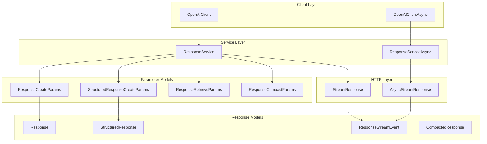
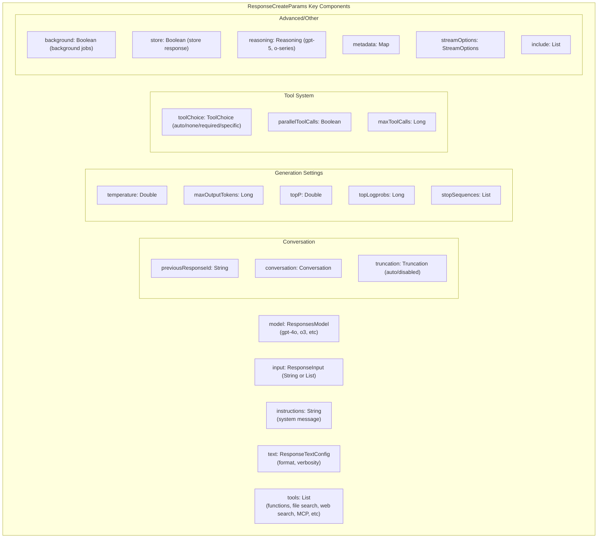
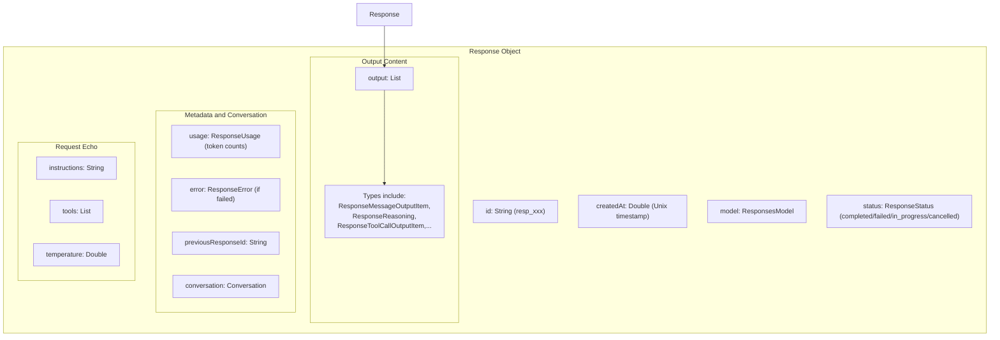
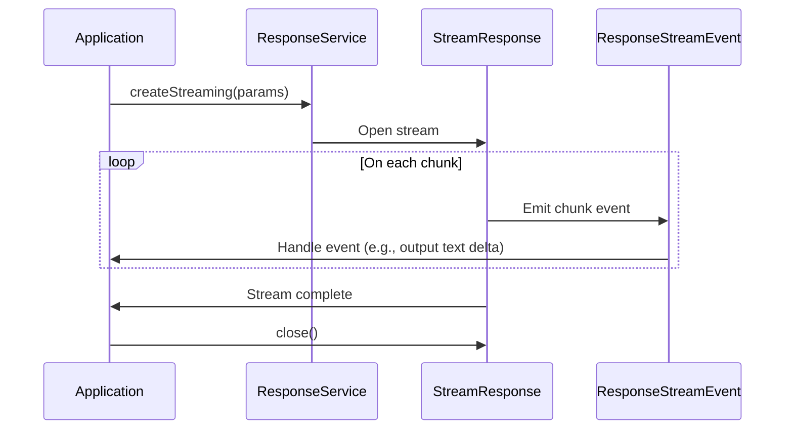
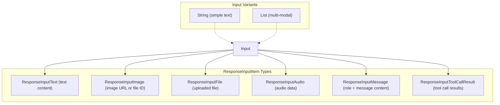
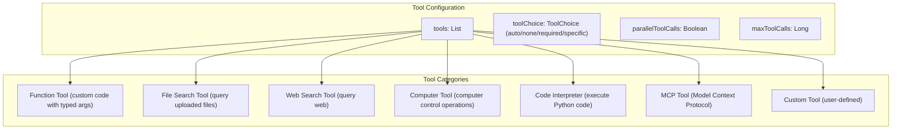

<!-- source: DeepWiki mcp.deepwiki.com · repo openai/openai-java · page 5 Responses API · fetched 2026-10-26 -->

# Responses API

<details>
<summary>Relevant source files</summary>

The following files were used as context for generating this wiki page:

- [openai-java-core/src/main/kotlin/com/openai/models/responses/ResponseRetrieveParams.kt](openai-java-core/src/main/kotlin/com/openai/models/responses/ResponseRetrieveParams.kt)
- [openai-java-core/src/main/kotlin/com/openai/models/responses/inputtokens/InputTokenCountResponse.kt](openai-java-core/src/main/kotlin/com/openai/models/responses/inputtokens/InputTokenCountResponse.kt)
- [openai-java-core/src/main/kotlin/com/openai/services/ResponseStreamEventValidation.kt](openai-java-core/src/main/kotlin/com/openai/services/ResponseStreamEventValidation.kt)
- [openai-java-core/src/main/kotlin/com/openai/services/async/ResponseServiceAsync.kt](openai-java-core/src/main/kotlin/com/openai/services/async/ResponseServiceAsync.kt)
- [openai-java-core/src/main/kotlin/com/openai/services/async/ResponseServiceAsyncImpl.kt](openai-java-core/src/main/kotlin/com/openai/services/async/ResponseServiceAsyncImpl.kt)
- [openai-java-core/src/main/kotlin/com/openai/services/async/responses/InputTokenServiceAsync.kt](openai-java-core/src/main/kotlin/com/openai/services/async/responses/InputTokenServiceAsync.kt)
- [openai-java-core/src/main/kotlin/com/openai/services/async/responses/InputTokenServiceAsyncImpl.kt](openai-java-core/src/main/kotlin/com/openai/services/async/responses/InputTokenServiceAsyncImpl.kt)
- [openai-java-core/src/main/kotlin/com/openai/services/blocking/ResponseService.kt](openai-java-core/src/main/kotlin/com/openai/services/blocking/ResponseService.kt)
- [openai-java-core/src/main/kotlin/com/openai/services/blocking/ResponseServiceImpl.kt](openai-java-core/src/main/kotlin/com/openai/services/blocking/ResponseServiceImpl.kt)
- [openai-java-core/src/main/kotlin/com/openai/services/blocking/responses/InputTokenService.kt](openai-java-core/src/main/kotlin/com/openai/services/blocking/responses/InputTokenService.kt)
- [openai-java-core/src/main/kotlin/com/openai/services/blocking/responses/InputTokenServiceImpl.kt](openai-java-core/src/main/kotlin/com/openai/services/blocking/responses/InputTokenServiceImpl.kt)
- [openai-java-core/src/test/kotlin/com/openai/services/ResponseStreamEventValidationTest.kt](openai-java-core/src/test/kotlin/com/openai/services/ResponseStreamEventValidationTest.kt)

</details>


The Responses API is the primary interface for generating model responses in the OpenAI Java SDK. It allows you to send text, image, or file inputs to OpenAI models and receive text or structured JSON outputs. The API supports multi-turn conversations, streaming responses, tool calling (including function calls, web search, file search, and MCP integrations), and background job processing.

For information about the deprecated Assistants API, see [Assistants (Beta - Deprecated)](#7.1). For structured outputs specifically, see [Structured Outputs](#6). For function calling details, see [Function Calling](#6.2).

---

## Architecture Overview

The Responses API is accessed through the synchronous `ResponseService` interface or the asynchronous `ResponseServiceAsync` interface, each providing methods for creating, retrieving, streaming, and managing model responses. These services build requests with parameter models like `ResponseCreateParams` and return response models such as `Response` or `ResponseStreamEvent`.



**Architecture: Responses API Component Structure**

Sources: [openai-java-core/src/main/kotlin/com/openai/services/blocking/ResponseService.kt:1-154](), [openai-java-core/src/main/kotlin/com/openai/services/async/ResponseServiceAsync.kt:1-152]()

---

## Core Operations

### Creating a Response

The central operation is creating a response by calling `create()` with `ResponseCreateParams`. The parameters specify the model, inputs, instructions, tools, and configuration options. Upon creation, you receive a `Response` object containing the model's output and metadata.

```mermaid
graph LR
    subgraph "1. Build Parameters"
        Builder["ResponseCreateParams.builder()"]
        SetModel[".model(ChatModel)"]
        SetInput[".input(String or List<ResponseInputItem>)"]
        SetInstructions[".instructions(String)"]
        SetTools[".addTool(Tool)"]
    end
    
    subgraph "2. Execute Request"
        Create["client.responses().create(params)"]
    end
    
    subgraph "3. Process Response"
        Response["Response object"]
        Output["response.output()"]
        OutputItem["List<ResponseOutputItem>"]
    end
    
    Builder --> SetModel
    SetModel --> SetInput
    SetInput --> SetInstructions
    SetInstructions --> SetTools
    SetTools --> Create
    Create --> Response
    Response --> Output
    Output --> OutputItem
```



You can call create in three principal ways:

- `create()` — without parameters, for a minimal response.
- `create(params)` — with detailed parameters for specific behavior.
- `create(structuredParams)` — for structured output deserialized into a typed Java class.

Sources: [openai-java-core/src/main/kotlin/com/openai/services/blocking/ResponseService.kt:67-90](), [openai-java-core/src/main/kotlin/com/openai/models/responses/ResponseCreateParams.kt:52-373]()

### Retrieving a Response

Retrieve an existing response by ID to get the latest status and outputs:

```java
Response response = client.responses().retrieve("resp_677efb5139a88190b512bc3fef8e535d");

// Or with additional include parameters:
Response response = client.responses().retrieve(
    ResponseRetrieveParams.builder()
        .responseId("resp_677efb5139a88190b512bc3fef8e535d")
        .addInclude(ResponseIncludable.FILE_SEARCH_CALL_RESULTS)
        .build()
);
```

Sources: [openai-java-core/src/main/kotlin/com/openai/services/blocking/ResponseService.kt:82-90, 146-173](), [openai-java-core/src/main/kotlin/com/openai/models/responses/ResponseRetrieveParams.kt:4-158]()

### Deleting a Response

To delete a stored response and free resources:

```java
client.responses().delete(ResponseDeleteParams.builder().responseId("resp_xxx").build());
```

Sources: [openai-java-core/src/main/kotlin/com/openai/services/blocking/ResponseService.kt:96-99]()

### Cancelling a Background Response

For responses created as background jobs (see below), cancellation is possible:

```java
Response cancelledResponse = client.responses().cancel(
    ResponseCancelParams.builder().responseId("resp_xxx").build()
);
```

Sources: [openai-java-core/src/main/kotlin/com/openai/services/blocking/ResponseService.kt:101-104]()

### Compacting Conversation History

To optimize conversations and reduce token usage, use the compact operation:

```java
CompactedResponse compacted = client.responses().compact(
    ResponseCompactParams.builder()
        .model(ResponseCompactParams.Model.GPT_5_2)
        .previousResponseId("resp_123")
        .build()
);
```

Sources: [openai-java-core/src/main/kotlin/com/openai/services/blocking/ResponseService.kt:105-110](), [openai-java-core/src/main/kotlin/com/openai/models/responses/ResponseCompactParams.kt]()

---

## Request Parameters Overview

`ResponseCreateParams` holds the bulk of options for custom response creation. It covers model selection, input content, instructions, tools, conversation management, and output configuration.



### Essential Parameters

| Parameter          | Type              | Description                                                |
|--------------------|-------------------|------------------------------------------------------------|
| `model`            | `ResponsesModel`  | Model ID to use, e.g. `ChatModel.GPT_4_O` or `ChatModel.O3` |
| `input`            | `Input` (String or List of input items) | Text or multi-modal inputs to the model                     |
| `instructions`     | `String`          | System or developer instructions to guide model behavior    |

### Output and Sampling Options

| Parameter           | Type                 | Description                                                     |
|---------------------|----------------------|-----------------------------------------------------------------|
| `text`              | `ResponseTextConfig` | Output formatting and verbosity                                 |
| `temperature`       | `Double`             | Sampling temperature (0-2)                                    |
| `maxOutputTokens`   | `Long`               | Max number of tokens to generate (including reasoning tokens)  |
| `topP`              | `Double`             | Nucleus sampling parameter                                     |
| `topLogprobs`       | `Long`               | Number of most probable tokens to report with logprobs         |

### Tool Options

| Parameter           | Type       | Description                                                  |
|---------------------|------------|--------------------------------------------------------------|
| `tools`             | List<Tool> | Array of tool definitions including functions, searches, MCP  |
| `toolChoice`        | ToolChoice | How the model selects tools (auto, none, required, specific) |
| `parallelToolCalls` | Boolean    | Allow parallel tool executions across multiple tools         |
| `maxToolCalls`      | Long       | Maximum allowed number of total tool calls                   |

### Conversation and State

| Parameter          | Type       | Description                                               |
|--------------------|------------|-----------------------------------------------------------|
| `previousResponseId` | String    | ID of the prior response for multi-turn continuation      |
| `conversation`     | Conversation | Conversation object, alternative to previousResponseId   |
| `truncation`       | Truncation | Strategy to truncate conversation when exceeding context window |

### Advanced / Background

| Parameter          | Type          | Description                                           |
|--------------------|---------------|-------------------------------------------------------|
| `background`       | Boolean       | Run generation as a background job                     |
| `store`            | Boolean       | Whether to store the response (default true)          |
| `reasoning`        | Reasoning     | Configuration for reasoning models like GPT-5 or O-series |
| `metadata`         | Map<String,String> | Custom key-value metadata attached with the request |
| `streamOptions`    | StreamOptions | Streaming-specific options                             |
| `include`          | List<ResponseIncludable> | Extra fields to include in retrieval or streaming |

Sources: [openai-java-core/src/main/kotlin/com/openai/models/responses/ResponseCreateParams.kt:42-373]()

---

## Response Structure

The `Response` object returned by the API encapsulates the generated content, status, usage, and conversation metadata.



### Core Fields

| Field                 | Type               | Description                                           |
|-----------------------|--------------------|-----------------------------------------------------|
| `id`                  | String             | Unique identifier for the response                    |
| `createdAt`           | Double (timestamp)  | Epoch time of response creation                        |
| `model`               | ResponsesModel     | Model used to generate the response                   |
| `status`              | ResponseStatus     | Response status (`completed`, `failed`, `in_progress`, `cancelled`) |
| `output`              | List<ResponseOutputItem> | Generated content items                               |

### Output Items

Output consists of heterogeneous items, for example:

- `ResponseMessageOutputItem`: Text message output
- `ResponseReasoning`: Reasoning tokens (for certain models)
- Various tool call output items:
  - Function tool calls
  - Web search calls
  - File search calls
  - Code interpreter outputs
  - MCP tool call outputs
  - Custom tool outputs

### Usage and Error

| Field                 | Type           | Description                                        |
|-----------------------|----------------|--------------------------------------------------|
| `usage.inputTokens`   | Long           | Tokens consumed from input                        |
| `usage.outputTokens`  | Long           | Tokens produced in output                         |
| `usage.totalTokens`   | Long           | Combined total tokens used                         |
| `usage.reasoningTokens` | Long         | Tokens used by reasoning models                    |
| `error`               | ResponseError  | Error information if any                           |

Sources: [openai-java-core/src/main/kotlin/com/openai/models/responses/Response.kt:37-1018]()

---

## Streaming Responses

Streaming responses send generated content incrementally as a sequence of `ResponseStreamEvent`s, allowing your application to process output in real-time.



### Synchronous Streaming Example

```java
try (StreamResponse<ResponseStreamEvent> stream = client.responses().createStreaming(params)) {
    stream.stream().forEach(event -> {
        event.outputTextDelta().ifPresent(delta -> System.out.print(delta.delta()));
        // Handle other event types similarly
    });
}
```

### Asynchronous Streaming Example

```java
client.async().responses().createStreaming(params)
    .subscribe(event -> {
        event.outputTextDelta().ifPresent(delta -> System.out.print(delta.delta()));
    })
    .onCompleteFuture()
    .whenComplete((unused, error) -> {
        if (error != null) {
            System.err.println("Stream error: " + error);
        } else {
            System.out.println("Stream completed");
        }
    });
```

### Stream Event Types

Typical event getters include:

| Method           | Description                             |
|------------------|-------------------------------------|
| `outputTextDelta()` | Partial incremental text change     |
| `outputItem()`     | Start of a new output item           |
| `outputItemDone()` | End of an output item                 |
| `usage()`          | Usage statistics at stream end       |
| `error()`          | Details on generation failure        |

### ResponseAccumulator

The `ResponseAccumulator` aids in reconstructing a full `Response` by accumulating streamed events for easier consumption.

Sources: [openai-java-core/src/main/kotlin/com/openai/services/blocking/ResponseService.kt:134-154](), [openai-java-core/src/test/kotlin/com/openai/services/ResponseStreamEventValidationTest.kt:1-174]()

---

## Conversation Management

The Responses API supports two main ways to manage multi-turn conversation state:

```mermaid
graph TB
    subgraph "Approach 1: previousResponseId"
        Req1["Request 1 (no previousResponseId)"]
        Resp1["Response 1 (id=resp_A)"]
        Req2["Request 2 (previousResponseId=resp_A)"]
        Resp2["Response 2 (id=resp_B)"]
        Req3["Request 3 (previousResponseId=resp_B)"]
        
        Req1 --> Resp1
        Resp1 --> Req2
        Req2 --> Resp2
        Resp2 --> Req3
    end
    
    subgraph "Approach 2: conversation Object"
        ReqA1["Request 1 (conversation=conv_X)"]
        RespA1["Response 1 (conversation=conv_X)"]
        ReqA2["Request 2 (conversation=conv_X)"]
        RespA2["Response 2 (conversation=conv_X)"]
        ReqA3["Request 3 (conversation=conv_X)"]
        
        ReqA1 --> RespA1
        RespA1 --> ReqA2
        ReqA2 --> RespA2
        RespA2 --> ReqA3
    end
```



### Using `previousResponseId`

- Chains responses by referencing the previously generated response ID.
- Each subsequent request uses `previousResponseId` to continue the conversation context.
- The API automatically includes prior input/output items.
- Suitable for simple linear dialogues.
- Cannot be used with the `conversation` parameter simultaneously.

Example:

```java
Response first = client.responses().create(
  ResponseCreateParams.builder()
    .model(ChatModel.GPT_4_O)
    .input("Hello, who won the World Cup in 2022?")
    .build()
);

Response second = client.responses().create(
  ResponseCreateParams.builder()
    .model(ChatModel.GPT_4_O)
    .previousResponseId(first.id())
    .input("And who was the top scorer?")
    .build()
);
```

### Using `conversation` Object

- All responses share the same conversation identifier.
- Items are appended to the conversation automatically.
- Supports managing multiple parallel conversation threads.
- Convenient for associating state and history in one place.
- Cannot be combined with `previousResponseId`.

Example:

```java
Response first = client.responses().create(
  ResponseCreateParams.builder()
    .model(ChatModel.GPT_4_O)
    .conversation("conv-1234")
    .input("Tell me a joke.")
    .build()
);

Response second = client.responses().create(
  ResponseCreateParams.builder()
    .model(ChatModel.GPT_4_O)
    .conversation("conv-1234")
    .input("Another one, please.")
    .build()
);
```

### Context Window Management and Truncation

To handle inputs exceeding model context windows, the `truncation` parameter controls behavior:

| Value      | Behavior                                                         |
|------------|------------------------------------------------------------------|
| `auto`     | Automatically drop oldest items to fit within token limits       |
| `disabled` | By default, fails with an error if the conversation is too long  |

Sources: [openai-java-core/src/main/kotlin/com/openai/models/responses/ResponseCreateParams.kt:177-186, 349-360]()

---

## Multi-modal Content

The `input` parameter accepts either simple text or array of multi-modal `ResponseInputItem`s handling text, images, audio, files, messages, and tool call results.



### Example: Text Input

```java
ResponseCreateParams.builder()
    .input("What is the weather today?")
    .build();
```

Or with `ResponseInputText` wrapper:

```java
ResponseCreateParams.builder()
    .inputOfResponseInputItems(List.of(
        ResponseInputItem.ofText(
            ResponseInputText.builder().text("Explain this image").build()
        )
    ))
    .build();
```

### Example: Image Input

Via image URL:

```java
ResponseInputItem.ofImage(
    ResponseInputImage.builder()
        .image(ResponseInputImage.Image.ofUrl(
            ResponseInputImageUrl.builder().url("https://example.com/image.jpg").build()
        ))
        .build()
)
```

Or from a previously uploaded file:

```java
ResponseInputItem.ofImage(
    ResponseInputImage.builder()
        .image(ResponseInputImage.Image.ofFileId("file-xxx"))
        .build()
)
```

### Example: File Input

For PDF or other document file:

```java
ResponseInputItem.ofFile(
    ResponseInputFile.builder().fileId("file-xxx").build()
)
```

### Example: Message Input

For role-based conversation input:

```java
ResponseInputItem.ofMessage(
    ResponseInputMessage.builder()
        .role(ResponseInputMessage.Role.USER)
        .addContent(ResponseInputMessageContent.ofText(
            ResponseInputText.builder().text("Hello").build()
        ))
        .build()
)
```

Sources: [openai-java-core/src/main/kotlin/com/openai/models/responses/ResponseCreateParams.kt:99-111]()

---

## Tool System

The Responses API extends model capability by letting the model call various "tools" indexed by the `tools` parameter and controlled by `toolChoice`.



### Defining Function Tools

Example function tool definition:

```java
Tool.ofFunction(
    FunctionTool.builder()
        .name("get_weather")
        .description("Get weather for a location")
        .parameters(
            FunctionTool.Parameters.builder()
                .putAdditionalProperty("type", JsonValue.from("object"))
                .putAdditionalProperty("properties", JsonValue.from(Map.of(
                    "location", Map.of("type", "string")
                )))
                .build()
        )
        .build()
);
```

### Built-in Tools Usage

```java
Tool.ofFileSearch(FileSearchTool.builder().build());
Tool.ofWebSearch(WebSearchTool.builder().build());
Tool.ofCodeInterpreter(CodeInterpreterTool.builder().build());
```

### Tool Choice Controls

| Option | Description                                |
|--------|--------------------------------------------|
| `auto` | Model chooses tools automatically (default) |
| `none` | No tool calls allowed                       |
| `required` | At least one tool call is enforced      |
| `specific` | Force usage of a particular tool        |

Example forcing a specific tool:

```java
.toolChoice(ToolChoice.ofFunction(
    ToolChoiceFunction.builder()
        .name("get_weather")
        .build()
));
```

### Handling Tool Call Outputs

In the response output items, tool call results appear as specialized output items that you can parse and act upon:

```java
response.output().stream()
    .filter(item -> item.isFunctionToolCall())
    .map(item -> item.asFunctionToolCall())
    .forEach(toolCall -> {
        String functionName = toolCall.name();
        JsonValue arguments = toolCall.arguments();
        // Handle the function call
    });
```

Sources: [openai-java-core/src/main/kotlin/com/openai/models/responses/ResponseCreateParams.kt:306-326]()

---

## Structured Outputs

For type-safe JSON structured outputs, the SDK supports using `StructuredResponseCreateParams<T>` allowing you to bind the response to a Java class with JSON schema validation and deserialization.

Example usage:

```java
// Define your Java response model
class BookList {
    List<Book> books;
}

// Create structured response parameters
StructuredResponseCreateParams<BookList> params = 
    StructuredResponseCreateParams.<BookList>builder()
        .responseType(BookList.class)
        .rawParams(
            ResponseCreateParams.builder()
                .model(ChatModel.GPT_4_O)
                .input("List popular novels")
                .build()
        )
        .build();

// Create and parse structured response
StructuredResponse<BookList> response = client.responses().create(params);
BookList bookList = response.content();
```

For details, see the [Structured Outputs](#6) child page.

Sources: [README.md:551-608]()

---

## Background Job Processing

Setting `background: true` in `ResponseCreateParams` runs model response generation asynchronously as a background job. The immediate response will have a status of `in_progress`, and you can poll for completion.

Example:

```java
Response response = client.responses().create(
    ResponseCreateParams.builder()
        .model(ChatModel.GPT_4_O)
        .input("Long essay prompt")
        .background(true)
        .build()
);

while (response.status() == ResponseStatus.IN_PROGRESS) {
    Thread.sleep(1000);
    response = client.responses().retrieve(response.id());
}

// Cancel if needed
client.responses().cancel(response.id());
```

Sources: [openai-java-core/src/main/kotlin/com/openai/models/responses/ResponseCreateParams.kt:60-66](), [openai-java-core/src/main/kotlin/com/openai/services/blocking/ResponseService.kt:101-104]()

---

## Asynchronous Client Support

All synchronous `ResponseService` operations are mirrored asynchronously in `ResponseServiceAsync`, returning `CompletableFuture<T>` or `AsyncStreamResponse<T>`.

Example asynchronous create:

```java
CompletableFuture<Response> future = client.async().responses().create(params);
future.thenAccept(response -> {
    System.out.println("Received response: " + response.id());
});
```

Streaming asynchronously:

```java
client.async().responses().createStreaming(params)
    .subscribe(event -> {
        event.outputTextDelta().ifPresent(delta -> System.out.print(delta.delta()));
    })
    .onCompleteFuture()
    .join();
```

Sources: [openai-java-core/src/main/kotlin/com/openai/services/async/ResponseServiceAsync.kt:27-152]()

---

## HTTP Client and Raw Response Access

The Responses API uses the configured HTTP client for requests. Request options like timeouts can be overridden per call using `RequestOptions`.

To get access to raw HTTP responses, use the `withRawResponse()` method. This allows access to HTTP status codes, headers, and unparsed response bodies.

Example:

```java
HttpResponseFor<Response> httpResponse =
    client.responses().withRawResponse().create(params);

int status = httpResponse.response().statusCode();
Headers headers = httpResponse.response().headers();
Response body = httpResponse.body();
```

Sources: [openai-java-core/src/main/kotlin/com/openai/services/blocking/ResponseService.kt:26-60, 112-162]()

---

## Usage Patterns Summary

- **Basic text generation:**

```java
Response response = client.responses().create(
    ResponseCreateParams.builder()
        .model(ChatModel.GPT_4_O)
        .input("Explain quantum computing")
        .build()
);
```

- **Multi-turn input using previous response ID:**

```java
Response r1 = client.responses().create(
    ResponseCreateParams.builder()
        .input("What's 2+2?")
        .model(ChatModel.GPT_4_O)
        .build());

Response r2 = client.responses().create(
    ResponseCreateParams.builder()
        .previousResponseId(r1.id())
        .input("What about 3+3?")
        .model(ChatModel.GPT_4_O)
        .build());
```

- **Streaming with tools enabled:**

```java
try (StreamResponse<ResponseStreamEvent> stream = client.responses().createStreaming(
        ResponseCreateParams.builder()
            .model(ChatModel.GPT_4_O)
            .input("Search the web for latest AI news")
            .addTool(Tool.ofWebSearch(WebSearchTool.builder().build()))
            .build())) {
    stream.stream().forEach(event ->
        event.outputTextDelta().ifPresent(delta -> System.out.print(delta.delta()))
    );
}
```

- **Multi-modal image analysis:**

```java
Response response = client.responses().create(
    ResponseCreateParams.builder()
        .model(ChatModel.GPT_4_O)
        .inputOfResponseInputItems(List.of(
            ResponseInputItem.ofText(
                ResponseInputText.builder().text("What's in this image?").build()
            ),
            ResponseInputItem.ofImage(
                ResponseInputImage.builder()
                    .image(ResponseInputImage.Image.ofUrl(
                        ResponseInputImageUrl.builder()
                            .url("https://example.com/photo.jpg")
                            .build()
                    ))
                    .build()
            )
        ))
        .build()
);
```

Sources: [openai-java-core/src/test/kotlin/com/openai/services/blocking/ResponseServiceTest.kt:1-120]()

---

## Key Files Reference

| File                                                       | Description                                        |
|------------------------------------------------------------|--------------------------------------------------|
| `ResponseService.kt`                                        | Synchronous service interface                      |
| `ResponseServiceAsync.kt`                                   | Asynchronous service interface                     |
| `ResponseCreateParams.kt`                                   | Builder for response creation parameters           |
| `Response.kt`                                              | Model for the API response object                   |
| `ResponseStreamEvent.kt`                                    | Model for streaming events                          |
| `ResponseCompactParams.kt`                                  | Parameters for conversation compaction             |
| `StructuredResponseCreateParams.kt`                         | Structured output creation parameters               |
| `StructuredResponse.kt`                                     | Type-safe structured response wrapper               |

Sources: [openai-java-core/src/main/kotlin/com/openai/services/blocking/ResponseService.kt](), [openai-java-core/src/main/kotlin/com/openai/services/async/ResponseServiceAsync.kt](), [openai-java-core/src/main/kotlin/com/openai/models/responses/ResponseCreateParams.kt](), [openai-java-core/src/main/kotlin/com/openai/models/responses/Response.kt]()

---

