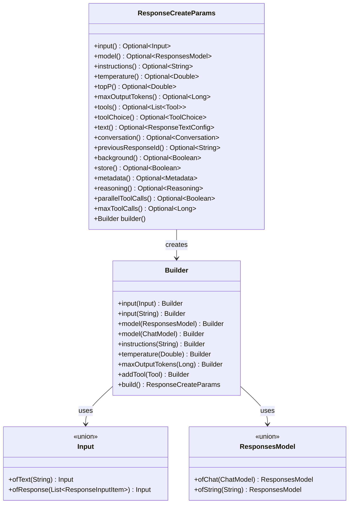
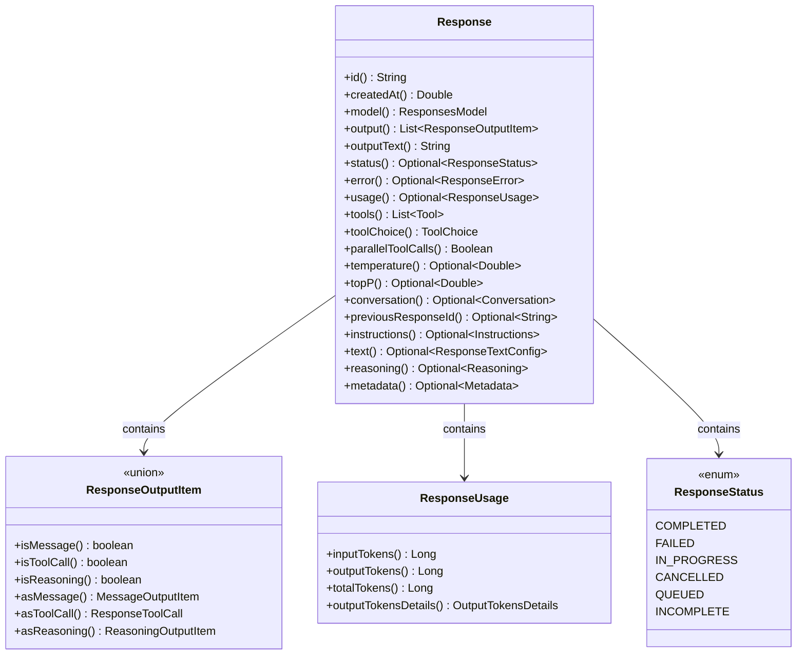
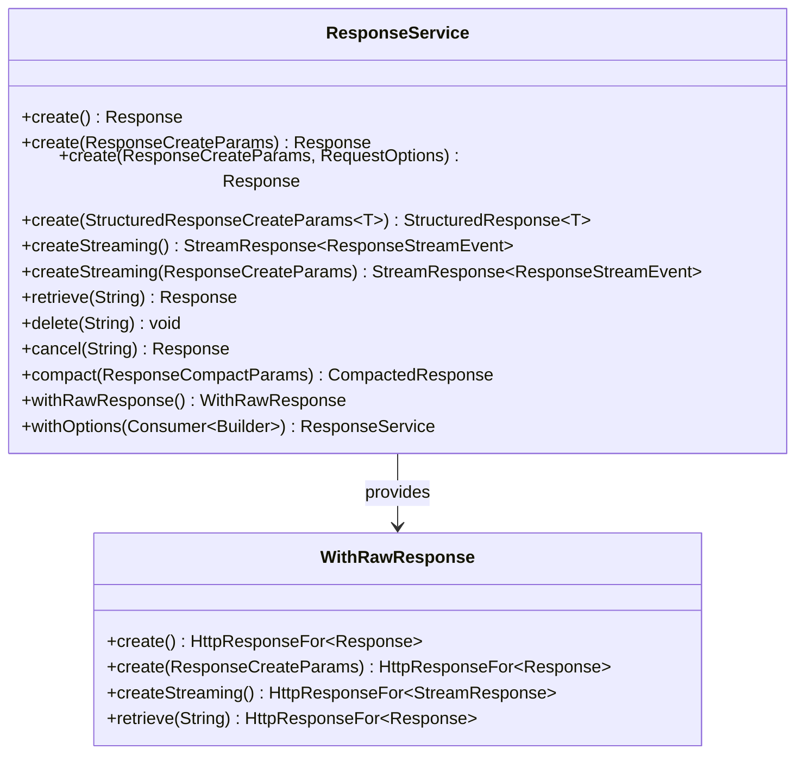

<!-- source: DeepWiki mcp.deepwiki.com · repo openai/openai-java · page 5.1 Basic Response Creation · fetched 2026-10-26 -->

# Basic Response Creation

<details>
<summary>Relevant source files</summary>

The following files were used as context for generating this wiki page:

- [openai-java-core/src/main/kotlin/com/openai/models/chat/completions/ChatCompletion.kt](openai-java-core/src/main/kotlin/com/openai/models/chat/completions/ChatCompletion.kt)
- [openai-java-core/src/main/kotlin/com/openai/models/chat/completions/ChatCompletionChunk.kt](openai-java-core/src/main/kotlin/com/openai/models/chat/completions/ChatCompletionChunk.kt)
- [openai-java-core/src/main/kotlin/com/openai/models/chat/completions/ChatCompletionCreateParams.kt](openai-java-core/src/main/kotlin/com/openai/models/chat/completions/ChatCompletionCreateParams.kt)
- [openai-java-core/src/main/kotlin/com/openai/models/responses/Response.kt](openai-java-core/src/main/kotlin/com/openai/models/responses/Response.kt)
- [openai-java-core/src/main/kotlin/com/openai/models/responses/ResponseCreateParams.kt](openai-java-core/src/main/kotlin/com/openai/models/responses/ResponseCreateParams.kt)
- [openai-java-core/src/main/kotlin/com/openai/models/responses/ResponsesClientEvent.kt](openai-java-core/src/main/kotlin/com/openai/models/responses/ResponsesClientEvent.kt)
- [openai-java-core/src/main/kotlin/com/openai/models/responses/inputtokens/InputTokenCountParams.kt](openai-java-core/src/main/kotlin/com/openai/models/responses/inputtokens/InputTokenCountParams.kt)
- [openai-java-core/src/test/kotlin/com/openai/models/beta/responses/BetaResponsesClientEventTest.kt](openai-java-core/src/test/kotlin/com/openai/models/beta/responses/BetaResponsesClientEventTest.kt)
- [openai-java-core/src/test/kotlin/com/openai/models/beta/responses/ResponseCreateParamsTest.kt](openai-java-core/src/test/kotlin/com/openai/models/beta/responses/ResponseCreateParamsTest.kt)
- [openai-java-core/src/test/kotlin/com/openai/models/responses/ResponseCreateParamsTest.kt](openai-java-core/src/test/kotlin/com/openai/models/responses/ResponseCreateParamsTest.kt)
- [openai-java-core/src/test/kotlin/com/openai/models/responses/ResponsesClientEventTest.kt](openai-java-core/src/test/kotlin/com/openai/models/responses/ResponsesClientEventTest.kt)
- [openai-java-core/src/test/kotlin/com/openai/models/responses/inputtokens/InputTokenCountParamsTest.kt](openai-java-core/src/test/kotlin/com/openai/models/responses/inputtokens/InputTokenCountParamsTest.kt)
- [openai-java-core/src/test/kotlin/com/openai/services/async/ResponseServiceAsyncTest.kt](openai-java-core/src/test/kotlin/com/openai/services/async/ResponseServiceAsyncTest.kt)
- [openai-java-core/src/test/kotlin/com/openai/services/async/responses/InputTokenServiceAsyncTest.kt](openai-java-core/src/test/kotlin/com/openai/services/async/responses/InputTokenServiceAsyncTest.kt)
- [openai-java-core/src/test/kotlin/com/openai/services/blocking/ResponseServiceTest.kt](openai-java-core/src/test/kotlin/com/openai/services/blocking/ResponseServiceTest.kt)
- [openai-java-core/src/test/kotlin/com/openai/services/blocking/responses/InputTokenServiceTest.kt](openai-java-core/src/test/kotlin/com/openai/services/blocking/responses/InputTokenServiceTest.kt)

</details>


## Purpose and Scope

This page documents the process for creating a model response using the Responses API with the OpenAI Java SDK. It explains how to construct instances of the immutable `ResponseCreateParams` class, invoke synchronous and asynchronous service methods to create a response, and interpret the structure of the returned `Response` object. Additionally, this page covers how the SDK supports input token counting to estimate usage.

For streaming response creation, see [Response Streaming](#5.2). For handling multi-modal inputs, see [Multi-modal Content](#5.3). For integrating tools, see [Tool System](#5.4). For managing conversation state, see [Conversation Management](#5.5).

---

## Overview

The Responses API provides a rich interface to generate responses involving text, images, or files as inputs. Unlike previous Assistants API versions, the new Responses API consolidates model response creation into a flexible request/response pattern, optionally supporting stateful conversations.

This SDK models the response creation using immutable parameter classes (`ResponseCreateParams`) built via the builder pattern, with service interfaces exposing synchronous (`ResponseService`) and asynchronous (`ResponseServiceAsync`) methods to create responses.

### Core Classes and Interfaces

| Component | Description | Source Location |
| --------- | ----------- | --------------- |
| `ResponseCreateParams` | Immutable container for request parameters for creating a response | [openai-java-core/src/main/kotlin/com/openai/models/responses/ResponseCreateParams.kt:52-583]() |
| `ResponseCreateParams.Builder` | Builder class for creating `ResponseCreateParams` instances with fluent setters | [openai-java-core/src/main/kotlin/com/openai/models/responses/ResponseCreateParams.kt:586-2629]() |
| `Response` | Immutable model for the response returned by the API, encapsulating output and metadata | [openai-java-core/src/main/kotlin/com/openai/models/responses/Response.kt:37-1543]() |
| `ResponseService` | Synchronous service interface for response creation | [openai-java-core/src/main/kotlin/com/openai/services/blocking/ResponseService.kt:25-283]() |
| `ResponseServiceAsync` | Asynchronous service interface for response creation returning `CompletableFuture` | [openai-java-core/src/main/kotlin/com/openai/services/async/ResponseServiceAsync.kt:27-283]() |

---

## Response Creation Flow

The creation of a Response involves building a request parameter object, sending it via the service, and receiving the deserialized `Response` model:

```mermaid
flowchart TB
    A["Application Code"]
    B["ResponseCreateParams.Builder"]
    C["ResponseCreateParams (Immutable)"]
    D["ResponseService.create()"]
    E["RetryingHttpClient"]
    F["POST /responses API Endpoint"]
    G["Response (Immutable)"]

    A -->|1. builder()| B
    B -->|2. Set parameters, e.g. input, model, tools| B
    B -->|3. build(), validate parameters| C
    A -->|4. Call create(params)| D
    C --> D
    D -->|5. Send HTTP request| E
    E -->|6. POST request| F
    F -->|7. JSON response| E
    E -->|8. Deserialize JSON| G
    D -->|9. Return| A
```

This flow reflects the immutable design of request objects with builders, the layered service abstraction, and the communication with the OpenAI API.

**Sources:** [openai-java-core/src/test/kotlin/com/openai/services/blocking/ResponseServiceTest.kt:26-109](), [openai-java-core/src/main/kotlin/com/openai/models/responses/ResponseCreateParams.kt:575-583]()

---

## Creating a Response

### Synchronous Example

```java
Response response = client.responses().create(
    ResponseCreateParams.builder()
        .input("What is the capital of France?")
        .model(ChatModel.GPT_4O)
        .build()
);

String outputText = response.outputText();
System.out.println(outputText);
```

### Asynchronous Example

```java
CompletableFuture<Response> future = client.responses().create(
    ResponseCreateParams.builder()
        .input("What is the capital of France?")
        .model(ChatModel.GPT_4O)
        .build()
);

Response response = future.get();
```

### Expanded Parameters Example

```java
Response response = client.responses().create(
    ResponseCreateParams.builder()
        .input("Explain quantum computing")
        .instructions("You are a helpful physics tutor")
        .model(ChatModel.GPT_5_1)
        .temperature(0.7)
        .maxOutputTokens(1000L)
        .store(true)
        .build()
);
```

**Sources:** [openai-java-core/src/test/kotlin/com/openai/services/blocking/ResponseServiceTest.kt:26-109]()

---

## Request Parameters Structure

### Class Relationships Overview



The `ResponseCreateParams` class is immutable and built with a fluent `Builder` pattern. It supports multiple option types for key parameters using union types, enabling flexible inputs and model specification.

**Sources:** [openai-java-core/src/main/kotlin/com/openai/models/responses/ResponseCreateParams.kt:52-583](), [openai-java-core/src/main/kotlin/com/openai/models/responses/ResponseCreateParams.kt:586-2629]()

---

### Core Parameters

| Parameter            | Type                   | Description                                                | Required? |
|----------------------|------------------------|------------------------------------------------------------|-----------|
| `input`              | `Input` (union)        | Text, image, or file inputs, either simple string or list  | No        |
| `model`              | `ResponsesModel`       | Model identifier (e.g. GPT-4O, GPT-5.1, or custom string)  | No        |
| `instructions`       | `String`               | System or developer message inserted into the model context | No        |
| `temperature`        | `Double`               | Sampling temperature, influences randomness (0.0 - 2.0)   | No        |
| `topP`               | `Double`               | Alternative nucleus sampling parameter                      | No        |
| `maxOutputTokens`    | `Long`                 | Max tokens generated including reasoning tokens            | No        |

**Sources:** [openai-java-core/src/main/kotlin/com/openai/models/responses/ResponseCreateParams.kt:99-347]()

---

### Tool and Function Parameters

| Parameter           | Type            | Description                                                     |
|---------------------|-----------------|-----------------------------------------------------------------|
| `tools`             | `List<Tool>`    | List of tools available to the model (functions, web/file search, etc.) |
| `toolChoice`        | `ToolChoice`    | Defines how the model selects which tools to use (auto, none, specific) |
| `parallelToolCalls` | `Boolean`       | Whether to allow executing multiple tools concurrently          |
| `maxToolCalls`      | `Long`          | Maximum number of built-in tool calls allowed per response      |

**Sources:** [openai-java-core/src/main/kotlin/com/openai/models/responses/ResponseCreateParams.kt:297-326]()

---

### Conversation State Parameters

| Parameter         | Type          | Description                                           | Mutually Exclusive With |
|-------------------|---------------|-------------------------------------------------------|------------------------|
| `previousResponseId` | `String`      | Previous response ID for multi-turn conversations      | `conversation`          |
| `conversation`    | `Conversation` | Explicit conversation object containing context items | `previousResponseId`    |

This allows multi-turn conversations either via a previous response reference or an explicit conversation object.

**Sources:** [openai-java-core/src/main/kotlin/com/openai/models/responses/ResponseCreateParams.kt:69-186]()

---

### Output Configuration Parameters

| Parameter        | Type                    | Description                                                       |
|------------------|-------------------------|-------------------------------------------------------------------|
| `text`           | `ResponseTextConfig`    | Configuration options for the text output (format, verbosity)     |
| `include`        | `List<ResponseIncludable>` | Additional output data flags (e.g., file sources, reasoning tokens) |
| `reasoning`      | `Reasoning`             | Settings for reasoning models including effort and summary options |

**Sources:** [openai-java-core/src/main/kotlin/com/openai/models/responses/ResponseCreateParams.kt:78-296]()

---

### Advanced Parameters

| Parameter             | Type                 | Description                                                          |
|-----------------------|----------------------|----------------------------------------------------------------------|
| `background`          | `Boolean`            | Run response processing in the background (cancellable)             |
| `store`               | `Boolean`            | Store the response for later retrieval                               |
| `metadata`            | `Metadata`           | Freeform structured key-value data (max 16 pairs)                   |
| `serviceTier`         | `ServiceTier`        | Processing tier (auto, default, flex, priority)                     |
| `truncation`          | `Truncation`         | Strategy for handling context size exceeding model limits           |
| `safetyIdentifier`    | `String`             | Stable identifier for abuse detection and tracing                    |
| `promptCacheKey`      | `String`             | Cache key for similar request reuse                                  |
| `promptCacheRetention`| `PromptCacheRetention`| Cache retention policy                                               |

**Sources:** [openai-java-core/src/main/kotlin/com/openai/models/responses/ResponseCreateParams.kt:59-372]()

---

## Builder Pattern Usage

### Builder Method Chaining Flow


Each setter returns the builder instance, enabling chained method calls. The `build()` method performs validations before producing the immutable request object.

**Sources:** [openai-java-core/src/main/kotlin/com/openai/models/responses/ResponseCreateParams.kt:586-2629]()

---

### Input Parameter Variants

The `input` parameter is a union type and may be set as either:

- A plain text string:
  
```java
params.builder()
    .input("Tell me a joke")
    .build();
```

- A structured list of `ResponseInputItem` instances for multi-modal inputs:

```java
params.builder()
    .inputOfResponse(List.of(
        ResponseInputItem.ofMessageInputItem(
            MessageInputItem.builder()
                .content("Analyze this image")
                .build()
        )
    ))
    .build();
```

**Sources:** [openai-java-core/src/main/kotlin/com/openai/models/responses/ResponseCreateParams.kt:709-735,1838-1982]()

---

### Model Parameter Variants

The `model` parameter can be specified via:

- Predefined `ChatModel` constant (recommended):

```java
params.builder()
    .model(ChatModel.GPT_4O)
    .build();
```

- Using the `ResponsesModel` wrapper for other supported models:

```java
params.builder()
    .model(ResponsesModel.ofChat(ChatModel.GPT_5_1))
    .build();
```

- String literal for new or unsupported models:

```java
params.builder()
    .model("gpt-5-new-model")
    .build();
```

**Sources:** [openai-java-core/src/main/kotlin/com/openai/models/responses/ResponseCreateParams.kt:839-898]()

---

### Adding Tools

Several tool types can be incorporated that extend model capabilities, like function calls, web search, file search, shell commands, etc. Add tools via `addTool()`:

```java
params.builder()
    .addTool(
        FunctionTool.builder()
            .name("get_weather")
            .parameters(
                FunctionTool.Parameters.builder()
                    .putAdditionalProperty("type", JsonValue.from("object"))
                    .putAdditionalProperty("properties", JsonValue.from(/* JSON schema */))
                    .build()
            )
            .build()
    )
    .addTool(WebSearchTool.builder().build())
    .addTool(FileSearchTool.builder().build())
    .build();
```

**Sources:** [openai-java-core/src/test/kotlin/com/openai/services/blocking/ResponseServiceTest.kt:89-100](), [openai-java-core/src/main/kotlin/com/openai/models/responses/ResponseCreateParams.kt:1384-1418]()

---

## Response Object Structure

### Class Relationship Diagram



The `Response` class encapsulates returned content and metadata. Its output consists of a heterogeneous list of `ResponseOutputItem`, representing either messages, tool calls, or reasoning outputs.

**Sources:** [openai-java-core/src/main/kotlin/com/openai/models/responses/Response.kt:37-183]()

---

### Key Response Fields

| Field            | Type                   | Description                                    | Present Always |
|------------------|------------------------|------------------------------------------------|----------------|
| `id`             | `String`               | Unique identifier of the response               | ✓              |
| `createdAt`       | `Double`               | Creation timestamp (Unix time in seconds)      | ✓              |
| `model`          | `ResponsesModel`        | Model used to create the response               | ✓              |
| `output`          | `List<ResponseOutputItem>` | List of output items (messages, tool calls)    | ✓              |
| `tools`           | `List<Tool>`           | Tools used or available during generation       | ✓              |
| `toolChoice`      | `ToolChoice`           | Tool selection mode employed                     | ✓              |
| `parallelToolCalls` | `Boolean`             | Whether parallel tool calls were executed        | ✓              |

### Optional Fields

| Field               | Type                 | Description                            |
|---------------------|----------------------|-------------------------------------|
| `status`            | `ResponseStatus`      | Completion status (completed, failed, canceled etc.) |
| `error`             | `ResponseError`       | Error details if the response failed  |
| `usage`             | `ResponseUsage`       | Token usage statistics                |
| `temperature`       | `Double`             | Temperature setting used in generation |
| `topP`              | `Double`             | Nucleus sampling factor used          |
| `conversation`      | `Conversation`       | Associated conversation object        |
| `previousResponseId`| `String`             | Previous response ID linked to this one |

**Sources:** [openai-java-core/src/main/kotlin/com/openai/models/responses/Response.kt:184-523]()

---

### Accessing Output Content

Output items may represent one of several types. Typically, for text output, the SDK provides a convenience method:

```java
String allOutputText = response.outputText();
```

Alternatively, iterate over output items for detailed processing:

```java
for (ResponseOutputItem item : response.output()) {
    if (item.isMessage()) {
        MessageOutputItem message = item.asMessage();
        // Process message content
    } else if (item.isToolCall()) {
        ResponseToolCall toolCall = item.asToolCall();
        // Process tool invocation
    } else if (item.isReasoning()) {
        ReasoningOutputItem reasoning = item.asReasoning();
        // Process reasoning data
    }
}
```

**Sources:** [openai-java-core/src/main/kotlin/com/openai/models/responses/Response.kt:266-276]()

---

### Usage Statistics

The `usage` field provides token count details:

```java
response.usage().ifPresent(usage -> {
    long inputTokens = usage.inputTokens();
    long outputTokens = usage.outputTokens();
    long totalTokens = usage.totalTokens();
    
    usage.outputTokensDetails().ifPresent(details -> {
        long textTokens = details.textTokens().orElse(0L);
        long reasoningTokens = details.reasoningTokens().orElse(0L);
    });
});
```

**Sources:** [openai-java-core/src/main/kotlin/com/openai/models/responses/Response.kt:504-511]()

---

## Service Interface Methods

### Synchronous API (`ResponseService`)



`create()` supports multiple overloads for convenience, including passing parameters with per-request options and raw HTTP access.

**Sources:** [openai-java-core/src/main/kotlin/com/openai/services/blocking/ResponseService.kt:25-283]()

---

### Asynchronous API (`ResponseServiceAsync`)

Async methods return a `CompletableFuture` to be combined or awaited asynchronously:

```java
CompletableFuture<Response> future = asyncService.create(
    ResponseCreateParams.builder()
        .input("Hello")
        .build()
);

future.thenAccept(response -> {
    System.out.println(response.outputText());
}).exceptionally(error -> {
    error.printStackTrace();
    return null;
});

// Blocking to get result
Response response = future.get();
```

**Sources:** [openai-java-core/src/main/kotlin/com/openai/services/async/ResponseServiceAsync.kt:56-95]()

---

### Raw HTTP Response Access

Using `withRawResponse()`, callers can retrieve HTTP status and headers alongside the parsed body:

```java
HttpResponseFor<Response> httpResponse = service
    .withRawResponse()
    .create(params);

Response response = httpResponse.body();
int statusCode = httpResponse.statusCode();
Headers headers = httpResponse.headers();

String rateLimitRemaining = headers.get("x-ratelimit-remaining");
```

**Sources:** [openai-java-core/src/main/kotlin/com/openai/services/blocking/ResponseService.kt:284-309]()

---

## Common Usage Patterns

### Simple Text Generation

```java
Response response = client.responses().create(
    ResponseCreateParams.builder()
        .input("Write a haiku about programming")
        .model(ChatModel.GPT_4O)
        .build()
);

System.out.println(response.outputText());
```

### With System Instructions

```java
Response response = client.responses().create(
    ResponseCreateParams.builder()
        .input("Explain recursion")
        .instructions("You are a patient computer science tutor. Use simple analogies.")
        .model(ChatModel.GPT_4O)
        .temperature(0.7)
        .build()
);
```

### Controlling Output Length

```java
Response response = client.responses().create(
    ResponseCreateParams.builder()
        .input("Summarize quantum mechanics")
        .maxOutputTokens(500L)  // Approx ~375 words limit
        .model(ChatModel.GPT_4O)
        .build()
);

// Optionally log tokens used
response.usage().ifPresent(usage -> {
    System.out.println("Tokens used: " + usage.totalTokens());
});
```

### Background Processing

For lengthy operations, background mode can be enabled to receive immediate response with `IN_PROGRESS` status:

```java
Response response = client.responses().create(
    ResponseCreateParams.builder()
        .input("Analyze this large document")
        .background(true)
        .store(true)
        .build()
);

String responseId = response.id();

// Poll for completion later
Response completed = client.responses().retrieve(responseId);
if (completed.status().orElse(null) == ResponseStatus.COMPLETED) {
    System.out.println(completed.outputText());
}

// Cancel if needed
client.responses().cancel(responseId);
```

### Metadata Tracking

Add custom key-value metadata to trace or annotate responses:

```java
Response response = client.responses().create(
    ResponseCreateParams.builder()
        .input("Hello")
        .metadata(
            ResponseCreateParams.Metadata.builder()
                .putAdditionalProperty("user_id", JsonValue.from("user123"))
                .putAdditionalProperty("session_id", JsonValue.from("sess456"))
                .putAdditionalProperty("feature", JsonValue.from("chat"))
                .build()
        )
        .build()
);

response.metadata().ifPresent(meta -> {
    // Metadata echoed back in response
});
```

### Error Handling

API-level errors return in the `error` field on `Response`. SDK/network errors throw exceptions.

```java
try {
    Response response = client.responses().create(params);
    if (response.error().isPresent()) {
        ResponseError error = response.error().get();
        System.err.println("API Error: " + error.message());
    }
} catch (OpenAIException e) {
    System.err.println("SDK Error: " + e.getMessage());
}
```

---

## Input Token Counting

To estimate input tokens before creating responses, the SDK provides `InputTokenCountParams`:

- Supports same parameters as response creation (`input`, `conversation`, `instructions`, `model`).
- Returns an object with `input_tokens` count, helpful for cost optimization.

This is exposed via the `ResponseInputTokenService` interface, with synchronous and asynchronous methods.

```java
InputTokenCountParams params = InputTokenCountParams.builder()
    .input("Sample text input")
    .model("gpt-4o")
    .build();

InputTokenCountResponse response = client.inputTokens().create(params);
long tokens = response.inputTokens();
```

**Sources:** [openai-java-core/src/main/kotlin/com/openai/models/responses/inputtokens/InputTokenCountParams.kt:63-155]()


---

# Appendix: Natural Language to Code Entity Mapping

### User Model for Response Creation

```mermaid
flowchart TD
    User["User / Developer"]
    SDK["OpenAI Java SDK"]
    Builder["ResponseCreateParams.Builder"]
    Params["ResponseCreateParams"]
    Service["ResponseService / ResponseServiceAsync"]
    HTTP["HTTP Layer (RetryingHttpClient)"]
    API["OpenAI Responses API Endpoint (POST /v1/responses)"]
    Response["Response"]
    
    User -->|Calls builder()| Builder
    Builder -->|Sets params| Builder
    Builder -->|build()| Params
    User -->|calls create(params)| Service
    Service -->|executes HTTP request| HTTP
    HTTP -->|POST to endpoint| API
    API -->|JSON response| HTTP
    HTTP -->|Deserialize to| Response
    Service -->|Returns Response| User
```

### Core Classes and Components in Code

```mermaid
classDiagram
    class ResponseCreateParams {
        +Builder builder()
        +Optional<Input> input()
        +Optional<ResponsesModel> model()
        +Optional<String> instructions()
        +Optional<Double> temperature()
        +Optional<Long> maxOutputTokens()
        +Optional<List<Tool>> tools()
        +Optional<ToolChoice> toolChoice()
        +Optional<Boolean> background()
        +Optional<Boolean> store()
        +Optional<Metadata> metadata()
    }
    
    class ResponseCreateParamsBuilder {
        +input(String)
        +input(Input)
        +model(ChatModel)
        +model(ResponsesModel)
        +instructions(String)
        +temperature(Double)
        +addTool(Tool)
        +build()
    }

    class ResponseService {
        +create(ResponseCreateParams) Response
        +create() Response
    }
    
    class Response {
        +id() String
        +output() List<ResponseOutputItem>
        +outputText() String
        +usage() Optional<ResponseUsage>
        +status() Optional<ResponseStatus>
        +error() Optional<ResponseError>
    }
    
    ResponseCreateParams --> ResponseCreateParamsBuilder : builder()
    ResponseService --> Response : create(params)
    Response --> ResponseOutputItem : output()
```

---

**Sources:**  
- [openai-java-core/src/main/kotlin/com/openai/models/responses/ResponseCreateParams.kt:1-2629]()  
- [openai-java-core/src/main/kotlin/com/openai/models/responses/Response.kt:1-1543]()  
- [openai-java-core/src/test/kotlin/com/openai/services/blocking/ResponseServiceTest.kt:1-147]()  
- [openai-java-core/src/test/kotlin/com/openai/services/async/ResponseServiceAsyncTest.kt:1-110]()  
- [openai-java-core/src/main/kotlin/com/openai/models/responses/inputtokens/InputTokenCountParams.kt:1-155]()

---

