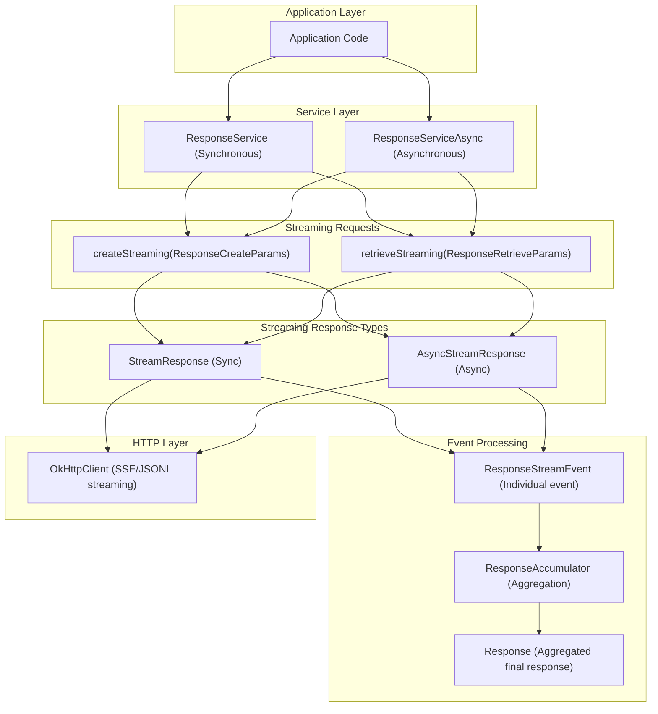
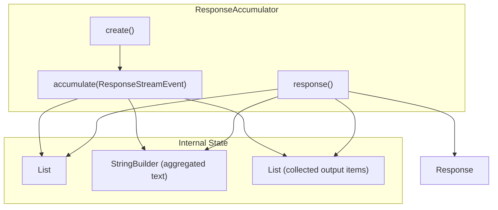
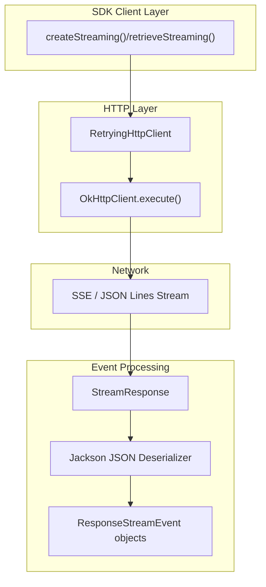

<!-- source: DeepWiki mcp.deepwiki.com · repo openai/openai-java · page 5.2 Response Streaming · fetched 2026-10-26 -->

# Response Streaming

<details>
<summary>Relevant source files</summary>

The following files were used as context for generating this wiki page:

- [openai-java-core/src/main/kotlin/com/openai/helpers/ResponseAccumulator.kt](openai-java-core/src/main/kotlin/com/openai/helpers/ResponseAccumulator.kt)
- [openai-java-core/src/main/kotlin/com/openai/models/audio/transcriptions/TranscriptionStreamEvent.kt](openai-java-core/src/main/kotlin/com/openai/models/audio/transcriptions/TranscriptionStreamEvent.kt)
- [openai-java-core/src/main/kotlin/com/openai/models/beta/agents/AgentSessionEnvironmentResetEvent.kt](openai-java-core/src/main/kotlin/com/openai/models/beta/agents/AgentSessionEnvironmentResetEvent.kt)
- [openai-java-core/src/main/kotlin/com/openai/models/beta/agents/AgentSessionEvent.kt](openai-java-core/src/main/kotlin/com/openai/models/beta/agents/AgentSessionEvent.kt)
- [openai-java-core/src/main/kotlin/com/openai/models/beta/assistants/AssistantStreamEvent.kt](openai-java-core/src/main/kotlin/com/openai/models/beta/assistants/AssistantStreamEvent.kt)
- [openai-java-core/src/main/kotlin/com/openai/models/beta/responses/BetaResponseStreamEvent.kt](openai-java-core/src/main/kotlin/com/openai/models/beta/responses/BetaResponseStreamEvent.kt)
- [openai-java-core/src/main/kotlin/com/openai/models/beta/responses/BetaResponsesServerEvent.kt](openai-java-core/src/main/kotlin/com/openai/models/beta/responses/BetaResponsesServerEvent.kt)
- [openai-java-core/src/main/kotlin/com/openai/models/images/ImageEditStreamEvent.kt](openai-java-core/src/main/kotlin/com/openai/models/images/ImageEditStreamEvent.kt)
- [openai-java-core/src/main/kotlin/com/openai/models/images/ImageGenStreamEvent.kt](openai-java-core/src/main/kotlin/com/openai/models/images/ImageGenStreamEvent.kt)
- [openai-java-core/src/main/kotlin/com/openai/models/live/forks/ForkServerEvent.kt](openai-java-core/src/main/kotlin/com/openai/models/live/forks/ForkServerEvent.kt)
- [openai-java-core/src/main/kotlin/com/openai/models/responses/ResponseStreamEvent.kt](openai-java-core/src/main/kotlin/com/openai/models/responses/ResponseStreamEvent.kt)
- [openai-java-core/src/main/kotlin/com/openai/models/responses/ResponsesServerEvent.kt](openai-java-core/src/main/kotlin/com/openai/models/responses/ResponsesServerEvent.kt)
- [openai-java-core/src/test/kotlin/com/openai/helpers/ResponseAccumulatorTest.kt](openai-java-core/src/test/kotlin/com/openai/helpers/ResponseAccumulatorTest.kt)
- [openai-java-core/src/test/kotlin/com/openai/models/beta/responses/BetaResponseStreamEventTest.kt](openai-java-core/src/test/kotlin/com/openai/models/beta/responses/BetaResponseStreamEventTest.kt)
- [openai-java-core/src/test/kotlin/com/openai/models/beta/responses/BetaResponsesServerEventTest.kt](openai-java-core/src/test/kotlin/com/openai/models/beta/responses/BetaResponsesServerEventTest.kt)
- [openai-java-core/src/test/kotlin/com/openai/models/responses/ResponseCompletedEventTest.kt](openai-java-core/src/test/kotlin/com/openai/models/responses/ResponseCompletedEventTest.kt)
- [openai-java-core/src/test/kotlin/com/openai/models/responses/ResponseCreatedEventTest.kt](openai-java-core/src/test/kotlin/com/openai/models/responses/ResponseCreatedEventTest.kt)
- [openai-java-core/src/test/kotlin/com/openai/models/responses/ResponseFailedEventTest.kt](openai-java-core/src/test/kotlin/com/openai/models/responses/ResponseFailedEventTest.kt)
- [openai-java-core/src/test/kotlin/com/openai/models/responses/ResponseInProgressEventTest.kt](openai-java-core/src/test/kotlin/com/openai/models/responses/ResponseInProgressEventTest.kt)
- [openai-java-core/src/test/kotlin/com/openai/models/responses/ResponseIncompleteEventTest.kt](openai-java-core/src/test/kotlin/com/openai/models/responses/ResponseIncompleteEventTest.kt)
- [openai-java-core/src/test/kotlin/com/openai/models/responses/ResponseQueuedEventTest.kt](openai-java-core/src/test/kotlin/com/openai/models/responses/ResponseQueuedEventTest.kt)
- [openai-java-core/src/test/kotlin/com/openai/models/responses/ResponseStreamEventTest.kt](openai-java-core/src/test/kotlin/com/openai/models/responses/ResponseStreamEventTest.kt)
- [openai-java-core/src/test/kotlin/com/openai/models/responses/ResponseTest.kt](openai-java-core/src/test/kotlin/com/openai/models/responses/ResponseTest.kt)
- [openai-java-core/src/test/kotlin/com/openai/models/responses/ResponsesServerEventTest.kt](openai-java-core/src/test/kotlin/com/openai/models/responses/ResponsesServerEventTest.kt)

</details>


This page provides an in-depth technical explanation of response streaming support in the OpenAI Java SDK for the Responses API. It covers the incremental streaming of model outputs via `ResponseStreamEvent` and `ResponsesServerEvent` classes, handling these events, and accumulating them into final `Response` objects using the `ResponseAccumulator`. Streaming enables applications to process and react to partial model outputs in real time.

## Overview

Response streaming allows the SDK user to interact with partial incremental results delivered from the API, instead of waiting for a complete response batch. The Responses API returns a sequence of streaming events (`ResponseStreamEvent`) that represent fragments or status changes of the overall response.

This streaming capability is available synchronously and asynchronously:

- **Synchronous Streaming:** Uses `StreamResponse<ResponseStreamEvent>`, which implements Java `Stream` and `AutoCloseable`. The user iterates over events synchronously.

- **Asynchronous Streaming:** Uses `AsyncStreamResponse<ResponseStreamEvent>`, allowing non-blocking subscription with callback handlers, custom executor configuration, and completion futures.

The streaming events encapsulate detailed state updates such as partial text deltas, tool call progress, reasoning updates, and terminal status notifications. An accumulator class consolidates these into a complete `Response` struct.

**Key classes for streaming:**

| Class/Interface          | Description                                   |
|-------------------------|-----------------------------------------------|
| `ResponseStreamEvent`   | Represents a single streaming response event |
| `ResponsesServerEvent`  | Server events model for WebSocket transport (beta) |
| `ResponseAccumulator`   | Aggregates a sequence of events into a final Response |

Sources: [openai-java-core/src/main/kotlin/com/openai/models/responses/ResponseStreamEvent.kt:21-114](), [openai-java-core/src/main/kotlin/com/openai/models/responses/ResponsesServerEvent.kt:32-113](), [openai-java-core/src/main/kotlin/com/openai/helpers/ResponseAccumulator.kt]().

---

## Streaming Architecture and Data Flow



**Explanation:**

- The Application layer calls synchronous or asynchronous service methods to request streaming responses.
- The methods `createStreaming()` and `retrieveStreaming()` return streaming response wrappers.
- Under the hood, HTTP streaming (SSE or JSON Lines) is handled by the OkHttp client.
- Incoming JSON events are deserialized into `ResponseStreamEvent` instances.
- Each event can be processed individually or accumulated into a full `Response` via `ResponseAccumulator`.
- Accumulation allows traditional, non-streaming style access to the final response after streaming ends.

Sources: [openai-java-core/src/main/kotlin/com/openai/services/blocking/ResponseService.kt:102-215](), [openai-java-core/src/main/kotlin/com/openai/services/async/ResponseServiceAsync.kt:108-213](), [openai-java-core/src/main/kotlin/com/openai/helpers/ResponseAccumulator.kt]()

---

## ResponseStreamEvent Class and Event Types

Each `ResponseStreamEvent` represents a distinct fragment or status update from the server during streaming. It is an immutable model class with numerous optional properties representing different event types.

### Key Event Type Accessors on `ResponseStreamEvent`

| Method                           | Return Type                      | Description                                           |
|---------------------------------|---------------------------------|-------------------------------------------------------|
| `audioDelta()`                  | `Optional<ResponseAudioDeltaEvent>`  | Partial audio response fragment                       |
| `audioDone()`                   | `Optional<ResponseAudioDoneEvent>`   | Audio response completion event                       |
| `outputTextDelta()`             | `Optional<ResponseTextDeltaEvent>`   | Partial incremental text output                       |
| `outputTextDone()`              | `Optional<ResponseTextDoneEvent>`    | Completion of text output                             |
| `outputItemAdded()`             | `Optional<ResponseOutputItemAddedEvent>` | New output item added (e.g., message, tool call)      |
| `outputItemDone()`              | `Optional<ResponseOutputItemDoneEvent>` | Output item completed                                 |
| `completed()`                  | `Optional<ResponseCompletedEvent>`  | Full response completion notification                 |
| `error()`                     | `Optional<ResponseErrorEvent>`      | Error information if streaming failed                 |
| `inProgress()`                | `Optional<ResponseInProgressEvent>` | Ongoing response status                                |
| `failed()`                    | `Optional<ResponseFailedEvent>`     | Response failure details                               |

The `ResponseStreamEvent` offers optional getters for a large set of event types covering audio, code interpreter status, file search, shell commands, reasoning, refusal, web search, image generation, MCP calls, and custom tool inputs among others.

### Usage Synopsis

A typical streaming event handler inspects available event types and processes accordingly:

```java
streamResponse.stream().forEach(event -> {
    event.outputTextDelta().ifPresent(textDelta -> {
        System.out.print(textDelta.delta());
    });

    event.error().ifPresent(errEvent -> {
        System.err.println("Error: " + errEvent.error().message());
    });

    event.completed().ifPresent(completed -> {
        System.out.println("Response completed with ID: " + completed.response().id());
    });
});
```

Sources: [openai-java-core/src/main/kotlin/com/openai/models/responses/ResponseStreamEvent.kt:24-114](), [openai-java-core/src/test/kotlin/com/openai/models/responses/ResponseStreamEventTest.kt:19-86]()

---

## ResponsesServerEvent for WebSocket Streaming (Beta)

The SDK also supports WebSocket streaming via the `ResponsesServerEvent` class, which models server events sent over a persistent WebSocket connection. This class mirrors many of the event types in `ResponseStreamEvent` but is used specifically when streaming via WebSockets (beta Responses models and transport).

Key design:

- Uses similar event properties prefixed with `response` (e.g., `responseAudioDelta()`, `responseCompleted()`).
- Has additional support for steering events and injection feedback (`responseSteerAccepted()`, etc.).

This model is similar in concept but handles the complexity of WebSocket server event multiplexing.

Sources: [openai-java-core/src/main/kotlin/com/openai/models/responses/ResponsesServerEvent.kt:32-113](), [openai-java-core/src/test/kotlin/com/openai/models/responses/ResponsesServerEventTest.kt:19-90]()

---

## Synchronous Streaming Usage

The synchronous streaming interface is based on the `StreamResponse<ResponseStreamEvent>` class.

### Characteristics

- Returns a `Stream<ResponseStreamEvent>` representing the streaming events.
- Implements `AutoCloseable` for resource management.
- Uses the Java Stream API for consuming and processing events.

### Example

```java
StreamResponse<ResponseStreamEvent> streamResponse =
    client.responses().createStreaming(
        ResponseCreateParams.builder()
            .input("Summarize this text")
            .model(ChatModel.GPT_4_1)
            .build());

try (streamResponse) {
    streamResponse.stream().forEach(event -> {
        event.outputTextDelta().ifPresent(textDelta -> System.out.print(textDelta.delta()));
    });
}
```

The stream must be closed after use to free network and system resources, typically via try-with-resources.

### Stream API Usage

Since `StreamResponse.stream()` returns a normal stream, users can apply filtering, mapping, and other Stream operations:

```java
try (StreamResponse<ResponseStreamEvent> streamResponse =
        client.responses().createStreaming(params)) {

    streamResponse.stream()
        .filter(event -> event.outputTextDelta().isPresent())
        .map(event -> event.outputTextDelta().get().delta())
        .forEach(System.out::print);
}
```

Sources: [openai-java-core/src/main/kotlin/com/openai/services/blocking/ResponseService.kt:102-144](), [openai-java-core/src/test/kotlin/com/openai/services/blocking/ResponseServiceTest.kt:112-196]()

---

## Asynchronous Streaming Usage

The asynchronous streaming interface uses `AsyncStreamResponse<ResponseStreamEvent>` which supports non-blocking subscription.

### Basic Subscribe Pattern

```java
AsyncStreamResponse<ResponseStreamEvent> asyncStream =
    client.async().responses().createStreaming(params);

asyncStream.subscribe(event -> {
    event.outputTextDelta().ifPresent(textDelta -> System.out.print(textDelta.delta()));
});
```

### Full Handler with Completion and Error Handling

```java
asyncStream.subscribe(new AsyncStreamResponse.Handler<>() {
    @Override
    public void onNext(ResponseStreamEvent event) {
        event.outputTextDelta().ifPresent(textDelta -> System.out.print(textDelta.delta()));
    }

    @Override
    public void onComplete(Optional<Throwable> error) {
        if (error.isPresent()) {
            System.err.println("Streaming failed: " + error.get());
        } else {
            System.out.println("\nStreaming completed successfully");
        }
    }
});
```

### CompletableFuture Usage

```java
CompletableFuture<Void> future = asyncStream
    .subscribe(event -> processEvent(event))
    .onCompleteFuture();

future.whenComplete((res, error) -> {
    if (error != null) {
        System.err.println("Error during streaming: " + error.getMessage());
    } else {
        System.out.println("Streaming finished.");
    }
});
```

### Executor Customization

Users may supply a custom executor for callback execution:

```java
Executor executor = Executors.newFixedThreadPool(4);
asyncStream.subscribe(event -> handle(event), executor);
```

Or configure globally via builder:

```java
OpenAIClient client = OpenAIOkHttpClient.builder()
    .fromEnv()
    .streamHandlerExecutor(Executors.newCachedThreadPool())
    .build();
```

Sources: [openai-java-core/src/main/kotlin/com/openai/services/async/ResponseServiceAsync.kt:108-144](), [openai-java-core/src/test/kotlin/com/openai/services/async/ResponseServiceAsyncTest.kt:113-197]()

---

## ResponseAccumulator

The `ResponseAccumulator` class provides a way to accumulate incremental streaming events into a complete `Response` object, which is useful for post-stream processing.

### Roles and Methods

| Method                | Description                                       |
|-----------------------|-------------------------------------------------|
| `create()`            | Factory method to instantiate the accumulator   |
| `accumulate(event)`   | Accepts a `ResponseStreamEvent` and updates state |
| `response()`          | Retrieves the aggregated final `Response` instance after completion |

### Internal Structure



### Example Usage (Synchronous)

```java
ResponseAccumulator accumulator = ResponseAccumulator.create();

try (StreamResponse<ResponseStreamEvent> streamResponse =
        client.responses().createStreaming(params)) {

    streamResponse.stream()
        .peek(accumulator::accumulate)
        .flatMap(event -> event.outputTextDelta().stream())
        .forEach(textDelta -> System.out.print(textDelta.delta()));
}

Response finalResponse = accumulator.response();
System.out.println("\nResponse ID: " + finalResponse.id());
```

### Example Usage (Asynchronous)

```java
ResponseAccumulator accumulator = ResponseAccumulator.create();

client.async().responses()
    .createStreaming(params)
    .subscribe(event -> {
        accumulator.accumulate(event);
        event.outputTextDelta().ifPresent(textDelta -> System.out.print(textDelta.delta()));
    })
    .onCompleteFuture()
    .join();

Response finalResponse = accumulator.response();
```

### Structured Response Accumulation

The accumulator also supports deserializing the final aggregated response into structured Java types when structured output is used.

Sources: [openai-java-core/src/main/kotlin/com/openai/helpers/ResponseAccumulator.kt](), [openai-java-core/src/test/kotlin/com/openai/helpers/ResponseAccumulatorTest.kt]()

---

## Streaming Options in ResponseCreateParams

The `ResponseCreateParams` class accepts a `streamOptions` parameter which configures streaming behaviors for the response.

### Supported Options

| Option               | Type      | Description                                                              |
|----------------------|-----------|--------------------------------------------------------------------------|
| `includeObfuscation` | `Boolean` | Includes encrypted reasoning tokens in reasoning output items — important for stateless multi-turn conversations with reasoning models |

### Example Configuration

```java
ResponseCreateParams params = ResponseCreateParams.builder()
    .input("Explain quantum computing")
    .model(ChatModel.GPT_4_1)
    .streamOptions(
        ResponseCreateParams.StreamOptions.builder()
            .includeObfuscation(true)
            .build()
    )
    .build();
```

This setting allows reasoning models to securely pass encrypted reasoning tokens between turns in a stateless multi-turn conversation.

Sources: [openai-java-core/src/main/kotlin/com/openai/models/responses/ResponseCreateParams.kt:269-274](), [openai-java-core/src/test/kotlin/com/openai/services/blocking/ResponseServiceTest.kt:76-79](), [openai-java-core/src/test/kotlin/com/openai/services/async/ResponseServiceAsyncTest.kt:76-79]()

---

## Structured Outputs with Streaming

Structured outputs provide type-safe mapping of the model's JSON responses to Java classes. Streaming structured responses arrive incrementally in event chunks and require accumulation before deserialization.

### Streaming a Structured Output Example

```java
// Define structured output classes
class BookList {
    public List<Book> books;
}
class Book {
    public String title;
    public String author;
}

// Build structured response create params with type class
StructuredResponseCreateParams<BookList> params =
    ResponseCreateParams.builder()
        .input("List famous 20th century novels")
        .model(ChatModel.GPT_4_1)
        .text(BookList.class)
        .build();

// Accumulate streaming events
ResponseAccumulator accumulator = ResponseAccumulator.create();

try (StreamResponse<ResponseStreamEvent> streamResponse =
        client.responses().createStreaming(params)) {

    streamResponse.stream()
        .peek(accumulator::accumulate)
        .flatMap(event -> event.outputTextDelta().stream())
        .forEach(textDelta -> System.out.print(textDelta.delta()));
}

// Deserialize accumulated response into structured type
StructuredResponse<BookList> structuredResponse = accumulator.response(BookList.class);

BookList books = structuredResponse.output().get(0).content();
books.books.forEach(book ->
    System.out.println(book.title + " by " + book.author)
);
```

This approach combines the real-time benefit of streaming with the type-safety of structured output after the stream concludes.

Sources: [openai-java-core/src/main/kotlin/com/openai/services/blocking/ResponseService.kt:124-144](), [openai-java-core/src/main/kotlin/com/openai/services/async/ResponseServiceAsync.kt:126-144]()

---

## Retrieve Streaming

Besides creating a new streamed response, the SDK supports retrieve streaming of an existing response.

### Use Cases

- Resume streaming after a partial/failed connection
- Incrementally re-fetch response content by event index
- Include additional auxiliary response data during retrieval

### Basic Retrieve Streaming Example

```java
StreamResponse<ResponseStreamEvent> streamResponse = 
    client.responses().retrieveStreaming("resp_abc123");

try (streamResponse) {
    streamResponse.stream().forEach(event -> {
        event.outputTextDelta().ifPresent(textDelta -> System.out.print(textDelta.delta()));
    });
}
```

### With Parameters

```java
ResponseRetrieveParams params = ResponseRetrieveParams.builder()
    .responseId("resp_abc123")
    .addInclude(ResponseIncludable.FILE_SEARCH_CALL_RESULTS)
    .includeObfuscation(true)
    .startingAfter(5L)  // Skip first 5 events
    .build();

StreamResponse<ResponseStreamEvent> streamResponse =
    client.responses().retrieveStreaming(params);
```

### Asynchronous Retrieve Streaming Example

```java
AsyncStreamResponse<ResponseStreamEvent> asyncStream =
    client.async().responses().retrieveStreaming("resp_abc123");

asyncStream.subscribe(event -> processEvent(event)).onCompleteFuture().join();
```

Sources: [openai-java-core/src/main/kotlin/com/openai/services/blocking/ResponseService.kt:175-215](), [openai-java-core/src/main/kotlin/com/openai/services/async/ResponseServiceAsync.kt:178-213](), [openai-java-core/src/test/kotlin/com/openai/services/blocking/ResponseServiceTest.kt:220-242]()

---

## Error Handling

### Synchronous Streaming Errors

Errors may be surfaced in two ways:

- Exceptions thrown during stream iteration (e.g., network failures, HTTP errors)
- `error()` events embedded in the stream representing API-side failures

Example handling:

```java
try (StreamResponse<ResponseStreamEvent> stream = client.responses().createStreaming(params)) {
    stream.stream().forEach(event -> {
        event.error().ifPresent(errorEvt -> {
            System.err.println("API error: " + errorEvt.error().message());
        });
    });
} catch (OpenAIException e) {
    System.err.println("OpenAI API exception: " + e.getMessage());
} catch (IOException e) {
    System.err.println("I/O exception: " + e.getMessage());
}
```

### Asynchronous Streaming Errors

Multiple error handling options exist:

- In the `AsyncStreamResponse.Handler.onComplete(Optional<Throwable>)`
- Receiving an `error()` event in the stream itself
- CompletableFuture exceptionally callbacks

Example:

```java
asyncStream.subscribe(new AsyncStreamResponse.Handler<>() {
    @Override
    public void onNext(ResponseStreamEvent event) {
        event.error().ifPresent(errorEvt -> {
            System.err.println("Stream error: " + errorEvt.error().message());
        });
    }

    @Override
    public void onComplete(Optional<Throwable> error) {
        if (error.isPresent()) {
            System.err.println("Streaming failed: " + error.get());
        }
    }
});
```

Or via future:

```java
asyncStream.subscribe(event -> process(event))
           .onCompleteFuture()
           .exceptionally(err -> {
               System.err.println("Stream error: " + err.getMessage());
               return null;
           });
```

Sources: [openai-java-core/src/main/kotlin/com/openai/services/blocking/ResponseService.kt:102-144](), [openai-java-core/src/main/kotlin/com/openai/services/async/ResponseServiceAsync.kt:108-144]()

---

## HTTP Streaming Implementation Details

The SDK leverages the OkHttpClient for HTTP layer streaming, utilizing Server-Sent Events (SSE) or JSON Lines over HTTP to receive incremental JSON event messages.



- The `OkHttpClient` executes HTTP calls supporting SSE or JSONL formats.
- The incoming stream is processed line-by-line as JSON events.
- Events are deserialized into `ResponseStreamEvent` instances by Jackson.
- Streaming wrappers expose typed event streams to SDK users.

### Connection Lifecycle Management

- Synchronous streaming requires explicit closing of the `StreamResponse`, ideally via try-with-resources.
- Asynchronous streaming closes connections when streams complete or encounter errors automatically.
- The underlying HTTP client manages connection pooling and resource cleanup.

Example synchronous safe usage:

```java
try (StreamResponse<ResponseStreamEvent> stream = client.responses().createStreaming(params)) {
    stream.stream().forEach(this::process);
} // Closes automatically here
```

Sources: [openai-java-client-okhttp/src/main/kotlin/com/openai/client/okhttp/OkHttpClient.kt:36-81](), [openai-java-core/src/main/kotlin/com/openai/core/http/StreamResponse.kt]().

---

# Summary

This page has detailed the low-level and high-level implementation, usage, and handling of response streaming in the OpenAI Java SDK Responses API:

- `ResponseStreamEvent` and `ResponsesServerEvent` provide rich streaming event models.
- Synchronous streaming offers Java Stream-based access, with explicit resource management.
- Asynchronous streaming supports non-blocking callbacks, completion futures, and configurable executors.
- `ResponseAccumulator` aggregates sequence of events into a final `Response` object.
- Structured outputs are compatible with streaming via post-accumulation conversion.
- Retrieval streaming supports incremental re-reading of existing responses.
- Robust error handling mechanisms exist for both sync and async modes.
- Underlying SSE/JSONL streaming is implemented atop OkHttp with Jackson deserialization.

This detailed understanding enables developers integrating the OpenAI Java SDK to fully harness streaming capabilities for responsive, incremental AI experiences.

Sources:

- [openai-java-core/src/main/kotlin/com/openai/models/responses/ResponseStreamEvent.kt]()
- [openai-java-core/src/main/kotlin/com/openai/models/responses/ResponsesServerEvent.kt]()
- [openai-java-core/src/main/kotlin/com/openai/helpers/ResponseAccumulator.kt]()
- [openai-java-core/src/main/kotlin/com/openai/services/blocking/ResponseService.kt:102-215]()
- [openai-java-core/src/main/kotlin/com/openai/services/async/ResponseServiceAsync.kt:108-213]()
- [openai-java-client-okhttp/src/main/kotlin/com/openai/client/okhttp/OkHttpClient.kt:36-81]()
- [openai-java-core/src/test/kotlin/com/openai/models/responses/ResponseStreamEventTest.kt:19-86]()
- [openai-java-core/src/test/kotlin/com/openai/models/responses/ResponsesServerEventTest.kt:19-90]()
- [openai-java-core/src/test/kotlin/com/openai/helpers/ResponseAccumulatorTest.kt]()

---

