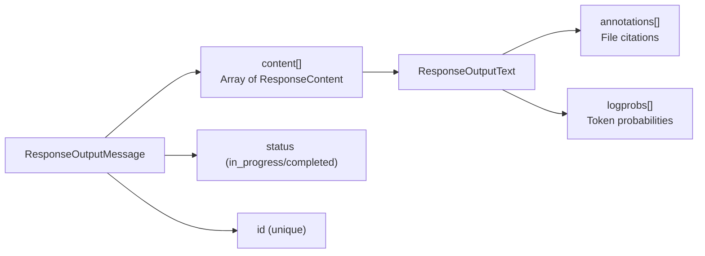
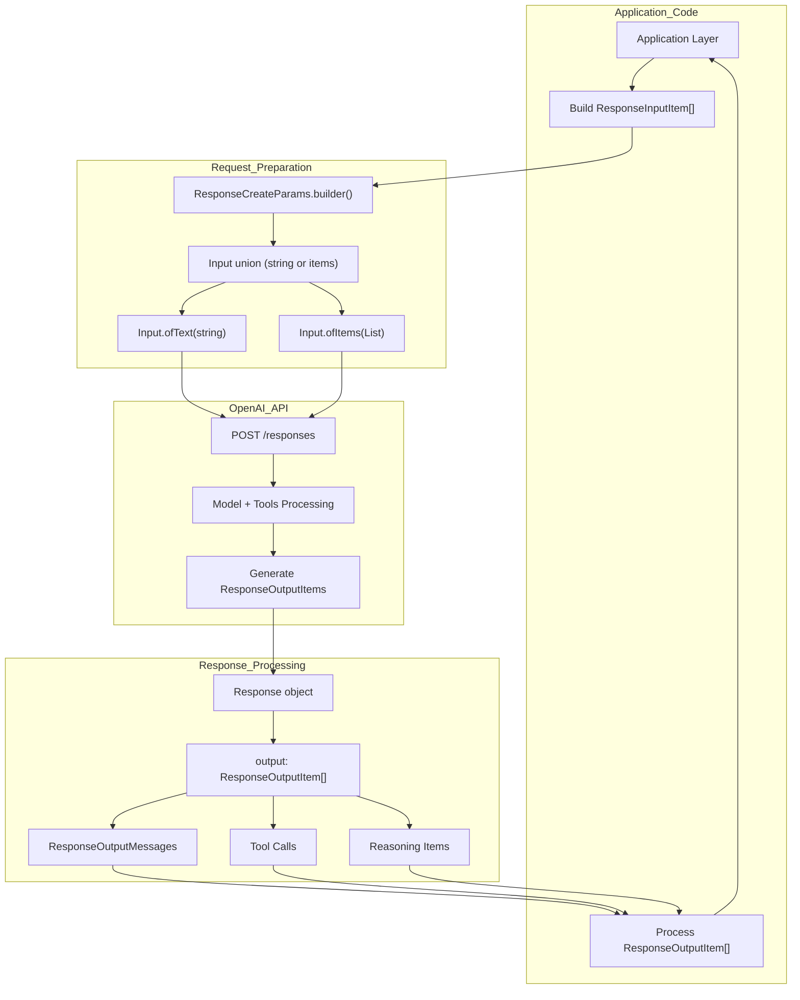

<!-- source: DeepWiki mcp.deepwiki.com · repo openai/openai-java · page 5.3 Multi-modal Content · fetched 2026-10-26 -->

# Multi-modal Content

<details>
<summary>Relevant source files</summary>

The following files were used as context for generating this wiki page:

- [openai-java-core/src/main/kotlin/com/openai/models/conversations/items/ConversationItem.kt](openai-java-core/src/main/kotlin/com/openai/models/conversations/items/ConversationItem.kt)
- [openai-java-core/src/main/kotlin/com/openai/models/responses/CustomTool.kt](openai-java-core/src/main/kotlin/com/openai/models/responses/CustomTool.kt)
- [openai-java-core/src/main/kotlin/com/openai/models/responses/ResponseContent.kt](openai-java-core/src/main/kotlin/com/openai/models/responses/ResponseContent.kt)
- [openai-java-core/src/main/kotlin/com/openai/models/responses/ResponseInputContent.kt](openai-java-core/src/main/kotlin/com/openai/models/responses/ResponseInputContent.kt)
- [openai-java-core/src/main/kotlin/com/openai/models/responses/ResponseInputFile.kt](openai-java-core/src/main/kotlin/com/openai/models/responses/ResponseInputFile.kt)
- [openai-java-core/src/main/kotlin/com/openai/models/responses/ResponseInputFileContent.kt](openai-java-core/src/main/kotlin/com/openai/models/responses/ResponseInputFileContent.kt)
- [openai-java-core/src/main/kotlin/com/openai/models/responses/ResponseInputItem.kt](openai-java-core/src/main/kotlin/com/openai/models/responses/ResponseInputItem.kt)
- [openai-java-core/src/main/kotlin/com/openai/models/responses/ResponseInputMessageItem.kt](openai-java-core/src/main/kotlin/com/openai/models/responses/ResponseInputMessageItem.kt)
- [openai-java-core/src/main/kotlin/com/openai/models/responses/ResponseItem.kt](openai-java-core/src/main/kotlin/com/openai/models/responses/ResponseItem.kt)
- [openai-java-core/src/main/kotlin/com/openai/models/responses/ResponseOutputItem.kt](openai-java-core/src/main/kotlin/com/openai/models/responses/ResponseOutputItem.kt)
- [openai-java-core/src/test/kotlin/com/openai/models/conversations/ComputerScreenshotContentTest.kt](openai-java-core/src/test/kotlin/com/openai/models/conversations/ComputerScreenshotContentTest.kt)
- [openai-java-core/src/test/kotlin/com/openai/models/conversations/items/ConversationItemTest.kt](openai-java-core/src/test/kotlin/com/openai/models/conversations/items/ConversationItemTest.kt)
- [openai-java-core/src/test/kotlin/com/openai/models/responses/ResponseContentTest.kt](openai-java-core/src/test/kotlin/com/openai/models/responses/ResponseContentTest.kt)
- [openai-java-core/src/test/kotlin/com/openai/models/responses/ResponseFunctionCallOutputItemTest.kt](openai-java-core/src/test/kotlin/com/openai/models/responses/ResponseFunctionCallOutputItemTest.kt)
- [openai-java-core/src/test/kotlin/com/openai/models/responses/ResponseInputContentTest.kt](openai-java-core/src/test/kotlin/com/openai/models/responses/ResponseInputContentTest.kt)
- [openai-java-core/src/test/kotlin/com/openai/models/responses/ResponseInputFileContentTest.kt](openai-java-core/src/test/kotlin/com/openai/models/responses/ResponseInputFileContentTest.kt)
- [openai-java-core/src/test/kotlin/com/openai/models/responses/ResponseInputFileTest.kt](openai-java-core/src/test/kotlin/com/openai/models/responses/ResponseInputFileTest.kt)
- [openai-java-core/src/test/kotlin/com/openai/models/responses/ResponseInputImageContentTest.kt](openai-java-core/src/test/kotlin/com/openai/models/responses/ResponseInputImageContentTest.kt)
- [openai-java-core/src/test/kotlin/com/openai/models/responses/ResponseInputImageTest.kt](openai-java-core/src/test/kotlin/com/openai/models/responses/ResponseInputImageTest.kt)
- [openai-java-core/src/test/kotlin/com/openai/models/responses/ResponseInputItemTest.kt](openai-java-core/src/test/kotlin/com/openai/models/responses/ResponseInputItemTest.kt)
- [openai-java-core/src/test/kotlin/com/openai/models/responses/ResponseInputMessageItemTest.kt](openai-java-core/src/test/kotlin/com/openai/models/responses/ResponseInputMessageItemTest.kt)
- [openai-java-core/src/test/kotlin/com/openai/models/responses/ResponseItemTest.kt](openai-java-core/src/test/kotlin/com/openai/models/responses/ResponseItemTest.kt)
- [openai-java-core/src/test/kotlin/com/openai/models/responses/ResponseOutputItemTest.kt](openai-java-core/src/test/kotlin/com/openai/models/responses/ResponseOutputItemTest.kt)
- [openai-java-core/src/test/kotlin/com/openai/models/responses/StructuredResponseOutputItemTest.kt](openai-java-core/src/test/kotlin/com/openai/models/responses/StructuredResponseOutputItemTest.kt)
- [openai-java-core/src/test/kotlin/com/openai/models/responses/inputitems/ResponseItemListTest.kt](openai-java-core/src/test/kotlin/com/openai/models/responses/inputitems/ResponseItemListTest.kt)
- [openai-java-core/src/test/kotlin/com/openai/models/videos/ImageInputReferenceParamTest.kt](openai-java-core/src/test/kotlin/com/openai/models/videos/ImageInputReferenceParamTest.kt)

</details>


## Purpose and Scope

This page documents the multi-modal content union types used in the Responses API for both input and output. The Responses API supports rich, multi-modal conversations that can include text, images, files, tool calls, reasoning traces, and more. These content types are represented by the `ResponseInputItem` and `ResponseOutputItem` union types.

For further details on tool definitions and interactions, refer to [Tool System](#5.4). For conversation state and item management, see [Conversation Management](#5.5).

---

## Overview

The Responses API leverages two main union types to represent multi-modal content flexibly:

- **`ResponseInputItem`**: Represents 26 possible content variants sent as input to the model.
- **`ResponseOutputItem`**: Represents 18 possible content variants output from the model.

Each union type provides clear and type-safe abstractions for various content forms including messages, tool calls and outputs, reasoning components, compact conversation state, and other specialized items. These types are backed by generated Kotlin classes with static factory methods aiding creation and validation.

### Union Type Architecture

```mermaid
graph TB
    subgraph "Input_to_Model"
        InputUnion["ResponseInputItem<br/>(26 variants)"]
        InputMsg["Messages<br/>3 variants"]
        InputTools["Tool Calls & Outputs<br/>15 variants"]
        InputSpecial["Other Items<br/>8 variants"]

        InputUnion --> InputMsg
        InputUnion --> InputTools
        InputUnion --> InputSpecial

        InputMsg --> EasyInput["EasyInputMessage"]
        InputMsg --> MsgInput["Message"]
        InputMsg --> RespOutputMsg["ResponseOutputMessage"]

        InputTools --> FuncCall["ResponseFunctionToolCall"]
        InputTools --> FuncOutput["FunctionCallOutput"]
        InputTools --> FileSearchCall["ResponseFileSearchToolCall"]
        InputTools --> WebSearchCall["ResponseFunctionWebSearch"]
        InputTools --> ComputerCall["ResponseComputerToolCall"]
        InputTools --> CompOutput["ComputerCallOutput"]
        InputTools --> CodeInterpreter["ResponseCodeInterpreterToolCall"]
        InputTools --> ImageGenCall["ImageGenerationCall"]
        InputTools --> LocalShellCall["LocalShellCall"]
        InputTools --> LocalShellOut["LocalShellCallOutput"]
        InputTools --> ShellCall["ShellCall"]
        InputTools --> ShellOut["ShellCallOutput"]
        InputTools --> ApplyPatchCall["ApplyPatchCall"]
        InputTools --> ApplyPatchOut["ApplyPatchCallOutput"]
        InputTools --> McpCall["McpCall"]
        InputTools --> CustomToolCall["ResponseCustomToolCall"]
        InputTools --> CustomToolOut["ResponseCustomToolCallOutput"]

        InputSpecial --> ReasoningItem["ResponseReasoningItem"]
        InputSpecial --> CompactionParam["ResponseCompactionItemParam"]
        InputSpecial --> McpListTools["McpListTools"]
        InputSpecial --> McpApprovalReq["McpApprovalRequest"]
        InputSpecial --> McpApprovalResp["McpApprovalResponse"]
        InputSpecial --> ItemReference["ItemReference"]
        InputSpecial --> CompactionTrigger["CompactionTrigger"]
        InputSpecial --> Program["Program"]
        InputSpecial --> ProgramOutput["ProgramOutput"]
    end

    subgraph "Output_from_Model"
        OutputUnion["ResponseOutputItem<br/>(18 variants)"]
        OutputMsg["Messages<br/>1 variant"]
        OutputTools["Tool Calls & Outputs<br/>14 variants"]
        OutputSpecial["Other Items<br/>3 variants"]

        OutputUnion --> OutputMsg
        OutputUnion --> OutputTools
        OutputUnion --> OutputSpecial

        OutputMsg --> RespOutputMsg["ResponseOutputMessage"]

        OutputTools --> FuncCall["ResponseFunctionToolCall"]
        OutputTools --> FileSearchCall["ResponseFileSearchToolCall"]
        OutputTools --> WebSearchCall["ResponseFunctionWebSearch"]
        OutputTools --> ComputerCall["ResponseComputerToolCall"]
        OutputTools --> CompOutput["ResponseComputerToolCallOutputItem"]
        OutputTools --> CodeInterpreter["ResponseCodeInterpreterToolCall"]
        OutputTools --> LocalShellCall["LocalShellCall"]
        OutputTools --> LocalShellOut["LocalShellCallOutput"]
        OutputTools --> ShellCall["ResponseFunctionShellToolCall"]
        OutputTools --> ShellOut["ResponseFunctionShellToolCallOutput"]
        OutputTools --> ApplyPatchCall["ResponseApplyPatchToolCall"]
        OutputTools --> ApplyPatchOut["ResponseApplyPatchToolCallOutput"]
        OutputTools --> McpCall["McpCall"]
        OutputTools --> CustomToolCall["ResponseCustomToolCall"]
        OutputTools --> CustomToolOut["ResponseCustomToolCallOutput"]

        OutputSpecial --> ReasoningItem["ResponseReasoningItem"]
        OutputSpecial --> CompactionItem["ResponseCompactionItem"]
        OutputSpecial --> ImageGenCall["ImageGenerationCall"]
    end
```



**Sources:** [ResponseInputItem.kt:35-79](), [ResponseOutputItem.kt:33-153](), [ResponseOutputItemTest.kt:15-154]()

---

## Content Categories

Multi-modal content is organized broadly into three categories:

| Category          | Description                                    | Input Variants                         | Output Variants                        |
|-------------------|------------------------------------------------|--------------------------------------|--------------------------------------|
| **Messages**      | User, assistant, or system messages including text, images, and files | `EasyInputMessage`, `Message`, `ResponseOutputMessage` | `ResponseOutputMessage`               |
| **Tool Interactions** | Calls to tools and their outputs for extending capabilities: file search, web search, function execution, shell calls, image generation, etc. | 15 tool-call & output-related types | 14 tool-call & output-related types   |
| **Special Items** | Reasoning, conversation compaction, item references, MCP approvals | `ResponseReasoningItem`, `ResponseCompactionItemParam`, `ItemReference`, `McpListTools`, `McpApprovalRequest`, `McpApprovalResponse`, etc. | `ResponseReasoningItem`, `ResponseCompactionItem`, `ImageGenerationCall` |

**Sources:** [ResponseInputItem.kt:35-79](), [ResponseOutputItem.kt:33-153]()

---

## Message Content Types

### Text Messages

Text-based messages are the fundamental unit of conversation and can be used as input or output.

#### EasyInputMessage

A simplified representation of text input, primarily used for straightforward user instructions.

```java
// Example usage creating EasyInputMessage input item
ResponseInputItem item = ResponseInputItem.ofEasyInputMessage(
    EasyInputMessage.builder()
        .content("Hello, how can you help me?")
        .role(EasyInputMessage.Role.USER)
        .type(EasyInputMessage.Type.MESSAGE)
        .build()
);
```

This class supports roles (`user`, `developer`, `system`, `assistant`), and distinguishes message type and phase.

**Sources:** [ResponseInputItemTest.kt:18-63]()

#### Message (Advanced Multi-modal Input)

The `Message` type is a richer structure allowing embedding of various content types like text, images, files, audio, or video all within one message.

```java
ResponseInputItem item = ResponseInputItem.ofMessage(
    ResponseInputItem.Message.builder()
        .addContent(
            ResponseInputContent.ofInputText(
                ResponseInputText.builder().text("What's the weather?").build()
            )
        )
        .role(ResponseInputItem.Message.Role.USER)
        .status(ResponseInputItem.Message.Status.IN_PROGRESS)
        .type(ResponseInputItem.Message.Type.MESSAGE)
        .build()
);
```

The contents are encapsulated in `ResponseInputContent` union types which represent:

- Text
- Image
- File
- Audio
- Video

**Sources:** [ResponseInputItemTest.kt:87-139](), [ResponseInputContentTest.kt:15-155]()

#### ResponseOutputMessage (Used as Input and Output)

Output messages generated by the model are represented as `ResponseOutputMessage`. They can also be re-used as input items for subsequent requests.

```java
ResponseInputItem inputFromOutput = ResponseInputItem.ofResponseOutputMessage(
    ResponseOutputMessage.builder()
        .id("message-id")
        .addContent(
            ResponseOutputText.builder()
                .text("Hello, how can I assist?")
                .build()
        )
        .status(ResponseOutputMessage.Status.IN_PROGRESS)
        .build()
);
```

Output messages contain arrays of `ResponseContent` providing fine-grained annotations (e.g., file citations, logprobs).

**Sources:** [ResponseOutputItemTest.kt:18-85](), [ResponseInputItemTest.kt:140-201]()

### Output Messages

Outputs from the model are aggregated into `ResponseOutputMessage` instances, containing:

- An ordered list of content items (`ResponseContent[]`)
- Status indicators (`in_progress`, `completed`)
- Unique message IDs
- Optional token-level logprobabilities for detailed generation analytics



**Sources:** [ResponseOutputItemTest.kt:15-85]()

---

## `ResponseInputItem` Variants

`ResponseInputItem` is a union type allowing 26 different content item variants. Each variant corresponds to a specific input content type.

### Message Variants

| Factory Method            | Underlying Type             | Description                        |
|--------------------------|-----------------------------|----------------------------------|
| `ofEasyInputMessage()`    | `EasyInputMessage`           | Simple user/system messages       |
| `ofMessage()`             | `Message`                    | Rich messages supporting multi-modal contents |
| `ofResponseOutputMessage()`| `ResponseOutputMessage`     | Output messages reused as input   |

**Sources:** [ResponseInputItem.kt:700-747]()

### Tool Call Variants

These variants represent various tool invocation requests from the model:

| Factory Method                | Type                         | Usage                                    |
|------------------------------|------------------------------|------------------------------------------|
| `ofFunctionCall()`            | `ResponseFunctionToolCall`   | Custom function call                     |
| `ofFileSearchCall()`          | `ResponseFileSearchToolCall` | Query uploaded files                     |
| `ofWebSearchCall()`           | `ResponseFunctionWebSearch`  | Perform web searches                     |
| `ofComputerCall()`            | `ResponseComputerToolCall`   | Computer use (e.g., mouse, keyboard)    |
| `ofCodeInterpreterCall()`     | `ResponseCodeInterpreterToolCall` | Python code execution                    |
| `ofImageGenerationCall()`     | `ImageGenerationCall`        | Image generation requests                |
| `ofLocalShellCall()`          | `LocalShellCall`             | Local shell commands                     |
| `ofShellCall()`               | `ShellCall`                  | Shell commands in managed environment   |
| `ofApplyPatchCall()`          | `ApplyPatchCall`             | File diff patch operations               |
| `ofMcpCall()`                 | `McpCall`                    | MCP tool server calls                    |
| `ofCustomToolCall()`          | `ResponseCustomToolCall`     | User-defined custom tool calls           |

**Sources:** [ResponseInputItem.kt:749-860]()

### Tool Output Variants

These represent results returned from executed tool calls:

| Factory Method                   | Type                          | Usage                           |
|---------------------------------|-------------------------------|---------------------------------|
| `ofFunctionCallOutput()`         | `FunctionCallOutput`           | Function execution results      |
| `ofComputerCallOutput()`         | `ComputerCallOutput`           | Computer tool call results      |
| `ofLocalShellCallOutput()`       | `LocalShellCallOutput`         | Local shell command output      |
| `ofShellCallOutput()`            | `ShellCallOutput`              | Managed shell command output    |
| `ofApplyPatchCallOutput()`       | `ApplyPatchCallOutput`         | File patch operation results    |
| `ofCustomToolCallOutput()`       | `ResponseCustomToolCallOutput` | Custom tool output              |

**Sources:** [ResponseInputItem.kt:790-857]()

### Special Item Variants

Special content related to state management or analytics:

| Factory Method          | Type                         | Explanation                         |
|------------------------|------------------------------|-----------------------------------|
| `ofReasoning()`         | `ResponseReasoningItem`       | Chain-of-thought reasoning traces |
| `ofCompaction()`        | `ResponseCompactionItemParam` | Compressed conversation state     |
| `ofMcpListTools()`      | `McpListTools`                | List available MCP tools           |
| `ofMcpApprovalRequest()`| `McpApprovalRequest`          | MCP tool approval requests         |
| `ofMcpApprovalResponse()`| `McpApprovalResponse`        | MCP tool approval responses        |
| `ofItemReference()`     | `ItemReference`               | Internal reference to other items  |

**Sources:** [ResponseInputItem.kt:790-863]()

---

## `ResponseOutputItem` Variants

The output union type supports 18 variants representing the model-generated content and tool outputs.

| Factory Method               | Type                          | Category      |
|-----------------------------|-------------------------------|---------------|
| `ofMessage()`               | `ResponseOutputMessage`        | Message       |
| `ofFunctionCall()`          | `ResponseFunctionToolCall`     | Tool Call     |
| `ofFileSearchCall()`        | `ResponseFileSearchToolCall`   | Tool Call     |
| `ofWebSearchCall()`         | `ResponseFunctionWebSearch`    | Tool Call     |
| `ofComputerCall()`          | `ResponseComputerToolCall`     | Tool Call     |
| `ofComputerCallOutput()`    | `ResponseComputerToolCallOutputItem` | Tool Output   |
| `ofCodeInterpreterCall()`   | `ResponseCodeInterpreterToolCall` | Tool Call  |
| `ofImageGenerationCall()`   | `ImageGenerationCall`          | Special       |
| `ofLocalShellCall()`        | `LocalShellCall`               | Tool Call     |
| `ofLocalShellCallOutput()`  | `LocalShellCallOutput`         | Tool Output   |
| `ofShellCall()`             | `ResponseFunctionShellToolCall` | Tool Call   |
| `ofShellCallOutput()`       | `ResponseFunctionShellToolCallOutput` | Tool Output |
| `ofApplyPatchCall()`        | `ResponseApplyPatchToolCall`   | Tool Call     |
| `ofApplyPatchCallOutput()`  | `ResponseApplyPatchToolCallOutput` | Tool Output  |
| `ofMcpCall()`               | `McpCall`                      | Tool Call     |
| `ofMcpListTools()`          | `McpListTools`                 | Special       |
| `ofMcpApprovalRequest()`    | `McpApprovalRequest`           | Special       |
| `ofCustomToolCall()`        | `ResponseCustomToolCall`       | Tool Call     |
| `ofCustomToolCallOutput()`  | `ResponseCustomToolCallOutputItem` | Tool Output  |
| `ofReasoning()`             | `ResponseReasoningItem`        | Special       |
| `ofCompaction()`            | `ResponseCompactionItem`       | Special       |

**Sources:** [ResponseOutputItemTest.kt:15-600]()

---

## Working with Union Types

### Creating Input Items

Use factory methods from `ResponseInputItem` to instantiate specific variants:

```java
// Creating a simple user text input message
ResponseInputItem userMessage = ResponseInputItem.ofEasyInputMessage(
    EasyInputMessage.builder()
        .content("What is the weather?")
        .role(EasyInputMessage.Role.USER)
        .build()
);

// Creating a function call output input item
ResponseInputItem functionOutput = ResponseInputItem.ofFunctionCallOutput(
    FunctionCallOutput.builder()
        .id("output1")
        .callId("call_abc123")
        .output("{\"temperature\": 72, \"condition\": \"sunny\"}")
        .build()
);
```

**Sources:** [ResponseInputItemTest.kt:18-54]()

### Checking Variant Types

Use predicate methods like `isFunctionCall()` on a union instance to determine active variant:

```java
ResponseInputItem item = // item from API or creation

if (item.isFunctionCall()) {
    ResponseFunctionToolCall call = item.asFunctionCall();
    // Process function call
} else if (item.isReasoning()) {
    ResponseReasoningItem reasoning = item.asReasoning();
    // Process reasoning content
}
```

**Sources:** [ResponseInputItem.kt:190-242]()

### Visitor Pattern

For structured variant handling, use the visitor pattern:

```java
String description = item.accept(new ResponseInputItem.Visitor<String>() {
    @Override
    public String visitEasyInputMessage(EasyInputMessage msg) {
        return "User message: " + msg.content();
    }
    @Override
    public String visitFunctionCall(ResponseFunctionToolCall call) {
        return "Function call: " + call.name();
    }
    @Override
    public String visitReasoning(ResponseReasoningItem reasoning) {
        return "Reasoning content";
    }
    @Override
    public String unknown(JsonValue json) {
        return "Unknown variant";
    }
});
```

**Sources:** [ResponseInputItem.kt:367-397]()

---

## Using Multi-modal Content in API Calls

### Sending Input Items

Input items are provided in the `input()` parameter of `ResponseCreateParams`. This parameter accepts a string for simple input or a union wrapping a list of `ResponseInputItem` instances.

```java
// Simple text input
ResponseCreateParams params = ResponseCreateParams.builder()
    .input("What is 2 + 2?")
    .model(ChatModel.GPT_4O)
    .build();

// Multi-modal input with several items
ResponseCreateParams multiParams = ResponseCreateParams.builder()
    .input(
        ResponseCreateParams.Input.ofItems(List.of(
            ResponseInputItem.ofEasyInputMessage(
                EasyInputMessage.builder()
                    .content("Analyze this image")
                    .role(EasyInputMessage.Role.USER)
                    .build()
            ),
            ResponseInputItem.ofMessage(
                ResponseInputItem.Message.builder()
                    .addContent(ResponseInputContent.ofInputImage(
                        ResponseInputImage.builder()
                            .imageUrl("https://example.com/image.png")
                            .build()
                    ))
                    .role(ResponseInputItem.Message.Role.USER)
                    .build()
            )
        ))
    )
    .model(ChatModel.GPT_4O)
    .build();
```

**Sources:** [ResponseCreateParams.kt:80-111](), [ResponseServiceTest.kt:36-106]()

### Processing Output Items

When responses arrive, their outputs are returned as an array of `ResponseOutputItem` instances. Typical processing involves iterating and pattern matching on the variant:

```java
Response response = client.responses().create(params);

for (ResponseOutputItem item : response.output()) {
    if (item.isMessage()) {
        ResponseOutputMessage message = item.asMessage();
        // Handle text, images, annotations
    } else if (item.isFunctionCall()) {
        ResponseFunctionToolCall call = item.asFunctionCall();
        // Execute function call and prepare output
    }
    // ... handle other variants accordingly
}
```

**Sources:** [Response.kt:260-280]()

---

## Multi-modal Content Data Flow



This diagram shows the multi-layer data flow starting from the application building input items, passing them through the request parameter builder, invoking the OpenAI API with input unions, model processing generating multi-modal outputs, and finally processing outputs back in the application.

**Sources:** [ResponseCreateParams.kt:80-111](), [Response.kt:260-280]()

---

## Reasoning Items

Reasoning items represent the chain-of-thought or explanation traces generated by reasoning-capable models (e.g., o1, o3, GPT-5 series). These are useful for advanced diagnostics, fine-grained context, or stateless conversation management.

### Structure Overview

- **id**: Unique identifier for the reasoning item
- **content**: Array of reasoning content items (text and/or other annotations)
- **summary**: Optional summary list of strings
- **encrypted_content**: Optional encrypted payload for stateless usage
- **status**: Status like `in_progress` or `completed`

### Example Usage

```java
ResponseInputItem reasoningInput = ResponseInputItem.ofReasoning(
    ResponseReasoningItem.builder()
        .id("reasoning_123")
        .addContent(
            ResponseReasoningItem.Content.builder()
                .text("First, I consider the factors...")
                .build()
        )
        .status(ResponseReasoningItem.Status.COMPLETED)
        .build()
);
```

Enable encrypted reasoning content in responses using includes:

```java
ResponseCreateParams params = ResponseCreateParams.builder()
    .addInclude(ResponseIncludable.REASONING_ENCRYPTED_CONTENT)
    .build();
```

**Sources:** [ResponseInputItemTest.kt:570-622](), [ResponseCreateParams.kt:70-96]()

---

## Compaction Items

Compaction items provide compressed conversation state useful in long-lived sessions or stateless clients.

### Input Compaction

Create a compaction input item with encrypted state:

```java
ResponseInputItem compactionInput = ResponseInputItem.ofCompaction(
    ResponseCompactionItemParam.builder()
        .id("compaction_123")
        .encryptedContent("encrypted_state_blob")
        .createdBy("model_id")
        .build()
);
```

### Creating Compactions via API

Generate compactions with the compact API method:

```java
CompactedResponse compacted = client.responses().compact(
    ResponseCompactParams.builder()
        .model(ResponseCompactParams.Model.GPT_5_2)
        .input("conversation text or history")
        .previousResponseId("resp_123")
        .build()
);
```

**Sources:** [ResponseCompactParams.kt:30-50](), [ResponseServiceTest.kt:270-290]()

---

## Summary

The OpenAI Java SDK represents multi-modal content in the Responses API through sophisticated union types:

- **`ResponseInputItem`** — supports 26 distinct variants spanning messages, tool calls, specialized reasoning content, and conversation state.
- **`ResponseOutputItem`** — supports 18 variants representing rich model outputs and tool responses.

These union abstractions enable flexible, extensible, and type-safe multi-modal conversation handling including:

- Text, image, audio, video, and file messages
- Extensive tool call and output support (function calls, file/web searches, shell commands, code interpreters, MCP tools, and custom tools)
- Advanced reasoning and chain-of-thought tracing
- Conversation compaction for efficiency

Developers create input items via static factories on `ResponseInputItem`, then pass them in request parameters as unions. Outputs are parsed into `ResponseOutputItem` instances, where variant type can be tested and handled using visitor patterns or type predicates.

The design provides a comprehensive foundation for building multi-modal conversational AI applications with OpenAI services in Java.

**Sources:** [ResponseInputItem.kt](), [ResponseOutputItem.kt](), [ResponseInputItemTest.kt](), [ResponseOutputItemTest.kt]()

---

