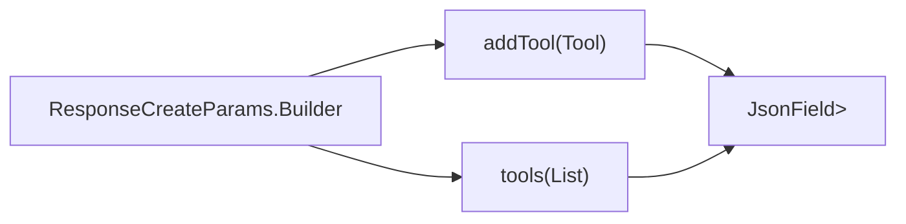
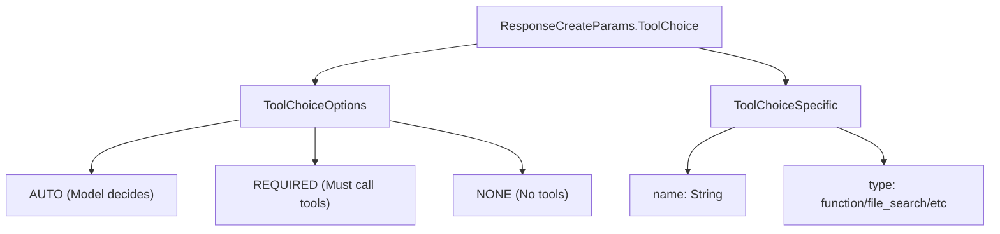
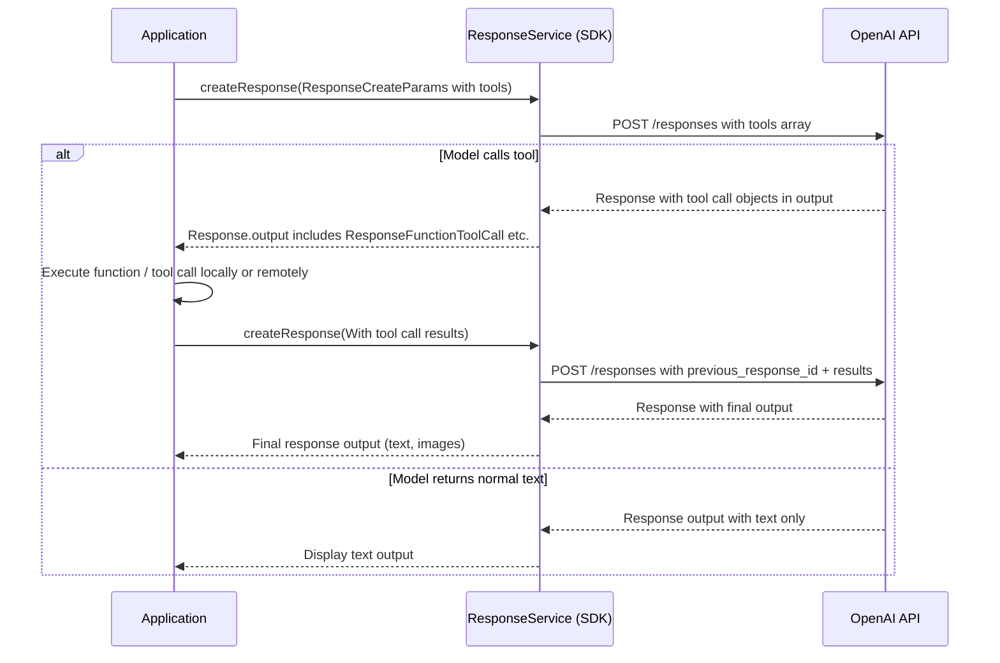
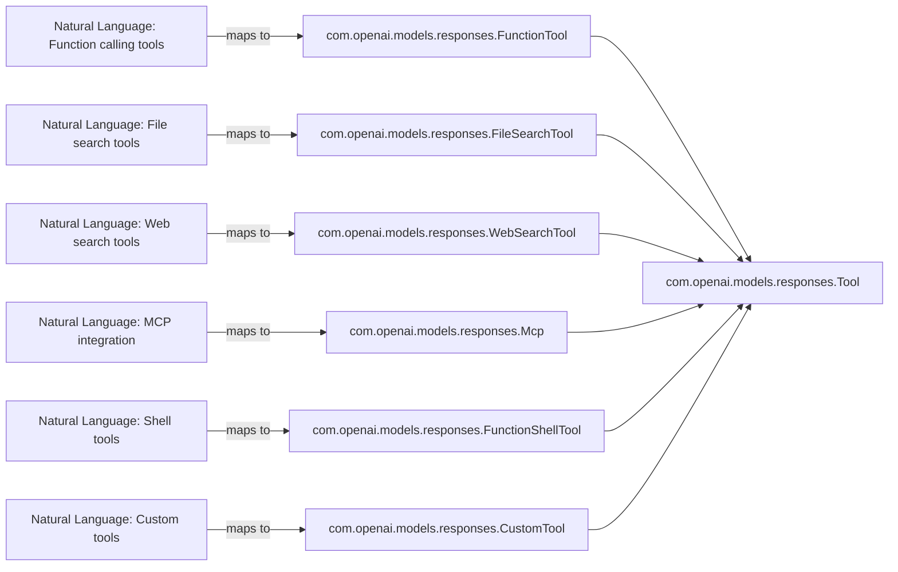

<!-- source: DeepWiki mcp.deepwiki.com · repo openai/openai-java · page 5.4 Tool System · fetched 2026-10-26 -->

# Tool System

<details>
<summary>Relevant source files</summary>

The following files were used as context for generating this wiki page:

- [openai-java-core/src/main/kotlin/com/openai/models/beta/responses/BetaResponseFunctionWebSearch.kt](openai-java-core/src/main/kotlin/com/openai/models/beta/responses/BetaResponseFunctionWebSearch.kt)
- [openai-java-core/src/main/kotlin/com/openai/models/beta/responses/BetaWebSearchPreviewTool.kt](openai-java-core/src/main/kotlin/com/openai/models/beta/responses/BetaWebSearchPreviewTool.kt)
- [openai-java-core/src/main/kotlin/com/openai/models/beta/responses/BetaWebSearchTool.kt](openai-java-core/src/main/kotlin/com/openai/models/beta/responses/BetaWebSearchTool.kt)
- [openai-java-core/src/main/kotlin/com/openai/models/images/ImageEditParams.kt](openai-java-core/src/main/kotlin/com/openai/models/images/ImageEditParams.kt)
- [openai-java-core/src/main/kotlin/com/openai/models/images/ImageGenerateParams.kt](openai-java-core/src/main/kotlin/com/openai/models/images/ImageGenerateParams.kt)
- [openai-java-core/src/main/kotlin/com/openai/models/images/ImageModel.kt](openai-java-core/src/main/kotlin/com/openai/models/images/ImageModel.kt)
- [openai-java-core/src/main/kotlin/com/openai/models/responses/NamespaceTool.kt](openai-java-core/src/main/kotlin/com/openai/models/responses/NamespaceTool.kt)
- [openai-java-core/src/main/kotlin/com/openai/models/responses/ResponseFunctionWebSearch.kt](openai-java-core/src/main/kotlin/com/openai/models/responses/ResponseFunctionWebSearch.kt)
- [openai-java-core/src/main/kotlin/com/openai/models/responses/Tool.kt](openai-java-core/src/main/kotlin/com/openai/models/responses/Tool.kt)
- [openai-java-core/src/main/kotlin/com/openai/models/responses/WebSearchPreviewTool.kt](openai-java-core/src/main/kotlin/com/openai/models/responses/WebSearchPreviewTool.kt)
- [openai-java-core/src/main/kotlin/com/openai/models/responses/WebSearchTool.kt](openai-java-core/src/main/kotlin/com/openai/models/responses/WebSearchTool.kt)
- [openai-java-core/src/test/kotlin/com/openai/models/beta/responses/BetaResponseFunctionWebSearchTest.kt](openai-java-core/src/test/kotlin/com/openai/models/beta/responses/BetaResponseFunctionWebSearchTest.kt)
- [openai-java-core/src/test/kotlin/com/openai/models/images/ImageCreateVariationParamsTest.kt](openai-java-core/src/test/kotlin/com/openai/models/images/ImageCreateVariationParamsTest.kt)
- [openai-java-core/src/test/kotlin/com/openai/models/images/ImageEditParamsTest.kt](openai-java-core/src/test/kotlin/com/openai/models/images/ImageEditParamsTest.kt)
- [openai-java-core/src/test/kotlin/com/openai/models/images/ImageGenerateParamsTest.kt](openai-java-core/src/test/kotlin/com/openai/models/images/ImageGenerateParamsTest.kt)
- [openai-java-core/src/test/kotlin/com/openai/models/responses/NamespaceToolTest.kt](openai-java-core/src/test/kotlin/com/openai/models/responses/NamespaceToolTest.kt)
- [openai-java-core/src/test/kotlin/com/openai/models/responses/ResponseFunctionWebSearchTest.kt](openai-java-core/src/test/kotlin/com/openai/models/responses/ResponseFunctionWebSearchTest.kt)
- [openai-java-core/src/test/kotlin/com/openai/models/responses/ToolTest.kt](openai-java-core/src/test/kotlin/com/openai/models/responses/ToolTest.kt)
- [openai-java-core/src/test/kotlin/com/openai/services/async/ImageServiceAsyncTest.kt](openai-java-core/src/test/kotlin/com/openai/services/async/ImageServiceAsyncTest.kt)
- [openai-java-core/src/test/kotlin/com/openai/services/blocking/ImageServiceTest.kt](openai-java-core/src/test/kotlin/com/openai/services/blocking/ImageServiceTest.kt)

</details>


## Purpose and Scope

The Tool System enables models to extend their capabilities by invoking external functions, searching files or the web, controlling virtual computers, running shell commands, applying patches, using Model Context Protocol (MCP) integrations, generating images, and supporting custom tools. This document details the `Tool` union type that encapsulates all supported tool variants, explains the integration of tools in the Responses API, and describes data flow and usage patterns.

For related content on multi-modal inputs and outputs, see the [Multi-modal Content](#5.3) page. For function calling specifics and structured output validation, see [Function Calling](#6.2).

---

## Tool Union Type Architecture

The core concept of the Tool System is the `Tool` union type, a polymorphic container class that represents 12 distinct tool variants. Each variant corresponds to a specific tool capability exposed to the language model.

```mermaid
graph TB
    Tool["Tool Union Type"]

    subgraph "Built-in Tools"
        FileSearch["FileSearchTool<br/>file_search"]
        WebSearch["WebSearchTool<br/>web_search"]
        WebSearchPreview["WebSearchPreviewTool<br/>web_search_preview"]
        ComputerUsePreview["ComputerUsePreviewTool<br/>computer_use_preview"]
        CodeInterpreter["CodeInterpreter<br/>code_interpreter"]
        ImageGeneration["ImageGeneration<br/>image_generation"]
        ApplyPatch["ApplyPatchTool<br/>apply_patch"]
    end

    subgraph "Function Calling"
        Function["FunctionTool<br/>function"]
        Custom["CustomTool<br/>custom"]
    end

    subgraph "MCP Integration"
        MCP["Mcp<br/>mcp"]
    end

    subgraph "Shell Tools"
        LocalShell["LocalShell<br/>local_shell"]
        Shell["FunctionShellTool<br/>shell"]
    end

    Tool --> Function
    Tool --> FileSearch
    Tool --> ComputerUsePreview
    Tool --> WebSearch
    Tool --> MCP
    Tool --> CodeInterpreter
    Tool --> ProgrammaticToolCalling["ProgrammaticToolCalling<br/>(JsonValue)"]
    Tool --> ImageGeneration
    Tool --> LocalShell
    Tool --> Shell
    Tool --> Custom
    Tool --> NamespaceTool["NamespaceTool<br/>namespace"]
    Tool --> ToolSearchTool["ToolSearchTool<br/>search"]
    Tool --> WebSearchPreview
    Tool --> ApplyPatch
```



The `Tool` class uses optional fields to hold instances of each variant. Accessor methods return `Optional` wrappers for type-safe retrieval, e.g., `function()`, `fileSearch()`, `webSearch()`, etc. Tool presence is checked via `isFunction()`, `isFileSearch()`, and analogous boolean methods.

**Discriminated Union Deserialization**: The SDK tries deserialization to each known tool subtype. It ranks success by validity of required fields and selects the best-matching variant. This ensures flexibility and robust parsing even if new tool types arrive or partial data is received.

**Sources:**  
[openai-java-core/src/main/kotlin/com/openai/models/responses/Tool.kt:34-162]()

---

## Tool Categories

### Built-in Tools

These tools are bundled with the platform, providing core enhanced capabilities without requiring custom user code:

- **FunctionTool**: Represents user-defined functions with typed JSON-schema based argument definitions.
- **FileSearchTool**: Enables semantic search over uploaded files using vector stores.
- **ComputerUsePreviewTool**: Controls and interacts with a virtual computer environment.
- **WebSearchTool**: Performs internet searches with configurable filters and context.
- **CodeInterpreter**: Executes Python code for computations or data analysis.
- **ImageGeneration**: Creates images using specialized GPT image models.
- **ApplyPatchTool**: Allows creating, deleting, or updating files via unified diffs.
- **WebSearchPreviewTool**: A preview variant of the web search tool.

These are accessible via their respective accessor methods on `Tool`.

**Sources:**  
[openai-java-core/src/main/kotlin/com/openai/models/responses/Tool.kt:38-56](),  
[openai-java-core/src/main/kotlin/com/openai/models/responses/WebSearchTool.kt:1-175]()  

---

### MCP Tools

Model Context Protocol (MCP) tools let the model interact with remote MCP servers or predefined connectors (Google Drive, SharePoint, etc.). Configuration fields include:

- `serverLabel`: Identifier for the MCP server.
- `allowedTools`: Either `ALL` or a list of named tools allowed from the server.
- Connector IDs for well-known connectors like `GOOGLE_DRIVE`, `SHAREPOINT`, `GITHUB`.
- Authentication details, URLs, headers, and approval requirements.

This enables rich data integrations beyond the immediate tool set.

**Sources:**  
[openai-java-core/src/main/kotlin/com/openai/models/responses/Tool.kt:640-767]()

---

### Function Calling (Custom Tools)

To let models execute custom business logic, function and custom tools are offered.

- **FunctionTool**: Defines a function with a name, parameters specified as a flexible JSON schema (supporting properties, required fields), descriptions, and call-mode constraints (sync/async, strict validation, allowed callers).
- **CustomTool**: Allows specification of tools with input format constraints either as raw text (unconstrained text) or via an EBNF grammar format, useful for strictly parsing input.

Function tools have a well-defined builder pattern for specifying JSON schema parameters. Custom tools support two input format classes (`Text` or `Grammar`).

**Sources:**  
[openai-java-core/src/main/kotlin/com/openai/models/responses/Tool.kt:39-40](),  
[openai-java-core/src/main/kotlin/com/openai/models/responses/CustomTool.kt:1-310]()  

---

### Shell Tools

Two variants exist:

- **LocalShell**: A minimal shell tool to run commands locally; represented as a simple JSON object.
- **FunctionShellTool**: A more configurable shell tool modeled after function tools.

**Sources:**  
[openai-java-core/src/main/kotlin/com/openai/models/responses/Tool.kt:428-434]()

---

## Specifying Tools in API Requests

Tools are configured when creating a response via the `ResponseCreateParams` builder.

### Adding Tools

You can add individual or multiple tools:



Example usage:

```java
ResponseCreateParams.builder()
    .addTool(
        FunctionTool.builder()
            .name("get_weather")
            .parameters(/* JSON schema here */)
            .build()
    )
    .addTool(
        FileSearchTool.builder()
            .addVectorStoreId("vs_abc123")
            .maxNumResults(5L)
            .build()
    )
    .build();
```

**Sources:**  
[openai-java-core/src/main/kotlin/com/openai/models/responses/ResponseCreateParams.kt:1056-1119]()

---

### Tool Choice

The `toolChoice` parameter controls how the model is allowed or directed to call tools with the following options:



- **AUTO**: Model decides on tool usage autonomously.
- **REQUIRED**: Model must call at least one tool.
- **NONE**: Model is prohibited from calling any tools.

Use `ToolChoiceSpecific` to restrict calls to a named tool by name and type.

Example:

```java
ResponseCreateParams.builder()
    .toolChoice(
        ToolChoiceSpecific.builder()
            .name("get_weather")
            .type(ToolChoiceSpecific.Type.FUNCTION)
            .build()
    )
    .build();
```

**Sources:**  
[openai-java-core/src/main/kotlin/com/openai/models/responses/ResponseCreateParams.kt:3534-4073]()

---

### Tool Call Limits and Parallelism

- **maxToolCalls**: Restricts the total number of tool calls across all tools during response generation.

  ```java
  ResponseCreateParams.builder()
      .maxToolCalls(10L) // Maximum 10 calls total
      .build();
  ```

- **parallelToolCalls**: Indicates whether the model can execute multiple tool calls in parallel.

  ```java
  ResponseCreateParams.builder()
      .parallelToolCalls(true) // Enable parallel execution
      .build();
  ```

**Sources:**  
[openai-java-core/src/main/kotlin/com/openai/models/responses/ResponseCreateParams.kt:136-175]()

---

## Tool Calls in Responses

When a model calls a tool during generation, calls and results appear as `ResponseOutputItem` entries in the response's output array. These outputs are union types discriminated by tool call or tool output variants.

```mermaid
graph TB
    ResponseOutputItem["ResponseOutputItem Union"]

    ToolCall["Tool Call Items"]
    ToolOutput["Tool Output Items"]

    ResponseOutputItem --> ToolCall
    ResponseOutputItem --> ToolOutput

    ToolCall --> FunctionCall["ResponseFunctionToolCall (Function invocation)"]
    ToolCall --> FileSearchCall["ResponseFileSearchToolCall (File search request)"]
    ToolCall --> WebSearchCall["ResponseWebSearchToolCall (Web search request)"]
    ToolCall --> ComputerCall["ResponseComputerToolCall (Computer action)"]
    ToolCall --> CodeInterpCall["ResponseCodeInterpreterToolCall (Code execution)"]
    ToolCall --> ImageGenCall["ResponseImageGenerationToolCall (Image creation)"]

    ToolOutput --> FunctionOutput["ResponseFunctionToolCallOutput (Function result)"]
    ToolOutput --> FileSearchOutput["ResponseFileSearchToolCallOutput (Search results)"]
    ToolOutput --> WebSearchOutput["ResponseWebSearchToolCallOutput (Web results)"]
    ToolOutput --> ComputerOutput["ResponseComputerToolCallOutput (Computer result)"]
    ToolOutput --> CodeInterpOutput["ResponseCodeInterpreterToolCallOutput (Execution result)"]
    ToolOutput --> ImageGenOutput["ResponseImageGenerationToolCallOutput (Generated image)"]
```



Calls and their outputs share a unique `id` for correlating requests and results.

**Sources:**  
[openai-java-core/src/main/kotlin/com/openai/models/responses/ResponseOutputItem.kt:1-100]()  

---

### Data Flow for Tool Calls



This flow shows the iterative exchange where the model requests tool execution via output items and client applications provide results in subsequent requests.

**Sources:**  
[openai-java-core/src/main/kotlin/com/openai/models/responses/ResponseCreateParams.kt:97-111](),  
[openai-java-core/src/main/kotlin/com/openai/models/responses/ResponseOutputItem.kt:1-100]()  

---

## Validation and Type Safety

Each tool variant validates its fields and nested objects to ensure correctness. The `Tool` union type provides:

- `validate()`: Throws `OpenAIInvalidDataException` if the tool is structurally invalid.
- `isValid()`: Returns boolean flag for quick validity checks.
- `validity()`: Internal scoring for deserialization.

Example:

```java
Tool tool = Tool.ofFunction(myFunctionTool);
tool.validate(); // Throws if invalid

if (tool.isValid()) {
    // Safe to use the tool
}
```

Validation is recursively performed on nested tool data, enforcing required fields and known enum values.

**Discriminated union deserialization** uses this validity scoring to pick the best matching tool variant when parsing from JSON.

**Sources:**  
[openai-java-core/src/main/kotlin/com/openai/models/responses/Tool.kt:213-276](),  
[openai-java-core/src/main/kotlin/com/openai/models/responses/Tool.kt:588-609]()  

---

## Reference Diagrams Bridging Natural Language to Code Entities

### Mapping Tool System in Natural Language to Core Classes



### Tool Usage Flow From Request to Response Entities

```mermaid
graph LR
    ReqBuilder["ResponseCreateParams.Builder"]
    ToolSpec["Tool specification (FunctionTool, FileSearchTool, etc)"]
    ReqPayload["JSON request with tools array"]
    ApiEndpoint["OpenAI API /responses"]
    RespJson["JSON response with output array (ResponseOutputItems)"]
    OutputItems["ResponseOutputItem subclasses (calls, outputs)"]
    AppHandling["Application logic executes tool calls"]
    NextRequest["Next ResponseCreateParams with tool call results"]

    ReqBuilder --> ToolSpec
    ToolSpec --> ReqPayload
    ReqPayload --> ApiEndpoint
    ApiEndpoint --> RespJson
    RespJson --> OutputItems
    OutputItems --> AppHandling
    AppHandling --> NextRequest
    NextRequest --> ApiEndpoint
```



---

# Summary

The Tool System in the OpenAI Java SDK provides a rich, extensible union type `Tool` that unifies 12 different tool variants — from native tools like file and web search, code interpreters, shells, image generation, and MCP connectors, to custom user-defined functions and grammar-based custom tools.

Tools are specified easily in request builders and enable the language model to perform complex tasks by invoking external capabilities. Tool calls and results are transmitted transparently via structured response output items, enabling iterative exchanges between client and model.

Robust validation and union deserialization logic ensure reliability and extensibility. The Tool System's architecture balances flexibility, strong typing, and ease of integration for applications extending model functionality.

---

## Sources

- openai-java-core/src/main/kotlin/com/openai/models/responses/Tool.kt:1-164,213-276,588-609,639-767,1174-1453,1591-1774  
- openai-java-core/src/main/kotlin/com/openai/models/responses/WebSearchTool.kt:1-175,415-467  
- openai-java-core/src/main/kotlin/com/openai/models/responses/ResponseCreateParams.kt:97-111,1056-1119,136-175,3534-4073  
- openai-java-core/src/main/kotlin/com/openai/models/responses/ResponseOutputItem.kt:1-100  
- openai-java-core/src/main/kotlin/com/openai/models/responses/Response.kt:266-276,303-325  
- openai-java-core/src/main/kotlin/com/openai/models/responses/CustomTool.kt:1-310

---

