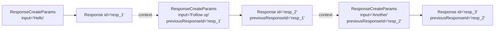
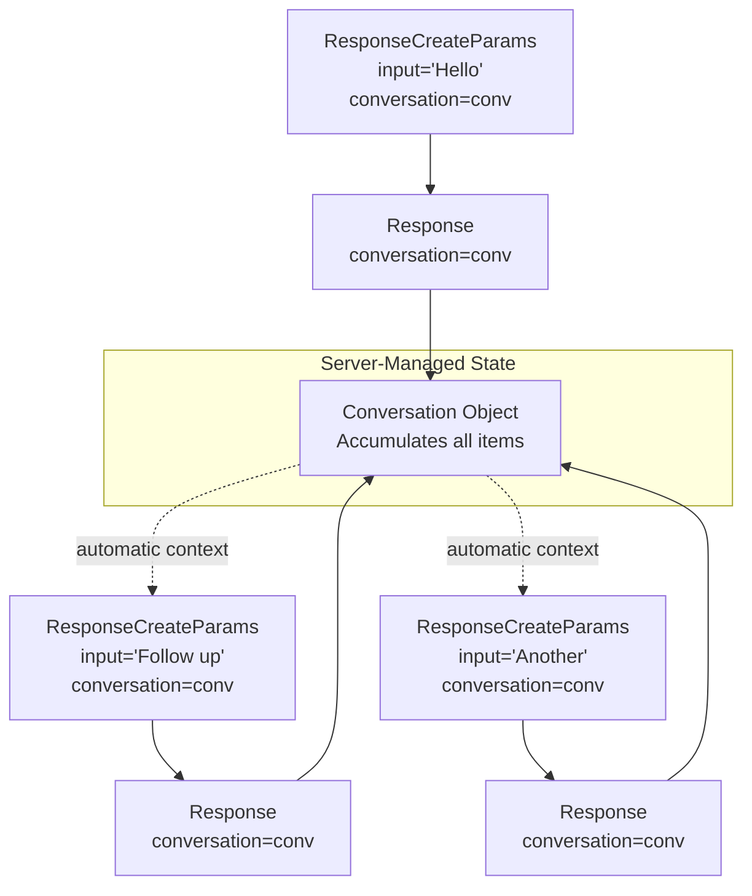
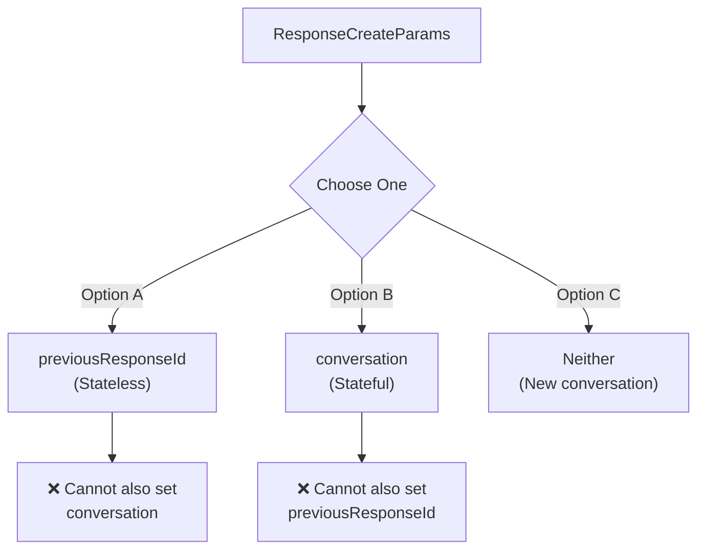
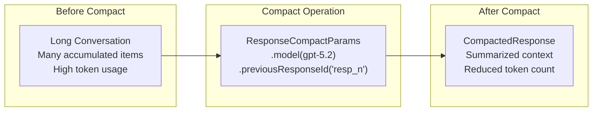
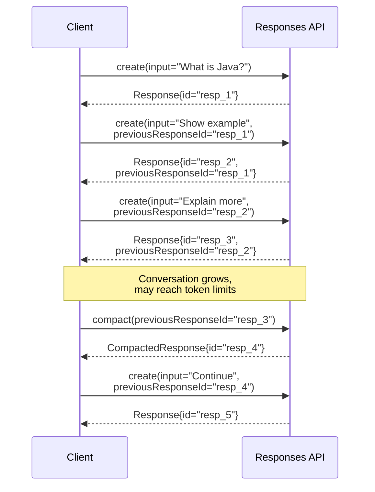

<!-- source: DeepWiki mcp.deepwiki.com · repo openai/openai-java · page 5.5 Conversation Management · fetched 2026-10-26 -->

# Conversation Management

<details>
<summary>Relevant source files</summary>

The following files were used as context for generating this wiki page:

- [openai-java-core/src/main/kotlin/com/openai/models/CustomToolInputFormat.kt](openai-java-core/src/main/kotlin/com/openai/models/CustomToolInputFormat.kt)
- [openai-java-core/src/main/kotlin/com/openai/models/conversations/ConversationCreateParams.kt](openai-java-core/src/main/kotlin/com/openai/models/conversations/ConversationCreateParams.kt)
- [openai-java-core/src/main/kotlin/com/openai/models/conversations/Message.kt](openai-java-core/src/main/kotlin/com/openai/models/conversations/Message.kt)
- [openai-java-core/src/main/kotlin/com/openai/models/conversations/SummaryTextContent.kt](openai-java-core/src/main/kotlin/com/openai/models/conversations/SummaryTextContent.kt)
- [openai-java-core/src/main/kotlin/com/openai/models/conversations/items/ItemCreateParams.kt](openai-java-core/src/main/kotlin/com/openai/models/conversations/items/ItemCreateParams.kt)
- [openai-java-core/src/main/kotlin/com/openai/models/responses/ComputerAction.kt](openai-java-core/src/main/kotlin/com/openai/models/responses/ComputerAction.kt)
- [openai-java-core/src/main/kotlin/com/openai/models/responses/ResponseCodeInterpreterToolCall.kt](openai-java-core/src/main/kotlin/com/openai/models/responses/ResponseCodeInterpreterToolCall.kt)
- [openai-java-core/src/main/kotlin/com/openai/models/responses/ResponseComputerToolCall.kt](openai-java-core/src/main/kotlin/com/openai/models/responses/ResponseComputerToolCall.kt)
- [openai-java-core/src/main/kotlin/com/openai/models/responses/ResponseComputerToolCallOutputItem.kt](openai-java-core/src/main/kotlin/com/openai/models/responses/ResponseComputerToolCallOutputItem.kt)
- [openai-java-core/src/main/kotlin/com/openai/models/responses/ResponseContentPartAddedEvent.kt](openai-java-core/src/main/kotlin/com/openai/models/responses/ResponseContentPartAddedEvent.kt)
- [openai-java-core/src/main/kotlin/com/openai/models/responses/ResponseContentPartDoneEvent.kt](openai-java-core/src/main/kotlin/com/openai/models/responses/ResponseContentPartDoneEvent.kt)
- [openai-java-core/src/test/kotlin/com/openai/models/conversations/MessageTest.kt](openai-java-core/src/test/kotlin/com/openai/models/conversations/MessageTest.kt)
- [openai-java-core/src/test/kotlin/com/openai/models/conversations/items/ConversationItemListTest.kt](openai-java-core/src/test/kotlin/com/openai/models/conversations/items/ConversationItemListTest.kt)
- [openai-java-core/src/test/kotlin/com/openai/models/conversations/items/ItemCreateParamsTest.kt](openai-java-core/src/test/kotlin/com/openai/models/conversations/items/ItemCreateParamsTest.kt)
- [openai-java-core/src/test/kotlin/com/openai/models/conversations/items/ItemListParamsTest.kt](openai-java-core/src/test/kotlin/com/openai/models/conversations/items/ItemListParamsTest.kt)
- [openai-java-core/src/test/kotlin/com/openai/models/conversations/items/ItemRetrieveParamsTest.kt](openai-java-core/src/test/kotlin/com/openai/models/conversations/items/ItemRetrieveParamsTest.kt)
- [openai-java-core/src/test/kotlin/com/openai/models/responses/ComputerActionTest.kt](openai-java-core/src/test/kotlin/com/openai/models/responses/ComputerActionTest.kt)
- [openai-java-core/src/test/kotlin/com/openai/models/responses/ResponseComputerToolCallTest.kt](openai-java-core/src/test/kotlin/com/openai/models/responses/ResponseComputerToolCallTest.kt)
- [openai-java-core/src/test/kotlin/com/openai/models/responses/ResponseConversationParamTest.kt](openai-java-core/src/test/kotlin/com/openai/models/responses/ResponseConversationParamTest.kt)
- [openai-java-core/src/test/kotlin/com/openai/models/responses/inputitems/InputItemListParamsTest.kt](openai-java-core/src/test/kotlin/com/openai/models/responses/inputitems/InputItemListParamsTest.kt)
- [openai-java-core/src/test/kotlin/com/openai/services/async/conversations/ItemServiceAsyncTest.kt](openai-java-core/src/test/kotlin/com/openai/services/async/conversations/ItemServiceAsyncTest.kt)
- [openai-java-core/src/test/kotlin/com/openai/services/blocking/conversations/ItemServiceTest.kt](openai-java-core/src/test/kotlin/com/openai/services/blocking/conversations/ItemServiceTest.kt)

</details>


This document describes the conversation state management mechanisms in the Responses API of the OpenAI Java SDK. It explains the two available approaches: using `previousResponseId` for stateless chaining versus using `conversation` objects for server-managed stateful conversations. Additionally, it covers conversation items, the `compact` operation for summarization, and key constraints to keep in mind.

## Overview

Conversation management is critical for maintaining multi-turn dialogues where context continuity is desired. The Responses API supports two mutually exclusive modes for maintaining conversation history:

- **Stateless chaining via `previousResponseId`**: The client explicitly references the prior response ID to link conversation turns.
- **Stateful session via `conversation` object**: The server tracks and aggregates conversation items in a conversation session, automatically managing context.

Clients choose one approach based on use case. Both enable multiple turns with context preservation, but differ in where state is stored and how context is constructed.

## Conversation State Mechanisms

### Using `previousResponseId`

This approach chains conversation turns statelessly. Each request supplies the `previousResponseId`, referencing the prior response's unique ID. The server reconstructs context using the referenced response and its history items.



- The server prepends the previous response's input and output items as context for the new interaction.
- `instructions` field is **not** carried over automatically: this allows changing system behavior between turns by explicitly setting new instructions.
- This provides flexibility for branching conversations by referencing different prior responses.
- The client fully controls linking by setting the `previousResponseId` explicitly on each request.

### Using `conversation` Objects

Alternatively, stateful management uses a server-side conversation object. This object aggregates all conversation items, and the server automatically prepends accumulated conversation items to each request.



- Input and output items automatically append to the conversation after each response completes.
- Server maintains full conversation history and prepends accumulated items as context for subsequent turns.
- The `conversation` object returned from the response can be reused for continued dialog.
- No need for passed `previousResponseId`; server-side state is authoritative and managed.

## Conversation Type Structure

The `conversation` field in `ResponseCreateParams` is defined as a union type to support two variants:

| Variant                         | Type                  | Description                                    |
|--------------------------------|-----------------------|------------------------------------------------|
| `Id` (String)                  | `String`              | A conversation ID referencing an existing conversation.|
| `ResponseConversationParam`    | Object                | A parameter object representing a conversation.|

Convenience builder methods in `ResponseCreateParams.Builder` allow specifying the conversation as either a String ID or a dedicated conversation object (union wrapping done automatically):

```java
// Using conversation ID string directly
.responseCreateParamsBuilder().conversation("conv_123");

// Using explicit conversation union object wrapping
.responseCreateParamsBuilder().conversation(Conversation.ofId("conv_123"));

// Using a ResponseConversationParam object
.responseCreateParamsBuilder().conversation(responseConversationParam);
```

The SDK internally wraps string IDs into the union `Conversation.Id` variant.

## Key Constraints and Rules

### Mutual Exclusivity of `previousResponseId` and `conversation`



- `previousResponseId` and `conversation` are **mutually exclusive** and must not be set together in the same request.
- Use `previousResponseId` for stateless chaining, or `conversation` for server-managed conversation. Do not mix.
- Starting a new conversation is done by leaving both unset.

### Instructions Field Behavior

With `previousResponseId`, the `instructions` field is **not automatically carried forward** from previous responses. This allows:

- Swapping system prompt or instructions dynamically between turns.
- Avoiding unexpected layering or duplication of instructions automatically.

Example:

```java
// First turn with instructions
ResponseCreateParams.builder()
    .input("Hello")
    .instructions("You are a helpful assistant.")
    .build();

// Second turn, instructions are NOT inherited automatically
ResponseCreateParams.builder()
    .input("Follow up")
    .previousResponseId("resp_1")
    .instructions("You are now a pirate.")  // override instructions explicitly
    .build();
```

Explicitly supply instructions on each turn if using `previousResponseId`.

## Conversation Compaction

The SDK supports a compaction operation to summarize a long conversation chain into a concise state to reduce token size and maintain context efficiently.



### `ResponseCompactParams` Structure

| Field              | Type                         | Required | Description                         |
|--------------------|------------------------------|----------|-----------------------------------|
| `model`            | `ResponseCompactParams.Model` | Yes      | Model to use for compaction.       |
| `input`            | `ResponseCompactParams.Input` | No       | Additional input context.           |
| `instructions`     | `String`                     | No       | System instructions for compaction.|
| `previousResponseId`| `String`                    | No       | Response ID reference to compact.  |

### Usage Example

```java
// Compact a long conversation chain
CompactedResponse compacted = client.responses().compact(
    ResponseCompactParams.builder()
        .model(ResponseCompactParams.Model.GPT_5_2)
        .previousResponseId("resp_123")
        .instructions("Summarize the key points")
        .build()
);

// Continue conversation using compacted response state
Response nextResponse = client.responses().create(
    ResponseCreateParams.builder()
        .input("Continue the discussion")
        .previousResponseId(compacted.id())
        .build()
);
```

Compaction helps manage token limits by summarizing conversation history without loss of key context.

## Service Methods for Conversation Management

### `ResponseService` Interface (Blocking)

| Method       | Parameters            | Return Type         | Description                          |
|--------------|-----------------------|---------------------|------------------------------------|
| `create()`   | `ResponseCreateParams` | `Response`          | Creates a new response. Supports both stateless and stateful modes. |
| `retrieve()` | `responseId: String`   | `Response`          | Retrieves an existing response by ID. |
| `compact()`  | `ResponseCompactParams`| `CompactedResponse` | Performs conversation compaction. |

### `ResponseServiceAsync` Interface (Async)

Equivalent async methods returning `CompletableFuture<T>` with identical signatures.

## Example: Multi-Turn Conversation Flow



This illustrates a typical usage with chained responses using `previousResponseId`, followed by compaction to shrink conversation state and continuation.

## Conversation Items

Conversation history consists of **items** representing messages or other response elements. The API defines:

- `ItemCreateParams`: Parameters to add items to an existing conversation by ID.
- `ResponseInputItem` and its variants represent discrete conversation inputs.
- `ResponseOutputMessage` and related classes represent outputs attached to conversation items.

Client code typically uses `items()` to manage input parts of the conversation (up to 20 per request).

### Adding Items Example

```kotlin
val params = ItemCreateParams.builder()
    .conversationId("conv_123")
    .addItem(
        EasyInputMessage.builder()
            .content("Hello, this is a follow-up message.")
            .role(EasyInputMessage.Role.USER)
            .phase(EasyInputMessage.Phase.COMMENTARY)
            .type(EasyInputMessage.Type.MESSAGE)
            .build()
    )
    .build()

val responseItems = itemService.create(params)
```

## Summary

- **`previousResponseId`** implements stateless chaining by explicitly referencing the prior response ID manually, giving full control on the client side.
- **`conversation` objects** manage state on the server, aggregating and prepending conversation items automatically.
- These two options are mutually exclusive and cannot be mixed.
- The `compact` operation is available for summarizing long conversations to reduce token usage.
- Conversation items and messages consist of structured input/output types for flexible conversation representation.

---

## Key Classes and Files

| Class                        | Package                          | Description                                   |
|------------------------------|---------------------------------|-----------------------------------------------|
| `ResponseCreateParams`        | `com.openai.models.responses`   | Parameters for creating a response including conversation linkage. |
| `Response`                   | `com.openai.models.responses`   | Response object containing conversation state info. |
| `ResponseCompactParams`       | `com.openai.models.responses`   | Parameters for conversation compaction.       |
| `CompactedResponse`          | `com.openai.models.responses`   | The result of compaction operation.            |
| `Conversation`               | `com.openai.models.responses`   | Union type representing conversation references. |
| `ResponseConversationParam`  | `com.openai.models.responses`   | Param object for conversation details.         |
| `ItemCreateParams`           | `com.openai.models.conversations.items` | Parameters for adding items to a conversation.  |
| `ResponseInputItem`          | `com.openai.models.responses`   | Input item variant used in conversations.      |
| `ResponseOutputMessage`      | `com.openai.models.responses`   | Output message items attached to conversations. |
| `ResponseService`            | `com.openai.services.blocking`  | Blocking API interface for response operations. |
| `ResponseServiceAsync`       | `com.openai.services.async`     | Async API interface for response operations.    |

---

Sources:  
- [openai-java-core/src/main/kotlin/com/openai/models/responses/ResponseCreateParams.kt:60-180, 600-670]()  
- [openai-java-core/src/main/kotlin/com/openai/models/responses/Response.kt:300-400]()  
- [openai-java-core/src/main/kotlin/com/openai/models/responses/ResponseCompactParams.kt:35-470]()  
- [openai-java-core/src/test/kotlin/com/openai/services/blocking/ResponseServiceTest.kt:20-110, 260-295]()  
- [openai-java-core/src/test/kotlin/com/openai/services/async/ResponseServiceAsyncTest.kt:20-300]()  
- [openai-java-core/src/main/kotlin/com/openai/models/conversations/items/ItemCreateParams.kt:40-160]()  
- [openai-java-core/src/test/kotlin/com/openai/models/conversations/items/ItemCreateParamsTest.kt:10-130]()

---

