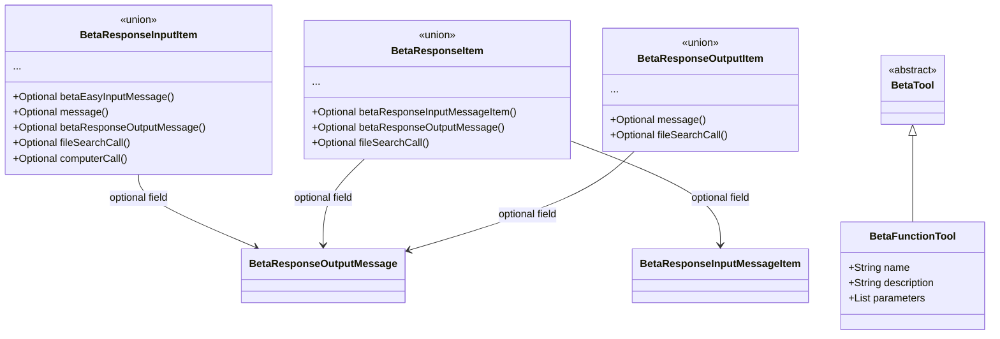
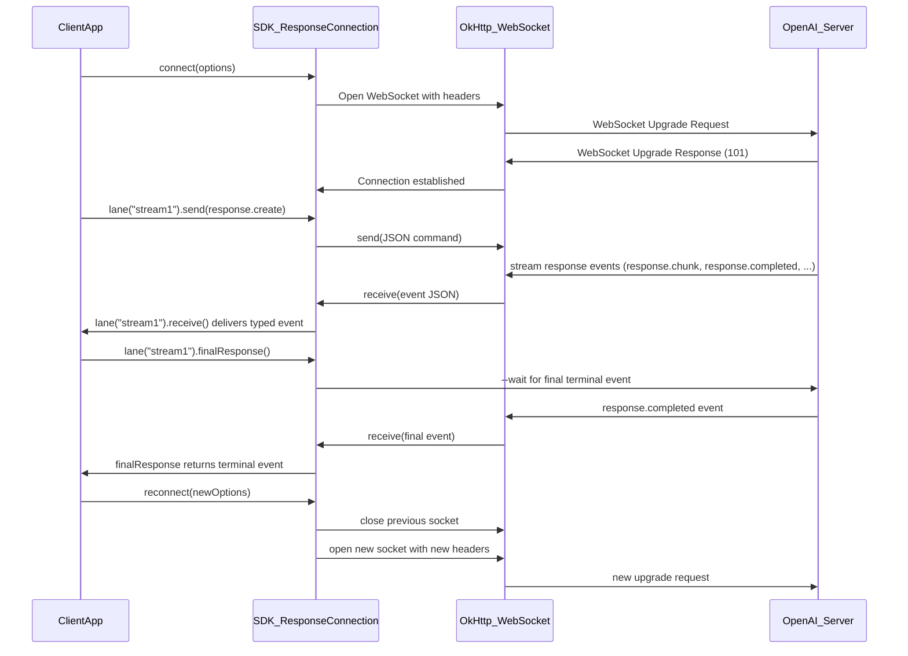

<!-- source: DeepWiki mcp.deepwiki.com · repo openai/openai-java · page 5.6 Beta Responses and WebSocket Transport · fetched 2026-10-26 -->

# Beta Responses and WebSocket Transport

<details>
<summary>Relevant source files</summary>

The following files were used as context for generating this wiki page:

- [buildSrc/src/main/kotlin/com/openai/gradle/CoreCompilationShards.kt](buildSrc/src/main/kotlin/com/openai/gradle/CoreCompilationShards.kt)
- [docs/responses-websocket.md](docs/responses-websocket.md)
- [openai-java-client-okhttp/src/main/kotlin/com/openai/client/okhttp/BoundedWebSocket.kt](openai-java-client-okhttp/src/main/kotlin/com/openai/client/okhttp/BoundedWebSocket.kt)
- [openai-java-client-okhttp/src/main/kotlin/com/openai/client/okhttp/X509Transport.kt](openai-java-client-okhttp/src/main/kotlin/com/openai/client/okhttp/X509Transport.kt)
- [openai-java-client-okhttp/src/test/kotlin/com/openai/client/okhttp/ResponsesWebSocketLifecycleTest.kt](openai-java-client-okhttp/src/test/kotlin/com/openai/client/okhttp/ResponsesWebSocketLifecycleTest.kt)
- [openai-java-client-okhttp/src/test/kotlin/com/openai/client/okhttp/ResponsesWebSocketLiveTest.kt](openai-java-client-okhttp/src/test/kotlin/com/openai/client/okhttp/ResponsesWebSocketLiveTest.kt)
- [openai-java-client-okhttp/src/test/kotlin/com/openai/client/okhttp/ResponsesWebSocketTest.kt](openai-java-client-okhttp/src/test/kotlin/com/openai/client/okhttp/ResponsesWebSocketTest.kt)
- [openai-java-client-okhttp/src/test/kotlin/com/openai/client/okhttp/X509WebSocketTest.kt](openai-java-client-okhttp/src/test/kotlin/com/openai/client/okhttp/X509WebSocketTest.kt)
- [openai-java-core/src/main/kotlin/com/openai/models/beta/responses/BetaResponseInputItem.kt](openai-java-core/src/main/kotlin/com/openai/models/beta/responses/BetaResponseInputItem.kt)
- [openai-java-core/src/main/kotlin/com/openai/models/beta/responses/BetaResponseItem.kt](openai-java-core/src/main/kotlin/com/openai/models/beta/responses/BetaResponseItem.kt)
- [openai-java-core/src/main/kotlin/com/openai/models/beta/responses/BetaResponseOutputItem.kt](openai-java-core/src/main/kotlin/com/openai/models/beta/responses/BetaResponseOutputItem.kt)
- [openai-java-core/src/test/kotlin/com/openai/models/beta/responses/BetaResponseInputItemTest.kt](openai-java-core/src/test/kotlin/com/openai/models/beta/responses/BetaResponseInputItemTest.kt)
- [openai-java-core/src/test/kotlin/com/openai/models/beta/responses/BetaResponseItemTest.kt](openai-java-core/src/test/kotlin/com/openai/models/beta/responses/BetaResponseItemTest.kt)
- [openai-java-core/src/test/kotlin/com/openai/models/beta/responses/BetaResponseOutputItemTest.kt](openai-java-core/src/test/kotlin/com/openai/models/beta/responses/BetaResponseOutputItemTest.kt)
- [openai-java-core/src/test/kotlin/com/openai/services/async/beta/ResponseServiceAsyncTest.kt](openai-java-core/src/test/kotlin/com/openai/services/async/beta/ResponseServiceAsyncTest.kt)
- [openai-java-core/src/test/kotlin/com/openai/services/blocking/beta/ResponseServiceTest.kt](openai-java-core/src/test/kotlin/com/openai/services/blocking/beta/ResponseServiceTest.kt)

</details>


## Purpose and Scope

This page documents the implementation details of the beta Responses models and the persistent WebSocket transport layer in the OpenAI Java SDK. It covers the key code entities representing beta Responses (`BetaResponse`, `BetaTool`, client and server events), as well as the WebSocket transport components used for efficient streaming interactions, including advanced features such as steering and injection of requests. We provide an in-depth technical overview suitable for developers extending or integrating with the beta Responses API using this SDK.

---

## 1. Beta Responses Models

The beta Responses API introduces a rich, flexible set of models to represent inputs and outputs included in conversational and multi-modal responses. These models allow for structured tool integration, reasoning traces, multi-agent coordination, and more.  

### 1.1 Core Model Classes

- **`BetaResponseInputItem`**  
  Represents diverse input types to a response including messages with roles, tool calls (function, web search, file search, computer use, shell, patching), agent messages, and configuration updates. This class encapsulates all possible shapes of an input item, and contains many optional fields wrapped in `Optional` to allow flexible data representations.  

- **`BetaResponseItem`**  
  Represents a general content item used to generate a response, with variants for input messages, output messages, tool calls, reasoning, compaction, etc. This class acts as a unified container for all response fragments exchanged or produced by the model.

- **`BetaResponseOutputItem`**  
  Represents output messages or tool results generated by the model. Like `BetaResponseItem` but focused on produced content.

- **`BetaTool` and `BetaFunctionTool`**  
  Represent the tools the model can call or is aware of. These may include functions, file search, web search, computer tools, and customized extensions.

### 1.2 Design Approach

These model classes use Jackson annotations for JSON serialization and deserialization and leverage a union-type style, where exactly one of many possible properties is set to define the item's type. Builders and factory methods are provided for common subclasses such as messages or tool calls.  

They provide rich metadata fields such as roles (`user`, `system`, `developer`, `assistant`), status (`in_progress`, `completed`), and phases (`commentary`, etc) to enable precise control and observation of the response generation process.

### Example: `BetaResponseInputItem`

```kotlin
class BetaResponseInputItem private constructor(
    private val betaEasyInputMessage: BetaEasyInputMessage? = null,
    private val message: Message? = null,
    private val betaResponseOutputMessage: BetaResponseOutputMessage? = null,
    private val fileSearchCall: BetaResponseFileSearchToolCall? = null,
    private val computerCall: BetaResponseComputerToolCall? = null,
    // ... many more variants omitted for brevity
)
```
Each optional field corresponds to a different possible input item type. Accessors return `Optional<T>` for safer null handling.

### Example: `BetaResponseItem`

```kotlin
class BetaResponseItem private constructor(
    private val betaResponseInputMessageItem: BetaResponseInputMessageItem? = null,
    private val betaResponseOutputMessage: BetaResponseOutputMessage? = null,
    private val fileSearchCall: BetaResponseFileSearchToolCall? = null,
    private val computerCall: BetaResponseComputerToolCall? = null,
    // ...
)
```

### Class Relationships Diagram



Sources:  
- `openai-java-core/src/main/kotlin/com/openai/models/beta/responses/BetaResponseInputItem.kt:1-146`  
- `openai-java-core/src/main/kotlin/com/openai/models/beta/responses/BetaResponseItem.kt:1-147`  
- `openai-java-core/src/main/kotlin/com/openai/models/beta/responses/BetaResponseOutputItem.kt:1-148`  

---

## 2. Client and Server Events for Responses

The communication protocol for the Responses API over WebSocket and HTTP streaming is event-driven. Events are modeled as typed Java objects for safe deserialization and processing.

### 2.1 `ResponsesClientEvent`

This class represents events sent by the client to the server, corresponding to actions such as:  

- Creating a response with specified parameters and inputs  
- Steering commands that influence ongoing responses  
- Cancelation or other control commands

### 2.2 `ResponsesServerEvent`

These are events received from the server, containing:  

- Streaming partial or complete response fragments (`response.chunk`)  
- Terminal response states (`response.completed`, `response.failed`, `response.incomplete`)  
- Protocol or transport signaling events  

### 2.3 Event Handling

The client and server events are marshalled as JSON objects over the WebSocket connection, and deserialized into their respective types using Jackson's polymorphic support. Events carry fields such as `type`, `sequence_number`, and embedded response state snapshots.

Sources:  
- `openai-java-client-okhttp/src/test/kotlin/com/openai/client/okhttp/ResponsesWebSocketTest.kt:6-126`  
- `docs/responses-websocket.md:1-40`  

---

## 3. Persistent WebSocket Transport Layer

The SDK employs a persistent WebSocket connection to efficiently stream Responses events and commands. This transport provides low-latency interaction, event multiplexing lanes, steering commands, reconnect handling, and more.

### 3.1 `ResponseConnection` and Lane Management

- **Lanes**: Each streaming response can be associated with a lane identified by a stream ID. Lanes multiplex over a single WebSocket connection, providing isolation of request/response flows.
- Clients register lanes before sending commands on those lanes.
- Events received from the server include a matching `stream_id` to route to the appropriate lane handler.
- Closing a lane releases resources for that lane but does not close the entire connection.

### 3.2 Connect and Lifecycle

- `connect()` establishes a new WebSocket connection with headers inherited and augmented from the client.
- The connection supports `send()` and `receive()` of typed events.
- Terminal response events end a response within a lane but keep the connection available for new requests.
- `reconnect()` can replace the underlying socket with updated headers or credentials while preserving lane registrations.

### 3.3 Limits and Features

- The connection enforces a maximum message size (`maxMessageBytes`), protecting against large message resource exhaustion.
- The WebSocket transport disables negotiated extensions to prevent compressed-message amplification attacks.
- Native OkHttp constraints apply (e.g., 16MiB max message size).
- Ping intervals for liveness probes default to zero (no pings sent).
- Cancellation and closure semantics are carefully managed to maintain consistent resource release and terminal event signaling.

### 3.4 Architecture: WebSocket Handling (`BoundedWebSocket`)

The internal `BoundedWebSocket` component wraps OkHttp WebSocket clients with bounded timeouts and disallows forbidden WebSocket extensions. It manages native socket lifecycle, exposes completion stages for connection states, and serializes event callbacks on a dedicated dispatcher thread pool to avoid blocking the OkHttp HTTP dispatcher.

---

## 4. Event and Connection Interaction Flow

Below is a sequence diagram illustrating the typical interaction steps using the Responses WebSocket transport for sending commands and receiving streamed responses:



---

## 5. Steering and Request Injection

The persistent WebSocket connection supports **steering commands**. These commands can modify or influence the state of an ongoing response by sending new `ResponsesClientEvent` objects containing steering instructions or injections such as:

- Altering tool choices  
- Supplying inline instructions  
- Adjusting configuration updates  
- Injecting additional context or reasoning directives  

The connection maintains the original `stream_id` to associate steering commands with their target response. This allows fine-grained control of response generation mid-flight.

---

## 6. Summary Table of Key Classes and Roles

| System Concept             | Java Entity                          | Description                                                                                   |
|----------------------------|------------------------------------|-----------------------------------------------------------------------------------------------|
| Beta Responses Input Item  | `BetaResponseInputItem`             | Union-type class representing various input types (messages, tool calls, config changes).     |
| Beta Responses Response Item| `BetaResponseItem`                  | Union-type class encapsulating response fragment (input or output).                           |
| Beta Tool Definition       | `BetaTool`, `BetaFunctionTool`      | Tools callable by the model, including functions and integration primitives.                   |
| Client Event               | `ResponsesClientEvent`              | Events sent from client over WebSocket to initiate or steer responses.                        |
| Server Event               | `ResponsesServerEvent`              | Events received from server containing partial or terminal responses.                         |
| Response WebSocket Connection| `ResponseConnection` (conceptual) | Persistent WebSocket used to send/receive streamed events with lane multiplexing.             |
| WebSocket Transport        | `BoundedWebSocket` (internal)       | OkHttp-based WebSocket wrapper enforcing limits and handling lifecycle with custom dispatcher.|

---

## 7. Additional Notes on Implementation and Testing

- Numerous comprehensive integration tests simulate client-server interactions over WebSocket to validate compliance with response event contracts and lifecycle behaviors. Among them is `ResponsesWebSocketTest`, which covers synchronous and asynchronous modes, verifies event sequences, and error handling on the transport layer.
- The models leverage advanced JSON handling including unknown field preservation and extensible union-type deserialization.
- The WebSocket transport uses a dedicated cached thread pool dispatcher for native socket reading to avoid blocking critical OkHttp resources.
- A strict policy disables WebSocket extension negotiation (e.g., no compression) for security and message size safety.

---

# Summary

This documentation has detailed the beta Responses domain models representing structured inputs, outputs, and tools; the event-based client-server communication layer; and the underlying persistent WebSocket transport harnessed by the OpenAI Java SDK. The design reflects a modern, extensible API client capable of concurrent multiplexed streaming with steering and injection, enabling advanced conversational use cases and efficient real-time interactions.

---

# Sources

- `openai-java-core/src/main/kotlin/com/openai/models/beta/responses/BetaResponseInputItem.kt:1-146`  
- `openai-java-core/src/main/kotlin/com/openai/models/beta/responses/BetaResponseItem.kt:1-147`  
- `openai-java-core/src/main/kotlin/com/openai/models/beta/responses/BetaResponseOutputItem.kt:1-148`  
- `openai-java-client-okhttp/src/test/kotlin/com/openai/client/okhttp/ResponsesWebSocketTest.kt:1-126`  
- `docs/responses-websocket.md:1-40`  
- `openai-java-client-okhttp/src/main/kotlin/com/openai/client/okhttp/BoundedWebSocket.kt:1-158`

---

