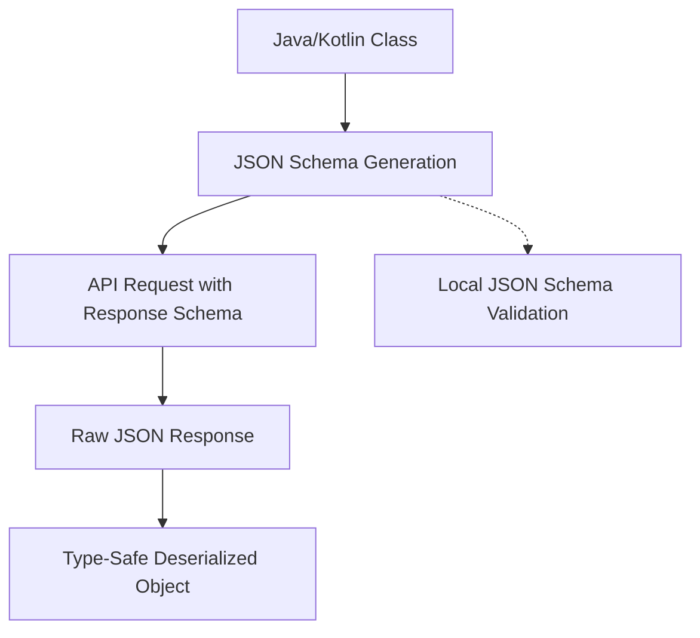
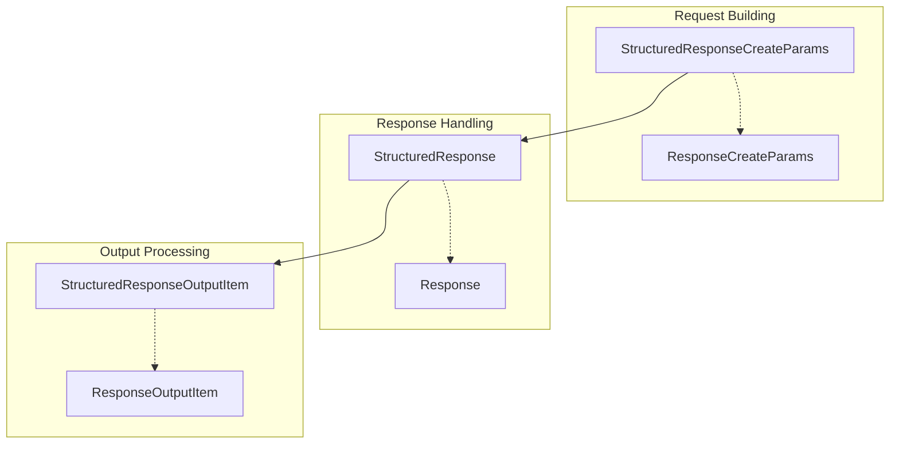
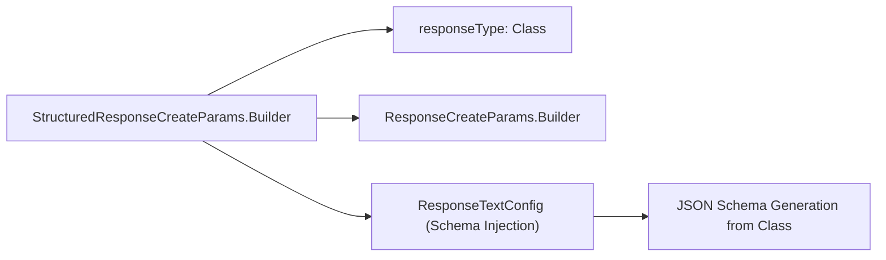
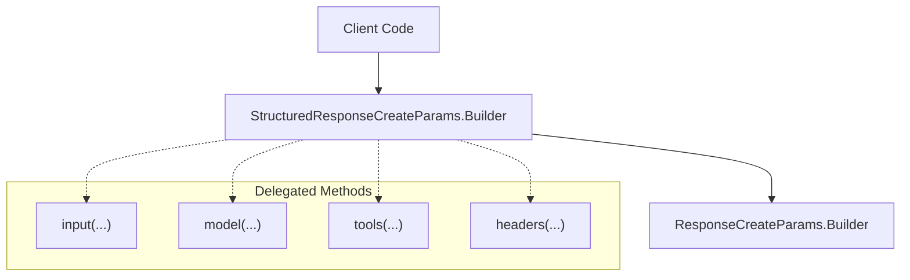
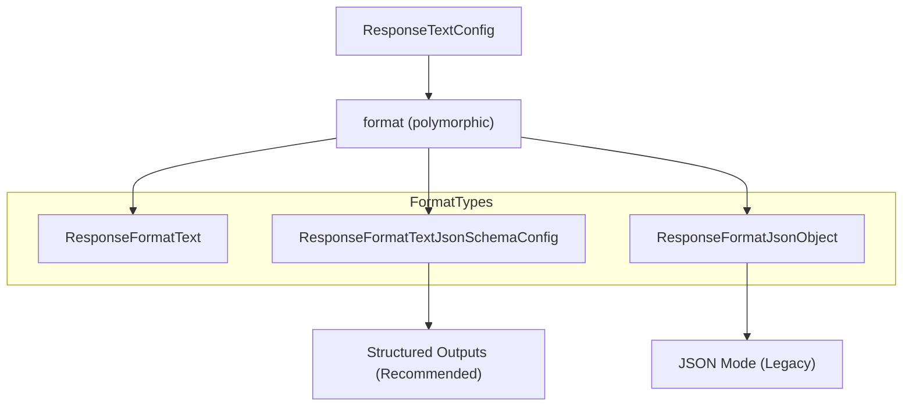
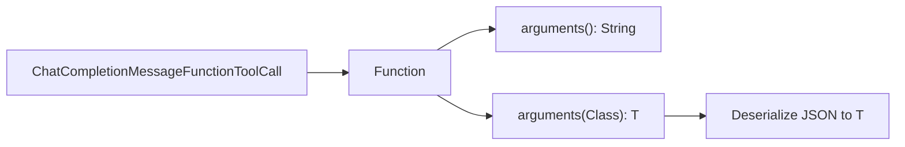
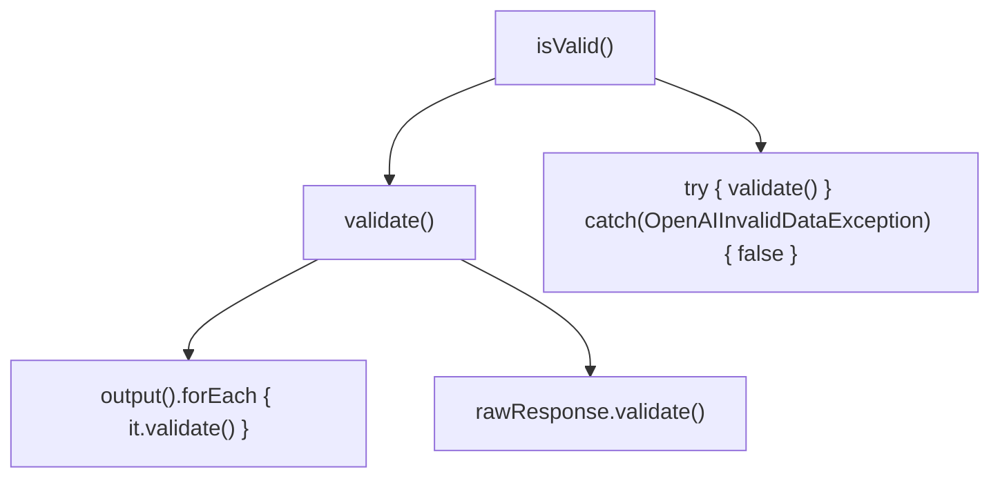

<!-- source: DeepWiki mcp.deepwiki.com · repo openai/openai-java · page 6 Structured Outputs · fetched 2026-10-26 -->

# Structured Outputs

<details>
<summary>Relevant source files</summary>

The following files were used as context for generating this wiki page:

- [openai-java-core/src/main/kotlin/com/openai/models/chat/completions/StructuredChatCompletionCreateParams.kt](openai-java-core/src/main/kotlin/com/openai/models/chat/completions/StructuredChatCompletionCreateParams.kt)
- [openai-java-core/src/main/kotlin/com/openai/models/responses/StructuredResponse.kt](openai-java-core/src/main/kotlin/com/openai/models/responses/StructuredResponse.kt)
- [openai-java-core/src/main/kotlin/com/openai/models/responses/StructuredResponseCreateParams.kt](openai-java-core/src/main/kotlin/com/openai/models/responses/StructuredResponseCreateParams.kt)
- [openai-java-core/src/main/kotlin/com/openai/models/responses/StructuredResponseOutputItem.kt](openai-java-core/src/main/kotlin/com/openai/models/responses/StructuredResponseOutputItem.kt)
- [openai-java-core/src/test/kotlin/com/openai/models/chat/completions/StructuredChatCompletionCreateParamsTest.kt](openai-java-core/src/test/kotlin/com/openai/models/chat/completions/StructuredChatCompletionCreateParamsTest.kt)
- [openai-java-core/src/test/kotlin/com/openai/models/responses/StructuredResponseCreateParamsTest.kt](openai-java-core/src/test/kotlin/com/openai/models/responses/StructuredResponseCreateParamsTest.kt)
- [openai-java-core/src/test/kotlin/com/openai/models/responses/StructuredResponseTest.kt](openai-java-core/src/test/kotlin/com/openai/models/responses/StructuredResponseTest.kt)

</details>


Structured Outputs enables type-safe JSON responses by automatically generating JSON schemas from Java/Kotlin classes and deserializing API responses into strongly-typed objects. This feature ensures the AI model's output conforms to predefined data structures, eliminating the need for manual JSON parsing and runtime error-prone handling.

For basic response handling without structured outputs, see [Responses API](#5). For function calling with structured parameters, see [Function Calling](#6.2).

---

## Overview

Structured Outputs provides a streamlined integration between natural language model output and type-safe code models. The SDK does this by:

- Deriving JSON schemas automatically from arbitrary Java/Kotlin classes via reflection.
- Injecting those JSON schemas into a request's response format configuration, constraining the AI output to the specified schema.
- Receiving the API response in a JSON format guaranteed to match this schema.
- Deserializing that JSON response directly into strong typed Java objects of the specified class.

This approach enables developers to work with rich, complex typed data directly in Java, improving correctness and development speed.



**Structured Outputs High-Level Workflow**

Sources: [openai-java-core/src/main/kotlin/com/openai/models/responses/StructuredResponseCreateParams.kt:16-24]()

---

## Core Components

The Structured Outputs system centers on wrapper classes that delegate most behavior to the core API classes while adding strong typing. The primary players are structured request parameter wrappers, structured response wrappers, and structured output item wrappers.



| Structured Class                 | Delegates To         | Role                                   |
|---------------------------------|---------------------|----------------------------------------|
| `StructuredResponseCreateParams<T>` | `ResponseCreateParams` | Type-safe request parameter construction |
| `StructuredResponse<T>`          | `Response`           | Type-safe access to response data       |
| `StructuredResponseOutputItem<T>` | `ResponseOutputItem` | Typed access to response output elements |

Sources:  
- [StructuredResponseCreateParams.kt:25-32]()  
- [StructuredResponse.kt:18-21]()  
- [StructuredResponseOutputItem.kt:18-21]()

---

## Creating Structured Requests

### `StructuredResponseCreateParams`

The `StructuredResponseCreateParams<T>` class wraps the vanilla `ResponseCreateParams` builder and adds a type parameter `T` representing the expected structured response type. It records this `responseType` to generate the corresponding JSON schema for request configuration.

Its `Builder` supports delegating almost all API parameter methods to the wrapped `ResponseCreateParams.Builder`, ensuring comprehensive parameter coverage while adding JSON schema generation for structured outputs.



Key methods include:

- `text(Class<T>, JsonSchemaLocalValidation)` to automatically generate the JSON schema and attach it to the request.
- `text(StructuredResponseTextConfig<T>)` to supply a preconfigured schema object.

This enables requests to tightly specify the expected response format based on the target POJO class.

Sources: [StructuredResponseCreateParams.kt:39-68](), [StructuredResponseCreateParams.kt:346-364]()

---

### Delegation Pattern for Request Building

Over 80 builder methods delegate from `StructuredResponseCreateParams.Builder<T>` to the wrapped `ResponseCreateParams.Builder`. This pattern retains full functionality and parameter compatibility while simplifying structured output configuration.



Sources: [openai-java-core/src/test/kotlin/com/openai/models/responses/StructuredResponseCreateParamsTest.kt:114-255]()

---

## Processing Structured Responses

### `StructuredResponse`

The `StructuredResponse<T>` class wraps a raw `Response` and provides type-safe access to its output items. Its key feature is overriding the `output()` accessor:

- Instead of raw `ResponseOutputItem` objects, it returns `StructuredResponseOutputItem<T>` wrappers parameterized by the expected response type `T`.
- The conversion happens lazily and safely maps the raw output into structured typed objects.

```mermaid
graph TB
    RawResponse["Response rawResponse"]
    StructuredResp["StructuredResponse<T>"]
    OutputLazy["Lazy val output"]
    OutputItems["List<StructuredResponseOutputItem<T>>"]

    RawResponse --> StructuredResp
    StructuredResp --> OutputLazy
    OutputLazy --> OutputItems

    OutputLazy -.-> "Mapping: rawResponse._output().map { it.map { StructuredResponseOutputItem<T>(responseType, it) } }"
```

Sources: [StructuredResponse.kt:46-54]()

---

### `StructuredResponseOutputItem`

The `StructuredResponseOutputItem<T>` wraps `ResponseOutputItem` to provide type-safe, class-based access to the JSON message content.

Key features:

- Lazy extraction and wrapping of the contained message into a `StructuredResponseOutputMessage<T>`.
- Strong typing accessors such as `message()`, `fileSearchCall()`, `functionCall()`, etc.
- Supports a visitor pattern with `accept(Visitor)` to properly handle various output item types.
- Type-safe access to the structured JSON content deserialized as an instance of `T`.

```mermaid
graph TD
    SROI["StructuredResponseOutputItem<T>"]
    ROI["ResponseOutputItem rawOutputItem"]
    MessageLazy["Lazy val message"]
    SROM["StructuredResponseOutputMessage<T>"]

    SROI --> ROI
    SROI --> MessageLazy
    MessageLazy --> SROM

    subgraph Access Methods
        IsMessage["isMessage()"]
        GetMessage["message()"]
        AcceptVisitor["accept(Visitor)"]
    end

    SROI -.-> Access Methods
```

Sources: [StructuredResponseOutputItem.kt:22-27](), [StructuredResponseOutputItem.kt:157-173]()

---

## JSON Schema Configuration

### ResponseTextConfig Formats

The SDK uses `ResponseTextConfig` for specifying the textual format of responses. Structured Outputs build on this by allowing a JSON schema to be supplied, describing the expected structured response format.

Supported format variants in `ResponseTextConfig.Builder.format()` include:

- `ResponseFormatText` — plain text output (default fallback).
- `ResponseFormatTextJsonSchemaConfig` — recommended structured outputs JSON schema.
- `ResponseFormatJsonObject` — legacy JSON mode.



Providing a type-safe class-based schema injects the schema in `text(Class<T>)` calls for structured outputs.

Sources: [openai-java-core/src/main/kotlin/com/openai/models/responses/ResponseTextConfig.kt:177-181]()

---

## Function Calling Integration

### Type-Safe Function Argument Parsing

Structured Outputs integrates with function calling to allow type-safe deserialization of function call arguments.

The key API point is the `ChatCompletionMessageFunctionToolCall.Function` class:

- It provides `arguments()` returning raw JSON string.
- It supports `arguments(Class<T>)` which deserializes the JSON arguments to the specified structured type `T`.
- Internally uses the response type from the JSON to object mapper for parsing.



This enables compile-time validation of function call input parameters from JSON.

Sources: [openai-java-core/src/main/kotlin/com/openai/models/chat/completions/ChatCompletionMessageFunctionToolCall.kt:279-280]()

---

## Validation and Error Handling

### Local JSON Schema Validation

Structured Outputs support both local and remote JSON schema validation:

| Validation Mode           | Description                          | Notes                         |
|---------------------------|------------------------------------|-------------------------------|
| `JsonSchemaLocalValidation.YES` | Validates JSON schema locally before request send | Catch schema generation issues early |
| `JsonSchemaLocalValidation.NO`  | Skips local validation            | Relies only on server validation  |

### Validation Method Flow

Structured classes include `validate()` and `isValid()` methods:

- `validate()` delegates to the wrapped raw response validation and additionally validates all structured output items.
- `isValid()` returns boolean success, swallowing any `OpenAIInvalidDataException` thrown by `validate()`.



These validations ensure the structured output strictly matches schema expectations.

Sources:  
- [StructuredResponse.kt:209-222]()  
- [StructuredResponseOutputItem.kt:177-252]()

---

# See Also

- [JSON Schema Generation](#6.1) — Detailed explanation of automatic JSON schema generation and local validation utilities.
- [Function Calling](#6.2) — Details on how structured outputs integrate with function calling, argument parsing, and passing results back to the model.

---

# Summary

Structured Outputs in the OpenAI Java SDK provide an elegant, type-safe integration for receiving model output as strongly-typed Java objects. By leveraging JSON schema generation from Java classes and comprehensive wrapper components, developers gain robust compile-time guarantees and easier JSON handling when working with AI-generated responses.

The system unifies request building, response processing, function calling, validation, and error handling around structured data contracts derived from code entities, bridging the model-generated natural language space into well-defined typed code domains.

Sources Summary:  
- [StructuredResponseCreateParams.kt:1-165]()  
- [StructuredResponse.kt:1-184]()  
- [StructuredResponseOutputItem.kt:1-161]()  
- [StructuredChatCompletionCreateParams.kt:1-155]()  
- [StructuredResponseCreateParamsTest.kt:1-134]()  
- [StructuredChatCompletionCreateParamsTest.kt:1-146]()  
- [ResponseTextConfig.kt:177-181]()  
- [ChatCompletionMessageFunctionToolCall.kt:279-280]()

---

