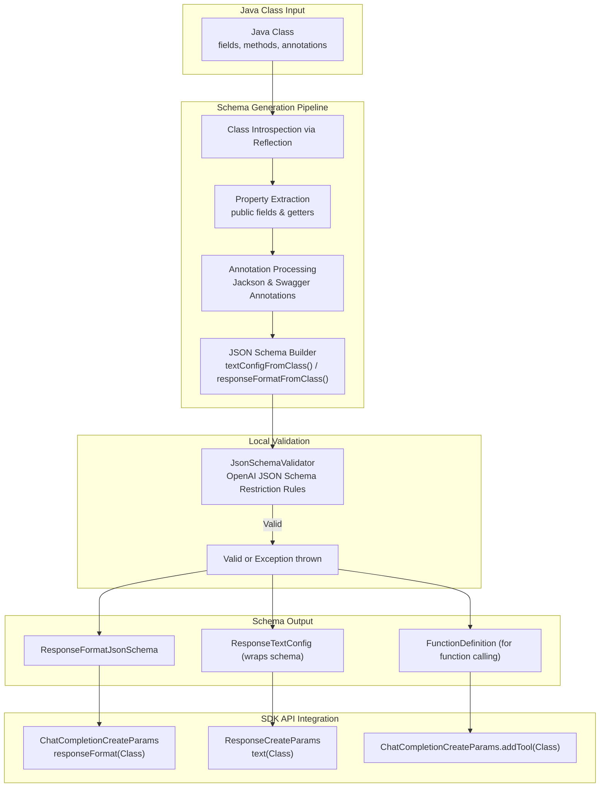
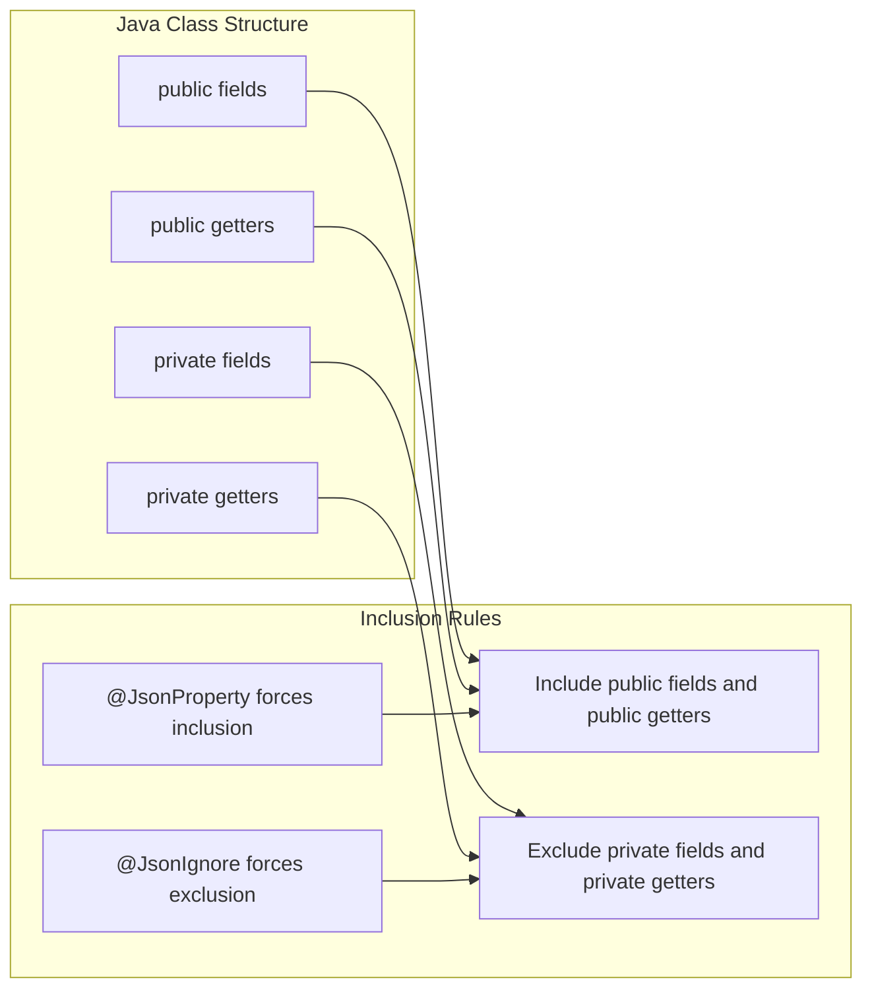
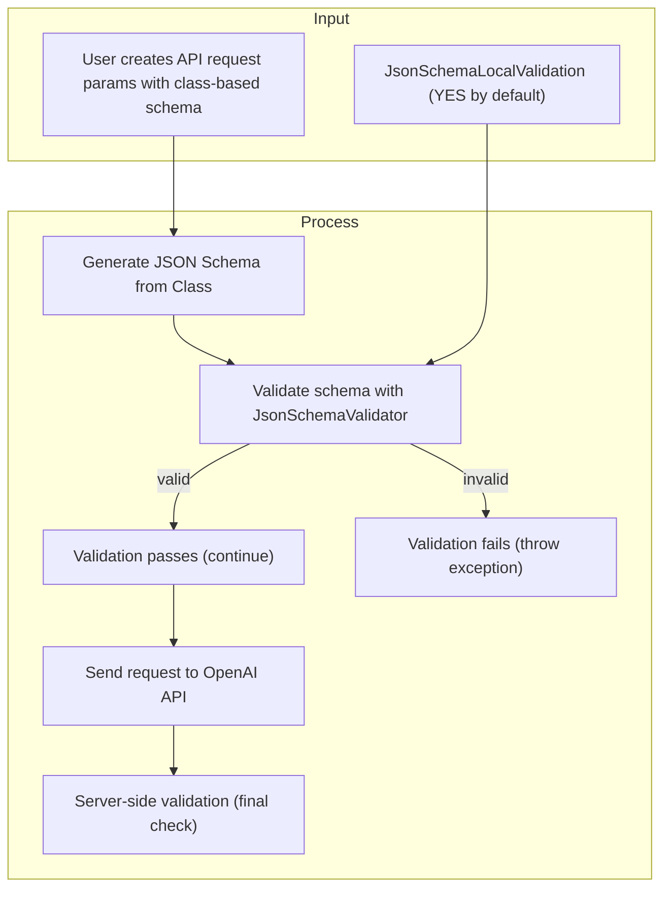
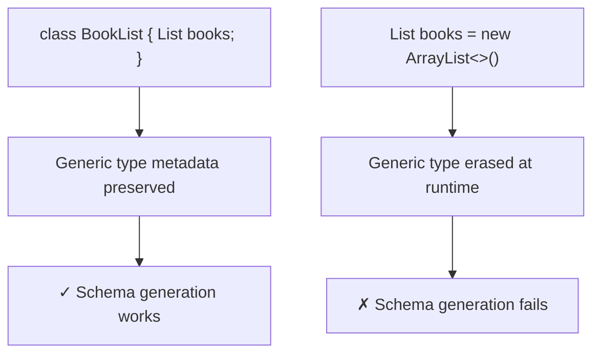

<!-- source: DeepWiki mcp.deepwiki.com · repo openai/openai-java · page 6.1 JSON Schema Generation · fetched 2026-10-26 -->

# JSON Schema Generation

<details>
<summary>Relevant source files</summary>

The following files were used as context for generating this wiki page:

- [openai-java-core/src/main/kotlin/com/openai/core/JsonSchemaValidator.kt](openai-java-core/src/main/kotlin/com/openai/core/JsonSchemaValidator.kt)
- [openai-java-core/src/main/kotlin/com/openai/core/StructuredOutputs.kt](openai-java-core/src/main/kotlin/com/openai/core/StructuredOutputs.kt)
- [openai-java-core/src/main/kotlin/com/openai/models/responses/StructuredResponseOutputMessage.kt](openai-java-core/src/main/kotlin/com/openai/models/responses/StructuredResponseOutputMessage.kt)
- [openai-java-core/src/test/kotlin/com/openai/core/StructuredOutputsTest.kt](openai-java-core/src/test/kotlin/com/openai/core/StructuredOutputsTest.kt)
- [openai-java-core/src/test/kotlin/com/openai/core/StructuredOutputsTestUtils.kt](openai-java-core/src/test/kotlin/com/openai/core/StructuredOutputsTestUtils.kt)
- [openai-java-core/src/test/kotlin/com/openai/models/responses/StructuredResponseOutputMessageTest.kt](openai-java-core/src/test/kotlin/com/openai/models/responses/StructuredResponseOutputMessageTest.kt)
- [openai-java-example/src/main/java/com/openai/example/StructuredOutputsExample.java](openai-java-example/src/main/java/com/openai/example/StructuredOutputsExample.java)

</details>


This page documents how JSON schemas are automatically generated from Java classes to support OpenAI's [Structured Outputs](https://platform.openai.com/docs/guides/structured-outputs) feature using the OpenAI Java SDK. It details the process of schema generation from Java types, local validation of schemas according to OpenAI API restrictions, and the SDK helpers for configuring response formats and text configurations with generated schemas.

Structured outputs enable calling models with a JSON schema describing the expected output structure, with seamless serialization/deserialization to and from Java types while enforcing response shape constraints.

## Purpose and Scope

The JSON schema generation facility in the SDK automatically:

1. Converts Java classes to JSON schemas by introspecting their fields, methods, and relevant annotations.
2. Validates the generated schema locally before sending requests to ensure compliance with OpenAI API schema restrictions.
3. Integrates the generated schema into API request payloads for structured output enforcement.
4. Deserializes model responses into instances of the original Java classes, enabling type-safe access.

This process automates and simplifies enabling structured outputs, eliminating manual schema authoring and boosting developer productivity.

**Sources:**  
[openai-java-core/src/main/kotlin/com/openai/core/StructuredOutputs.kt:25-111]()

---

## Schema Generation Architecture



**Key Classes & Functions:**

- `textConfigFromClass(Class<T>, JsonSchemaLocalValidation)`  
  Generates a `ResponseFormatTextJsonSchemaConfig` wrapping the schema derived from a class.

- `responseFormatFromClass(Class<T>, JsonSchemaLocalValidation)`  
  Generates a `ResponseFormatJsonSchema` wrapping the schema for use in chat completions.

- `extractFunctionInfo(Class<T>, JsonSchemaLocalValidation)`  
  Extracts function name, description, and parameters schema from a class for function calling.

- `JsonSchemaValidator`  
  Performs local validation on generated schemas enforcing OpenAI API constraints.

**Sources:**  
[openai-java-core/src/main/kotlin/com/openai/core/StructuredOutputs.kt:40-159]()  
[openai-java-core/src/main/kotlin/com/openai/core/JsonSchemaValidator.kt:7-155]()  

---

## Property Extraction from Java Classes

Schema generation relies on Java reflection and annotations to infer the JSON schema properties.



### Property Naming

- Public fields are used as property names directly.
- Public getters following Java bean conventions define properties named after the getter (e.g. `getName()` → `"name"`).
- Non-public fields/getters are excluded by default unless annotated with `@JsonProperty` to override exclusion.
- `@JsonIgnore` explicitly excludes a public field/getter from the schema.

### Supported Types

- Primitive types (int, long, double, boolean) and their boxed counterparts.
- `String`
- `java.util.Optional<T>` to mark optional properties.
- Collection types `List<T>`, `Set<T>` (generic parameter type preserved).
- Nested classes (recursively encoded as nested JSON schema objects).
- `Map<K, V>` is encoded as an object with no named properties (an empty `"properties"` block).

### Optionality

- Properties wrapped in `Optional<T>` are not included in the `required` list. 
- All other properties are implicitly required.

**Sources:**  
[openai-java-core/src/main/kotlin/com/openai/core/StructuredOutputs.kt:1-111]()  
[openai-java-core/src/test/kotlin/com/openai/core/StructuredOutputsTest.kt:79-150]()  

---

## Annotation-Based Schema Customization

The SDK leverages Jackson and OpenAPI Swagger annotations to customize generated schemas.

### Jackson Annotations

| Annotation                     | Purpose                                   | Usage                 |
|-------------------------------|-------------------------------------------|-----------------------|
| `@JsonIgnore`                 | Exclude field/getter from schema          | Field or getter method|
| `@JsonProperty`               | Force inclusion of non-public property    | Field or getter method|
| `@JsonPropertyDescription`   | Adds description to a JSON property       | Field or getter method|
| `@JsonClassDescription`      | Adds description at class schema level    | Class declaration      |

```java
@JsonClassDescription("Book with author details")
class Book {
    @JsonPropertyDescription("Title of the book")
    public String title;

    @JsonIgnore
    public String internalId; // Not included in schema

    @JsonProperty
    private String isbn; // Included despite private access
}
```

### OpenAPI Swagger (io.swagger.v3.oas.annotations)

Adds schema constraints like min/max for arrays, pattern/format for strings, and min/max for numbers.

| Annotation                     | Supported Constraints                    | Usage example                                 |
|-------------------------------|-----------------------------------------|-----------------------------------------------|
| `@ArraySchema(minItems=..., maxItems=...)` | Array size limits                        | `@ArraySchema(minItems=1, maxItems=10)`       |
| `@Schema(pattern=..., format=..., minimum=..., maximum=...)` | Various field constraints                  | `@Schema(pattern="^[A-Z]+$", minimum="0")`    |

The generated schema respects these constraints and includes them as keywords.

### Precedence

If both Jackson and Swagger annotations define the same property (e.g., description), the Jackson value takes precedence.

**Sources:**  
[openai-java-core/src/test/kotlin/com/openai/core/StructuredOutputsTest.kt:3-108]()  
[README.md:636-728]()  

---

## Local Schema Validation

Before sending a request with a generated JSON schema, the SDK performs local validation to ensure compliance with OpenAI's schema restrictions.



### Validation Behavior

- The default is `JsonSchemaLocalValidation.YES`, which performs synchronous, in-process validation.
- If the schema is invalid per OpenAI restrictions, an exception is thrown before the network call, preventing unnecessary API traffic.
- Validation includes checks on:
  - Schema nesting depth,
  - Allowed keywords,
  - Supported data types,
  - Maximum total string lengths,
  - Required properties presence.
- Constraint *values* are not checked for correctness (e.g., an invalid `format` string will pass local validation).
- Users can opt out of local validation by specifying `JsonSchemaLocalValidation.NO`, forwarding schema validation responsibility solely to the API.

### Example Usage

```java
StructuredChatCompletionCreateParams<BookList> params =
    ChatCompletionCreateParams.builder()
        .model(ChatModel.GPT_4O_MINI)
        .addUserMessage("List famous novels")
        .responseFormat(BookList.class, JsonSchemaLocalValidation.NO)  // disable local validation
        .build();

StructuredResponseCreateParams<BookList> params =
    ResponseCreateParams.builder()
        .input("List famous novels")
        .model(ChatModel.GPT_4O_MINI)
        .text(BookList.class, JsonSchemaLocalValidation.YES)  // default, with validation
        .build();
```

**Sources:**  
[openai-java-core/src/main/kotlin/com/openai/core/JsonSchemaValidator.kt:7-155]()  
[openai-java-core/src/main/kotlin/com/openai/core/StructuredOutputs.kt:63-86]()  
[openai-java-core/src/main/kotlin/com/openai/models/responses/StructuredResponseCreateParams.kt:356-369]()  

---

## Integration with API Endpoints

The SDK seamlessly integrates JSON schema generation and validation with the API request builders for both the Chat Completions and Responses APIs.

### Chat Completions API Integration

- The `ChatCompletionCreateParams` builder exposes a `responseFormat(Class<T>)` method.
- When specified, it generates a JSON schema for the class `T` and wraps it in `ResponseFormatJsonSchema`.
- The builder returns a specialized `StructuredChatCompletionCreateParams.Builder<T>` to enforce type propagation.
- The schema is sent as part of the `response_format` field in the API request.
- Responses are deserialized automatically to instances of `T`.

```mermaid
graph LR
    Builder["ChatCompletionCreateParams.builder()"]
    AddUserMsg["addUserMessage(...)"]
    SetModel["model(ChatModel)"]
    AddResponseFormat["responseFormat(Class<T>)"]
    SchemaGen["Generate JSON schema (textConfigFromClass)"]
    TypeSafeBuilder["StructuredChatCompletionCreateParams.Builder<T>"]
    Build["build()"]
    HttpRequest["POST /v1/chat/completions with response_format"]
    HttpResponse["JSON response"]
    Deserialize["Deserialize to Class<T>"]
    TypedAccess["Typed access via message().content()"]

    Builder --> AddUserMsg --> SetModel --> AddResponseFormat
    AddResponseFormat --> SchemaGen --> TypeSafeBuilder --> Build --> HttpRequest --> HttpResponse --> Deserialize --> TypedAccess
```



**Example snippet:**

```java
StructuredChatCompletionCreateParams<BookList> params =
    ChatCompletionCreateParams.builder()
        .addUserMessage("List famous 20th century novels")
        .model(ChatModel.GPT_4O_MINI)
        .responseFormat(BookList.class) // triggers schema gen
        .build();

client.chat().completions().create(params)
    .choices().stream()
    .flatMap(choice -> choice.message().content().stream())
    .flatMap(bookList -> bookList.books.stream())
    .forEach(book -> System.out.println(book.title + " by " + book.author.name));
```

**Sources:**  
[openai-java-core/src/main/kotlin/com/openai/models/responses/StructuredResponseCreateParams.kt:7-20]()  
[openai-java-core/src/test/kotlin/com/openai/core/StructuredOutputsTest.kt:79-150]()  
[openai-java-example/src/main/java/com/openai/example/StructuredOutputsExample.java:14-75]()  

---

### Responses API Integration

- The `ResponseCreateParams` builder has a `text(Class<T>)` method to specify that the response text should conform to a JSON schema derived from `T`.
- This internally calls `textConfigFromClass(Class<T>)` to generate a compatible `ResponseFormatTextJsonSchemaConfig`.
- The builder returns a specialized `StructuredResponseCreateParams.Builder<T>` enforcing typing.
- The schema is sent in the `text` field inside the request payload.
- Responses are deserialized back to `T`.

```mermaid
graph LR
    Builder["ResponseCreateParams.builder()"]
    SetInput["input(...)"]
    SetModel["model(ResponsesModel)"]
    TextSchema["text(Class<T>) (schema generation)"]
    StructuredBuilder["StructuredResponseCreateParams.Builder<T>"]
    Build["build()"]
    HttpRequest["POST /v1/responses with JSON schema"]
    HttpResponse["API JSON response"]
    Deserialize["Deserialize to Class<T>"]
    TypedAccess["Typed access via Response"]

    Builder --> SetInput --> SetModel --> TextSchema --> StructuredBuilder --> Build --> HttpRequest --> HttpResponse --> Deserialize --> TypedAccess
```



There is also an option to build a `ResponseTextConfig` explicitly with `.format(Class<T>)` to separately configure verbosity or other text config options.

**Example snippet:**

```java
StructuredResponseCreateParams<BookList> params =
    ResponseCreateParams.builder()
        .input("List famous 20th century novels")
        .model(ChatModel.GPT_4O_MINI)
        .text(BookList.class) // triggers schema generation
        .build();

Response response = client.responses().create(params);
```

**Sources:**  
[openai-java-core/src/main/kotlin/com/openai/models/responses/StructuredResponseCreateParams.kt:344-380]()  

---

### Function Calling Integration

- The SDK supports defining a function tool by passing a Java class representing the function's input parameters.
- The schema derived from the class is used to define the function's parameter JSON schema.
- The class's simple name or `@JsonTypeName` annotation provides the function name.
- The class-level `@JsonClassDescription` (if present) becomes the function description.
- The function definition is wrapped in `ChatCompletionFunctionTool` and added via `addTool(Class<T>)` on the chat completion request builder.

**Example snippet:**

```java
@JsonClassDescription("Gets the quality of the given SDK")
class GetSdkQuality {
    @JsonPropertyDescription("The name of the SDK")
    public String name;

    public SdkQuality execute() {
        return new SdkQuality(name, name.contains("OpenAI") ? "Robust!" : "*shrug*");
    }
}

ChatCompletionCreateParams params = ChatCompletionCreateParams.builder()
    .model(ChatModel.GPT_3_5_TURBO)
    .addUserMessage("How good is the OpenAI Java SDK?")
    .addTool(GetSdkQuality.class) // schema generated for function params
    .build();
```

**Sources:**  
[openai-java-core/src/main/kotlin/com/openai/core/StructuredOutputs.kt:114-159]()  

---

## Generic Type Erasure Limitations



Because Java erases generic type information at runtime, generic types declared in local variables or parameters lose actual generic type parameters, causing schema generation to fail or produce incomplete schemas.

**Recommended Practice:**

- Always wrap generic containers within a named class to preserve generic type information for schema generation.

```java
class BookList {
  public List<Book> books; // generic info retained in class metadata
}

StructuredResponseCreateParams<BookList> params =
    ResponseCreateParams.builder()
        .text(BookList.class) // succeeds
        .build();
```

**Sources:**  
[openai-java-core/src/test/kotlin/com/openai/core/StructuredOutputsTest.kt:117-149]()  

---

## Summary Table of Schema Generation Flow

| Step                       | Component / Function                                         | Location (File:lines)                                    | Description                         |
|----------------------------|-------------------------------------------------------------|----------------------------------------------------------|-----------------------------------|
| 1. Java class as input      | User-supplied Class<T>                                      | User code                                                | Defines schema structure           |
| 2. Generate schema         | `textConfigFromClass`, `responseFormatFromClass`           | `openai-java-core/src/main/kotlin/com/openai/core/StructuredOutputs.kt:40-111` | Builds JSON schema from class     |
| 3. Local validation        | `JsonSchemaValidator`                                        | `openai-java-core/src/main/kotlin/com/openai/core/JsonSchemaValidator.kt:7-155` | Checks restrictions compliance    |
| 4. Wrap as SDK type        | `ResponseFormatJsonSchema`, `ResponseFormatTextJsonSchemaConfig`, `FunctionDefinition` | Various                                                    | Wraps JSON schema for API fields  |
| 5. Build request params    | `StructuredChatCompletionCreateParams.Builder`, `StructuredResponseCreateParams.Builder` | `openai-java-core/src/main/kotlin/com/openai/models/responses/StructuredResponseCreateParams.kt:320-380` | Incorporate schema into request    |
| 6. Send HTTP request       | `/v1/chat/completions` or `/v1/responses`                   | HTTP layer                                               | JSON schema embedded in payload    |
| 7. Receive JSON response   | Model output JSON                                           | OpenAI API                                               | Output conforms to schema          |
| 8. Deserialize response    | Jackson ObjectMapper                                         | Core serialization                                       | JSON to Java type deserialization  |
| 9. Typed access            | `StructuredResponseOutputMessage<T>`, `StructuredChatCompletion<T>` | `openai-java-core/src/main/kotlin/com/openai/models/responses/StructuredResponseOutputMessage.kt:1-176` | Type-safe getters for output       |

**Sources:**  
[openai-java-core/src/main/kotlin/com/openai/core/StructuredOutputs.kt]()  
[openai-java-core/src/main/kotlin/com/openai/core/JsonSchemaValidator.kt]()  
[openai-java-core/src/main/kotlin/com/openai/models/responses/StructuredResponseCreateParams.kt]()  

---

This completes the technical overview of JSON Schema Generation within the OpenAI Java SDK, covering schema derivation from classes, local validation with OpenAI restrictions, and integration with Chat Completions, Responses API, and function calling features.

---

