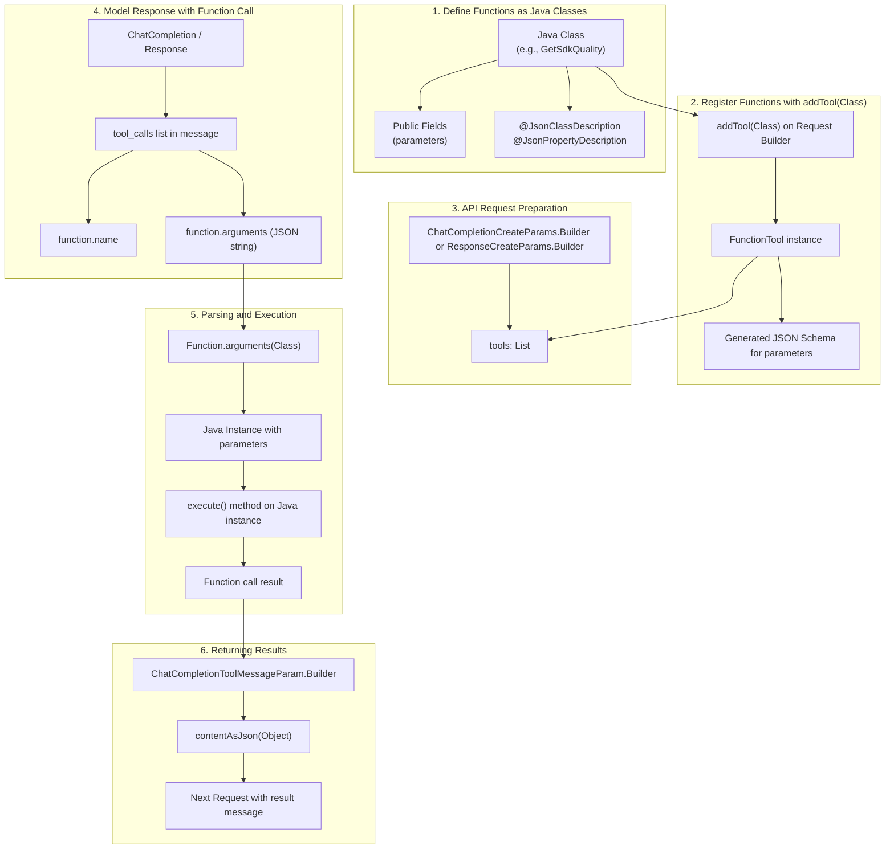
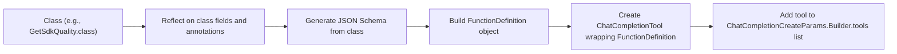
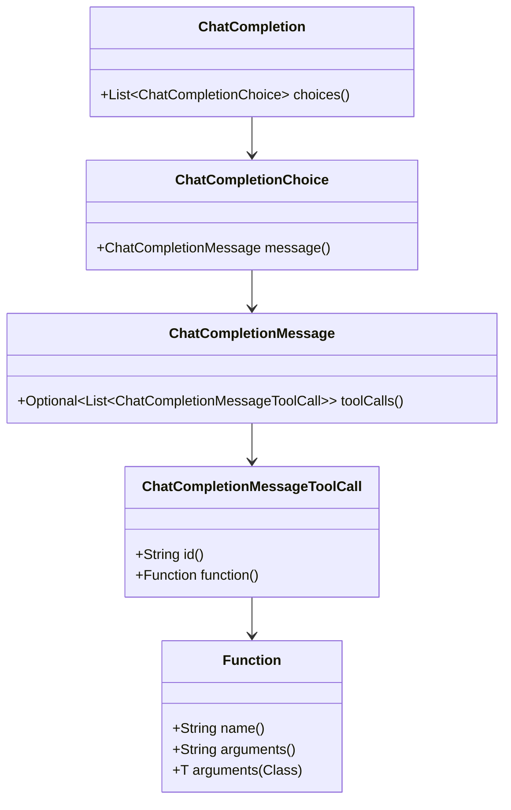
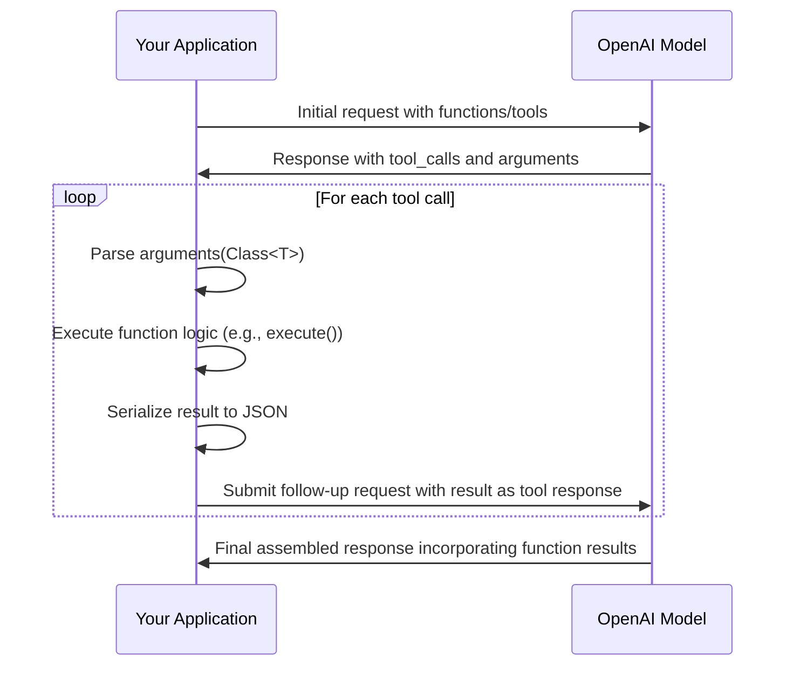

<!-- source: DeepWiki mcp.deepwiki.com · repo openai/openai-java · page 6.2 Function Calling · fetched 2026-10-26 -->

# Function Calling

<details>
<summary>Relevant source files</summary>

The following files were used as context for generating this wiki page:

- [openai-java-core/src/main/kotlin/com/openai/models/beta/responses/BetaResponseFunctionToolCallOutputItem.kt](openai-java-core/src/main/kotlin/com/openai/models/beta/responses/BetaResponseFunctionToolCallOutputItem.kt)
- [openai-java-core/src/main/kotlin/com/openai/models/chat/completions/StructuredChatCompletionCreateParams.kt](openai-java-core/src/main/kotlin/com/openai/models/chat/completions/StructuredChatCompletionCreateParams.kt)
- [openai-java-core/src/main/kotlin/com/openai/models/responses/ResponseFunctionToolCallOutputItem.kt](openai-java-core/src/main/kotlin/com/openai/models/responses/ResponseFunctionToolCallOutputItem.kt)
- [openai-java-core/src/main/kotlin/com/openai/models/responses/StructuredResponse.kt](openai-java-core/src/main/kotlin/com/openai/models/responses/StructuredResponse.kt)
- [openai-java-core/src/main/kotlin/com/openai/models/responses/StructuredResponseCreateParams.kt](openai-java-core/src/main/kotlin/com/openai/models/responses/StructuredResponseCreateParams.kt)
- [openai-java-core/src/main/kotlin/com/openai/models/responses/StructuredResponseOutputItem.kt](openai-java-core/src/main/kotlin/com/openai/models/responses/StructuredResponseOutputItem.kt)
- [openai-java-core/src/test/kotlin/com/openai/models/beta/responses/BetaResponseFunctionToolCallOutputItemTest.kt](openai-java-core/src/test/kotlin/com/openai/models/beta/responses/BetaResponseFunctionToolCallOutputItemTest.kt)
- [openai-java-core/src/test/kotlin/com/openai/models/chat/completions/StructuredChatCompletionCreateParamsTest.kt](openai-java-core/src/test/kotlin/com/openai/models/chat/completions/StructuredChatCompletionCreateParamsTest.kt)
- [openai-java-core/src/test/kotlin/com/openai/models/responses/ResponseFunctionToolCallOutputItemTest.kt](openai-java-core/src/test/kotlin/com/openai/models/responses/ResponseFunctionToolCallOutputItemTest.kt)
- [openai-java-core/src/test/kotlin/com/openai/models/responses/StructuredResponseCreateParamsTest.kt](openai-java-core/src/test/kotlin/com/openai/models/responses/StructuredResponseCreateParamsTest.kt)
- [openai-java-core/src/test/kotlin/com/openai/models/responses/StructuredResponseTest.kt](openai-java-core/src/test/kotlin/com/openai/models/responses/StructuredResponseTest.kt)

</details>


This page documents the Function Calling feature in the OpenAI Java SDK, enabling models to invoke external functions defined in your Java application code. This functionality enables bidirectional communication where the model can request a function call with parameters, and your application executes the function and returns results back to the model. It applies to both the Chat Completions API and the Responses API.

For related information on JSON schema generation and structured outputs, see [JSON Schema Generation](#6.1).

## Purpose and Scope

Function calling supports integrating custom logic directly into language model interactions by:

- Defining functions using Java classes annotated to describe parameters and purpose
- Registering these Java function classes as tools in API requests via `addTool(Class<T>)`
- Parsing function calls from model responses, including argument deserialization
- Executing corresponding Java functions with parsed arguments
- Returning function call results to the model by embedding them in tool response messages

## Function Calling Architecture



The process involves generating a JSON schema from the Java class representing the function’s parameters and attaching this as a tool to the API request. When the model responds with function call requests including argument JSON strings, the SDK parses these into Java instances, executes the function logic, and sends results back using structured messages.

**Sources:** [README.md:729-806](), [openai-java-core/src/main/kotlin/com/openai/models/responses/Tool.kt:34-527]()

---

## Defining Functions with Java Classes

Functions are declared using Java classes following these principles:

- The class name is used as the function name.
- Public fields in the class define the parameters accepted by the function.
- Optional Jackson annotations provide human-readable descriptions for the function and its parameters to improve model understanding.
- An optional `execute()` method can implement actual function logic, returning a result object or primitive.

### Example: Basic Function Definition

```java
@JsonClassDescription("Gets the quality of the given SDK.")
static class GetSdkQuality {
    @JsonPropertyDescription("The name of the SDK.")
    public String name;

    public SdkQuality execute() {
        return new SdkQuality(
            name, 
            name.contains("OpenAI") ? "It's robust and polished!" : "*shrug*"
        );
    }
}
```

Here, the class `GetSdkQuality` corresponds to a function named `"GetSdkQuality"` with a single `name` parameter and an `execute()` method providing the logic.

### Key Requirements for Functions

| Aspect           | Requirement                                     | Details                                                                        |
|------------------|------------------------------------------------|--------------------------------------------------------------------------------|
| Class Name       | Required                                       | Used as the function name                                                      |
| Fields           | Public fields or annotated getters/setters    | Parameters exposed to the model                                               |
| Field Types      | JSON-compatible types                           | Primitive types, String, Lists, nested classes                                |
| Annotations      | Optional but recommended                        | `@JsonClassDescription` for the class, `@JsonPropertyDescription` for fields   |
| Execute Method   | Optional                                       | Convenience method for function logic returning results                       |

### Example: Multiple Function Classes

```java
@JsonClassDescription("Gets the quality of the given SDK.")
static class GetSdkQuality {
    @JsonPropertyDescription("The name of the SDK.")
    public String name;

    public SdkQuality execute() {
        return new SdkQuality(
            name, 
            name.contains("OpenAI") ? "It's robust and polished!" : "*shrug*"
        );
    }
}

@JsonClassDescription("Gets the review score (out of 10) for the named SDK.")
static class GetSdkScore {
    public String name;

    public int execute() {
        return name.contains("OpenAI") ? 10 : 3;
    }
}
```

---

## Adding Functions to Requests

To use your defined functions, add them as tools on the request builder using `addTool(Class<T>)`.

### Example: Adding Tools to Chat Completion Request

```java
ChatCompletionCreateParams.Builder builder = ChatCompletionCreateParams.builder()
    .model(ChatModel.GPT_3_5_TURBO)
    .maxCompletionTokens(2048)
    .addTool(GetSdkQuality.class)
    .addTool(GetSdkScore.class)
    .addUserMessage("What's the quality and score of the OpenAI Java SDK?")
    .build();
```

This automatically translates the Java classes into `FunctionTool` definitions with JSON schema parameters included.

### Detailed Flow of addTool()



The SDK reflects on the Java class, generates JSON Schema for the parameters including any field and class descriptions, constructs a `FunctionDefinition`, wraps it in a `ChatCompletionTool`, then adds the tool to the list in the request parameters.

**Sources:** [README.md:797-801](), [README.md:729-747]()

---

## Processing Function Call Responses

When the model calls a function, the response includes tool calls describing functions to invoke.

### Response Structure Key Classes



### Parsing Function Arguments

The function call includes arguments as a JSON string. Use `Function.arguments(Class<T>)` to deserialize:

```java
List<ChatCompletionMessageToolCall> toolCalls = chatCompletion.choices().get(0).message().toolCalls().orElse(Collections.emptyList());

for (ChatCompletionMessageToolCall call : toolCalls) {
    String functionName = call.function().name();
    if ("GetSdkQuality".equals(functionName)) {
        GetSdkQuality params = call.function().arguments(GetSdkQuality.class);
        String sdkName = params.name;
        // Now call execute() or other logic
    }
}
```

`arguments(Class<T>)` returns an instance of your Java parameter class populated with values from the model's JSON arguments.

**Sources:** [README.md:798-799]()

---

## Executing Functions and Returning Results

After receiving a function call and parsing its arguments, your application typically executes the function logic and sends the results back to the model in a follow-up message.

### Execution and Response Flow



### Returning Results via `contentAsJson()`

Results can be returned to the model by creating a `ChatCompletionToolMessageParam` whose content is the function's result serialized automatically to JSON:

```java
GetSdkQuality params = toolCall.function().arguments(GetSdkQuality.class);
SdkQuality result = params.execute();

ChatCompletionToolMessageParam toolMessage = ChatCompletionToolMessageParam.builder()
    .toolCallId(toolCall.id())
    .contentAsJson(result)  // Converts object to JSON automatically
    .build();

List<ChatCompletionMessageParam> messages = new ArrayList<>();
messages.add(chatCompletion.choices().get(0).message());
messages.add(toolMessage);

ChatCompletionCreateParams followUp = ChatCompletionCreateParams.builder()
    .model(ChatModel.GPT_3_5_TURBO)
    .messages(messages)
    .build();

ChatCompletion finalResponse = client.chat().completions().create(followUp);
```

### `contentAsJson()` Accepts

- Custom objects (e.g., `SdkQuality` instance)
- Simple types like `String`, boxed primitives
- Collections: `List`, `Map`, etc.
- Any Jackson-serializable object

**Sources:** [README.md:802-806]()

---

## Complete Function Calling Example

### 1. Define Function Classes

```java
@JsonClassDescription("Gets the quality of the given SDK.")
static class GetSdkQuality {
    @JsonPropertyDescription("The name of the SDK.")
    public String name;

    public SdkQuality execute() {
        return new SdkQuality(
            name,
            name.contains("OpenAI") ? "It's robust and polished!" : "*shrug*"
        );
    }
}

static class SdkQuality {
    public String quality;

    public SdkQuality(String name, String evaluation) {
        quality = name + ": " + evaluation;
    }
}
```

### 2. Build Initial Request with Functions

```java
ChatCompletionCreateParams params = ChatCompletionCreateParams.builder()
    .model(ChatModel.GPT_3_5_TURBO)
    .addTool(GetSdkQuality.class)
    .addUserMessage("What's the quality of the OpenAI Java SDK?")
    .build();

ChatCompletion chatCompletion = client.chat().completions().create(params);
```

### 3. Parse and Execute Function Calls

```java
List<ChatCompletionMessageToolCall> toolCalls = chatCompletion.choices().get(0).message().toolCalls().orElse(Collections.emptyList());
List<ChatCompletionMessageParam> messages = new ArrayList<>();
messages.add(chatCompletion.choices().get(0).message()); // Keep previous messages

for (ChatCompletionMessageToolCall toolCall : toolCalls) {
    GetSdkQuality params = toolCall.function().arguments(GetSdkQuality.class);
    SdkQuality result = params.execute();

    ChatCompletionToolMessageParam toolMessage = ChatCompletionToolMessageParam.builder()
        .toolCallId(toolCall.id())
        .contentAsJson(result)
        .build();

    messages.add(toolMessage);
}
```

### 4. Submit Follow-up Request with Results

```java
ChatCompletionCreateParams followUp = ChatCompletionCreateParams.builder()
    .model(ChatModel.GPT_3_5_TURBO)
    .messages(messages)
    .build();

ChatCompletion finalResponse = client.chat().completions().create(followUp);
String answer = finalResponse.choices().get(0).message().content().orElse("");
```

**Sources:** [README.md:764-806]()

---

## Advanced Topics

### Using Annotations for Better Descriptions

Providing class and field annotations enhances function discoverability and usability by the model.

```java
@JsonClassDescription("Retrieves current weather information for a specified location")
static class GetWeather {
    @JsonPropertyDescription("The city name, e.g., 'San Francisco'")
    public String city;
    
    @JsonPropertyDescription("Temperature unit: 'celsius' or 'fahrenheit'")
    public String unit;
}
```

### Complex Parameter Types

Function parameters can be more complex objects with nested structures and collections:

```java
static class SearchDocuments {
    public String query;
    public List<String> categories;
    public FilterOptions filters;
    public Optional<Integer> maxResults;
}

static class FilterOptions {
    public String dateRange;
    public List<String> tags;
}
```

### Low-Level API Alternative

You can manually create `ChatCompletionTool` and `FunctionDefinition` instances bypassing `addTool(Class<T>)`, but this forfeits the automatic type-safe JSON schema generation.

```java
ChatCompletionTool tool = ChatCompletionTool.builder()
    .function(
        FunctionDefinition.builder()
            .name("get_weather")
            .description("Get current weather")
            .parameters(
                FunctionDefinition.Parameters.builder()
                    .putAdditionalProperty("type", JsonValue.from("object"))
                    .putAdditionalProperty(
                        "properties",
                        JsonValue.from(Map.of("city", Map.of("type", "string")))
                    )
                    .build()
            )
            .build()
    )
    .build();
```

**Sources:** [README.md:738-747](), [README.md:764-774]()

---

## Function Calling and Custom Tools

The SDK supports a rich set of tool types represented by the union type `Tool`. Function calling corresponds to the `FunctionTool` variant.

| Tool Type             | Purpose                              | Usage                          |
|-----------------------|------------------------------------|--------------------------------|
| **`FunctionTool`**      | User-defined application functions | Use `addTool(Class<T>)`          |
| **`FileSearchTool`**    | Search uploaded files               | Built-in                      |
| **`WebSearchTool`**     | Search the web                     | Built-in                      |
| **`CustomTool`**        | Custom input format handling       | Advanced use                   |
| **`CodeInterpreter`**   | Running Python code dynamically     | Built-in                      |
| Others                 | Computer use, MCP, shell, patches  | Various built-in               |

Function calling is the standard way to integrate bespoke Java logic into the model interaction flow.

**Sources:** [openai-java-core/src/main/kotlin/com/openai/models/responses/Tool.kt:34-527](), [openai-java-core/src/main/kotlin/com/openai/models/responses/CustomTool.kt:21-304]()

---

## Key Classes and Methods Reference

| Class                              | Description                                             | Location / Notes                             |
|-----------------------------------|---------------------------------------------------------|----------------------------------------------|
| `ChatCompletionCreateParams`      | Request parameters builder for chat completions         | Includes `addTool(Class<T>)` method          |
| `ChatCompletion`                  | Represents chat completion API response                  | Has choices, each with a message              |
| `ChatCompletionMessageToolCall`  | Represents tool call invocation in chat response        | Includes `Function` with call details         |
| `Function`                       | Function call details including name and JSON arguments  | Method `arguments(Class<T>)` to parse arguments |
| `ChatCompletionToolMessageParam` | Builder for tool response messages                        | Method `contentAsJson(Object)` to set result content |
| `FunctionTool`                   | Represents a function tool included in a request          | Created automatically by `addTool`             |
| `Tool`                           | Union type for various tool kinds                        | Wraps `FunctionTool` and other tool types     |

**Sources:** [README.md:729-806](), [openai-java-core/src/main/kotlin/com/openai/models/responses/Tool.kt:34-527]()

---

## Best Practices

### 1. Use Descriptive Names and Annotations

Provide precise names and descriptive annotations to improve function discoverability and correct usage by the model.

```java
@JsonClassDescription("Calculates total price including tax and discounts")
static class CalculateTotal {
    @JsonPropertyDescription("The base price before any calculations")
    public double basePrice;
    
    @JsonPropertyDescription("Tax rate as decimal (e.g. 0.08 for 8%)")
    public double taxRate;
}
```

### 2. Handle Cases when Model Does Not Call Functions

Always check for the presence of tool calls before attempting to handle them:

```java
Optional<List<ChatCompletionMessageToolCall>> toolCallsOpt = chatCompletion.choices()
    .get(0).message().toolCalls();

if (toolCallsOpt.isEmpty()) {
    // Model chose not to invoke any function; process text response instead
    String textResponse = chatCompletion.choices().get(0).message().content().orElse("");
}
```

### 3. Validate and Sanitize Function Results

Ensure the function results conform to expectations before sending:

```java
try {
    SdkQuality result = params.execute();
    if (result == null || result.quality == null) {
        // Handle invalid results gracefully
        result = new SdkQuality("error", "Could not determine quality");
    }
    toolMessage.contentAsJson(result);
} catch (Exception e) {
    // Handle errors by returning informative error messages
    toolMessage.contentAsJson(Map.of("error", e.getMessage()));
}
```

### 4. Keep Parameter Schemas Simple and Clear

Avoid overly complicated schemas which can confuse the model. Favor simple, flat JSON structures with explicit field descriptions.

---

# Summary

The OpenAI Java SDK provides a robust function calling mechanism that bridges between natural language prompts and type-safe Java code execution. Using `addTool(Class<T>)`, your function Java classes become callable tools by the model, enabling flexible and reliable integrations. Functions are executed locally with parsed arguments and their results passed back to the model in tool response messages, maintaining a clear and maintainable workflow.

**Sources:**  
- [README.md:729-806]()  
- [openai-java-core/src/main/kotlin/com/openai/models/responses/Tool.kt:34-527]()  
- [openai-java-core/src/main/kotlin/com/openai/models/chat/completions/StructuredChatCompletionCreateParams.kt:1-155]()  
- [openai-java-core/src/main/kotlin/com/openai/models/responses/StructuredResponseCreateParams.kt:1-165]()

---

