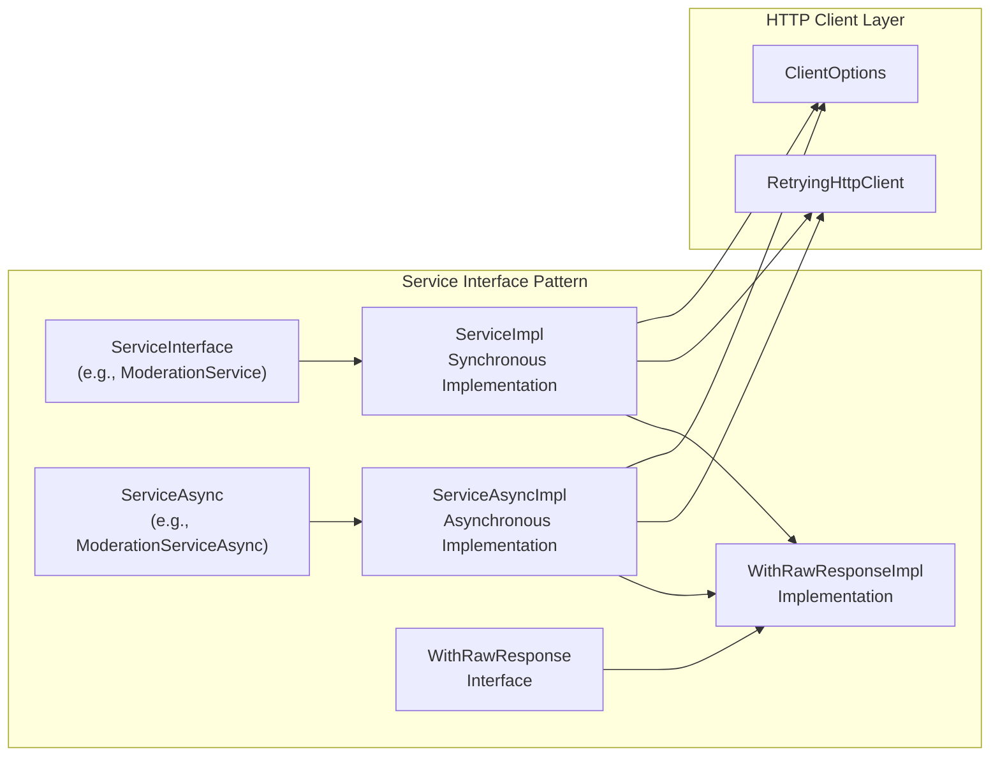
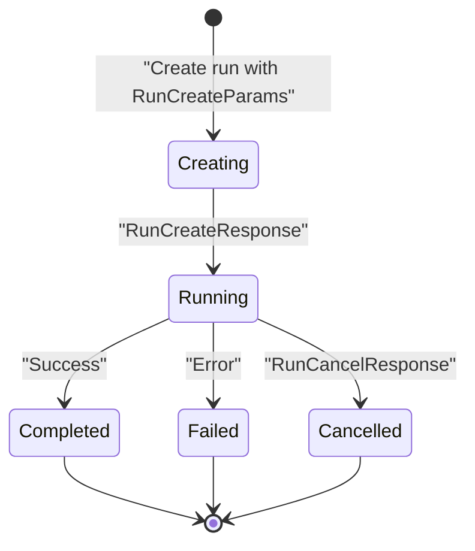
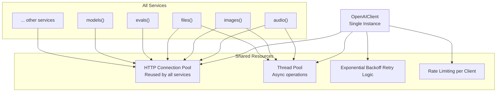

<!-- source: DeepWiki mcp.deepwiki.com · repo openai/openai-java · page 7 Other API Services · fetched 2026-10-26 -->

# Other API Services

<details>
<summary>Relevant source files</summary>

The following files were used as context for generating this wiki page:

- [openai-java-core/src/main/kotlin/com/openai/client/OpenAIClient.kt](openai-java-core/src/main/kotlin/com/openai/client/OpenAIClient.kt)
- [openai-java-core/src/main/kotlin/com/openai/client/OpenAIClientAsync.kt](openai-java-core/src/main/kotlin/com/openai/client/OpenAIClientAsync.kt)
- [openai-java-core/src/main/kotlin/com/openai/client/OpenAIClientAsyncImpl.kt](openai-java-core/src/main/kotlin/com/openai/client/OpenAIClientAsyncImpl.kt)
- [openai-java-core/src/main/kotlin/com/openai/client/OpenAIClientImpl.kt](openai-java-core/src/main/kotlin/com/openai/client/OpenAIClientImpl.kt)
- [openai-java-core/src/main/kotlin/com/openai/services/async/ModerationServiceAsync.kt](openai-java-core/src/main/kotlin/com/openai/services/async/ModerationServiceAsync.kt)
- [openai-java-core/src/main/kotlin/com/openai/services/blocking/ModerationService.kt](openai-java-core/src/main/kotlin/com/openai/services/blocking/ModerationService.kt)

</details>


This page provides an overview of API services available in the OpenAI Java SDK beyond the primary Chat Completions and Responses APIs. These services support specialized use cases including audio processing, image and video generation, embeddings, evaluations, file and vector store management, fine-tuning, moderation, and more.

For information about Chat Completions, see [Chat Completions](#4). For information about the Responses API, see [Responses API](#5). For structured outputs and function calling patterns that work across multiple services, see [Structured Outputs](#6).

## Service Architecture

All services in the SDK are accessed through the main client interfaces `OpenAIClient` (synchronous) and `OpenAIClientAsync` (asynchronous). These clients provide logically grouped services, instantiated lazily on demand.

The diagram below illustrates how application code interacts with the client and its numerous service APIs:

```mermaid
graph TB
    App["Application Code"]
    
    subgraph "Client Entry Point"
        SyncClient["OpenAIClient"]
        AsyncClient["OpenAIClientAsync"]
    end
    
    subgraph "Core Services"
        Completions["completions()"]
        Chat["chat()"]
        Embeddings["embeddings()"]
        Responses["responses()"]
    end
    
    subgraph "Media Services"
        Audio["audio()"]
        Images["images()"]
        Videos["videos()"]
    end
    
    subgraph "Storage & Management"
        Files["files()"]
        VectorStores["vectorStores()"]
        Uploads["uploads()"]
        Batches["batches()"]
    end
    
    subgraph "Model Operations"
        Models["models()"]
        FineTuning["fineTuning()"]
    end
    
    subgraph "Evaluation & Testing"
        Evals["evals()"]
        Graders["graders()"]
    end
    
    subgraph "Advanced Features"
        Beta["beta() - Assistants"]
        Realtime["realtime()"]
        Conversations["conversations()"]
        Moderations["moderations()"]
        Webhooks["webhooks()"]
        Containers["containers()"]
        Admin["admin()"]
        Safety["safety()"]
        Skills["skills()"]
        Live["live()"]
    end
    
    App --> SyncClient
    App --> AsyncClient
    
    SyncClient --> Completions
    SyncClient --> Chat
    SyncClient --> Embeddings
    SyncClient --> Responses
    SyncClient --> Audio
    SyncClient --> Images
    SyncClient --> Videos
    SyncClient --> Files
    SyncClient --> VectorStores
    SyncClient --> Uploads
    SyncClient --> Batches
    SyncClient --> Models
    SyncClient --> FineTuning
    SyncClient --> Evals
    SyncClient --> Graders
    SyncClient --> Beta
    SyncClient --> Realtime
    SyncClient --> Conversations
    SyncClient --> Moderations
    SyncClient --> Webhooks
    SyncClient --> Containers
    SyncClient --> Admin
    SyncClient --> Safety
    SyncClient --> Skills
    SyncClient --> Live
    
    AsyncClient --> Completions
    AsyncClient --> Chat
    AsyncClient --> Embeddings
    AsyncClient --> Responses
    AsyncClient --> Audio
    AsyncClient --> Images
    AsyncClient --> Videos
    AsyncClient --> Files
    AsyncClient --> VectorStores
    AsyncClient --> Uploads
    AsyncClient --> Batches
    AsyncClient --> Models
    AsyncClient --> FineTuning
    AsyncClient --> Evals
    AsyncClient --> Graders
    AsyncClient --> Beta
    AsyncClient --> Realtime
    AsyncClient --> Conversations
    AsyncClient --> Moderations
    AsyncClient --> Webhooks
    AsyncClient --> Containers
    AsyncClient --> Admin
    AsyncClient --> Safety
    AsyncClient --> Skills
    AsyncClient --> Live
```



**Sources:** [openai-java-core/src/main/kotlin/com/openai/client/OpenAIClient.kt:43-172](), [openai-java-core/src/main/kotlin/com/openai/client/OpenAIClientImpl.kt:51-177]()

## Service Categories

The SDK organizes the API services into distinct categories to address different use cases:

| Category           | Services                                                                                   | Purpose                                                        |
|--------------------|--------------------------------------------------------------------------------------------|----------------------------------------------------------------|
| **Core Text Generation** | `chat()`, `completions()`, `responses()`                                                 | Primary model interaction for text generation                  |
| **Media Processing**    | `audio()`, `images()`, `videos()`                                                        | Audio transcription, text-to-speech, image & video generation  |
| **Storage & Data**      | `files()`, `vectorStores()`, `uploads()`, `batches()`                                   | File and vector store management, batch operations              |
| **Model Management**    | `models()`, `fineTuning()`                                                               | Listing models, fine-tuning operations                          |
| **Evaluation**          | `evals()`, `graders()`                                                                   | Model evaluation and grading                                   |
| **Embeddings**          | `embeddings()`                                                                           | Vector representations of text for ML                          |
| **Advanced Features**   | `beta()`, `realtime()`, `conversations()`, `moderations()`, `webhooks()`, `containers()`, `admin()`, `safety()`, `skills()`, `live()` | Assistants (deprecated), real-time APIs, conversation management, content moderation, webhooks, container services, admin & safety management |

**Sources:** [openai-java-core/src/main/kotlin/com/openai/client/OpenAIClient.kt:65-105](), [openai-java-core/src/main/kotlin/com/openai/client/OpenAIClientImpl.kt:68-126]()

## Service Implementation Pattern

Each API service is implemented with a consistent pattern providing:

- **Synchronous service interface** with blocking methods.
- **Asynchronous service interface** returning `CompletableFuture`.
- **Raw HTTP response access** via nested `WithRawResponse` interfaces.

The following diagram illustrates the service interface and implementation relationships for a typical service such as `ModerationService`:



**Sources:** [openai-java-core/src/main/kotlin/com/openai/services/blocking/ModerationService.kt:13-67](), [openai-java-core/src/main/kotlin/com/openai/services/async/ModerationServiceAsync.kt:13-70]()

---

## Assistants API (Beta - Deprecated)

The Assistants API, previously available under the `beta()` namespace in the client, is now deprecated in favor of the newer and more flexible Responses API. 

Clients that still use assistants instantiate parameters like `AssistantCreateParams` and manage conversation threads, runs, and steps. However, it is strongly recommended to migrate to the Responses API, which supports richer multi-modal and tool-driven interactions.

For complete details, see the child page [Assistants (Beta - Deprecated)](#7.1).

**Sources:** [openai-java-core/src/main/kotlin/com/openai/models/beta/assistants/AssistantCreateParams.kt:1-50](), [openai-java-core/src/main/kotlin/com/openai/models/beta/threads/runs/RunCreateParams.kt:1-70]()

---

## Evaluations and Graders

The evaluations system enables comprehensive testing of model performance. It supports the creation of evaluation runs with varied data sources including JSONL files, completion data, and response objects. Grader models assist by providing automated scoring based on input messages, reasoning effort, and output sampling configuration.

**Evaluation Run Lifecycle**



**Evaluation Data Source Types**

```mermaid
graph TB
    DataSource["DataSource (Union Type)"]
    
    subgraph "JSONL Sources"
        JsonlFile["CreateEvalJsonlRunDataSource"]
        JsonlFileContent["Source.FileContent - Inline JSONL"]
        JsonlFileId["Source.FileId - Uploaded file reference"]
    end
    
    subgraph "Completions Sources"
        CompletionsSource["CreateEvalCompletionsRunDataSource"]
        CompletionsFileContent["Source.FileContent - Inline completions"]
        CompletionsFileId["Source.FileId"]
        StoredCompletions["Source.StoredCompletions"]
    end
    
    subgraph "Responses Sources"
        ResponsesSource["CreateEvalResponsesRunDataSource"]
        ResponsesFileContent["Source.FileContent"]
        ResponsesFileId["Source.FileId"]
        ResponsesStored["Source.Responses"]
    end
    
    DataSource --> JsonlFile
    DataSource --> CompletionsSource
    DataSource --> ResponsesSource
```



**Grader Model Example - ScoreModelGrader**

| Component         | Type                    | Description                             |
|-------------------|-------------------------|-------------------------------------|
| `input`           | List of input messages   | Inputs to grade (text/audio/images)  |
| `model`           | String                  | Model used for grading (e.g., "o3-mini") |
| `name`            | String                  | Grader name                         |
| `type`            | `"score_model"`         | Fixed value representing grader type |
| `range`           | List<Double>            | Score range, defaults to [0,1]      |
| `samplingParams`  | Sampling parameters     | Optional tuning (temperature, tokens, reasoning effort)|

For full details on evaluations and graders, see the child page [Evaluations and Graders](#7.2).

**Sources:** [openai-java-core/src/main/kotlin/com/openai/models/evals/runs/RunCreateParams.kt:50-380](), [openai-java-core/src/main/kotlin/com/openai/models/graders/gradermodels/ScoreModelGrader.kt:38-48]()

---

## Fine-Tuning and Models

Fine-tuning capabilities enable users to customize models tailored to specific tasks. The SDK provides interfaces for creating fine-tuning jobs, monitoring their progress, listing available models, and managing model permissions and checkpoints.

See the child page [Fine-Tuning and Models](#7.3) for details about job creation parameters, hyperparameters, and grader alpha API integration.

**Sources:** [openai-java-core/src/main/kotlin/com/openai/client/OpenAIClient.kt:100-110](), [openai-java-core/src/main/kotlin/com/openai/client/OpenAIClientImpl.kt:90-110]()

---

## Audio Services

Audio processing in the SDK covers:

- Speech-to-text transcription, including diarization and streaming
- Audio translation
- Text-to-speech generation

The `audio()` service provides these features with synchronous and asynchronous variants.

For advanced usage, see [Audio Services](#7.4).

**Sources:** [openai-java-core/src/main/kotlin/com/openai/client/OpenAIClient.kt:95-97](), [openai-java-core/src/main/kotlin/com/openai/client/OpenAIClientImpl.kt:90-100]()

---

## Image and Video Services

SDK support for visual media includes:

- Image generation, editing, and variation through `images()`
- Video creation, editing, extension, and character management through `videos()`

For detailed documentation, see [Image and Video Services](#7.5).

**Sources:** [openai-java-core/src/main/kotlin/com/openai/client/OpenAIClient.kt:90-95](), [openai-java-core/src/main/kotlin/com/openai/client/OpenAIClientImpl.kt:78-82](), [openai-java-core/src/main/kotlin/com/openai/client/OpenAIClient.kt:140-142]()

---

## Files, Uploads, Containers, and Vector Stores

The SDK provides rich file and storage management facilities:

- Uploading, retrieving, and deleting files (`files()` service)
- Managing multipart uploads and upload parts (`uploads()`)
- Container file management (`containers()`)
- Vector store creation and batch operations involving vectors and files (`vectorStores()` and `batches()`)

See [Files, Uploads, Containers and Vector Stores](#7.6) for a complete guide.

**Sources:** [openai-java-core/src/main/kotlin/com/openai/client/OpenAIClient.kt:85-120](), [openai-java-core/src/main/kotlin/com/openai/client/OpenAIClientImpl.kt:78-115]()

---

## Embeddings, Completions, Moderations, and Batches

These core services include:

- `embeddings()`: Generate vector representations of text for ML applications.
- Legacy `completions()`: Classic text completions API.
- `moderations()`: Content moderation for text and images.
- `batches()`: Batch API requests for asynchronous processing.

See [Embeddings, Completions, Moderations and Batches](#7.7) for extensive details.

**Moderation Service Usage:**

```java
ModerationCreateResponse response = client.moderations().create(
    ModerationCreateParams.builder()
        .input("Text to moderate")
        .build()
);
```

**Sources:** [openai-java-core/src/main/kotlin/com/openai/services/blocking/ModerationService.kt:13-67](), [openai-java-core/src/main/kotlin/com/openai/client/OpenAIClient.kt:77-79]()

---

## Realtime API

The `realtime()` service supports bi-directional applications allowing client-server event handling, audio configuration, and low-latency interactivity. This can be used for streaming conversations, live interactions, and other real-time scenarios.

For more information, see [Realtime API](#7.8).

**Sources:** [openai-java-core/src/main/kotlin/com/openai/client/OpenAIClient.kt:128-134]()

---

## Webhooks

The SDK supports webhook event handling through `webhooks()`. This service manages event unwrapping, signature verification, and classification of webhook event types.

For details, see [Webhooks](#7.9).

**Sources:** [openai-java-core/src/main/kotlin/com/openai/client/OpenAIClient.kt:110-116]()

---

## Admin, Safety, and Agents (Beta)

Advanced API areas include:

- Admin service (`admin()`): project management, API key management, audit logs, usage monitoring, invites, and external storage.
- Safety service (`safety()`): safety case management and automated checks.
- Beta Agents (`beta()`): agent sessions, environments, and credential vaults.

See [Admin, Safety and Agents (Beta)](#7.10) for detailed guidance.

**Sources:** [openai-java-core/src/main/kotlin/com/openai/client/OpenAIClient.kt:105-125]()

---

## Resource Management

All services share underlying client resources such as HTTP connection pools, thread pools, retry logic, and rate limiting. The SDK encourages reusing a single `OpenAIClient` instance to optimize resource usage.



The SDK uses the `PhantomReachableExecutorService` pattern to automatically release resources when clients are no longer referenced, but clients can also be manually closed via `client.close()`.

**Sources:** [openai-java-core/src/main/kotlin/com/openai/client/OpenAIClient.kt:29-42]()

---

## API Coverage Summary

The OpenAI Java SDK provides comprehensive coverage of OpenAI REST API endpoints, implementing over 130 endpoints across all service categories, ensuring extensive feature availability.

---

For detailed API usage and examples, consult the respective child pages:

- [Assistants (Beta - Deprecated)](#7.1)
- [Evaluations and Graders](#7.2)
- [Fine-Tuning and Models](#7.3)
- [Audio Services](#7.4)
- [Image and Video Services](#7.5)
- [Files, Uploads, Containers and Vector Stores](#7.6)
- [Embeddings, Completions, Moderations and Batches](#7.7)
- [Realtime API](#7.8)
- [Webhooks](#7.9)
- [Admin, Safety and Agents (Beta)](#7.10)

---

This concludes the overview of Other API Services in the OpenAI Java SDK.

**Sources:**  
- [openai-java-core/src/main/kotlin/com/openai/client/OpenAIClient.kt:1-184]()  
- [openai-java-core/src/main/kotlin/com/openai/client/OpenAIClientImpl.kt:1-158]()  
- [openai-java-core/src/main/kotlin/com/openai/services/blocking/ModerationService.kt:1-68]()  
- [openai-java-core/src/main/kotlin/com/openai/services/async/ModerationServiceAsync.kt:1-70]()  
- [openai-java-core/src/main/kotlin/com/openai/models/beta/assistants/AssistantCreateParams.kt:1-50]()  
- [openai-java-core/src/main/kotlin/com/openai/models/beta/threads/runs/RunCreateParams.kt:1-70]()  
- [openai-java-core/src/main/kotlin/com/openai/models/evals/runs/RunCreateParams.kt:50-380]()  
- [openai-java-core/src/main/kotlin/com/openai/models/graders/gradermodels/ScoreModelGrader.kt:30-60]()

---

