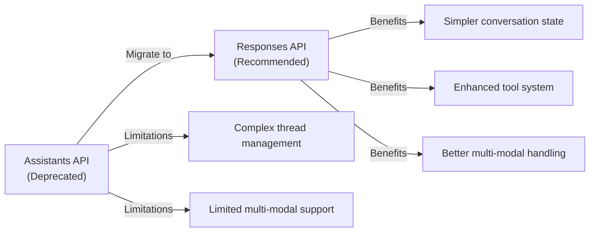
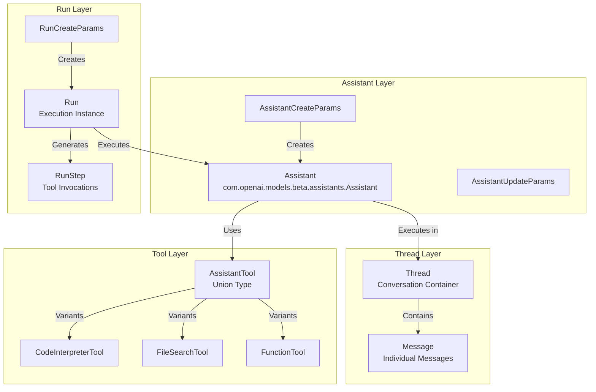
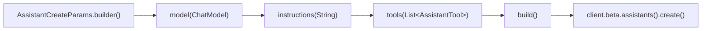
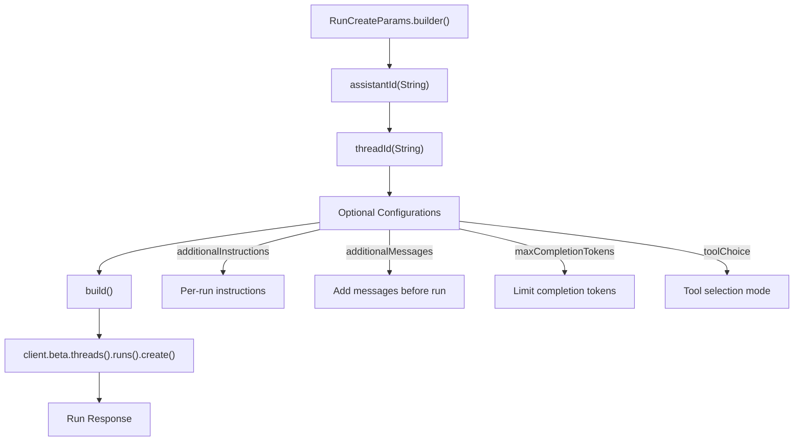
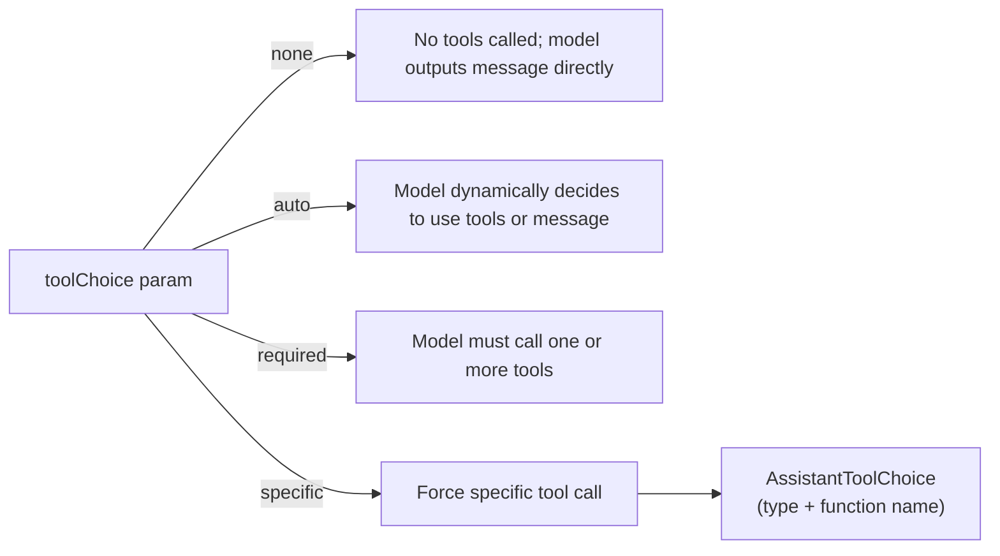
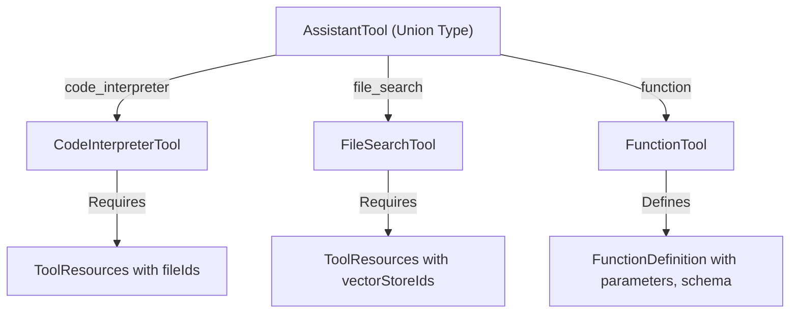
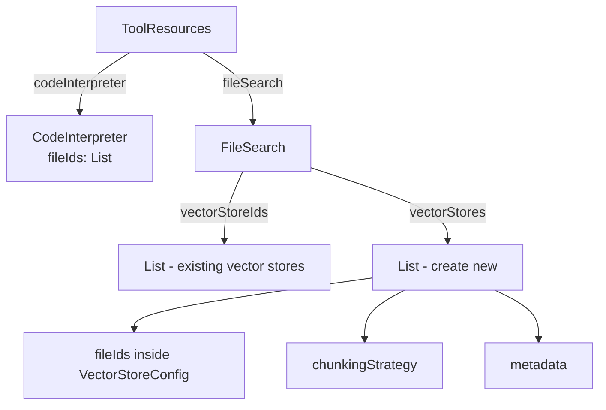
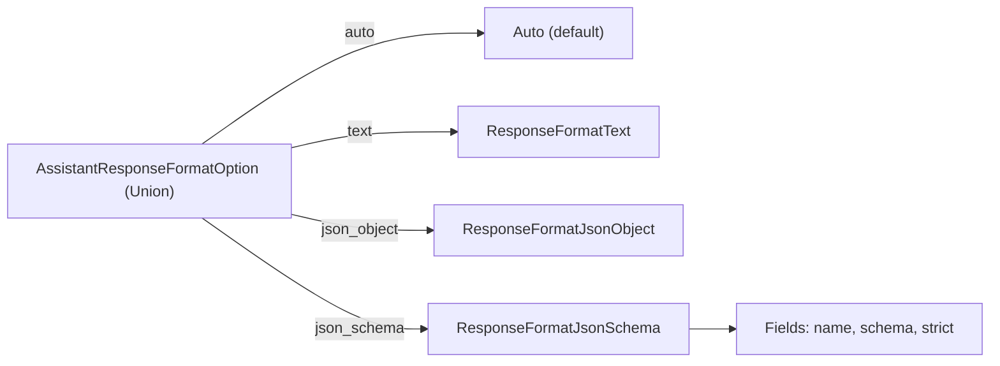
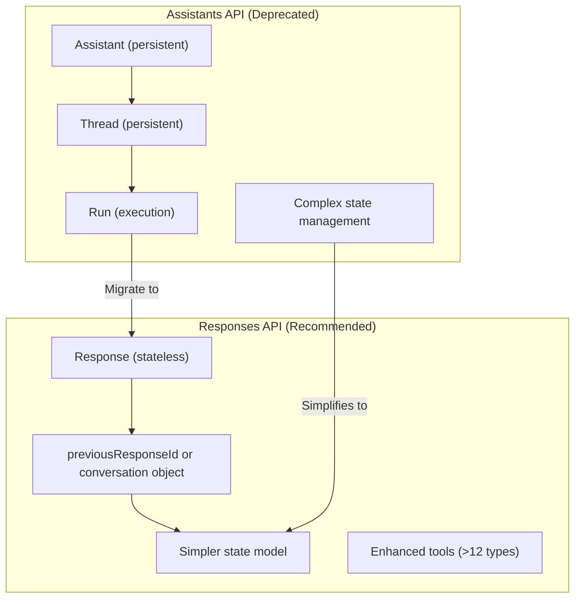

<!-- source: DeepWiki mcp.deepwiki.com · repo openai/openai-java · page 7.1 Assistants (Beta - Deprecated) · fetched 2026-10-26 -->

# Assistants (Beta - Deprecated)

<details>
<summary>Relevant source files</summary>

The following files were used as context for generating this wiki page:

- [openai-java-core/src/main/kotlin/com/openai/models/ReasoningEffort.kt](openai-java-core/src/main/kotlin/com/openai/models/ReasoningEffort.kt)
- [openai-java-core/src/main/kotlin/com/openai/models/beta/assistants/AssistantCreateParams.kt](openai-java-core/src/main/kotlin/com/openai/models/beta/assistants/AssistantCreateParams.kt)
- [openai-java-core/src/main/kotlin/com/openai/models/beta/assistants/AssistantUpdateParams.kt](openai-java-core/src/main/kotlin/com/openai/models/beta/assistants/AssistantUpdateParams.kt)
- [openai-java-core/src/main/kotlin/com/openai/models/beta/threads/ThreadCreateAndRunParams.kt](openai-java-core/src/main/kotlin/com/openai/models/beta/threads/ThreadCreateAndRunParams.kt)
- [openai-java-core/src/main/kotlin/com/openai/models/beta/threads/ThreadCreateParams.kt](openai-java-core/src/main/kotlin/com/openai/models/beta/threads/ThreadCreateParams.kt)
- [openai-java-core/src/main/kotlin/com/openai/models/beta/threads/runs/RunCreateParams.kt](openai-java-core/src/main/kotlin/com/openai/models/beta/threads/runs/RunCreateParams.kt)
- [openai-java-core/src/main/kotlin/com/openai/models/chat/completions/ChatCompletionListParams.kt](openai-java-core/src/main/kotlin/com/openai/models/chat/completions/ChatCompletionListParams.kt)
- [openai-java-core/src/main/kotlin/com/openai/models/finetuning/jobs/FineTuningJob.kt](openai-java-core/src/main/kotlin/com/openai/models/finetuning/jobs/FineTuningJob.kt)
- [openai-java-core/src/main/kotlin/com/openai/services/async/beta/AssistantServiceAsyncImpl.kt](openai-java-core/src/main/kotlin/com/openai/services/async/beta/AssistantServiceAsyncImpl.kt)
- [openai-java-core/src/main/kotlin/com/openai/services/async/beta/ThreadServiceAsyncImpl.kt](openai-java-core/src/main/kotlin/com/openai/services/async/beta/ThreadServiceAsyncImpl.kt)
- [openai-java-core/src/main/kotlin/com/openai/services/async/beta/threads/MessageServiceAsyncImpl.kt](openai-java-core/src/main/kotlin/com/openai/services/async/beta/threads/MessageServiceAsyncImpl.kt)
- [openai-java-core/src/main/kotlin/com/openai/services/async/beta/threads/RunServiceAsyncImpl.kt](openai-java-core/src/main/kotlin/com/openai/services/async/beta/threads/RunServiceAsyncImpl.kt)
- [openai-java-core/src/main/kotlin/com/openai/services/async/beta/threads/runs/StepServiceAsyncImpl.kt](openai-java-core/src/main/kotlin/com/openai/services/async/beta/threads/runs/StepServiceAsyncImpl.kt)
- [openai-java-core/src/main/kotlin/com/openai/services/blocking/beta/AssistantServiceImpl.kt](openai-java-core/src/main/kotlin/com/openai/services/blocking/beta/AssistantServiceImpl.kt)
- [openai-java-core/src/main/kotlin/com/openai/services/blocking/beta/ThreadServiceImpl.kt](openai-java-core/src/main/kotlin/com/openai/services/blocking/beta/ThreadServiceImpl.kt)
- [openai-java-core/src/main/kotlin/com/openai/services/blocking/beta/threads/MessageServiceImpl.kt](openai-java-core/src/main/kotlin/com/openai/services/blocking/beta/threads/MessageServiceImpl.kt)
- [openai-java-core/src/main/kotlin/com/openai/services/blocking/beta/threads/RunServiceImpl.kt](openai-java-core/src/main/kotlin/com/openai/services/blocking/beta/threads/RunServiceImpl.kt)
- [openai-java-core/src/main/kotlin/com/openai/services/blocking/beta/threads/runs/StepServiceImpl.kt](openai-java-core/src/main/kotlin/com/openai/services/blocking/beta/threads/runs/StepServiceImpl.kt)
- [openai-java-core/src/test/kotlin/com/openai/models/beta/assistants/AssistantCreateParamsTest.kt](openai-java-core/src/test/kotlin/com/openai/models/beta/assistants/AssistantCreateParamsTest.kt)
- [openai-java-core/src/test/kotlin/com/openai/models/beta/assistants/AssistantUpdateParamsTest.kt](openai-java-core/src/test/kotlin/com/openai/models/beta/assistants/AssistantUpdateParamsTest.kt)
- [openai-java-core/src/test/kotlin/com/openai/models/beta/threads/ThreadCreateAndRunParamsTest.kt](openai-java-core/src/test/kotlin/com/openai/models/beta/threads/ThreadCreateAndRunParamsTest.kt)
- [openai-java-core/src/test/kotlin/com/openai/models/beta/threads/runs/RunCreateParamsTest.kt](openai-java-core/src/test/kotlin/com/openai/models/beta/threads/runs/RunCreateParamsTest.kt)
- [openai-java-core/src/test/kotlin/com/openai/services/async/CompletionServiceAsyncTest.kt](openai-java-core/src/test/kotlin/com/openai/services/async/CompletionServiceAsyncTest.kt)
- [openai-java-core/src/test/kotlin/com/openai/services/async/beta/AssistantServiceAsyncTest.kt](openai-java-core/src/test/kotlin/com/openai/services/async/beta/AssistantServiceAsyncTest.kt)
- [openai-java-core/src/test/kotlin/com/openai/services/async/beta/ThreadServiceAsyncTest.kt](openai-java-core/src/test/kotlin/com/openai/services/async/beta/ThreadServiceAsyncTest.kt)
- [openai-java-core/src/test/kotlin/com/openai/services/async/beta/threads/RunServiceAsyncTest.kt](openai-java-core/src/test/kotlin/com/openai/services/async/beta/threads/RunServiceAsyncTest.kt)
- [openai-java-core/src/test/kotlin/com/openai/services/async/chat/ChatCompletionServiceAsyncTest.kt](openai-java-core/src/test/kotlin/com/openai/services/async/chat/ChatCompletionServiceAsyncTest.kt)
- [openai-java-core/src/test/kotlin/com/openai/services/blocking/beta/AssistantServiceTest.kt](openai-java-core/src/test/kotlin/com/openai/services/blocking/beta/AssistantServiceTest.kt)
- [openai-java-core/src/test/kotlin/com/openai/services/blocking/beta/ThreadServiceTest.kt](openai-java-core/src/test/kotlin/com/openai/services/blocking/beta/ThreadServiceTest.kt)
- [openai-java-core/src/test/kotlin/com/openai/services/blocking/beta/threads/RunServiceTest.kt](openai-java-core/src/test/kotlin/com/openai/services/blocking/beta/threads/RunServiceTest.kt)
- [openai-java-core/src/test/kotlin/com/openai/services/blocking/chat/ChatCompletionServiceTest.kt](openai-java-core/src/test/kotlin/com/openai/services/blocking/chat/ChatCompletionServiceTest.kt)

</details>


## Purpose and Scope

This page documents the deprecated Assistants API in the OpenAI Java SDK. **The Assistants API is deprecated in favor of the Responses API.** For new projects, use the [Responses API](#5) instead, which provides enhanced capabilities including better conversation management, multi-modal support, and improved tool handling.

This page covers:

- Assistant creation and configuration via `AssistantCreateParams`
- Thread runs via `RunCreateParams`
- Tool integration with code interpreter, file search, and function calling tools
- Assistant-specific configuration options and reasoning effort tuning

For information about the recommended Responses API, see [Responses API](#5). For general chat completions without persistent state, see [Chat Completions](#4).

**Sources:** [openai-java-core/src/main/kotlin/com/openai/models/beta/threads/runs/RunCreateParams.kt:53]()

---

## Deprecation Notice



- The Assistants API is marked deprecated in the code with the `@Deprecated` annotation.
- The new Responses API offers significant improvements and should be preferred.

**Sources:** [openai-java-core/src/main/kotlin/com/openai/models/beta/threads/runs/RunCreateParams.kt:53]()

---

## Architecture Overview

The Assistants API is structured into multiple layered components that represent assistants, conversation threads, runs (executions), and tools. This API manages persistent state and complex interactions involving tools.



**Sources:**  
- [openai-java-core/src/main/kotlin/com/openai/models/beta/assistants/AssistantCreateParams.kt:1-50]()  
- [openai-java-core/src/main/kotlin/com/openai/models/beta/threads/runs/RunCreateParams.kt:52-62]()

---

## Core Components

### Assistant

An Assistant is a configured AI agent instance with persistent instructions, tools, parameters, and optional metadata.

- **`AssistantCreateParams`**: Builder for assistant creation, including model, instructions, tools, and metadata.
- **`AssistantUpdateParams`**: Supports updates to an existing assistant.
- **`Assistant`**: Represents an assistant instance returned from the service.

**Sources:** [openai-java-core/src/main/kotlin/com/openai/models/beta/assistants/AssistantCreateParams.kt:42-48]()

### Thread

A Thread represents a persistent conversation container, holding messages and state between runs.

### Run

A Run is a single execution of an Assistant on a Thread. It may involve multiple steps such as tool invocations.

- **`RunCreateParams`**: Builder to create a run, specifying assistant, thread, instructions, tokens, tools, and overrides.
- **`Run`**: The returned object representing the execution outcome.
- **`RunStep`**: Represents granular steps such as tool calls within a run.

**Sources:** [openai-java-core/src/main/kotlin/com/openai/models/beta/threads/runs/RunCreateParams.kt:52-62]()

---

## Creating Assistants

### Basic Assistant Creation Flow



#### Required Parameters

| Field | Type | Description |
|-------|------|-------------|
| `model` | `ChatModel` | Model ID to use (e.g., `gpt-4o`) |

#### Optional Parameters

| Field | Type | Description | Max Length |
|-------|------|-------------|------------|
| `instructions` | `String` | System instructions to guide assistant behavior | 256,000 chars |
| `name` | `String` | Assistant name for identification | 256 chars |
| `description` | `String` | Human-readable description | 512 chars |
| `tools` | `List<AssistantTool>` | Enabled assistant tools (max 128) | - |
| `toolResources` | `ToolResources` | Resources required by tools | - |
| `metadata` | `Metadata` | Key-value data for structured info (max 16 pairs) | - |
| `temperature` | `Double` | Sampling temperature (0 to 2) | - |
| `topP` | `Double` | Nucleus sampling parameter | - |
| `responseFormat` | `AssistantResponseFormatOption` | Expected format of model output | - |
| `reasoningEffort` | `ReasoningEffort` | Effort level for reasoning models | - |

**Sources:** [openai-java-core/src/main/kotlin/com/openai/models/beta/assistants/AssistantCreateParams.kt:50-180]()

### Reasoning Effort Configuration

The `reasoningEffort` parameter adjusts the computational effort used by reasoning models:

| Value | Supported Models | Description |
|-------|------------------|-------------|
| `NONE` | GPT-5.1+ | No reasoning performed, fastest, least tokens |
| `MINIMAL` | Most | Minimal reasoning effort |
| `LOW` | GPT-5.1+ | Low reasoning effort |
| `MEDIUM` | Most (pre-GPT-5.1) | Default level for older models |
| `HIGH` | GPT-5.1+ | High reasoning effort |
| `XHIGH` | GPT-5.1-Codex-max+ | Maximum reasoning effort |

**Model-specific defaults:**

- `gpt-5.1` models start at `NONE` (recommended)
- Older models default to `MEDIUM` and don't support `NONE`
- `gpt-5-pro` defaults to `HIGH` only

**Sources:**  
- [openai-java-core/src/main/kotlin/com/openai/models/beta/assistants/AssistantCreateParams.kt:99-110]()  
- [openai-java-core/src/main/kotlin/com/openai/models/ReasoningEffort.kt:10-21]()

---

## Running Assistants

### Run Creation Flow



### Run Configuration Parameters

#### Required:

| Field | Type | Description |
|-------|------|-------------|
| `assistantId` | `String` | ID of the assistant to execute |
| `threadId` | `String` | ID of the conversation thread |

#### Optional Overrides:

| Field | Type | Description |
|-------|------|-------------|
| `model` | `ChatModel` | Override assistant's default model |
| `instructions` | `String` | Override assistant's instructions |
| `additionalInstructions` | `String` | Additional per-run instructions appended |
| `additionalMessages` | `List<AdditionalMessage>` | Add messages to thread before the run starts |
| `tools` | `List<AssistantTool>` | Override the set of enabled tools |
| `metadata` | `Metadata` | Metadata for current run |

#### Token Limits:

| Field | Type | Description |
|-------|------|-------------|
| `maxCompletionTokens` | `Long` | Maximum tokens for completions across all turns |
| `maxPromptTokens` | `Long` | Maximum tokens for prompts across all turns |

**Sources:** [openai-java-core/src/main/kotlin/com/openai/models/beta/threads/runs/RunCreateParams.kt:80-235]()

### Tool Control and Invocation



- Tool choice options allow controlling whether and how the model calls tools.
- `parallelToolCalls` flag enables parallel invocation of multiple tools by the model.

**Sources:** [openai-java-core/src/main/kotlin/com/openai/models/beta/threads/runs/RunCreateParams.kt:217-230]()

---

## Tools and Resources

### Tool Types



**Sources:** [openai-java-core/src/main/kotlin/com/openai/models/beta/assistants/AssistantCreateParams.kt:161-167]()

### Code Interpreter Tool

- Type: `code_interpreter`
- Requires file IDs in `ToolResources.codeInterpreter.fileIds`
- Enables execution of code and handling of file inputs/outputs

### File Search Tool

- Type: `file_search`
- Requires vector stores or vector store IDs describing indexed documents
- Configurable ranking and retrieval parameters

### Function Tool

- Type: `function`
- Defines callable functions with:
  - `name`: Function name
  - `description`: Optional function description
  - `parameters`: JSON schema describing the function arguments
  - `strict`: Whether strict adherence to schema is enforced

**Function Definition Structure:**

| Field | Type | Required | Description |
|-------|------|----------|-------------|
| `name` | `String` | Yes | Unique function identifier |
| `description` | `String` | No | Human-readable description |
| `parameters` | `FunctionParameters` | No | JSON schema describing args |
| `strict` | `Boolean` | No | Strict mode for schema validation |

**Sources:** [openai-java-core/src/main/kotlin/com/openai/models/beta/assistants/AssistantCreateParams.kt:161-167]()

---

## Tool Resources

### ToolResources Structure



**Code Interpreter Example:**

```kotlin
ToolResources.builder()
    .codeInterpreter(
        CodeInterpreter.builder()
            .fileIds(listOf("file-123", "file-456"))
            .build()
    )
    .build()
```

**File Search Example:**

```kotlin
ToolResources.builder()
    .fileSearch(
        FileSearch.builder()
            .vectorStoreIds(listOf("vs_abc123"))
            .build()
    )
    .build()
```

Or define new vector stores inline.

**Sources:** [openai-java-core/src/main/kotlin/com/openai/models/beta/assistants/AssistantCreateParams.kt:143-158]()

---

## Response Format Configuration

### Supported Response Formats



| Format Type | Description | Notes |
|-------------|-------------|-------|
| `auto` | Model selects best output | Default mode |
| `text` | Plain text output | Basic response |
| `json_object` | Valid JSON output | Model produces JSON document |
| `json_schema` | Strict JSON with validation | Enables type-safe structured output with JSON Schema |

**Important:** When using `json_object` mode, you must instruct the model explicitly in the messages to respond with valid JSON, otherwise the model may produce continuous whitespace or truncated data.

**Sources:** [openai-java-core/src/main/kotlin/com/openai/models/beta/assistants/AssistantCreateParams.kt:116-139]()

---

## Metadata and Tracking

Metadata can be attached to both assistants and runs, useful for structured tracking or querying in API/dashboard.

- Maximum 16 key-value pairs
- Keys max 64 characters
- Values max 512 characters

Common uses:

- User identification
- Request source tracking
- Audit or business metrics tags
- Cost tracking

**Sources:**  
- [openai-java-core/src/main/kotlin/com/openai/models/beta/assistants/AssistantCreateParams.kt:77-88]()  
- [openai-java-core/src/main/kotlin/com/openai/models/beta/threads/runs/RunCreateParams.kt:134-145]()

---

## Run Steps and Execution Details

### RunStep Inclusion in Responses

When creating runs, you can specify extra fields to include for detailed step data, such as tool call outputs.

```mermaid
graph LR
    RunCreateParams["RunCreateParams"]
    IncludeParam["include parameter"]
    
    IncludeParam -->| "RunStepInclude" | FileSearchDetails["step_details.tool_calls[*].file_search.results[*].content"]
    
    FileSearchDetails --> ContentFetched["Includes detailed file search result content"]
```

- The `include` list supports values such as `step_details.tool_calls[*].file_search.results[*].content`.
- This fetches detailed content of tool call results like file search.

**Sources:** [openai-java-core/src/main/kotlin/com/openai/models/beta/threads/runs/RunCreateParams.kt:65-74]()

---

## Code Entity Reference

### Main Classes and Packages

| Class | Package | Description |
|-------|---------|-------------|
| `AssistantCreateParams` | `com.openai.models.beta.assistants` | Assistant creation parameters builder |
| `AssistantUpdateParams` | `com.openai.models.beta.assistants` | Parameters for assistant updates |
| `RunCreateParams` | `com.openai.models.beta.threads.runs` | Run creation parameters builder |
| `AssistantTool` | `com.openai.models.beta.assistants` | Union type describing assistant tools |
| `CodeInterpreterTool` | `com.openai.models.beta.assistants` | Tool configuration for code execution |
| `FileSearchTool` | `com.openai.models.beta.assistants` | Tool configuration for file search |
| `FunctionTool` | `com.openai.models.beta.assistants` | Tool configuration for function calls |
| `AssistantToolChoice` | `com.openai.models.beta.threads` | Tool choice options for runs |
| `AssistantResponseFormatOption` | `com.openai.models.beta.threads` | Union type for response format |
| `ReasoningEffort` | `com.openai.models` | Enum for reasoning effort levels |

**Sources:**  
- [openai-java-core/src/main/kotlin/com/openai/models/beta/assistants/AssistantCreateParams.kt:1-50]()  
- [openai-java-core/src/main/kotlin/com/openai/models/beta/threads/runs/RunCreateParams.kt:1-50]()  
- [openai-java-core/src/main/kotlin/com/openai/models/ReasoningEffort.kt:1-50]()

---

## Migration to Responses API

### Key Differences



### Migration Checklist

To migrate from Assistants API to Responses API:

1. Replace `AssistantCreateParams` with `ResponseCreateParams`.
2. Remove explicit Thread management; use `previousResponseId` or conversation objects instead.
3. Update tool definitions to the new `Tool` union type (more than 12 tool variants available).
4. Replace `RunCreateParams` usage with direct response creation methods.
5. Align tool resource configuration with new Response API format.

### Benefits of Responses API

- Simplified conversation state without complex thread/run concepts
- Richer multi-modal content support including images, video, and tools
- Expanded tool system supporting a variety of function calls and external actions
- Improved streaming and performance capabilities
- Enhanced developer experience with less boilerplate and simpler API surface

For detailed migration steps and updated usage patterns, see [Responses API](#5).

**Sources:** [openai-java-core/src/main/kotlin/com/openai/models/beta/threads/runs/RunCreateParams.kt:53]()

---

## Summary

The Assistants API delivers a stateful, persistent conversation model with assistant, thread, and run abstractions that support tool usage and rich interaction models. However, it is now **deprecated** in favor of the more advanced and simplified Responses API.

Developers are encouraged to adopt the Responses API for new implementations to benefit from enhanced functionality, simpler usage, and ongoing support.

---

## References

- `AssistantCreateParams`: [openai-java-core/src/main/kotlin/com/openai/models/beta/assistants/AssistantCreateParams.kt]()
- `AssistantUpdateParams`: [openai-java-core/src/main/kotlin/com/openai/models/beta/assistants/AssistantUpdateParams.kt]()
- `RunCreateParams`: [openai-java-core/src/main/kotlin/com/openai/models/beta/threads/runs/RunCreateParams.kt]()
- `RunServiceImpl`: Managing run lifecycle [openai-java-core/src/main/kotlin/com/openai/services/blocking/beta/threads/RunServiceImpl.kt]()
- `ThreadServiceImpl`: Managing threads [openai-java-core/src/main/kotlin/com/openai/services/blocking/beta/ThreadServiceImpl.kt]()
- `RunServiceAsyncImpl`: Asynchronous run service [openai-java-core/src/main/kotlin/com/openai/services/async/beta/threads/RunServiceAsyncImpl.kt]()
- Test examples (Assistant creation, run creation): [openai-java-core/src/test/kotlin/com/openai/services/blocking/beta/AssistantServiceTest.kt](), [openai-java-core/src/test/kotlin/com/openai/services/blocking/beta/threads/RunServiceTest.kt]()

---

# End of Assistants (Beta - Deprecated) Documentation

---

