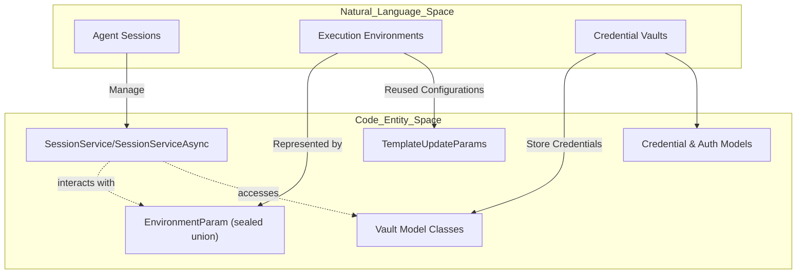

<!-- source: DeepWiki mcp.deepwiki.com · repo openai/openai-java · page 7.10 Admin, Safety and Agents (Beta) · fetched 2026-10-26 -->

# Admin, Safety and Agents (Beta)

<details>
<summary>Relevant source files</summary>

The following files were used as context for generating this wiki page:

- [openai-java-core/src/main/kotlin/com/openai/models/admin/organization/auditlogs/AuditLogListParams.kt](openai-java-core/src/main/kotlin/com/openai/models/admin/organization/auditlogs/AuditLogListParams.kt)
- [openai-java-core/src/main/kotlin/com/openai/models/admin/organization/auditlogs/AuditLogListResponse.kt](openai-java-core/src/main/kotlin/com/openai/models/admin/organization/auditlogs/AuditLogListResponse.kt)
- [openai-java-core/src/main/kotlin/com/openai/models/admin/organization/externalstorage/ExternalStorageDeleteParams.kt](openai-java-core/src/main/kotlin/com/openai/models/admin/organization/externalstorage/ExternalStorageDeleteParams.kt)
- [openai-java-core/src/main/kotlin/com/openai/models/admin/organization/invites/InviteCreateParams.kt](openai-java-core/src/main/kotlin/com/openai/models/admin/organization/invites/InviteCreateParams.kt)
- [openai-java-core/src/main/kotlin/com/openai/models/admin/organization/projects/serviceaccounts/apikeys/ApiKeyCreateParams.kt](openai-java-core/src/main/kotlin/com/openai/models/admin/organization/projects/serviceaccounts/apikeys/ApiKeyCreateParams.kt)
- [openai-java-core/src/main/kotlin/com/openai/models/admin/organization/projects/serviceaccounts/apikeys/ApiKeyCreateResponse.kt](openai-java-core/src/main/kotlin/com/openai/models/admin/organization/projects/serviceaccounts/apikeys/ApiKeyCreateResponse.kt)
- [openai-java-core/src/main/kotlin/com/openai/models/admin/organization/usage/UsageAudioSpeechesResponse.kt](openai-java-core/src/main/kotlin/com/openai/models/admin/organization/usage/UsageAudioSpeechesResponse.kt)
- [openai-java-core/src/main/kotlin/com/openai/models/admin/organization/usage/UsageAudioTranscriptionsResponse.kt](openai-java-core/src/main/kotlin/com/openai/models/admin/organization/usage/UsageAudioTranscriptionsResponse.kt)
- [openai-java-core/src/main/kotlin/com/openai/models/admin/organization/usage/UsageCodeInterpreterSessionsResponse.kt](openai-java-core/src/main/kotlin/com/openai/models/admin/organization/usage/UsageCodeInterpreterSessionsResponse.kt)
- [openai-java-core/src/main/kotlin/com/openai/models/admin/organization/usage/UsageCompletionsResponse.kt](openai-java-core/src/main/kotlin/com/openai/models/admin/organization/usage/UsageCompletionsResponse.kt)
- [openai-java-core/src/main/kotlin/com/openai/models/admin/organization/usage/UsageCostsResponse.kt](openai-java-core/src/main/kotlin/com/openai/models/admin/organization/usage/UsageCostsResponse.kt)
- [openai-java-core/src/main/kotlin/com/openai/models/admin/organization/usage/UsageEmbeddingsResponse.kt](openai-java-core/src/main/kotlin/com/openai/models/admin/organization/usage/UsageEmbeddingsResponse.kt)
- [openai-java-core/src/main/kotlin/com/openai/models/admin/organization/usage/UsageImagesResponse.kt](openai-java-core/src/main/kotlin/com/openai/models/admin/organization/usage/UsageImagesResponse.kt)
- [openai-java-core/src/main/kotlin/com/openai/models/admin/organization/usage/UsageModerationsResponse.kt](openai-java-core/src/main/kotlin/com/openai/models/admin/organization/usage/UsageModerationsResponse.kt)
- [openai-java-core/src/main/kotlin/com/openai/models/admin/organization/usage/UsageVectorStoresResponse.kt](openai-java-core/src/main/kotlin/com/openai/models/admin/organization/usage/UsageVectorStoresResponse.kt)
- [openai-java-core/src/main/kotlin/com/openai/models/beta/agents/EnvironmentParam.kt](openai-java-core/src/main/kotlin/com/openai/models/beta/agents/EnvironmentParam.kt)
- [openai-java-core/src/main/kotlin/com/openai/models/beta/agents/environments/templates/TemplateCreateParams.kt](openai-java-core/src/main/kotlin/com/openai/models/beta/agents/environments/templates/TemplateCreateParams.kt)
- [openai-java-core/src/main/kotlin/com/openai/models/beta/agents/environments/templates/TemplateUpdateParams.kt](openai-java-core/src/main/kotlin/com/openai/models/beta/agents/environments/templates/TemplateUpdateParams.kt)
- [openai-java-core/src/main/kotlin/com/openai/models/beta/agents/sessions/SessionUpdateParams.kt](openai-java-core/src/main/kotlin/com/openai/models/beta/agents/sessions/SessionUpdateParams.kt)
- [openai-java-core/src/main/kotlin/com/openai/models/beta/agents/vaults/Vault.kt](openai-java-core/src/main/kotlin/com/openai/models/beta/agents/vaults/Vault.kt)
- [openai-java-core/src/main/kotlin/com/openai/models/beta/agents/vaults/credentials/Credential.kt](openai-java-core/src/main/kotlin/com/openai/models/beta/agents/vaults/credentials/Credential.kt)
- [openai-java-core/src/main/kotlin/com/openai/models/beta/agents/vaults/credentials/CredentialAuth.kt](openai-java-core/src/main/kotlin/com/openai/models/beta/agents/vaults/credentials/CredentialAuth.kt)
- [openai-java-core/src/main/kotlin/com/openai/models/beta/agents/vaults/credentials/CredentialAuthCreateParam.kt](openai-java-core/src/main/kotlin/com/openai/models/beta/agents/vaults/credentials/CredentialAuthCreateParam.kt)
- [openai-java-core/src/main/kotlin/com/openai/models/beta/agents/vaults/credentials/CredentialAuthRotateParam.kt](openai-java-core/src/main/kotlin/com/openai/models/beta/agents/vaults/credentials/CredentialAuthRotateParam.kt)
- [openai-java-core/src/main/kotlin/com/openai/models/beta/agents/vaults/credentials/CredentialCreateParams.kt](openai-java-core/src/main/kotlin/com/openai/models/beta/agents/vaults/credentials/CredentialCreateParams.kt)
- [openai-java-core/src/main/kotlin/com/openai/models/beta/agents/vaults/credentials/CredentialNetworking.kt](openai-java-core/src/main/kotlin/com/openai/models/beta/agents/vaults/credentials/CredentialNetworking.kt)
- [openai-java-core/src/main/kotlin/com/openai/models/beta/agents/vaults/credentials/CredentialNetworkingParam.kt](openai-java-core/src/main/kotlin/com/openai/models/beta/agents/vaults/credentials/CredentialNetworkingParam.kt)
- [openai-java-core/src/main/kotlin/com/openai/models/beta/agents/vaults/credentials/CredentialUpdateParams.kt](openai-java-core/src/main/kotlin/com/openai/models/beta/agents/vaults/credentials/CredentialUpdateParams.kt)
- [openai-java-core/src/main/kotlin/com/openai/models/safety/cases/CaseRetrieveParams.kt](openai-java-core/src/main/kotlin/com/openai/models/safety/cases/CaseRetrieveParams.kt)
- [openai-java-core/src/main/kotlin/com/openai/models/safety/cases/SafetyCase.kt](openai-java-core/src/main/kotlin/com/openai/models/safety/cases/SafetyCase.kt)
- [openai-java-core/src/main/kotlin/com/openai/services/async/SafetyServiceAsync.kt](openai-java-core/src/main/kotlin/com/openai/services/async/SafetyServiceAsync.kt)
- [openai-java-core/src/main/kotlin/com/openai/services/async/SafetyServiceAsyncImpl.kt](openai-java-core/src/main/kotlin/com/openai/services/async/SafetyServiceAsyncImpl.kt)
- [openai-java-core/src/main/kotlin/com/openai/services/async/admin/OrganizationServiceAsync.kt](openai-java-core/src/main/kotlin/com/openai/services/async/admin/OrganizationServiceAsync.kt)
- [openai-java-core/src/main/kotlin/com/openai/services/async/admin/OrganizationServiceAsyncImpl.kt](openai-java-core/src/main/kotlin/com/openai/services/async/admin/OrganizationServiceAsyncImpl.kt)
- [openai-java-core/src/main/kotlin/com/openai/services/async/admin/organization/ExternalStorageServiceAsync.kt](openai-java-core/src/main/kotlin/com/openai/services/async/admin/organization/ExternalStorageServiceAsync.kt)
- [openai-java-core/src/main/kotlin/com/openai/services/async/beta/agents/SessionServiceAsync.kt](openai-java-core/src/main/kotlin/com/openai/services/async/beta/agents/SessionServiceAsync.kt)
- [openai-java-core/src/main/kotlin/com/openai/services/async/safety/CaseServiceAsync.kt](openai-java-core/src/main/kotlin/com/openai/services/async/safety/CaseServiceAsync.kt)
- [openai-java-core/src/main/kotlin/com/openai/services/async/safety/CaseServiceAsyncImpl.kt](openai-java-core/src/main/kotlin/com/openai/services/async/safety/CaseServiceAsyncImpl.kt)
- [openai-java-core/src/main/kotlin/com/openai/services/blocking/SafetyService.kt](openai-java-core/src/main/kotlin/com/openai/services/blocking/SafetyService.kt)
- [openai-java-core/src/main/kotlin/com/openai/services/blocking/SafetyServiceImpl.kt](openai-java-core/src/main/kotlin/com/openai/services/blocking/SafetyServiceImpl.kt)
- [openai-java-core/src/main/kotlin/com/openai/services/blocking/admin/OrganizationService.kt](openai-java-core/src/main/kotlin/com/openai/services/blocking/admin/OrganizationService.kt)
- [openai-java-core/src/main/kotlin/com/openai/services/blocking/admin/OrganizationServiceImpl.kt](openai-java-core/src/main/kotlin/com/openai/services/blocking/admin/OrganizationServiceImpl.kt)
- [openai-java-core/src/main/kotlin/com/openai/services/blocking/admin/organization/ExternalStorageService.kt](openai-java-core/src/main/kotlin/com/openai/services/blocking/admin/organization/ExternalStorageService.kt)
- [openai-java-core/src/main/kotlin/com/openai/services/blocking/beta/agents/SessionService.kt](openai-java-core/src/main/kotlin/com/openai/services/blocking/beta/agents/SessionService.kt)
- [openai-java-core/src/main/kotlin/com/openai/services/blocking/safety/CaseService.kt](openai-java-core/src/main/kotlin/com/openai/services/blocking/safety/CaseService.kt)
- [openai-java-core/src/test/kotlin/com/openai/models/admin/organization/auditlogs/AuditLogListPageResponseTest.kt](openai-java-core/src/test/kotlin/com/openai/models/admin/organization/auditlogs/AuditLogListPageResponseTest.kt)
- [openai-java-core/src/test/kotlin/com/openai/models/admin/organization/auditlogs/AuditLogListParamsTest.kt](openai-java-core/src/test/kotlin/com/openai/models/admin/organization/auditlogs/AuditLogListParamsTest.kt)
- [openai-java-core/src/test/kotlin/com/openai/models/admin/organization/auditlogs/AuditLogListResponseTest.kt](openai-java-core/src/test/kotlin/com/openai/models/admin/organization/auditlogs/AuditLogListResponseTest.kt)
- [openai-java-core/src/test/kotlin/com/openai/models/admin/organization/projects/serviceaccounts/apikeys/ApiKeyCreateParamsTest.kt](openai-java-core/src/test/kotlin/com/openai/models/admin/organization/projects/serviceaccounts/apikeys/ApiKeyCreateParamsTest.kt)
- [openai-java-core/src/test/kotlin/com/openai/models/admin/organization/projects/serviceaccounts/apikeys/ApiKeyCreateResponseTest.kt](openai-java-core/src/test/kotlin/com/openai/models/admin/organization/projects/serviceaccounts/apikeys/ApiKeyCreateResponseTest.kt)
- [openai-java-core/src/test/kotlin/com/openai/models/beta/agents/sessions/SessionUpdateParamsTest.kt](openai-java-core/src/test/kotlin/com/openai/models/beta/agents/sessions/SessionUpdateParamsTest.kt)
- [openai-java-core/src/test/kotlin/com/openai/models/beta/agents/sessions/SessionUpdateSerializationTest.kt](openai-java-core/src/test/kotlin/com/openai/models/beta/agents/sessions/SessionUpdateSerializationTest.kt)
- [openai-java-core/src/test/kotlin/com/openai/models/evals/EvalCustomDataSourceConfigTest.kt](openai-java-core/src/test/kotlin/com/openai/models/evals/EvalCustomDataSourceConfigTest.kt)
- [openai-java-core/src/test/kotlin/com/openai/services/async/admin/organization/projects/serviceaccounts/ApiKeyServiceAsyncTest.kt](openai-java-core/src/test/kotlin/com/openai/services/async/admin/organization/projects/serviceaccounts/ApiKeyServiceAsyncTest.kt)
- [openai-java-core/src/test/kotlin/com/openai/services/async/beta/agents/SessionServiceAsyncTest.kt](openai-java-core/src/test/kotlin/com/openai/services/async/beta/agents/SessionServiceAsyncTest.kt)
- [openai-java-core/src/test/kotlin/com/openai/services/blocking/admin/organization/projects/serviceaccounts/ApiKeyServiceTest.kt](openai-java-core/src/test/kotlin/com/openai/services/blocking/admin/organization/projects/serviceaccounts/ApiKeyServiceTest.kt)
- [openai-java-core/src/test/kotlin/com/openai/services/blocking/beta/agents/SessionServiceTest.kt](openai-java-core/src/test/kotlin/com/openai/services/blocking/beta/agents/SessionServiceTest.kt)

</details>


This section documents the **Admin and Organization APIs**, the **Safety Service**, and the **Beta Agents** service as implemented in the OpenAI Java SDK. These APIs enable managing organization-level administrative operations (projects, API keys, invites, usage, audit logs, external storage), handling safety cases, and interacting with the beta Agent framework for sessions, environments, and vaults/credentials.

---

## 1. Admin / Organization APIs

The **Admin/Organization** APIs provide comprehensive management capabilities for an OpenAI organization. The SDK exposes these APIs through the `OrganizationService` interface and its asynchronous counterpart `OrganizationServiceAsync`, each providing services for various organization management domains: projects, API keys, invites, usage, audit logs, certificates, external storage, spend limits and alerts, roles, groups, users, and data retention.

### Key Interfaces and Implementations

- **Synchronous Service Interface**: `OrganizationService`  
- **Asynchronous Service Interface**: `OrganizationServiceAsync`  
- **Blocking Service Implementation**: `OrganizationServiceImpl`  
- **Async Service Implementation**: `OrganizationServiceAsyncImpl`  

These service interfaces provide entry points to sub-services such as `auditLogs()`, `adminApiKeys()`, `projects()`, etc., each returning interfaces to their respective sub-APIs.

Both sync and async interfaces support:

- Access to raw HTTP response views via `.withRawResponse()`.
- Functional options pattern for per-request customization via `.withOptions()`.

### Sub-services Include

- **Audit Logs**: List user actions and configuration changes within the organization.
- **Admin API Keys**: Create, update, and manage API keys for the organization.
- **Invites**: Manage user invitation flows.
- **Usage**: View organization-wide usage metrics and statistics.
- **Projects**: Manage organization projects.
- **Users & Groups**: Manage organization users and groups.
- **Roles**: Manage role-based access control.
- **Certificates**: Manage authentication certificates.
- **External Storage**: Manage integrations with external storage providers.
- **Spend Limits & Alerts**: Control and monitor usage spending.

### Data Flow & Architecture

1. **Client Construction**: The client creates an instance of `OrganizationServiceImpl` or `OrganizationServiceAsyncImpl` with shared `ClientOptions`.
2. **Lazy Initialization**: Each sub-service is lazily instantiated on demand and configured with current client options.
3. **Method Calls**: Calls to methods like `projects()` retrieve the corresponding sub-service interface.
4. **Request Execution**: Sub-service methods ultimately execute HTTP API calls via client infrastructure, handle API responses, and return strongly typed model objects.

### Diagram: Organization API Services to Implementation Classes

```mermaid
graph LR
  "OrganizationService" --> "OrganizationServiceImpl"
  "OrganizationServiceAsync" --> "OrganizationServiceAsyncImpl"

  "OrganizationServiceImpl" --> "AuditLogServiceImpl"
  "OrganizationServiceImpl" --> "AdminApiKeyServiceImpl"
  "OrganizationServiceImpl" --> "ProjectServiceImpl"
  "OrganizationServiceImpl" --> "InviteServiceImpl"
  "OrganizationServiceImpl" --> "UsageServiceImpl"
  "OrganizationServiceImpl" --> "UserServiceImpl"
  "OrganizationServiceImpl" --> "GroupServiceImpl"
  "OrganizationServiceImpl" --> "RoleServiceImpl"
  "OrganizationServiceImpl" --> "CertificateServiceImpl"
  "OrganizationServiceImpl" --> "ExternalStorageServiceImpl"
  "OrganizationServiceImpl" --> "SpendLimitServiceImpl"
  "OrganizationServiceImpl" --> "SpendAlertServiceImpl"
  "OrganizationServiceAsyncImpl" --> "AuditLogServiceAsyncImpl"
  "OrganizationServiceAsyncImpl" --> "AdminApiKeyServiceAsyncImpl"
  "OrganizationServiceAsyncImpl" --> "ProjectServiceAsyncImpl"
  "OrganizationServiceAsyncImpl" --> "InviteServiceAsyncImpl"
  "OrganizationServiceAsyncImpl" --> "UsageServiceAsyncImpl"
  "OrganizationServiceAsyncImpl" --> "UserServiceAsyncImpl"
  "OrganizationServiceAsyncImpl" --> "GroupServiceAsyncImpl"
  "OrganizationServiceAsyncImpl" --> "RoleServiceAsyncImpl"
  "OrganizationServiceAsyncImpl" --> "CertificateServiceAsyncImpl"
  "OrganizationServiceAsyncImpl" --> "ExternalStorageServiceAsyncImpl"
  "OrganizationServiceAsyncImpl" --> "SpendLimitServiceAsyncImpl"
  "OrganizationServiceAsyncImpl" --> "SpendAlertServiceAsyncImpl"
```

Sources:  
- `openai-java-core/src/main/kotlin/com/openai/services/blocking/admin/OrganizationService.kt` (lines 21-103)  
- `openai-java-core/src/main/kotlin/com/openai/services/async/admin/OrganizationServiceAsync.kt` (lines 21-104)  
- `openai-java-core/src/main/kotlin/com/openai/services/blocking/admin/OrganizationServiceImpl.kt` (lines 34-103)  
- `openai-java-core/src/main/kotlin/com/openai/services/async/admin/OrganizationServiceAsyncImpl.kt` (lines 33-110)  

---

### Audit Logs API

The Audit Logs API surfaces detailed logs of user actions and configuration changes within an organization. It supports querying logs using flexible parameters such as actor email/ID, event types, time ranges, project/resource filters, etc.

- **Query Parameters** are encapsulated in `AuditLogListParams`.
- Logs are strongly typed with various event subtype payloads reflecting different organizational events (e.g., API key creation, project updates).

The API responses are represented by `AuditLogListResponse` data model objects.

Sources:  
- `openai-java-core/src/main/kotlin/com/openai/models/admin/organization/auditlogs/AuditLogListParams.kt` (lines 18-156)  
- `openai-java-core/src/main/kotlin/com/openai/models/admin/organization/auditlogs/AuditLogListResponse.kt` (lines 36-132)  

---

### Example Usage of Organization API Client

```java
OrganizationService orgService = client.admin().organization();

List<AuditLogListResponse> logs = orgService.auditLogs()
    .list(AuditLogListParams.builder()
        .limit(50L)
        .build());

orgService.projects()
    .create(ProjectCreateParams.builder()
        .name("New Project")
        .build());
```

---

## 2. Safety Service and Cases

The Safety API offers capabilities to manage safety-related cases and alerts within an organization.

### Service Structure

- The `SafetyService` interface (sync) and `SafetyServiceAsync` interface (async) expose two main sub-services:
  - `cases()`: For managing safety cases.
  - `alerts()`: For managing safety alerts.

- Each supports a `.withRawResponse()` view and `.withOptions()` method for customization.

### Implementation Details

- Implemented by `SafetyServiceImpl` and `SafetyServiceAsyncImpl`.
- Lazy initialization of `CaseService` and `AlertService`.
- Raw response views implemented as nested classes within service implementations.

### Data Flow

1. The client initializes the Safety service with options.
2. Calls to `cases()` or `alerts()` provide interfaces for managing respective resources.
3. Service methods internally handle HTTP requests and responses mapping to models like `SafetyCase`.

### Diagram: Safety Service to Sub-services Mapping

```mermaid
graph TD
  "SafetyService" --> "CaseService"
  "SafetyService" --> "AlertService"
  "SafetyServiceImpl" --> "CaseServiceImpl"
  "SafetyServiceImpl" --> "AlertServiceImpl"
  "SafetyServiceAsync" --> "CaseServiceAsync"
  "SafetyServiceAsync" --> "AlertServiceAsync"
  "SafetyServiceAsyncImpl" --> "CaseServiceAsyncImpl"
  "SafetyServiceAsyncImpl" --> "AlertServiceAsyncImpl"
```

Sources:  
- `openai-java-core/src/main/kotlin/com/openai/services/blocking/SafetyService.kt` (lines 10-42)  
- `openai-java-core/src/main/kotlin/com/openai/services/blocking/SafetyServiceImpl.kt` (lines 12-54)  
- `openai-java-core/src/main/kotlin/com/openai/services/async/SafetyServiceAsync.kt` (lines 10-46)  
- `openai-java-core/src/main/kotlin/com/openai/services/async/SafetyServiceAsyncImpl.kt` (lines 12-54)  

---

### Safety Case Management

The Safety API handles cases representing flagged or monitored incidents requiring attention.

- Case models, retrieval parameters, and operations are defined in dedicated packages (not fully shown here) such as `CaseRetrieveParams` and `SafetyCase` model classes.
- Services wrap these models and implement the API calls for listing, retrieving, updating cases.

---

## 3. Beta Agents Framework

The Agents Beta API is a new framework that enables programmatic management and execution of autonomous agents. Key concepts include:

- **Sessions**: Live agent instances managing conversation and state.
- **Environments**: Execution contexts for agents; can be OpenAI-hosted or self-hosted.
- **Vaults and Credentials**: Securely stored credentials needed for agent actions.

---

### Key Agent Model Classes

- `EnvironmentParam`: Encapsulates the agent's execution environment, which can be:
  - None (no environment)
  - OpenAI-hosted environment (existing or template based)
  - Self-hosted environment (application-managed)
  This class uses a sealed union pattern with visitor interfaces for variant handling.

- `TemplateUpdateParams`: For updating reusable environment templates, supporting fields like plugins, skills, environment variables, files, network policies, and setup commands.

- Credential and Vault related classes manage secure storage of agent credentials and secret data.

---

### Service Structure

- `SessionService` and `SessionServiceAsync` provide access to managing agent sessions.
- Environment template services allow creating and updating reusable environment configurations.
- Vault services manage credentials and secrets for agents.

---

### Execution Environment Details (`EnvironmentParam`)

- Defined as a sealed class with variants `none`, `openaiHosted`, and `selfHosted`.
- Offers validation and visitor pattern APIs to safely operate on specific variants.
- Supports JSON serialization/deserialization for communication with the backend.

---

### Data Flow in Agent Session Management

1. Client creates or updates an agent session specifying an environment.
2. If using reusable environments, a template is referenced or updated using `TemplateUpdateParams`.
3. Credentials needed by the agent (e.g., API keys, tokens) are stored in vaults with secure access controls.
4. Agent sessions execute in the defined environment, interact with skills/plugins, and maintain state.

---

### Diagram: Agents Natural Language Concepts to Code Entities



Sources:  
- `openai-java-core/src/main/kotlin/com/openai/models/beta/agents/EnvironmentParam.kt` (lines 33-184)  
- `openai-java-core/src/main/kotlin/com/openai/models/beta/agents/environments/templates/TemplateUpdateParams.kt` (lines 30-180)  

---

## Summary

The Admin, Safety, and Agents Beta packages in the OpenAI Java SDK provide extensive programmatic access to:

- Manage organizational structures, API keys, projects, users, and audit logs for governance and compliance.
- Manage safety-related cases and alerts for risk mitigation.
- Develop, configure, and run autonomous agents with dedicated session, environment, and credential management APIs under the Beta program.

These are implemented via carefully layered service abstractions with both synchronous and asynchronous APIs, leveraging strongly typed model classes to ensure data consistency and integration safety.

---

# Table: Admin, Safety and Agents Key Services and Models Overview

| Domain              | Service Interface          | Implementation Class          | Key Models                                      | Description                                   |
|---------------------|----------------------------|-------------------------------|-------------------------------------------------|-----------------------------------------------|
| Organization Admin  | `OrganizationService`       | `OrganizationServiceImpl`     | `AuditLogListParams`, `AuditLogListResponse`    | Manage projects, API keys, invites, usage, audit logs, storage |
| Safety              | `SafetyService`             | `SafetyServiceImpl`           | `CaseService`, `AlertService`, `SafetyCase`     | Manage safety alerts and cases                 |
| Agents (Beta)       | `SessionService`            | (Beta agents impl, not shown) | `EnvironmentParam`, `TemplateUpdateParams`, `Vault`, `Credential` | Agent sessions, environments, vaults & credentials |

---

This completes the documentation on the Admin, Safety, and Beta Agents services available in the OpenAI Java SDK.

---

# References and Sources

- `openai-java-core/src/main/kotlin/com/openai/services/blocking/admin/OrganizationService.kt`  
- `openai-java-core/src/main/kotlin/com/openai/services/async/admin/OrganizationServiceAsync.kt`  
- `openai-java-core/src/main/kotlin/com/openai/services/blocking/admin/OrganizationServiceImpl.kt`  
- `openai-java-core/src/main/kotlin/com/openai/services/async/admin/OrganizationServiceAsyncImpl.kt`  
- `openai-java-core/src/main/kotlin/com/openai/models/admin/organization/auditlogs/AuditLogListParams.kt`  
- `openai-java-core/src/main/kotlin/com/openai/models/admin/organization/auditlogs/AuditLogListResponse.kt`  
- `openai-java-core/src/main/kotlin/com/openai/services/blocking/SafetyService.kt`  
- `openai-java-core/src/main/kotlin/com/openai/services/blocking/SafetyServiceImpl.kt`  
- `openai-java-core/src/main/kotlin/com/openai/services/async/SafetyServiceAsync.kt`  
- `openai-java-core/src/main/kotlin/com/openai/services/async/SafetyServiceAsyncImpl.kt`  
- `openai-java-core/src/main/kotlin/com/openai/models/beta/agents/EnvironmentParam.kt`  
- `openai-java-core/src/main/kotlin/com/openai/models/beta/agents/environments/templates/TemplateUpdateParams.kt`

---

