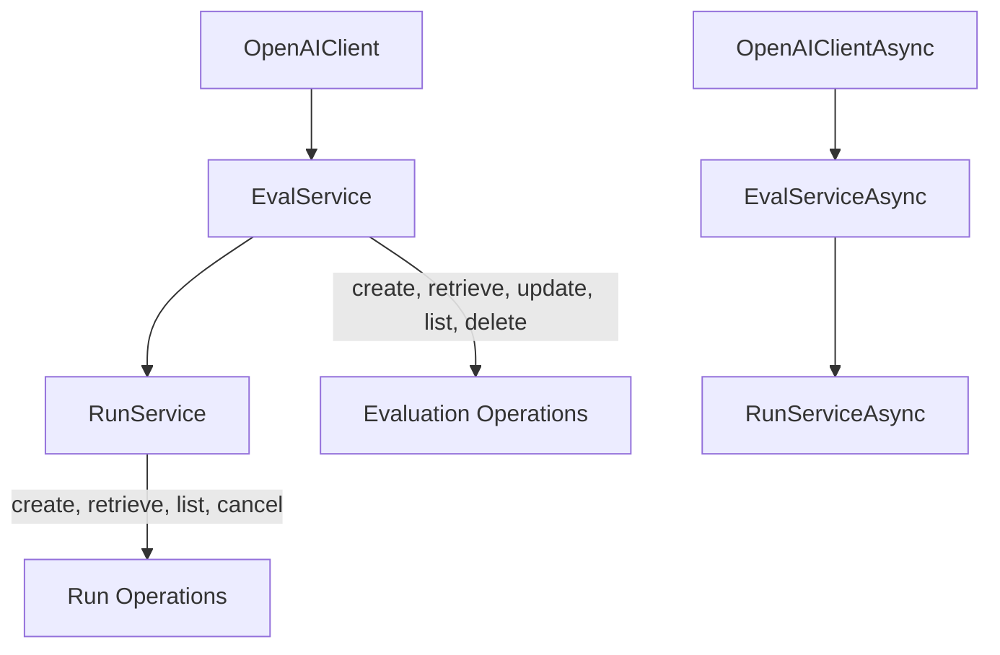
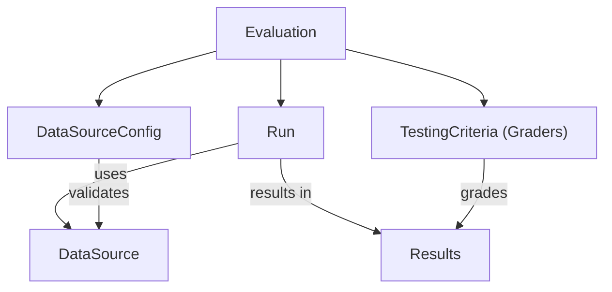
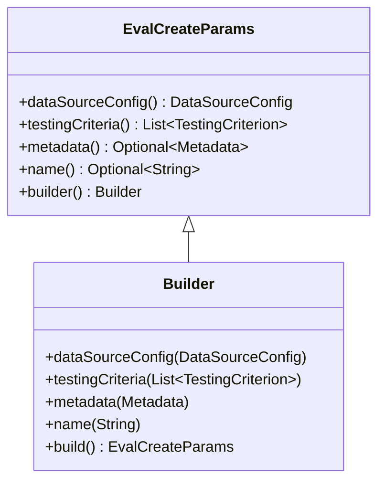
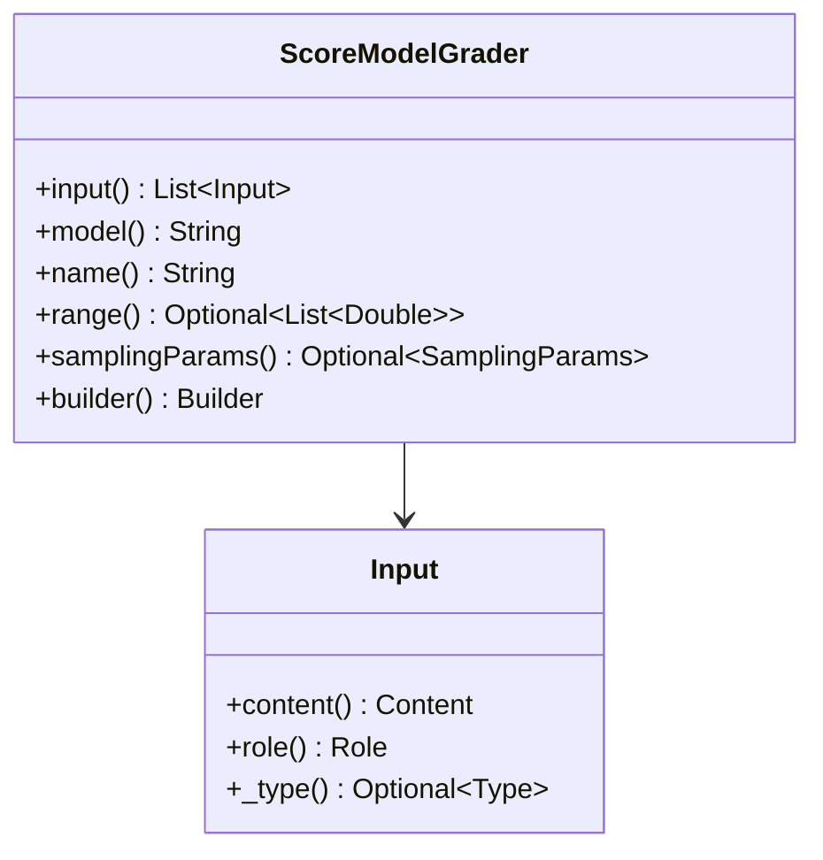
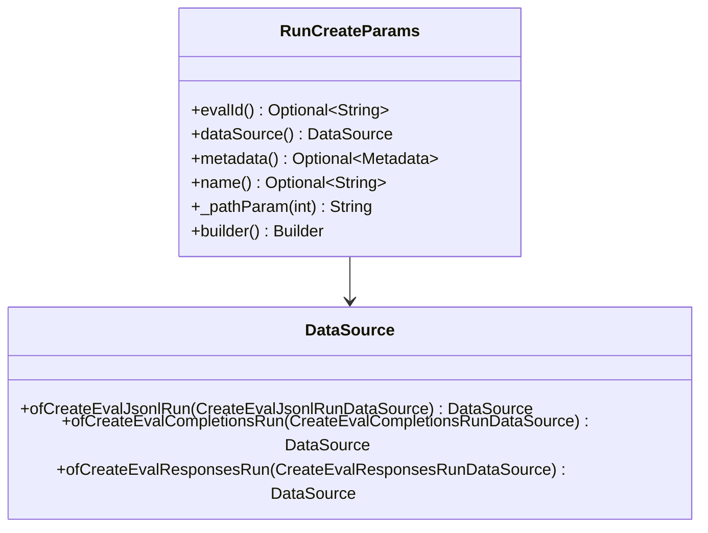
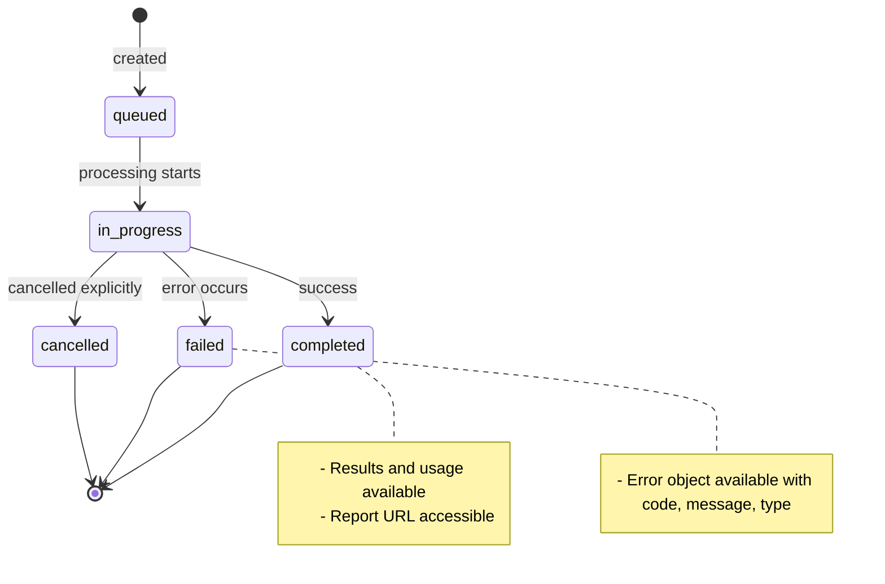
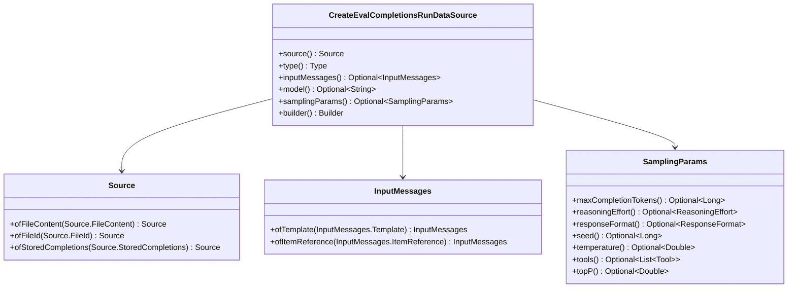
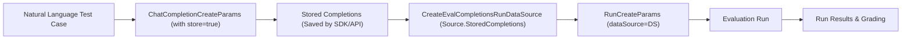

<!-- source: DeepWiki mcp.deepwiki.com · repo openai/openai-java · page 7.2 Evaluations and Graders · fetched 2026-10-26 -->

# Evaluations and Graders

<details>
<summary>Relevant source files</summary>

The following files were used as context for generating this wiki page:

- [openai-java-core/src/main/kotlin/com/openai/models/evals/EvalCreateParams.kt](openai-java-core/src/main/kotlin/com/openai/models/evals/EvalCreateParams.kt)
- [openai-java-core/src/main/kotlin/com/openai/models/evals/EvalCreateResponse.kt](openai-java-core/src/main/kotlin/com/openai/models/evals/EvalCreateResponse.kt)
- [openai-java-core/src/main/kotlin/com/openai/models/evals/EvalListResponse.kt](openai-java-core/src/main/kotlin/com/openai/models/evals/EvalListResponse.kt)
- [openai-java-core/src/main/kotlin/com/openai/models/evals/EvalRetrieveResponse.kt](openai-java-core/src/main/kotlin/com/openai/models/evals/EvalRetrieveResponse.kt)
- [openai-java-core/src/main/kotlin/com/openai/models/evals/EvalUpdateResponse.kt](openai-java-core/src/main/kotlin/com/openai/models/evals/EvalUpdateResponse.kt)
- [openai-java-core/src/main/kotlin/com/openai/models/evals/runs/CreateEvalCompletionsRunDataSource.kt](openai-java-core/src/main/kotlin/com/openai/models/evals/runs/CreateEvalCompletionsRunDataSource.kt)
- [openai-java-core/src/main/kotlin/com/openai/models/evals/runs/RunCancelResponse.kt](openai-java-core/src/main/kotlin/com/openai/models/evals/runs/RunCancelResponse.kt)
- [openai-java-core/src/main/kotlin/com/openai/models/evals/runs/RunCreateParams.kt](openai-java-core/src/main/kotlin/com/openai/models/evals/runs/RunCreateParams.kt)
- [openai-java-core/src/main/kotlin/com/openai/models/evals/runs/RunCreateResponse.kt](openai-java-core/src/main/kotlin/com/openai/models/evals/runs/RunCreateResponse.kt)
- [openai-java-core/src/main/kotlin/com/openai/models/evals/runs/RunListResponse.kt](openai-java-core/src/main/kotlin/com/openai/models/evals/runs/RunListResponse.kt)
- [openai-java-core/src/main/kotlin/com/openai/models/evals/runs/RunRetrieveResponse.kt](openai-java-core/src/main/kotlin/com/openai/models/evals/runs/RunRetrieveResponse.kt)
- [openai-java-core/src/main/kotlin/com/openai/models/graders/gradermodels/EvalContentItem.kt](openai-java-core/src/main/kotlin/com/openai/models/graders/gradermodels/EvalContentItem.kt)
- [openai-java-core/src/main/kotlin/com/openai/models/graders/gradermodels/LabelModelGrader.kt](openai-java-core/src/main/kotlin/com/openai/models/graders/gradermodels/LabelModelGrader.kt)
- [openai-java-core/src/main/kotlin/com/openai/models/graders/gradermodels/ScoreModelGrader.kt](openai-java-core/src/main/kotlin/com/openai/models/graders/gradermodels/ScoreModelGrader.kt)

</details>


The Evaluations API enables systematic testing and validation of model performance using structured data sources and configurable grading criteria. This page details the implementation, data flow, and key entities/classes for working with evaluations, runs, and graders in the OpenAI Java SDK.

---

## Purpose and Scope

This page explains the **Evaluations API** in the OpenAI Java SDK, including:

- Creating and managing **Evaluations** that define test criteria and data source schemas
- Executing **Runs** that apply these evaluations to specific models and datasets
- Configuring **Data Sources** for evaluation runs
- Using **Grader Models** to automatically score or label model outputs
- Understanding response data structures and error reporting

This section is a **leaf** page focusing on technical details of the evaluation-related data model and service interactions.

---

## Evaluations API Overview

The Evaluations API provides a framework to define tasks that test model responses systematically:

- **Evaluations**: Templates specifying data source configurations and testing criteria (graders)
- **Runs**: Executions of evaluations on actual models with real data, producing graded results and metrics

This API is accessed through the `OpenAIClient` and `OpenAIClientAsync` interfaces:



---

## Core Concepts

### Evaluations vs Runs



- **Evaluation**: Defines the testing framework including the data schema (`DataSourceConfig`) and graders (`TestingCriteria`).
- **Run**: An individual test of a model against an evaluation with concrete data and model parameters.

---

## Evaluation Creation (`EvalCreateParams`)

Evaluations are constructed via the `EvalCreateParams` class, which contains:

- `dataSourceConfig()`: Configuration describing the data source schema used for runs.
- `testingCriteria()`: A list of graders specifying how model outputs are evaluated.
- Optional metadata and name fields.



- The builder pattern enforces required fields and structured construction.

Sources:  
- [openai-java-core/src/main/kotlin/com/openai/models/evals/EvalCreateParams.kt:51-167]()

---

## Grader Models (`TestingCriterion`)

Grading during evaluations is performed by **graders**, which automatically assess model outputs. Key grader types include:

### ScoreModelGrader

- Uses a separate model to assign a numeric score for the input.
- Fields:
  - `input()`: List of input messages supporting various content types (text, audio, images).
  - `model()`: Model name to use for scoring.
  - `name()`: Identifier for the grader.
  - `range()`: Optional score range (default `[0,1]`).
  - `samplingParams()`: Optional sampling configuration such as temperature.



Sources:  
- [openai-java-core/src/main/kotlin/com/openai/models/graders/gradermodels/ScoreModelGrader.kt:37-114]()

### LabelModelGrader

- Assigns categorical labels to evaluation items.
- Requires a list of valid labels and passing labels.
- Uses a model that supports structured outputs.

Sources:  
- [openai-java-core/src/main/kotlin/com/openai/models/graders/gradermodels/LabelModelGrader.kt:37-148]()

Other grader types include `StringCheckGrader`, `PythonGrader`, and `TextSimilarityGrader`.

---

## Evaluation Runs (`RunCreateParams`)

Runs are concrete executions of evaluations:

- Represented by the `RunCreateParams` class with:
  - `evalId()`: ID of the evaluation to run.
  - `dataSource()`: Specific data source to use for this run, validated against the evaluation's schema.
  - Optional metadata and name.



- The `evalId` is used as a path parameter in HTTP requests (`_pathParam(0)`).

Sources:  
- [openai-java-core/src/main/kotlin/com/openai/models/evals/runs/RunCreateParams.kt:63-125]()

### Run Lifecycle and Status

Evaluation runs progress through states, observable via their `status()` field:



Sources:  
- [openai-java-core/src/main/kotlin/com/openai/models/evals/runs/RunCreateResponse.kt:113-234]()  
- [openai-java-core/src/main/kotlin/com/openai/models/evals/runs/RunCancelResponse.kt:113-234]()

---

## Run Response Structures

Run response types (`RunCreateResponse`, `RunRetrieveResponse`, `RunListResponse`, `RunCancelResponse`) share a consistent data model exposing:

| Method | Description |
|--------|-------------|
| `id()` | Unique ID of the run |
| `createdAt()` | Creation timestamp (Unix seconds) |
| `dataSource()` | Data source info used in the run |
| `error()` | Evaluation API error if failed |
| `evalId()` | Related evaluation ID |
| `metadata()` | Optional key-value metadata |
| `model()` | Model used in this run |
| `name()` | Name of the run |
| `perModelUsage()` | Token usage statistics per model |
| `perTestingCriteriaResults()` | Results for each testing criterion |
| `reportUrl()` | URL to detailed report dashboard |
| `resultCounts()` | Summary statistics of results |
| `status()` | Current run status string |

All provide safe JSON accessors for raw JSON values prefixed with `_`.

Sources:  
- [openai-java-core/src/main/kotlin/com/openai/models/evals/runs/RunCreateResponse.kt:55-234]()  
- [openai-java-core/src/main/kotlin/com/openai/models/evals/runs/RunRetrieveResponse.kt:55-234]()  
- [openai-java-core/src/main/kotlin/com/openai/models/evals/runs/RunListResponse.kt:55-234]()  
- [openai-java-core/src/main/kotlin/com/openai/models/evals/runs/RunCancelResponse.kt:55-234]()

---

## Data Source Types

Run data sources specify where evaluation data originates. Supported types include:

### CreateEvalCompletionsRunDataSource

Used for sampling model completions during evaluation runs.



- `source`: Defines the input data to sample completions from (file content, file ID, or stored completions)
- `type`: Always `COMPLETIONS`
- `inputMessages`: Defines the messages to prompt the model, either templated or referencing stored data
- `model`: The model name for sampling completions
- `samplingParams`: Parameters steering the generation such as max tokens, temperature, and tools

Builder convenience methods simplify construction from `fileContent` or `fileId` sources.

Sources:  
- [openai-java-core/src/main/kotlin/com/openai/models/evals/runs/CreateEvalCompletionsRunDataSource.kt:44-172]()

---

## Example: Creating an Evaluation Run

```kotlin
val runCreateParams = RunCreateParams.builder()
    .evalId("eval_abc123")
    .dataSource(
        DataSource.ofCreateEvalCompletionsRun(
            CreateEvalCompletionsRunDataSource.builder()
                .source(Source.ofFileId(Source.FileId.builder().id("file_xyz").build()))
                .type(CreateEvalCompletionsRunDataSource.Type.COMPLETIONS)
                .model("gpt-4o-mini")
                .build()
        )
    )
    .name("Example Run")
    .build()

val runResponse = evalClient.runs().create(runCreateParams)
```

This example shows how to create a run referencing a file data source and a specific model for evaluation.

---

## Service Method Summary

| Service | Method | Arguments | Return Type | Description |
|---------|--------|-----------|-------------|-------------|
| EvalService | `create(EvalCreateParams)` | `EvalCreateParams` | `EvalCreateResponse` | Create a new evaluation template |
| EvalService | `retrieve(String evalId)` | Evaluation ID | `EvalRetrieveResponse` | Fetch evaluation details |
| EvalService | `update(String evalId, EvalUpdateParams)` | Evaluation ID, update params | `EvalUpdateResponse` | Update an existing evaluation |
| EvalService | `list()` | - | List of `EvalListResponse` | List existing evaluations |
| EvalService | `delete(String evalId)` | Evaluation ID | `void` | Delete evaluation |

| Service | Method | Arguments | Return Type | Description |
|---------|--------|-----------|-------------|-------------|
| RunService | `create(RunCreateParams)` | Run creation params | `RunCreateResponse` | Start an evaluation run |
| RunService | `retrieve(String evalId, String runId)` | Eval ID, run ID | `RunRetrieveResponse` | Get run status and results |
| RunService | `list(String evalId)` | Eval ID | List of `RunListResponse` | List runs for an evaluation |
| RunService | `cancel(String evalId, String runId)` | Eval ID, run ID | `RunCancelResponse` | Cancel a run in progress |

Sources:  
- [openai-java-core/src/main/kotlin/com/openai/models/evals/runs/RunCreateParams.kt:53-125]()

---

## Data Flow Diagram: From Natural Language Test Case to Evaluation Run



- User test inputs as chat completion requests with storage enabled
- Stored completions reused as data sources in evaluation runs
- Runs execute and produce graded results

Sources:  
- [openai-java-core/src/main/kotlin/com/openai/models/chat/completions/ChatCompletionCreateParams.kt:360-380]()  
- [openai-java-core/src/main/kotlin/com/openai/models/evals/runs/CreateEvalCompletionsRunDataSource.kt:40-80]()  
- [openai-java-core/src/main/kotlin/com/openai/models/evals/runs/RunCreateParams.kt:60-90]()

---

## Summary

The OpenAI Java SDK's Evaluations API offers a modular, type-safe approach to defining evaluation templates and running them against models and datasets. By leveraging data source schemas and grader models, developers can automate detailed model quality assessments with flexible, reusable components.

- **Evaluations** define the structured testing criteria and data schema
- **Runs** apply these configurations to specific model data and produce rich graded output
- Model-based **graders** like `ScoreModelGrader` enable automated scoring
- The SDK supports multiple data source types including stored completions for replay and testing
- The client API offers rich synchronous and asynchronous operation support

This architecture enables thorough, repeatable model evaluation workflows integrated natively in Java applications.

---

## Sources

- [openai-java-core/src/main/kotlin/com/openai/models/evals/EvalCreateParams.kt:51-167]()  
- [openai-java-core/src/main/kotlin/com/openai/models/evals/runs/RunCreateParams.kt:53-125]()  
- [openai-java-core/src/main/kotlin/com/openai/models/evals/runs/CreateEvalCompletionsRunDataSource.kt:44-172]()  
- [openai-java-core/src/main/kotlin/com/openai/models/graders/gradermodels/ScoreModelGrader.kt:37-114]()  
- [openai-java-core/src/main/kotlin/com/openai/models/evals/runs/RunCreateResponse.kt:55-234]()  
- [openai-java-core/src/main/kotlin/com/openai/models/evals/runs/RunCancelResponse.kt:55-234]()  
- [openai-java-core/src/main/kotlin/com/openai/models/chat/completions/ChatCompletionCreateParams.kt:360-380]()

---

