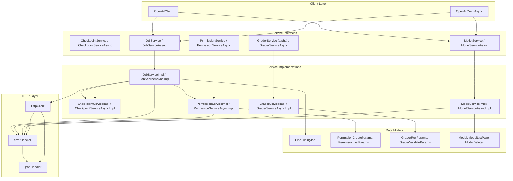
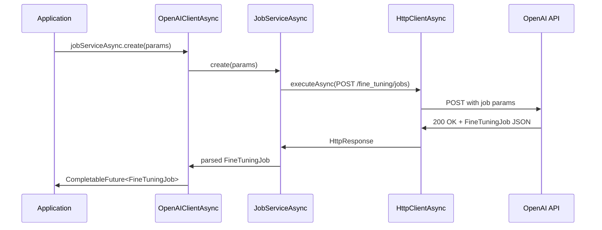
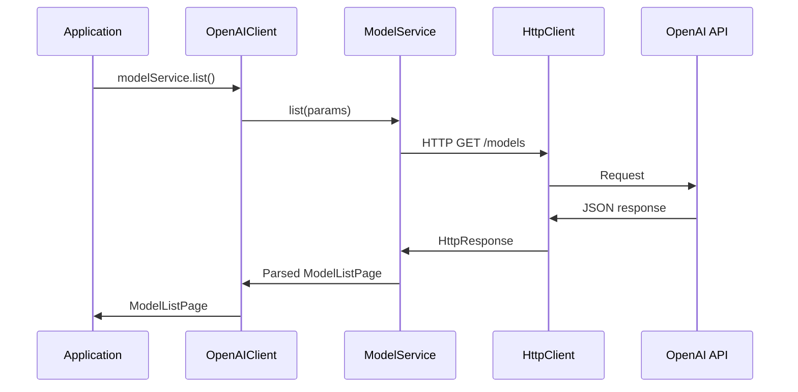
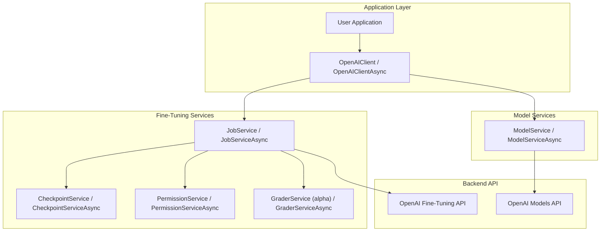

<!-- source: DeepWiki mcp.deepwiki.com · repo openai/openai-java · page 7.3 Fine-Tuning and Models · fetched 2026-10-26 -->

# Fine-Tuning and Models

<details>
<summary>Relevant source files</summary>

The following files were used as context for generating this wiki page:

- [openai-java-core/src/main/kotlin/com/openai/models/finetuning/checkpoints/permissions/PermissionRetrieveResponse.kt](openai-java-core/src/main/kotlin/com/openai/models/finetuning/checkpoints/permissions/PermissionRetrieveResponse.kt)
- [openai-java-core/src/main/kotlin/com/openai/services/async/finetuning/JobServiceAsyncImpl.kt](openai-java-core/src/main/kotlin/com/openai/services/async/finetuning/JobServiceAsyncImpl.kt)
- [openai-java-core/src/main/kotlin/com/openai/services/async/finetuning/alpha/GraderServiceAsyncImpl.kt](openai-java-core/src/main/kotlin/com/openai/services/async/finetuning/alpha/GraderServiceAsyncImpl.kt)
- [openai-java-core/src/main/kotlin/com/openai/services/async/finetuning/checkpoints/PermissionServiceAsync.kt](openai-java-core/src/main/kotlin/com/openai/services/async/finetuning/checkpoints/PermissionServiceAsync.kt)
- [openai-java-core/src/main/kotlin/com/openai/services/async/finetuning/checkpoints/PermissionServiceAsyncImpl.kt](openai-java-core/src/main/kotlin/com/openai/services/async/finetuning/checkpoints/PermissionServiceAsyncImpl.kt)
- [openai-java-core/src/main/kotlin/com/openai/services/blocking/finetuning/JobServiceImpl.kt](openai-java-core/src/main/kotlin/com/openai/services/blocking/finetuning/JobServiceImpl.kt)
- [openai-java-core/src/main/kotlin/com/openai/services/blocking/finetuning/alpha/GraderServiceImpl.kt](openai-java-core/src/main/kotlin/com/openai/services/blocking/finetuning/alpha/GraderServiceImpl.kt)
- [openai-java-core/src/main/kotlin/com/openai/services/blocking/finetuning/checkpoints/PermissionService.kt](openai-java-core/src/main/kotlin/com/openai/services/blocking/finetuning/checkpoints/PermissionService.kt)
- [openai-java-core/src/main/kotlin/com/openai/services/blocking/finetuning/checkpoints/PermissionServiceImpl.kt](openai-java-core/src/main/kotlin/com/openai/services/blocking/finetuning/checkpoints/PermissionServiceImpl.kt)
- [openai-java-core/src/test/kotlin/com/openai/models/finetuning/checkpoints/permissions/PermissionRetrieveResponseTest.kt](openai-java-core/src/test/kotlin/com/openai/models/finetuning/checkpoints/permissions/PermissionRetrieveResponseTest.kt)
- [openai-java-core/src/test/kotlin/com/openai/services/async/finetuning/checkpoints/PermissionServiceAsyncTest.kt](openai-java-core/src/test/kotlin/com/openai/services/async/finetuning/checkpoints/PermissionServiceAsyncTest.kt)
- [openai-java-core/src/test/kotlin/com/openai/services/blocking/finetuning/checkpoints/PermissionServiceTest.kt](openai-java-core/src/test/kotlin/com/openai/services/blocking/finetuning/checkpoints/PermissionServiceTest.kt)

</details>


This page documents the Fine-Tuning job creation, hyperparameters, checkpoints with permissions, the grader alpha API, and model management functionality in the OpenAI Java SDK. Fine-tuning enables customizing OpenAI models with your own training data to improve performance on tailored tasks. The SDK provides synchronous and asynchronous service interfaces, well-defined data models, and management utilities for fine-tuning workflows.

---

## Overview

The Fine-Tuning and Model components in the SDK provide comprehensive capabilities including:

- **Fine-Tuning Job Management:** Create, retrieve, list, cancel, pause, and resume fine-tuning jobs via `JobService` and `JobServiceAsync`.
- **Checkpoint and Permissions Management:** Manage fine-tuned model checkpoints and organization-level permissions to share models.
- **Grader Alpha API:** Submit grader runs and validations with experimental API endpoints.
- **Model Management:** List, retrieve, and delete models including fine-tuned custom models.
- **Hyperparameters & Training Methods:** Specify fine-tuning hyperparameters and support for multiple training methods e.g. supervised, DPO, RL.

The SDK exposes rich data models (`FineTuningJob`, `Permission*`, `Grader*` classes) aligned with OpenAI’s backend API schema, and consistent HTTP request/response handling patterns.

Sources:
- [openai-java-core/src/main/kotlin/com/openai/services/async/finetuning/JobServiceAsyncImpl.kt:39-106]()
- [openai-java-core/src/main/kotlin/com/openai/services/blocking/finetuning/JobServiceImpl.kt:38-87]()
- [openai-java-core/src/main/kotlin/com/openai/services/async/finetuning/checkpoints/PermissionServiceAsyncImpl.kt:35-138]()
- [openai-java-core/src/main/kotlin/com/openai/services/blocking/finetuning/checkpoints/PermissionServiceImpl.kt:34-133]()
- [openai-java-core/src/main/kotlin/com/openai/services/async/finetuning/alpha/GraderServiceAsyncImpl.kt:27-135]()

---

## Architecture

The fine-tuning and model management features adhere to the layered SDK architecture:



Sources:
- [openai-java-core/src/main/kotlin/com/openai/services/async/finetuning/JobServiceAsyncImpl.kt:39-107]()
- [openai-java-core/src/main/kotlin/com/openai/services/async/finetuning/checkpoints/PermissionServiceAsyncImpl.kt:35-138]()
- [openai-java-core/src/main/kotlin/com/openai/services/async/finetuning/alpha/GraderServiceAsyncImpl.kt:27-135]()
- [openai-java-core/src/main/kotlin/com/openai/services/blocking/ModelServiceImpl.kt:29-40]()

---

## Fine-Tuning Job Creation and Management

### Job Service Interface

The `JobService` and `JobServiceAsync` interfaces provide operations for:

- Creating fine-tuning jobs (`create()`)
- Retrieving job details (`retrieve()`)
- Listing all jobs (`list()`)
- Canceling (`cancel()`), pausing (`pause()`), and resuming (`resume()`) jobs
- Listing job events
- Accessing checkpoint sub-service (`checkpoints()`)

Example flow for creating a fine-tuning job:

```kotlin
// Example: Creating a fine-tuning job asynchronously
val jobFuture: CompletableFuture<FineTuningJob> = jobServiceAsync.create(jobCreateParams, requestOptions)
jobFuture.thenAccept { job ->
    println("Created job with ID: ${job.id()}")
}
```

Each method corresponds to an HTTP endpoint under `/fine_tuning/jobs` in the OpenAI API. The SDK implementation builds and executes requests, then parses responses into `FineTuningJob` objects.

### Checkpoint and Permissions

Checkpoints represent saved states of fine-tuned models. The SDK provides fine-grained permission management over checkpoints via the `PermissionService` and `PermissionServiceAsync`.

Supported operations:

- Create permissions to share checkpoints with other projects/organizations
- List existing permissions (paginated)
- Retrieve (deprecated)
- Delete permissions

**Permissions require special admin API keys** that authorize modifying access at the organizational level.

### Data Flow for Fine-Tuning Job Creation



Sources:
- [openai-java-core/src/main/kotlin/com/openai/services/async/finetuning/JobServiceAsyncImpl.kt:58-105]()
- [openai-java-core/src/main/kotlin/com/openai/services/blocking/finetuning/JobServiceImpl.kt:38-87]()

---

## Fine-Tuning Job Hyperparameters and Methods

Fine-tuning jobs support specification of crucial hyperparameters via the `hyperparameters()` field in `FineTuningJob`. These hyperparameters include parameters controlling learning rate, batch size, training steps, and early stopping.

### Training Methods

Three primary training methods are supported:

- **Supervised Learning:** Classic fine-tuning with labeled training data
- **DPO (Direct Preference Optimization):** Preference-based adjustment methods
- **Reinforcement Learning:** Using custom graders for feedback-based training

The `method()` field identifies the method in use, with associated hyperparameters.

Example fields in `FineTuningJob` related to hyperparameters:

| Field             | Description                        |
|-------------------|----------------------------------|
| `hyperparameters()`| Hyperparameters configuration    |
| `method()`        | Optional training method          |
| `seed()`          | Random seed for initialization   |

Sources:
- [openai-java-core/src/main/kotlin/com/openai/models/finetuning/jobs/FineTuningJob.kt:126-298]()
- [openai-java-core/src/main/kotlin/com/openai/models/finetuning/jobs/FineTuningJob.kt:267-289]()

---

## Checkpoints and Permissions Management

### Permission Service Overview

The `PermissionService` and `PermissionServiceAsync` interfaces manage permissions for fine-tuned model checkpoints. Key points:

- Permissions enable sharing checkpoints across projects or organizations.
- Operations include create, list (paginated), deprecated retrieve, and delete.
- Calls require an **admin API key** due to elevated privileges.

### Permission Service API Calls

- **Create Permission:** POST `/fine_tuning/checkpoints/{fine_tuned_model_checkpoint}/permissions`
- **List Permissions:** GET `/fine_tuning/checkpoints/{fine_tuned_model_checkpoint}/permissions`
- **Delete Permission:** DELETE `/fine_tuning/checkpoints/{fine_tuned_model_checkpoint}/permissions/{permission_id}`

All methods handle API interaction and response parsing with validation.

### Code Flow Example (Synchronous Create)

```kotlin
override fun create(params: PermissionCreateParams, requestOptions: RequestOptions): PermissionCreatePage {
    checkRequired("fineTunedModelCheckpoint", params.fineTunedModelCheckpoint().getOrNull())
    val request = HttpRequest.builder()
        .method(HttpMethod.POST)
        .baseUrl(clientOptions.baseUrl())
        .addPathSegments("fine_tuning", "checkpoints", params._pathParam(0), "permissions")
        .body(json(clientOptions.jsonMapper, params._body()))
        .build()
        .prepare(clientOptions, params, SecurityOptions.builder().adminApiKeyAuth(true).build())
    val response = clientOptions.httpClient.execute(request, requestOptions)
    return errorHandler.handle(response).parseable {
        response.use { createHandler.handle(it) }.also {
            if (requestOptions.responseValidation!!) it.validate()
        }.let {
            PermissionCreatePage.builder()
                .service(PermissionServiceImpl(clientOptions))
                .params(params)
                .response(it)
                .build()
        }
    }
}
```

Sources:
- [openai-java-core/src/main/kotlin/com/openai/services/blocking/finetuning/checkpoints/PermissionServiceImpl.kt:34-133]()
- [openai-java-core/src/main/kotlin/com/openai/services/async/finetuning/checkpoints/PermissionServiceAsyncImpl.kt:35-138]()

---

## Grader Alpha API

The Grader alpha API offers experimental endpoints to run and validate graders for reinforcement learning or quality evaluation during fine-tuning.

### Service Interface

- `GraderService` and `GraderServiceAsync` provide:

  - `run(GraderRunParams, RequestOptions)`: Run a grader evaluation asynchronously or synchronously.
  - `validate(GraderValidateParams, RequestOptions)`: Validate a grader configuration or data.

### API Endpoint Paths

- `/fine_tuning/alpha/graders/run` (POST)
- `/fine_tuning/alpha/graders/validate` (POST)

### Example Usage (Asynchronous Run)

```kotlin
val graderRunResponseFuture = graderServiceAsync.run(graderRunParams, requestOptions)
graderRunResponseFuture.thenAccept { response ->
    println("Grader run id: ${response.id()}")
}
```

### Implementation Details

The SDK builds and sends JSON body payloads, handles HTTP response errors, and parses JSON responses into respective response objects.

Sources:
- [openai-java-core/src/main/kotlin/com/openai/services/async/finetuning/alpha/GraderServiceAsyncImpl.kt:27-135]()
- [openai-java-core/src/main/kotlin/com/openai/services/blocking/finetuning/alpha/GraderServiceImpl.kt:26-126]()

---

## Model Management

### Supported Operations

The SDK provides `ModelService` and `ModelServiceAsync` for managing models, including:

- Listing all models (`list()`)
- Retrieving model details (`retrieve()`)
- Deleting fine-tuned/custom models (`delete()`)

These operations correspond to OpenAI API endpoints under `/models`.

### Typical Request Flow for Model Listing



### HTTP Request Sample for Model Retrieval

```kotlin
checkRequired("model", params.model().getOrNull())
val request = HttpRequest.builder()
    .method(HttpMethod.GET)
    .baseUrl(clientOptions.baseUrl())
    .addPathSegments("models", params._pathParam(0))
    .build()
```

### Model Deletion Handling

For deleting custom models:

- HTTP DELETE method on `/models/{model}`
- Request body optionally included for deletion context
- Requires proper authorization

Sources:
- [openai-java-core/src/main/kotlin/com/openai/services/blocking/ModelServiceImpl.kt:66-157]()
- [openai-java-core/src/main/kotlin/com/openai/services/async/ModelServiceAsyncImpl.kt:78-177]()

---

## Summary Diagram: Fine-Tuning and Model Workflow in Code



---

# References

- `JobServiceImpl` / `JobServiceAsyncImpl` for fine-tuning job management [blocking/async JobServiceImpl:38-106]()
- `PermissionServiceImpl` / `PermissionServiceAsyncImpl` for checkpoint permissions [blocking/async PermissionServiceImpl:34-133]()
- `GraderServiceImpl` / `GraderServiceAsyncImpl` for grader alpha endpoints [blocking/async GraderServiceImpl:26-126]()
- `ModelServiceImpl` / `ModelServiceAsyncImpl` for model operations [blocking/async ModelServiceImpl:29-157]()
- `FineTuningJob` data model including hyperparameters [models/finetuning/jobs/FineTuningJob.kt:126-298]()

---

This page covers fine-tuning job lifecycle management, checkpoint permissions, grader alpha API endpoints, and model management, offering a detailed technical view of SDK internals and their correspondence to OpenAI APIs.

---

