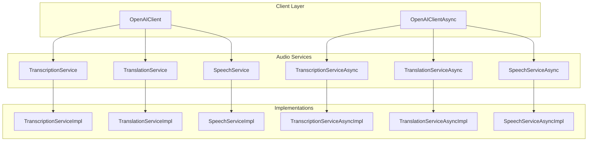
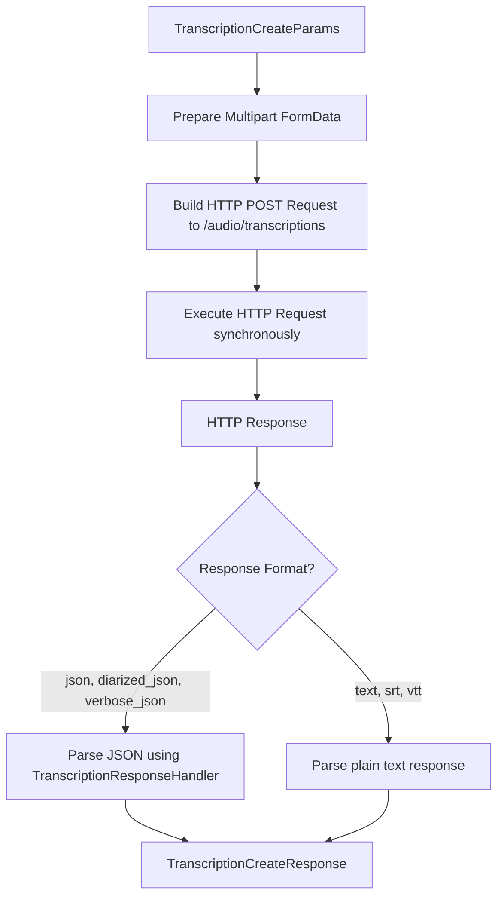
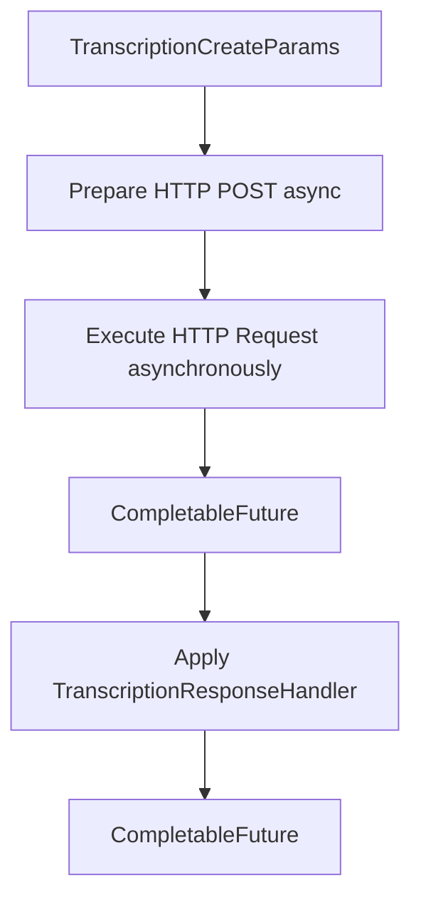
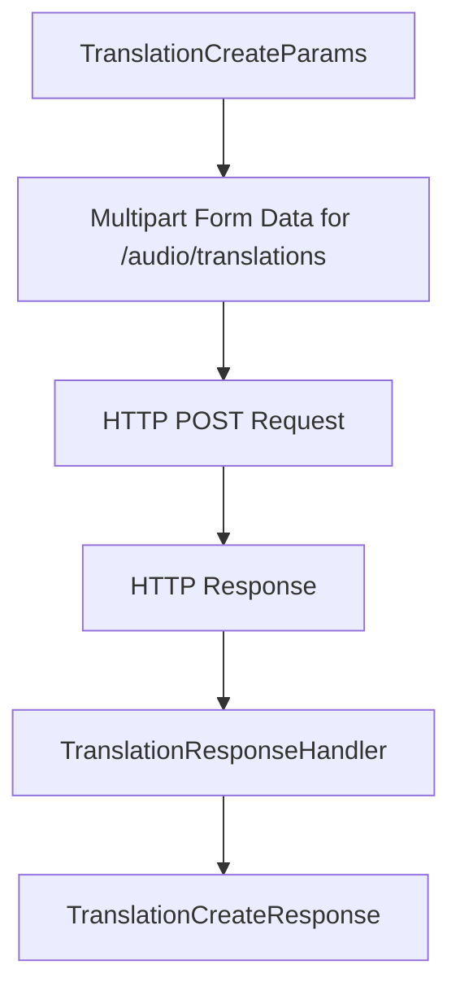

<!-- source: DeepWiki mcp.deepwiki.com · repo openai/openai-java · page 7.4 Audio Services · fetched 2026-10-26 -->

# Audio Services

<details>
<summary>Relevant source files</summary>

The following files were used as context for generating this wiki page:

- [openai-java-client-okhttp/src/test/kotlin/com/openai/client/okhttp/AudioTranscriptionResponseTest.kt](openai-java-client-okhttp/src/test/kotlin/com/openai/client/okhttp/AudioTranscriptionResponseTest.kt)
- [openai-java-client-okhttp/src/test/kotlin/com/openai/client/okhttp/AudioTranslationMediaTest.kt](openai-java-client-okhttp/src/test/kotlin/com/openai/client/okhttp/AudioTranslationMediaTest.kt)
- [openai-java-core/src/main/kotlin/com/openai/models/Reasoning.kt](openai-java-core/src/main/kotlin/com/openai/models/Reasoning.kt)
- [openai-java-core/src/main/kotlin/com/openai/models/audio/AudioResponseFormat.kt](openai-java-core/src/main/kotlin/com/openai/models/audio/AudioResponseFormat.kt)
- [openai-java-core/src/main/kotlin/com/openai/models/audio/transcriptions/Transcription.kt](openai-java-core/src/main/kotlin/com/openai/models/audio/transcriptions/Transcription.kt)
- [openai-java-core/src/main/kotlin/com/openai/models/audio/transcriptions/TranscriptionCreateParams.kt](openai-java-core/src/main/kotlin/com/openai/models/audio/transcriptions/TranscriptionCreateParams.kt)
- [openai-java-core/src/main/kotlin/com/openai/models/audio/transcriptions/TranscriptionTextDeltaEvent.kt](openai-java-core/src/main/kotlin/com/openai/models/audio/transcriptions/TranscriptionTextDeltaEvent.kt)
- [openai-java-core/src/main/kotlin/com/openai/models/audio/transcriptions/TranscriptionVerbose.kt](openai-java-core/src/main/kotlin/com/openai/models/audio/transcriptions/TranscriptionVerbose.kt)
- [openai-java-core/src/main/kotlin/com/openai/models/audio/translations/TranslationCreateParams.kt](openai-java-core/src/main/kotlin/com/openai/models/audio/translations/TranslationCreateParams.kt)
- [openai-java-core/src/main/kotlin/com/openai/models/beta/realtime/ConversationItemInputAudioTranscriptionCompletedEvent.kt](openai-java-core/src/main/kotlin/com/openai/models/beta/realtime/ConversationItemInputAudioTranscriptionCompletedEvent.kt)
- [openai-java-core/src/main/kotlin/com/openai/models/containers/files/FileCreateParams.kt](openai-java-core/src/main/kotlin/com/openai/models/containers/files/FileCreateParams.kt)
- [openai-java-core/src/main/kotlin/com/openai/models/files/FileCreateParams.kt](openai-java-core/src/main/kotlin/com/openai/models/files/FileCreateParams.kt)
- [openai-java-core/src/main/kotlin/com/openai/models/files/FileObject.kt](openai-java-core/src/main/kotlin/com/openai/models/files/FileObject.kt)
- [openai-java-core/src/main/kotlin/com/openai/models/images/ImageCreateVariationParams.kt](openai-java-core/src/main/kotlin/com/openai/models/images/ImageCreateVariationParams.kt)
- [openai-java-core/src/main/kotlin/com/openai/models/responses/ResponseMcpCallArgumentsDeltaEvent.kt](openai-java-core/src/main/kotlin/com/openai/models/responses/ResponseMcpCallArgumentsDeltaEvent.kt)
- [openai-java-core/src/main/kotlin/com/openai/models/responses/ResponseMcpCallArgumentsDoneEvent.kt](openai-java-core/src/main/kotlin/com/openai/models/responses/ResponseMcpCallArgumentsDoneEvent.kt)
- [openai-java-core/src/main/kotlin/com/openai/models/responses/ResponseOutputTextAnnotationAddedEvent.kt](openai-java-core/src/main/kotlin/com/openai/models/responses/ResponseOutputTextAnnotationAddedEvent.kt)
- [openai-java-core/src/main/kotlin/com/openai/models/uploads/parts/PartCreateParams.kt](openai-java-core/src/main/kotlin/com/openai/models/uploads/parts/PartCreateParams.kt)
- [openai-java-core/src/main/kotlin/com/openai/services/AudioResponseHandlers.kt](openai-java-core/src/main/kotlin/com/openai/services/AudioResponseHandlers.kt)
- [openai-java-core/src/main/kotlin/com/openai/services/async/FileServiceAsync.kt](openai-java-core/src/main/kotlin/com/openai/services/async/FileServiceAsync.kt)
- [openai-java-core/src/main/kotlin/com/openai/services/async/audio/TranscriptionServiceAsyncImpl.kt](openai-java-core/src/main/kotlin/com/openai/services/async/audio/TranscriptionServiceAsyncImpl.kt)
- [openai-java-core/src/main/kotlin/com/openai/services/async/audio/TranslationServiceAsyncImpl.kt](openai-java-core/src/main/kotlin/com/openai/services/async/audio/TranslationServiceAsyncImpl.kt)
- [openai-java-core/src/main/kotlin/com/openai/services/blocking/FileService.kt](openai-java-core/src/main/kotlin/com/openai/services/blocking/FileService.kt)
- [openai-java-core/src/main/kotlin/com/openai/services/blocking/audio/TranscriptionServiceImpl.kt](openai-java-core/src/main/kotlin/com/openai/services/blocking/audio/TranscriptionServiceImpl.kt)
- [openai-java-core/src/main/kotlin/com/openai/services/blocking/audio/TranslationServiceImpl.kt](openai-java-core/src/main/kotlin/com/openai/services/blocking/audio/TranslationServiceImpl.kt)
- [openai-java-core/src/test/kotlin/com/openai/models/audio/transcriptions/TranscriptionCreateResponseTest.kt](openai-java-core/src/test/kotlin/com/openai/models/audio/transcriptions/TranscriptionCreateResponseTest.kt)
- [openai-java-core/src/test/kotlin/com/openai/models/audio/transcriptions/TranscriptionTextDeltaEventTest.kt](openai-java-core/src/test/kotlin/com/openai/models/audio/transcriptions/TranscriptionTextDeltaEventTest.kt)
- [openai-java-core/src/test/kotlin/com/openai/models/audio/transcriptions/TranscriptionVerboseTest.kt](openai-java-core/src/test/kotlin/com/openai/models/audio/transcriptions/TranscriptionVerboseTest.kt)
- [openai-java-core/src/test/kotlin/com/openai/services/blocking/FileServiceTest.kt](openai-java-core/src/test/kotlin/com/openai/services/blocking/FileServiceTest.kt)
- [openai-java-example/src/main/java/com/openai/example/AudioTranscriptionsVttExample.java](openai-java-example/src/main/java/com/openai/example/AudioTranscriptionsVttExample.java)

</details>


The Audio Services in the OpenAI Java SDK provide comprehensive functionality to perform audio transcription (speech-to-text), audio translation, and text-to-speech (speech synthesis). This includes support for synchronous and asynchronous usage, streaming transcription, diarization, multiple response formats, and model selection.

This page documents the architecture, core interfaces, data flow, and implementation details of the Audio Services, with a focus on:

- Audio transcription, including diarization and streaming support
- Audio translation
- Text-to-speech capabilities (speech generation)
- Key parameters, response formats, and models
- Error handling and response validation
- Multipart form handling for audio file uploads

---

## Overview

The Audio Services module comprises statically typed service interfaces and implementations to facilitate interaction with the OpenAI audio-related REST endpoints.

Clients can use both synchronous (`TranscriptionService`, `TranslationService`) and asynchronous (`TranscriptionServiceAsync`, `TranslationServiceAsync`) APIs. These interfaces allow submitting audio files for transcription or translation, receiving responses in various formats, and optionally consuming transcription streams for real-time partial results.

### High-Level Audio Service Architecture



Sources:  
[openai-java-core/src/main/kotlin/com/openai/client/OpenAIClientImpl.kt:82](),  
[openai-java-core/src/main/kotlin/com/openai/client/OpenAIClientAsyncImpl.kt:84-86](),  
[openai-java-core/src/main/kotlin/com/openai/services/blocking/audio/TranscriptionServiceImpl.kt:31-56](),  
[openai-java-core/src/main/kotlin/com/openai/services/async/audio/TranscriptionServiceAsyncImpl.kt:33-62](),  
[openai-java-core/src/main/kotlin/com/openai/services/blocking/audio/TranslationServiceImpl.kt:25-38](),  
[openai-java-core/src/main/kotlin/com/openai/services/async/audio/TranslationServiceAsyncImpl.kt:26-43]()

---

## Audio Transcription Service

The transcription service converts spoken audio into text. It supports multiple models (like Whisper and GPT-4o transcription variants), a variety of audio input formats, and response formats such as `json`, `text`, `srt`, `verbose_json`, and `vtt`. It also supports speaker diarization and partial streaming results.

### Core Interfaces

- **Synchronous:**
  - `TranscriptionService`  
  - `TranscriptionService.WithRawResponse`
- **Asynchronous:**  
  - `TranscriptionServiceAsync`  
  - `TranscriptionServiceAsync.WithRawResponse`

These interfaces provide:

- `create(params, requestOptions)`: Transcribes audio synchronously or asynchronously and returns full transcription results.
- `createStreaming(params, requestOptions)`: Provides real-time streaming transcription results.

Both synchronous and async versions accept `TranscriptionCreateParams` which includes audio file input, chosen model, response format, language, diarization options, and more.

### Data Flow for Synchronous Transcription



Example method call:  
`synchronousService.create(params, requestOptions) -> TranscriptionCreateResponse`

Sources:  
[openai-java-core/src/main/kotlin/com/openai/services/blocking/audio/TranscriptionServiceImpl.kt:43-56, 70-103](),  
[openai-java-core/src/main/kotlin/com/openai/models/audio/transcriptions/TranscriptionCreateParams.kt:44-151](),  
[openai-java-core/src/main/kotlin/com/openai/services/AudioResponseHandlers.kt:14-30]()

### Asynchronous Transcription Flow



With streaming transcription:

```mermaid
flowchart TD
    A[TranscriptionCreateParams + stream=true] --> B[Multipart Form Data]
    B --> C[POST /audio/transcriptions with "Accept: text/event-stream"]
    C --> D[SSE Response Stream]
    D --> E[Parsed TranscriptionStreamEvent objects]
    E --> F[AsyncStreamResponse<TranscriptionStreamEvent>]
```

Example async method:  
`transcriptionServiceAsync.createStreaming(params, requestOptions)`

Sources:  
[openai-java-core/src/main/kotlin/com/openai/services/async/audio/TranscriptionServiceAsyncImpl.kt:46-62, 115-153]()

### Parameters Highlights (`TranscriptionCreateParams`)

Key parameters for transcription requests include:

| Parameter                | Description                                                                               | Required/Optional           |
|--------------------------|-------------------------------------------------------------------------------------------|-----------------------------|
| `file`                   | The audio file input as an InputStream in supported formats (e.g. wav, mp3, flac, etc.)   | Required                    |
| `model`                  | The transcription model to use (e.g. `gpt-transcribe`, `whisper-1`, `gpt-4o-transcribe`)  | Required                    |
| `responseFormat`         | Preferred response format (`json`, `text`, `srt`, `verbose_json`, `vtt`)                 | Optional (default is `json`) |
| `language`               | Language code ISO-639-1 for audio input (improves accuracy)                              | Optional                    |
| `chunkingStrategy`       | Strategy to segment audio into chunks, e.g. `"auto"` for VAD-based chunking               | Optional (required for diarize in long audio) |
| `include`                | List of extra information to include, like logprobs                                      | Optional                    |
| `knownSpeakerNames`      | List of known speaker labels for diarization                                             | Optional                    |
| `knownSpeakerReferences` | Audio samples of known speakers for diarization                                         | Optional                    |
| `prompt`                 | Text prompt to guide transcription style                                                | Optional                    |

Sources:  
[openai-java-core/src/main/kotlin/com/openai/models/audio/transcriptions/TranscriptionCreateParams.kt:44-151]()

### Streaming Transcription Events

Streaming transcription produces `TranscriptionStreamEvent` objects, representing partial transcription results as they arrive from the server via Server-Sent Events (SSE).

Consumers can process these streaming events to show partial subtitles or live transcripts with minimal latency.

### Response Handling

The `TranscriptionResponseHandler` class parses and maps HTTP responses into typed `TranscriptionCreateResponse` instances, dispatching to:

- Basic transcription result (`TranscriptionCreateResponse.ofTranscription()`)
- Diarized JSON result (`TranscriptionCreateResponse.ofDiarized()`)
- Verbose JSON with metadata (`TranscriptionCreateResponse.ofVerbose()`)

Depending on the `response_format` in the request.

Sources:  
[openai-java-core/src/main/kotlin/com/openai/services/AudioResponseHandlers.kt:14-30]()

---

## Audio Translation Service

The translation service transcribes audio and translates it into English. Currently, only the `whisper-1` model is supported.

### Core Interfaces

- `TranslationService` (sync)
- `TranslationServiceAsync` (async)

They expose a single `create()` method that takes `TranslationCreateParams` and returns `TranslationCreateResponse`.

### Communication Flow



Parameters include audio file input, model, optional prompt, response format, and temperature.

The response handler can parse both JSON and plain text response formats.

Sources:  
[openai-java-core/src/main/kotlin/com/openai/services/blocking/audio/TranslationServiceImpl.kt:25-92](),  
[openai-java-core/src/main/kotlin/com/openai/services/async/audio/TranslationServiceAsyncImpl.kt:26-97](),  
[openai-java-core/src/main/kotlin/com/openai/models/audio/translations/TranslationCreateParams.kt:30-177](),  
[openai-java-core/src/main/kotlin/com/openai/services/AudioResponseHandlers.kt:31-45]()

---

## Text-to-Speech (Speech) Services

The speech service allows generation of audio from text input using configured voice models (e.g., `tts-1`, `tts-1-hd`, `gpt-4o-mini-tts`).

While implementations and detailed API documentation are not included in the provided files, the SDK follows the pattern observed for transcription and translation:

- Synchronous and asynchronous `SpeechService` interfaces and implementations.
- Use of parameters specifying text input and voice configuration.
- Support for raw response access and options customization.

---

## Implementation Details

### Multipart Form Data Handling

Audio transcription and translation requests use multipart form data encoding to upload:

- Audio files (as `InputStream`, validated formats)
- Model ID and other parameters as form fields
- Optional streaming flag for streaming requests (`stream=true`)

The multipart payload is built via a utility method `multipartFormData(jsonMapper, body)` where `body` is a map representing parameters extracted from the `Params` object.

Example multipart building snippet (conceptual):  

```kotlin
val requestBody = multipartFormData(jsonMapper, params._body())
```

For streaming transcription:

```kotlin
val requestBody = multipartFormData(
    jsonMapper,
    params._body() + ("stream" to MultipartField.of(true))
)
```

Sources:  
[openai-java-core/src/main/kotlin/com/openai/services/blocking/audio/TranscriptionServiceImpl.kt:86-92, 120-123](),  
[openai-java-core/src/main/kotlin/com/openai/services/async/audio/TranscriptionServiceAsyncImpl.kt:128-132]()

---

### Error Handling and Response Validation

Audio services integrate layered error and response validation handling:

- `errorHandler` to process non-2xx HTTP statuses including body parsing.
- `errorBodyHandler` for reading error response bodies.
- Optionally enabled per request, `ResponseValidation` verifies that the data model is consistent.

Streaming responses support validation per streamed event when enabled.

These handlers ensure robust failure detection and simplified error propagation to client code.

Sources:  
[openai-java-core/src/main/kotlin/com/openai/services/blocking/audio/TranscriptionServiceImpl.kt:60-61, 95-103, 137-142](),  
[openai-java-core/src/main/kotlin/com/openai/services/async/audio/TranscriptionServiceAsyncImpl.kt:66-68, 143-152]()

---

### Asynchronous Streaming Model

The asynchronous transcription streaming API returns an `AsyncStreamResponse<TranscriptionStreamEvent>`. This abstraction wraps SSE event parsing into domain model events and provides hooks to handle streamed partial results.

The stream handlers leverage the client's `streamHandlerExecutor` executor for concurrency.

---

# Summary Mermaid Diagram: Natural Language Space to Code Entity Space Mapping

```mermaid
graph TD
    subgraph "Natural Language Space"
        NL1["Audio Transcription"]
        NL2["Audio Translation"]
        NL3["Text-to-Speech (Speech Synthesis)"]
        NL4["Streaming Transcription"]
        NL5["Multipart Audio Upload"]
        NL6["Response Formats (json, text, etc.)"]
        NL7["Models (whisper-1, gpt-4o-transcribe)"]
    end

    subgraph "Code Entity Space"
        CE1[TranscriptionService / TranscriptionServiceAsync]
        CE2[TranslationService / TranslationServiceAsync]
        CE3[SpeechService / SpeechServiceAsync]
        CE4[createStreaming() methods]
        CE5[multipartFormData()]
        CE6[TranscriptionResponseHandler / TranslationResponseHandler]
        CE7[AudioModel.kt / AudioResponseFormat.kt enums]
        CE8[TranscriptionCreateParams / TranslationCreateParams]
    end

    NL1 --> CE1
    NL2 --> CE2
    NL3 --> CE3
    NL4 --> CE4
    NL5 --> CE5
    NL6 --> CE6
    NL7 --> CE7
    NL1 --> CE8
    NL2 --> CE8
```

Sources:  
All code files cited page-wide.

---

# Summary Tables

## Supported Audio Models

| Model Enum (AudioModel)      | String Value                     | Usage              |
|-----------------------------|---------------------------------|--------------------|
| `WHISPER_1`                 | `whisper-1`                     | Whisper-based general model |
| `GPT_4O_TRANSCRIBE`         | `gpt-4o-transcribe`             | GPT-4o advanced transcription (JSON only) |
| `GPT_4O_MINI_TRANSCRIBE`    | `gpt-4o-mini-transcribe`        | Smaller GPT-4o transcription |
| `GPT_4O_TRANSCRIBE_DIARIZE` | `gpt-4o-transcribe-diarize`     | GPT-4o with diarization support |

Sources:  
[openai-java-core/src/main/kotlin/com/openai/models/audio/AudioModel.kt:23-28]()

## Supported Audio Response Formats

| Format Enum (AudioResponseFormat) | String Value      | Description                              | JSON Response? |
|----------------------------------|-------------------|----------------------------------------|---------------|
| `JSON`                           | `json`            | Standard JSON transcription output      | Yes           |
| `TEXT`                           | `text`            | Plain text transcription output        | No            |
| `SRT`                            | `srt`             | SubRip subtitle format                  | No            |
| `VERBOSE_JSON`                   | `verbose_json`    | JSON with extra metadata                | Yes           |
| `VTT`                            | `vtt`             | WebVTT subtitle format                  | No            |

Sources:  
[openai-java-core/src/main/kotlin/com/openai/models/audio/AudioResponseFormat.kt:28-36, 146-154]()

---

# Example: Synchronous Transcription Usage

```kotlin
val transcriptionService: TranscriptionService = client.audio().transcriptions()

val params = TranscriptionCreateParams.builder()
    .file(audioInputStream)
    .model(AudioModel.WHISPER_1)
    .responseFormat(AudioResponseFormat.JSON)
    .language("en")
    .build()

val response: TranscriptionCreateResponse = transcriptionService.create(params, RequestOptions.none())

println("Transcribed text: ${response.text()}")
```

# Example: Asynchronous Streaming Transcription Usage

```kotlin
val transcriptionAsync: TranscriptionServiceAsync = client.audio().transcriptionsAsync()

val params = TranscriptionCreateParams.builder()
    .file(audioInputStream)
    .model(AudioModel.WHISPER_1)
    .build()

val streamResponse = transcriptionAsync.createStreaming(params, RequestOptions.none())
streamResponse.onEvent { event ->
    println("Partial transcription: ${event.text()}")
}
streamResponse.awaitCompletion()
```

---

# References and Further Reading

- [TranscriptionServiceImpl.kt](openai-java-core/src/main/kotlin/com/openai/services/blocking/audio/TranscriptionServiceImpl.kt)  
- [TranscriptionServiceAsyncImpl.kt](openai-java-core/src/main/kotlin/com/openai/services/async/audio/TranscriptionServiceAsyncImpl.kt)  
- [TranslationServiceImpl.kt](openai-java-core/src/main/kotlin/com/openai/services/blocking/audio/TranslationServiceImpl.kt)  
- [TranslationServiceAsyncImpl.kt](openai-java-core/src/main/kotlin/com/openai/services/async/audio/TranslationServiceAsyncImpl.kt)  
- [AudioResponseHandlers.kt](openai-java-core/src/main/kotlin/com/openai/services/AudioResponseHandlers.kt)  
- [TranscriptionCreateParams.kt](openai-java-core/src/main/kotlin/com/openai/models/audio/transcriptions/TranscriptionCreateParams.kt)  
- [TranslationCreateParams.kt](openai-java-core/src/main/kotlin/com/openai/models/audio/translations/TranslationCreateParams.kt)  
- [AudioModel.kt](openai-java-core/src/main/kotlin/com/openai/models/audio/AudioModel.kt)  
- [AudioResponseFormat.kt](openai-java-core/src/main/kotlin/com/openai/models/audio/AudioResponseFormat.kt)  

---

# Conclusion

The OpenAI Java SDK’s Audio Services module provides robust support for audio transcription and translation with flexible synchronous and asynchronous APIs, rich response format support, streaming capabilities, and comprehensive error handling, all powered by a unified multipart upload and response handler infrastructure. This enables Java developers to seamlessly integrate speech-to-text and text-to-speech functionality in their applications.


Sources:  
[openai-java-core/src/main/kotlin/com/openai/services/blocking/audio/TranscriptionServiceImpl.kt:31-145](),  
[openai-java-core/src/main/kotlin/com/openai/services/async/audio/TranscriptionServiceAsyncImpl.kt:33-153](),  
[openai-java-core/src/main/kotlin/com/openai/models/audio/transcriptions/TranscriptionCreateParams.kt:44-151](),  
[openai-java-core/src/main/kotlin/com/openai/models/audio/translations/TranslationCreateParams.kt:30-177](),  
[openai-java-core/src/main/kotlin/com/openai/services/AudioResponseHandlers.kt:14-45](),  
[openai-java-core/src/main/kotlin/com/openai/services/blocking/audio/TranslationServiceImpl.kt:25-92](),  
[openai-java-core/src/main/kotlin/com/openai/services/async/audio/TranslationServiceAsyncImpl.kt:26-97]()

---

