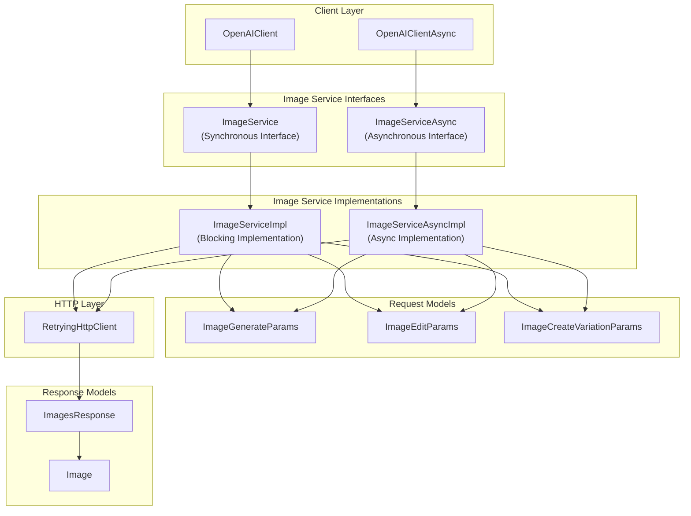
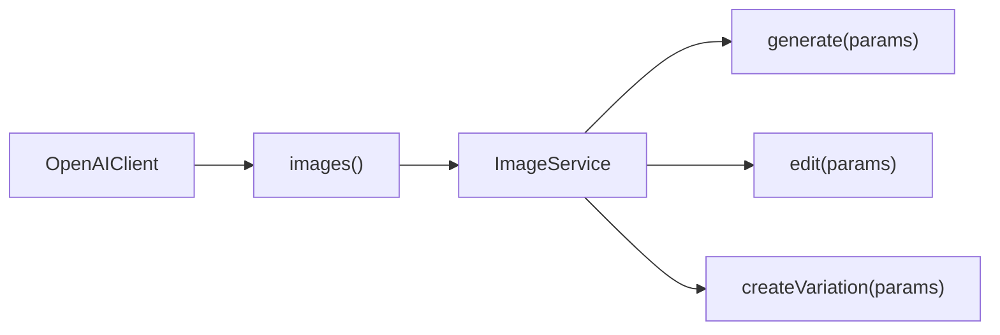
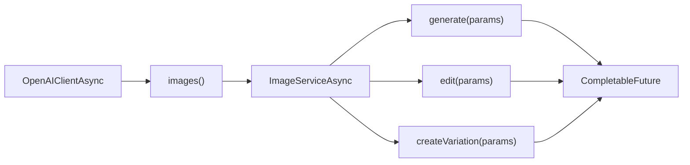
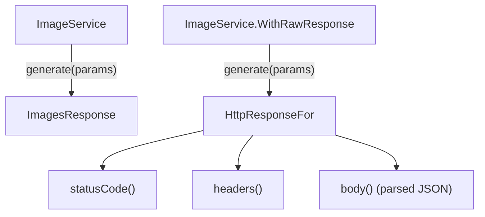
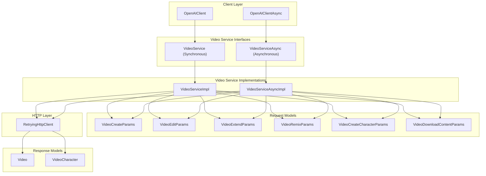
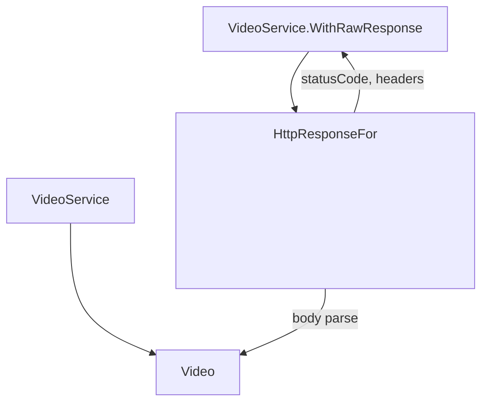

<!-- source: DeepWiki mcp.deepwiki.com · repo openai/openai-java · page 7.5 Image and Video Services · fetched 2026-10-26 -->

# Image and Video Services

<details>
<summary>Relevant source files</summary>

The following files were used as context for generating this wiki page:

- [openai-java-core/src/main/kotlin/com/openai/models/audio/AudioModel.kt](openai-java-core/src/main/kotlin/com/openai/models/audio/AudioModel.kt)
- [openai-java-core/src/main/kotlin/com/openai/models/audio/speech/SpeechCreateParams.kt](openai-java-core/src/main/kotlin/com/openai/models/audio/speech/SpeechCreateParams.kt)
- [openai-java-core/src/main/kotlin/com/openai/models/audio/speech/SpeechModel.kt](openai-java-core/src/main/kotlin/com/openai/models/audio/speech/SpeechModel.kt)
- [openai-java-core/src/main/kotlin/com/openai/models/realtime/AudioTranscription.kt](openai-java-core/src/main/kotlin/com/openai/models/realtime/AudioTranscription.kt)
- [openai-java-core/src/main/kotlin/com/openai/models/responses/ResponseFunctionShellToolCallOutput.kt](openai-java-core/src/main/kotlin/com/openai/models/responses/ResponseFunctionShellToolCallOutput.kt)
- [openai-java-core/src/main/kotlin/com/openai/models/videos/Video.kt](openai-java-core/src/main/kotlin/com/openai/models/videos/Video.kt)
- [openai-java-core/src/main/kotlin/com/openai/models/videos/VideoCreateCharacterParams.kt](openai-java-core/src/main/kotlin/com/openai/models/videos/VideoCreateCharacterParams.kt)
- [openai-java-core/src/main/kotlin/com/openai/models/videos/VideoCreateParams.kt](openai-java-core/src/main/kotlin/com/openai/models/videos/VideoCreateParams.kt)
- [openai-java-core/src/main/kotlin/com/openai/models/videos/VideoEditParams.kt](openai-java-core/src/main/kotlin/com/openai/models/videos/VideoEditParams.kt)
- [openai-java-core/src/main/kotlin/com/openai/models/videos/VideoExtendParams.kt](openai-java-core/src/main/kotlin/com/openai/models/videos/VideoExtendParams.kt)
- [openai-java-core/src/main/kotlin/com/openai/models/videos/VideoGetCharacterParams.kt](openai-java-core/src/main/kotlin/com/openai/models/videos/VideoGetCharacterParams.kt)
- [openai-java-core/src/main/kotlin/com/openai/services/async/CompletionServiceAsyncImpl.kt](openai-java-core/src/main/kotlin/com/openai/services/async/CompletionServiceAsyncImpl.kt)
- [openai-java-core/src/main/kotlin/com/openai/services/async/EmbeddingServiceAsyncImpl.kt](openai-java-core/src/main/kotlin/com/openai/services/async/EmbeddingServiceAsyncImpl.kt)
- [openai-java-core/src/main/kotlin/com/openai/services/async/ImageServiceAsyncImpl.kt](openai-java-core/src/main/kotlin/com/openai/services/async/ImageServiceAsyncImpl.kt)
- [openai-java-core/src/main/kotlin/com/openai/services/async/ModerationServiceAsyncImpl.kt](openai-java-core/src/main/kotlin/com/openai/services/async/ModerationServiceAsyncImpl.kt)
- [openai-java-core/src/main/kotlin/com/openai/services/async/VideoServiceAsync.kt](openai-java-core/src/main/kotlin/com/openai/services/async/VideoServiceAsync.kt)
- [openai-java-core/src/main/kotlin/com/openai/services/async/VideoServiceAsyncImpl.kt](openai-java-core/src/main/kotlin/com/openai/services/async/VideoServiceAsyncImpl.kt)
- [openai-java-core/src/main/kotlin/com/openai/services/blocking/CompletionServiceImpl.kt](openai-java-core/src/main/kotlin/com/openai/services/blocking/CompletionServiceImpl.kt)
- [openai-java-core/src/main/kotlin/com/openai/services/blocking/EmbeddingServiceImpl.kt](openai-java-core/src/main/kotlin/com/openai/services/blocking/EmbeddingServiceImpl.kt)
- [openai-java-core/src/main/kotlin/com/openai/services/blocking/ImageServiceImpl.kt](openai-java-core/src/main/kotlin/com/openai/services/blocking/ImageServiceImpl.kt)
- [openai-java-core/src/main/kotlin/com/openai/services/blocking/ModerationServiceImpl.kt](openai-java-core/src/main/kotlin/com/openai/services/blocking/ModerationServiceImpl.kt)
- [openai-java-core/src/main/kotlin/com/openai/services/blocking/VideoService.kt](openai-java-core/src/main/kotlin/com/openai/services/blocking/VideoService.kt)
- [openai-java-core/src/main/kotlin/com/openai/services/blocking/VideoServiceImpl.kt](openai-java-core/src/main/kotlin/com/openai/services/blocking/VideoServiceImpl.kt)
- [openai-java-core/src/test/kotlin/com/openai/models/responses/ResponseFunctionShellToolCallOutputTest.kt](openai-java-core/src/test/kotlin/com/openai/models/responses/ResponseFunctionShellToolCallOutputTest.kt)
- [openai-java-core/src/test/kotlin/com/openai/models/videos/VideoCreateParamsTest.kt](openai-java-core/src/test/kotlin/com/openai/models/videos/VideoCreateParamsTest.kt)
- [openai-java-core/src/test/kotlin/com/openai/models/videos/VideoEditParamsTest.kt](openai-java-core/src/test/kotlin/com/openai/models/videos/VideoEditParamsTest.kt)
- [openai-java-core/src/test/kotlin/com/openai/models/videos/VideoExtendParamsTest.kt](openai-java-core/src/test/kotlin/com/openai/models/videos/VideoExtendParamsTest.kt)
- [openai-java-core/src/test/kotlin/com/openai/services/async/VideoServiceAsyncTest.kt](openai-java-core/src/test/kotlin/com/openai/services/async/VideoServiceAsyncTest.kt)
- [openai-java-core/src/test/kotlin/com/openai/services/blocking/VideoServiceTest.kt](openai-java-core/src/test/kotlin/com/openai/services/blocking/VideoServiceTest.kt)

</details>


This section documents the image and video generation, editing, and variation capabilities provided by the OpenAI Java SDK. It covers the image generation/edit/variation services powered by DALL-E models as well as the Video API, including video creation, editing, extending, remixing, character management, and content downloading features.

---

## Overview

The SDK provides comprehensive support for the following:

- **Image Services:** Generate images from descriptions, edit images with masks, create variations of images, both synchronously and asynchronously.
- **Video Services:** Create new videos from prompts and references, edit existing videos, extend videos, remix videos, manage video characters, download video content, all through a dedicated Video service interface.
- Both services follow the SDK's layered architecture pattern, with separate interfaces for synchronous and asynchronous modes, shared request/response models, built-in multipart form-data handling for binary uploads, configured retry and error handling, and a raw response access pattern for advanced use cases.

This page provides in-depth technical details on implementation classes, request/response data flow, key data types, and usage.

---

## Image Services Architecture

The Image Services implement the generation, editing, and variation endpoints of the OpenAI API. They provide:

- **`ImageService` (sync)** and **`ImageServiceAsync` (async)** interfaces for clients.
- Implementations: `ImageServiceImpl` and `ImageServiceAsyncImpl`.
- Use request parameter models: `ImageGenerateParams`, `ImageEditParams`, `ImageCreateVariationParams`.
- Return response model `ImagesResponse`.
- Make HTTP calls via an underlying HTTP client supporting retries and error handling.



**Sources:** [openai-java-core/src/main/kotlin/com/openai/services/blocking/ImageServiceImpl.kt:35-78](), [openai-java-core/src/main/kotlin/com/openai/services/async/ImageServiceAsyncImpl.kt:39-93]()

---

## Accessing Image Services

The users access image capabilities from the client as follows:

### Synchronous Access



### Asynchronous Access



**Sources:** [openai-java-core/src/main/kotlin/com/openai/client/OpenAIClient.kt:73](), [openai-java-core/src/main/kotlin/com/openai/client/OpenAIClientAsync.kt:73]()

---

## Image Generation, Editing, and Variation Flows

The Image API supports three main operations: generate, edit, and create variation. Internally these map to HTTP POST calls to `/images/generations`, `/images/edits`, and `/images/variations` respectively, with multipart form data bodies for uploads when necessary.

Below diagrams show request parameter building, HTTP dispatch, and response parsing flows:

### Image Generation Flow

```mermaid
flowchart LR
    subgraph "Prepare Request"
        ParamsBuilder["ImageGenerateParams.builder()"]
        SetPrompt["prompt(String)"]
        SetModel["model(String)"]
        SetSize["size(String)"]
        SetOtherParams["(quality, n, responseFormat, etc.)"]
    end
    
    subgraph "Send Request"
        ImageService["ImageService.generate()"]
        HttpClient["RetryingHttpClient"]
        ApiEndpoint["POST /images/generations"]
    end
    
    subgraph "Process Response"
        RawHttpResponse["HttpResponse"]
        ParseJson["Parse JSON to ImagesResponse"]
        ImagesResponse["ImagesResponse"]
    end
    
    ParamsBuilder --> SetPrompt --> SetModel --> SetSize --> SetOtherParams --> ImageService
    ImageService --> HttpClient --> ApiEndpoint --> RawHttpResponse --> ParseJson --> ImagesResponse
```



### Image Editing Flow


### Image Variation Flow

```mermaid
flowchart LR
    subgraph "Prepare Request"
        ParamsBuilder["ImageCreateVariationParams.builder()"]
        SetImage["image(byte[])"]
        SetModel["model(String)"]
        SetOtherParams["(n, size, responseFormat)"]
    end
    
    subgraph "Multipart Form Data"
        MultipartBody["Multipart Form Data Builder"]
        AddImagePart["Add 'image' part"]
        AddTextParts["Add textual parts"]
    end
    
    subgraph "Send Request"
        ImageService["ImageService.createVariation()"]
        HttpClient["RetryingHttpClient"]
        ApiEndpoint["POST /images/variations"]
    end

    subgraph "Process Response"
        RawHttpResponse["HttpResponse"]
        ParseJson["Parse JSON to ImagesResponse"]
        ImagesResponse["ImagesResponse"]
    end
    
    ParamsBuilder --> SetImage --> SetModel --> SetOtherParams --> MultipartBody
    MultipartBody --> AddImagePart --> AddTextParts --> ImageService
    ImageService --> HttpClient --> ApiEndpoint --> RawHttpResponse --> ParseJson --> ImagesResponse
```



**Sources:** [openai-java-core/src/main/kotlin/com/openai/services/blocking/ImageServiceImpl.kt:47-114](), [openai-java-core/src/main/kotlin/com/openai/services/async/ImageServiceAsyncImpl.kt:51-140]()

---

## Raw Response Pattern in Image Services

Both synchronous and asynchronous ImageService interfaces expose a `WithRawResponse` sub-interface. This allows clients to:

- Access underlying HTTP response details such as status code and headers.
- Parse the response body on demand.
- Support advanced use cases like logging, debugging, metrics, and custom retry logic.



**Sources:** [openai-java-core/src/main/kotlin/com/openai/services/blocking/ImageServiceImpl.kt:79-121]()

---

## Video Services Architecture

The Video API offers rich video generation and manipulation, including:

- Creating new videos based on prompts and optional input references.
- Editing existing videos by specifying prompt instructions and source video.
- Extending completed videos by generating additional segments.
- Remixing videos to produce variation clips.
- Managing video characters (creating and retrieving).
- Downloading video content or variants.

The API is currently marked deprecated with the Sora API scheduled for shutdown in 2026, but the SDK supports it fully until then.

---

### Video Service Interfaces and Implementation Overview

There are both synchronous and asynchronous interfaces:

- `VideoService` / `VideoServiceImpl` (blocking)
- `VideoServiceAsync` / `VideoServiceAsyncImpl` (async)

Each defines methods corresponding to API endpoints and takes typed request parameters modeled by classes such as:

- `VideoCreateParams` — Parameters for creating videos from prompts.
- `VideoEditParams` — Parameters for editing videos.
- `VideoExtendParams` — Parameters for extending video duration.
- `VideoRemixParams` — Parameters for remixing videos.
- `VideoCreateCharacterParams` — For character creation.
- `VideoDownloadContentParams` — For downloading video content/variants.

Responses are represented by the `Video` and `VideoCharacter` classes, among others.



**Sources:** [openai-java-core/src/main/kotlin/com/openai/services/blocking/VideoServiceImpl.kt:35-80](), [openai-java-core/src/main/kotlin/com/openai/services/async/VideoServiceAsyncImpl.kt:35-65]()

---

## Video API Method Flows

### Video Creation

- Construct a `VideoCreateParams` object specifying:
  - Required `prompt` string describing the video content.
  - Optional `inputReference` input stream or file guiding generation.
  - Optional model version (e.g., `sora-2`, default).
  - Duration `seconds` (4, 8, or 12).
  - Resolution `size`.
- Call `videoService.create(params, requestOptions)` (sync) or async variant.
- SDK sends multipart/form-data request to `/videos/create`.
- Response parsed into a `Video` instance representing the generated video job.

### Video Editing

- Use `VideoEditParams` to provide:
  - Required `prompt` string describing the edit instructions.
  - Required `video` reference (file, input stream, or `VideoReferenceInputParam`) identifying source video.
- Call `videoService.edit(params, requestOptions)` which sends a multipart POST request to `/videos/edit`.
- Response is parsed to `Video`.

### Video Extending

- Use `VideoExtendParams` to provide:
  - Required `prompt` for the extension.
  - Duration `seconds` for new segment.
  - Required `video` (existing video reference).
- Call `videoService.extend(params, requestOptions)` for extending the video.

### Remixing Videos

- Submit `VideoRemixParams` with remix-specific fields, including source video and prompt.
- Call `videoService.remix(params, requestOptions)` to get remixed video.

### Video Character Management

- Create character jobs with `VideoCreateCharacterParams` (specifying name and video).
- Retrieve character info by character ID.

### Downloading Video Content

- Use `VideoDownloadContentParams` to specify the video ID and variant type (e.g., video, thumbnail).
- Call `videoService.downloadContent(params, requestOptions)` to obtain the binary content response.

---

### Parameter Class Highlights

Example: `VideoCreateParams` encapsulates multipart form data parameters:

- Prompt text (`String`).
- Optional `inputReference` supporting an input stream or byte array.
- Optional enums for model, seconds, size.
- Builders allow setting raw multipart fields for advanced usage.
- Additional headers and query params can be included.

This flexible builder pattern is consistent across video parameter classes.

---

### Technical Details and Data Flow for Video Creation (Simplified)


---

### Example Sync Method Signature for Video Creation

```kotlin
fun create(params: VideoCreateParams, requestOptions: RequestOptions): Video
```

### Implementation Snippet (Sync)

The synchronous `VideoServiceImpl` builds the HTTP request, sets multipart body from `params._body()`, prepares the request with authentication, executes using the HTTP client, handles errors, and parses the response into a `Video`.

**Same pattern applies for other video methods including edit, extend, remix, and character operations.**

---

## Synchronous vs Asynchronous Video Services

### Synchronous Usage

- Methods block the calling thread until the response arrives.
- Return domain models directly (`Video`, `VideoCharacter`).
- Suitable for CLI apps or simple workflows.

### Asynchronous Usage

- Methods return `CompletableFuture<Video>` or `CompletableFuture<VideoCharacter>`.
- Use CompletableFuture chaining, composition, or reactive integration.
- Do not block threads; suitable for highly concurrent or UI applications.

---

## Summary Table of Video API Methods and Corresponding Parameters

| Operation           | Request Parameter Class         | Return Type | HTTP Endpoint          |
|---------------------|-------------------------------|-------------|-----------------------|
| Create Video        | `VideoCreateParams`             | `Video`     | POST `/videos/create`  |
| Edit Video          | `VideoEditParams`               | `Video`     | POST `/videos/edit`    |
| Extend Video        | `VideoExtendParams`             | `Video`     | POST `/videos/extend`  |
| Remix Video         | `VideoRemixParams`              | `Video`     | POST `/videos/remix`   |
| Create Character    | `VideoCreateCharacterParams`   | `VideoCharacter` | POST `/videos/characters` |
| Get Character       | `VideoGetCharacterParams`       | `VideoCharacter` | GET `/videos/characters/{id}` |
| Download Content    | `VideoDownloadContentParams`    | `HttpResponse` (binary) | GET `/videos/{videoId}/content` |

---

## WithRawResponse for Video Service

The video service also supports the `WithRawResponse` pattern, enabling access to raw HTTP metadata:



---

# Summary

This page has detailed the **Image Services** and **Video Services** of the OpenAI Java SDK:

- Image Services support generation, editing, and variation with DALL-E, providing both synchronous and asynchronous clients.
- Video Services wrap the Sora video API for creating, editing, extending, remixing videos, managing characters, and downloading content.
- Both services use a multipart form-data approach for image/video file uploads alongside textual parameters.
- The SDK implementations handle HTTP request lifecycle with retries, error handling, JSON parsing, and expose raw response interfaces for advanced usage.
- Complete type-safe parameter models and response classes provide a reliable developer experience.

---

**Sources:**

- Image Service: [openai-java-core/src/main/kotlin/com/openai/services/blocking/ImageServiceImpl.kt:35-121](), [openai-java-core/src/main/kotlin/com/openai/services/async/ImageServiceAsyncImpl.kt:39-140]()
- Video Service: [openai-java-core/src/main/kotlin/com/openai/services/blocking/VideoServiceImpl.kt:30-230](), [openai-java-core/src/main/kotlin/com/openai/services/async/VideoServiceAsyncImpl.kt:26-204](), [openai-java-core/src/main/kotlin/com/openai/models/videos/VideoCreateParams.kt:30-179](), [openai-java-core/src/main/kotlin/com/openai/models/videos/VideoEditParams.kt:30-174](), [openai-java-core/src/main/kotlin/com/openai/models/videos/VideoExtendParams.kt:30-176]()

---

