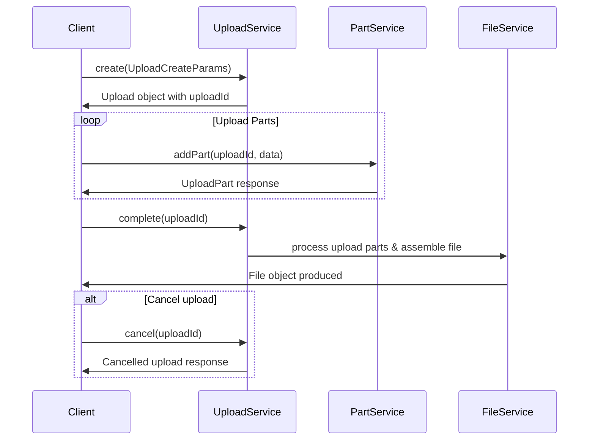
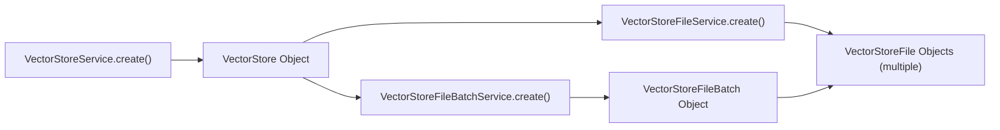
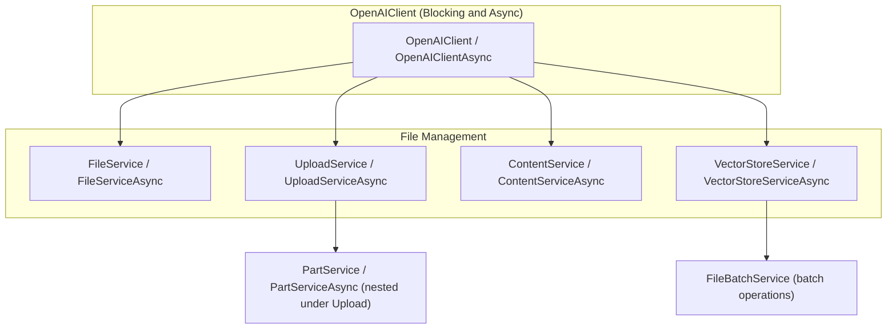

<!-- source: DeepWiki mcp.deepwiki.com · repo openai/openai-java · page 7.6 Files, Uploads, Containers and Vector Stores · fetched 2026-10-26 -->

# Files, Uploads, Containers and Vector Stores

Relevant source files

The following files were used as context for generating this wiki page:

- [openai-java-core/src/main/kotlin/com/openai/models/vectorstores/filebatches/FileBatchCreateParams.kt](openai-java-core/src/main/kotlin/com/openai/models/vectorstores/filebatches/FileBatchCreateParams.kt)
- [openai-java-core/src/main/kotlin/com/openai/models/vectorstores/files/FileCreateParams.kt](openai-java-core/src/main/kotlin/com/openai/models/vectorstores/files/FileCreateParams.kt)
- [openai-java-core/src/main/kotlin/com/openai/services/async/BatchServiceAsyncImpl.kt](openai-java-core/src/main/kotlin/com/openai/services/async/BatchServiceAsyncImpl.kt)
- [openai-java-core/src/main/kotlin/com/openai/services/async/ContainerServiceAsyncImpl.kt](openai-java-core/src/main/kotlin/com/openai/services/async/ContainerServiceAsyncImpl.kt)
- [openai-java-core/src/main/kotlin/com/openai/services/async/FileServiceAsyncImpl.kt](openai-java-core/src/main/kotlin/com/openai/services/async/FileServiceAsyncImpl.kt)
- [openai-java-core/src/main/kotlin/com/openai/services/async/ModelServiceAsyncImpl.kt](openai-java-core/src/main/kotlin/com/openai/services/async/ModelServiceAsyncImpl.kt)
- [openai-java-core/src/main/kotlin/com/openai/services/async/UploadServiceAsyncImpl.kt](openai-java-core/src/main/kotlin/com/openai/services/async/UploadServiceAsyncImpl.kt)
- [openai-java-core/src/main/kotlin/com/openai/services/async/containers/FileServiceAsyncImpl.kt](openai-java-core/src/main/kotlin/com/openai/services/async/containers/FileServiceAsyncImpl.kt)
- [openai-java-core/src/main/kotlin/com/openai/services/async/containers/files/ContentServiceAsync.kt](openai-java-core/src/main/kotlin/com/openai/services/async/containers/files/ContentServiceAsync.kt)
- [openai-java-core/src/main/kotlin/com/openai/services/async/containers/files/ContentServiceAsyncImpl.kt](openai-java-core/src/main/kotlin/com/openai/services/async/containers/files/ContentServiceAsyncImpl.kt)
- [openai-java-core/src/main/kotlin/com/openai/services/blocking/BatchServiceImpl.kt](openai-java-core/src/main/kotlin/com/openai/services/blocking/BatchServiceImpl.kt)
- [openai-java-core/src/main/kotlin/com/openai/services/blocking/ContainerServiceImpl.kt](openai-java-core/src/main/kotlin/com/openai/services/blocking/ContainerServiceImpl.kt)
- [openai-java-core/src/main/kotlin/com/openai/services/blocking/FileServiceImpl.kt](openai-java-core/src/main/kotlin/com/openai/services/blocking/FileServiceImpl.kt)
- [openai-java-core/src/main/kotlin/com/openai/services/blocking/ModelServiceImpl.kt](openai-java-core/src/main/kotlin/com/openai/services/blocking/ModelServiceImpl.kt)
- [openai-java-core/src/main/kotlin/com/openai/services/blocking/UploadServiceImpl.kt](openai-java-core/src/main/kotlin/com/openai/services/blocking/UploadServiceImpl.kt)
- [openai-java-core/src/main/kotlin/com/openai/services/blocking/containers/FileServiceImpl.kt](openai-java-core/src/main/kotlin/com/openai/services/blocking/containers/FileServiceImpl.kt)
- [openai-java-core/src/main/kotlin/com/openai/services/blocking/containers/files/ContentService.kt](openai-java-core/src/main/kotlin/com/openai/services/blocking/containers/files/ContentService.kt)
- [openai-java-core/src/main/kotlin/com/openai/services/blocking/containers/files/ContentServiceImpl.kt](openai-java-core/src/main/kotlin/com/openai/services/blocking/containers/files/ContentServiceImpl.kt)
- [openai-java-core/src/test/kotlin/com/openai/services/async/containers/files/ContentServiceAsyncTest.kt](openai-java-core/src/test/kotlin/com/openai/services/async/containers/files/ContentServiceAsyncTest.kt)
- [openai-java-core/src/test/kotlin/com/openai/services/blocking/containers/files/ContentServiceTest.kt](openai-java-core/src/test/kotlin/com/openai/services/blocking/containers/files/ContentServiceTest.kt)

This page documents the file management, multipart uploads, container files, and vector store/file batch management aspects of the OpenAI Java SDK. These capabilities enable managing files for diverse use cases such as fine-tuning, assistants, evaluations, batch processing, and large file uploads via multipart.

---

## Overview

The OpenAI Java SDK provides three primary service groups related to file data:

- **FileService**: Basic file CRUD (create, retrieve, list, delete) and file content retrieval for documents used in various API features.
- **UploadService**: Multipart upload support for large files split into multiple parts, with management for creating, uploading parts, completing, and canceling uploads.
- **Container File Service**: Management of files within containers including content retrieval from container files.
- **VectorStoreService**: Management of vector stores which organize file embeddings and support adding/removing files individually or in batches.

These services support both synchronous and asynchronous execution models, adopting a `withRawResponse()` pattern to allow access to HTTP details alongside parsed domain objects.

---

## FileService - File Uploads, Retrieval, Deletion

`FileService` manages files uploaded to the OpenAI platform, representing document resources that can be used with fine-tuning, assistants, evaluations, and batch processing.

### Key Features

- **Create Files** by uploading file data multipart encoded with associated metadata.
- **Retrieve Files** for metadata inspection or content download.
- **List Files** with filtering options based on purpose.
- **Delete Files** permanently by ID.
- **Retrieve Content** as binary streams.

### Data Flow and Methods

Operations use HTTP methods against `/files` endpoints. Requests are constructed via `HttpRequest` with correct HTTP methods and multipart form data or query parameters.

The `FileServiceImpl` and `FileServiceAsyncImpl` provide implementations, utilizing handlers for error processing and JSON serialization/deserialization.

Key methods include:

| Method           | HTTP Endpoint          | Description                       |
|------------------|-----------------------|---------------------------------|
| `create`         | POST `/files`          | Upload a new file                |
| `retrieve`       | GET `/files/{file_id}` | Get file metadata                |
| `list`           | GET `/files`           | List files                      |
| `delete`         | DELETE `/files/{file_id}` | Delete a file                  |
| `content`        | GET `/files/{file_id}/content` | Download file content      |

### Internal Behavior

- Uploads use `multipartFormData` to prepare the request body.
- Retrieving content sets the `Accept` header to `application/binary`.
- All calls require authentication configured with bearer tokens.
- Response handlers parse JSON into `FileObject` or related models and validate responses optionally.

### Example Class and Methods
- `FileServiceImpl` (blocking) delegates to `WithRawResponseImpl` which sends the HTTP request and processes response [openai-java-core/src/main/kotlin/com/openai/services/blocking/FileServiceImpl.kt:37-164]()
- `FileServiceAsyncImpl` (async) behavior mirrors blocking but returns `CompletableFuture` [openai-java-core/src/main/kotlin/com/openai/services/async/FileServiceAsyncImpl.kt:38-164]()

**Sources:**
- [openai-java-core/src/main/kotlin/com/openai/services/blocking/FileServiceImpl.kt:37-164]()
- [openai-java-core/src/main/kotlin/com/openai/services/async/FileServiceAsyncImpl.kt:38-164]()

---

## UploadService - Multipart Uploads and Parts

`UploadService` enables uploading large files by splitting them into multiple parts. This service provides control for creating uploads, adding parts, completing uploads, or cancelling them.

### Multipart Upload Lifecycle

1. **Create Upload**: Initializes an upload session (POST `/uploads`).
2. **Add Parts**: Upload separate parts independently, each becoming an `UploadPart`.
3. **Complete Upload**: Finalizes the multipart upload (POST `/uploads/{upload_id}/complete`), triggering file assembly and processing.
4. **Cancel Upload**: Aborts an ongoing upload, deleting any parts.

Parts are managed through the nested `PartService` accessible from the upload service, enabling modular operations.

### Implementation Highlights

- `UploadServiceImpl` and `UploadServiceAsyncImpl` manage the lifecycle with `WithRawResponseImpl` for raw HTTP operations [openai-java-core/src/main/kotlin/com/openai/services/blocking/UploadServiceImpl.kt:31-157](), [openai-java-core/src/main/kotlin/com/openai/services/async/UploadServiceAsyncImpl.kt:31-159]()
- `PartService` and `PartServiceAsync` handle part uploads separately (referenced from within UploadService).

---

### Multipart Upload Sequence Diagram

**Sources:**
- [openai-java-core/src/main/kotlin/com/openai/services/blocking/UploadServiceImpl.kt:31-157]()
- [openai-java-core/src/main/kotlin/com/openai/services/async/UploadServiceAsyncImpl.kt:31-159]()

---

## Containers and Container Files

Files can be managed within **containers**, which group multiple files into a single logical scope. Container files have their own service, primarily exposing content retrieval.

### Container File Content Retrieval

- Supported by the `ContentService` and `ContentServiceAsync`.
- Retrieve file content with GET `/containers/{container_id}/files/{file_id}/content`.
- The request includes the container and file identifier path segments.
- The response is binary, indicated by the `"Accept: application/binary"` header.

### Implementation

- `ContentServiceImpl` (blocking) and `ContentServiceAsyncImpl` (async) contain the logic for content retrieval, handling error and HTTP response [openai-java-core/src/main/kotlin/com/openai/services/blocking/containers/files/ContentServiceImpl.kt:20-81](), [openai-java-core/src/main/kotlin/com/openai/services/async/containers/files/ContentServiceAsyncImpl.kt:21-84]()

### Container Files Diagram

**Sources:**
- [openai-java-core/src/main/kotlin/com/openai/services/blocking/containers/files/ContentServiceImpl.kt:20-81]()
- [openai-java-core/src/main/kotlin/com/openai/services/async/containers/files/ContentServiceAsyncImpl.kt:21-84]()

---

## VectorStoreService and File Batches

Vector stores enable indexing and searching large document collections via embeddings. Files are added to vector stores either individually or in batches.

### Key Concepts

- **Vector Store**: A collection of files processed into embeddings.
- **Vector Store Files**: Individual files attached to a vector store.
- **File Batches**: Multiple files uploaded and attached in one batch operation, improving ingestion efficiency.

### Vector Store File Batch Creation

- Represented via `FileBatchCreateParams`, allowing specification of multiple files or file IDs alongside optional chunking strategies and attributes.
- Supports global or file-specific metadata and chunking strategies.
- The SDK models chunking strategies: auto or static chunking with token size and overlap parameters.

### Vector Store File and File Batch Flows

- Creating files or batches calls respective API endpoints under the vector stores resource hierarchy.
- Vector store files will eventually transition through processing states (in progress, completed, failed).

---

### Vector Store and File Batches Diagram

---

## Summary of Key Classes and Interfaces

| Feature Area              | Key Classes/Interfaces                               | Description                                    |
|---------------------------|-----------------------------------------------------|------------------------------------------------|
| File Management           | `FileServiceImpl`, `FileServiceAsyncImpl`, `FileCreateParams`, `FileObject` | File CRUD, content retrieval                    |
| Multipart Uploads          | `UploadServiceImpl`, `UploadServiceAsyncImpl`, `UploadCreateParams`, `PartService` | Multipart upload lifecycle                       |
| Container Files           | `ContentServiceImpl`, `ContentServiceAsyncImpl`, `ContentRetrieveParams` | File content in containers                      |
| Vector Stores and Batches | `FileBatchCreateParams`, `FileCreateParams`, VectorStore services (not shown fully) | Manage vector store files and batch ingestion  |

---

## Service Relationships and Client Access

Clients provide access to these services for both blocking and async usage:

---

# References

- `FileServiceImpl.kt` and `FileServiceAsyncImpl.kt` handle the core file operations [lines 37-164]
- `UploadServiceImpl.kt` and `UploadServiceAsyncImpl.kt` manage multipart upload lifecycles [lines 31-159]
- `ContentServiceImpl.kt` and `ContentServiceAsyncImpl.kt` for container file content retrieval [lines 20-85]
- `FileBatchCreateParams.kt` defines vector store file batch creation parameters [lines 1-159]

**Sources:**

- [openai-java-core/src/main/kotlin/com/openai/services/blocking/FileServiceImpl.kt:37-164]()
- [openai-java-core/src/main/kotlin/com/openai/services/async/FileServiceAsyncImpl.kt:38-164]()
- [openai-java-core/src/main/kotlin/com/openai/services/blocking/UploadServiceImpl.kt:31-157]()
- [openai-java-core/src/main/kotlin/com/openai/services/async/UploadServiceAsyncImpl.kt:31-159]()
- [openai-java-core/src/main/kotlin/com/openai/services/blocking/containers/files/ContentServiceImpl.kt:20-81]()
- [openai-java-core/src/main/kotlin/com/openai/services/async/containers/files/ContentServiceAsyncImpl.kt:21-84]()
- [openai-java-core/src/main/kotlin/com/openai/models/vectorstores/filebatches/FileBatchCreateParams.kt:1-159]()

---

