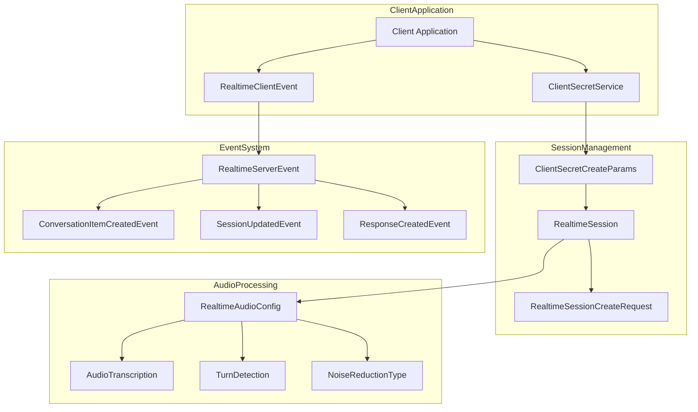
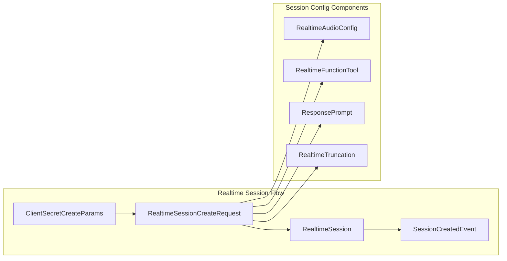
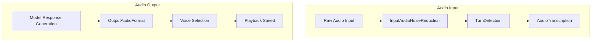
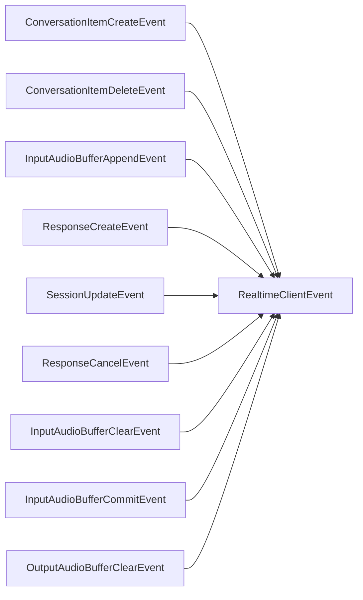
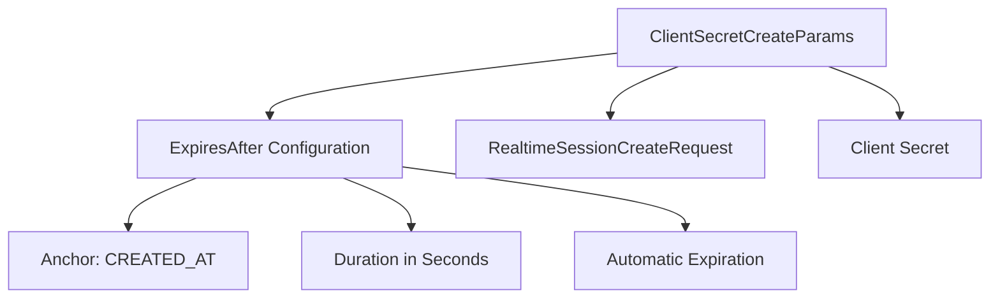
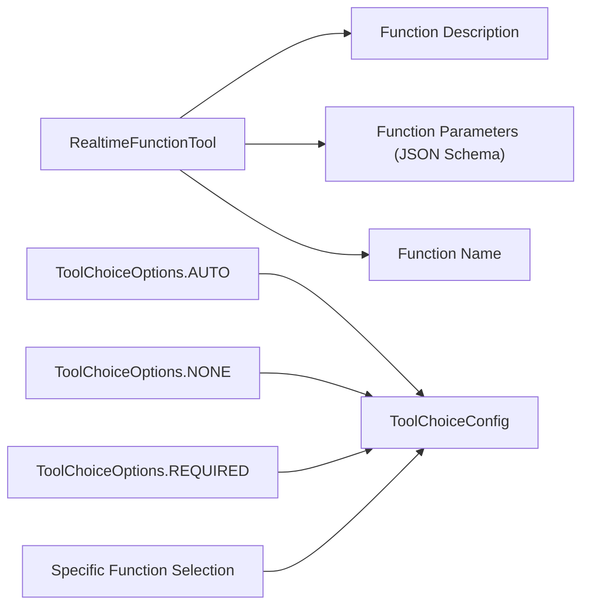

<!-- source: DeepWiki mcp.deepwiki.com · repo openai/openai-java · page 7.8 Realtime API · fetched 2026-10-26 -->

# Realtime API

Relevant source files

The following files were used as context for generating this wiki page:

- [openai-java-core/src/main/kotlin/com/openai/core/http/MultipartEncoding.kt](openai-java-core/src/main/kotlin/com/openai/core/http/MultipartEncoding.kt)
- [openai-java-core/src/main/kotlin/com/openai/models/beta/responses/BetaTool.kt](openai-java-core/src/main/kotlin/com/openai/models/beta/responses/BetaTool.kt)
- [openai-java-core/src/main/kotlin/com/openai/models/realtime/RealtimeResponseCreateMcpTool.kt](openai-java-core/src/main/kotlin/com/openai/models/realtime/RealtimeResponseCreateMcpTool.kt)
- [openai-java-core/src/main/kotlin/com/openai/models/realtime/RealtimeSession.kt](openai-java-core/src/main/kotlin/com/openai/models/realtime/RealtimeSession.kt)
- [openai-java-core/src/main/kotlin/com/openai/models/realtime/RealtimeSessionCreateRequest.kt](openai-java-core/src/main/kotlin/com/openai/models/realtime/RealtimeSessionCreateRequest.kt)
- [openai-java-core/src/main/kotlin/com/openai/models/realtime/RealtimeToolsConfigUnion.kt](openai-java-core/src/main/kotlin/com/openai/models/realtime/RealtimeToolsConfigUnion.kt)
- [openai-java-core/src/main/kotlin/com/openai/models/realtime/RealtimeTracingConfig.kt](openai-java-core/src/main/kotlin/com/openai/models/realtime/RealtimeTracingConfig.kt)
- [openai-java-core/src/main/kotlin/com/openai/models/realtime/calls/CallCreateParams.kt](openai-java-core/src/main/kotlin/com/openai/models/realtime/calls/CallCreateParams.kt)
- [openai-java-core/src/main/kotlin/com/openai/models/realtime/clientsecrets/RealtimeSessionCreateResponse.kt](openai-java-core/src/main/kotlin/com/openai/models/realtime/clientsecrets/RealtimeSessionCreateResponse.kt)
- [openai-java-core/src/main/kotlin/com/openai/models/responses/ResponseIncludable.kt](openai-java-core/src/main/kotlin/com/openai/models/responses/ResponseIncludable.kt)
- [openai-java-core/src/main/kotlin/com/openai/services/async/beta/realtime/SessionServiceAsyncImpl.kt](openai-java-core/src/main/kotlin/com/openai/services/async/beta/realtime/SessionServiceAsyncImpl.kt)
- [openai-java-core/src/main/kotlin/com/openai/services/async/beta/realtime/TranscriptionSessionServiceAsyncImpl.kt](openai-java-core/src/main/kotlin/com/openai/services/async/beta/realtime/TranscriptionSessionServiceAsyncImpl.kt)
- [openai-java-core/src/main/kotlin/com/openai/services/async/realtime/CallServiceAsync.kt](openai-java-core/src/main/kotlin/com/openai/services/async/realtime/CallServiceAsync.kt)
- [openai-java-core/src/main/kotlin/com/openai/services/async/realtime/CallServiceAsyncImpl.kt](openai-java-core/src/main/kotlin/com/openai/services/async/realtime/CallServiceAsyncImpl.kt)
- [openai-java-core/src/main/kotlin/com/openai/services/blocking/beta/realtime/SessionServiceImpl.kt](openai-java-core/src/main/kotlin/com/openai/services/blocking/beta/realtime/SessionServiceImpl.kt)
- [openai-java-core/src/main/kotlin/com/openai/services/blocking/beta/realtime/TranscriptionSessionServiceImpl.kt](openai-java-core/src/main/kotlin/com/openai/services/blocking/beta/realtime/TranscriptionSessionServiceImpl.kt)
- [openai-java-core/src/main/kotlin/com/openai/services/blocking/realtime/CallService.kt](openai-java-core/src/main/kotlin/com/openai/services/blocking/realtime/CallService.kt)
- [openai-java-core/src/main/kotlin/com/openai/services/blocking/realtime/CallServiceImpl.kt](openai-java-core/src/main/kotlin/com/openai/services/blocking/realtime/CallServiceImpl.kt)
- [openai-java-core/src/test/kotlin/com/openai/core/http/MultipartEncodingTest.kt](openai-java-core/src/test/kotlin/com/openai/core/http/MultipartEncodingTest.kt)
- [openai-java-core/src/test/kotlin/com/openai/models/realtime/RealtimeAudioConfigTest.kt](openai-java-core/src/test/kotlin/com/openai/models/realtime/RealtimeAudioConfigTest.kt)
- [openai-java-core/src/test/kotlin/com/openai/models/realtime/RealtimeClientEventTest.kt](openai-java-core/src/test/kotlin/com/openai/models/realtime/RealtimeClientEventTest.kt)
- [openai-java-core/src/test/kotlin/com/openai/models/realtime/RealtimeResponseCreateMcpToolTest.kt](openai-java-core/src/test/kotlin/com/openai/models/realtime/RealtimeResponseCreateMcpToolTest.kt)
- [openai-java-core/src/test/kotlin/com/openai/models/realtime/RealtimeServerEventTest.kt](openai-java-core/src/test/kotlin/com/openai/models/realtime/RealtimeServerEventTest.kt)
- [openai-java-core/src/test/kotlin/com/openai/models/realtime/RealtimeSessionCreateRequestTest.kt](openai-java-core/src/test/kotlin/com/openai/models/realtime/RealtimeSessionCreateRequestTest.kt)
- [openai-java-core/src/test/kotlin/com/openai/models/realtime/RealtimeSessionTest.kt](openai-java-core/src/test/kotlin/com/openai/models/realtime/RealtimeSessionTest.kt)
- [openai-java-core/src/test/kotlin/com/openai/models/realtime/RealtimeToolsConfigUnionTest.kt](openai-java-core/src/test/kotlin/com/openai/models/realtime/RealtimeToolsConfigUnionTest.kt)
- [openai-java-core/src/test/kotlin/com/openai/models/realtime/SessionCreatedEventTest.kt](openai-java-core/src/test/kotlin/com/openai/models/realtime/SessionCreatedEventTest.kt)
- [openai-java-core/src/test/kotlin/com/openai/models/realtime/SessionUpdateEventTest.kt](openai-java-core/src/test/kotlin/com/openai/models/realtime/SessionUpdateEventTest.kt)
- [openai-java-core/src/test/kotlin/com/openai/models/realtime/SessionUpdatedEventTest.kt](openai-java-core/src/test/kotlin/com/openai/models/realtime/SessionUpdatedEventTest.kt)
- [openai-java-core/src/test/kotlin/com/openai/models/realtime/calls/CallAcceptParamsTest.kt](openai-java-core/src/test/kotlin/com/openai/models/realtime/calls/CallAcceptParamsTest.kt)
- [openai-java-core/src/test/kotlin/com/openai/models/realtime/calls/CallCreateParamsTest.kt](openai-java-core/src/test/kotlin/com/openai/models/realtime/calls/CallCreateParamsTest.kt)
- [openai-java-core/src/test/kotlin/com/openai/models/realtime/clientsecrets/ClientSecretCreateParamsTest.kt](openai-java-core/src/test/kotlin/com/openai/models/realtime/clientsecrets/ClientSecretCreateParamsTest.kt)
- [openai-java-core/src/test/kotlin/com/openai/models/responses/ResponseRetrieveParamsTest.kt](openai-java-core/src/test/kotlin/com/openai/models/responses/ResponseRetrieveParamsTest.kt)
- [openai-java-core/src/test/kotlin/com/openai/services/async/realtime/CallServiceAsyncTest.kt](openai-java-core/src/test/kotlin/com/openai/services/async/realtime/CallServiceAsyncTest.kt)
- [openai-java-core/src/test/kotlin/com/openai/services/async/realtime/ClientSecretServiceAsyncTest.kt](openai-java-core/src/test/kotlin/com/openai/services/async/realtime/ClientSecretServiceAsyncTest.kt)
- [openai-java-core/src/test/kotlin/com/openai/services/blocking/realtime/CallServiceTest.kt](openai-java-core/src/test/kotlin/com/openai/services/blocking/realtime/CallServiceTest.kt)
- [openai-java-core/src/test/kotlin/com/openai/services/blocking/realtime/ClientSecretServiceTest.kt](openai-java-core/src/test/kotlin/com/openai/services/blocking/realtime/ClientSecretServiceTest.kt)

The Realtime API provides real-time bidirectional audio communication capabilities with AI models through WebSocket connections. This system enables voice conversations with enhanced features including audio transcription, turn detection, function calling, and streaming responses. The API supports various audio formats and offers comprehensive session management with an event-driven communication model.

This page documents the Realtime API implementation details in the OpenAI Java SDK, covering core entities such as sessions, client secrets, calls, events from client and server, and audio configurations.

---

## Architecture Overview

The Realtime API is architected around event-driven bidirectional communication implemented over WebSocket connections. The key components include client secret management for secure access, realtime session configurations for model and audio parameters, calls for media negotiation, and a rich set of client and server events to maintain conversational state and stream data.

Sources:  
[openai-java-core/src/main/kotlin/com/openai/models/realtime/RealtimeSession.kt:1-162](),  
[openai-java-core/src/test/kotlin/com/openai/models/realtime/RealtimeServerEventTest.kt:1-134](),  
[openai-java-core/src/test/kotlin/com/openai/services/async/realtime/ClientSecretServiceAsyncTest.kt:5-136]()

---

## Session Management

### Realtime Session Configuration

`RealtimeSession` represents the core configuration and metadata for a realtime interaction session. Each session is uniquely identified and stores model selection, audio configuration, instructions, token limits, enabled tools, and output modalities.

Important session properties include:

| Property                  | Type                             | Description                                                             |
|---------------------------|---------------------------------|-------------------------------------------------------------------------|
| `id`                      | `String`                        | Unique session ID (e.g., `sess_1234567890abcdef`)                      |
| `model`                   | `Model`                        | The model used for the realtime interaction (e.g., `gpt-realtime`)     |
| `inputAudioFormat`        | `InputAudioFormat`             | Input audio data format (`pcm16`, `g711_ulaw`, `g711_alaw`)            |
| `outputAudioFormat`       | `OutputAudioFormat`            | Output audio format, similar options as input                          |
| `voice`                   | `Voice`                       | Voice profile for speech synthesis (`alloy`, `ash`, `ballad`, etc.)    |
| `instructions`            | `String`                      | Optional system instructions to guide model behavior                   |
| `temperature`             | `Double`                      | Sampling temperature (recommended range 0.6-1.2, 0.8 default for audio)|
| `maxResponseOutputTokens` | `MaxResponseOutputTokens`      | Token limit for responses (range 1-4096 or `inf`)                      |
| `tools`                   | `List<RealtimeFunctionTool>`  | Optional functions/tools enabled in the session                        |
| `truncation`              | `RealtimeTruncation`           | Controls truncation behavior                                           |

#### Construction and Validation

`RealtimeSession` is instantiated internally from a `RealtimeSessionCreateRequest` object that the client prepares and sends to the server. The response received is then deserialized into a `RealtimeSession` object reflecting finalized parameters for the session.

Sources:  
[openai-java-core/src/main/kotlin/com/openai/models/realtime/RealtimeSession.kt:34-162](),  
[openai-java-core/src/main/kotlin/com/openai/models/realtime/RealtimeSessionCreateRequest.kt:1-164](),  
[openai-java-core/src/test/kotlin/com/openai/models/realtime/RealtimeSessionTest.kt:1-75]()

---

## Audio Configuration

The Realtime API supports rich audio input/output configuration, including various audio encodings, noise reduction, turn detection mechanisms, and transcription settings.

Key features:

- **Noise Reduction Types:**  
  - `NEAR_FIELD`: Optimized for headphone/mic (close range) scenarios  
  - `FAR_FIELD`: For room microphone environments

- **Turn Detection** supports two modes:

  - **Server VAD (Voice Activity Detection):** Detects audio volume activity to cue end of user speech. Parameters include threshold, silence duration, and idle timeout.
  
  - **Semantic VAD:** Uses model-based intelligence to estimate when a user has finished speaking, providing natural and adaptive turn-taking with conversational context.

- **Audio Formats:**  
  - PCM16 (16-bit little-endian PCM at 24kHz)  
  - G.711 μ-law (`g711_ulaw`) and A-law (`g711_alaw`) codecs  

- **Transcription Support:** Optional asynchronous transcriptions are performed and streamed back via special events. The client configures transcription models, languages, and delay modes.

- **Output Options:** Voice profiles and output speed are configurable to convey different tonal styles and speaking rates.

Sources:  
[openai-java-core/src/main/kotlin/com/openai/models/realtime/RealtimeSession.kt:1375-1530](),  
[openai-java-core/src/main/kotlin/com/openai/models/realtime/RealtimeSessionCreateRequest.kt:60-135](),  
[openai-java-core/src/test/kotlin/com/openai/models/realtime/RealtimeSessionCreateRequestTest.kt:10-67]()

---

## Client and Server Events

### Client Events (`RealtimeClientEvent`)

These represent events or data sent from the client to the server during a realtime session. Important event types include:

- `ConversationItemCreateEvent`
- `ConversationItemDeleteEvent`
- `InputAudioBufferAppendEvent`
- `ResponseCreateEvent`
- `SessionUpdateEvent`
- `ResponseCancelEvent`
- Audio buffer management events such as clearing and committing input/output buffers

Sources:  
[openai-java-core/src/test/kotlin/com/openai/models/realtime/RealtimeClientEventTest.kt:19-54]()

---

### Server Events (`RealtimeServerEvent`)

These represent messages from the server back to clients and include:

| Event Type                            | Purpose                                  |
|-------------------------------------|------------------------------------------|
| `ConversationCreatedEvent`           | Initialization of a new conversation     |
| `ConversationItemCreatedEvent`       | New item (message, action) added          |
| `ResponseCreatedEvent`                | Model response initiation                 |
| `ResponseDoneEvent`                  | Completion of model response              |
| `SessionCreatedEvent`                | Session established confirmation          |
| `SessionUpdatedEvent`                | Updated session parameters notification   |
| `InputAudioBufferSpeechStartedEvent`| Start of speech detection on input audio |
| `InputAudioBufferSpeechStoppedEvent`| End of speech detection                    |
| Audio transcription and function call events                   |
| MCP tool-related events                                      |

Sources:  
[openai-java-core/src/test/kotlin/com/openai/models/realtime/RealtimeServerEventTest.kt:18-134]()

---

## Client Secret Management

Client secrets are short-lived secure tokens used to authorize realtime session access.

### Client Secret Creation (`ClientSecretCreateParams`)

The SDK supports creating client secrets with configurable expiration anchored to a specific time.

- `anchor` is usually set to `CREATED_AT` indicating expiration countdown starts at creation time.
- `seconds` defines how long the secret remains valid (e.g., 10 seconds for testing).
- The client secret enables access to realtime session endpoints under controlled time validity.

Sources:  
[openai-java-core/src/test/kotlin/com/openai/models/realtime/clientsecrets/ClientSecretCreateParamsTest.kt:24-113](),  
[openai-java-core/src/test/kotlin/com/openai/services/async/realtime/ClientSecretServiceAsyncTest.kt:27-136]()

---

## Turn Detection and Conversation Flow

Realtime turn detection supports two key mechanisms to optimize natural dialog flow:

### Server Voice Activity Detection (VAD)

Detects start and end of speech segments in input audio based on configured thresholds and timeouts.

- **Parameters:**
  - `threshold`: Audio volume level to detect speech start
  - `prefixPaddingMs`: Milliseconds to pad before detected speech start
  - `silenceDurationMs`: Silence duration to detect speech end
  - `idleTimeoutMs`: Maximum idle duration to timeout pending speech
  - `createResponse`: Whether to auto-generate a response upon detecting speech end
  - `interruptResponse`: Whether the current response can be interrupted by new speech

### Semantic VAD

A model-driven turn detection using semantic understanding to predict user speech completion dynamically. This approach enables more natural interactions by adapting timeouts based on speech probability and contextual signals.

Sources:  
[openai-java-core/src/main/kotlin/com/openai/models/realtime/RealtimeSession.kt:312-327](),  
[openai-java-core/src/test/kotlin/com/openai/models/realtime/RealtimeSessionTest.kt:61-75]()

---

## Function Calling Integration

Realtime API supports function calling integrated through `RealtimeFunctionTool`s, enabling models to execute predefined functions with structured arguments.

Function call arguments are streamed incrementally via events like `ResponseFunctionCallArgumentsDeltaEvent` and finalized with `ResponseFunctionCallArgumentsDoneEvent`. The SDK manages encoding and validation of function parameters to ensure type safety and correctness during invocation.

Sources:  
[openai-java-core/src/main/kotlin/com/openai/models/realtime/RealtimeFunctionTool.kt:1-150](),  
[openai-java-core/src/test/kotlin/com/openai/models/realtime/RealtimeServerEventTest.kt:55-60]()

---

## Call Management

The Realtime API enables multistep WebRTC call lifecycle management through calls endpoints:

- `CallCreateParams` to initiate calls with SDP offers.
- `CallAcceptParams` and `CallRejectParams` to handle incoming call signaling.
- `CallReferParams` for transferring or referring calls.

Calls enable streaming audio/video setup aligned with realtime sessions.

Sources:  
[openai-java-core/src/main/kotlin/com/openai/models/realtime/calls/CallCreateParams.kt:1-130](),  
[openai-java-core/src/main/kotlin/com/openai/services/blocking/realtime/CallServiceImpl.kt:43-126]()

---

# Summary

The Realtime API in the OpenAI Java SDK is structured around robust session configurations, secured by ephemeral client secrets, and powered by a sophisticated event system supporting realtime audio communication, transcription, turn management, function calling, and call handling. The SDK provides detailed models for session and audio configuration and patterns for streaming conversation events over WebSocket. This design enables seamless AI-powered voice interactions with low latency, contextual awareness, and extensibility.

---

Sources summary:  
- openai-java-core/src/main/kotlin/com/openai/models/realtime/RealtimeSession.kt:1-162  
- openai-java-core/src/main/kotlin/com/openai/models/realtime/RealtimeSessionCreateRequest.kt:1-164  
- openai-java-core/src/main/kotlin/com/openai/models/realtime/RealtimeClientEvent.kt  
- openai-java-core/src/main/kotlin/com/openai/models/realtime/RealtimeServerEvent.kt  
- openai-java-core/src/test/kotlin/com/openai/models/realtime/RealtimeServerEventTest.kt:1-134  
- openai-java-core/src/test/kotlin/com/openai/models/realtime/RealtimeClientEventTest.kt:19-54  
- openai-java-core/src/test/kotlin/com/openai/services/async/realtime/ClientSecretServiceAsyncTest.kt:27-136  
- openai-java-core/src/main/kotlin/com/openai/models/realtime/RealtimeToolsConfigUnion.kt:1-187  
- openai-java-core/src/main/kotlin/com/openai/models/realtime/RealtimeResponseCreateMcpTool.kt:1-166  
- openai-java-core/src/main/kotlin/com/openai/models/beta/responses/BetaTool.kt:1-164  
- openai-java-core/src/main/kotlin/com/openai/services/blocking/realtime/CallServiceImpl.kt:43-126  
- openai-java-core/src/test/kotlin/com/openai/models/realtime/RealtimeSessionTest.kt:1-75  
- openai-java-core/src/main/kotlin/com/openai/models/realtime/RealtimeFunctionTool.kt  
- openai-java-core/src/main/kotlin/com/openai/models/realtime/RealtimeAudioConfig.kt  
- openai-java-core/src/main/kotlin/com/openai/models/realtime/clientsecrets/RealtimeSessionCreateResponse.kt

---

