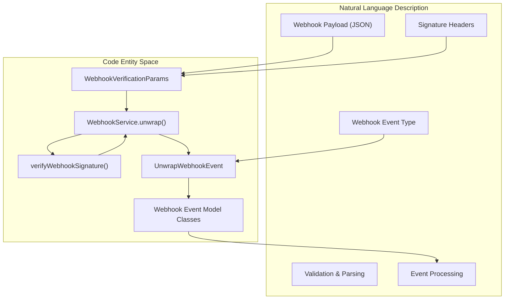

<!-- source: DeepWiki mcp.deepwiki.com · repo openai/openai-java · page 7.9 Webhooks · fetched 2026-10-26 -->

# Webhooks

<details>
<summary>Relevant source files</summary>

The following files were used as context for generating this wiki page:

- [openai-java-core/src/main/kotlin/com/openai/errors/InvalidWebhookSignatureException.kt](openai-java-core/src/main/kotlin/com/openai/errors/InvalidWebhookSignatureException.kt)
- [openai-java-core/src/main/kotlin/com/openai/models/webhooks/LiveCallIncomingWebhookEvent.kt](openai-java-core/src/main/kotlin/com/openai/models/webhooks/LiveCallIncomingWebhookEvent.kt)
- [openai-java-core/src/main/kotlin/com/openai/models/webhooks/LiveTransportIncomingWebhookEvent.kt](openai-java-core/src/main/kotlin/com/openai/models/webhooks/LiveTransportIncomingWebhookEvent.kt)
- [openai-java-core/src/main/kotlin/com/openai/models/webhooks/RealtimeCallIncomingWebhookEvent.kt](openai-java-core/src/main/kotlin/com/openai/models/webhooks/RealtimeCallIncomingWebhookEvent.kt)
- [openai-java-core/src/main/kotlin/com/openai/models/webhooks/SafetyDeactivationIssuedWebhookEvent.kt](openai-java-core/src/main/kotlin/com/openai/models/webhooks/SafetyDeactivationIssuedWebhookEvent.kt)
- [openai-java-core/src/main/kotlin/com/openai/models/webhooks/SafetyWarningIssuedWebhookEvent.kt](openai-java-core/src/main/kotlin/com/openai/models/webhooks/SafetyWarningIssuedWebhookEvent.kt)
- [openai-java-core/src/main/kotlin/com/openai/models/webhooks/UnwrapWebhookEvent.kt](openai-java-core/src/main/kotlin/com/openai/models/webhooks/UnwrapWebhookEvent.kt)
- [openai-java-core/src/main/kotlin/com/openai/models/webhooks/WebhookVerificationParams.kt](openai-java-core/src/main/kotlin/com/openai/models/webhooks/WebhookVerificationParams.kt)
- [openai-java-core/src/main/kotlin/com/openai/services/WebhookVerification.kt](openai-java-core/src/main/kotlin/com/openai/services/WebhookVerification.kt)
- [openai-java-core/src/main/kotlin/com/openai/services/async/WebhookServiceAsync.kt](openai-java-core/src/main/kotlin/com/openai/services/async/WebhookServiceAsync.kt)
- [openai-java-core/src/main/kotlin/com/openai/services/async/WebhookServiceAsyncImpl.kt](openai-java-core/src/main/kotlin/com/openai/services/async/WebhookServiceAsyncImpl.kt)
- [openai-java-core/src/main/kotlin/com/openai/services/blocking/WebhookService.kt](openai-java-core/src/main/kotlin/com/openai/services/blocking/WebhookService.kt)
- [openai-java-core/src/main/kotlin/com/openai/services/blocking/WebhookServiceImpl.kt](openai-java-core/src/main/kotlin/com/openai/services/blocking/WebhookServiceImpl.kt)
- [openai-java-core/src/test/kotlin/com/openai/helpers/SafetyWebhookVisitorCompatibilityTest.kt](openai-java-core/src/test/kotlin/com/openai/helpers/SafetyWebhookVisitorCompatibilityTest.kt)
- [openai-java-core/src/test/kotlin/com/openai/models/webhooks/LiveCallIncomingWebhookEventTest.kt](openai-java-core/src/test/kotlin/com/openai/models/webhooks/LiveCallIncomingWebhookEventTest.kt)
- [openai-java-core/src/test/kotlin/com/openai/models/webhooks/LiveTransportIncomingWebhookEventTest.kt](openai-java-core/src/test/kotlin/com/openai/models/webhooks/LiveTransportIncomingWebhookEventTest.kt)
- [openai-java-core/src/test/kotlin/com/openai/models/webhooks/RealtimeCallIncomingWebhookEventTest.kt](openai-java-core/src/test/kotlin/com/openai/models/webhooks/RealtimeCallIncomingWebhookEventTest.kt)
- [openai-java-core/src/test/kotlin/com/openai/models/webhooks/SafetyDeactivationIssuedWebhookEventTest.kt](openai-java-core/src/test/kotlin/com/openai/models/webhooks/SafetyDeactivationIssuedWebhookEventTest.kt)
- [openai-java-core/src/test/kotlin/com/openai/models/webhooks/SafetyWarningIssuedWebhookEventTest.kt](openai-java-core/src/test/kotlin/com/openai/models/webhooks/SafetyWarningIssuedWebhookEventTest.kt)
- [openai-java-core/src/test/kotlin/com/openai/models/webhooks/UnwrapWebhookEventTest.kt](openai-java-core/src/test/kotlin/com/openai/models/webhooks/UnwrapWebhookEventTest.kt)
- [openai-java-core/src/test/kotlin/com/openai/services/WebhookSignatureVerificationTest.kt](openai-java-core/src/test/kotlin/com/openai/services/WebhookSignatureVerificationTest.kt)
- [openai-java-core/src/test/kotlin/com/openai/services/WebhookVerificationTest.kt](openai-java-core/src/test/kotlin/com/openai/services/WebhookVerificationTest.kt)
- [openai-java-core/src/test/kotlin/com/openai/services/async/WebhookServiceAsyncTest.kt](openai-java-core/src/test/kotlin/com/openai/services/async/WebhookServiceAsyncTest.kt)
- [openai-java-core/src/test/kotlin/com/openai/services/blocking/WebhookServiceTest.kt](openai-java-core/src/test/kotlin/com/openai/services/blocking/WebhookServiceTest.kt)

</details>


This section documents the webhook handling capabilities in the OpenAI Java SDK, focusing on webhook event unwrapping, signature verification, and supported webhook event types. Webhooks provide a mechanism for your application to receive asynchronous notifications from the OpenAI API about various system events such as response completions, batch jobs, safety alerts, and realtime call sessions.

---

## 1. Purpose and Scope

Webhook support in the SDK enables:

- **Validation and Verification** of webhook payload authenticity using signature verification.
- **Unwrapping and Parsing** webhook JSON payloads into strongly typed Java event objects.
- Access to **Event Types** for subscription and management of webhook events.
- Support for both **synchronous** and **asynchronous** client APIs.

This ensures secure, reliable processing of OpenAI webhook notifications in your Java applications.

---

## 2. Webhook Event Unwrapping

### Overview

Webhook events are received as serialized JSON payloads in HTTP requests. To work with these events programmatically, they must be unwrapped into SDK-specific Java model classes representing the event data.

The key entry point for this is the `WebhookService` interface, particularly the `unwrap` method, which:

1. Verifies the webhook signature (security check).
2. Parses the JSON payload into an `UnwrapWebhookEvent` object, which acts as a type-safe union over all possible webhook event types.

### Implementation Details

- The `WebhookServiceImpl` class implements this behavior synchronously.
- The `unwrap` method takes `WebhookVerificationParams` containing:
  - Raw payload bytes.
  - HTTP headers from the webhook request.
  - The webhook secret (used for signature verification).
  - Optional tolerance for clock skew.

- It first calls `verifySignature(params)` to ensure authenticity.
- On passing verification, it uses the configured `ObjectMapper` (`jsonMapper`) to parse the JSON into the `UnwrapWebhookEvent` sealed union type.
- Parsing errors are wrapped into `OpenAIInvalidDataException` for clarity.

```kotlin
override fun unwrap(params: WebhookVerificationParams): UnwrapWebhookEvent {
    verifySignature(params)

    val bodyString = String(params.payload, StandardCharsets.UTF_8)
    return try {
        clientOptions.jsonMapper.readValue(bodyString, jacksonTypeRef<UnwrapWebhookEvent>())
    } catch (e: Exception) {
        throw OpenAIInvalidDataException("Error parsing body", e)
    }
}
```

The asynchronous version (`WebhookServiceAsyncImpl`) follows similar logic with asynchronous support.

### Event Model: `UnwrapWebhookEvent`

- This class is a discriminated union representing all supported webhook event variants.
- Each variant corresponds to a specific event type (e.g., `BatchCompletedWebhookEvent`, `ResponseCompletedWebhookEvent`, `RealtimeCallIncomingWebhookEvent`, etc.).
- Provides optional accessors for each event type, for example:

```java
Optional<BatchCompletedWebhookEvent> batchCompleted();
Optional<ResponseCompletedWebhookEvent> responseCompleted();
Optional<RealtimeCallIncomingWebhookEvent> realtimeCallIncoming();
```

This design allows handling the webhook event generically at first, then branching for specific event types.

---

## 3. Signature Verification

### Purpose

To ensure security, webhook payloads are signed by OpenAI. The SDK verifies these signatures to authenticate the source and prevent replay attacks.

### Verification Logic Summary

- Extracts webhook headers:
  - `webhook-signature`
  - `webhook-timestamp`
  - `webhook-id`
- Ensures each header is present and correctly formatted.
- Validates timestamp to disallow stale or future requests beyond the configured tolerance window (default 5 minutes).
- Decodes the webhook secret if base64-encoded and prefixed (`whsec_`).
- Constructs a signed message string:  
  `"<webhook_id>.<webhook_timestamp>.<payload>"`
- Computes the HMAC-SHA256 signature over this string using the secret.
- Compares the computed signature against one or more signatures present in the header using a timing-safe comparison.
- Throws `InvalidWebhookSignatureException` on any failure.

### Implementation Details

This logic is implemented in the internal `verifyWebhookSignature` function used by `WebhookServiceImpl.verifySignature()`:

```kotlin
internal fun verifyWebhookSignature(
    clientOptions: ClientOptions,
    params: WebhookVerificationParams,
) {
    val webhookSecret = getWebhookSecret(params, clientOptions)
    val signatureHeader = getRequiredHeader(params.headers, "webhook-signature")
    val timestampHeader = getRequiredHeader(params.headers, "webhook-timestamp")
    val webhookId = getRequiredHeader(params.headers, "webhook-id")

    val timestampSeconds = timestampHeader.toLongOrThrow()
    validateTimestamp(clientOptions.clock, timestampSeconds, params.tolerance)

    val signedPayload = "$webhookId.$timestampHeader.${String(params.payload, StandardCharsets.UTF_8)}"
    val expectedSignature = computeHmacSha256(webhookSecret, signedPayload)

    val signatureMatches = signatureHeader
        .split(whitespace)
        .map { it.removePrefix("v1,") }
        .any { timingSafeEquals(expectedSignature, it) }

    if (!signatureMatches) {
        throw InvalidWebhookSignatureException("The given webhook signature does not match the expected signature")
    }
}
```

Key points:

- The secret may come from per-call params or the global client config.
- Multiple signatures are supported in the header (space-separated).
- The timestamp check uses the client's clock and the tolerance duration to prevent replay.

---

## 4. Supported Webhook Event Types

The SDK includes generated model classes for each webhook event type, each representing particular event webs:

- **Batch-related:**
  - `BatchCancelledWebhookEvent`
  - `BatchCompletedWebhookEvent`
  - `BatchExpiredWebhookEvent`
  - `BatchFailedWebhookEvent`

- **Eval Runs:**
  - `EvalRunCanceledWebhookEvent`
  - `EvalRunFailedWebhookEvent`
  - `EvalRunSucceededWebhookEvent`

- **Fine-tuning jobs:**
  - `FineTuningJobCancelledWebhookEvent`
  - `FineTuningJobFailedWebhookEvent`
  - `FineTuningJobSucceededWebhookEvent`

- **Response events:**
  - `ResponseCancelledWebhookEvent`
  - `ResponseCompletedWebhookEvent`
  - `ResponseFailedWebhookEvent`
  - `ResponseIncompleteWebhookEvent`

- **Safety alerts and warnings:**
  - `SafetyAlertCreatedWebhookEvent`
  - `SafetyDeactivationIssuedWebhookEvent`
  - `SafetyOrgAlertCreatedWebhookEvent`
  - `SafetyWarningIssuedWebhookEvent`

- **Realtime/Live call events:**
  - `LiveCallIncomingWebhookEvent` (deprecated)
  - `LiveTransportIncomingWebhookEvent`
  - `RealtimeCallIncomingWebhookEvent`

Each event class provides strongly typed access to relevant fields such as `id`, `createdAt`, `data`, and `type`. Some events are marked deprecated to guide migration.

### Example: `RealtimeCallIncomingWebhookEvent`

- Sent when an incoming API SIP session is available for realtime acceptance.
- Contains data including session ID and SIP headers.
- Has accessor methods with validation for required fields like `id()` and `createdAt()`.

---

## 5. SDK API & Usage

### Webhook Service Interface Summary

`WebhookService` exposes key methods including:

- `unwrap(WebhookVerificationParams)`: Parses and verifies a webhook payload.
- `verifySignature(WebhookVerificationParams)`: Validates signature only.
- `eventTypes()`: Accesses webhook event types service.
- CRUD operations on webhook endpoints (`create()`, `retrieve()`, `update()`, `list()`, `delete()`, `rotateSecret()`, `test()`).

Both synchronous (`WebhookServiceImpl`) and asynchronous (`WebhookServiceAsyncImpl`) implementations are available.

### Typical Usage Flow

1. Receive webhook HTTP request.
2. Extract raw payload bytes and HTTP headers.
3. Call `webhookService.unwrap()` passing `WebhookVerificationParams` with payload, headers, and secret.
4. Handle the returned `UnwrapWebhookEvent` by checking which event is present.
5. Act on the specific event data.

Example snippet of unwrap and validation in a blocking context:

```kotlin
val event = webhookService.unwrap(
    WebhookVerificationParams.builder()
        .payload(rawPayload)
        .headers(requestHeaders)
        .secret(webhookSecret)
        .build()
).validate()

if (event.isResponseCompleted()) {
    // Process ResponseCompletedWebhookEvent
}
```

---

## 6. Mermaid Diagrams

### 6.1 Webhook Event Processing Flow

```mermaid
flowchart TD
    A[Webhook HTTP POST] --> B[Receive Headers + Payload]
    B --> C[Create WebhookVerificationParams]
    C --> D[WebhookService.unwrap(params)]
    D --> E[verifySignature(params)]
    E -- valid --> F[Parse JSON into UnwrapWebhookEvent]
    E -- invalid --> G[Throw InvalidWebhookSignatureException]
    F --> H[Return UnwrapWebhookEvent]
    H --> I[User code handles event type]

    style G fill:#fff,stroke:#000,stroke-width:1px,stroke-dasharray: 5 5
```

### 6.2 Mapping Natural Language to Code Entities



---

## 7. Additional Details

- The SDK includes **extensive tests** for webhook handling, both for synchronous and asynchronous clients, validating correct signature verification, event unwrapping, and error cases.
- The signature verification supports **multiple concatenated signatures** in the header for key rotation safety.
- The webhook secret can be supplied:
  - Per request (`WebhookVerificationParams.secret`).
  - Globally on the client builder (`OpenAIOkHttpClient.builder().webhookSecret()`).
  - Via environment variables (`OPENAI_WEBHOOK_SECRET`).

---

# Summary

The OpenAI Java SDK offers robust webhook support:

- Securely verify webhook authenticity using HMAC-SHA256 of the concatenated payload including `webhook-id` and `webhook-timestamp`.
- Deserialize verified webhook JSON payloads into convenient, strongly typed event classes via `unwrap`.
- Provides a comprehensive set of event types covering batch jobs, evaluations, realtime calls, responses, and safety alerts.
- Supports both synchronous and asynchronous invocation patterns.
- Well-tested functionality ensures correctness and reliability.

Integrating webhooks with this SDK allows Java applications to react promptly and securely to asynchronous events from OpenAI services.

---

## Sources

- `openai-java-core/src/main/kotlin/com/openai/services/blocking/WebhookServiceImpl.kt:44-74, 79-100, 87-131`  
- `openai-java-core/src/main/kotlin/com/openai/models/webhooks/UnwrapWebhookEvent.kt:21-138`  
- `openai-java-core/src/main/kotlin/com/openai/services/WebhookVerification.kt:1-101`  
- `openai-java-core/src/main/kotlin/com/openai/models/webhooks/RealtimeCallIncomingWebhookEvent.kt:23-178`  
- `openai-java-core/src/test/kotlin/com/openai/services/blocking/WebhookServiceTest.kt:23-73, 75-96`  
- `openai-java-core/src/test/kotlin/com/openai/services/WebhookSignatureVerificationTest.kt:1-186`  
- `openai-java-core/src/test/kotlin/com/openai/services/WebhookVerificationTest.kt:1-163`  
- `openai-java-core/src/test/kotlin/com/openai/services/async/WebhookServiceAsyncTest.kt:1-85`

---

