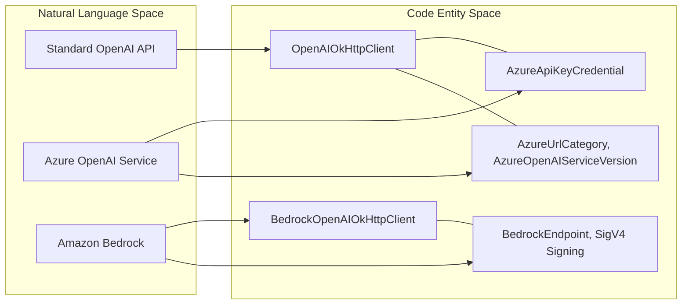
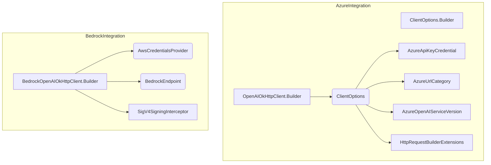

<!-- source: DeepWiki mcp.deepwiki.com · repo openai/openai-java · page 8 Alternative Endpoints and Providers · fetched 2026-10-26 -->

# Alternative Endpoints and Providers

<details>
<summary>Relevant source files</summary>

The following files were used as context for generating this wiki page:

- [.release-please-manifest.json](.release-please-manifest.json)
- [CHANGELOG.md](CHANGELOG.md)
- [CONTRIBUTING.md](CONTRIBUTING.md)
- [README.md](README.md)
- [bedrock.md](bedrock.md)
- [build.gradle.kts](build.gradle.kts)

</details>


This section provides a high-level overview of the alternative endpoints and providers supported by the OpenAI Java SDK beyond the default OpenAI API service. The SDK supports seamless integration with prominent alternative platforms such as Azure OpenAI and Amazon Bedrock. These integrations allow you to target different hosted OpenAI-compatible endpoints with specialized authentication, request routing, and configuration requirements, all while maintaining a consistent client programming model.

The purpose of this section is to introduce these alternative providers, summarize their distinct characteristics, and link to detailed child pages covering their configuration, usage, and implementation specifics.

---

## 8.1 Azure OpenAI Support (Child page)

The SDK fully supports Azure OpenAI services, which host OpenAI models in Microsoft Azure cloud environments. Integration with Azure OpenAI requires specific handling for authentication, endpoint formatting, and API versioning that differ from the default OpenAI platform.

- **Authentication**: Azure OpenAI uses API keys sent in the `api-key` header via the `AzureApiKeyCredential` class, distinct from the bearer tokens in standard OpenAI.
- **Endpoint Configuration**: Azure endpoints use unique hostnames, and often require adding `/openai/v1` URL segments depending on the URL style mode (`LEGACY` or `UNIFIED`).
- **API Versioning**: Azure mandates specifying an `api-version` query parameter, managed via the `AzureOpenAIServiceVersion` class in the SDK.
- **Automatic Endpoint Detection**: The SDK auto-detects Azure endpoints by hostname pattern and configures request paths and authentication accordingly.

This child page contains detailed documentation on these topics and includes code examples, environment variable support, URL categorization logic, and a discussion of differences from standard OpenAI integration.

For details, see [Azure OpenAI Support](#8.1).

---

## 8.2 Amazon Bedrock Integration (Child page)

Amazon Bedrock provides OpenAI-compatible APIs hosted on AWS infrastructure, accessible via standard AWS credential chains. The SDK supports Bedrock with a dedicated `openai-java-bedrock` artifact that extends the core client functionality.

Key features:

- **AWS Credential Integration**: Uses the AWS SDK credential provider chain, including environment credentials, profiles, IAM roles, and Workload Identity.
- **SigV4 Signing**: Requests to Bedrock endpoints are signed with AWS SigV4 on every call.
- **Endpoint Selection**: Supports multiple Bedrock endpoints (`Mantle`, `Runtime`) with region-specific DNS suffixes and signing service names.
- **Compatibility**: Supports existing Bearer Token auth for backward compatibility.
- **Client Construction**: `BedrockOpenAIOkHttpClient` wraps the OkHttp client with Bedrock-specific signing and endpoint resolution.

Bedrock integration supports all standard OpenAI APIs and models adapted for AWS-hosted inference profiles.

For details, see [Amazon Bedrock Integration](#8.2).

---

## Relationship and Comparison

The SDK design abstracts over endpoint and provider differences to present a unified programming interface (`OpenAIClient` and `OpenAIClientAsync`), while specialized modules implement provider-specific authentication and request shaping.



This diagram shows how the natural service names map to concrete code modules and classes in the SDK.

---

## Using Alternative Providers

### Selecting Azure OpenAI

You configure the client with Azure credentials and endpoint URLs. The SDK detects Azure endpoints and applies Azure-specific authentication and request routing automatically.

Example snippet:

```java
OpenAIClient client = OpenAIOkHttpClient.builder()
    .baseUrl("https://myresource.openai.azure.com")
    .credential(AzureApiKeyCredential.create("azure-api-key"))
    .azureServiceVersion(AzureOpenAIServiceVersion.V2024_10_21)
    .azureUrlPathMode(AzureUrlPathMode.UNIFIED)
    .build();
```

### Selecting Amazon Bedrock

Add the `openai-java-bedrock` artifact, then build the client specifying AWS credentials and the Bedrock endpoint.

Example snippet:

```java
OpenAIClient client = BedrockOpenAIOkHttpClient.builder()
    .awsRegion("us-east-1")
    .build();
```

Requests are signed with AWS SigV4, and endpoint and model names follow Bedrock conventions.

---

## Summary Table

| Provider        | Primary Artifact               | Authentication                   | Endpoint Features                             | Additional Configuration                                                                 |
|-----------------|-------------------------------|---------------------------------|-----------------------------------------------|-----------------------------------------------------------------------------------------|
| OpenAI (default) | `openai-java` / `openai-java-core` | Bearer token (`Authorization: Bearer`) | Standard `https://api.openai.com/v1` endpoints | Uses standard OpenAI API keys and optional organization/project IDs                       |
| Azure OpenAI    | `openai-java-core` + OkHttp client | API key via `api-key` header     | Distinct hostnames & routes, requires `api-version` param | Supports legacy/unified URL path modes, automatically detects Azure endpoints            |
| Amazon Bedrock  | `openai-java-bedrock`          | AWS SigV4 signing or bearer token | Region-aware endpoints (Mantle, Runtime)      | Uses AWS credential chain; supports profiles, workload identities, explicit credentials  |

---

## Further Reading

- For in-depth details about how to configure and use Azure OpenAI endpoints, refer to the child page: [Azure OpenAI Support](#8.1).
- For detailed instructions and explanations of Amazon Bedrock integration, including credentialing and endpoint selection, see the child page: [Amazon Bedrock Integration](#8.2).

---

# Appendix: Detailed Component Mapping - Azure vs Bedrock



This diagram clarifies crucial classes and components involved in alternate endpoint support.

---

Sources:  
- [README.md:94-121]()  
- [bedrock.md:1-183]()  
- [openai-java-core/src/main/kotlin/com/openai/core/ClientOptions.kt:400-580]()  
- [openai-java-core/src/main/kotlin/com/openai/azure/credential/AzureApiKeyCredential.kt]()  
- [openai-java-core/src/main/kotlin/com/openai/azure/AzureOpenAIServiceVersion.kt]()  
- [openai-java-core/src/main/kotlin/com/openai/azure/AzureUrlCategory.kt]()  
- [openai-java-core/src/main/kotlin/com/openai/azure/AzureUrlPathMode.kt]()  
- [openai-java-client-okhttp/src/main/kotlin/com/openai/client/okhttp/OpenAIOkHttpClient.kt:25-70,200-220,315-340]()  
- [bedrock.md]()

---

