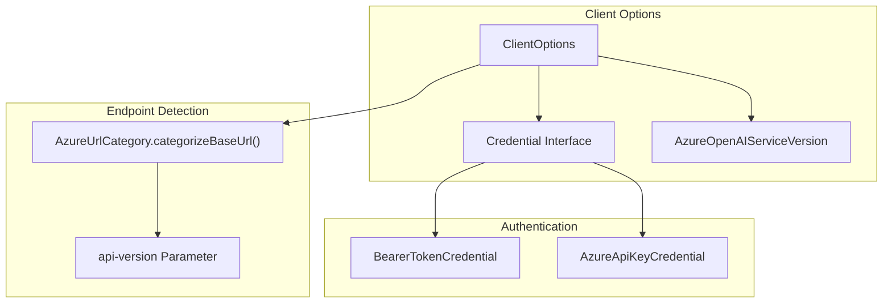
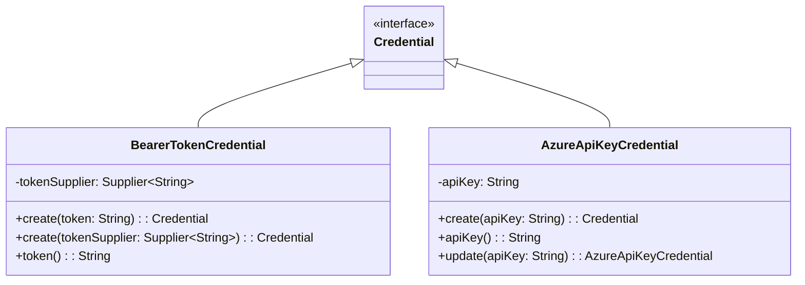
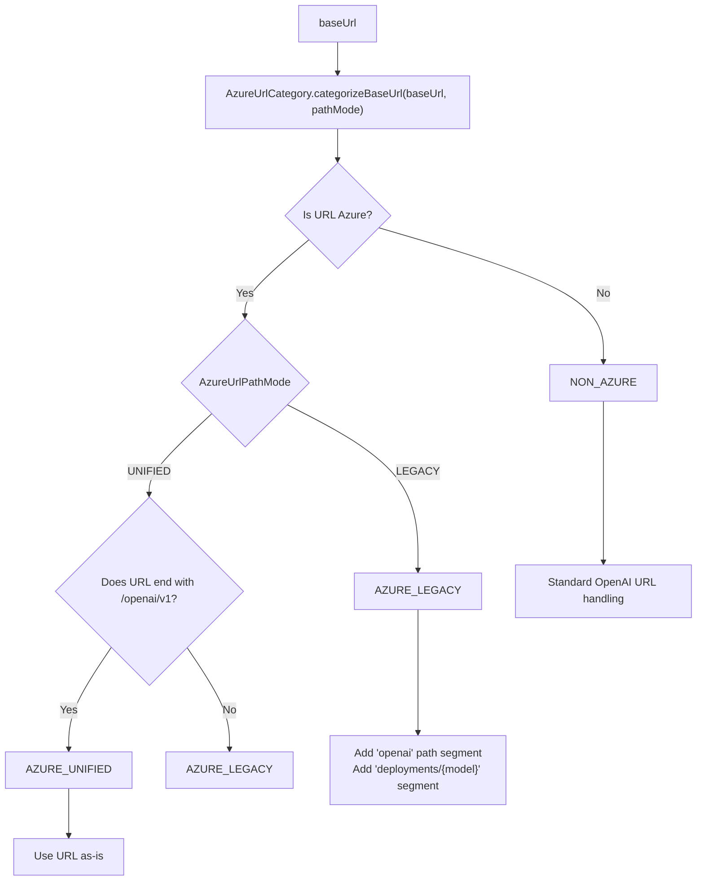
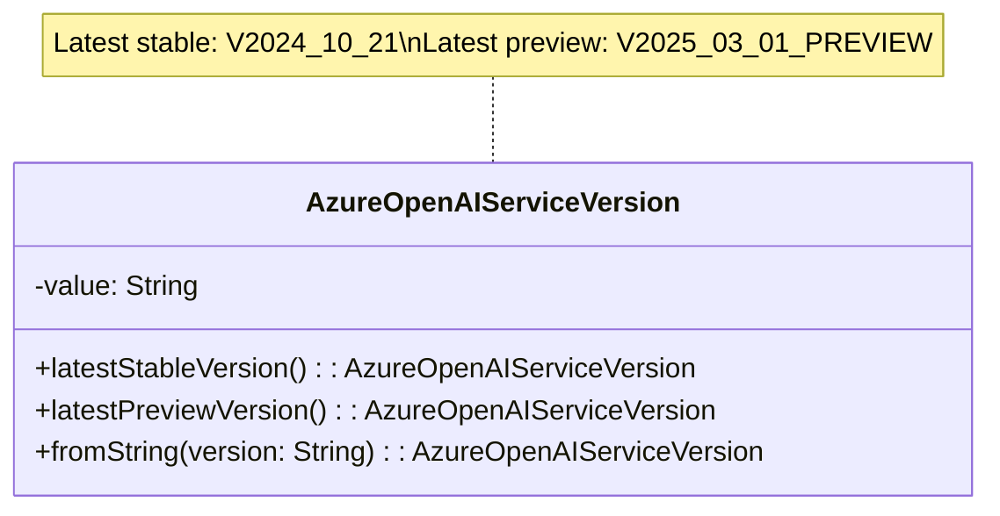
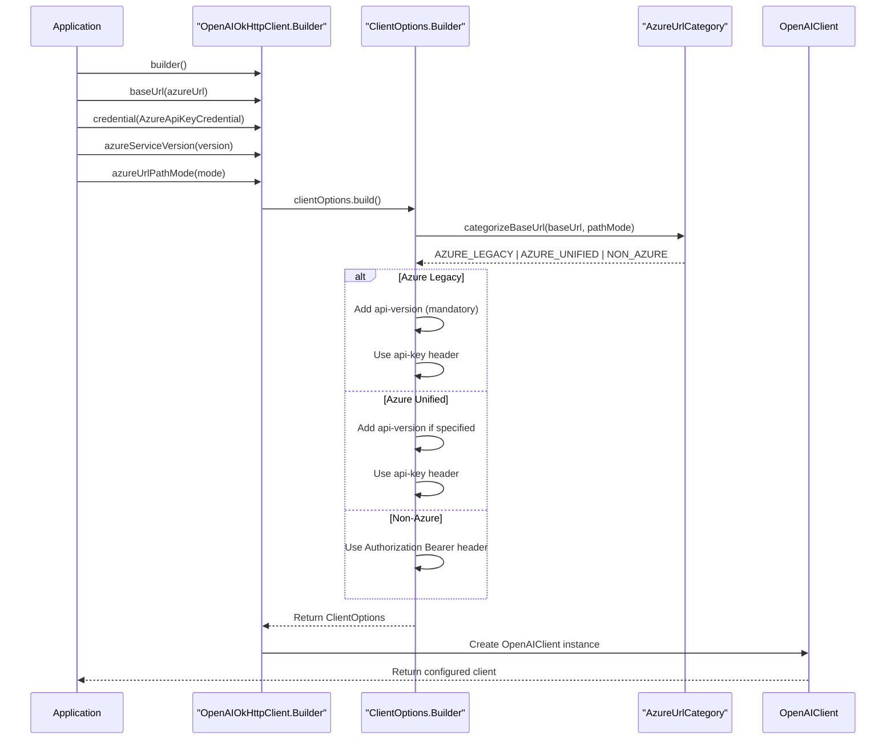
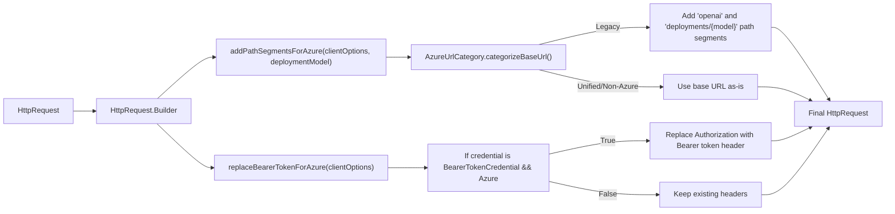

<!-- source: DeepWiki mcp.deepwiki.com · repo openai/openai-java · page 8.1 Azure OpenAI Support · fetched 2026-10-26 -->

# Azure OpenAI Support

<details>
<summary>Relevant source files</summary>

The following files were used as context for generating this wiki page:

- [openai-java-client-okhttp/src/main/kotlin/com/openai/client/okhttp/OkHttpClient.kt](openai-java-client-okhttp/src/main/kotlin/com/openai/client/okhttp/OkHttpClient.kt)
- [openai-java-client-okhttp/src/main/kotlin/com/openai/client/okhttp/OpenAIOkHttpClient.kt](openai-java-client-okhttp/src/main/kotlin/com/openai/client/okhttp/OpenAIOkHttpClient.kt)
- [openai-java-client-okhttp/src/main/kotlin/com/openai/client/okhttp/OpenAIOkHttpClientAsync.kt](openai-java-client-okhttp/src/main/kotlin/com/openai/client/okhttp/OpenAIOkHttpClientAsync.kt)
- [openai-java-client-okhttp/src/test/kotlin/com/openai/client/okhttp/ProxyAuthenticationBoundaryTest.kt](openai-java-client-okhttp/src/test/kotlin/com/openai/client/okhttp/ProxyAuthenticationBoundaryTest.kt)
- [openai-java-client-okhttp/src/test/kotlin/com/openai/client/okhttp/RedirectCredentialBoundaryTest.kt](openai-java-client-okhttp/src/test/kotlin/com/openai/client/okhttp/RedirectCredentialBoundaryTest.kt)
- [openai-java-core/src/main/kotlin/com/openai/azure/AzureOpenAIServiceVersion.kt](openai-java-core/src/main/kotlin/com/openai/azure/AzureOpenAIServiceVersion.kt)
- [openai-java-core/src/main/kotlin/com/openai/azure/HttpRequestBuilderExtensions.kt](openai-java-core/src/main/kotlin/com/openai/azure/HttpRequestBuilderExtensions.kt)
- [openai-java-core/src/main/kotlin/com/openai/azure/credential/AzureApiKeyCredential.kt](openai-java-core/src/main/kotlin/com/openai/azure/credential/AzureApiKeyCredential.kt)
- [openai-java-core/src/main/kotlin/com/openai/core/ClientOptions.kt](openai-java-core/src/main/kotlin/com/openai/core/ClientOptions.kt)
- [openai-java-core/src/main/kotlin/com/openai/core/http/WorkloadIdentityHttpClient.kt](openai-java-core/src/main/kotlin/com/openai/core/http/WorkloadIdentityHttpClient.kt)
- [openai-java-core/src/main/kotlin/com/openai/credential/BearerTokenCredential.kt](openai-java-core/src/main/kotlin/com/openai/credential/BearerTokenCredential.kt)
- [openai-java-core/src/main/kotlin/com/openai/credential/Credential.kt](openai-java-core/src/main/kotlin/com/openai/credential/Credential.kt)
- [openai-java-core/src/test/kotlin/com/openai/core/RemovedCredentialHeadersTest.kt](openai-java-core/src/test/kotlin/com/openai/core/RemovedCredentialHeadersTest.kt)
- [openai-java-core/src/test/kotlin/com/openai/core/http/ClientOptionsTest.kt](openai-java-core/src/test/kotlin/com/openai/core/http/ClientOptionsTest.kt)

</details>


This page documents how the OpenAI Java SDK supports integration with Azure OpenAI services. It covers authentication mechanisms, endpoint configuration, API version management, and how to properly configure the client for Azure OpenAI usage.

## Purpose and Scope

This document explains how to use the OpenAI Java SDK with Azure OpenAI services, including:

- Authentication with Azure API keys
- Configuring Azure-specific endpoints
- Managing API versions
- Differences between standard OpenAI and Azure OpenAI usage

For information about general SDK configuration, see [Configuration](#2.2).

## Overview of Azure OpenAI Integration

The OpenAI Java SDK provides built-in support for Azure OpenAI services, allowing developers to use the same client interface while connecting to Azure-hosted OpenAI models.



Sources:  
- [openai-java-core/src/main/kotlin/com/openai/core/ClientOptions.kt:36-173]()  
- [openai-java-core/src/main/kotlin/com/openai/azure/credential/AzureApiKeyCredential.kt:1-26]()  
- [openai-java-core/src/main/kotlin/com/openai/credential/BearerTokenCredential.kt]()  
- [openai-java-core/src/main/kotlin/com/openai/credential/Credential.kt:1-4]()

## Authentication with Azure OpenAI

Azure OpenAI services use a different authentication mechanism than standard OpenAI services. Instead of the `Authorization: Bearer` token header, Azure OpenAI uses an API key passed in the `api-key` header.

### Authentication Mechanisms

The SDK supports two primary credential implementations:

1. **Standard OpenAI Authentication**: Uses `BearerTokenCredential` with an OpenAI API key  
2. **Azure OpenAI Authentication**: Uses `AzureApiKeyCredential` with an Azure API key



Sources:  
- [openai-java-core/src/main/kotlin/com/openai/credential/Credential.kt:1-4]()  
- [openai-java-core/src/main/kotlin/com/openai/credential/BearerTokenCredential.kt]()  
- [openai-java-core/src/main/kotlin/com/openai/azure/credential/AzureApiKeyCredential.kt:1-26]()

### Setting Up Azure Authentication

There are two main ways to configure Azure authentication in the SDK:

#### 1. Using Environment Variables

Using the environment variables:

- `AZURE_OPENAI_KEY`: Azure OpenAI API key  
- `OPENAI_BASE_URL`: Azure OpenAI endpoint URL (e.g., https://your-resource-name.openai.azure.com)

Example usage:

```java
// Uses AZURE_OPENAI_KEY and OPENAI_BASE_URL from environment variables
OpenAIClient client = OpenAIOkHttpClient.fromEnv();
```

The SDK detects `AZURE_OPENAI_KEY` and configures the client with `AzureApiKeyCredential` automatically.

Sources:  
- [openai-java-core/src/main/kotlin/com/openai/core/ClientOptions.kt:254-279]()  
- [openai-java-client-okhttp/src/main/kotlin/com/openai/client/okhttp/OpenAIOkHttpClient.kt:40-49]()

#### 2. Using Builder Pattern

```java
OpenAIClient client = OpenAIOkHttpClient.builder()
    .baseUrl("https://your-resource-name.openai.azure.com")
    .credential(AzureApiKeyCredential.create("your-azure-api-key"))
    .build();
```

Sources:  
- [openai-java-client-okhttp/src/main/kotlin/com/openai/client/okhttp/OpenAIOkHttpClient.kt:26-29]()  
- [openai-java-core/src/main/kotlin/com/openai/azure/credential/AzureApiKeyCredential.kt:12-14]()

## Azure OpenAI Endpoints and URL Categorization

The SDK categorizes endpoints to handle Azure OpenAI URLs appropriately.

### Azure URL Categories

Azure OpenAI URLs fall into three categories:

| Category       | Description                                  | Example URL                            |
|----------------|----------------------------------------------|--------------------------------------|
| AZURE_LEGACY   | Old-style Azure endpoints not ending with `/openai/v1`  | https://example.openai.azure.com     |
| AZURE_UNIFIED  | Azure endpoints ending with `/openai/v1`    | https://example.openai.azure.com/openai/v1 |
| NON_AZURE      | Standard OpenAI or other endpoints           | https://api.openai.com/v1             |

The SDK recognizes Azure URLs by matching host suffixes such as `.openai.azure.com`, `.azure-api.net`, `.cognitiveservices.azure.com`, etc.

### URL Path Modes

The SDK uses `AzureUrlPathMode` enum to determine how to interpret the base URL:

- `LEGACY`: Always treat Azure endpoints as legacy style
- `UNIFIED`: Use unified style if URL ends with `/openai/v1`, else legacy
- `AUTO`: Default mode that auto-detects based on the URL structure

### Path Construction for Azure Legacy URLs

For legacy endpoints, the SDK automatically inserts path segments:

- Adds `"openai"` path segment to the base URL  
- Adds `"deployments/{model-name}"` path segments dynamically when building requests

This behavior adjusts endpoint URLs to conform with Azure legacy expectations.

### Path Construction Logic Overview



Sources:  
- [openai-java-core/src/main/kotlin/com/openai/azure/AzureUrlCategory.kt:6-44]()  
- [openai-java-core/src/main/kotlin/com/openai/azure/AzureUrlPathMode.kt:1-10]()  
- [openai-java-core/src/main/kotlin/com/openai/core/ClientOptions.kt:468-512]()  
- [openai-java-core/src/main/kotlin/com/openai/azure/HttpRequestBuilderExtensions.kt:7-19]()

## API Version Management

Azure OpenAI services mandate specifying an API version as a query parameter (`api-version`).

### Azure OpenAI Service Versions

The SDK provides the `AzureOpenAIServiceVersion` class for managing supported API versions. It enumerates several stable and preview versions:

| Version String           | Stability    |
|-------------------------|--------------|
| `2022-12-01`            | Stable       |
| `2023-05-15`            | Stable       |
| `2024-02-01`            | Stable       |
| `2024-06-01`            | Stable       |
| `2024-10-21` (latest)   | Latest stable|
| `2023-06-01-preview`    | Preview      |
| `2023-07-01-preview`    | Preview      |
| `2024-02-15-preview`    | Preview      |
| ...                     | ...          |
| `2025-03-01-preview`    | Latest preview|



Sources:  
- [openai-java-core/src/main/kotlin/com/openai/azure/AzureOpenAIServiceVersion.kt:1-54]()

### API Version Usage

- For `AZURE_LEGACY` endpoints, the `api-version` query parameter is **mandatory** and added automatically if not specified by the user (defaults to latest stable version).
- For `AZURE_UNIFIED` endpoints, `api-version` is added only if explicitly specified in configuration.
- For non-Azure endpoints, no API version parameter is added.

Example client configuration with specified API version and path mode:

```java
OpenAIClient client = OpenAIOkHttpClient.builder()
    .baseUrl("https://your-resource-name.openai.azure.com")
    .credential(AzureApiKeyCredential.create("your-azure-api-key"))
    .azureServiceVersion(AzureOpenAIServiceVersion.V2024_10_21)
    .azureUrlPathMode(AzureUrlPathMode.UNIFIED)
    .build();
```

Sources:  
- [openai-java-core/src/main/kotlin/com/openai/core/ClientOptions.kt:468-512]()  
- [openai-java-core/src/main/kotlin/com/openai/azure/AzureOpenAIServiceVersion.kt:12-15]()  
- [openai-java-client-okhttp/src/main/kotlin/com/openai/client/okhttp/OpenAIOkHttpClient.kt:199-210]()

## Client Configuration Flow

Azure OpenAI integration involves several key components working together to manage credentials, endpoint categorization, URL path adjustments, and API version insertion.

### Configuration Flow Diagram



### Key Configuration Components

| Component                  | Role                                      | File Location                                                      |
|----------------------------|-------------------------------------------|-------------------------------------------------------------------|
| `ClientOptions.Builder`    | Main client configuration builder        | [openai-java-core/src/main/kotlin/com/openai/core/ClientOptions.kt:154-556]() |
| `AzureUrlCategory`         | Endpoint URL categorization logic         | [openai-java-core/src/main/kotlin/com/openai/azure/AzureUrlCategory.kt:6-44]() |
| `AzureApiKeyCredential`    | Azure API key credential                   | [openai-java-core/src/main/kotlin/com/openai/azure/credential/AzureApiKeyCredential.kt:6-26]() |
| `AzureUrlPathMode`         | Azure URL path mode enum                   | [openai-java-core/src/main/kotlin/com/openai/azure/AzureUrlPathMode.kt]() |
| `HttpRequest.Builder` Extensions | Extend HTTP requests for Azure-specific path insertion and authentication replacement | [openai-java-core/src/main/kotlin/com/openai/azure/HttpRequestBuilderExtensions.kt:7-34]() |

Sources:  
- [openai-java-core/src/main/kotlin/com/openai/core/ClientOptions.kt:468-556]()  
- [openai-java-core/src/main/kotlin/com/openai/azure/AzureUrlCategory.kt:6-44]()  
- [openai-java-core/src/main/kotlin/com/openai/azure/credential/AzureApiKeyCredential.kt:6-26]()  
- [openai-java-core/src/main/kotlin/com/openai/azure/HttpRequestBuilderExtensions.kt:7-34]()  
- [openai-java-client-okhttp/src/main/kotlin/com/openai/client/okhttp/OpenAIOkHttpClient.kt:300-335]()

### Request Processing Pipeline for Azure



Sources:  
- [openai-java-core/src/main/kotlin/com/openai/core/ClientOptions.kt:468-512]()  
- [openai-java-core/src/main/kotlin/com/openai/azure/HttpRequestBuilderExtensions.kt:8-34]()  
- [openai-java-client-okhttp/src/main/kotlin/com/openai/client/okhttp/OpenAIOkHttpClient.kt:320-335]()

## Usage Examples

### Creating a Client Using Environment Variables

```java
// Set environment variables:
// AZURE_OPENAI_KEY=your-azure-api-key
// OPENAI_BASE_URL=https://your-resource-name.openai.azure.com

OpenAIClient client = OpenAIOkHttpClient.fromEnv();
```

### Creating a Client with Explicit Configuration

```java
import com.openai.azure.AzureOpenAIServiceVersion;
import com.openai.azure.AzureUrlPathMode;
import com.openai.azure.credential.AzureApiKeyCredential;
import com.openai.client.OpenAIClient;
import com.openai.client.okhttp.OpenAIOkHttpClient;

OpenAIClient client = OpenAIOkHttpClient.builder()
    .baseUrl("https://your-resource-name.openai.azure.com")
    .credential(AzureApiKeyCredential.create("your-azure-api-key"))
    .azureServiceVersion(AzureOpenAIServiceVersion.V2024_10_21)
    .azureUrlPathMode(AzureUrlPathMode.LEGACY)
    .build();
```

### Example: Using Structured Outputs with Azure OpenAI

```java
// Configure client from environment variables using Azure credentials
OpenAIClient client = OpenAIOkHttpClient.fromEnv();

// Use deployed model name in Azure
StructuredChatCompletionCreateParams<BookList> params = ChatCompletionCreateParams.builder()
        .model("your-azure-model-deployment")
        .maxCompletionTokens(2048)
        .responseFormat(BookList.class)
        .addUserMessage("List some famous late twentieth century novels.")
        .build();

var response = client.chat().completions().create(params);
response.choices().stream()
        .flatMap(choice -> choice.message().content().stream())
        .flatMap(bookList -> bookList.books.stream())
        .forEach(book -> System.out.println(" - " + book));
```

Sources:  
- [openai-java-example/src/main/java/com/openai/example/StructuredOutputsExample.java:58-74]()  
- [openai-java-core/src/main/kotlin/com/openai/core/ClientOptions.kt:254-279]()

## Differences: Standard OpenAI vs Azure OpenAI

| Feature            | Standard OpenAI                          | Azure OpenAI                                         |
|--------------------|----------------------------------------|-----------------------------------------------------|
| Authentication     | `Authorization: Bearer {API_KEY}`      | `api-key: {AZURE_API_KEY}`                           |
| Base URL           | https://api.openai.com/v1               | https://{resource}.openai.azure.com or unified path |
| API Version        | Not required                           | Required via `api-version` query parameter           |
| Model Naming       | Model names like `gpt-4`                | Deployment names configured in Azure portal          |
| Env Variable Key   | `OPENAI_API_KEY`                        | `AZURE_OPENAI_KEY`                                   |

Sources:  
- [openai-java-core/src/main/kotlin/com/openai/core/ClientOptions.kt:254-279]()  
- [openai-java-core/src/main/kotlin/com/openai/core/ClientOptions.kt:310-321]()

## Environment Variable Configuration and Validation

The SDK's `ClientOptions.Builder.fromEnv()` method reads environment variables to auto-configure credentials and endpoints, with safeguards to detect conflicts such as setting both Azure and OpenAI keys simultaneously:

```kotlin
when {
    !openAIKey.isNullOrEmpty() && !azureOpenAIKey.isNullOrEmpty() -> {
        throw IllegalArgumentException("Both OpenAI and Azure OpenAI keys are set. Specify only one.")
    }
    !openAIKey.isNullOrEmpty() -> {
        credential(BearerTokenCredential.create(openAIKey))
    }
    !azureOpenAIKey.isNullOrEmpty() -> {
        credential(AzureApiKeyCredential.create(azureOpenAIKey))
    }
}
```

This mechanism prevents misconfiguration and ensures the client uses a consistent authentication mode.

Sources:  
- [openai-java-core/src/main/kotlin/com/openai/core/ClientOptions.kt:422-453]()  
- [openai-java-client-okhttp/src/main/kotlin/com/openai/client/okhttp/OpenAIOkHttpClient.kt:43-43]()

## Troubleshooting

- **Missing API Version**: For `AZURE_LEGACY` endpoints, failing to provide an `api-version` results in the SDK using the latest stable version by default. Specify the version explicitly to control behavior.
- **Invalid Credentials**: Using an empty or invalid Azure API key will fail. The SDK validates the key on creation.
- **Endpoint Detection**: Non-standard Azure endpoints (custom domains or uncommon hosts) may not be auto-detected as Azure by the SDK. You will need to configure `api-version` manually.

Sources:  
- [openai-java-core/src/main/kotlin/com/openai/core/ClientOptions.kt:323-333]()  
- [openai-java-core/src/main/kotlin/com/openai/azure/credential/AzureApiKeyCredential.kt:15-17]()

## Summary

The OpenAI Java SDK supports Azure OpenAI seamlessly by:

- Providing the `AzureApiKeyCredential` for API key authentication unique to Azure.  
- Detecting Azure endpoint URLs and adjusting request paths and headers accordingly.  
- Managing Azure API versions through `AzureOpenAIServiceVersion`, supporting both stable and preview versions.  
- Maintaining a consistent client interface for both standard and Azure-based OpenAI calls.  

This support ensures developers can integrate with Azure-hosted OpenAI models using familiar SDK constructs while adhering to Azure's specific requirements.

---

Sources:  
- [openai-java-core/src/main/kotlin/com/openai/core/ClientOptions.kt]()  
- [openai-java-core/src/main/kotlin/com/openai/azure/AzureOpenAIServiceVersion.kt]()  
- [openai-java-core/src/main/kotlin/com/openai/azure/credential/AzureApiKeyCredential.kt]()  
- [openai-java-core/src/main/kotlin/com/openai/azure/HttpRequestBuilderExtensions.kt]()  
- [openai-java-core/src/main/kotlin/com/openai/azure/AzureUrlCategory.kt]()  
- [openai-java-core/src/main/kotlin/com/openai/azure/AzureUrlPathMode.kt]()  
- [openai-java-client-okhttp/src/main/kotlin/com/openai/client/okhttp/OpenAIOkHttpClient.kt]()

---

