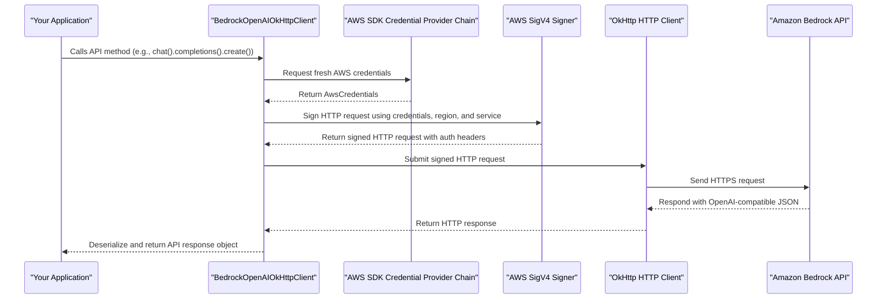
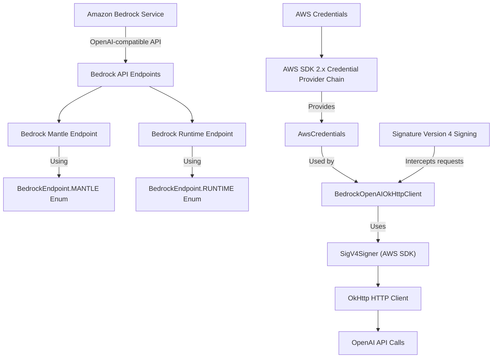
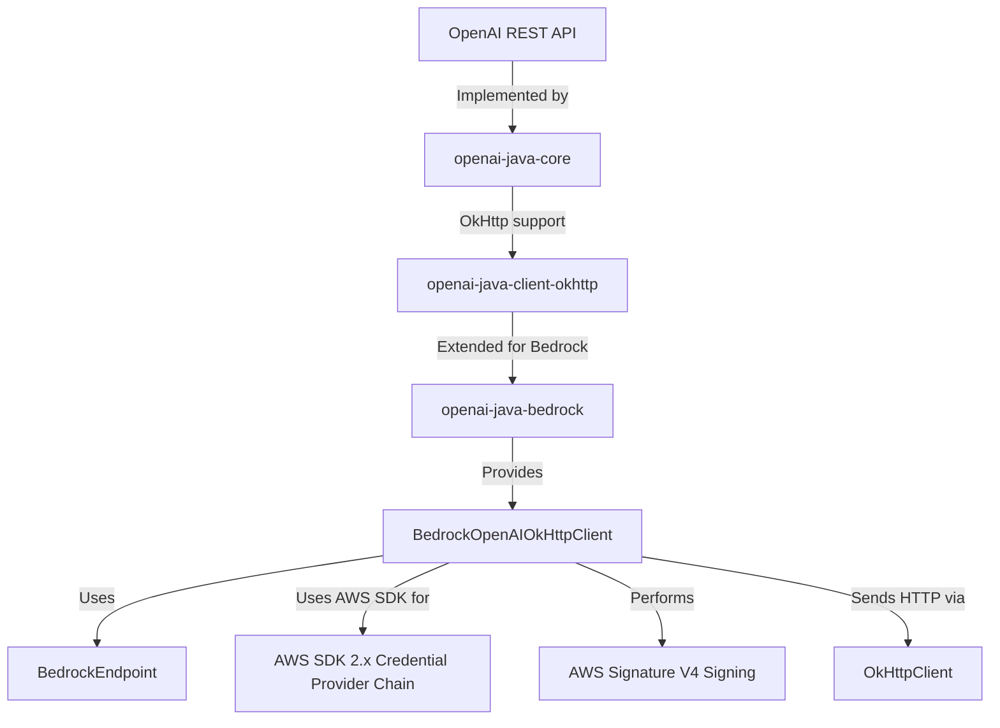

<!-- source: DeepWiki mcp.deepwiki.com · repo openai/openai-java · page 8.2 Amazon Bedrock Integration · fetched 2026-10-26 -->

# Amazon Bedrock Integration

<details>
<summary>Relevant source files</summary>

The following files were used as context for generating this wiki page:

- [.release-please-manifest.json](.release-please-manifest.json)
- [CHANGELOG.md](CHANGELOG.md)
- [CONTRIBUTING.md](CONTRIBUTING.md)
- [README.md](README.md)
- [bedrock.md](bedrock.md)
- [build.gradle.kts](build.gradle.kts)
- [buildSrc/src/main/kotlin/openai.wiremock-test.gradle.kts](buildSrc/src/main/kotlin/openai.wiremock-test.gradle.kts)
- [openai-java-bedrock/build.gradle.kts](openai-java-bedrock/build.gradle.kts)
- [openai-java-core/src/main/kotlin/com/openai/core/ObjectMappers.kt](openai-java-core/src/main/kotlin/com/openai/core/ObjectMappers.kt)
- [openai-java-core/src/main/kotlin/com/openai/core/handlers/JsonHandler.kt](openai-java-core/src/main/kotlin/com/openai/core/handlers/JsonHandler.kt)
- [openai-java-core/src/test/kotlin/com/openai/core/ObjectMappersTest.kt](openai-java-core/src/test/kotlin/com/openai/core/ObjectMappersTest.kt)
- [openai-java-example/build.gradle.kts](openai-java-example/build.gradle.kts)
- [openai-java-example/src/main/java/com/openai/example/Main.java](openai-java-example/src/main/java/com/openai/example/Main.java)

</details>


This section documents the **openai-java-bedrock** module, which integrates the OpenAI Java SDK with Amazon Bedrock. Amazon Bedrock offers OpenAI-compatible APIs via AWS-managed endpoints, and this module provides seamless support for AWS credentials, SigV4 request signing, and Bedrock-specific endpoint configuration.

---

## Purpose and Scope

The **openai-java-bedrock** module extends the OpenAI Java client to support Amazon Bedrock endpoints using AWS authentication mechanisms. It enables developers to use the familiar OpenAI API patterns while transparently handling AWS Signature Version 4 (SigV4) signing, region selection, and endpoint configuration.

This documentation explains the key classes and components in the module:

- `BedrockOpenAIOkHttpClient`: The HTTP client with AWS SigV4 signing integration.
- `BedrockEndpoint`: Enum for selecting Bedrock endpoint variants.
- AWS SigV4 signing flow as applied to OpenAI API requests.
- Usage guidelines including configuration and builder patterns.

---

## Module Overview: `openai-java-bedrock`

The **openai-java-bedrock** module is an optional artifact that depends on the base OkHttp client and AWS SDK 2.x. It introduces Amazon Bedrock authentication, intercepting all outgoing OpenAI HTTP requests to sign them with fresh AWS credentials on every retry attempt.

The module isolates AWS dependencies, including:

- `software.amazon.awssdk:auth`
- `software.amazon.awssdk:regions`
- Runtime dependencies for STS, SSO, and other AWS credential providers.

It bundles:

- OkHttp client extensions for Bedrock.
- Endpoint configuration logic for Bedrock Mantle and Runtime.
- AWS SigV4 signing interceptors.

### Dependency and Packaging

The `build.gradle.kts` dependency excerpt:

```kotlin
dependencies {
    api(project(":openai-java-client-okhttp"))
    api(platform("software.amazon.awssdk:bom:2.46.8"))
    api("software.amazon.awssdk:auth")
    api("software.amazon.awssdk:regions")
    implementation("software.amazon.awssdk:http-client-spi")
    implementation("com.squareup.okhttp3:okhttp:4.12.0")
    // runtimeOnly dependencies omitted for brevity
}
```

This confirms the module builds on the OkHttp client infrastructure and AWS SDK for signing and credential chain support [openai-java-bedrock/build.gradle.kts:7-44]()

---

## Key Classes and Components

### 1. `BedrockOpenAIOkHttpClient`

This class is a specialized implementation of the OpenAI HTTP client using OkHttp, customized for Amazon Bedrock.

- It offers a builder pattern for easy construction.
- Supports AWS credential configuration options:
  - `awsRegion(String)`
  - `awsProfile(String)`
  - `awsAccessKeyId`, `awsSecretAccessKey`, `awsSessionToken` for explicit credentials.
  - `AwsCredentialsProvider` for custom or refreshable credentials.
- Automatically performs AWS SigV4 signing on every request attempt.
- Handles endpoint selection via `BedrockEndpoint`.
- Supports configuration of the base URL to override defaults.

**Usage example:**

```java
OpenAIClient client = BedrockOpenAIOkHttpClient.builder()
    .awsRegion("us-east-1")
    .endpoint(BedrockEndpoint.RUNTIME)
    .build();
```

This client uses AWS credentials resolved by the standard AWS SDK 2.x credential provider chain, including environment variables, profiles, instance metadata, etc., and signs each request accordingly [README.md:107-116,94-121](), [bedrock.md:90-173]()

---

### 2. `BedrockEndpoint`

This enum defines supported Amazon Bedrock endpoint variants:

| Enum Value | Description                                    | Default URL Pattern                                                        | SigV4 Service Name |
|------------|------------------------------------------------|---------------------------------------------------------------------------|--------------------|
| `MANTLE`    | Bedrock Mantle endpoint for OpenAI APIs         | `https://bedrock-mantle.{region}.api.aws/openai/v1`                       | `bedrock-mantle`    |
| `RUNTIME`   | Bedrock Runtime endpoint for OpenAI-compatible APIs | `https://bedrock-runtime.{region}.amazonaws.com/openai/v1`                 | `bedrock`           |

The enum allows the SDK to:

- Construct region-specific URLs with correct DNS suffixes based on standard partitions (AWS, China, ISO, Sovereign Cloud).
- Select the correct SigV4 signing service name for signing.

Using the runtime endpoint is recommended for most new AWS Bedrock users `[bedrock.md:29-64]()`.

---

### 3. AWS SigV4 Signing Process in the Client

The integration with AWS SigV4 signing involves:

- Retrieving fresh AWS credentials through the standard AWS SDK 2.x credential provider chain on each request.
- Intercepting HTTP requests made by OkHttp.
- Computing the signature following AWS SigV4 process:
  - Use the resolved credentials (access key, secret key, session token if present).
  - Use the selected AWS region and service name (`bedrock-mantle` or `bedrock`).
  - Calculate canonical request and sign headers.
  - Inject authorization headers into the outgoing request.
- The client repeats signing before every retry to guarantee fresh credentials.

This ensures compatibility with temporary credentials, workload identities, and profiles.

The signature process is transparent to users of the client. If users prefer, they can fallback to legacy bearer token authentication by setting `AWS_BEARER_TOKEN_BEDROCK` environment variable, but that is not recommended for new usage.

---

## Configuration and Usage

### Client Construction

Recommended construction uses the `BedrockOpenAIOkHttpClient.Builder`, which allows fluent configuration:

| Method                  | Description                                                |
|-------------------------|------------------------------------------------------------|
| `.awsRegion(String)`     | Specify the AWS region (e.g. "us-east-1")                   |
| `.awsProfile(String)`    | Specify AWS named profile to use                            |
| `.awsCredentialsProvider(AwsCredentialsProvider)` | Provide custom AWS credentials provider |
| `.awsAccessKeyId(String)`| Provide explicit AWS access key ID                         |
| `.awsSecretAccessKey(String)` | Provide explicit AWS secret key                        |
| `.awsSessionToken(String)` | Provide explicit AWS session token (optional)             |
| `.endpoint(BedrockEndpoint)` | Choose Bedrock endpoint variant (`MANTLE` or `RUNTIME`)     |
| `.baseUrl(String)`       | Override the default base URL                               |

Example with profile and region:

```java
OpenAIClient client = BedrockOpenAIOkHttpClient.builder()
    .awsRegion("us-east-1")
    .awsProfile("production")
    .endpoint(BedrockEndpoint.MANTLE)
    .build();
```

### Default Resolution Order

- AWS region:
  1. Set via `.awsRegion()`
  2. Environment variable `AWS_REGION`
  3. Environment variable `AWS_DEFAULT_REGION`
  4. AWS SDK default region provider chain

- Base URL:
  1. Set via `.baseUrl()`
  2. Environment variable `AWS_BEDROCK_BASE_URL`
  3. Derived from selected endpoint and region

---

## Data Flow and Request Execution

Below is a detailed flow of how a typical OpenAI API call happens when using the Bedrock client:



This sequence repeats the credential acquisition and signing step on every retry, ensuring fresh tokens during transient failures or request loops.

---

## Diagram Bridging Natural Language Concepts to Code Entities



- The `BedrockOpenAIOkHttpClient` invokes the AWS SDK credential provider chain to obtain fresh credentials.
- It uses `BedrockEndpoint` to determine the suitable Bedrock API URL and SigV4 service name.
- The client signs requests using the AWS SigV4 scheme before passing the request to the underlying OkHttp client.
- This flow ensures OpenAI-compliant API calls to Amazon Bedrock endpoints.

---

## Example Usage: Basic Bedrock Chat Completion

```java
import com.openai.bedrock.BedrockEndpoint;
import com.openai.client.OpenAIClient;
import com.openai.client.okhttp.BedrockOpenAIOkHttpClient;
import com.openai.models.chat.completions.ChatCompletionCreateParams;

public class BedrockChatExample {
    public static void main(String[] args) {
        OpenAIClient client = BedrockOpenAIOkHttpClient.builder()
            .endpoint(BedrockEndpoint.RUNTIME)
            .awsRegion("us-east-1")
            .build();

        ChatCompletionCreateParams params = ChatCompletionCreateParams.builder()
            .model("us.openai.gpt-5.6-sol")
            .addUserMessage("Say hello from Amazon Bedrock Runtime")
            .build();

        client.chat().completions().create(params).choices().stream()
            .flatMap(choice -> choice.message().content().stream())
            .forEach(System.out::println);
    }
}
```

- The client uses AWS region and `BedrockEndpoint.RUNTIME` for Bedrock Runtime access.
- The model name uses the cross-region inference-profile identifier required by Bedrock.
- Output prints model's generated text.

---

## Summary

| Feature                | Description                                               |
|------------------------|-----------------------------------------------------------|
| Module                 | `openai-java-bedrock`                                     |
| Client class           | `BedrockOpenAIOkHttpClient`                              |
| Endpoint enum          | `BedrockEndpoint` (`MANTLE`, `RUNTIME`)                   |
| AWS credential support | Full AWS SDK 2.x provider chain, including profiles, web-identity, SSO, instance roles, etc. |
| Signing protocol       | AWS Signature Version 4 (SigV4)                            |
| Base URL derivation    | Region-based DNS suffixes, API route variations supported |
| Backward compatibility | Support for legacy `AWS_BEARER_TOKEN_BEDROCK` bearer tokens|

---

## References and Further Reading

- [README.md](README.md:94-121) — Bedrock client usage and configuration examples
- [bedrock.md](bedrock.md:1-183) — Detailed integration guide, endpoint selection, credential options, and environment variables
- [openai-java-bedrock/build.gradle.kts](openai-java-bedrock/build.gradle.kts:7-44) — Build dependencies and AWS SDK inclusion for Bedrock module

---

# Additional Mermaid Diagram: Natural Language APIs to Code Entity Mapping



- The OpenAI Java SDK core provides the base API models.
- The OkHttp module adds HTTP client infrastructure.
- The Bedrock module extends the OkHttp client to support AWS credentials and SigV4 signing.
- `BedrockOpenAIOkHttpClient` encapsulates this combined logic.
- AWS credentials and signing components are from the AWS SDK 2.x.

---

# Summary Table: Amazon Bedrock Integration Classes and Responsibilities

| Class/Enum                      | Package                       | Responsibility                                     |
|--------------------------------|-------------------------------|---------------------------------------------------|
| `BedrockOpenAIOkHttpClient`     | `com.openai.client.okhttp` (`bedrock` subpackage) | Extended OpenAI OkHttp client with AWS SigV4 signing and credential support |
| `BedrockEndpoint`               | `com.openai.bedrock`          | Enum of supported Bedrock endpoint variants (`MANTLE`, `RUNTIME`) |
| `AwsCredentialsProvider` (AWS SDK) | AWS SDK                      | Provides AWS credentials from environment, profiles, roles, etc. |
| SigV4 Signing Interceptor        | AWS SDK and client module     | Signs HTTP requests per AWS Signature Version 4 process |

---

This concludes the technical documentation for the Amazon Bedrock integration in the OpenAI Java SDK.

---

### Sources

- [README.md:94-121]()
- [bedrock.md:1-183]()
- [openai-java-bedrock/build.gradle.kts:7-44]()

---

