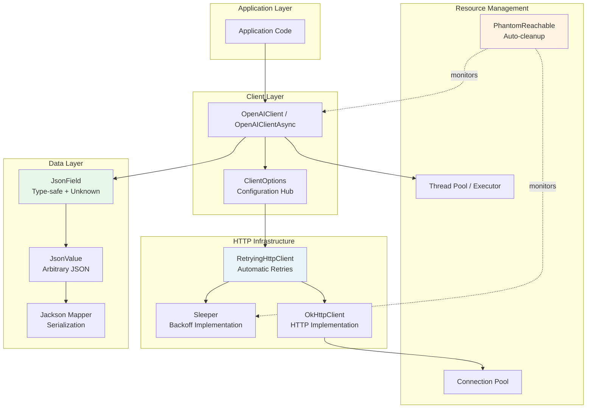
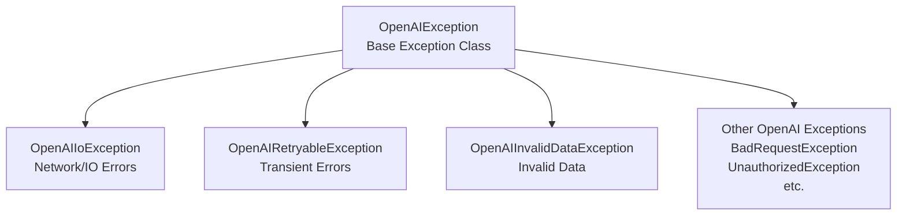
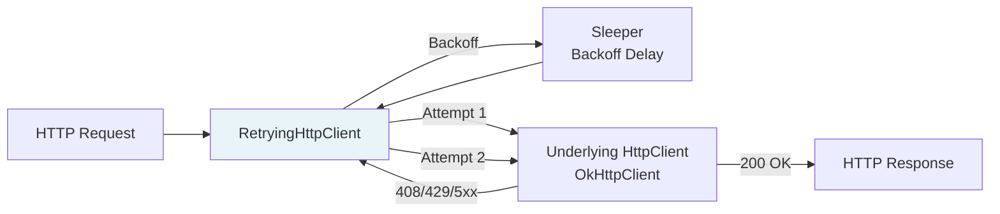
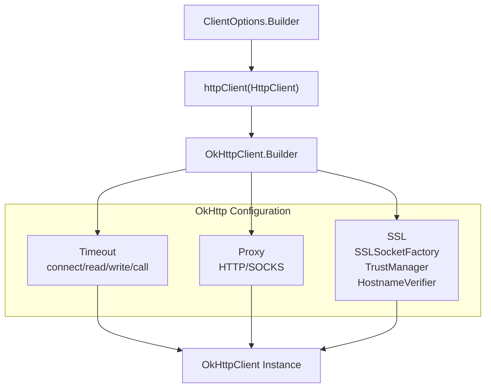
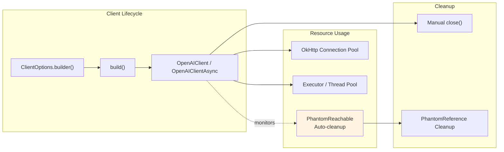
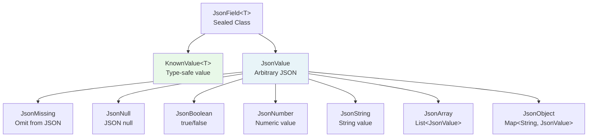

<!-- source: DeepWiki mcp.deepwiki.com · repo openai/openai-java · page 9 Advanced Features · fetched 2026-10-26 -->

# Advanced Features

Relevant source files

The following files were used as context for generating this wiki page:

- [LICENSE](LICENSE)
- [openai-java-core/src/main/kotlin/com/openai/core/Check.kt](openai-java-core/src/main/kotlin/com/openai/core/Check.kt)
- [openai-java-core/src/main/kotlin/com/openai/core/Values.kt](openai-java-core/src/main/kotlin/com/openai/core/Values.kt)
- [openai-java-core/src/main/kotlin/com/openai/core/http/HttpRequest.kt](openai-java-core/src/main/kotlin/com/openai/core/http/HttpRequest.kt)
- [openai-java-core/src/main/kotlin/com/openai/core/http/RetryingHttpClient.kt](openai-java-core/src/main/kotlin/com/openai/core/http/RetryingHttpClient.kt)
- [openai-java-core/src/main/kotlin/com/openai/errors/OpenAIRetryableException.kt](openai-java-core/src/main/kotlin/com/openai/errors/OpenAIRetryableException.kt)
- [openai-java-core/src/test/kotlin/com/openai/core/UtilsTest.kt](openai-java-core/src/test/kotlin/com/openai/core/UtilsTest.kt)
- [openai-java-core/src/test/kotlin/com/openai/core/ValuesTest.kt](openai-java-core/src/test/kotlin/com/openai/core/ValuesTest.kt)
- [openai-java-core/src/test/kotlin/com/openai/core/http/HttpRequestTest.kt](openai-java-core/src/test/kotlin/com/openai/core/http/HttpRequestTest.kt)
- [openai-java-core/src/test/kotlin/com/openai/core/http/MultipartContentTypeBoundaryTest.kt](openai-java-core/src/test/kotlin/com/openai/core/http/MultipartContentTypeBoundaryTest.kt)
- [openai-java-core/src/test/kotlin/com/openai/core/http/RetryDateOverflowTest.kt](openai-java-core/src/test/kotlin/com/openai/core/http/RetryDateOverflowTest.kt)
- [openai-java-core/src/test/kotlin/com/openai/core/http/RetryingHttpClientCloseTest.kt](openai-java-core/src/test/kotlin/com/openai/core/http/RetryingHttpClientCloseTest.kt)
- [openai-java-core/src/test/kotlin/com/openai/core/http/RetryingHttpClientTest.kt](openai-java-core/src/test/kotlin/com/openai/core/http/RetryingHttpClientTest.kt)

This page introduces the advanced SDK features and customization options available in the OpenAI Java SDK. It is targeted at users needing resilient, production-grade behavior such as automatic retries, fine-grained HTTP client customization, robust error handling, efficient resource management, and flexible JSON/data serialization.

Rather than delving into the low-level details here, this page provides a high-level overview of the main advanced features and how they interrelate. Links to dedicated child pages are included for each topic to explore specifics and usage patterns.

---

## Overview of Advanced Infrastructure

The SDK encapsulates advanced features within a layered architecture. Key infrastructure components can be individually customized or replaced, allowing developers to fit the SDK into complex or constrained environments:

This architecture supports production stability, extensibility, and customization by separating concerns such as HTTP client implementation, retry/backoff policies, resource lifecycle, and JSON data modeling.

**Sources:**  
- [openai-java-core/src/main/kotlin/com/openai/core/http/RetryingHttpClient.kt:1-266]()  
- [openai-java-client-okhttp/src/main/kotlin/com/openai/client/okhttp/OkHttpClient.kt:1-253]()  
- [openai-java-core/src/main/kotlin/com/openai/core/Values.kt:1-609]()

---

## Error Handling

The SDK offers a robust error handling model:

- A structured exception hierarchy distinguishes between network errors (`OpenAIIoException`), transient retryable errors (`OpenAIRetryableException`), invalid data (`OpenAIInvalidDataException`), and other service errors.
- All retryable exceptions trigger automatic retries by the `RetryingHttpClient`.
- SDK users should handle exceptions explicitly based on their semantics to provide correct recovery or user feedback.

| Exception Class | Purpose | Retryable | Typical Scenario |
|-----------------|---------|-----------|------------------|
| `OpenAIIoException` | Network or IO failures | Yes (auto-retry) | Connection lost, timeouts |
| `OpenAIRetryableException` | Explicitly transient errors | Yes (auto-retry) | Temporary server issues |
| `OpenAIInvalidDataException` | Invalid input data | No | Missing required params, type errors |

The recommended way to trigger a custom retry is to throw `OpenAIRetryableException` in your application code.

**Sources:**  
- [openai-java-core/src/main/kotlin/com/openai/errors/OpenAIRetryableException.kt:1-14]()  
- [openai-java-core/src/main/kotlin/com/openai/core/http/RetryingHttpClient.kt:182-186]()  
- [openai-java-core/src/test/kotlin/com/openai/core/http/RetryingHttpClientTest.kt:258-332]()

For detailed information see the [Error Handling](#9.1) child page.

---

## Retry Logic

The SDK implements automatic HTTP retry logic via the `RetryingHttpClient` decorator:

Key retry conditions include:

| Condition | HTTP Status Codes | Retry Behavior |
|-----------|-------------------|----------------|
| Timeout | 408 (Request Timeout) | Retry |
| Lock Timeout | 409 | Retry |
| Rate Limiting | 429 | Retry, respects `Retry-After` header |
| Server Errors | 5xx | Retry |
| Network IO Failures | N/A | Retry |
| Explicit Retry Signals | N/A | Retry when `OpenAIRetryableException` thrown |

Additionally, the non-standard `X-Should-Retry` header can override retry behavior:

- `X-Should-Retry: true` forces a retry
- `X-Should-Retry: false` suppresses retry

The retry backoff uses an exponential strategy with jitter:

1. Check `Retry-After-Ms` (milliseconds)
2. Else check `Retry-After` (seconds or RFC 1123 date)
3. Else exponential backoff starting at 0.5 seconds, doubling each retry capped at 8 seconds
4. Apply random jitter between 75%-100% of calculated backoff to spread retries

Example backoff sequence (approximate in seconds):  
`[0.25-0.5], [0.75-1.0], [1.5-2.0], [3.0-4.0], [6.0-8.0]`

You can configure the maximum retry attempts through `ClientOptions.Builder.maxRetries`, defaulting to 2. Setting `maxRetries` to 0 disables retries.

The client adds idempotency headers automatically when configured via `RetryingHttpClient.Builder.idempotencyHeader()`, along with a retry count header `X-Stainless-Retry-Count` for tracking retry attempts.

Async retry logic is implemented with non-blocking backoff using `CompletableFuture` and asynchronous sleep operations on the `Sleeper` interface.

**Sources:**  
- [openai-java-core/src/main/kotlin/com/openai/core/http/RetryingHttpClient.kt:24-181]()  
- [openai-java-core/src/main/kotlin/com/openai/core/http/RetryingHttpClient.kt:182-264]()  
- [openai-java-core/src/test/kotlin/com/openai/core/http/RetryingHttpClientTest.kt:46-150]()

For full detail see the [Retry Logic](#9.2) child page.

---

## HTTP Layer Customization

Developers can customize the HTTP layer extensively. The default HTTP implementation uses OkHttp 3.x with many configurable options:

Available HTTP customization features include:

- Configuring connect, read, write, and total request timeouts at the OkHttp client level or overridden on individual requests.
- Setting HTTP and SOCKS proxies.
- Customizing SSL/TLS behavior with `SSLSocketFactory`, `X509TrustManager`, and `HostnameVerifier` to support self-signed certificates or enterprise PKI.
- Adding custom headers, query parameters, and multipart encoding helpers.
- Handling Server-Sent Events (SSE) and streaming with dedicated mechanisms.
- Enabling HTTP request and response logging via the `OPENAI_LOG` environment variable, supporting levels `info` (basic) and `debug` (full bodies).

**Sources:**  
- [openai-java-client-okhttp/src/main/kotlin/com/openai/client/okhttp/OkHttpClient.kt:77-253]()

For implementation examples and configuration options, see [HTTP Layer Customization](#9.3).

---

## Resource Management

Proper resource handling is critical in applications integrating with the SDK. The SDK offers several facilities:

- OpenAI client instances implement `AutoCloseable` to support try-with-resources. Calling `close()` triggers cleanup of thread pools, connection pools, and timer tasks.
- The SDK uses a PhantomReachable pattern to automatically release resources when clients become unreachable to the JVM garbage collector, even if not explicitly closed.
- `Sleeper` implementations manage async backoff timers and are cleaned up accordingly.
- The thread pool used for async streaming (e.g., subscription event dispatch) can be customized globally or per operation.
- Connection pools reuse TCP connections efficiently and have configurable limits.

All response resources must be closed properly by the client or application to avoid leaks. The retry client ensures failed responses are closed before retrying.

**Sources:**  
- [openai-java-client-okhttp/src/main/kotlin/com/openai/client/okhttp/OkHttpClient.kt:70-81]()  
- [openai-java-core/src/main/kotlin/com/openai/core/PhantomReachableSleeper.kt:1-23]()  
- [openai-java-core/src/main/kotlin/com/openai/core/http/RetryingHttpClient.kt:68-71]()  
- [openai-java-core/src/test/kotlin/com/openai/core/http/RetryingHttpClientTest.kt:48-62]()

For full resource management patterns, see [Resource Management](#9.4).

---

## JSON and Data Structures

The SDK provides an advanced and flexible JSON data serialization system centered around the `JsonField<T>` and `JsonValue` abstractions:

- `JsonField<T>` is a container that may hold a known value of type `T` (`KnownValue<T>`) or an arbitrary raw JSON representation (`JsonValue`) to allow forward compatibility and unknown fields.
- It supports querying as known or unknown, accessing booleans, numbers, strings, arrays, or objects, plus identifying if fields are missing or null.
- Serialization respects missing values by omitting them entirely and null values by serializing as JSON null.
- Union types are handled via a best-match deserialization approach that tries all known types and falls back to raw JSON.
- The system integrates tightly with Jackson for JSON parsing and generation.
- Utility methods support mapping from arbitrary objects to `JsonValue` and converting to Java types, supporting flexible data processing.

The SDK also ensures Jackson version compatibility with runtime checks and consumer rules, avoiding common version conflicts.

**Sources:**  
- [openai-java-core/src/main/kotlin/com/openai/core/Values.kt:32-208]()  
- [openai-java-core/src/main/kotlin/com/openai/core/Check.kt:50-96]()  
- [openai-java-core/src/main/kotlin/com/openai/core/Values.kt:209-235]()  

For more about JSON handling, union types, and serialization see [JSON and Data Structures](#9.5).

---

## ProGuard and Runtime Compatibility

The SDK provides consumer rules and a dedicated `proguard-test` module to ensure compatibility with ProGuard and R8 optimizers. It includes GraalVM native image metadata to support native compilation.

Jackson dependency versions are carefully managed, and runtime compatibility is verified programmatically. These mechanisms assist users with complex JVM environments, minimizing runtime exceptions from class retention issues or version conflicts.

For details, see the [ProGuard and Runtime Compatibility](#9.6) page.

---

## Summary and Recommended Reading

| Advanced Feature Area | Description | See Child Page |
|----------------------|-------------|----------------|
| Error Handling | Exception hierarchy, error response modeling, retryable exceptions | [Error Handling](#9.1) |
| Retry Logic | RetryingHttpClient, exponential backoff, retry after handling, headers | [Retry Logic](#9.2) |
| HTTP Layer Customization | OkHttp settings, proxy, SSL, timeouts, multipart encoding, SSE, logging | [HTTP Layer Customization](#9.3) |
| Resource Management | Connection and thread pools, PhantomReachable auto-cleanup, client lifecycle | [Resource Management](#9.4) |
| JSON and Data Structures | JsonField, JsonValue system, union types, serialization patterns | [JSON and Data Structures](#9.5) |
| ProGuard & Runtime Compatibility | Obfuscation rules, GraalVM metadata, Jackson version checks | [ProGuard and Runtime Compatibility](#9.6) |

This modular breakdown enables users to customize and tune the SDK in detail for advanced use cases, production environments, and specialized infrastructures.

---

By understanding and leveraging these advanced features, developers gain robust control over API interactions, performance, error resiliency, and data modeling with the OpenAI Java SDK.

# Advanced Features Wiki Page End

---

