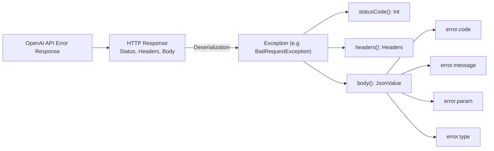
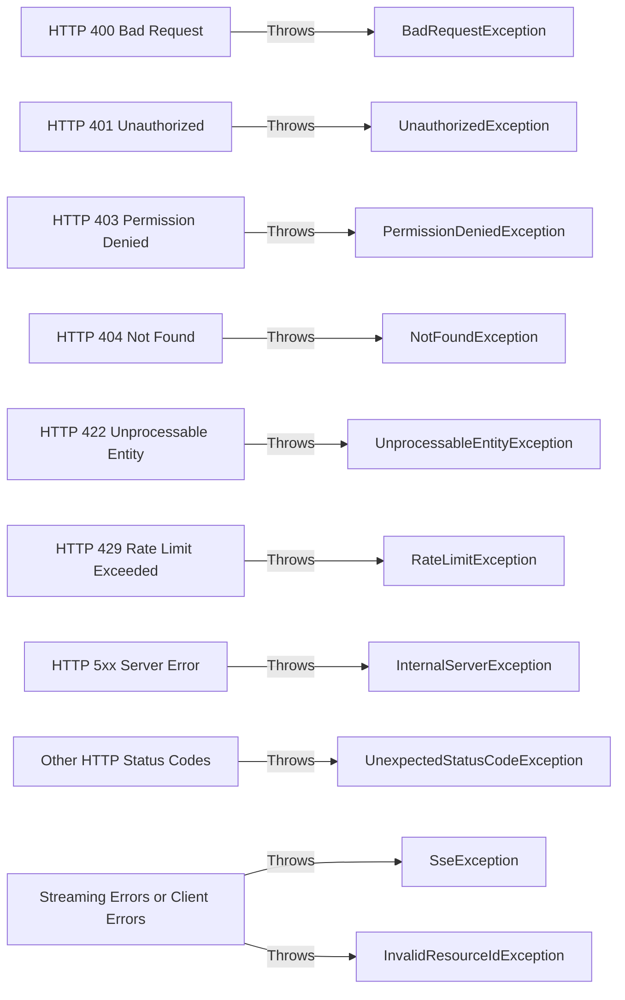
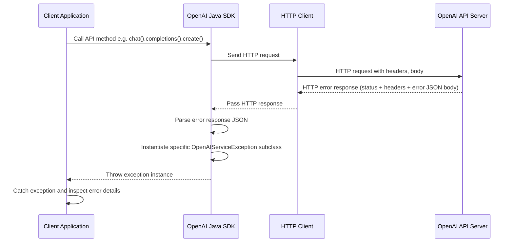

<!-- source: DeepWiki mcp.deepwiki.com · repo openai/openai-java · page 9.1 Error Handling · fetched 2026-10-26 -->

# Error Handling

<details>
<summary>Relevant source files</summary>

The following files were used as context for generating this wiki page:

- [openai-java-client-okhttp/src/test/kotlin/com/openai/client/okhttp/AzureRequestPreparationCompatibilityTest.kt](openai-java-client-okhttp/src/test/kotlin/com/openai/client/okhttp/AzureRequestPreparationCompatibilityTest.kt)
- [openai-java-client-okhttp/src/test/kotlin/com/openai/client/okhttp/ResourcePathValidationTest.kt](openai-java-client-okhttp/src/test/kotlin/com/openai/client/okhttp/ResourcePathValidationTest.kt)
- [openai-java-client-okhttp/src/test/kotlin/com/openai/client/okhttp/UploadResourcePathValidationTest.kt](openai-java-client-okhttp/src/test/kotlin/com/openai/client/okhttp/UploadResourcePathValidationTest.kt)
- [openai-java-core/src/main/kotlin/com/openai/core/PrepareRequest.kt](openai-java-core/src/main/kotlin/com/openai/core/PrepareRequest.kt)
- [openai-java-core/src/main/kotlin/com/openai/core/handlers/ErrorHandler.kt](openai-java-core/src/main/kotlin/com/openai/core/handlers/ErrorHandler.kt)
- [openai-java-core/src/main/kotlin/com/openai/errors/BadRequestException.kt](openai-java-core/src/main/kotlin/com/openai/errors/BadRequestException.kt)
- [openai-java-core/src/main/kotlin/com/openai/errors/InternalServerException.kt](openai-java-core/src/main/kotlin/com/openai/errors/InternalServerException.kt)
- [openai-java-core/src/main/kotlin/com/openai/errors/InvalidResourceIdException.kt](openai-java-core/src/main/kotlin/com/openai/errors/InvalidResourceIdException.kt)
- [openai-java-core/src/main/kotlin/com/openai/errors/NotFoundException.kt](openai-java-core/src/main/kotlin/com/openai/errors/NotFoundException.kt)
- [openai-java-core/src/main/kotlin/com/openai/errors/OpenAIServiceException.kt](openai-java-core/src/main/kotlin/com/openai/errors/OpenAIServiceException.kt)
- [openai-java-core/src/main/kotlin/com/openai/errors/PermissionDeniedException.kt](openai-java-core/src/main/kotlin/com/openai/errors/PermissionDeniedException.kt)
- [openai-java-core/src/main/kotlin/com/openai/errors/RateLimitException.kt](openai-java-core/src/main/kotlin/com/openai/errors/RateLimitException.kt)
- [openai-java-core/src/main/kotlin/com/openai/errors/SseException.kt](openai-java-core/src/main/kotlin/com/openai/errors/SseException.kt)
- [openai-java-core/src/main/kotlin/com/openai/errors/UnauthorizedException.kt](openai-java-core/src/main/kotlin/com/openai/errors/UnauthorizedException.kt)
- [openai-java-core/src/main/kotlin/com/openai/errors/UnexpectedStatusCodeException.kt](openai-java-core/src/main/kotlin/com/openai/errors/UnexpectedStatusCodeException.kt)
- [openai-java-core/src/main/kotlin/com/openai/errors/UnprocessableEntityException.kt](openai-java-core/src/main/kotlin/com/openai/errors/UnprocessableEntityException.kt)
- [openai-java-core/src/test/kotlin/com/openai/core/http/ResourcePathValidationTest.kt](openai-java-core/src/test/kotlin/com/openai/core/http/ResourcePathValidationTest.kt)
- [openai-java-core/src/test/kotlin/com/openai/services/ErrorHandlingTest.kt](openai-java-core/src/test/kotlin/com/openai/services/ErrorHandlingTest.kt)
- [openai-java-core/src/test/kotlin/com/openai/services/ServiceParamsTest.kt](openai-java-core/src/test/kotlin/com/openai/services/ServiceParamsTest.kt)
- [openai-java-core/src/test/kotlin/com/openai/services/blocking/BatchServiceTest.kt](openai-java-core/src/test/kotlin/com/openai/services/blocking/BatchServiceTest.kt)
- [openai-java-core/src/test/kotlin/com/openai/services/blocking/CompletionServiceTest.kt](openai-java-core/src/test/kotlin/com/openai/services/blocking/CompletionServiceTest.kt)
- [openai-java-core/src/test/kotlin/com/openai/services/blocking/EmbeddingServiceTest.kt](openai-java-core/src/test/kotlin/com/openai/services/blocking/EmbeddingServiceTest.kt)
- [openai-java-core/src/test/kotlin/com/openai/services/blocking/ModerationServiceTest.kt](openai-java-core/src/test/kotlin/com/openai/services/blocking/ModerationServiceTest.kt)

</details>


This page documents the exception hierarchy, error response structures, and error handling patterns used in the OpenAI Java SDK. It explains how the SDK models and surfaces errors arising from API calls, how errors can be inspected programmatically, and typical usage patterns for robust error handling in client code.

---

## Exception Hierarchy

The SDK organizes errors into an inheritance hierarchy rooted at the base class `OpenAIServiceException`, which itself extends from `OpenAIException`. The hierarchy covers common HTTP error responses as specific subclasses, special streaming exceptions, and exceptions for validation and resource ID issues.

```mermaid
graph TB
    OpenAIException["OpenAIException<br/>(base class)"]
    OpenAIServiceException["OpenAIServiceException<br/>(extends OpenAIException)"]
    
    OpenAIServiceException --> BadRequestException["BadRequestException<br/>(400)"]
    OpenAIServiceException --> UnauthorizedException["UnauthorizedException<br/>(401)"]
    OpenAIServiceException --> PermissionDeniedException["PermissionDeniedException<br/>(403)"]
    OpenAIServiceException --> NotFoundException["NotFoundException<br/>(404)"]
    OpenAIServiceException --> UnprocessableEntityException["UnprocessableEntityException<br/>(422)"]
    OpenAIServiceException --> RateLimitException["RateLimitException<br/>(429)"]
    OpenAIServiceException --> InternalServerException["InternalServerException<br/>(5xx)"]
    OpenAIServiceException --> UnexpectedStatusCodeException["UnexpectedStatusCodeException<br/>(other status codes)"]
    
    OpenAIException --> SseException["SseException<br/>(streaming errors)"]
    OpenAIException --> InvalidResourceIdException["InvalidResourceIdException<br/>(invalid resource IDs)"]
```



### Key Exception Classes

| Exception Class                  | HTTP Status Code | Description                                                   | Retryable |
|--------------------------------|------------------|---------------------------------------------------------------|-----------|
| `BadRequestException`           | 400              | The request parameters were invalid or malformed.             | No        |
| `UnauthorizedException`         | 401              | The API key was missing or invalid.                           | No        |
| `PermissionDeniedException`     | 403              | The client lacks permission for the resource.                 | No        |
| `NotFoundException`             | 404              | The requested resource was not found.                         | No        |
| `UnprocessableEntityException` | 422              | The request was understood but could not be processed.        | No        |
| `RateLimitException`            | 429              | The application has exceeded the API rate limit.              | Yes       |
| `InternalServerException`       | 5xx              | Server-side internal errors.                                  | Yes       |
| `UnexpectedStatusCodeException`| Other            | Unhandled or unknown HTTP status errors.                      | Depends   |
| `SseException`                  | N/A              | Errors occurring during Server-Sent Events (streaming).       | Depends   |
| `InvalidResourceIdException`    | N/A              | Client-side error for invalid resource IDs during request preparation. | No        |

The hierarchy ensures that all HTTP exceptions share a common interface for accessing status code, headers, and structured error payloads.

Sources:  
- [openai-java-core/src/main/kotlin/com/openai/errors/BadRequestException.kt:13-98]()  
- [openai-java-core/src/main/kotlin/com/openai/errors/UnauthorizedException.kt:13-98]()  
- [openai-java-core/src/main/kotlin/com/openai/errors/PermissionDeniedException.kt:13-98]()  
- [openai-java-core/src/main/kotlin/com/openai/errors/NotFoundException.kt:13-98]()  
- [openai-java-core/src/main/kotlin/com/openai/errors/UnprocessableEntityException.kt:13-98]()  
- [openai-java-core/src/main/kotlin/com/openai/errors/RateLimitException.kt:13-98]()  
- [openai-java-core/src/main/kotlin/com/openai/errors/InternalServerException.kt:13-110]()  
- [openai-java-core/src/main/kotlin/com/openai/errors/UnexpectedStatusCodeException.kt:13-111]()  
- [openai-java-core/src/main/kotlin/com/openai/errors/SseException.kt:1-40]()  
- [openai-java-core/src/main/kotlin/com/openai/errors/InvalidResourceIdException.kt:1-13]()  

---

## Error Response Structure

When the OpenAI API returns an error response, the SDK parses the HTTP response and its JSON body to instantiate an appropriate exception subclass. Each error response includes:

- HTTP status code  
- HTTP headers  
- A JSON body containing an `error` object with details

### Error Object Structure

The `error` field of the response body contains structured fields which are extracted into the exception:

| Field   | Type    | Description                                      |
|---------|---------|------------------------------------------------|
| `code`  | String  | Short error code (e.g., `rate_limit_exceeded`) |
| `message` | String | Human-readable error message                     |
| `param` | String  | Request parameter that caused the error (optional) |
| `type`  | String  | Error classification/type (e.g., `invalid_request_error`) |

### Deserialization Flow



### Accessing Error Details in Code

Example Kotlin/Java usage to inspect the error:

```java
try {
    client.chat().completions().create(params);
} catch (BadRequestException e) {
    int status = e.statusCode();  // e.g., 400
    Headers headers = e.headers();
    JsonValue body = e.body();
    String code = e.code().orElse(null);
    String param = e.param().orElse(null);
    String type = e.type().orElse(null);
    // Use error details as needed
}
```

Each exception subclass provides these methods to retrieve full error response data for logging or custom handling.

Sources: [openai-java-core/src/main/kotlin/com/openai/errors/BadRequestException.kt:19-41](), [openai-java-core/src/test/kotlin/com/openai/services/ErrorHandlingTest.kt:44-58]()

---

## Error Handling Patterns

### Pattern 1: Catch Specific Exceptions

Developers can catch specific exception classes to tailor handling behavior according to error semantics. For example:

- `RateLimitException` indicates you should wait (respecting `Retry-After` header) before retrying.  
- `UnauthorizedException` suggests invalid API keys and should halt further requests.  
- `BadRequestException` means client request is malformed, fix request parameters.

Example usage:

```java
try {
    client.fineTuning().jobs().create(jobParams);
} catch (RateLimitException e) {
    long retryAfterMs = e.headers().values("Retry-After").stream().findFirst()
        .map(Long::parseLong).orElse(60L) * 1000;
    Thread.sleep(retryAfterMs);
    // Retry logic here
} catch (UnauthorizedException e) {
    logger.error("API key not authorized: {}", e.body());
} catch (BadRequestException e) {
    logger.error("Invalid parameters: {}", e.body());
} catch (Exception e) {
    logger.error("Unhandled exception: ", e);
}
```

### Pattern 2: Access Raw Response Data

The SDK supports `withRawResponse()` pattern for requests, which throws exceptions but the exception instances retain raw HTTP response data. This allows client code to:

- Read HTTP status codes  
- Inspect headers  
- Parse or log raw JSON error bodies

Example:

```java
try {
    client.chat().completions()
        .withRawResponse()
        .create(params);
} catch (BadRequestException e) {
    System.out.println("Status code: " + e.statusCode());
    System.out.println("Headers: " + e.headers());
    System.out.println("Error body: " + e.body());
}
```

This is useful for diagnostics or building more sophisticated error recovery or reporting.

### Pattern 3: Handle Unknown Enum Values Gracefully

When responses contain enums (e.g., model names), unknown values can appear due to API version differences. The SDK provides a `known()` method to retrieve a type-safe enum or throw if unknown, and a `value()` method returning a safe union type including an `_UNKNOWN` sentinel.

Example:

```java
ChatModel model = response.model();
if (model.value() == ChatModel.Value._UNKNOWN) {
    // API returned a model string not yet known to the SDK.
    String rawValue = model.asString();
    System.out.println("Unknown model received: " + rawValue);
} else {
    // Use the known enum value safely.
}
```

Graceful handling of unknown values prevents runtime errors and supports forward compatibility.

### Pattern 4: Asynchronous Error Handling

When using the asynchronous client, errors are propagated via `CompletableFuture` exception mechanisms.

Example:

```java
client.chat().completions().createAsync(params)
    .thenAccept(completion -> {
        // Process successful response
    })
    .exceptionally(throwable -> {
        Throwable cause = throwable.getCause();
        if (cause instanceof RateLimitException) {
            // Handle rate limits
        }
        // Other error handling
        return null;
    });
```

Retry logic and error handling patterns apply similarly in async flows with non-blocking delays.

Sources: [openai-java-core/src/test/kotlin/com/openai/services/ErrorHandlingTest.kt:79-193](), [openai-java-core/src/main/kotlin/com/openai/core/http/RetryingHttpClient.kt:74-131]()

---

## Diagram: Mapping HTTP Error Responses to OpenAIException Subclasses



Sources: [openai-java-core/src/main/kotlin/com/openai/errors/*.kt]()

---

## Error Handling Lifecycle in the SDK



This flow illustrates the internal processing from sending a request, receiving an error response, parsing and throwing a typed exception, and client-side error handling.

Sources: [openai-java-core/src/test/kotlin/com/openai/services/ErrorHandlingTest.kt:41-117]()

---

# Summary

The OpenAI Java SDK provides a rich and consistent error handling framework:

- A detailed exception hierarchy models common API and client errors with typed exceptions holding status, headers, and error payloads.  
- SDK deserializes the `error` object from response JSON into rich structured data exposed by exception methods.  
- Automatic retry logic is layered on top (see Retry Logic documentation) handling transient errors and rate limits.  
- Client code can handle specific subclasses, use `withRawResponse()`, handle unknown enums gracefully, and manage async exceptions.  

Proper understanding and usage of these error handling constructs helps build robust integrations with the OpenAI API in Java.

---

**Sources:**  
- [openai-java-core/src/main/kotlin/com/openai/errors/BadRequestException.kt:13-98]()  
- [openai-java-core/src/main/kotlin/com/openai/errors/UnauthorizedException.kt:13-98]()  
- [openai-java-core/src/main/kotlin/com/openai/errors/PermissionDeniedException.kt:13-98]()  
- [openai-java-core/src/main/kotlin/com/openai/errors/NotFoundException.kt:13-98]()  
- [openai-java-core/src/main/kotlin/com/openai/errors/UnprocessableEntityException.kt:13-98]()  
- [openai-java-core/src/main/kotlin/com/openai/errors/RateLimitException.kt:13-98]()  
- [openai-java-core/src/main/kotlin/com/openai/errors/InternalServerException.kt:13-110]()  
- [openai-java-core/src/main/kotlin/com/openai/errors/UnexpectedStatusCodeException.kt:13-111]()  
- [openai-java-core/src/main/kotlin/com/openai/errors/SseException.kt:1-40]()  
- [openai-java-core/src/main/kotlin/com/openai/errors/InvalidResourceIdException.kt:1-13]()  
- [openai-java-core/src/test/kotlin/com/openai/services/ErrorHandlingTest.kt:1-152]()

---

