<!-- source: DeepWiki mcp.deepwiki.com · repo openai/openai-java · page 9.2 Retry Logic · fetched 2026-10-26 -->

# Retry Logic

<details>
<summary>Relevant source files</summary>

The following files were used as context for generating this wiki page:

- [LICENSE](LICENSE)
- [openai-java-core/src/main/kotlin/com/openai/core/Check.kt](openai-java-core/src/main/kotlin/com/openai/core/Check.kt)
- [openai-java-core/src/main/kotlin/com/openai/core/Values.kt](openai-java-core/src/main/kotlin/com/openai/core/Values.kt)
- [openai-java-core/src/main/kotlin/com/openai/core/http/HttpRequest.kt](openai-java-core/src/main/kotlin/com/openai/core/http/HttpRequest.kt)
- [openai-java-core/src/main/kotlin/com/openai/core/http/RetryingHttpClient.kt](openai-java-core/src/main/kotlin/com/openai/core/http/RetryingHttpClient.kt)
- [openai-java-core/src/main/kotlin/com/openai/errors/OpenAIRetryableException.kt](openai-java-core/src/main/kotlin/com/openai/errors/OpenAIRetryableException.kt)
- [openai-java-core/src/test/kotlin/com/openai/core/UtilsTest.kt](openai-java-core/src/test/kotlin/com/openai/core/UtilsTest.kt)
- [openai-java-core/src/test/kotlin/com/openai/core/ValuesTest.kt](openai-java-core/src/test/kotlin/com/openai/core/ValuesTest.kt)
- [openai-java-core/src/test/kotlin/com/openai/core/http/HttpRequestTest.kt](openai-java-core/src/test/kotlin/com/openai/core/http/HttpRequestTest.kt)
- [openai-java-core/src/test/kotlin/com/openai/core/http/MultipartContentTypeBoundaryTest.kt](openai-java-core/src/test/kotlin/com/openai/core/http/MultipartContentTypeBoundaryTest.kt)
- [openai-java-core/src/test/kotlin/com/openai/core/http/RetryDateOverflowTest.kt](openai-java-core/src/test/kotlin/com/openai/core/http/RetryDateOverflowTest.kt)
- [openai-java-core/src/test/kotlin/com/openai/core/http/RetryingHttpClientCloseTest.kt](openai-java-core/src/test/kotlin/com/openai/core/http/RetryingHttpClientCloseTest.kt)
- [openai-java-core/src/test/kotlin/com/openai/core/http/RetryingHttpClientTest.kt](openai-java-core/src/test/kotlin/com/openai/core/http/RetryingHttpClientTest.kt)

</details>


## Purpose and Scope

This document describes the automatic retry mechanism implemented in the OpenAI Java SDK's HTTP layer. The retry logic provides resilience against transient failures by automatically retrying failed requests with exponential backoff and jitter. This system handles both synchronous and asynchronous requests, respects server-directed retry timing via `Retry-After` headers, and ensures idempotency for retried requests.

For information about HTTP layer customization, see [HTTP Layer Customization](#9.3). For error handling and exception types, see [Error Handling](#9.1).

## RetryingHttpClient Overview

The `RetryingHttpClient` class acts as a decorator around any existing `HttpClient` implementation. It intercepts all HTTP requests and responses, applying automatic retry behavior transparently to the caller.

Constructed via a builder pattern, `RetryingHttpClient` wraps an underlying HTTP client (commonly the OkHttp-based client) and implements the same `HttpClient` interface. It controls how many times a request will be retried, how to compute backoff delays, and how to manage request headers such as idempotency keys and retry count.

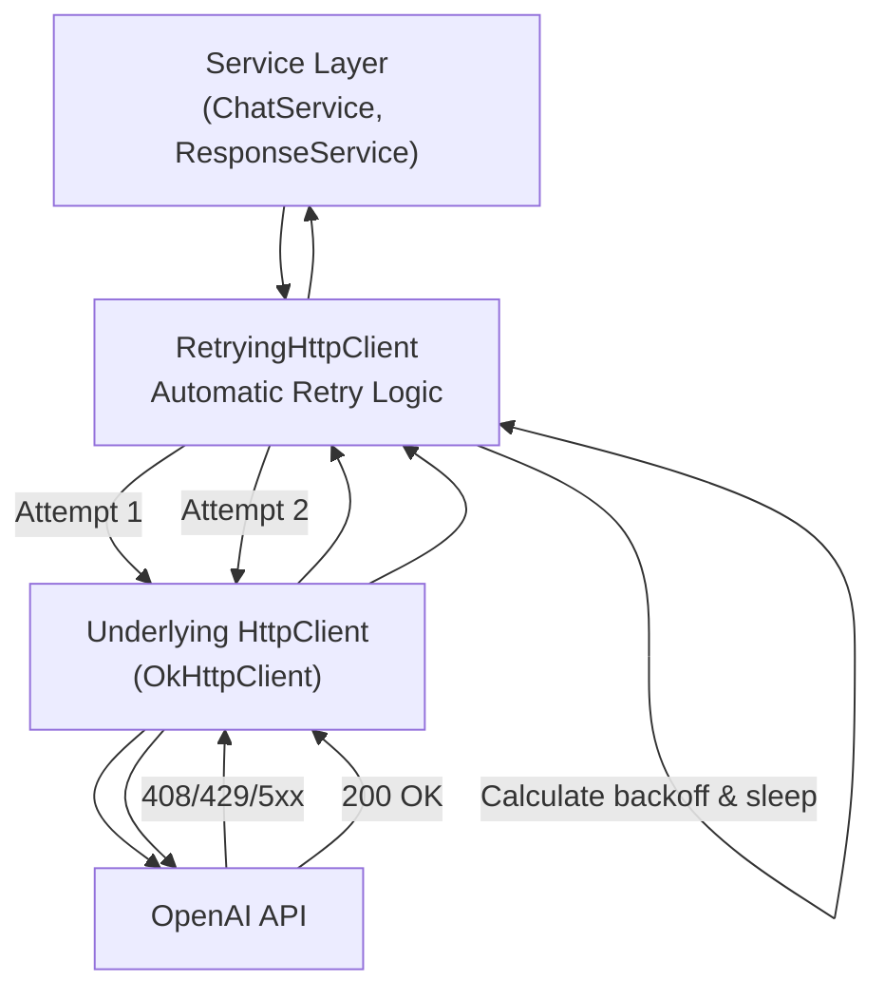

**Sources:** [openai-java-core/src/main/kotlin/com/openai/core/http/RetryingHttpClient.kt:24-31]()

### Key Responsibilities

The `RetryingHttpClient` is responsible for:

- **Retry orchestration:** Repeating failed requests up to `maxRetries`
- **Backoff management:** Calculating exponential backoff delays with random jitter
- **Header management:** Injecting retry count and optional idempotency headers
- **Request inspection:** Checking if the request is repeatable before retrying
- **Response resource cleanup:** Closing responses before retrying to prevent resource leaks
- **Synchronous and asynchronous support:** Supporting both blocking and non-blocking request execution

**Sources:** [openai-java-core/src/main/kotlin/com/openai/core/http/RetryingHttpClient.kt:33-137]()

---

## Retry Conditions

The retry logic triggers retries only under specific conditions related to request repeatability, response status, and exception types.

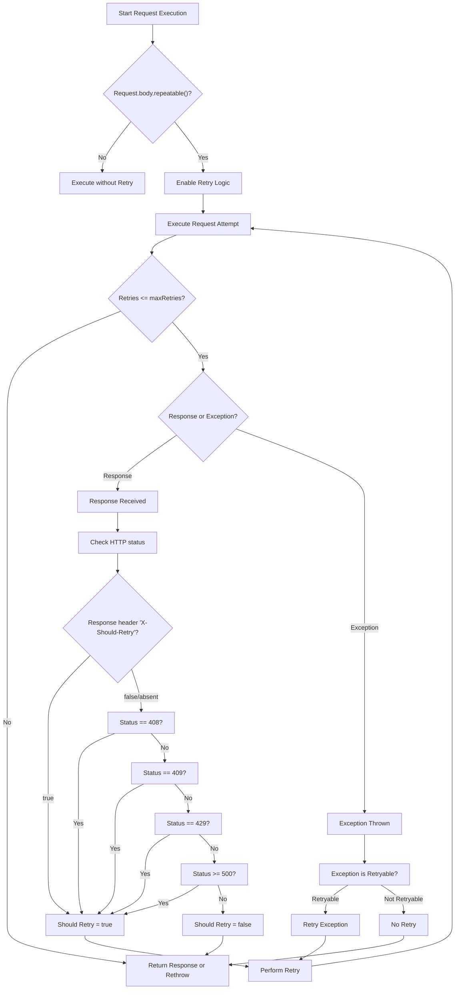

### Details

- **Repeatability check**: Requests with a non-repeatable body (streamed, consumed, or non-resettable) are _never_ retried, even if a retryable error occurs.
- **Response status codes triggering retries**:
  - 408 Request Timeout
  - 409 Conflict (e.g., lock timeout)
  - 429 Too Many Requests (rate limiting)
  - 5xx Server Errors (500 and above)
- **`X-Should-Retry` response header** (if present) overrides status-based retry decisions:
  - `"true"` forces retry
  - `"false"` suppresses retry
- **Retryable exception types**:
  - `IOException`
  - `OpenAIIoException`
  - `OpenAIRetryableException`

All other exceptions stop retries and are immediately propagated.

**Sources:** [openai-java-core/src/main/kotlin/com/openai/core/http/RetryingHttpClient.kt:138-183](), [openai-java-core/src/main/kotlin/com/openai/errors/OpenAIRetryableException.kt:1-14]()

---

## Backoff Strategy

Retries implement **exponential backoff with jitter** to reduce retry storms and spread retry requests over time.

### Backoff Computation Flow

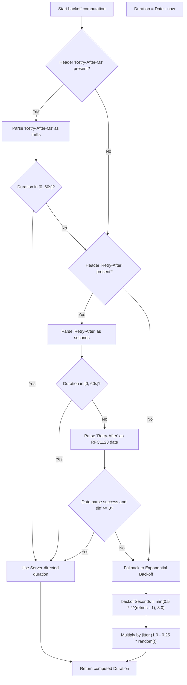

### Backoff Details

- The SDK recognizes three retry-after header formats:
  - `Retry-After-Ms` (milliseconds, floating-point)
  - `Retry-After` (seconds, floating-point)
  - `Retry-After` (HTTP-date RFC 1123)
- Server-directed retry times are validated to be within 0-60 seconds. Invalid values fall back to exponential backoff.
- Exponential backoff formula for delay in seconds:
  
  ```
  backoffSeconds = min(0.5 × 2^(retries-1), 8.0)
  jitter = 1.0 - 0.25 × random[0, 1)
  duration = backoffSeconds × jitter
  ```

  This results in increasing delays capped at approximately 8 seconds, with randomness to reduce collisions.

| Retry Attempt | Base Delay (s) | Delay with jitter (s) |
|---------------|----------------|----------------------|
| 1             | 0.5            | 0.375  – 0.5         |
| 2             | 1.0            | 0.75   – 1.0         |
| 3             | 2.0            | 1.5    – 2.0         |
| 4             | 4.0            | 3.0    – 4.0         |
| 5+            | 8.0 (cap)      | 6.0    – 8.0         |

**Sources:** [openai-java-core/src/main/kotlin/com/openai/core/http/RetryingHttpClient.kt:188-231]()

---

## Retry-After Header Processing

Handling of the `Retry-After` headers is robust, capable of parsing multiple formats and falling back gracefully.

### Supported Headers

- **Retry-After-Ms** (non-standard):
  - Expressed as floating-point milliseconds.
  - Example: `Retry-After-Ms: 1500.5`
  
- **Retry-After** (standard HTTP header):
  - Either a float number of seconds (delay-seconds) or an HTTP-date formatted timestamp.
  - Examples:
    - Delay seconds: `Retry-After: 3.5`
    - Date: `Retry-After: Wed, 21 Oct 2015 07:28:00 GMT`

### Validation and Fallback

- Parsed durations must be in the interval `[0, 60]` seconds.
- If the parsed value is invalid (negative, too large, or unparsable), the SDK falls back to exponential backoff.
- If the date is in the past, it falls back to exponential backoff.

**Sources:** [openai-java-core/src/main/kotlin/com/openai/core/http/RetryingHttpClient.kt:189-222]()

---

## Idempotency and Retry Count Headers

Ensuring idempotency in retried requests avoids side effects like duplicate resource creation.

### Idempotency Header

- An **optional** header name can be configured to enable idempotency keys on retried requests.
- On the _first_ retry attempt, a UUID-based idempotency key is generated:
  ```
  stainless-java-retry-{uuid}
  ```
- This key is added as a header to the request.
- For all subsequent retries, the _same_ idempotency key header value is reused.
- If the request already contains an idempotency header, the SDK respects it and doesn't overwrite.

### Retry Count Header

- The header `"X-Stainless-Retry-Count"` is added to each request attempt.
- Represents the zero-based retry attempt count: 0 for first attempt, increasing incrementally.
- The SDK only adds this header if the caller has not already set it.
- This allows downstream instrumentation, diagnostics, or server logic to know the retry attempt number.

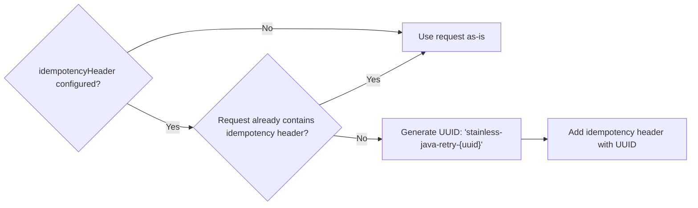

**Sources:** [openai-java-core/src/main/kotlin/com/openai/core/http/RetryingHttpClient.kt:146-158](), [openai-java-core/src/main/kotlin/com/openai/core/http/RetryingHttpClient.kt:33-49]()

---

## Configuration

`RetryingHttpClient` uses a builder pattern for flexible configuration.

### Builder API

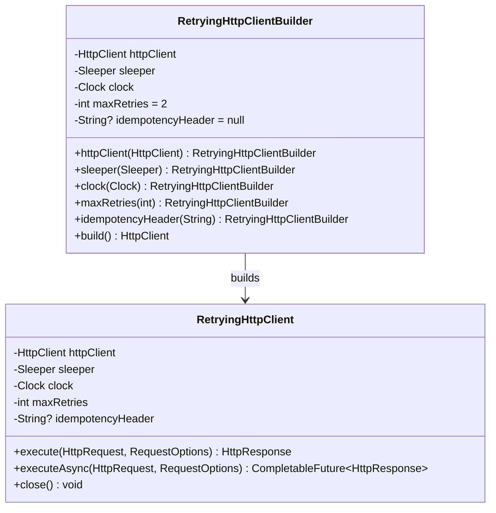

### Configuration Options Summary

| Field              | Type       | Default              | Description                                        |
|--------------------|------------|----------------------|--------------------------------------------------|
| `httpClient`       | `HttpClient` | (required)           | Underlying HTTP client to wrap                    |
| `sleeper`          | `Sleeper`  | `DefaultSleeper()`   | Controls thread sleeping or async delays          |
| `clock`            | `Clock`    | `Clock.systemUTC()`  | Used for parsing Retry-After date headers         |
| `maxRetries`       | `int`      | `2`                  | Maximum retry attempts; 0 disables retry          |
| `idempotencyHeader`| `String?`  | `null`               | Optional idempotency header name                   |

### Example Usage

```java
HttpClient retryingClient = RetryingHttpClient.builder()
    .httpClient(underlyingClient)
    .maxRetries(3)
    .idempotencyHeader("Idempotency-Key")
    .build();
```

**Sources:** [openai-java-core/src/main/kotlin/com/openai/core/http/RetryingHttpClient.kt:233-264]()

---

## Request Repeatability

Not all HTTP requests are safe to retry because some request bodies cannot be replayed.

### Repeatability Check Logic

- If the request has a body, the `repeatable()` method on the `HttpRequestBody` is checked.
- If no body (e.g., GET), retries are always allowed.
- If `repeatable()` returns `false`, retry logic is disabled for that request.

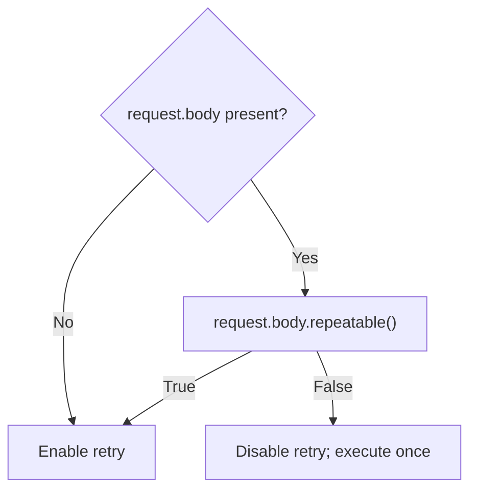

### Non-Repeatable Request Examples

- Streaming uploads where the input stream cannot be reset.
- Requests with bodies that consume content on transmission.
- Such requests are executed once; failures do not trigger retries.

**Sources:** [openai-java-core/src/main/kotlin/com/openai/core/http/RetryingHttpClient.kt:138-141]()

---

## Sleeper Interface

The `Sleeper` interface abstracts sleep operations between retry attempts, providing both synchronous and asynchronous delay mechanisms.

### Sleeper Design

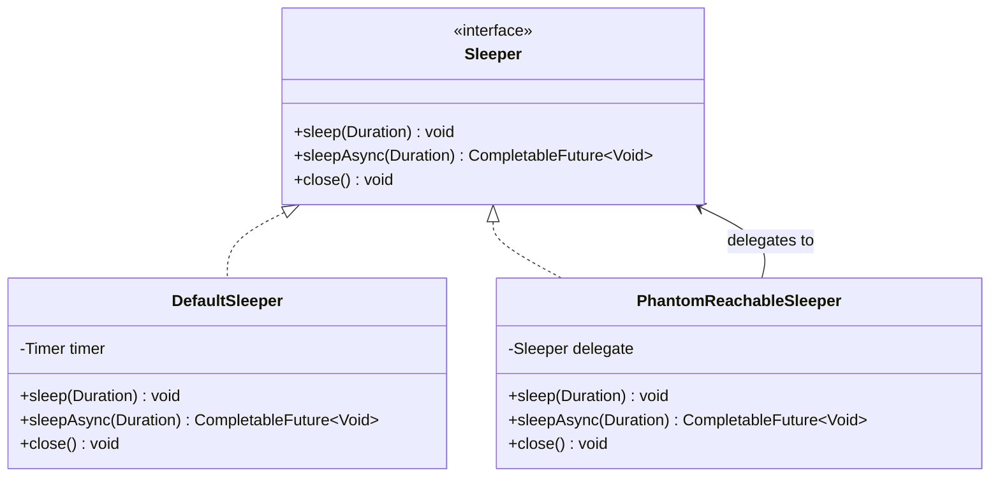

### DefaultSleeper

- Uses `Thread.sleep()` for synchronous blocking.
- Uses a `java.util.Timer` with `CompletableFuture` to handle asynchronous sleep.
- The timer is a daemon thread named "DefaultSleeper".
- Automatically cancels timer on `close()`.

### PhantomReachableSleeper

- Wraps another `Sleeper` to ensure it is closed automatically on garbage collection via `PhantomReachable` mechanism.
- Prevents resource leaks if caller forgets to call close.

**Sources:** 
- [openai-java-core/src/main/kotlin/com/openai/core/Sleeper.kt](not shown)
- [openai-java-core/src/main/kotlin/com/openai/core/DefaultSleeper.kt](not shown)
- [openai-java-core/src/main/kotlin/com/openai/core/PhantomReachableSleeper.kt](not shown)

---

## Synchronous vs. Asynchronous Execution

`RetryingHttpClient` supports both blocking and non-blocking execution with identical retry semantics.

### Synchronous Execution Flow

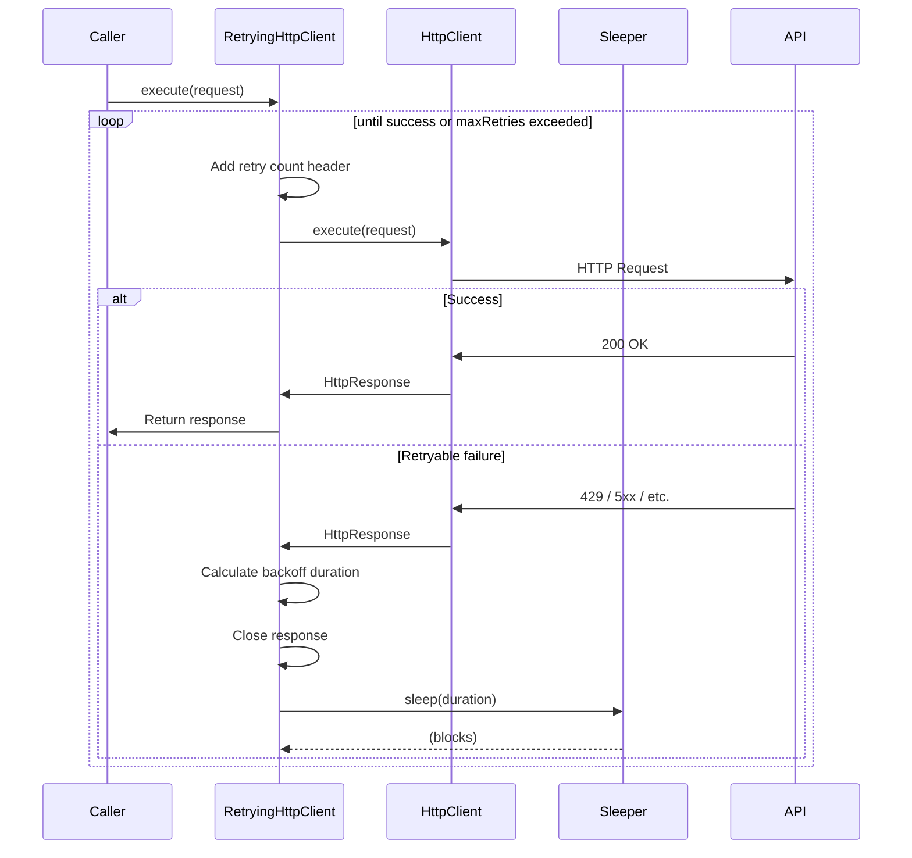

- Uses a blocking while loop.
- Calls `sleeper.sleep()` to block between attempts.
- Closes failed responses before sleeping to release resources.

### Asynchronous Execution Flow

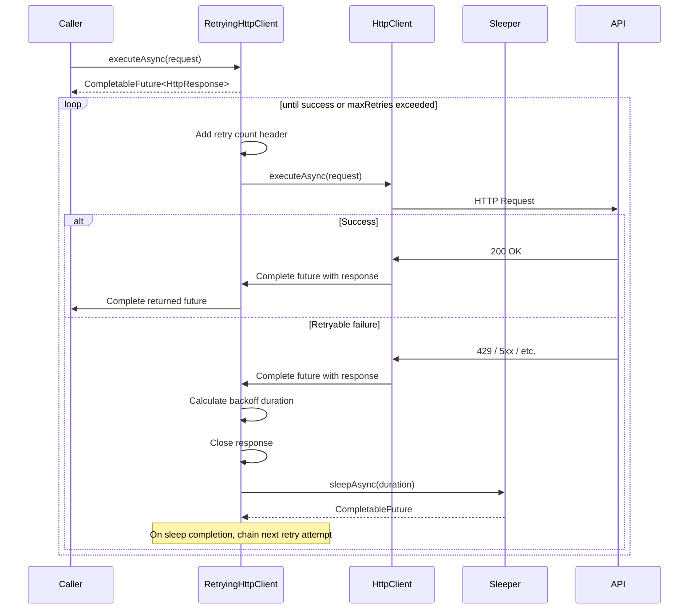

- Uses recursive `CompletableFuture` chaining with `handleAsync`.
- Calls `sleeper.sleepAsync()` to asynchronously wait without blocking threads.
- Closes failed responses before sleeping.
- Returns a `CompletableFuture` that completes when a successful response or a final failure occurs.

### Comparison Summary

| Aspect               | Synchronous                        | Asynchronous                       |
|----------------------|----------------------------------|----------------------------------|
| Thread model         | Blocks the caller thread           | Non-blocking thread usage         |
| Implementation       | `while(true)` loop + `sleep()`     | Recursive future chaining         |
| Sleep function       | `sleeper.sleep()`                  | `sleeper.sleepAsync()`            |
| Error forwarding     | Throws exceptions directly         | `CompletableFuture.completeExceptionally()` |
| Context             | Runs on caller thread              | Runs on executor thread (via `handleAsync`) |

**Sources:** [openai-java-core/src/main/kotlin/com/openai/core/http/RetryingHttpClient.kt:33-131]()

---

## Integration with SDK Architecture

`RetryingHttpClient` is a core HTTP infrastructure component used internally by the SDK. It sits as a middleware layer between the service layer and the raw HTTP client.

```mermaid
graph TB
    subgraph "Application Code"
        App["Application"]
    end
    
    subgraph "Client Layer"
        OpenAIClient["OpenAIClient"]
        OpenAIClientAsync["OpenAIClientAsync"]
    end
    
    subgraph "Services"
        ChatService["ChatService"]
        ResponseService["ResponseService"]
    end
    
    subgraph "HTTP Infrastructure"
        RetryingHttpClient["RetryingHttpClient<br/>maxRetries=2<br/>exponential backoff<br/>jitter<br/>Retry-After handling"]
        OkHttpClient["OkHttpClient<br/>Connection pooling<br/>SSL/TLS support"]
    end
    
    subgraph "Support Components"
        DefaultSleeper["DefaultSleeper<br/>Blocking & async sleep"]
        PhantomReachableSleeper["PhantomReachableSleeper<br/>Auto-close sleeper"]
    end
    
    App --> OpenAIClient
    App --> OpenAIClientAsync
    OpenAIClient --> ChatService
    OpenAIClient --> ResponseService
    OpenAIClientAsync --> ChatService
    OpenAIClientAsync --> ResponseService
    
    ChatService --> RetryingHttpClient
    ResponseService --> RetryingHttpClient
    
    RetryingHttpClient --> OkHttpClient
    RetryingHttpClient --> DefaultSleeper
    DefaultSleeper --> PhantomReachableSleeper
    
    OkHttpClient --> "|HTTP Requests|" API["OpenAI API"]
```

- The `RetryingHttpClient` decorates the base HTTP client, inheriting its network behavior (connection pooling, SSL, retryable failures).
- `DefaultSleeper` and `PhantomReachableSleeper` provide sleep and resource lifecycle support.
- This layered separation allows customization of retry logic and transport independently.

### Initialization Flow in the SDK

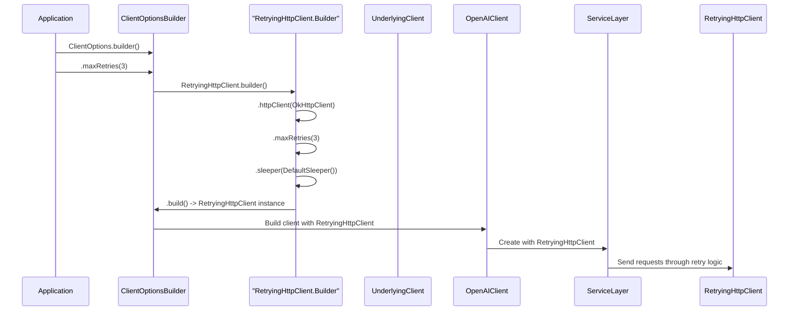

**Sources:** [openai-java-core/src/main/kotlin/com/openai/core/http/RetryingHttpClient.kt:24-31](), [openai-java-core/src/main/kotlin/com/openai/core/http/RetryingHttpClient.kt:233-264]()

---

## Response Resource Cleanup

Proper resource cleanup is integral to the retry mechanism to avoid leaking HTTP connections or streams.

### Cleanup Steps

- For each retryable failure response, `RetryingHttpClient` **closes the response immediately** before sleeping.
- Once a response qualifies as the final response (non-retryable or max retries reached), it is returned unclosed to the caller who is responsible for closing it.
- On exceptions during request execution, the request body is closed if multipart uploads are involved to free resources.

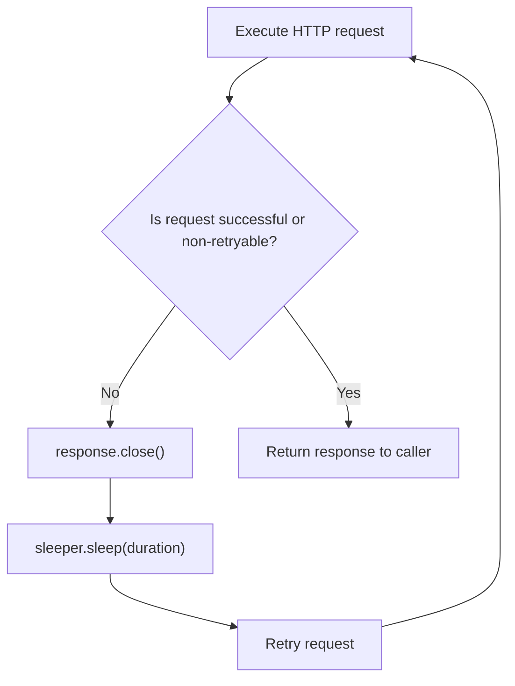

**Sources:** [openai-java-core/src/main/kotlin/com/openai/core/http/RetryingHttpClient.kt:37-41](), [openai-java-core/src/main/kotlin/com/openai/core/http/RetryingHttpClient.kt:113-117](), [openai-java-core/src/test/kotlin/com/openai/core/http/RetryingHttpClientTest.kt:339-360]()

---

# Summary

The OpenAI Java SDK utilizes the `RetryingHttpClient` to automatically retry transient failures such as network errors and rate limits. It supports synchronous and asynchronous modes, respects server-specified retry timing via `Retry-After` headers, and enforces idempotency using configurable headers and unique keys. This retry layer is configurable and well integrated into the SDK architecture, ensuring robust and reliable operation in face of transient API failures.

**Sources:** [openai-java-core/src/main/kotlin/com/openai/core/http/RetryingHttpClient.kt](), [openai-java-core/src/test/kotlin/com/openai/core/http/RetryingHttpClientTest.kt](), [openai-java-core/src/main/kotlin/com/openai/errors/OpenAIRetryableException.kt]()

---

