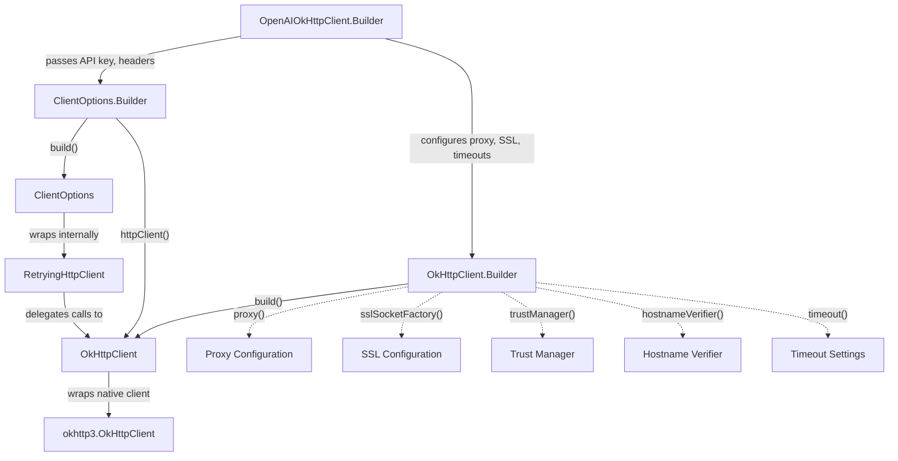
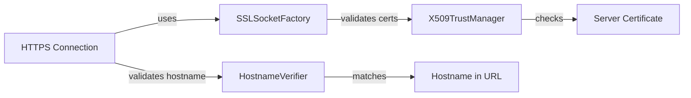
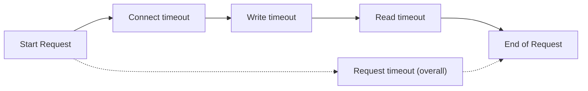
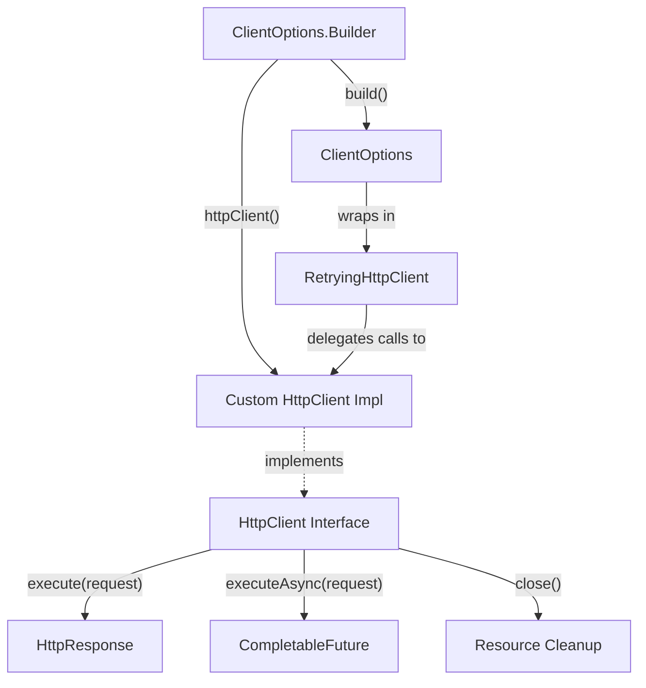
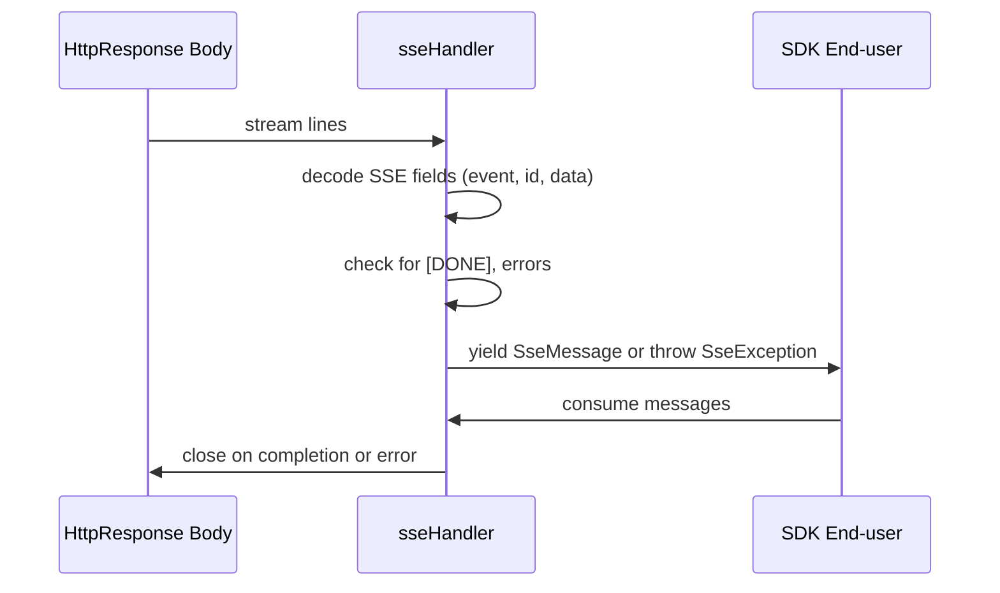
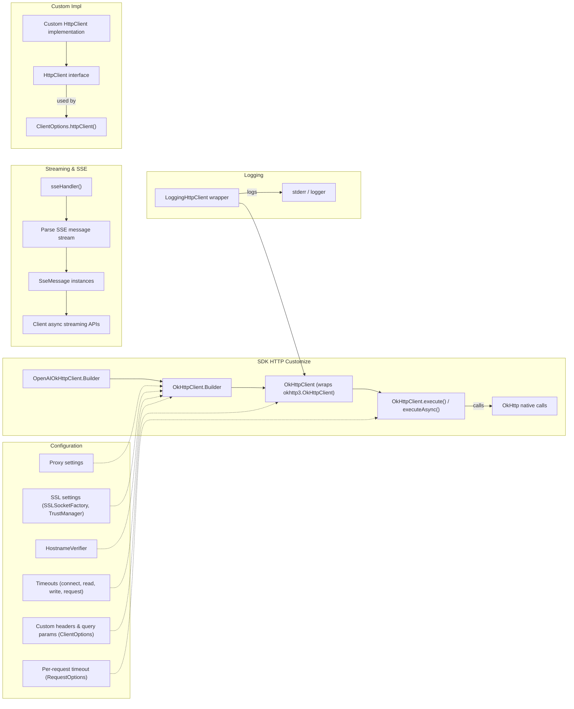

<!-- source: DeepWiki mcp.deepwiki.com · repo openai/openai-java · page 9.3 HTTP Layer Customization · fetched 2026-10-26 -->

# HTTP Layer Customization

<details>
<summary>Relevant source files</summary>

The following files were used as context for generating this wiki page:

- [openai-java-client-okhttp/src/main/kotlin/com/openai/client/okhttp/OkHttpClient.kt](openai-java-client-okhttp/src/main/kotlin/com/openai/client/okhttp/OkHttpClient.kt)
- [openai-java-client-okhttp/src/main/kotlin/com/openai/client/okhttp/OpenAIOkHttpClient.kt](openai-java-client-okhttp/src/main/kotlin/com/openai/client/okhttp/OpenAIOkHttpClient.kt)
- [openai-java-client-okhttp/src/main/kotlin/com/openai/client/okhttp/OpenAIOkHttpClientAsync.kt](openai-java-client-okhttp/src/main/kotlin/com/openai/client/okhttp/OpenAIOkHttpClientAsync.kt)
- [openai-java-client-okhttp/src/test/kotlin/com/openai/client/okhttp/ProxyAuthenticationBoundaryTest.kt](openai-java-client-okhttp/src/test/kotlin/com/openai/client/okhttp/ProxyAuthenticationBoundaryTest.kt)
- [openai-java-client-okhttp/src/test/kotlin/com/openai/client/okhttp/RedirectCredentialBoundaryTest.kt](openai-java-client-okhttp/src/test/kotlin/com/openai/client/okhttp/RedirectCredentialBoundaryTest.kt)
- [openai-java-core/src/main/kotlin/com/openai/azure/AzureOpenAIServiceVersion.kt](openai-java-core/src/main/kotlin/com/openai/azure/AzureOpenAIServiceVersion.kt)
- [openai-java-core/src/main/kotlin/com/openai/azure/credential/AzureApiKeyCredential.kt](openai-java-core/src/main/kotlin/com/openai/azure/credential/AzureApiKeyCredential.kt)
- [openai-java-core/src/main/kotlin/com/openai/core/ClientOptions.kt](openai-java-core/src/main/kotlin/com/openai/core/ClientOptions.kt)
- [openai-java-core/src/main/kotlin/com/openai/core/Utils.kt](openai-java-core/src/main/kotlin/com/openai/core/Utils.kt)
- [openai-java-core/src/main/kotlin/com/openai/core/handlers/SseHandler.kt](openai-java-core/src/main/kotlin/com/openai/core/handlers/SseHandler.kt)
- [openai-java-core/src/main/kotlin/com/openai/core/handlers/StreamHandler.kt](openai-java-core/src/main/kotlin/com/openai/core/handlers/StreamHandler.kt)
- [openai-java-core/src/main/kotlin/com/openai/core/http/Headers.kt](openai-java-core/src/main/kotlin/com/openai/core/http/Headers.kt)
- [openai-java-core/src/main/kotlin/com/openai/core/http/HttpResponse.kt](openai-java-core/src/main/kotlin/com/openai/core/http/HttpResponse.kt)
- [openai-java-core/src/main/kotlin/com/openai/core/http/HttpResponseFor.kt](openai-java-core/src/main/kotlin/com/openai/core/http/HttpResponseFor.kt)
- [openai-java-core/src/main/kotlin/com/openai/core/http/LoggingHttpClient.kt](openai-java-core/src/main/kotlin/com/openai/core/http/LoggingHttpClient.kt)
- [openai-java-core/src/main/kotlin/com/openai/core/http/QueryParams.kt](openai-java-core/src/main/kotlin/com/openai/core/http/QueryParams.kt)
- [openai-java-core/src/main/kotlin/com/openai/core/http/SseMessage.kt](openai-java-core/src/main/kotlin/com/openai/core/http/SseMessage.kt)
- [openai-java-core/src/main/kotlin/com/openai/credential/BearerTokenCredential.kt](openai-java-core/src/main/kotlin/com/openai/credential/BearerTokenCredential.kt)
- [openai-java-core/src/main/kotlin/com/openai/credential/Credential.kt](openai-java-core/src/main/kotlin/com/openai/credential/Credential.kt)
- [openai-java-core/src/main/kotlin/com/openai/services/blocking/CompletionService.kt](openai-java-core/src/main/kotlin/com/openai/services/blocking/CompletionService.kt)
- [openai-java-core/src/test/kotlin/com/openai/core/handlers/SseHandlerTest.kt](openai-java-core/src/test/kotlin/com/openai/core/handlers/SseHandlerTest.kt)
- [openai-java-core/src/test/kotlin/com/openai/core/handlers/SseTerminalEventTest.kt](openai-java-core/src/test/kotlin/com/openai/core/handlers/SseTerminalEventTest.kt)
- [openai-java-core/src/test/kotlin/com/openai/core/handlers/StreamHandlerTest.kt](openai-java-core/src/test/kotlin/com/openai/core/handlers/StreamHandlerTest.kt)
- [openai-java-core/src/test/kotlin/com/openai/core/http/ClientOptionsTest.kt](openai-java-core/src/test/kotlin/com/openai/core/http/ClientOptionsTest.kt)
- [openai-java-core/src/test/kotlin/com/openai/core/http/HeaderHashContractTest.kt](openai-java-core/src/test/kotlin/com/openai/core/http/HeaderHashContractTest.kt)
- [openai-java-core/src/test/kotlin/com/openai/core/http/HeadersTest.kt](openai-java-core/src/test/kotlin/com/openai/core/http/HeadersTest.kt)
- [openai-java-core/src/test/kotlin/com/openai/core/http/HttpResponseForTest.kt](openai-java-core/src/test/kotlin/com/openai/core/http/HttpResponseForTest.kt)
- [openai-java-core/src/test/kotlin/com/openai/core/http/LoggingHttpClientTest.kt](openai-java-core/src/test/kotlin/com/openai/core/http/LoggingHttpClientTest.kt)
- [openai-java-core/src/test/kotlin/com/openai/core/http/QueryParamsTest.kt](openai-java-core/src/test/kotlin/com/openai/core/http/QueryParamsTest.kt)

</details>


This document details how to customize the HTTP layer of the OpenAI Java SDK. It covers customization of proxy settings, SSL/TLS configuration, fine-grained timeout management, using custom HTTP client implementations, handling headers and query parameters, multipart encoding, SSE (Server-Sent Events) handling, and enabling detailed HTTP logging. These capabilities are primarily exposed through the integration with OkHttp and the client builder APIs (`OpenAIOkHttpClient.Builder` and `OpenAIOkHttpClientAsync.Builder`).

For retry logic and HTTP error handling, refer to [Retry Logic](#9.2). For connection pooling and resource cleanup, see [Resource Management](#9.4).

---

## Overview

The OpenAI Java SDK uses Square’s **OkHttp** library as its HTTP client. Users can customize the HTTP transport by either adjusting the OkHttp client’s configuration or by providing a fully custom `HttpClient` implementation.

Customization applies globally at the client construction time and affects all requests via that client instance.

The diagram below illustrates the relationship and flow from the SDK client builder to the underlying HTTP transport:



**Sources:**
- [openai-java-client-okhttp/src/main/kotlin/com/openai/client/okhttp/OpenAIOkHttpClient.kt:38-168]()
- [openai-java-client-okhttp/src/main/kotlin/com/openai/client/okhttp/OkHttpClient.kt:42-104]()
- [openai-java-core/src/main/kotlin/com/openai/core/ClientOptions.kt:36-173]()

---

## Proxy Configuration

You can configure HTTP proxy settings globally for the SDK client. This influences all outgoing requests.

### Setting a Proxy

Use the `.proxy()` method on the `OpenAIOkHttpClient.Builder` or `OpenAIOkHttpClientAsync.Builder` to specify a `java.net.Proxy` instance.

```java
import java.net.Proxy;
import java.net.InetSocketAddress;
import com.openai.client.OpenAIClient;
import com.openai.client.okhttp.OpenAIOkHttpClient;

Proxy proxy = new Proxy(
    Proxy.Type.HTTP,
    new InetSocketAddress("proxy.example.com", 8080)
);

OpenAIClient client = OpenAIOkHttpClient.builder()
    .fromEnv()
    .proxy(proxy)
    .build();
```

### Proxy Types Supported

| Proxy.Type    | Description                           |
|---------------|-------------------------------------|
| `HTTP`        | HTTP proxy supporting HTTP/HTTPS    |
| `SOCKS`       | SOCKS v4/v5 proxy                   |
| `DIRECT`      | Direct connection, no proxy (default) |

To explicitly disable proxy usage (even if system defaults exist), pass `null`:

```java
OpenAIClient client = OpenAIOkHttpClient.builder()
    .fromEnv()
    .proxy((Proxy) null)
    .build();
```

**Sources:**
- [openai-java-client-okhttp/src/main/kotlin/com/openai/client/okhttp/OpenAIOkHttpClient.kt:95-99]()
- [openai-java-client-okhttp/src/main/kotlin/com/openai/client/okhttp/OkHttpClient.kt:177-189]()

---

## SSL/TLS Configuration

The SDK supports customization of SSL/TLS settings for HTTPS connections, including specifying a custom SSL socket factory, trust manager, and hostname verifier.

### SSL Configuration Components



**Sources:**
- [openai-java-client-okhttp/src/main/kotlin/com/openai/client/okhttp/OkHttpClient.kt:200-239]()

### Setting a Custom SSL Socket Factory and Trust Manager

To override default SSL validation, set both SSL socket factory and trust manager together via the builder:

```java
import javax.net.ssl.SSLSocketFactory;
import javax.net.ssl.TrustManagerFactory;
import javax.net.ssl.X509TrustManager;
import javax.net.ssl.SSLContext;
import com.openai.client.OpenAIClient;
import com.openai.client.okhttp.OpenAIOkHttpClient;

// Create SSL context and trust manager
SSLContext sslContext = SSLContext.getInstance("TLS");
TrustManagerFactory tmf =
    TrustManagerFactory.getInstance(
        TrustManagerFactory.getDefaultAlgorithm()
    );
tmf.init((java.security.KeyStore) null);
X509TrustManager trustManager = (X509TrustManager) tmf.getTrustManagers()[0];
sslContext.init(null, tmf.getTrustManagers(), null);

OpenAIClient client = OpenAIOkHttpClient.builder()
    .sslSocketFactory(sslContext.getSocketFactory())
    .trustManager(trustManager)
    .build();
```

**Important:**

- You must set **both** `sslSocketFactory` and `trustManager` or neither.
- The system default SSL settings are used if you don’t set these explicitly.
- Custom SSL configuration disables OkHttp optimizations and should only be used with careful consideration.

**Sources:**
- [openai-java-client-okhttp/src/main/kotlin/com/openai/client/okhttp/OpenAIOkHttpClient.kt:158-168]()
- [openai-java-client-okhttp/src/main/kotlin/com/openai/client/okhttp/OpenAIOkHttpClient.kt:163-168]()

### Custom Hostname Verifier

Customize hostname verification by providing your own `HostnameVerifier`:

```java
import javax.net.ssl.HostnameVerifier;
import javax.net.ssl.SSLSession;

HostnameVerifier customVerifier =
    new HostnameVerifier() {
        @Override
        public boolean verify(String hostname, SSLSession session) {
            // Custom logic, e.g. whitelist domains
            return hostname.endsWith(".openai.com");
        }
    };

OpenAIClient client = OpenAIOkHttpClient.builder()
    .hostnameVerifier(customVerifier)
    .build();
```

If unset, OkHttp defaults to standard RFC2818 hostname verification.

**Sources:**
- [openai-java-client-okhttp/src/main/kotlin/com/openai/client/okhttp/OpenAIOkHttpClient.kt:95-107]()

---

## Timeout Configuration

Timeouts can be finely specified for each phase of an HTTP request: connection, write, read, and total request duration.

### Timeout Phases



**Sources:**
- [openai-java-client-okhttp/src/main/kotlin/com/openai/client/okhttp/OkHttpClient.kt:161-177]()

### Timeout Configuration Options

| Timeout Parameter | Description                                      | Default        |
|-------------------|------------------------------------------------|----------------|
| `connect()`       | Max time to establish a TCP connection          | OkHttp default |
| `write()`         | Max time to send the HTTP request body          | OkHttp default |
| `read()`          | Max time to read response data chunks            | OkHttp default |
| `request()`       | Total max time allowed for the complete call     | 60 seconds (default SDK timeout) |

The client builder supports setting either:

- A simple total timeout as a `Duration` (sets request timeout)
- A detailed `Timeout` via `Timeout.builder()` with individual fields for connect, write, and read timeouts.

### Example: Simple Timeout

```java
import java.time.Duration;

OpenAIClient client = OpenAIOkHttpClient.builder()
    .timeout(Duration.ofSeconds(30))
    .build();
```

Sets a 30-second timeout for the entire request. Other timeout phases will use OkHttp's default.

**Sources:**
- [openai-java-client-okhttp/src/main/kotlin/com/openai/client/okhttp/OpenAIOkHttpClient.kt:183-194]()

### Example: Granular Timeout

```java
import com.openai.core.Timeout;
import java.time.Duration;

Timeout timeout = Timeout.builder()
    .connect(Duration.ofSeconds(5))
    .write(Duration.ofSeconds(10))
    .read(Duration.ofSeconds(30))
    .request(Duration.ofSeconds(60))
    .build();

OpenAIClient client = OpenAIOkHttpClient.builder()
    .timeout(timeout)
    .build();
```

### Per-Request Timeout Override

Timeouts can be overridden for a specific call via `RequestOptions` in API calls:

```java
import com.openai.core.RequestOptions;
import com.openai.models.chat.completions.ChatCompletionCreateParams;
import java.time.Duration;

var params = ChatCompletionCreateParams.builder()
    .addUserMessage("Say this is a test")
    .model(ChatModel.GPT_4_1)
    .build();

var requestOptions = RequestOptions.builder()
    .timeout(Duration.ofMinutes(5))
    .build();

var completion = client.chat().completions().create(params, requestOptions);
```

The SDK creates a dedicated OkHttp client with this timeout for that request.

### Timeout Headers

For observability, the SDK sends these headers with HTTP requests when applicable:

| Header Name            | Purpose                        |
|------------------------|--------------------------------|
| `X-Stainless-Read-Timeout` | Read timeout (seconds)          |
| `X-Stainless-Timeout`      | Total request timeout (seconds) |

**Sources:**
- [openai-java-client-okhttp/src/main/kotlin/com/openai/client/okhttp/OkHttpClient.kt:121-139]()
- [openai-java-core/src/main/kotlin/com/openai/core/ClientOptions.kt:251-306]()

---

## Custom HTTP Client Implementation

Beyond OkHttp, you may supply a fully custom `HttpClient` implementation via the `ClientOptions.Builder.httpClient()` method.

### HttpClient Interface

```kotlin
interface HttpClient : AutoCloseable {
    fun execute(request: HttpRequest, requestOptions: RequestOptions): HttpResponse
    fun executeAsync(request: HttpRequest, requestOptions: RequestOptions): CompletableFuture<HttpResponse>
    override fun close()
}
```

A custom HTTP client must implement synchronous execution, asynchronous execution, and resource cleanup.

### Integration Diagram



### Usage Example

```java
CustomHttpClient customClient = new CustomHttpClientImplementation();

OpenAIClient client = new OpenAIClientImpl(
    ClientOptions.builder()
        .httpClient(customClient)
        .apiKey("sk-...")
        .build()
);
```

**Note:** Using a fully custom `HttpClient` bypasses all OkHttp-specific customization such as proxy, SSL, and timeouts unless implemented within your custom client.

**Sources:**
- [openai-java-core/src/main/kotlin/com/openai/core/ClientOptions.kt:38-48]()
- [openai-java-client-okhttp/src/main/kotlin/com/openai/client/okhttp/OkHttpClient.kt:33-82]()

---

## Headers and Query Parameters Customization

The SDK exposes immutable `Headers` and `QueryParams` classes to represent HTTP headers and query parameters.

- Users can configure global headers and query parameters via `ClientOptions.Builder.headers()` and `.queryParams()`.
- Headers and query params are combined and sent with every request.

The `Headers` class is case-insensitive with methods to add, replace, remove, and clear headers safely in a builder pattern that returns immutable instances.

**Sources:**
- [openai-java-core/src/main/kotlin/com/openai/core/http/Headers.kt:14-123]()
- [openai-java-core/src/main/kotlin/com/openai/core/http/QueryParams.kt]()

---

## Multipart Encoding

For endpoints that require file uploads or multipart/form-data requests, the SDK relies on OkHttp’s multipart support to encode requests.

- Multipart fields are represented internally with classes like `MultipartField`.
- The `OkHttpClient` builds multipart requests as needed for uploading files or other multi-part inputs.
- The encoding transparently happens inside the `execute` method of OkHttp HTTP client.

**Sources:**
- [openai-java-client-okhttp/src/main/kotlin/com/openai/client/okhttp/OkHttpClient.kt:30-40] (import of okio for multipart sink) 
- Implied by OkHttp usage (no explicit multipart class given)

---

## Server-Sent Events (SSE) Handling

The SDK supports SSE streaming with a dedicated handler that processes the streaming data into typed `SseMessage` objects.

### SSE Handler Flow

- The `sseHandler()` function consumes the HTTP response input stream line-by-line.
- It parses SSE fields such as `event`, `data`, `id`, and `retry`.
- Events with `[DONE]` data terminate the stream.
- If an error JSON is present in the data, an `SseException` is thrown.
- Each parsed event is yielded as an `SseMessage` that can be mapped to specific event classes for further consumption.



**Sources:**
- [openai-java-core/src/main/kotlin/com/openai/core/handlers/SseHandler.kt:1-139]()

---

## Logging HTTP Client

The SDK provides a `LoggingHttpClient` decorator to log HTTP request and response details at various log levels (`OFF`, `INFO`, `DEBUG`, `ERROR`).

### Logging Behavior

- At `INFO` level, logs start line and response status with duration.
- At `DEBUG` level, logs request and response headers and marks end of request and response.
- Sensitive headers such as `Authorization` and `Api-Key` are automatically redacted.
- Errors are logged at `ERROR` level with exception details.

### Example Log Output at INFO Level

```
--> GET https://api.openai.com/v1/models
<-- 200 (234ms, 128-byte body)
```

### Enabling HTTP Logging

You can enable HTTP request/response logging by setting the environment variable:

```bash
export OPENAI_LOG=info  # Logs request/response lines and headers
export OPENAI_LOG=debug # Logs full bodies and headers
```

### Internal Usage

Logging is implemented as a wrapper around the underlying `HttpClient`, created using `LoggingHttpClient.builder()` and integrated transparently when requested by client options.

**Sources:**
- [openai-java-core/src/main/kotlin/com/openai/core/http/LoggingHttpClient.kt:1-204]()
- [openai-java-core/src/test/kotlin/com/openai/core/http/LoggingHttpClientTest.kt:1-204]()

---

## Connection Pooling and Resource Management

OkHttp powers connection pooling and thread management for efficient reuse of TCP connections:

- By default, the SDK configures OkHttp dispatcher to allow up to 64 concurrent requests per host (matching the max total requests).
- Connection pooling and caching are managed internally by OkHttp.
- When the client is closed or garbage collected, connection pools are evicted and resources cleaned up automatically.

The SDK wraps all underlying HTTP clients with a `PhantomReachableClosingHttpClient` to ensure timely cleanup of resources even if `close()` is not explicitly called.

**Sources:**
- [openai-java-client-okhttp/src/main/kotlin/com/openai/client/okhttp/OkHttpClient.kt:246-263]()
- [openai-java-core/src/main/kotlin/com/openai/core/ClientOptions.kt:16-58]()

---

# Summary Diagram: Natural Language to Code Entities Mapping



---

This completes the documentation on HTTP layer customization. Refer to other sections for retry logic ([Retry Logic](#9.2)) and resource lifecycle ([Resource Management](#9.4)).

**Sources Summary:**

- openai-java-core/src/main/kotlin/com/openai/core/ClientOptions.kt:36-173
- openai-java-client-okhttp/src/main/kotlin/com/openai/client/okhttp/OpenAIOkHttpClient.kt:38-168
- openai-java-client-okhttp/src/main/kotlin/com/openai/client/okhttp/OkHttpClient.kt:42-104
- openai-java-core/src/main/kotlin/com/openai/core/handlers/SseHandler.kt:1-140
- openai-java-core/src/main/kotlin/com/openai/core/http/LoggingHttpClient.kt:1-204
- openai-java-client-okhttp/src/main/kotlin/com/openai/client/okhttp/OkHttpClient.kt:246-263

---

