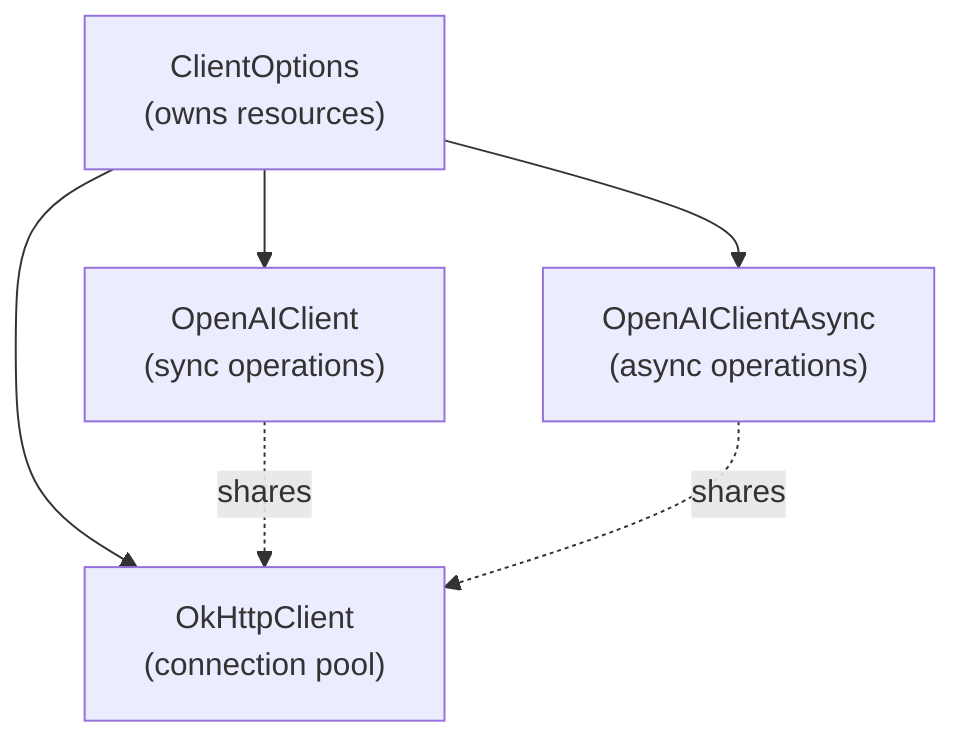
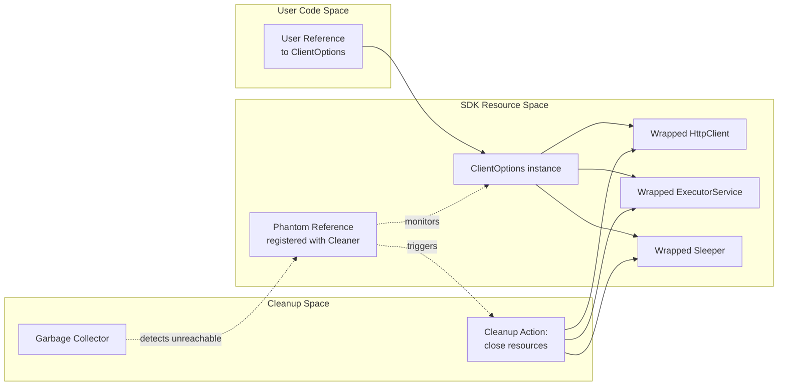
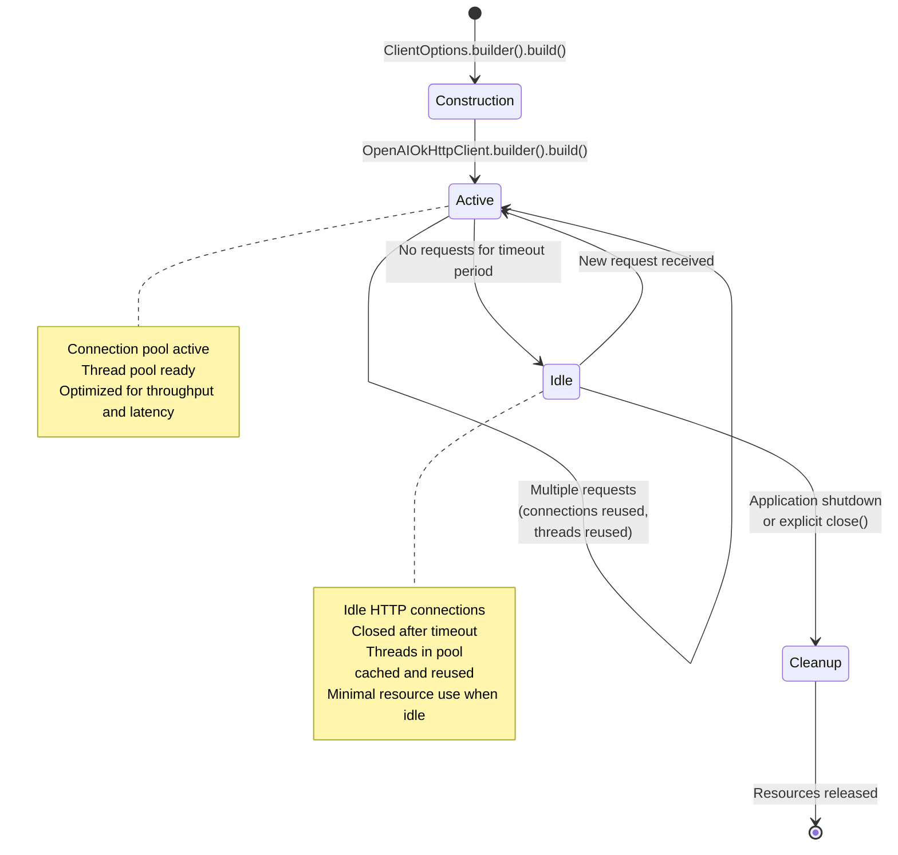
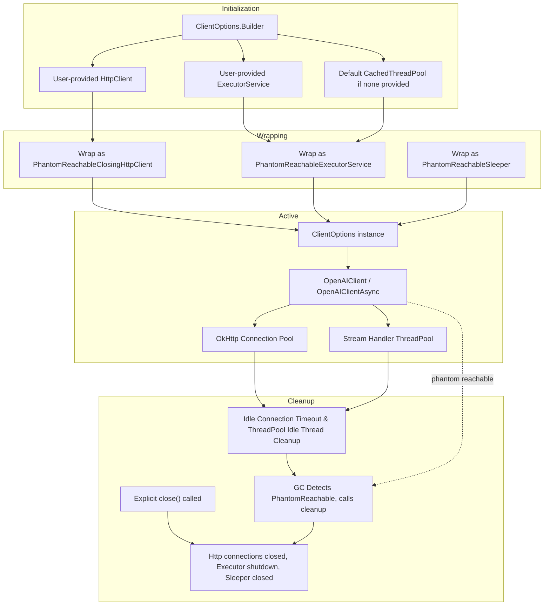

<!-- source: DeepWiki mcp.deepwiki.com · repo openai/openai-java · page 9.4 Resource Management · fetched 2026-10-26 -->

# Resource Management

<details>
<summary>Relevant source files</summary>

The following files were used as context for generating this wiki page:

- [openai-java-core/src/main/kotlin/com/openai/core/PhantomReachable.kt](openai-java-core/src/main/kotlin/com/openai/core/PhantomReachable.kt)
- [openai-java-core/src/main/kotlin/com/openai/core/http/AsyncStreamResponse.kt](openai-java-core/src/main/kotlin/com/openai/core/http/AsyncStreamResponse.kt)
- [openai-java-core/src/main/kotlin/com/openai/core/http/PhantomReachableClosingAsyncStreamResponse.kt](openai-java-core/src/main/kotlin/com/openai/core/http/PhantomReachableClosingAsyncStreamResponse.kt)
- [openai-java-core/src/main/kotlin/com/openai/core/http/PhantomReachableClosingHttpClient.kt](openai-java-core/src/main/kotlin/com/openai/core/http/PhantomReachableClosingHttpClient.kt)
- [openai-java-core/src/main/kotlin/com/openai/core/http/PhantomReachableClosingStreamResponse.kt](openai-java-core/src/main/kotlin/com/openai/core/http/PhantomReachableClosingStreamResponse.kt)
- [openai-java-core/src/main/kotlin/com/openai/services/async/CompletionServiceAsync.kt](openai-java-core/src/main/kotlin/com/openai/services/async/CompletionServiceAsync.kt)
- [openai-java-core/src/test/kotlin/com/openai/core/PhantomReachableTest.kt](openai-java-core/src/test/kotlin/com/openai/core/PhantomReachableTest.kt)
- [openai-java-core/src/test/kotlin/com/openai/core/http/ActiveStreamReachabilityTest.kt](openai-java-core/src/test/kotlin/com/openai/core/http/ActiveStreamReachabilityTest.kt)
- [openai-java-core/src/test/kotlin/com/openai/core/http/AsyncStreamResponseTest.kt](openai-java-core/src/test/kotlin/com/openai/core/http/AsyncStreamResponseTest.kt)

</details>


This document details how the OpenAI Java SDK manages critical system resources such as HTTP connection pools, thread pools for asynchronous streaming, automatic resource cleanup using the PhantomReachable pattern, and client lifecycle management. This ensures efficient, safe, and performant use of network and concurrency resources within the SDK.

For HTTP-level configuration like proxy, SSL, and timeouts, please refer to [HTTP Layer Customization](#9.3). For retry strategies, see [Retry Logic](#9.2).

---

## Resource Ownership Model

The SDK uses a well-defined ownership model centered around the `ClientOptions` instance. Resources provided to or created by `ClientOptions` are wrapped with PhantomReachable wrappers to automate cleanup upon garbage collection if explicit closure is omitted.

| Resource           | `ClientOptions` Field           | Ownership           | Cleanup Mechanism                     |
|--------------------|--------------------------------|---------------------|-------------------------------------|
| HTTP Client        | `httpClient`                   | Takes ownership     | Wrapped by `PhantomReachableClosingHttpClient` |
| Stream Executor     | `streamHandlerExecutor`        | Takes ownership     | Wrapped by `PhantomReachableExecutorService`    |
| Sleeper            | `sleeper`                     | Takes ownership     | Wrapped by `PhantomReachableSleeper`            |
| JSON Mapper        | `jsonMapper`                  | Shared (immutable)  | No cleanup required                  |
| Clock              | `clock`                       | Shared (immutable)  | No cleanup required                  |

When you configure your client with an HTTP client or executor, the SDK wraps these resources in "phantom reachable" wrappers to guarantee cleanup:

- Wrapping HTTP client:

  ```kotlin
  // ClientOptions.kt lines 219-221
  override fun httpClient(httpClient: HttpClient): Builder = apply {
      this.httpClient = PhantomReachableClosingHttpClient.wrap(httpClient)
  }
  ```

- Wrapping executor service, if provided:

  ```kotlin
  // ClientOptions.kt lines 242-254
  override fun streamHandlerExecutor(streamHandlerExecutor: Executor): Builder = apply {
      // Wraps the user-provided executor to enable phantom reachable cleanup
      this.streamHandlerExecutor =
          if (streamHandlerExecutor is java.util.concurrent.ExecutorService) {
              PhantomReachableExecutorService(streamHandlerExecutor)
          } else {
              streamHandlerExecutor
          }
  }
  ```

If no executor is provided, a default cached thread pool with custom thread naming is created and wrapped similarly:

```kotlin
// ClientOptions.kt lines 505-522
if (builder.streamHandlerExecutor == null) {
    builder.streamHandlerExecutor = PhantomReachableExecutorService(
        Executors.newCachedThreadPool {
            Thread(it, "openai-stream-handler-thread-${threadCount.getAndIncrement()}")
                .apply {
                    isDaemon = true
                }
        }
    )
}
```

These wrappers ensure the resource is closed when the `ClientOptions` instance becomes phantom reachable (eligible for reclamation by the GC).

**Sources:** [openai-java-core/src/main/kotlin/com/openai/core/ClientOptions.kt:29-122](), [openai-java-core/src/main/kotlin/com/openai/core/ClientOptions.kt:219-221](), [openai-java-core/src/main/kotlin/com/openai/core/ClientOptions.kt:242-254](), [openai-java-core/src/main/kotlin/com/openai/core/ClientOptions.kt:505-522]()

---

## HTTP Connection Pool

The OpenAI Java SDK relies on OkHttp as its default `HttpClient` implementation. OkHttp internally manages connection pooling that greatly improves network efficiency by reusing HTTP/1.1 or HTTP/2 connections.

### Connection Pool Characteristics

- Connections are reused across multiple HTTP requests to the same host.
- Idle connections are automatically closed after configurable timeouts.
- The pool dynamically adjusts the number of kept-alive connections based on demand.

The default OkHttp client used in the SDK is created and configured with sensible defaults including timeouts:

```kotlin
// OpenAIOkHttpClient.kt lines 338-346
val okHttpClient: OkHttpClient = OkHttpClient.Builder()
      .connectTimeout(connectionTimeout)
      ...
      .build()
```

### Shared Connection Pool

Both synchronous and asynchronous clients share the same connection pool via the `HttpClient` instance held within shared `ClientOptions`:



Clients constructed with the same `ClientOptions` instance share the underlying HTTP client connection pool, enabling efficient reuse:

- Sync client constructor references `ClientOptions` at [OpenAIClientImpl.kt:62]()
- Async client constructor references `ClientOptions` at [OpenAIClientAsyncImpl.kt:62]()

**Sources:** [openai-java-client-okhttp/src/main/kotlin/com/openai/client/okhttp/OpenAIOkHttpClient.kt:338-346](), [openai-java-core/src/main/kotlin/com/openai/client/OpenAIClientImpl.kt:62](), [openai-java-core/src/main/kotlin/com/openai/client/OpenAIClientAsyncImpl.kt:62]()

---

## Thread Pool for Async Streaming

The SDK uses an internal thread pool to dispatch callbacks for `AsyncStreamResponse` handlers, allowing stream processing without blocking calling threads.

### Default ExecutorService

If no executor is given explicitly, the client creates a cached thread pool. Threads are created with the naming pattern `openai-stream-handler-thread-N` for easier debugging and management:

```kotlin
// ClientOptions.kt lines 505-522
if (builder.streamHandlerExecutor == null) {
    builder.streamHandlerExecutor = PhantomReachableExecutorService(
        Executors.newCachedThreadPool {
            Thread(it, "openai-stream-handler-thread-${threadCount.getAndIncrement()}").apply {
                isDaemon = true
            }
        }
    )
}
```

This thread pool grows as needed and purges idle threads automatically, balancing throughput and resource usage.

### Custom Executors

Users may provide a custom `Executor` for the stream handlers, which the SDK will wrap for automatic cleanup if it is an `ExecutorService`:

```kotlin
// ClientOptions.kt lines 242-254
override fun streamHandlerExecutor(streamHandlerExecutor: Executor): Builder = apply {
    this.streamHandlerExecutor =
      if (streamHandlerExecutor is ExecutorService) {
          PhantomReachableExecutorService(streamHandlerExecutor)
      } else {
          streamHandlerExecutor
      }
}
```

This ensures resources are reclaimed as clients become unreachable.

**Sources:** [openai-java-core/src/main/kotlin/com/openai/core/ClientOptions.kt:56-62](), [openai-java-core/src/main/kotlin/com/openai/core/ClientOptions.kt:242-254](), [openai-java-core/src/main/kotlin/com/openai/core/ClientOptions.kt:505-522]()

---

## PhantomReachable Pattern for Auto-Cleanup

A core innovation of the SDK is the use of the PhantomReachable pattern to guarantee resource cleanup of wrapped objects once the owning `ClientOptions` or similar resources become unreachable (garbage collected), even if users forget to call `close()` explicitly.

### How It Works

The SDK uses Java 9+ `java.lang.ref.Cleaner` via reflection (falling back to no-op on Java 8). It registers a cleanup action for each wrapped resource associated with an "observed" object. When the observed object is phantom reachable, the `Cleaner` runs the cleanup action (typically `close()`).



The core helper function is:

```kotlin
// PhantomReachable.kt lines 14-29
internal fun closeWhenPhantomReachable(observed: Any, closeable: AutoCloseable) {
    check(observed !== closeable) { "...cannot be the same object..." }
    closeWhenPhantomReachable(observed, closeable::close)
}

internal fun closeWhenPhantomReachable(observed: Any, close: () -> Unit) {
    closeWhenPhantomReachable?.let { it(observed, close) }
}
```

### Wrapped Resource Classes

Key wrapped resources employing this pattern:

| Wrapper Class                          | Wrapped Resource Type       | Role                                       |
|--------------------------------------|-----------------------------|---------------------------------------------|
| `PhantomReachableClosingHttpClient`  | `HttpClient`                | Ensures HTTP client is closed when unreachable |
| `PhantomReachableExecutorService`    | `ExecutorService`           | Ensures thread pool shuts down automatically    |
| `PhantomReachableSleeper`             | `Sleeper`                   | Closes sleeper to release resources              |

Example for automatic closure of an `HttpClient`:

```kotlin
// PhantomReachableClosingHttpClient.kt lines 12-36
internal class PhantomReachableClosingHttpClient(private val httpClient: HttpClient) : HttpClient {
    init {
        closeWhenPhantomReachable(this, httpClient)
    }
    // Delegate HTTP client methods...
    override fun close() = httpClient.close()
}
```

### Auto-close for Stream Responses

Besides client-level resources, the SDK wraps streaming responses to auto-close them once they are only phantom reachable:

- `PhantomReachableClosingStreamResponse` wraps synchronous `StreamResponse` to auto-close when phantom reachable
- `PhantomReachableClosingAsyncStreamResponse` wraps asynchronous `AsyncStreamResponse` similarly

This ensures streaming resources don't leak if clients forget to close streams explicitly.

**Sources:** [openai-java-core/src/main/kotlin/com/openai/core/PhantomReachable.kt:14-56](), [openai-java-core/src/main/kotlin/com/openai/core/http/PhantomReachableClosingHttpClient.kt:12-36](), [openai-java-core/src/main/kotlin/com/openai/core/http/PhantomReachableClosingStreamResponse.kt:11-28](), [openai-java-core/src/main/kotlin/com/openai/core/http/PhantomReachableClosingAsyncStreamResponse.kt:15-41](), [openai-java-core/src/test/kotlin/com/openai/core/PhantomReachableTest.kt:6-27]()

---

## Manual Resource Cleanup

While the PhantomReachable wrappers provide automated cleanup, users can manually release resources early by calling `close()` on clients or `ClientOptions`. This is recommended when resource release must be immediate or when managing client lifecycle explicitly.

### Closing ClientOptions

`ClientOptions.close()` releases held resources:

- Closes the wrapped HTTP client (closing connections)
- Shuts down the stream handler executor if it is `ExecutorService`
- Closes the sleeper

```kotlin
// ClientOptions.kt lines 600-614
override fun close() {
    synchronized(closeMutex) {
        if (closed) return
        closed = true
        // Close HTTP Client
        httpClient.close()
        // Shutdown stream handler executor if applicable
        (streamHandlerExecutor as? ExecutorService)?.shutdown()
        // Close sleeper
        sleeper.close()
    }
}
```

### Closing Clients

Both synchronous and asynchronous `OpenAIClient` implementations delegate `close()` calls to their held `ClientOptions` instance:

```kotlin
// OpenAIClientImpl.kt lines 177-178
override fun close() {
    clientOptions.close()
}

// OpenAIClientAsyncImpl.kt lines 193-194
override fun close() {
    clientOptions.close()
}
```

### When to Call `close()`

The SDK intentionally does not implement `AutoCloseable` on clients to discourage try-with-resources usage, as clients are designed to be reused.

You should call `close()` if:

- Your application creates and disposes many clients dynamically
- You need to immediately release resources (e.g., in constrained environments)
- You want deterministic shutdown of threads and connections

You **do not** need to call `close()` if:

- Your application uses a single client instance reused throughout runtime
- You prefer to rely on automatic idle connection and thread pool cleanup
- The application is terminating, and the OS will reclaim resources

**Sources:** [openai-java-core/src/main/kotlin/com/openai/core/ClientOptions.kt:600-614](), [openai-java-core/src/main/kotlin/com/openai/client/OpenAIClient.kt:107-117](), [openai-java-core/src/main/kotlin/com/openai/client/OpenAIClientImpl.kt:177-178](), [openai-java-core/src/main/kotlin/com/openai/client/OpenAIClientAsyncImpl.kt:193-194]()

---

## Client Lifecycle Best Practices

### Recommended Pattern: Single Client Instance

Create one `OpenAIClient` or `OpenAIClientAsync` instance with a shared `ClientOptions` and reuse it for all requests. This enables:

- Connection pool reuse across many requests
- Thread pool reuse for streaming handler callbacks
- Resource-efficient operation for long-lived applications



This pattern aligns with SDK documentation guidelines insisting on client reuse for best performance and stability:

```kotlin
// OpenAIClient.kt lines 33-37
/**
 * Reuse a single client instance for your application's lifetime.
 */
```

### Automatic Idle Cleanup

OkHttp closes idle connections automatically after an idle timeout. Similarly, cached thread pools remove idle threads eventually. The PhantomReachable pattern also ensures clients cleaned from memory release underlying resources even if `close()` is never called.

### Anti-Pattern: Multiple Client Instances

Creating new clients repeatedly causes:

- Separate connection pools, preventing connection reuse.
- Separate thread pools, increasing resource consumption.
- Fragmented rate limit tracking, allowing exceeding of rate limits collectively.

Example of bad practice:

```java
// BAD - Creates new clients and pools for each request
for (int i = 0; i < 100; i++) {
    OpenAIClient client = OpenAIOkHttpClient.fromEnv();
    client.chat().completions().create(...);
}
```

Instead, create a client once and reuse:

```java
// GOOD - Single client reused across multiple requests
OpenAIClient client = OpenAIOkHttpClient.fromEnv();
for (int i = 0; i < 100; i++) {
    client.chat().completions().create(...);
}
```

SDK documentation warns that multiple `RetryingHttpClient` instances independently track rate limits, which can lead to aggregate exceeding.

**Sources:** [openai-java-core/src/main/kotlin/com/openai/client/OpenAIClient.kt:29-42](), [openai-java-core/src/main/kotlin/com/openai/client/OpenAIClientAsync.kt:32-41]()

---

## Resource Configuration Summary

| Configuration Aspect          | Default Behavior/Wrapper           | Notes                          |
|------------------------------|----------------------------------|--------------------------------|
| `httpClient()`               | Required, wrapped by `PhantomReachableClosingHttpClient` | Owns HTTP connection pool       |
| `streamHandlerExecutor()`    | Default cached thread pool wrapped by `PhantomReachableExecutorService` | Owns thread pool for async callbacks |
| `sleeper()`                 | Default `DefaultSleeper` wrapped by `PhantomReachableSleeper` | Owns sleeper resource            |
| `jsonMapper()`               | SDK default (shared, immutable)  | No cleanup required             |
| `clock()`                   | System UTC clock (shared)         | No cleanup required             |

### Resource Lifecycle Overview



**Sources:** [openai-java-core/src/main/kotlin/com/openai/core/ClientOptions.kt:169-597](), [openai-java-core/src/main/kotlin/com/openai/core/ClientOptions.kt:503-596]()

---

## Environment-Specific Considerations

### Testing Environments

During testing, it is common to create and dispose many client instances, which can exhaust resources quickly:

- **Option 1 (Recommended):** Reuse one client instance across tests.
- **Option 2:** Explicitly call `close()` to release resources during teardown.
- **Option 3:** Provide mocked `Sleeper` and `Clock` implementations to speed up tests and control timing.

Example:

```kotlin
// ClientOptions.kt lines 256-274 shows test double usage
```

### Resource-Constrained Environments

In serverless or container environments where resource limits are tight, consider:

- Closing clients immediately after use via `close()`.
- Monitoring thread and connection pool usage.
- Relying on automatic idle timeout cleanup but not expecting immediate resource release without manual close.

**Sources:** [openai-java-core/src/main/kotlin/com/openai/core/ClientOptions.kt:64-80](), [openai-java-core/src/main/kotlin/com/openai/core/ClientOptions.kt:256-274]()

---

# Summary

The OpenAI Java SDK manages critical resources efficiently by:

- Using OkHttp's connection pool internally and sharing it among all clients created from the same `ClientOptions`.
- Providing a dedicated thread pool for async streaming that uses cached threads with meaningful naming.
- Wrapping all owned resources in phantom-reachable wrappers to ensure automatic cleanup upon GC.
- Supporting explicit `close()` calls for deterministic resource release.
- Encouraging users to create and reuse a single client instance for best performance and reduced resource footprint.

This design provides robust resource management, balancing performance, ease of use, and preventing leaks in both simple and complex application workflows. 

---

**Sources:**  
- [openai-java-core/src/main/kotlin/com/openai/core/ClientOptions.kt:29-122, 169-274, 219-254, 503-596, 600-614]()  
- [openai-java-core/src/main/kotlin/com/openai/core/PhantomReachable.kt:14-56]()  
- [openai-java-core/src/main/kotlin/com/openai/core/http/PhantomReachableClosingHttpClient.kt:12-36]()  
- [openai-java-core/src/main/kotlin/com/openai/core/http/PhantomReachableClosingStreamResponse.kt:11-28]()  
- [openai-java-core/src/main/kotlin/com/openai/core/http/PhantomReachableClosingAsyncStreamResponse.kt:15-41]()  
- [openai-java-core/src/main/kotlin/com/openai/core/PhantomReachableExecutorService.kt:8-58]()  
- [openai-java-client-okhttp/src/main/kotlin/com/openai/client/okhttp/OpenAIOkHttpClient.kt:338-346]()  
- [openai-java-core/src/main/kotlin/com/openai/client/OpenAIClientImpl.kt:62, 177-178]()  
- [openai-java-core/src/main/kotlin/com/openai/client/OpenAIClientAsyncImpl.kt:62, 193-194]()  
- [openai-java-core/src/main/kotlin/com/openai/client/OpenAIClient.kt:29-42, 107-117]()

---

