<!-- source: DeepWiki mcp.deepwiki.com · repo openai/openai-java · page 9.5 JSON and Data Structures · fetched 2026-10-26 -->

# JSON and Data Structures

<details>
<summary>Relevant source files</summary>

The following files were used as context for generating this wiki page:

- [LICENSE](LICENSE)
- [buildSrc/src/main/kotlin/openai.wiremock-test.gradle.kts](buildSrc/src/main/kotlin/openai.wiremock-test.gradle.kts)
- [openai-java-bedrock/build.gradle.kts](openai-java-bedrock/build.gradle.kts)
- [openai-java-core/src/main/kotlin/com/openai/core/Check.kt](openai-java-core/src/main/kotlin/com/openai/core/Check.kt)
- [openai-java-core/src/main/kotlin/com/openai/core/ObjectMappers.kt](openai-java-core/src/main/kotlin/com/openai/core/ObjectMappers.kt)
- [openai-java-core/src/main/kotlin/com/openai/core/Values.kt](openai-java-core/src/main/kotlin/com/openai/core/Values.kt)
- [openai-java-core/src/main/kotlin/com/openai/core/handlers/JsonHandler.kt](openai-java-core/src/main/kotlin/com/openai/core/handlers/JsonHandler.kt)
- [openai-java-core/src/main/kotlin/com/openai/core/http/HttpRequest.kt](openai-java-core/src/main/kotlin/com/openai/core/http/HttpRequest.kt)
- [openai-java-core/src/main/kotlin/com/openai/core/http/RetryingHttpClient.kt](openai-java-core/src/main/kotlin/com/openai/core/http/RetryingHttpClient.kt)
- [openai-java-core/src/main/kotlin/com/openai/errors/OpenAIRetryableException.kt](openai-java-core/src/main/kotlin/com/openai/errors/OpenAIRetryableException.kt)
- [openai-java-core/src/main/kotlin/com/openai/models/conversations/items/ConversationItem.kt](openai-java-core/src/main/kotlin/com/openai/models/conversations/items/ConversationItem.kt)
- [openai-java-core/src/main/kotlin/com/openai/models/responses/ResponseInputItem.kt](openai-java-core/src/main/kotlin/com/openai/models/responses/ResponseInputItem.kt)
- [openai-java-core/src/main/kotlin/com/openai/models/responses/ResponseItem.kt](openai-java-core/src/main/kotlin/com/openai/models/responses/ResponseItem.kt)
- [openai-java-core/src/main/kotlin/com/openai/models/responses/ResponseOutputItem.kt](openai-java-core/src/main/kotlin/com/openai/models/responses/ResponseOutputItem.kt)
- [openai-java-core/src/test/kotlin/com/openai/core/ObjectMappersTest.kt](openai-java-core/src/test/kotlin/com/openai/core/ObjectMappersTest.kt)
- [openai-java-core/src/test/kotlin/com/openai/core/UtilsTest.kt](openai-java-core/src/test/kotlin/com/openai/core/UtilsTest.kt)
- [openai-java-core/src/test/kotlin/com/openai/core/ValuesTest.kt](openai-java-core/src/test/kotlin/com/openai/core/ValuesTest.kt)
- [openai-java-core/src/test/kotlin/com/openai/core/http/HttpRequestTest.kt](openai-java-core/src/test/kotlin/com/openai/core/http/HttpRequestTest.kt)
- [openai-java-core/src/test/kotlin/com/openai/core/http/MultipartContentTypeBoundaryTest.kt](openai-java-core/src/test/kotlin/com/openai/core/http/MultipartContentTypeBoundaryTest.kt)
- [openai-java-core/src/test/kotlin/com/openai/core/http/RetryDateOverflowTest.kt](openai-java-core/src/test/kotlin/com/openai/core/http/RetryDateOverflowTest.kt)
- [openai-java-core/src/test/kotlin/com/openai/core/http/RetryingHttpClientCloseTest.kt](openai-java-core/src/test/kotlin/com/openai/core/http/RetryingHttpClientCloseTest.kt)
- [openai-java-core/src/test/kotlin/com/openai/core/http/RetryingHttpClientTest.kt](openai-java-core/src/test/kotlin/com/openai/core/http/RetryingHttpClientTest.kt)
- [openai-java-core/src/test/kotlin/com/openai/models/conversations/items/ConversationItemTest.kt](openai-java-core/src/test/kotlin/com/openai/models/conversations/items/ConversationItemTest.kt)
- [openai-java-core/src/test/kotlin/com/openai/models/responses/ResponseInputItemTest.kt](openai-java-core/src/test/kotlin/com/openai/models/responses/ResponseInputItemTest.kt)
- [openai-java-core/src/test/kotlin/com/openai/models/responses/ResponseItemTest.kt](openai-java-core/src/test/kotlin/com/openai/models/responses/ResponseItemTest.kt)
- [openai-java-core/src/test/kotlin/com/openai/models/responses/ResponseOutputItemTest.kt](openai-java-core/src/test/kotlin/com/openai/models/responses/ResponseOutputItemTest.kt)
- [openai-java-core/src/test/kotlin/com/openai/models/responses/StructuredResponseOutputItemTest.kt](openai-java-core/src/test/kotlin/com/openai/models/responses/StructuredResponseOutputItemTest.kt)
- [openai-java-example/build.gradle.kts](openai-java-example/build.gradle.kts)
- [openai-java-example/src/main/java/com/openai/example/Main.java](openai-java-example/src/main/java/com/openai/example/Main.java)

</details>


This document explains the JSON and data structure system used throughout the OpenAI Java SDK. It covers the `JsonField` and `JsonValue` types that enable type-safe yet flexible handling of JSON data, immutability patterns, and serialization/deserialization mechanisms. It also covers the `MultipartField` abstraction, the union types with validity scoring approach used in model response union classes, the usage of custom Jackson `ObjectMappers`, and typical serialization patterns.

For information about specific union types that use this JSON system, see other API-specific documentation. For HTTP layer details, see [HTTP Layer Customization](#9.3).

---

## Core Concepts

The SDK uses a specialized JSON type system built on top of Jackson that provides:

1. **Type Safety with Flexibility**: `JsonField<T>` can hold either a strongly-typed "known" value or an arbitrary JSON structure.
2. **Forward Compatibility**: Unknown JSON shapes are preserved during deserialization without causing errors.
3. **Immutability**: All data structures are immutable after construction.
4. **Null and Missing Distinction**: Explicit differentiation between `null` values and missing fields.

**Key Type Hierarchy:**

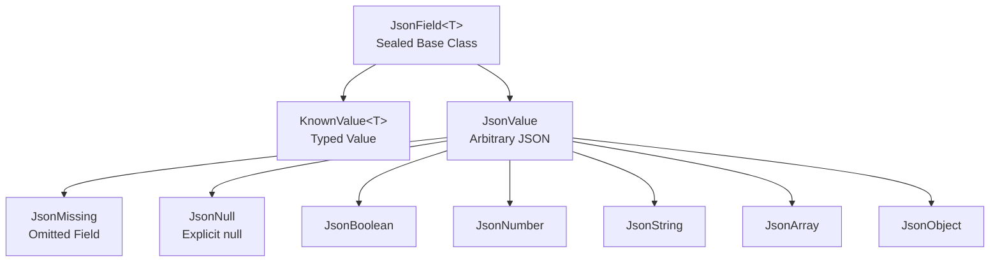

Sources: [openai-java-core/src/main/kotlin/com/openai/core/Values.kt:38-262]()

---

## JsonField System

### Overview

`JsonField<T>` is a sealed class representing a JSON field that can be in either:

| State          | Type             | Description                             |
|----------------|------------------|-------------------------------------|
| Known Value    | `KnownValue<T>`  | Matches the expected type `T`          |
| Arbitrary JSON | `JsonValue`      | Any valid JSON structure (type mismatch) |

This dual-state design allows the SDK to:

- Provide strong typing when data matches expectations.
- Gracefully handle API evolution when new fields or types appear.
- Preserve unknown or unexpected data for debugging or future processing.

### Creating `JsonField` Values

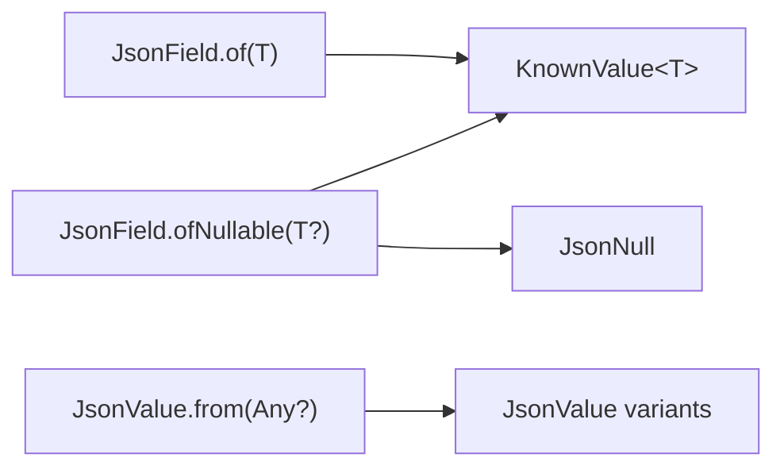

- `JsonField.of(value)` creates a `KnownValue<T>` containing the value.
- `JsonField.ofNullable(value)` creates either a `KnownValue` or a `JsonNull`.
- `JsonValue.from(value)` converts any Java object to an appropriate `JsonValue` wrapper.

### Type Checking and Extraction

`JsonField` provides methods to test and extract values safely:

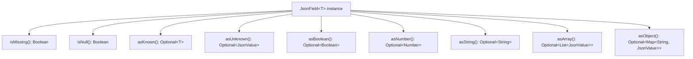

| Method       | Returns               | Description                             |
|--------------|-----------------------|-----------------------------------------|
| `isMissing()`  | `Boolean`             | True if this field is absent from JSON entirely. |
| `isNull()`     | `Boolean`             | True if this field is explicitly set to `null`.  |
| `asKnown()`    | `Optional<T>`         | Extracts expected typed value if present.         |
| `asUnknown()`  | `Optional<JsonValue>` | Extracts raw JSON value if type doesn't match.    |
| `asBoolean()`  | `Optional<Boolean>`   | Extracts boolean value from any representation.   |
| `asNumber()`   | `Optional<Number>`    | Extracts numeric value similarly.                   |
| `asString()`   | `Optional<String>`    | Extracts string value similarly.                     |
| `asArray()`    | `Optional<List<JsonValue>>` | Extracts JSON array if present.                  |
| `asObject()`   | `Optional<Map<String, JsonValue>>` | Extracts JSON object if present.              |

Sources: [openai-java-core/src/main/kotlin/com/openai/core/Values.kt:44-168]()

### Internal Access Methods

The SDK provides internal "get" helpers that throw detailed exceptions for missing or invalid data — used during deserialization or validation:

- `getRequired(fieldName: String)`: Throws if field is missing or null or unknown type.
- `getOptional(fieldName: String)`: Returns empty for missing or null, throws if unknown type.
- `map(transform)`: Transforms the known value while preserving unknown JSON if present.

Sources: [openai-java-core/src/main/kotlin/com/openai/core/Values.kt:170-202]()

---

## JsonValue Type Hierarchy

### JsonValue Variants

`JsonValue` represents arbitrary JSON values with seven concrete types:

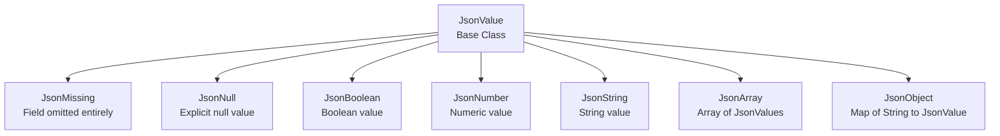

Sources: [openai-java-core/src/main/kotlin/com/openai/core/Values.kt:264-602]()

### JsonMissing and JsonNull

| Type         | Serialization                | Use Case                                     |
|--------------|-----------------------------|----------------------------------------------|
| `JsonMissing` | Omitted from JSON output    | Optional params not sent                      |
| `JsonNull`   | Serialized as JSON `null`    | Explicit null value                           |

- `JsonMissing` is a singleton that throws if serialized and is filtered out by the `@ExcludeMissing` Jackson annotation.
- `JsonNull` is a singleton using Jackson's `NullSerializer`.

Sources: [openai-java-core/src/main/kotlin/com/openai/core/Values.kt:426-470]()

### Primitive JsonValue Types

```mermaid
graph LR
    subgraph "Primitives"
        JsonBoolean["JsonBoolean<br/>value: Boolean"]
        JsonNumber["JsonNumber<br/>value: Number"]
        JsonString["JsonString<br/>value: String"]
    end

    JsonBoolean <-- "JsonBoolean.of(Boolean)"
    JsonNumber <-- "JsonNumber.of(Number)"
    JsonString <-- "JsonString.of(String)"
```

Each primitive wraps an immutable value, implements `equals()`, `hashCode()`, and `toString()`, and supports Jackson deserialization via `@JsonCreator`.

Sources: [openai-java-core/src/main/kotlin/com/openai/core/Values.kt:472-545]()

### JsonArray

Represents an immutable array of `JsonValue`s.

```java
class JsonArray {
    List<JsonValue> values;  // immutable list

    static JsonArray of(List<JsonValue> values);
}
```

Characteristics:

- The list is deeply immutable (a defensive copy wrapped as unmodifiable).
- Elements can be any `JsonValue` variant.

Sources: [openai-java-core/src/main/kotlin/com/openai/core/Values.kt:547-572]()

### JsonObject

Represents an immutable map from strings to `JsonValue`s.

```java
class JsonObject {
    Map<String, JsonValue> values;  // immutable map

    static JsonObject of(Map<String, JsonValue> values);
}
```

Characteristics:

- Keys are always strings.
- The map is deeply immutable.
- Values can be any `JsonValue` subtype.

Sources: [openai-java-core/src/main/kotlin/com/openai/core/Values.kt:574-602]()

### Visitor Pattern

`JsonValue` has a visitor interface method:

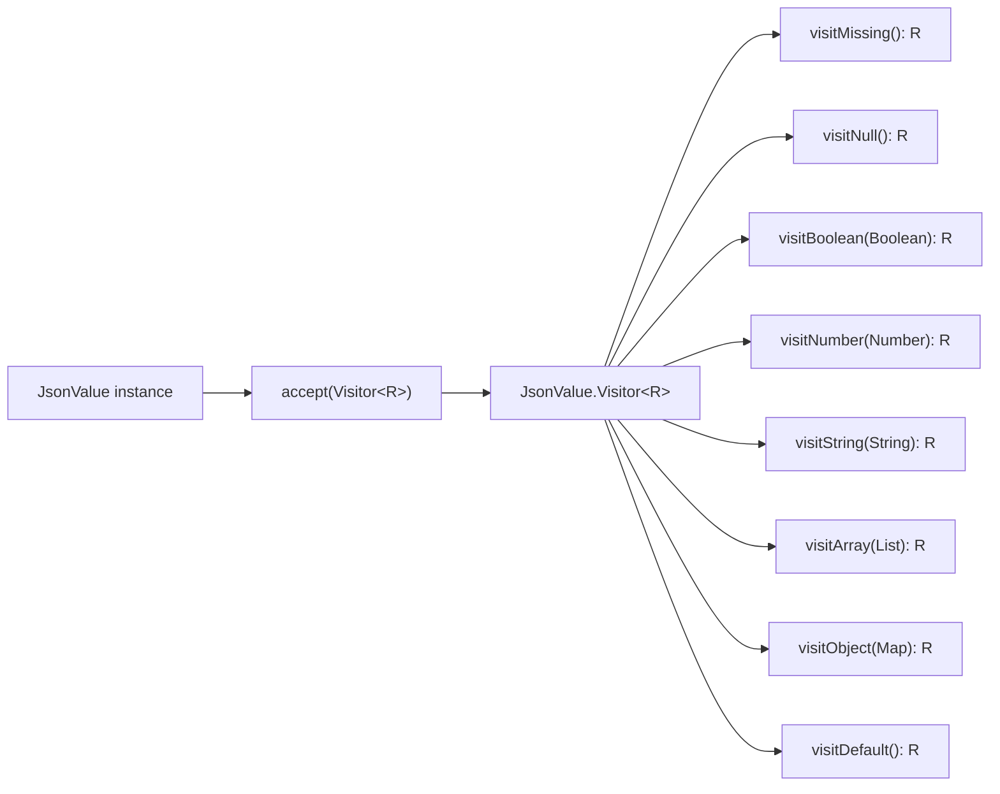

This pattern enables exhaustive, type-safe branching on all JSON types without runtime casting.

Sources: [openai-java-core/src/main/kotlin/com/openai/core/Values.kt:277-315]()

---

## Serialization and Deserialization

### Jackson Integration

The SDK integrates the `JsonField` and `JsonValue` types smoothly with Jackson using custom serializers and contextual deserializers.

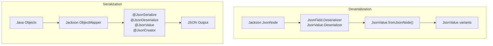

The `JsonField` deserializer attempts to decode the JSON first into the expected type `T` (via contextual type information). If that fails, it falls back to deserializing into a raw `JsonValue` to preserve unknown data.

Sources: [openai-java-core/src/main/kotlin/com/openai/core/Values.kt:248-262, 368-394]()

### JsonNode to JsonValue Conversion

The `fromJsonNode` method converts Jackson tree nodes into `JsonValue` subtypes:

| JsonNode Type | Maps To      |
|---------------|--------------|
| MISSING       | `JsonMissing`  |
| NULL          | `JsonNull`     |
| BOOLEAN       | `JsonBoolean`  |
| NUMBER        | `JsonNumber`   |
| STRING        | `JsonString`   |
| ARRAY         | `JsonArray` (recursive) |
| OBJECT        | `JsonObject` (recursive) |
| BINARY / POJO | Throws `IllegalStateException` |

Sources: [openai-java-core/src/main/kotlin/com/openai/core/Values.kt:368-386]()

### Type Conversion

`JsonValue` supports conversion to strongly typed Java/Kotlin objects:

```kotlin
interface JsonValue {
    fun <R> convert(typeReference: TypeReference<R>): R
    fun <R> convert(type: Class<R>): R
}
```

These use Jackson's converter internally to deserialize the JSON value to the target type.

Sources: [openai-java-core/src/main/kotlin/com/openai/core/Values.kt:273-275]()

### Contextual Deserialization

The `JsonField.Deserializer` is contextual, and on deserialization it:

1. Obtains the Java type `T` expected.
2. Attempts to deserialize the raw input JSON into `T`.
3. On failure, falls back to capturing the raw `JsonValue`.
4. Wraps `T` values into `KnownValue`; raw JSON becomes `JsonValue`.

This strategy maintains forward compatibility with new API fields or unexpected data.

---

## Immutability Patterns

### Immutable Collections

All SDK collection types are deeply immutable to ensure thread safety and safety of returned objects.

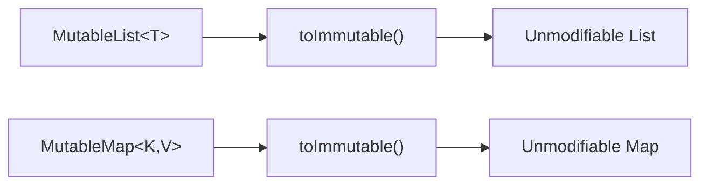

Utilities include:

| Function           | Input            | Output                           |
|--------------------|------------------|---------------------------------|
| `List<T>.toImmutable()`   | MutableList       | Unmodifiable `List<T>`           |
| `Map<K,V>.toImmutable()`  | MutableMap        | Unmodifiable `Map<K, V>`         |
| `SortedMap<K,V>.toImmutable()` | MutableSortedMap | Unmodifiable `SortedMap<K,V>`    |
| `immutableEmptyMap<K,V>()`| -                | Empty `Map<K,V>` singleton       |

Empty collections are optimized to use singleton empty maps/lists.

Sources: [openai-java-core/src/main/kotlin/com/openai/core/Utils.kt:16-28]()

### Content-Based Equality

Since JSON data can contain arrays, the SDK provides helpers that implement deep value equality and hashing:

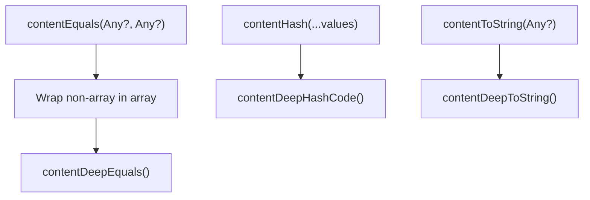

These are used in `equals()`, `hashCode()`, and `toString()` implementations of data classes to properly handle arrays and nested structures.

Sources: [openai-java-core/src/main/kotlin/com/openai/core/Utils.kt:58-92]()

---

## MultipartField System

### Purpose

`MultipartField<T>` wraps a `JsonField<T>` along with HTTP content metadata for multipart/form-data encodings in HTTP requests.

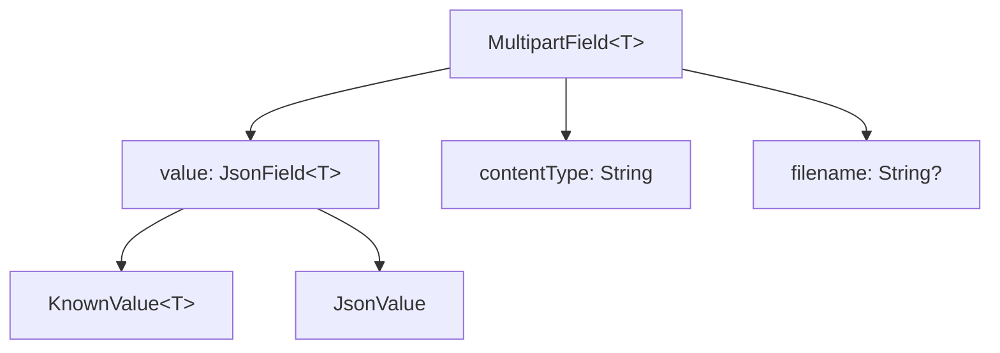

### Structure

| Field       | Type          | Description                            |
|-------------|---------------|-------------------------------------|
| `value`       | `JsonField<T>`  | Holds the actual value               |
| `contentType` | `String`       | MIME Content-Type for the part       |
| `filename`    | `Optional<String>` | Optional filename for uploaded data |

### Content Type Detection

The builder applies heuristics for content type based on the value:

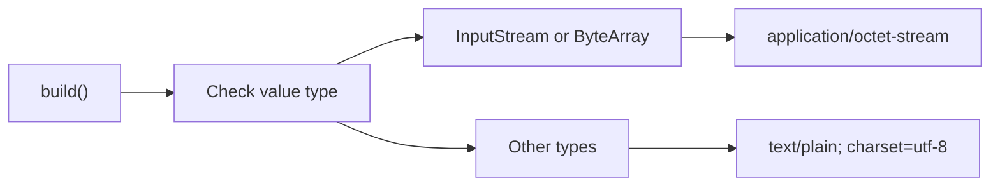

- If the value contains binary data (e.g., `InputStream` or byte array), the content type defaults to `application/octet-stream`.
- Otherwise, defaults to `text/plain; charset=utf-8`.

### Builder and Factory Methods

Factories are provided for ease of use:

- `MultipartField.of(value)` - Creates a `MultipartField` with auto-detected content type.
- `MultipartField.of(JsonField<T>)` - Wraps an existing `JsonField`.
- `MultipartField.builder()` - Returns a builder to specify content type and filename explicitly.

Sources: [openai-java-core/src/main/kotlin/com/openai/core/Values.kt:608-723]()

---

## HTTP Integration with JsonField and JsonValue

### Headers Builder

Methods like `Headers.Builder.put(name, JsonValue)` exist and expand JSON values into HTTP headers based on the value type:

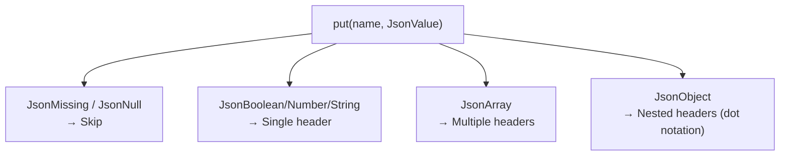

| JsonValue Type           | Header Mapping                                     |
|-------------------------|--------------------------------------------------|
| `JsonMissing` / `JsonNull` | Field is skipped (no header emitted)              |
| `JsonBoolean` / `JsonNumber` / `JsonString` | Single header with the given name and value     |
| `JsonArray`              | Multiple headers with the same name, one per element |
| `JsonObject`             | Nested headers using dot notation (e.g., `name.key`) |

Sources: [openai-java-core/src/main/kotlin/com/openai/core/http/Headers.kt:41-52]()

### QueryParams Builder

Similarly, `QueryParams.Builder.put(key, JsonValue)` expands JSON values into query parameters:

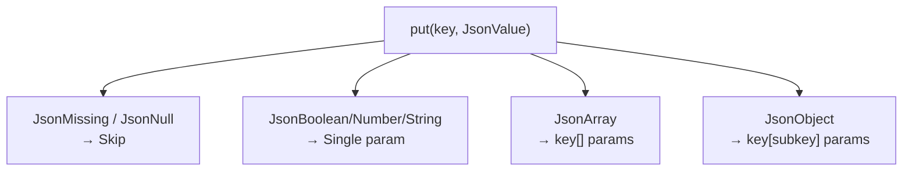

| JsonValue Type           | Query Parameter Expansion                               |
|-------------------------|---------------------------------------------------------|
| `JsonMissing` / `JsonNull` | Skipped (no param emitted)                               |
| `JsonBoolean` / `JsonNumber` / `JsonString` | Single param `key=value`                              |
| `JsonArray`              | Multiple params `key[]=value1&key[]=value2`              |
| `JsonObject`             | Nested params `key[subkey]=value`                         |

Sources: [openai-java-core/src/main/kotlin/com/openai/core/http/QueryParams.kt:39-50]()

---

## Union Types with Validity Scoring

Many SDK models use "union" classes (e.g., `ResponseInputItem`, `ResponseOutputItem`, `ResponseItem`, `ConversationItem`) which wrap multiple variant types.

- Each variant corresponds to a different JSON structure or class.
- Only one variant value is active at a time.
- These unions implement validity scoring: when deserializing from JSON, each candidate union variant is scored for likelihood/validity.
- The variant with the highest validity score is chosen as the active one; this enables polymorphic parsing with strong error detection and helps handle structurally overlapping JSON schemas.

Such union types provide rich model-driven structural flexibility but maintain type safety and clear API paths to access the specific variant.

See for example `ResponseInputItem` defined with extensive unions of variants such as `EasyInputMessage`, `Message`, `ResponseOutputMessage`, various tool calls, reasoning items, and many more, each accessed via `Optional` fields for safe retrieval.

Sources: [openai-java-core/src/main/kotlin/com/openai/models/responses/ResponseInputItem.kt:1-148](), [openai-java-core/src/main/kotlin/com/openai/models/responses/ResponseOutputItem.kt:1-149](), [openai-java-core/src/main/kotlin/com/openai/models/responses/ResponseItem.kt:1-152](), [openai-java-core/src/main/kotlin/com/openai/models/conversations/items/ConversationItem.kt:1-150]()

---

## ObjectMappers and Serialization Patterns

The SDK uses customized Jackson `ObjectMapper` instances (`jsonMapper`) with preconfigured modules and settings for JSON-binding.

Key features include:

- Custom serializers and deserializers for JsonField and JsonValue types.
- Handling of `@ExcludeMissing` to omit missing fields from serialized JSON.
- Support for polymorphic union type deserialization.
- Usage of `jacksonTypeRef` utility to simplify generic type information capture when deserializing generic classes.
- Test coverage verifies faithful round-trip serialization of model classes including union types.

The object mappers are defined in the `ObjectMappers.kt` module and used extensively for serializing requests and deserializing responses.

Sources: [openai-java-core/src/main/kotlin/com/openai/core/ObjectMappers.kt:~](), [openai-java-core/src/test/kotlin/com/openai/core/ObjectMappersTest.kt:~]()

---

## Summary Diagram: JSON System Bridging Natural Language to Code Entities

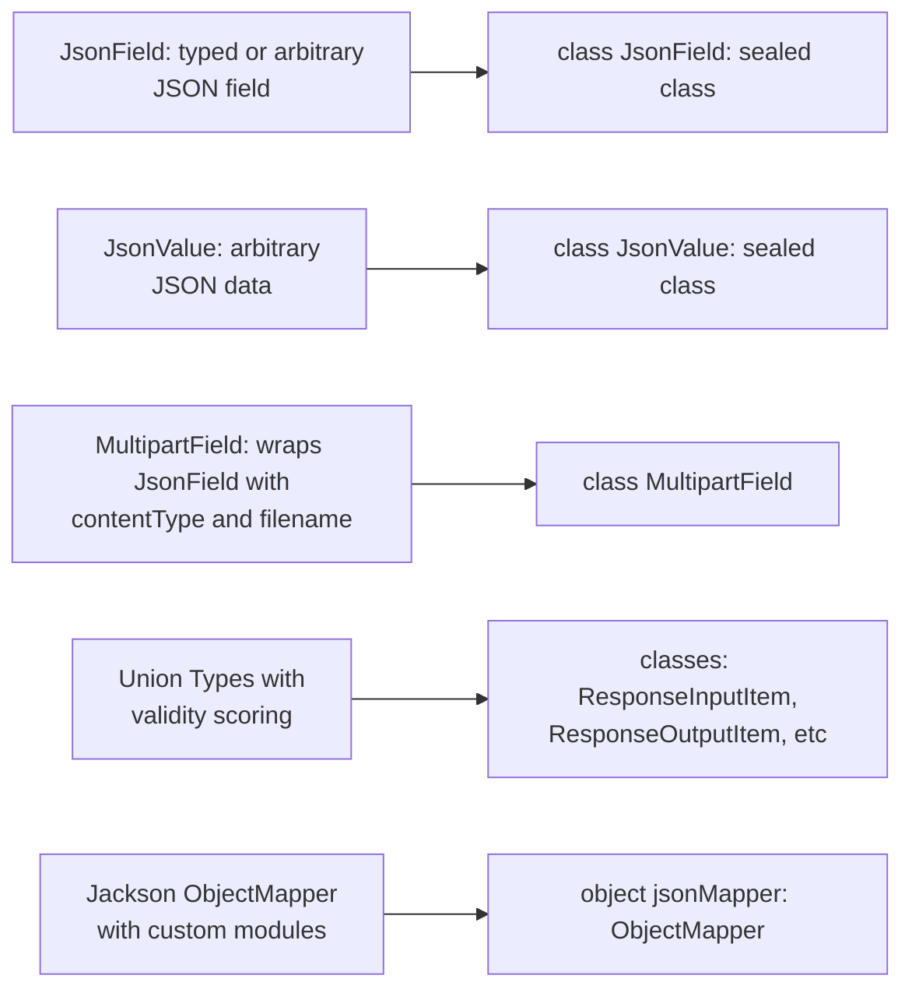

---

## Summary Diagram: Union Types Detailed Example

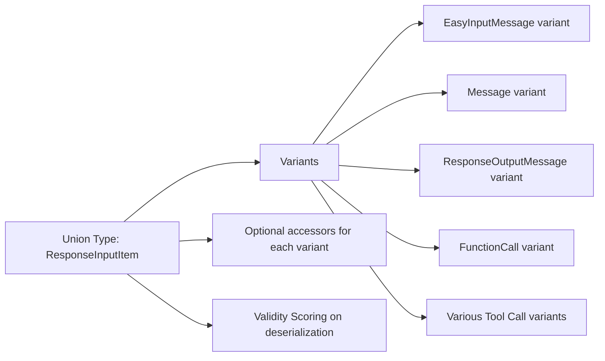

This pattern is repeated across many SDK model union classes, enabling flexible and safe polymorphic JSON handling.

Sources: [openai-java-core/src/main/kotlin/com/openai/models/responses/ResponseInputItem.kt](), [openai-java-core/src/main/kotlin/com/openai/models/responses/ResponseOutputItem.kt](), [openai-java-core/src/main/kotlin/com/openai/models/responses/ResponseItem.kt](), [openai-java-core/src/main/kotlin/com/openai/models/conversations/items/ConversationItem.kt]()

---

# Additional Remarks

- The SDK's JSON system and immutable data structures form a foundational layer used by all API interactions.
- The extensible union types help represent the complex polymorphic nature of OpenAI API responses and requests.
- The multipart field abstraction supports complex requests involving file uploads with proper MIME semantics.
- The intimate integration with Jackson ensures robustness and performance for JSON serialization/deserialization.
- These systems together promote maintainability, forward compatibility, and developer ergonomics in the OpenAI Java SDK.

---

Sources:  
- [openai-java-core/src/main/kotlin/com/openai/core/Values.kt:1-724]()  
- [openai-java-core/src/main/kotlin/com/openai/core/Utils.kt:16-98]()  
- [openai-java-core/src/main/kotlin/com/openai/core/http/Headers.kt:41-52]()  
- [openai-java-core/src/main/kotlin/com/openai/core/http/QueryParams.kt:39-50]()  
- [openai-java-core/src/main/kotlin/com/openai/core/Check.kt:8-47]()  
- [openai-java-core/src/main/kotlin/com/openai/models/responses/ResponseInputItem.kt:1-148]()  
- [openai-java-core/src/main/kotlin/com/openai/models/responses/ResponseOutputItem.kt:1-149]()  
- [openai-java-core/src/main/kotlin/com/openai/models/responses/ResponseItem.kt:1-152]()  
- [openai-java-core/src/main/kotlin/com/openai/models/conversations/items/ConversationItem.kt:1-150]()  
- [openai-java-core/src/main/kotlin/com/openai/core/ObjectMappers.kt:~]()

---

