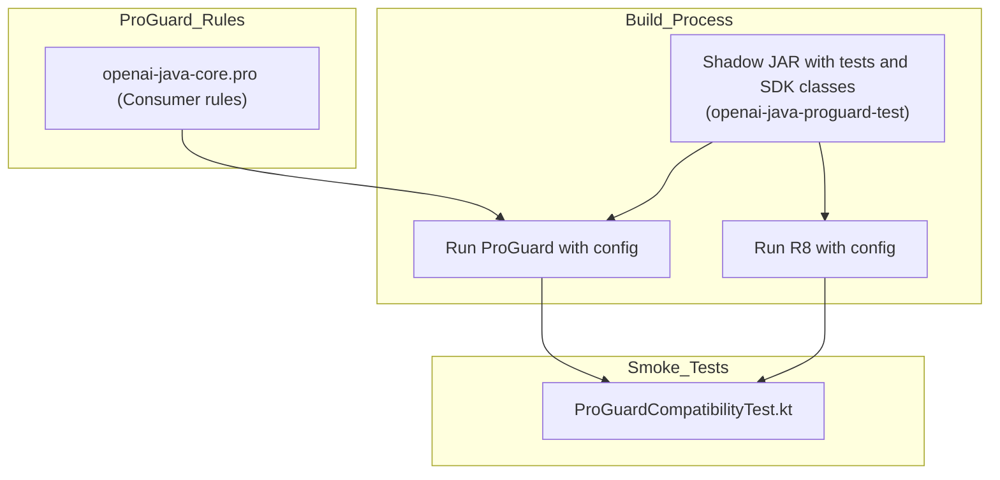
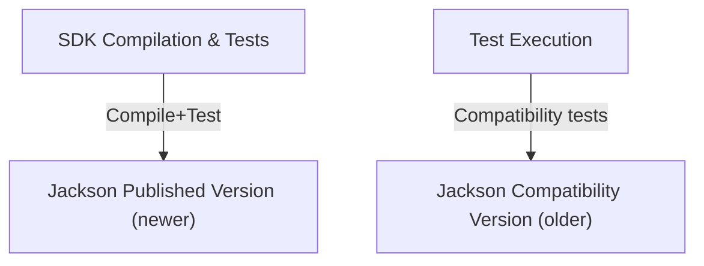
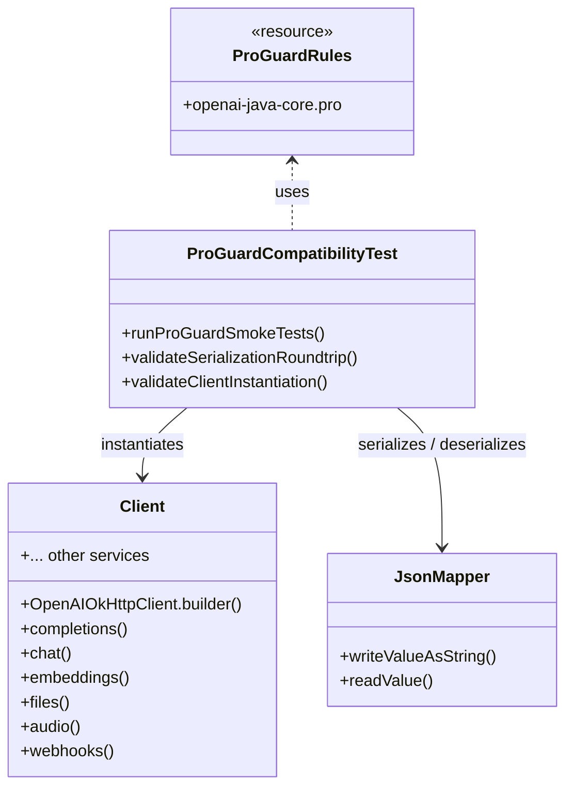

<!-- source: DeepWiki mcp.deepwiki.com · repo openai/openai-java · page 9.6 ProGuard and Runtime Compatibility · fetched 2026-10-26 -->

# 9.6 ProGuard and Runtime Compatibility

<details>
<summary>Relevant source files</summary>

The following files were used as context for generating this wiki page:

- [openai-java-client-okhttp/build.gradle.kts](openai-java-client-okhttp/build.gradle.kts)
- [openai-java-core/build.gradle.kts](openai-java-core/build.gradle.kts)
- [openai-java-core/src/main/resources/META-INF/proguard/openai-java-core.pro](openai-java-core/src/main/resources/META-INF/proguard/openai-java-core.pro)
- [openai-java-core/src/test/kotlin/com/openai/core/WireMockHandlebarsCompatibilityTest.kt](openai-java-core/src/test/kotlin/com/openai/core/WireMockHandlebarsCompatibilityTest.kt)
- [openai-java-core/src/test/kotlin/com/openai/models/chat/completions/ChatCompletionChunkTest.kt](openai-java-core/src/test/kotlin/com/openai/models/chat/completions/ChatCompletionChunkTest.kt)
- [openai-java-core/src/test/kotlin/com/openai/models/chat/completions/ChatCompletionListPageResponseTest.kt](openai-java-core/src/test/kotlin/com/openai/models/chat/completions/ChatCompletionListPageResponseTest.kt)
- [openai-java-core/src/test/kotlin/com/openai/models/chat/completions/ChatCompletionTest.kt](openai-java-core/src/test/kotlin/com/openai/models/chat/completions/ChatCompletionTest.kt)
- [openai-java-proguard-test/build.gradle.kts](openai-java-proguard-test/build.gradle.kts)
- [openai-java-proguard-test/src/test/kotlin/com/openai/proguard/ProGuardCompatibilityTest.kt](openai-java-proguard-test/src/test/kotlin/com/openai/proguard/ProGuardCompatibilityTest.kt)
- [openai-java-proguard-test/test.pro](openai-java-proguard-test/test.pro)
- [scripts/castiron/README.md](scripts/castiron/README.md)
- [scripts/castiron/ruff.toml](scripts/castiron/ruff.toml)

</details>


This section details the handling of ProGuard and R8 obfuscation/minification consumer rules, runtime compatibility concerns such as Jackson JSON library versioning, GraalVM native-image metadata generation, and the role of the runtime-compatibility module within the OpenAI Java SDK. These elements ensure the SDK functions correctly and consistently across different Java runtime environments, obfuscation strategies, and native compilation scenarios.

---

## 9.6.1 ProGuard / R8 Consumer Rules

### Purpose and Context

The OpenAI Java SDK includes ProGuard consumer rules to avoid incorrect removal or obfuscation of essential classes, fields, annotations, and reflection metadata that Jackson and Kotlin reflection depend on. This is vital because the SDK's data modeling and JSON serialization/deserialization are heavily reliant on reflection for runtime JSON processing.

### Key Implementation Details

- A ProGuard configuration file is provided as `META-INF/proguard/openai-java-core.pro` within the core module.
- This ruleset preserves Kotlin metadata, Kotlin reflection classes, Jackson annotation class members, and constructors with annotated parameters of model classes critical for JSON processing.
- It also keeps enum class methods required by Jackson for enum serialization/deserialization.
- The `runtime-compatibility` is explicitly enforced through these rules to avoid issues caused by aggressive shrinking and obfuscation.

```proguard
# From openai-java-core/src/main/resources/META-INF/proguard/openai-java-core.pro

# Preserve runtime attributes Jackson requires
-keepattributes Exceptions,InnerClasses,Signature,Deprecated,*Annotation*

# Keep Kotlin reflection classes and metadata
-keep class kotlin.reflect.** { *; }
-keep class kotlin.Metadata { *; }

# Keep enum members for Jackson serialization
-keepclassmembers class com.fasterxml.jackson.** extends java.lang.Enum {
    <fields>;
    public static **[] values();
    public static ** valueOf(java.lang.String);
}

# Keep some annotations and classes
-keep @interface com.openai.core.ExcludeMissing { *; }
-keep class com.openai.core.JsonField$IsMissing { *; }

# Preserve constructors for data model classes for reflection
-keep class com.openai.models.chat.completions.ChatCompletion { *; }
-keep class com.openai.models.completions.CompletionUsage { *; }
-keep class com.openai.models.responses.ResponseUsage { *; }

# Preserve Jackson annotation members used for serialization/deserialization
-keepclassmembers @interface com.fasterxml.jackson.annotation.** {
    *;
}

# Keep TypeReference classes for Jackson reified types processing
-keep class com.fasterxml.jackson.core.type.TypeReference { *; }
-keep class * extends com.fasterxml.jackson.core.type.TypeReference { *; }

# Preserve JsonSerialize and JsonDeserialize annotated classes and members
-keep @com.fasterxml.jackson.databind.annotation.JsonSerialize class com.openai.** { *; }
-keep @com.fasterxml.jackson.databind.annotation.JsonDeserialize class com.openai.** { *; }
-keepclassmembers class com.openai.** {
    <init>(...);
    @com.fasterxml.jackson.annotation.* *;
}
```

### ProGuard/R8 Smoke Testing

A dedicated module `openai-java-proguard-test` is created to:

- Package a shadow JAR that includes test and main classes.
- Execute ProGuard and R8 with the SDK's consumer rules to verify compatibility.
- Run smoke tests to ensure reflection-heavy features, such as JSON (de)serialization and client creation, are unaffected by minification.

This module's build and test tasks are configured with:

- A shadow JAR task that includes the test classes and dependencies.
- ProGuard and R8 tasks execute with the appropriate configuration files, including the core module's ProGuard consumer rules.
- Smoke tests run directly using the processed JARs to verify runtime correctness.

The main testing class `ProGuardCompatibilityTest` performs critical runtime validation such as:

- Verifying the presence of the ProGuard rules resource.
- Creating client instances with the `OpenAIOkHttpClient.builder()`.
- Accessing core service clients like completions, chat, embeddings, etc.
- Serialization/deserialization roundtrip of complex model classes like `ChatCompletion`.

These tests ensure runtime compatibility post-obfuscation.

```kotlin
// Key methods for ProGuard test in ProGuardCompatibilityTest.kt
val client = OpenAIOkHttpClient.builder()
    .apiKey("My API Key")
    .adminApiKey("My Admin API Key")
    .build()

assertThat(client).isNotNull()
assertThat(client.chat()).isNotNull()

// Serialization round-trip with ChatCompletion
val chatCompletion = ChatCompletion.builder()
    .id("id")
    ...build()

val jsonMapper = jsonMapper()
val json = jsonMapper.writeValueAsString(chatCompletion)
val roundtrip = jsonMapper.readValue(json, ChatCompletion::class.java)
assertThat(roundtrip).isEqualTo(chatCompletion)
```

### Diagram: ProGuard Consumer Rules and Testing Flow



Sources:  
- `openai-java-core/src/main/resources/META-INF/proguard/openai-java-core.pro:1-42`  
- `openai-java-proguard-test/build.gradle.kts:1-125`  
- `openai-java-proguard-test/src/test/kotlin/com/openai/proguard/ProGuardCompatibilityTest.kt:1-152`  

---

## 9.6.2 GraalVM Native-Image Metadata

### Purpose

The SDK includes runtime metadata to support compilation with GraalVM native-image (ahead-of-time compilation). GraalVM requires explicit metadata to preserve reflection information and resources for classes accessed reflectively, especially for JSON serialization and Kotlin data classes.

### Mechanics

- The ProGuard consumer rules described above also guide the creation of native-image metadata.
- The SDK likely includes configuration resources (`native-image.properties` or JSON metadata files) that enumerate classes and members to keep at runtime.
- These resources support native-image compilation to produce fully functional binaries without reflection runtime failures.
- This is vital for cloud-native deployment scenarios where native images offer startup time and memory advantages.

_The documentation does not show explicit native-image metadata files but the ProGuard and reflection preservation rules strongly imply a parallel native-image configuration workflow integrated within the build system._

---

## 9.6.3 Jackson Version Compatibility

### Challenge

The SDK depends on the Jackson library for JSON serialization/deserialization. However, different environments or applications might use various Jackson versions with different feature sets or bug fixes. Ensuring compatibility with a range of Jackson versions is critical for broad SDK adoption.

### Implementation in Build System

- The `openai-java-core` module defines two different Jackson versions:

  - `jacksonCompatibilityVersion`: An older, stable Jackson version for compile and compatibility testing.
  - `jacksonPublishedVersion`: A newer, secure version published in SDK artifacts.

- The Gradle build script (`openai-java-core/build.gradle.kts`) manages separate runtime classpaths for:

  - Regular testing with `jacksonPublishedVersion`.
  - Compatibility testing with `jacksonCompatibilityVersion` to verify that the SDK works with earlier Jackson versions.

- Test tasks ensure that the SDK compiles and runs correctly against these Jackson versions to safeguard users who might have older or mismatched Jackson dependencies.

- Specific Jackson modules listed for compatibility constraints include:

  - `jackson-core`
  - `jackson-databind`
  - `jackson-annotations`
  - `jackson-datatype-jdk8`
  - `jackson-datatype-jsr310`
  - `jackson-module-kotlin`

This setup reduces conflicts and runtime exceptions due to Jackson incompatibilities.

### Diagram: Jackson Version Compatibility Enforcement



Sources:  
- `openai-java-core/build.gradle.kts:29-161`  
- `openai-java-client-okhttp/build.gradle.kts:14-28`  

---

## 9.6.4 `runtime-compatibility` Module

### Purpose

The `runtime-compatibility` module is dedicated to enforcing that the SDK remains compatible with a wide range of Java runtime environments, specifically:

- Maintaining reflection metadata for runtimes using runtime JSON (de)serialization with Jackson.
- Supporting Kotlin reflection for Kotlin data classes.
- Ensuring ProGuard and R8 minification do not break functionality.
- Packaging tests confirming all these compatibility guarantees.

### Responsibilities

- Providing ProGuard consumer rules and test infrastructure (`openai-java-proguard-test` module).
- Performing serialization/deserialization roundtrip tests with model objects.
- Providing tests to confirm that client instantiation and service API access function under minified and runtimes with various Jackson versions.
- Potentially exposing utilities and annotations related to compatibility management.

### Data Flow: Serialization and Compatibility Validation

1. Serialize a complex model (e.g., `ChatCompletion`) to JSON.
2. Deserialize this JSON back to a model object.
3. Validate equality and integrity post-serialization, confirming reflection and Kotlin metadata are preserved.
4. Ensure client creation and API client access work reliably.
5. Execute these tests under different build conditions: standard compilation, ProGuard, and R8 minification.

### Diagram: Compatibility Module Interaction Overview



Sources:  
- `openai-java-proguard-test/src/test/kotlin/com/openai/proguard/ProGuardCompatibilityTest.kt:21-152`  
- `openai-java-proguard-test/build.gradle.kts:1-125`  
- `openai-java-core/src/main/resources/META-INF/proguard/openai-java-core.pro:1-42`  

---

# Summary

The OpenAI Java SDK dedicates extensive effort to ensure runtime compatibility and proper operation under bytecode shrinking tools like ProGuard and R8, large ecosystem JSON library version heterogeneity, and ahead-of-time GraalVM native-image compilation scenarios. The rigorous ProGuard rules preserve reflection and Kotlin metadata required by Jackson, while the `openai-java-proguard-test` module validates these guarantees via smoke tests. Jackson compatibility constraints in the build system guarantee the SDK works against older and newer versions of Jackson, enhancing user dependency resolution robustness. Together, these ensure the SDK operates reliably in diverse Java runtime environments with minimal runtime failures due to missing reflection data or incompatible dependencies.

---

# Appendix: Key Files

| Purpose | Path |
|--------|------|
| ProGuard consumer rules for SDK core | `openai-java-core/src/main/resources/META-INF/proguard/openai-java-core.pro` |
| ProGuard and R8 tests and configuration | `openai-java-proguard-test/build.gradle.kts` |
| ProGuardCompatibilityTest for runtime validation | `openai-java-proguard-test/src/test/kotlin/com/openai/proguard/ProGuardCompatibilityTest.kt` |
| Jackson version management and compatibility in core | `openai-java-core/build.gradle.kts` |


# End of 9.6 ProGuard and Runtime Compatibility

---

