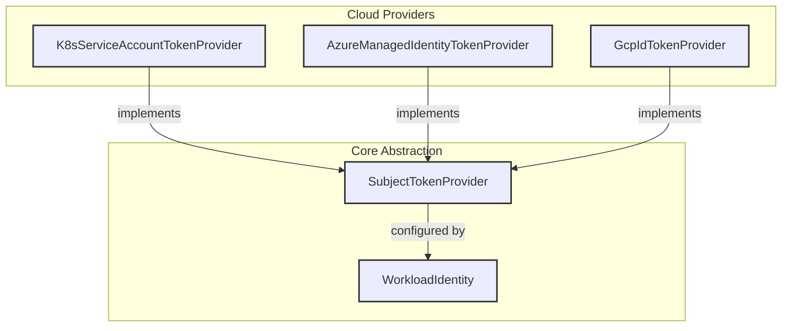
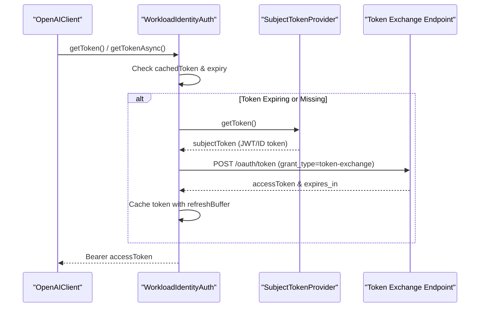
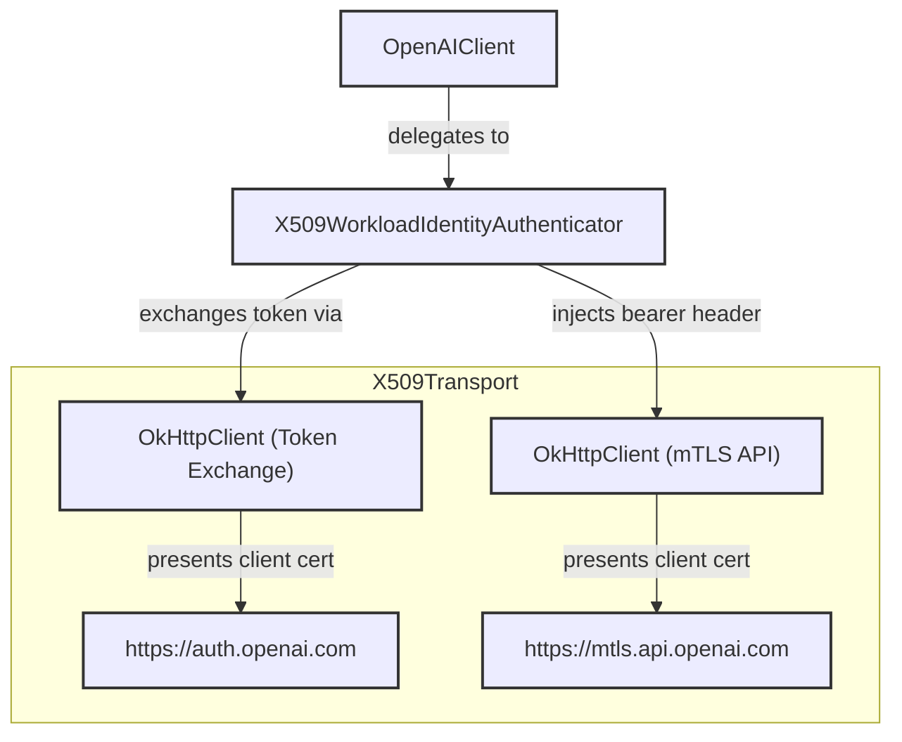

<!-- source: DeepWiki mcp.deepwiki.com · repo openai/openai-java · extra page Workload Identity and X.509 · fetched 2026-10-26 -->

# Workload Identity and X.509

Relevant source files

The following files were used as context for generating this wiki page:

- [docs/x509-live-verification.md](docs/x509-live-verification.md)
- [openai-java-client-okhttp/src/main/kotlin/com/openai/client/okhttp/X509TokenExchange.kt](openai-java-client-okhttp/src/main/kotlin/com/openai/client/okhttp/X509TokenExchange.kt)
- [openai-java-client-okhttp/src/main/kotlin/com/openai/client/okhttp/X509WorkloadIdentity.kt](openai-java-client-okhttp/src/main/kotlin/com/openai/client/okhttp/X509WorkloadIdentity.kt)
- [openai-java-client-okhttp/src/main/kotlin/com/openai/client/okhttp/X509WorkloadIdentityAuthenticator.kt](openai-java-client-okhttp/src/main/kotlin/com/openai/client/okhttp/X509WorkloadIdentityAuthenticator.kt)
- [openai-java-client-okhttp/src/test/kotlin/com/openai/client/okhttp/OkHttpClientTest.kt](openai-java-client-okhttp/src/test/kotlin/com/openai/client/okhttp/OkHttpClientTest.kt)
- [openai-java-client-okhttp/src/test/kotlin/com/openai/client/okhttp/X509LiveVerificationTest.kt](openai-java-client-okhttp/src/test/kotlin/com/openai/client/okhttp/X509LiveVerificationTest.kt)
- [openai-java-client-okhttp/src/test/kotlin/com/openai/client/okhttp/X509TokenExchangeTest.kt](openai-java-client-okhttp/src/test/kotlin/com/openai/client/okhttp/X509TokenExchangeTest.kt)
- [openai-java-client-okhttp/src/test/kotlin/com/openai/client/okhttp/X509TransportTest.kt](openai-java-client-okhttp/src/test/kotlin/com/openai/client/okhttp/X509TransportTest.kt)
- [openai-java-client-okhttp/src/test/kotlin/com/openai/client/okhttp/X509WireTestInfrastructure.kt](openai-java-client-okhttp/src/test/kotlin/com/openai/client/okhttp/X509WireTestInfrastructure.kt)
- [openai-java-client-okhttp/src/test/kotlin/com/openai/client/okhttp/X509WorkloadIdentityIntegrationTest.kt](openai-java-client-okhttp/src/test/kotlin/com/openai/client/okhttp/X509WorkloadIdentityIntegrationTest.kt)
- [openai-java-client-okhttp/src/test/kotlin/com/openai/client/okhttp/X509WorkloadIdentityWireContractTest.kt](openai-java-client-okhttp/src/test/kotlin/com/openai/client/okhttp/X509WorkloadIdentityWireContractTest.kt)
- [openai-java-core/src/main/kotlin/com/openai/auth/AzureManagedIdentityTokenProvider.kt](openai-java-core/src/main/kotlin/com/openai/auth/AzureManagedIdentityTokenProvider.kt)
- [openai-java-core/src/main/kotlin/com/openai/auth/GcpIdTokenProvider.kt](openai-java-core/src/main/kotlin/com/openai/auth/GcpIdTokenProvider.kt)
- [openai-java-core/src/main/kotlin/com/openai/auth/K8sServiceAccountTokenProvider.kt](openai-java-core/src/main/kotlin/com/openai/auth/K8sServiceAccountTokenProvider.kt)
- [openai-java-core/src/main/kotlin/com/openai/auth/SubjectTokenProvider.kt](openai-java-core/src/main/kotlin/com/openai/auth/SubjectTokenProvider.kt)
- [openai-java-core/src/main/kotlin/com/openai/auth/TokenExchangeResponse.kt](openai-java-core/src/main/kotlin/com/openai/auth/TokenExchangeResponse.kt)
- [openai-java-core/src/main/kotlin/com/openai/auth/WorkloadIdentity.kt](openai-java-core/src/main/kotlin/com/openai/auth/WorkloadIdentity.kt)
- [openai-java-core/src/main/kotlin/com/openai/auth/WorkloadIdentityAuth.kt](openai-java-core/src/main/kotlin/com/openai/auth/WorkloadIdentityAuth.kt)
- [openai-java-core/src/test/kotlin/com/openai/auth/WorkloadIdentityAuthTest.kt](openai-java-core/src/test/kotlin/com/openai/auth/WorkloadIdentityAuthTest.kt)
- [openai-java-core/src/test/kotlin/com/openai/core/ClientOptionsTest.kt](openai-java-core/src/test/kotlin/com/openai/core/ClientOptionsTest.kt)
- [openai-java-example/src/main/java/com/openai/example/X509WorkloadIdentityExample.java](openai-java-example/src/main/java/com/openai/example/X509WorkloadIdentityExample.java)

## Purpose and Scope
This page documents the authentication and transport mechanisms for enterprise workload identities and certificate-based mutual TLS (mTLS) in the OpenAI Java SDK. It details `SubjectTokenProvider` implementations across cloud platforms (Kubernetes, Azure, GCP), OAuth token exchange protocols via `WorkloadIdentityAuth` and `X509TokenExchange`, and isolated mTLS transport management through `X509Transport`, `X509WorkloadIdentity`, and `X509WorkloadIdentityAuthenticator`.

---

## 1. Subject Token Providers and Cloud Workload Identity

The SDK supports obtaining subject tokens from various cloud environments to exchange for OpenAI API access tokens. These are driven by the `SubjectTokenProvider` abstraction and configured using `WorkloadIdentity`.

### Cloud Implementations
- **Kubernetes (`K8sServiceAccountTokenProvider`)**: Reads service account tokens from standard Kubernetes projected volume paths or token request APIs.
- **Azure Managed Identity (`AzureManagedIdentityTokenProvider`)**: Requests access tokens from the Azure Instance Metadata Service (IMDS) or managed identity endpoints.
- **GCP ID Token (`GcpIdTokenProvider`)**: Fetches OIDC identity tokens from the Google Cloud metadata server for workload identity federation.

*Figure 1: SubjectTokenProvider hierarchy and cloud implementations.*

Sources: 
- `openai-java-core/src/test/kotlin/com/openai/core/ClientOptionsTest.kt:1-191()`
- `openai-java-core/src/main/kotlin/com/openai/auth/WorkloadIdentityAuth.kt:1-172()`

---

## 2. OAuth Token Exchange Flow

Once a subject token is acquired, or when authenticating via an X.509 client certificate, the SDK performs an IETF OAuth 2.0 token exchange (`urn:ietf:params:oauth:grant-type:token-exchange`).

### Token Exchange Classes
- `WorkloadIdentityAuth` (`[openai-java-core/src/main/kotlin/com/openai/auth/WorkloadIdentityAuth.kt:30-172]()`): Manages thread-safe token acquisition, expiration tracking, background/foreground refresh loops, and error mapping for cloud-based workload identities.
- `X509TokenExchange` (`[openai-java-client-okhttp/src/main/kotlin/com/openai/client/okhttp/X509TokenExchange.kt:1-100]()`): Handles certificate-backed exchanges against `https://auth.openai.com/oauth/token`.

*Figure 2: Token exchange data flow and caching lifecycle.*

Sources: 
- `openai-java-core/src/main/kotlin/com/openai/auth/WorkloadIdentityAuth.kt:1-172()`
- `openai-java-client-okhttp/src/test/kotlin/com/openai/client/okhttp/X509TransportTest.kt:1-137()`

---

## 3. X.509 mTLS Transport and Client Binding

For high-security environments, mutual TLS (mTLS) with fixed X.509 client certificates can be used instead of standard API keys or bearer tokens.

### Key Components
- `X509Transport` (`[openai-java-client-okhttp/src/main/kotlin/com/openai/client/okhttp/X509Transport.kt:1-100]()`): Configures isolated `OkHttpClient` instances with custom `X509ExtendedKeyManager`, certificate aliases, and trust managers. Ensures direct, non-retrying, isolated connections without redirection.
- `X509WorkloadIdentity` (`[openai-java-client-okhttp/src/main/kotlin/com/openai/client/okhttp/X509WorkloadIdentity.kt:9-84]()`): Bundles `identityProviderId`, `serviceAccountId`, and `X509Transport` configuration.
- `X509WorkloadIdentityAuthenticator` (`[openai-java-client-okhttp/src/main/kotlin/com/openai/client/okhttp/X509WorkloadIdentityAuthenticator.kt:23-178]()`): Implements `HttpRequestAuthenticator` to inject the exchanged bearer token specifically into authorized mTLS origins (`mtls.api.openai.com` or `mtls-eu.api.openai.com`), handles automatic token refresh within the configured `refreshBuffer`, and rejects unauthorized hosts.

*Figure 3: X.509 transport isolation and request authentication binding.*

Sources: 
- `openai-java-client-okhttp/src/main/kotlin/com/openai/client/okhttp/X509WorkloadIdentity.kt:9-84()`
- `openai-java-client-okhttp/src/main/kotlin/com/openai/client/okhttp/X509WorkloadIdentityAuthenticator.kt:23-178()`
- `openai-java-client-okhttp/src/test/kotlin/com/openai/client/okhttp/X509TransportTest.kt:1-52()`

---

