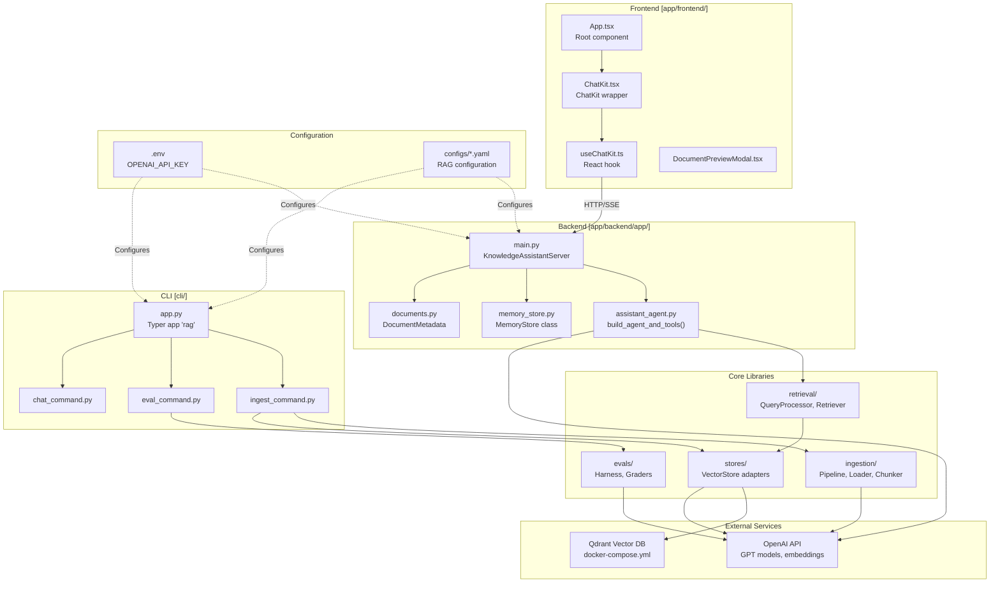
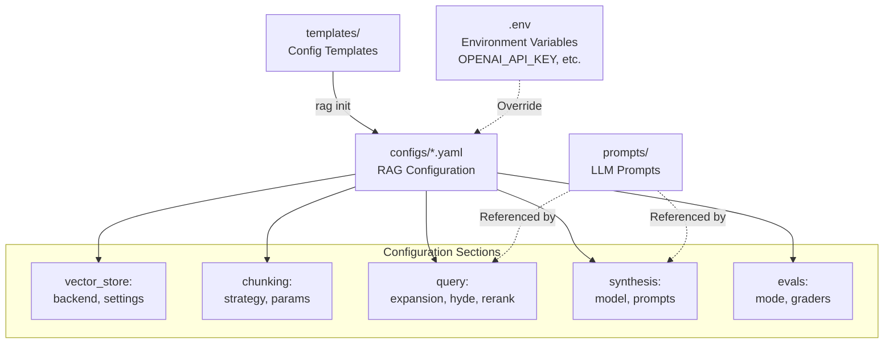
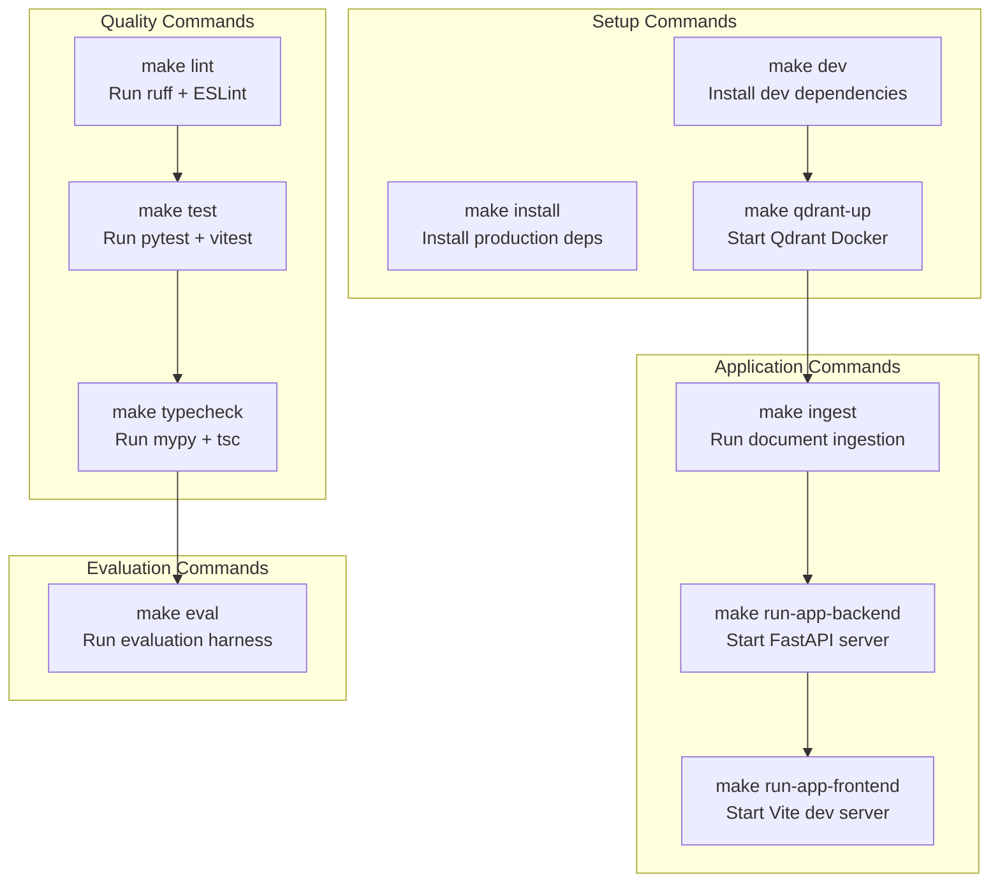

<!-- source: DeepWiki mcp.deepwiki.com · repo openai/openai-knowledge-retrieval · page 1 Overview · fetched 2026-10-26 -->

# Overview

Relevant source files

The following files were used as context for generating this wiki page:

- [LICENSE](LICENSE)
- [README.md](README.md)

## Purpose and Scope

This document provides a high-level introduction to the OpenAI Knowledge Retrieval starter kit—a production-ready framework for building Retrieval Augmented Generation (RAG) applications. This page covers the system's purpose, architecture, key components, and how they work together to enable document-based question answering with citations.

For detailed setup instructions, see [Getting Started](#2). For in-depth technical documentation of individual components, see [Backend Components](#4) and [Frontend Components](#5). For configuration options, see [Configuration](#7).

## What is OpenAI Knowledge Retrieval?

OpenAI Knowledge Retrieval is a config-first RAG starter kit that combines OpenAI's File Search, ChatKit UI components, and Evals platform into a cohesive application. The system enables organizations to build conversational interfaces over their proprietary documents, providing answers with verifiable citations back to source material.

The repository is located at https://github.com/openai/openai-knowledge-retrieval and is distributed under the MIT License.

**Sources**: [README.md:1-8](), [LICENSE:1-22]()

## Key Features

| Feature | Description | Configuration |
|---------|-------------|---------------|
| **YAML-First Configuration** | Define ingestion, retrieval, and synthesis behavior without editing code | `configs/*.yaml` files |
| **Multiple Vector Stores** | Support for OpenAI File Search (managed) or custom stores like Qdrant | `vector_store.backend` setting |
| **Typed Pipelines** | Pydantic-validated data models throughout ingestion and retrieval | `ingestion/`, `retrieval/` modules |
| **ChatKit UI** | Pre-built React components for conversational interface | `@openai/chatkit-react` package |
| **Evaluation Harness** | Generate synthetic datasets and measure retrieval quality | `evals/` module, `rag eval` command |
| **Pluggable Chunking** | Multiple strategies (recursive, heading-based, XML-aware) | `chunking` configuration block |
| **Query Enhancement** | Optional query expansion and HyDE for improved retrieval | `query.expansion`, `query.hyde` settings |
| **LLM-Based Reranking** | Cross-encoder reranking using language models | `query.rerank` configuration |

**Sources**: [README.md:44-52]()

## System Architecture

The following diagram shows how the major system components relate to each other and map to actual code entities:

### Component Relationship Diagram

**Sources**: [README.md:54-66](), [app/backend/app/main.py:1-50](), [cli/app.py:1-30]()

## System Components

### Frontend Application

The frontend is a React 19 + Vite application located in `app/frontend/` that provides a conversational interface for querying documents.

**Key Files**:
- [app/frontend/src/App.tsx]() - Root component with theme management
- [app/frontend/src/chatkit-react/ChatKit.tsx]() - ChatKit web component wrapper
- [app/frontend/src/chatkit-react/useChatKit.ts]() - React hook for ChatKit integration
- [app/frontend/src/components/DocumentPreviewModal.tsx]() - Document viewer

The frontend communicates with the backend via HTTP and Server-Sent Events (SSE) for streaming responses. See [Frontend Architecture](#3.3) for details.

**Sources**: [README.md:241-249](), [app/frontend/package.json:1-20]()

### Backend Services

The backend is a FastAPI application located in `app/backend/app/` that orchestrates AI agents, manages conversation threads, and serves documents.

**Core Classes**:
- `KnowledgeAssistantServer` in [app/backend/app/main.py]() - Main API server
- `build_agent_and_tools()` in [app/backend/app/assistant_agent.py]() - Agent initialization
- `MemoryStore` in [app/backend/app/memory_store.py]() - Thread/message persistence
- `DocumentMetadata` in [app/backend/app/documents.py]() - Document metadata handling

**API Endpoints**:
- `POST /knowledge/chatkit` - ChatKit request handler
- `GET /knowledge/documents` - List available documents
- `GET /knowledge/documents/:id/file` - Download document files
- `GET /knowledge/threads/:id/citations` - Retrieve citations for a thread
- `GET /knowledge/health` - Health check endpoint

See [Backend Architecture](#3.2) for detailed documentation.

**Sources**: [README.md:60](), [app/backend/app/main.py:1-100]()

### CLI Tools

The `rag` CLI is a Typer-based command-line application located in `cli/` that provides administrative functions.

**Commands**:
- `rag init` - Generate configuration templates
- `rag ingest` - Process documents and populate vector store
- `rag chat` - Interactive chat in terminal
- `rag eval` - Run evaluation harness

The CLI shares core libraries with the backend but operates independently. See [CLI Tools](#6) for usage documentation.

**Sources**: [README.md:56](), [cli/app.py:1-50]()

### Core Libraries

The repository includes several core Python packages that implement RAG functionality:

| Package | Purpose | Key Modules |
|---------|---------|-------------|
| `ingestion/` | Document loading, chunking, preprocessing | `pipeline.py`, `loaders/`, `chunkers/` |
| `retrieval/` | Query processing, retrieval, reranking | `query_processor.py`, `retriever.py` |
| `stores/` | Vector store abstractions | `base.py`, `openai_store.py`, `qdrant_store.py` |
| `evals/` | Evaluation harness, graders, reporters | `harness.py`, `graders/`, `reporters/` |

**Sources**: [README.md:54-66]()

### External Services

The system integrates with two primary external services:

**OpenAI API**:
- GPT models for response synthesis
- Embeddings API for vector generation
- File Search for managed vector storage
- Evals platform for evaluation tracking

**Qdrant Vector Database** (optional):
- Self-hosted vector search
- Deployed via Docker Compose
- Accessible at `http://localhost:6333` by default

Configuration determines which vector store backend is used. See [Vector Store Configuration](#7.3) for details.

**Sources**: [README.md:48-49](), [README.md:109-114]()

## Repository Structure

The following diagram maps the repository directory structure to functional areas:

```mermaid
graph TB
    root["Repository Root"]
    
    subgraph "Application Layer"
        app["app/"]
        backend["app/backend/<br/>FastAPI server"]
        frontend["app/frontend/<br/>React + Vite UI"]
    end
    
    subgraph "Core Functionality"
        cli["cli/<br/>Typer CLI 'rag'"]
        ingestion["ingestion/<br/>Document processing"]
        retrieval["retrieval/<br/>Query & retrieval"]
        stores["stores/<br/>Vector store adapters"]
        evals["evals/<br/>Evaluation harness"]
    end
    
    subgraph "Configuration & Data"
        configs["configs/<br/>YAML configs"]
        templates["templates/<br/>Config templates"]
        prompts["prompts/<br/>LLM prompts"]
        data["data/<br/>Document corpus"]
    end
    
    subgraph "Development"
        tests["tests/<br/>Test suites"]
        docs["docs/<br/>Documentation"]
        makefile["Makefile<br/>Task orchestration"]
        envexample[".env.example<br/>Config template"]
    end
    
    root --> app
    root --> cli
    root --> ingestion
    root --> retrieval
    root --> stores
    root --> evals
    root --> configs
    root --> templates
    root --> prompts
    root --> data
    root --> tests
    root --> docs
    root --> makefile
    root --> envexample
    
    app --> backend
    app --> frontend
```

**Sources**: [README.md:54-66]()

## Technology Stack

### Backend Stack

| Component | Technology | Version |
|-----------|----------|---------|
| **Language** | Python | 3.10+ |
| **Web Framework** | FastAPI | 0.111+ |
| **LLM Integration** | OpenAI Python SDK | Latest |
| **CLI Framework** | Typer | Latest |
| **Data Validation** | Pydantic | Latest |
| **Vector Store** | Qdrant (optional) | Latest |

### Frontend Stack

| Component | Technology | Version |
|-----------|----------|---------|
| **Language** | TypeScript | Latest |
| **Framework** | React | 19 |
| **Build Tool** | Vite | Latest |
| **UI Library** | @openai/chatkit-react | Latest |
| **Styling** | Tailwind CSS | Latest |
| **Icons** | Lucide React | Latest |

**Sources**: [README.md:3-5](), [README.md:242](), [README.md:302-307]()

## How It Works: RAG Pipeline Overview

The system implements a complete RAG pipeline from document ingestion through response generation:

### RAG Pipeline Flow

```mermaid
graph LR
    subgraph "1. Ingestion"
        Docs["Documents<br/>data/"]
        Load["Loader<br/>ingestion/loaders/"]
        Chunk["Chunker<br/>ingestion/chunkers/"]
        Embed["Embeddings API"]
        Store["Vector Store"]
    end
    
    subgraph "2. Query Processing"
        Query["User Query"]
        Expand["Query Expansion<br/>retrieval/query_processor.py"]
        HyDE["HyDE Generation"]
    end
    
    subgraph "3. Retrieval"
        Search["Vector Search<br/>retrieval/retriever.py"]
        Filter["Similarity Filter"]
        Rerank["LLM Reranker"]
    end
    
    subgraph "4. Synthesis"
        Context["Context Assembly"]
        LLM["GPT Model"]
        Citations["Citation Extraction<br/>main.py"]
    end
    
    subgraph "5. Response"
        Stream["SSE Stream"]
        UI["ChatKit UI"]
    end
    
    Docs --> Load
    Load --> Chunk
    Chunk --> Embed
    Embed --> Store
    
    Query --> Expand
    Expand --> HyDE
    HyDE --> Search
    
    Store --> Search
    Search --> Filter
    Filter --> Rerank
    
    Rerank --> Context
    Context --> LLM
    LLM --> Citations
    
    Citations --> Stream
    Stream --> UI
```

### Pipeline Stages

1. **Ingestion Phase** (`rag ingest`):
   - Load documents from `data/` directory using format-specific loaders
   - Apply chunking strategy (recursive, heading-based, XML-aware, etc.)
   - Generate embeddings via OpenAI API
   - Store vectors in chosen backend (OpenAI File Search or Qdrant)

2. **Query Processing**:
   - Receive user query through ChatKit UI
   - Optionally expand query with LLM-generated variants
   - Optionally generate hypothetical document (HyDE)

3. **Retrieval**:
   - Perform vector similarity search
   - Apply similarity threshold filtering
   - Optionally rerank results with cross-encoder LLM

4. **Synthesis**:
   - Assemble retrieved chunks into context
   - Include conversation history from `MemoryStore`
   - Generate response with configured GPT model
   - Extract citations from annotations or chunk metadata

5. **Response Streaming**:
   - Stream response tokens via Server-Sent Events
   - Deliver citations with document references
   - Display in ChatKit UI with clickable annotations

Each stage is configurable via YAML. See [RAG Configuration Files](#7.2) for available options.

**Sources**: [README.md:7-8](), [README.md:210-223]()

## Configuration System

The system is designed to be configuration-first, with minimal code changes required to customize behavior.

### Configuration Hierarchy

**Configuration Files**:
- `.env` - API keys and environment-specific settings
- `configs/*.yaml` - RAG pipeline configuration
- `templates/` - Starter configuration templates
- `prompts/` - LLM prompt templates

Use `rag init --template <name>` to generate configuration from templates. Available templates include `openai` (default, uses File Search) and `custom-qdrant` (self-hosted vector store).

**Sources**: [README.md:86-107](), [README.md:151-239]()

## Evaluation System

The repository includes a comprehensive evaluation harness for measuring retrieval quality:

### Evaluation Modes

| Mode | Description | Dataset Source |
|------|-------------|----------------|
| **Auto** | Synthesize evaluation data from ingested documents | LLM-generated questions from chunks |
| **User** | Use curated evaluation datasets | JSONL files in `evals/datasets/` |

### Grading Metrics

- **Groundedness** - Verify answer is supported by retrieved context
- **Relevance** - Measure answer relevance to user query
- **Exact Match (EM)** - Compare against golden answers
- **F1 Score** - Token-level overlap with golden answers
- **Custom Rubrics** - Define domain-specific evaluation criteria

### OpenAI Evals Integration

When `evals.openai_evals.enabled: true`, results are mirrored to OpenAI's Evals dashboard for visualization and tracking. Local reports are always generated in `evals/reports/` (Markdown and HTML formats).

Run evaluations with: `rag eval --config configs/my.yaml`

See [Evaluation System](#6.3) for detailed documentation.

**Sources**: [README.md:252-286](), [README.md:141-149]()

## Development Orchestration

The `Makefile` provides a unified interface for all development tasks:

### Key Make Targets

The Makefile orchestrates all services and provides consistent commands across backend, frontend, and CLI components.

**Sources**: [README.md:16-42]()

## Next Steps

- **Setup**: Follow [Getting Started](#2) to install dependencies and configure the system
- **Architecture**: Explore [Architecture](#3) for detailed component documentation
- **Configuration**: Review [Configuration](#7) to customize RAG pipeline behavior
- **Development**: See [Development Guide](#8) for contribution guidelines
- **API Reference**: Consult [API Reference](#11) for endpoint and interface documentation

**Sources**: [README.md:1-308]()

---

