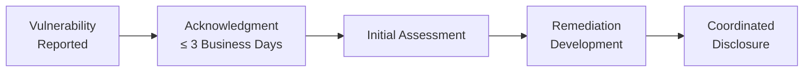
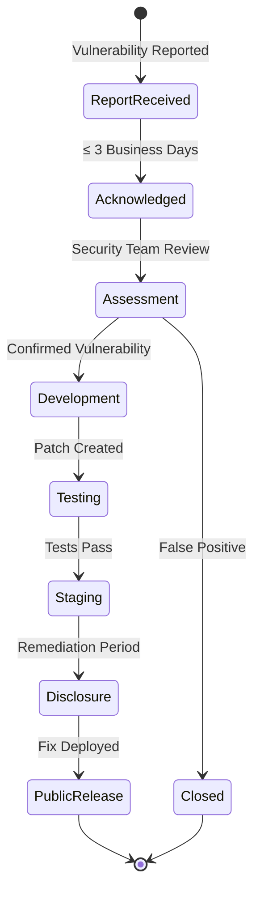
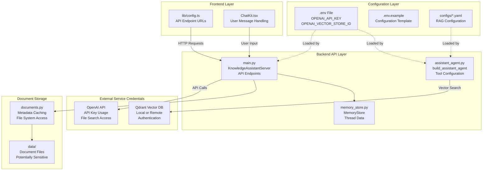
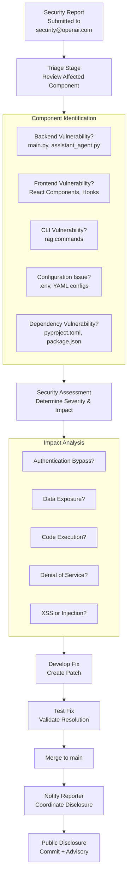
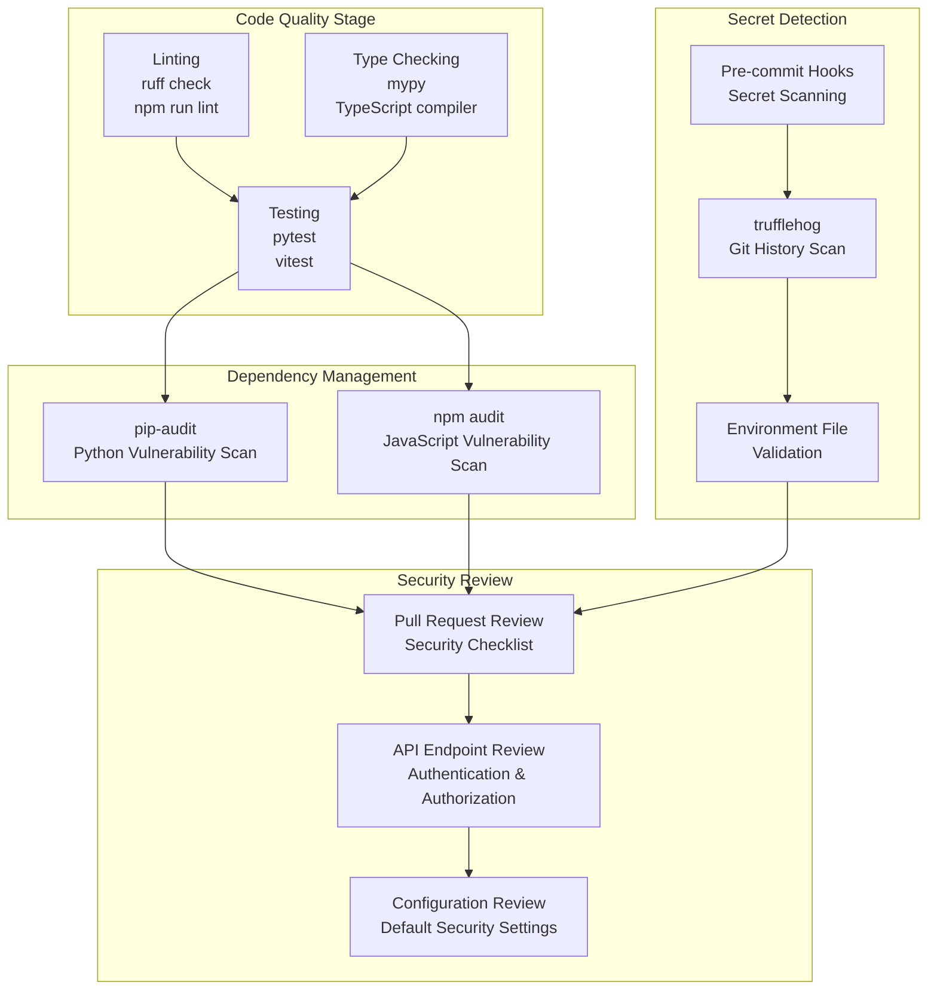

<!-- source: DeepWiki mcp.deepwiki.com · repo openai/openai-knowledge-retrieval · page 10.1 Security Policy · fetched 2026-10-26 -->

# Security Policy

<details>
<summary>Relevant source files</summary>

The following files were used as context for generating this wiki page:

- [SECURITY.md](SECURITY.md)

</details>


## Purpose and Scope

This document describes the security policy for the OpenAI Knowledge Retrieval starter kit, including supported versions, vulnerability disclosure procedures, and the coordination process for security issues. This policy applies to the entire codebase, including frontend, backend, CLI tools, and configuration files.

For practical security recommendations and implementation guidelines, see [Security Best Practices](#10.2).

**Sources**: [SECURITY.md:1-42]()

---

## Supported Versions

The OpenAI Knowledge Retrieval project is released as open-source software without a formal support policy or versioned releases. The project operates on a continuous delivery model where all development occurs on the main branch.

### Version Support Policy

| Branch | Support Status | Security Updates |
|--------|---------------|------------------|
| `main` | Active Development | All fixes applied here first |
| Feature branches | Not Supported | No direct security patches |
| Forks | User Responsibility | Users must merge upstream fixes |

### Update Recommendations

Security fixes are backported to prior commits at the maintainers' discretion. Users are strongly encouraged to:

- Follow the `main` branch for the latest security patches
- Regularly pull updates from the upstream repository
- Monitor the repository for security-related commits
- Review the commit history before deploying to production

The absence of semantic versioning means that all security improvements are delivered through the continuous main branch. Users should treat each commit as potentially containing security enhancements.

**Sources**: [SECURITY.md:3-7]()

---

## Vulnerability Reporting Process

### Reporting Channel

Security vulnerabilities must be reported through private channels to prevent exploitation before fixes are available. **Do not** create public GitHub issues for security vulnerabilities.

**Primary Contact**: [security@openai.com](mailto:security@openai.com)

### Response Timeline



**Vulnerability Reporting Workflow**

The security team aims to acknowledge new vulnerability reports within three business days of receipt. This acknowledgment confirms that the report has been received and is under review.

**Sources**: [SECURITY.md:9-12]()

---

## Required Reporting Information

To facilitate rapid assessment and remediation, vulnerability reports should include the following information when possible:

### Mandatory Information

| Field | Description | Example |
|-------|-------------|---------|
| Description | Clear explanation of the vulnerability | "API endpoint allows unauthenticated access to document metadata" |
| Impact | Potential consequences if exploited | "Attacker can enumerate all document titles without authentication" |
| Affected Components | Specific files, functions, or endpoints | `app/backend/app/main.py:GET /knowledge/documents` |

### Recommended Information

| Field | Description | Purpose |
|-------|-------------|---------|
| Reproduction Steps | Step-by-step instructions to reproduce | Validates the vulnerability exists |
| Proof of Concept | Code, curl commands, or exploit script | Demonstrates exploitability |
| Mitigations | Known workarounds or temporary fixes | Enables immediate protection |
| CVSS Score | Common Vulnerability Scoring System rating | Prioritizes remediation efforts |
| Patch/Fix | Suggested code changes or pull request | Accelerates resolution |

### Vulnerability Report Template

```
Subject: [SECURITY] Vulnerability in [Component]

Description:
[Detailed explanation of the vulnerability]

Impact:
[What an attacker could achieve]

Affected Components:
- File: [path/to/file.py]
- Function: [function_name]
- Endpoint: [HTTP method and path]
- Lines: [start-end]

Steps to Reproduce:
1. [First step]
2. [Second step]
3. [Vulnerability demonstrated]

Proof of Concept:
[Code or commands demonstrating the issue]

Suggested CVSS Score: [X.X]

Proposed Mitigation:
[Your suggested fix or workaround]
```

**Sources**: [SECURITY.md:14-23]()

---

## Disclosure Coordination

### Coordinated Disclosure Policy

The project follows a coordinated disclosure model to balance timely security improvements with responsible vulnerability management. The process follows this timeline:



**Vulnerability Lifecycle**

### Remediation Period

Following confirmation of a vulnerability, the security team coordinates with the reporter to establish a reasonable remediation period. This period allows for:

1. **Development**: Creating and testing a fix
2. **Review**: Security review of the proposed patch
3. **Deployment**: Coordinating deployment timing
4. **Documentation**: Preparing security advisory content

The remediation period is negotiated based on:
- Severity of the vulnerability (CVSS score)
- Complexity of the fix required
- Availability of workarounds
- Active exploitation status

### Public Disclosure

Public disclosure occurs after the remediation period when:
- A fix has been merged to the `main` branch
- The fix has been verified to resolve the issue
- Sufficient time has passed for users to update (if applicable)
- The reporter agrees to public disclosure (when coordinated)

Public disclosure typically includes:
- Commit message describing the security fix
- Credit to the reporter (if desired)
- CVE assignment (for high-severity issues)
- Security advisory (for critical vulnerabilities)

**Sources**: [SECURITY.md:22-23]()

---

## Security-Relevant System Components

Understanding which components handle sensitive data helps identify potential vulnerability surfaces:



**Security-Sensitive Components and Data Flow**

### Component Security Characteristics

| Component | Sensitive Data | Security Considerations |
|-----------|---------------|-------------------------|
| `.env` | API keys, vector store IDs | Must not be committed to version control |
| `OPENAI_API_KEY` | OpenAI authentication token | Grants access to OpenAI services and billing |
| `data/` directory | Document content | May contain proprietary or sensitive information |
| `MemoryStore` | Conversation history | In-memory only, not persisted to disk |
| API endpoints | User queries, responses | No authentication by default in starter kit |
| `configs/*.yaml` | System configuration | Controls retrieval and synthesis behavior |

**Sources**: [SECURITY.md:1-42](), [.env.example:1-9](), [app/backend/app/main.py:1-500](), [app/backend/app/assistant_agent.py:1-200]()

---

## Vulnerability Assessment Workflow

The following diagram shows how vulnerability reports are processed through the system's architecture:



**Vulnerability Processing Pipeline**

**Sources**: [SECURITY.md:9-23]()

---

## Security Contact Information

### Primary Channel

- **Email**: security@openai.com
- **Response Time**: ≤ 3 business days for acknowledgment
- **Encryption**: PGP encryption welcomed but not required

### What NOT To Do

| Action | Reason | Alternative |
|--------|--------|-------------|
| Create public GitHub issue | Enables exploitation before fix | Email security@openai.com |
| Post on social media | Premature disclosure | Coordinated disclosure process |
| Exploit in production | Violates responsible disclosure | Report through proper channels |
| Demand immediate fix | May compromise fix quality | Negotiate reasonable timeline |

### Reporter Recognition

Security researchers who follow the responsible disclosure process may receive:
- Credit in the security advisory (if desired)
- Public acknowledgment of the discovery
- Notification when the fix is deployed
- Opportunity to review the patch before release

**Sources**: [SECURITY.md:11-12]()

---

## Integration with Development Workflow

Security considerations are integrated throughout the development process:



**Security in Development Lifecycle**

For detailed implementation of these security measures, see [Code Quality and Testing](#8.2) and [Security Best Practices](#10.2).

**Sources**: [SECURITY.md:26-41](), [CONTRIBUTING.md:1-100]()

---

