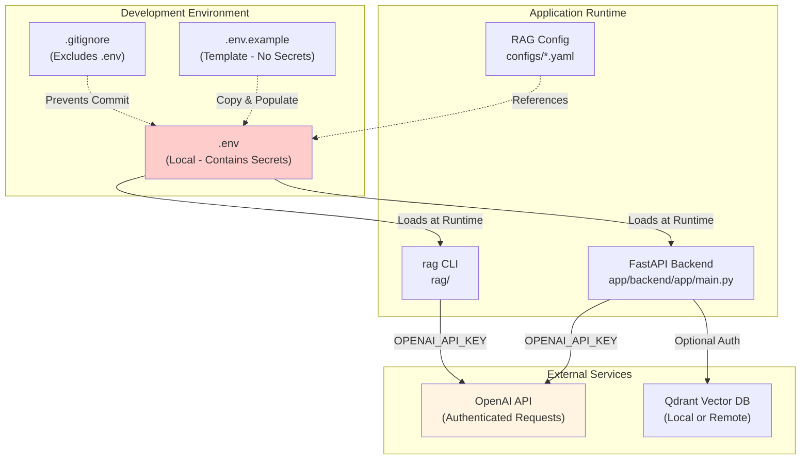
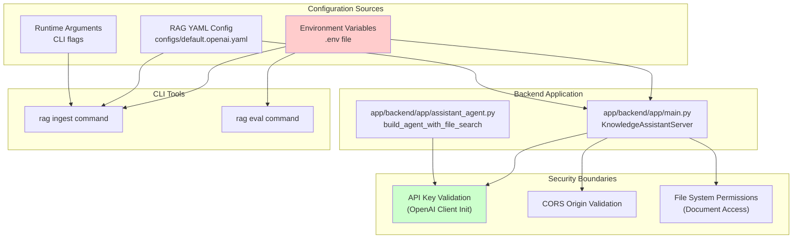
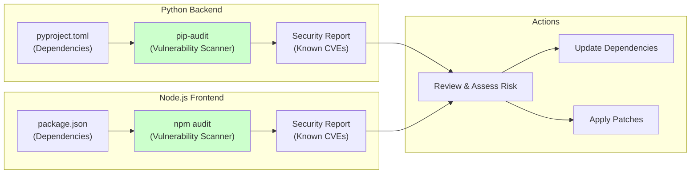
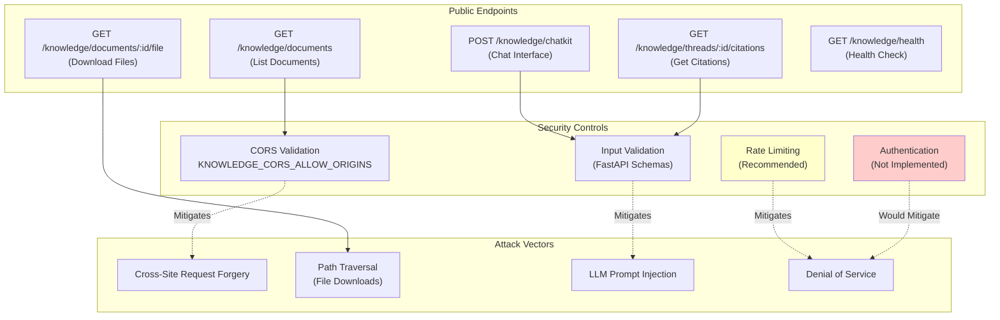
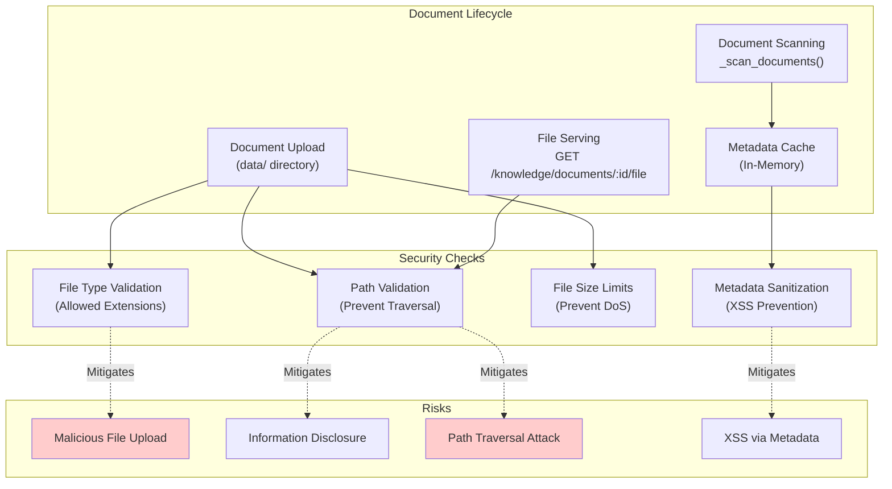

<!-- source: DeepWiki mcp.deepwiki.com · repo openai/openai-knowledge-retrieval · page 10.2 Security Best Practices · fetched 2026-10-26 -->

# Security Best Practices

<details>
<summary>Relevant source files</summary>

The following files were used as context for generating this wiki page:

- [.env.example](.env.example)
- [SECURITY.md](SECURITY.md)

</details>


## Purpose and Scope

This page documents recommended security practices for deploying and operating the OpenAI Knowledge Retrieval starter kit. It covers credential management, environment configuration, dependency auditing, API security, and data handling best practices. For the formal vulnerability reporting process and supported versions, see [Security Policy](#10.1).

---

## API Key and Credential Management

The system requires multiple sensitive credentials to interact with OpenAI's services and external databases. Proper credential management is critical to prevent unauthorized access.

### Required Credentials

| Credential | Environment Variable | Purpose | Sensitivity Level |
|-----------|---------------------|---------|-------------------|
| OpenAI API Key | `OPENAI_API_KEY` | Authenticates all OpenAI API calls | **Critical** - Grants billing access |
| OpenAI Organization ID | `OPENAI_ORG_ID` | Associates requests with organization | High - Links to billing account |
| OpenAI Project ID | `OPENAI_PROJECT_ID` | Scopes requests to specific project | Medium - Isolates resources |
| Vector Store ID | `VECTOR_STORE_ID` | References OpenAI file search vector store | Medium - Access to indexed data |

**Sources:** [.env.example:1-5]()

### Credential Storage



**Best Practices:**

1. **Never commit `.env` files** - The repository's `.gitignore` should exclude `.env` to prevent accidental commits
2. **Use `.env.example` as template** - Populate `.env.example` with variable names and empty values as documentation [.env.example:1-7]()
3. **Rotate keys regularly** - Regenerate API keys periodically through the OpenAI dashboard
4. **Scope credentials minimally** - Use project-scoped API keys rather than organization-wide keys when possible
5. **Audit commit history** - Before publishing forks, run `trufflehog git file://.` to scan for accidentally committed secrets

**Sources:** [SECURITY.md:27-30](), [.env.example:1-7]()

---

## Environment Configuration Security

### Secure Configuration Loading

The application loads configuration from multiple sources with varying security implications:



**Configuration Security Checklist:**

| Configuration | Security Concern | Mitigation |
|--------------|------------------|------------|
| `OPENAI_API_KEY` | Exposure in logs/errors | Never log full key values; mask in output |
| `KNOWLEDGE_CORS_ALLOW_ORIGINS` | Unrestricted CORS allows XSS | Whitelist only trusted origins [.env.example:6]() |
| `RAG_CONFIG` path | Path traversal to sensitive configs | Validate config file paths are within expected directories |
| `VECTOR_STORE_ID` | Unauthorized data access | Validate vector store ownership before use |

**Sources:** [.env.example:1-7](), [SECURITY.md:27-28]()

### CORS Configuration

The `KNOWLEDGE_CORS_ALLOW_ORIGINS` environment variable controls which domains can access the backend API:

```bash
# Development (localhost only)
KNOWLEDGE_CORS_ALLOW_ORIGINS="http://localhost:5173,http://127.0.0.1:5173"

# Production (specific domains only)
KNOWLEDGE_CORS_ALLOW_ORIGINS="https://yourdomain.com"
```

**Never use wildcard origins (`*`) in production** - This allows any website to make requests to your API, enabling credential theft and CSRF attacks.

**Sources:** [.env.example:6]()

---

## Dependency Security

The application depends on external packages that may contain vulnerabilities. Regular auditing is essential.

### Vulnerability Scanning Workflow



### Audit Commands

Run these commands periodically (requires internet access):

```bash
# Python dependency audit
pip install pip-audit
pip-audit

# Node.js dependency audit (excluding dev dependencies)
npm audit --omit=dev
```

**Sources:** [SECURITY.md:31-38]()

### Dependency Update Strategy

| Update Type | Frequency | Risk Assessment |
|------------|-----------|-----------------|
| Security patches | Immediately | Apply all security patches promptly |
| Minor version updates | Monthly | Review changelog for breaking changes |
| Major version updates | Quarterly | Test thoroughly before deployment |
| Development dependencies | As needed | Lower priority unless security-critical |

**Automated Security Monitoring:**

Consider integrating GitHub's Dependabot or similar tools to:
- Automatically detect vulnerable dependencies
- Create pull requests with security updates
- Provide CVSS scores and vulnerability details

**Sources:** [SECURITY.md:31-38]()

---

## Network and API Security

### API Endpoint Security

The backend exposes several HTTP endpoints that require security considerations:



**Security Recommendations:**

1. **Implement Authentication** - The starter kit does not include authentication. Add JWT tokens, OAuth, or API keys before production deployment
2. **Add Rate Limiting** - Protect against abuse and DoS attacks using middleware like `slowapi`
3. **Validate File Access** - When serving files via `GET /knowledge/documents/:id/file`, ensure path traversal is prevented
4. **Sanitize User Input** - While FastAPI provides schema validation, additional sanitization may be needed for LLM prompts
5. **Use HTTPS** - Always use TLS/SSL in production to encrypt data in transit

**Sources:** [SECURITY.md:25-42](), [.env.example:6]()

### Port Configuration

| Service | Default Port | Exposure | Security Notes |
|---------|-------------|----------|----------------|
| FastAPI Backend | 8000, 8002 | Internal/Public | Should be behind reverse proxy in production |
| Vite Dev Server | 5173 | Development only | Never expose in production |
| Qdrant Vector DB | 6333 | Internal only | Block external access via firewall |

**Production Deployment:**
- Use a reverse proxy (nginx, Caddy) with HTTPS
- Configure firewall rules to restrict port access
- Bind services to `127.0.0.1` if only accessed via proxy

**Sources:** Based on system architecture diagrams

---

## Data and File System Security

### Document Handling

The application processes and serves user-provided documents, creating multiple security concerns:



**Document Security Best Practices:**

1. **Validate File Paths** - Ensure `_resolve_document_path()` prevents directory traversal attacks
2. **Restrict File Types** - Only allow safe document formats (PDF, TXT, MD, DOCX)
3. **Scan for Malware** - Integrate antivirus scanning for uploaded documents in production
4. **Isolate Document Storage** - Store documents in a dedicated directory with restricted permissions
5. **Sanitize Filenames** - Remove special characters and path separators from user-provided filenames

**Sources:** [SECURITY.md:40-41]()

### Sensitive Data in Documents

```bash
# Before deploying publicly, audit your data directory
find data/ -type f -exec grep -l "password\|secret\|api_key\|credit_card" {} \;

# Consider encrypting sensitive documents at rest
```

**Recommendations:**
- Replace sample datasets with sanitized data before public deployment
- Implement access controls if documents contain PII or confidential information
- Use encryption for sensitive document storage
- Log document access for audit trails

**Sources:** [SECURITY.md:40-41]()

---

## LLM-Specific Security Considerations

### Prompt Injection

The system uses user input to query LLMs, creating prompt injection risks:

| Attack Type | Description | Mitigation |
|------------|-------------|------------|
| Direct Injection | User includes instructions in query | Input sanitization, system prompt hardening |
| Indirect Injection | Malicious content in retrieved documents | Document content validation, output filtering |
| Jailbreaking | Attempts to bypass system constraints | Robust system prompts, content filtering |

**Mitigation Strategies:**
1. Use OpenAI's moderation API to filter harmful inputs
2. Implement output validation to detect instruction-following behavior
3. Separate user input from system instructions in prompts
4. Monitor for unusual token usage patterns

### Data Leakage

The system's retrieval mechanism may expose information across security boundaries:

**Concerns:**
- Vector search may return chunks from documents user shouldn't access
- Citation metadata may reveal file paths or sensitive titles
- Conversation history stored in `MemoryStore` may persist sensitive data

**Mitigations:**
1. Implement document-level access controls
2. Filter retrieval results based on user permissions
3. Sanitize file paths in citations before returning to frontend
4. Implement thread/conversation isolation per user
5. Add TTL to in-memory conversation storage

---

## Security Checklist

Use this checklist before deploying to production:

### Pre-Deployment

- [ ] All API keys stored in `.env` (not `.env.example` or code)
- [ ] `.env` file excluded in `.gitignore`
- [ ] Commit history scanned with `trufflehog git file://.`
- [ ] CORS origins restricted to production domains
- [ ] HTTPS/TLS configured for all public endpoints
- [ ] Authentication/authorization implemented
- [ ] Rate limiting configured on API endpoints
- [ ] File upload restrictions (size, type) implemented
- [ ] Path traversal protections tested
- [ ] Sample/test data removed or sanitized

### Ongoing Maintenance

- [ ] Weekly dependency audits (`pip-audit`, `npm audit`)
- [ ] Monthly API key rotation
- [ ] Quarterly security review of custom code
- [ ] Monitor OpenAI API usage for anomalies
- [ ] Review application logs for suspicious activity
- [ ] Keep FastAPI, React, and dependencies updated
- [ ] Test disaster recovery procedures
- [ ] Maintain incident response plan

### Documentation

- [ ] Security contact documented ([Security Policy](#10.1))
- [ ] Deployment security requirements documented
- [ ] Credential rotation procedures documented
- [ ] Incident response procedures documented

**Sources:** [SECURITY.md:25-42](), [.env.example:1-7]()

---

## Additional Security Resources

### External Tools

| Tool | Purpose | Command |
|------|---------|---------|
| TruffleHog | Secret scanning | `trufflehog git file://.` |
| pip-audit | Python vulnerability scanning | `pip install pip-audit && pip-audit` |
| npm audit | Node.js vulnerability scanning | `npm audit --omit=dev` |
| Safety | Python security checker | `pip install safety && safety check` |
| Bandit | Python code security linter | `pip install bandit && bandit -r .` |

### OpenAI Security Documentation

Consult OpenAI's security best practices:
- API key management guidelines
- Rate limiting recommendations
- Usage monitoring and alerts
- Content moderation policies

### Related Pages

- [Security Policy](#10.1) - Vulnerability reporting and supported versions
- [Configuration](#7) - Detailed configuration documentation
- [Backend API Endpoints](#11.1) - API endpoint specifications
- [Deployment](#9) - Production deployment guidance

**Sources:** [SECURITY.md:1-42](), [.env.example:1-7]()

---

