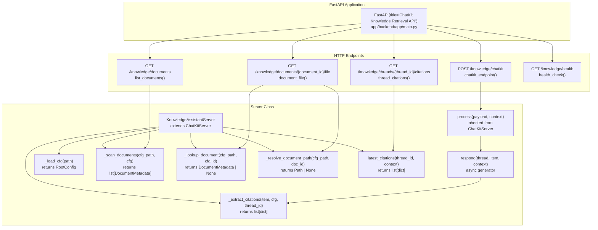
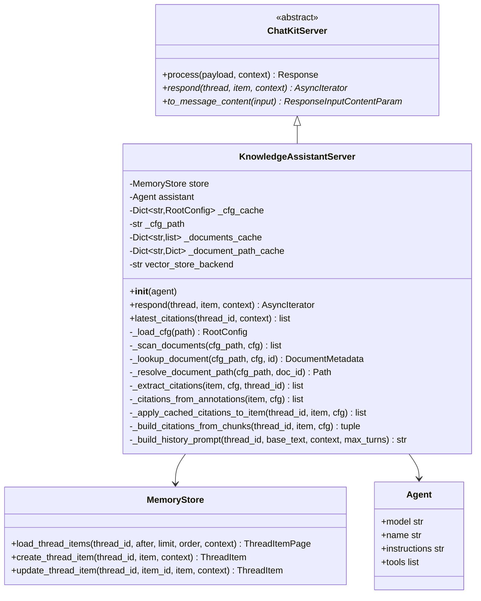
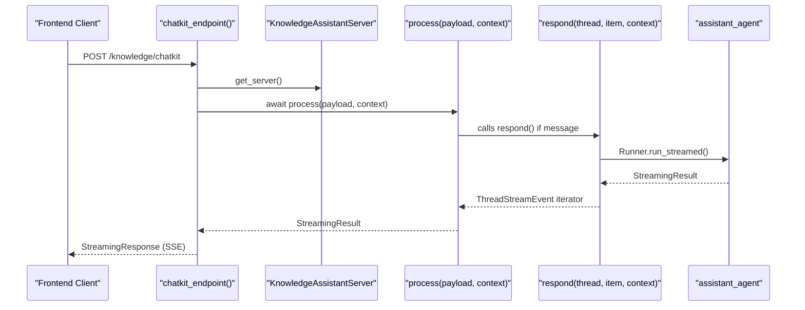
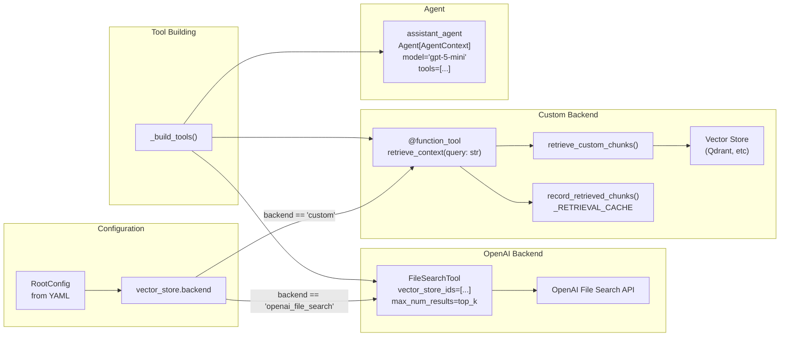

<!-- source: DeepWiki mcp.deepwiki.com · repo openai/openai-knowledge-retrieval · page 11 API Reference · fetched 2026-10-26 -->

# API Reference

<details>
<summary>Relevant source files</summary>

The following files were used as context for generating this wiki page:

- [app/backend/app/assistant_agent.py](app/backend/app/assistant_agent.py)
- [app/backend/app/main.py](app/backend/app/main.py)

</details>


This document provides comprehensive API documentation for both the backend HTTP endpoints and frontend component interfaces in the OpenAI Knowledge Retrieval system. The backend exposes a FastAPI-based REST API for chat interactions, document management, and citation retrieval. The frontend provides React hooks and components for integrating with the backend and OpenAI's ChatKit platform.

For detailed documentation of individual endpoints and parameters, see [Backend API Endpoints](#11.1). For React component props and hook interfaces, see [Frontend Hooks and Components API](#11.2).

## Backend HTTP API Overview

The backend API is implemented in the `KnowledgeAssistantServer` class, which extends `ChatKitServer` and provides five primary HTTP endpoints. All endpoints are mounted under the `/knowledge` prefix and return JSON responses unless otherwise specified.

**Base URL**: `http://localhost:8000` (development) or `http://localhost:8002` (app backend)

### HTTP Endpoint Mapping



**Sources**: [app/backend/app/main.py:131-647]()

### Core Server Class Architecture

The `KnowledgeAssistantServer` class orchestrates all backend operations. It maintains several caches and manages interactions with the agent system, memory store, and document management subsystems.



**Sources**: [app/backend/app/main.py:131-143](), [app/backend/app/main.py:247-545]()

## Frontend Component API Overview

The frontend provides React hooks and components for integrating with both the backend API and OpenAI's ChatKit web component. The primary integration point is the `useChatKit` hook, which manages the lifecycle and event handling for the `<openai-chatkit>` web component.

For detailed component props and hook return values, see [Frontend Hooks and Components API](#11.2).

## Key Data Types

### Backend Request/Response Types

#### ChatKit Request Processing

The `/knowledge/chatkit` endpoint accepts ChatKit protocol messages and returns either a JSON response or a server-sent event stream.

**Request**: Raw ChatKit protocol payload (processed by `ChatKitServer.process()`)

**Response Types**:
- `StreamingResult`: Server-sent events for streaming responses
- JSON object for non-streaming responses



**Sources**: [app/backend/app/main.py:580-591](), [app/backend/app/main.py:247-294]()

#### Document Metadata Structure

The `DocumentMetadata` class represents document information returned by the `/knowledge/documents` endpoint.

**TypeScript Interface** (implicit):
```typescript
interface DocumentMetadata {
  id: string;           // SHA1 hash of file path
  filename: string;     // Original filename
  title: string;        // Human-readable title
  description: string | null;
}
```

**Python Definition**: See [app/backend/app/documents.py]()

**Sources**: [app/backend/app/main.py:55-57](), [app/backend/app/main.py:593-600]()

#### Citation Structure

Citations are returned by the `/knowledge/threads/{thread_id}/citations` endpoint and embedded in assistant message annotations.

**TypeScript Interface**:
```typescript
interface Citation {
  document_id: string;        // Document identifier
  filename: string;           // Document filename
  title: string;              // Document title
  description: string | null; // Optional description
  annotation_index: number | null; // Index in annotations array
}
```

**API Response**:
```typescript
interface CitationsResponse {
  documentIds: string[];      // Sorted unique document IDs
  citations: Citation[];      // Full citation objects
}
```

**Sources**: [app/backend/app/main.py:626-641](), [app/backend/app/main.py:318-348]()

### Frontend Data Types

#### ChatKit Event Types

The ChatKit integration uses several event types from the `chatkit.types` module:

| Type | Purpose | Location |
|------|---------|----------|
| `ThreadStreamEvent` | Base event type for streaming responses | [app/backend/app/main.py:23]() |
| `ThreadItemDoneEvent` | Emitted when a thread item is complete | [app/backend/app/main.py:21]() |
| `UserMessageItem` | User message in thread | [app/backend/app/main.py:24]() |
| `AssistantMessageItem` | Assistant message with content and annotations | [app/backend/app/main.py:16]() |
| `AssistantMessageContent` | Content block within assistant message | [app/backend/app/main.py:15]() |
| `Annotation` | Citation/source annotation | [app/backend/app/main.py:14]() |
| `ThreadMetadata` | Thread identification and metadata | [app/backend/app/main.py:22]() |

**Sources**: [app/backend/app/main.py:13-25]()

## Agent System Integration

The backend integrates with OpenAI's agent system through the `assistant_agent` singleton, which is configured with retrieval tools based on the vector store backend.

### Agent Tool Configuration



**Sources**: [app/backend/app/assistant_agent.py:67-127]()

### Retrieval Cache Management

The assistant agent module maintains a thread-local cache of retrieved chunks to enable citation extraction after the agent responds.

**Cache Functions**:

| Function | Purpose | Signature |
|----------|---------|-----------|
| `record_retrieved_chunks()` | Store chunks for a thread | `(thread_id: str | None, chunks: list[dict]) -> None` |
| `get_last_retrieved_chunks()` | Retrieve cached chunks | `(thread_id: str) -> list[dict]` |
| `clear_last_retrieved_chunks()` | Remove cached chunks | `(thread_id: str) -> None` |
| `set_current_thread()` | Set context var for thread | `(thread_id: str | None) -> Token` |
| `reset_current_thread()` | Reset context var | `(token: Token) -> None` |

**Sources**: [app/backend/app/assistant_agent.py:41-64]()

## CORS Configuration

The FastAPI application configures CORS middleware to allow cross-origin requests from the frontend application.

**Configuration**:
```python
# Default allowed origins
cors_allow_origins = [
    "http://localhost:5172",
    "http://127.0.0.1:5172",
]

# Override via environment variable
KNOWLEDGE_CORS_ALLOW_ORIGINS="http://localhost:5173,http://127.0.0.1:5173"
```

**CORS Policy**:
- `allow_credentials`: `False`
- `allow_methods`: `["GET", "POST", "OPTIONS"]`
- `allow_headers`: `["Accept", "Content-Type", "Authorization"]`
- `expose_headers`: `["Content-Disposition"]`

**Sources**: [app/backend/app/main.py:551-573]()

## API Endpoint Summary Table

| Endpoint | Method | Purpose | Request Body | Response Type | Streaming |
|----------|--------|---------|--------------|---------------|-----------|
| `/knowledge/chatkit` | POST | Process ChatKit messages | ChatKit protocol | JSON or SSE | Optional |
| `/knowledge/documents` | GET | List available documents | None | JSON | No |
| `/knowledge/documents/{document_id}/file` | GET | Download document file | None | File (binary) | No |
| `/knowledge/threads/{thread_id}/citations` | GET | Get thread citations | None | JSON | No |
| `/knowledge/health` | GET | Health check | None | JSON | No |

**Sources**: [app/backend/app/main.py:580-646]()

## Error Handling

The API uses standard HTTP status codes for error responses:

**Common Status Codes**:
- `200 OK`: Successful request
- `404 Not Found`: Document or resource not found (e.g., invalid `document_id`)
- `500 Internal Server Error`: Unhandled server errors

**HTTPException Examples**:
```python
# Document not found
raise HTTPException(status_code=404, detail="Document not found")

# File not available
raise HTTPException(status_code=404, detail="File not available")
```

**Sources**: [app/backend/app/main.py:610-615]()

## Configuration Dependencies

The API server loads configuration from YAML files specified by the `RAG_CONFIG` environment variable (defaults to `configs/default.openai.yaml`). The configuration affects:

- Vector store backend selection (OpenAI File Search vs. custom)
- Retrieval parameters (top_k, reranking, etc.)
- Document paths and filtering rules
- Citation extraction settings

For configuration details, see [RAG Configuration Files](#7.2).

**Sources**: [app/backend/app/main.py:137](), [app/backend/app/assistant_agent.py:33-38]()

---

