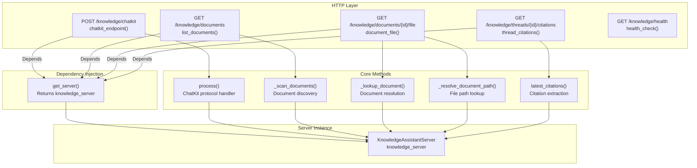
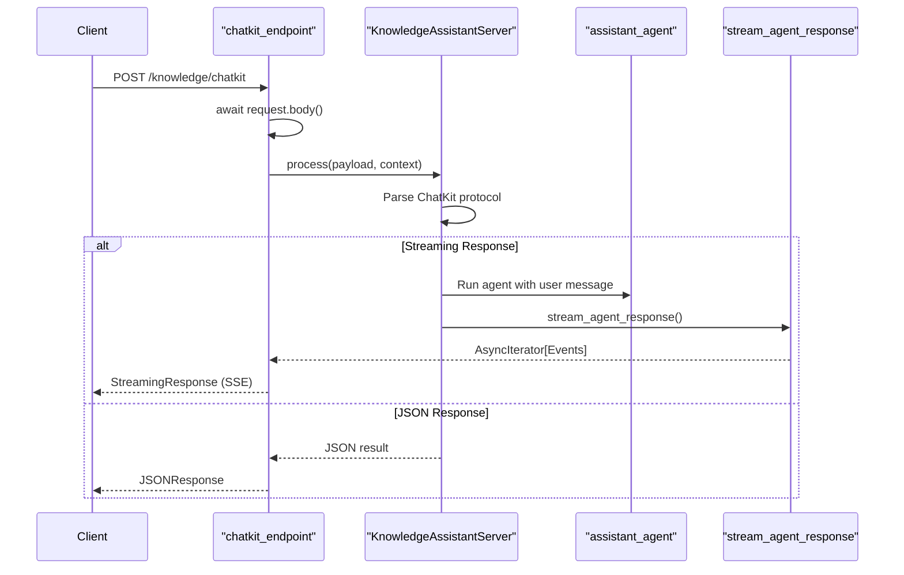
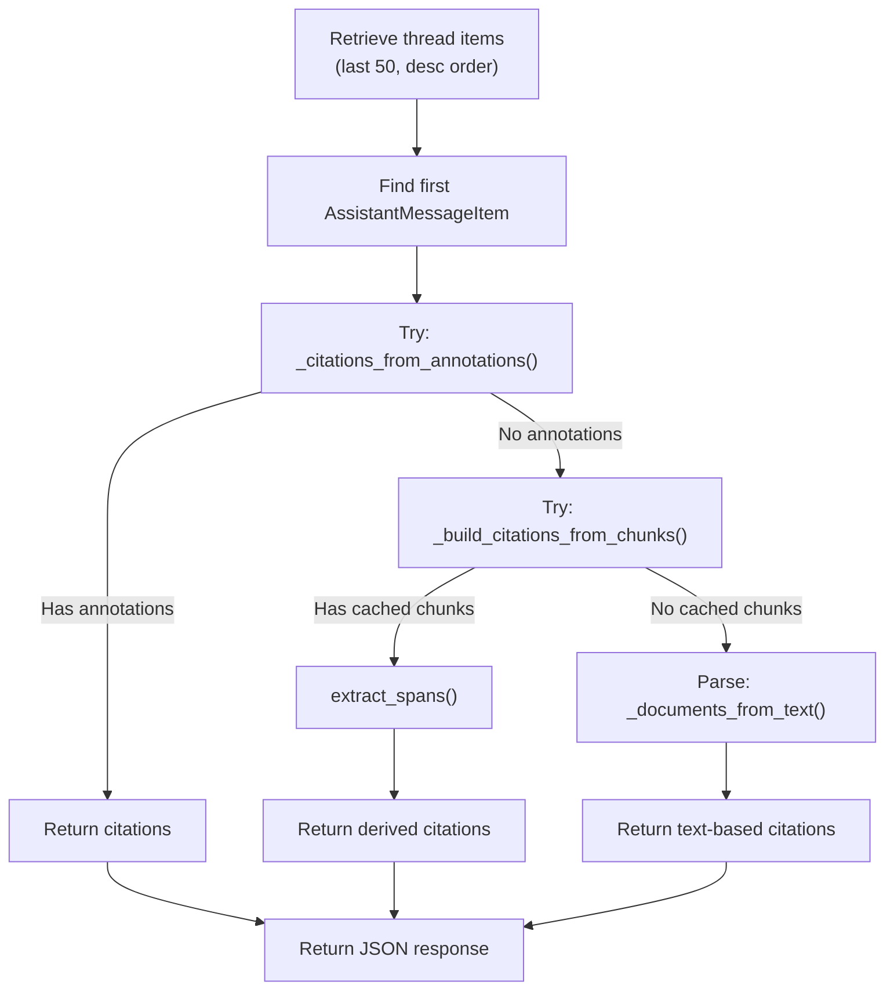
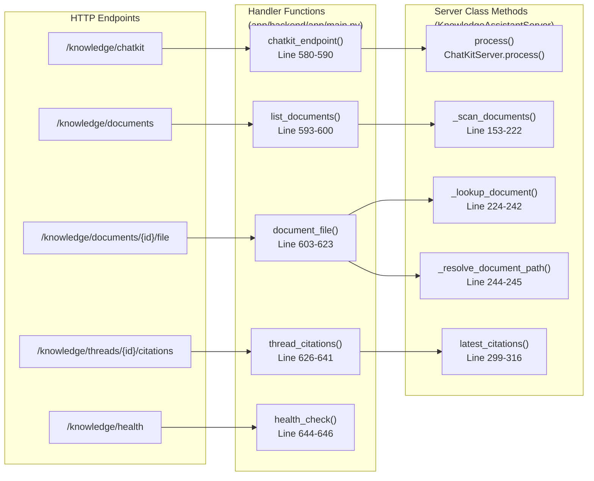

<!-- source: DeepWiki mcp.deepwiki.com · repo openai/openai-knowledge-retrieval · page 11.1 Backend API Endpoints · fetched 2026-10-26 -->

# Backend API Endpoints

<details>
<summary>Relevant source files</summary>

The following files were used as context for generating this wiki page:

- [app/backend/app/documents.py](app/backend/app/documents.py)
- [app/backend/app/main.py](app/backend/app/main.py)
- [app/backend/app/memory_store.py](app/backend/app/memory_store.py)

</details>


This document provides a comprehensive reference for all HTTP endpoints exposed by the FastAPI backend server. These endpoints enable the frontend application to interact with the knowledge retrieval system, including chat operations, document management, and citation retrieval.

For information about the backend service architecture and internal components, see [Backend Architecture](#3.2). For details on the agent system that powers the chat functionality, see [Assistant Agent System](#4.2).

## API Overview

The backend API is implemented as a FastAPI application in [app/backend/app/main.py](). The server exposes five primary endpoints under the `/knowledge` prefix, all orchestrated by the `KnowledgeAssistantServer` class which extends `ChatKitServer`.

**Sources:** [app/backend/app/main.py:549-647]()

## Endpoint Summary

The following table summarizes all available endpoints:

| HTTP Method | Endpoint Path | Purpose | Response Type |
|-------------|--------------|---------|---------------|
| POST | `/knowledge/chatkit` | Process ChatKit protocol requests (chat streaming) | Server-Sent Events or JSON |
| GET | `/knowledge/documents` | List all available documents in the knowledge base | JSON |
| GET | `/knowledge/documents/{document_id}/file` | Download or view a specific document file | File (various MIME types) |
| GET | `/knowledge/threads/{thread_id}/citations` | Retrieve citations for the latest message in a thread | JSON |
| GET | `/knowledge/health` | Health check endpoint | JSON |

**Sources:** [app/backend/app/main.py:580-646]()

## Endpoint Architecture



**Sources:** [app/backend/app/main.py:547-647]()

## CORS Configuration

The API implements Cross-Origin Resource Sharing (CORS) middleware to control frontend access. CORS configuration is controlled by the `KNOWLEDGE_CORS_ALLOW_ORIGINS` environment variable.

**Default allowed origins:**
- `http://localhost:5172`
- `http://127.0.0.1:5172`

**CORS settings:**
- **Allowed Methods:** `GET`, `POST`, `OPTIONS`
- **Allowed Headers:** `Accept`, `Content-Type`, `Authorization`
- **Exposed Headers:** `Content-Disposition`
- **Credentials:** Disabled (`allow_credentials=False`)

**Sources:** [app/backend/app/main.py:551-573]()

## Endpoint Details

### POST /knowledge/chatkit

The primary endpoint for processing ChatKit protocol requests, including streaming chat responses.

#### Function Signature

```python
async def chatkit_endpoint(
    request: Request, 
    server: KnowledgeAssistantServer = Depends(get_server)
) -> Response
```

#### Request Format

- **Content-Type:** `application/json`
- **Body:** ChatKit protocol payload (binary/JSON)
- **Protocol:** Conforms to the ChatKit server protocol specification

The request payload is processed by `server.process()` which handles thread management, message streaming, and agent invocation.

#### Response Format

The endpoint returns one of two response types depending on the operation:

1. **Streaming Response** (Server-Sent Events)
   - **Content-Type:** `text/event-stream`
   - Used for streaming agent responses during chat interactions
   - Events include message chunks, tool calls, and completion notifications

2. **JSON Response**
   - **Content-Type:** `application/json`
   - Used for non-streaming operations like thread creation or metadata updates

#### Implementation Flow



#### Context Injection

The endpoint injects a context dictionary containing the FastAPI `Request` object:

```python
context = {"request": request}
```

This context is propagated through the store operations and available to custom handlers.

**Sources:** [app/backend/app/main.py:580-590](), [app/backend/app/main.py:247-294]()

### GET /knowledge/documents

Lists all documents available in the configured knowledge base.

#### Function Signature

```python
async def list_documents(
    server: KnowledgeAssistantServer = Depends(get_server),
) -> dict[str, Any]
```

#### Request Parameters

No query parameters required.

#### Response Format

```json
{
  "documents": [
    {
      "id": "a1b2c3...",
      "filename": "example.pdf",
      "title": "Example Document",
      "description": null
    }
  ]
}
```

#### Response Fields

| Field | Type | Description |
|-------|------|-------------|
| `documents` | Array | List of document metadata objects |
| `documents[].id` | String | SHA1 hash of the document file path |
| `documents[].filename` | String | Original filename |
| `documents[].title` | String | Humanized title derived from filename |
| `documents[].description` | String or null | Optional document description |

#### Document Discovery

Documents are discovered by scanning configured data paths from the RAG configuration file. The scanning process:

1. Loads configuration from `RAG_CONFIG` environment variable (default: `configs/default.openai.yaml`)
2. Reads `data.paths` configuration
3. Recursively scans directories for files matching `include_extensions`
4. Applies `exclude_globs` filters
5. Generates unique document IDs using SHA1 hash of file paths
6. Caches results for performance

**Sources:** [app/backend/app/main.py:593-600](), [app/backend/app/main.py:153-222]()

### GET /knowledge/documents/{document_id}/file

Serves document files for preview or download.

#### Function Signature

```python
async def document_file(
    document_id: str, 
    server: KnowledgeAssistantServer = Depends(get_server)
) -> FileResponse
```

#### Path Parameters

| Parameter | Type | Description |
|-----------|------|-------------|
| `document_id` | String | Document ID, filename, stem, or title slug |

The `document_id` parameter supports multiple resolution strategies:
- Exact ID match (SHA1 hash)
- Case-insensitive filename match
- Case-insensitive stem match
- Slugified title match (alphanumeric characters only)

#### Response

**Success (200 OK):**
- **Content-Type:** Determined by file extension (e.g., `application/pdf`, `text/plain`)
- **Headers:** `Content-Disposition: inline; filename="<filename>"`
- **Body:** Raw file content

**Error (404 Not Found):**
```json
{
  "detail": "Document not found"
}
```
or
```json
{
  "detail": "File not available"
}
```

#### MIME Type Detection

MIME types are automatically determined using Python's `mimetypes.guess_type()`. If detection fails, defaults to `application/octet-stream`.

**Sources:** [app/backend/app/main.py:603-623](), [app/backend/app/main.py:224-245]()

### GET /knowledge/threads/{thread_id}/citations

Retrieves citations from the most recent assistant message in a conversation thread.

#### Function Signature

```python
async def thread_citations(
    thread_id: str,
    request: Request,
    server: KnowledgeAssistantServer = Depends(get_server),
) -> dict[str, Any]
```

#### Path Parameters

| Parameter | Type | Description |
|-----------|------|-------------|
| `thread_id` | String | Unique thread identifier |

#### Response Format

```json
{
  "documentIds": ["doc1", "doc2"],
  "citations": [
    {
      "document_id": "doc1",
      "filename": "example.pdf",
      "title": "Example Document",
      "description": null,
      "annotation_index": 0
    }
  ]
}
```

#### Response Fields

| Field | Type | Description |
|-------|------|-------------|
| `documentIds` | Array[String] | Sorted unique list of cited document IDs |
| `citations` | Array[Object] | Detailed citation objects |
| `citations[].document_id` | String | Document identifier |
| `citations[].filename` | String | Document filename |
| `citations[].title` | String | Document title |
| `citations[].description` | String or null | Document description |
| `citations[].annotation_index` | Number or null | Index of annotation in message content |

#### Citation Extraction Strategy

The endpoint implements a three-tier fallback strategy for citation extraction:



1. **Annotation-based:** Extracts citations directly from OpenAI file search annotations
2. **Chunk-based:** Derives citations from cached retrieval chunks using span extraction
3. **Text-based:** Parses document references from message text (fallback)

**Sources:** [app/backend/app/main.py:626-641](), [app/backend/app/main.py:299-348](), [app/backend/app/main.py:318-348](), [app/backend/app/main.py:350-396](), [app/backend/app/main.py:398-502]()

### GET /knowledge/health

Simple health check endpoint for monitoring and orchestration.

#### Function Signature

```python
async def health_check() -> dict[str, str]
```

#### Request Parameters

None.

#### Response Format

```json
{
  "status": "healthy"
}
```

#### Use Cases

- Container orchestration health probes
- Load balancer health checks
- Monitoring system integration
- Service availability verification

**Sources:** [app/backend/app/main.py:644-646]()

## Error Handling

The API implements standard HTTP error responses:

### 404 Not Found

Returned when:
- Document ID does not match any known document
- File path cannot be resolved
- Thread or item not found in store

Example:
```json
{
  "detail": "Document not found"
}
```

### 500 Internal Server Error

Returned for unexpected server errors. The FastAPI framework automatically catches and formats exceptions.

### Store Errors

The `MemoryStore` implementation raises `NotFoundError` for missing resources, which FastAPI translates to 404 responses.

**Sources:** [app/backend/app/main.py:610-615](), [app/backend/app/memory_store.py:22-177]()

## Request Context

All endpoints that depend on `KnowledgeAssistantServer` receive a context dictionary containing the FastAPI `Request` object:

```python
context = {"request": request}
```

This context is threaded through:
- `ChatKitServer.process()` method
- `Store` interface methods (`load_thread_items`, `save_thread`, etc.)
- Agent response streaming

The context enables custom extensions to access request-specific data like headers, authentication tokens, or session information.

**Sources:** [app/backend/app/main.py:585](), [app/backend/app/main.py:632]()

## Code Entity Mapping

The following diagram maps API endpoints to their implementing code entities:



**Sources:** [app/backend/app/main.py:131-545]()

## Server Instantiation

The backend creates a single global server instance that is shared across all requests:

```python
knowledge_server = KnowledgeAssistantServer(agent=assistant_agent)
```

This instance is injected into endpoint handlers via FastAPI's dependency injection system using the `get_server()` function.

**Sources:** [app/backend/app/main.py:547](), [app/backend/app/main.py:576-577]()

## Configuration

The server loads its configuration from:

1. **Environment Variables:**
   - `RAG_CONFIG`: Path to RAG configuration YAML (default: `configs/default.openai.yaml`)
   - `KNOWLEDGE_CORS_ALLOW_ORIGINS`: Comma-separated list of allowed CORS origins

2. **Configuration File:**
   - Loaded via `load_config()` from the CLI module
   - Cached in `_cfg_cache` dictionary
   - Contains data paths, vector store settings, and query configuration

**Sources:** [app/backend/app/main.py:137](), [app/backend/app/main.py:144-151](), [app/backend/app/main.py:551-573]()

---

