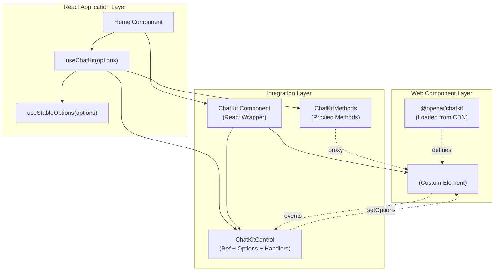
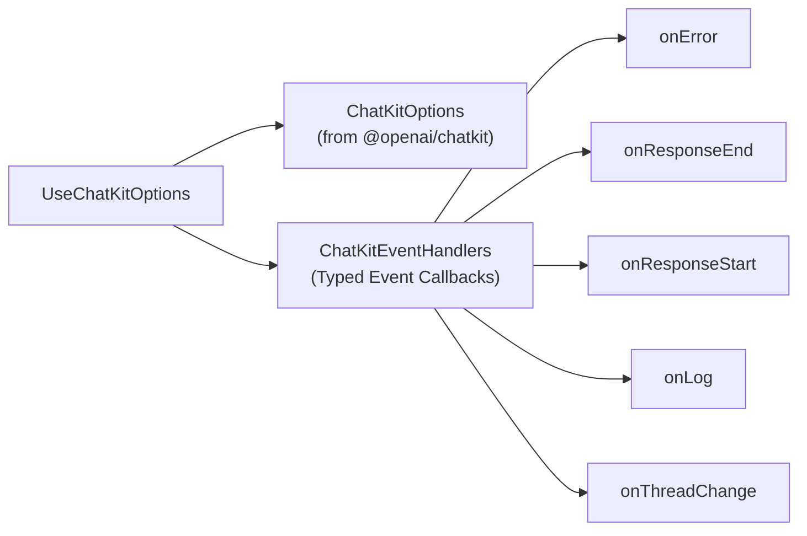
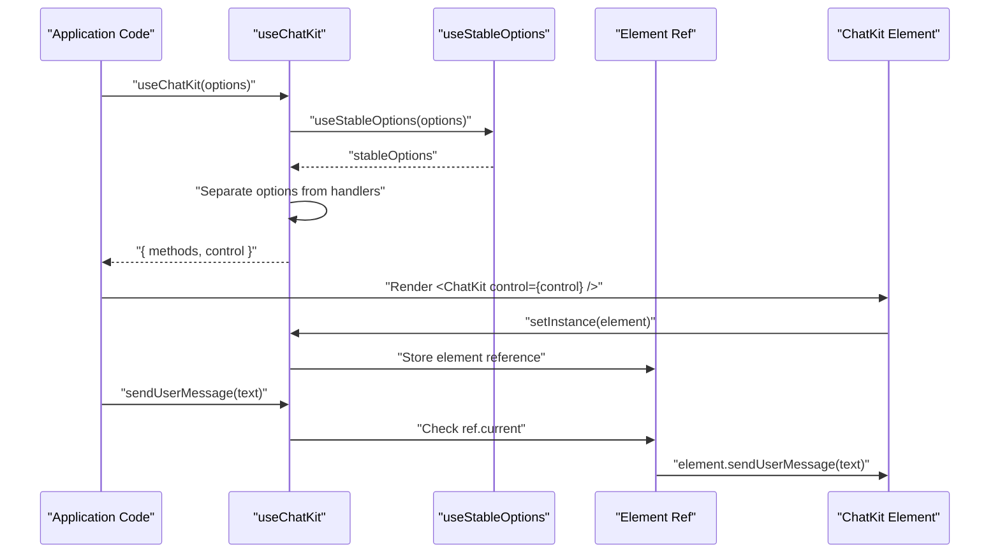
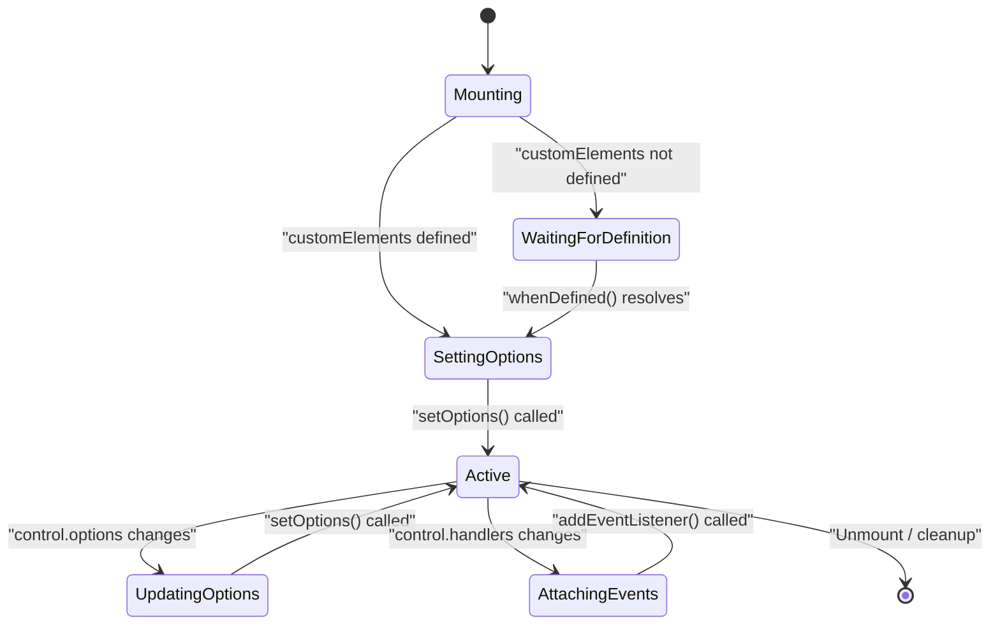
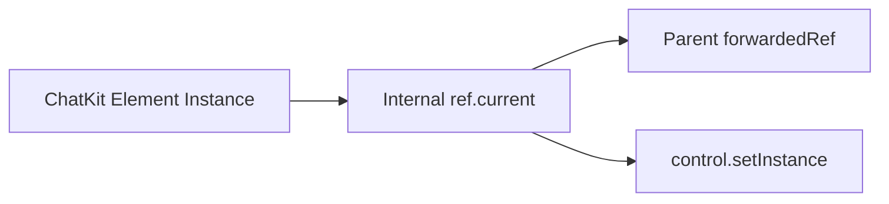
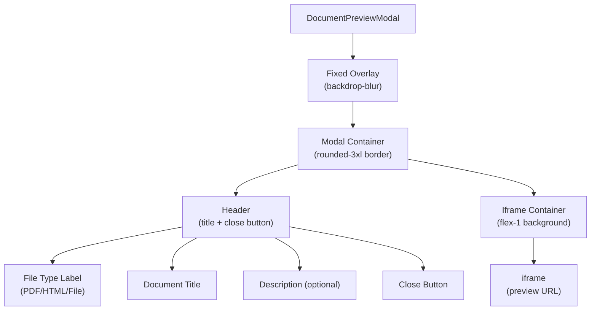

<!-- source: DeepWiki mcp.deepwiki.com · repo openai/openai-knowledge-retrieval · page 11.2 Frontend Hooks and Components API · fetched 2026-10-26 -->

# Frontend Hooks and Components API

<details>
<summary>Relevant source files</summary>

The following files were used as context for generating this wiki page:

- [app/frontend/src/chatkit-react/ChatKit.tsx](app/frontend/src/chatkit-react/ChatKit.tsx)
- [app/frontend/src/chatkit-react/useChatKit.ts](app/frontend/src/chatkit-react/useChatKit.ts)
- [app/frontend/src/components/DocumentPreviewModal.tsx](app/frontend/src/components/DocumentPreviewModal.tsx)

</details>


## Purpose and Scope

This document provides comprehensive API reference documentation for the frontend's React hooks, components, and TypeScript interfaces. It covers the ChatKit integration layer that bridges OpenAI's web component with React, reusable UI components for document display, and custom hooks for data fetching and state management.

For information about the overall frontend architecture and component hierarchy, see [Frontend Architecture](#3.3). For build tools and development configuration, see [Build and Development Tools](#5.4).

---

## ChatKit Integration Layer

The ChatKit integration layer provides React bindings for the `<openai-chatkit>` web component. This layer consists of two primary exports: the `useChatKit` hook and the `ChatKit` wrapper component.

### Architecture Overview



**Sources:** `app/frontend/src/chatkit-react/useChatKit.ts`, `app/frontend/src/chatkit-react/ChatKit.tsx`

---

## useChatKit Hook

The `useChatKit` hook provides a React interface for controlling the ChatKit web component. It accepts configuration options and event handlers, returning methods to control the component and a control object for the wrapper component.

### Type Signature

| Type | Description |
|------|-------------|
| `UseChatKitOptions` | Input options combining `ChatKitOptions` and `ChatKitEventHandlers` |
| `UseChatKitReturn` | Return object containing methods and control |
| `ChatKitControl` | Control object for the `ChatKit` component |
| `ChatKitMethods` | Proxied methods from the web component |

### Input Options



**Sources:** [app/frontend/src/chatkit-react/useChatKit.ts:43]()

### Event Handler Typing

The hook uses TypeScript mapped types to automatically convert web component event names to React-style handler names:

| Web Component Event | Handler Name | Type |
|---------------------|--------------|------|
| `chatkit.error` | `onError` | `(event: ErrorDetail) => void` |
| `chatkit.response.start` | `onResponseStart` | `(event: ResponseStartDetail) => void` |
| `chatkit.response.end` | `onResponseEnd` | `(event: ResponseEndDetail) => void` |
| `chatkit.log` | `onLog` | `(event: LogDetail) => void` |
| `chatkit.thread.change` | `onThreadChange` | `(event: ThreadChangeDetail) => void` |

The conversion is performed by the `ToEventHandlerKey` type utility:

[app/frontend/src/chatkit-react/useChatKit.ts:28-31]()

**Sources:** [app/frontend/src/chatkit-react/useChatKit.ts:28-41]()

### Return Value: Methods

The hook returns proxied methods that forward calls to the underlying web component:

| Method | Signature | Description |
|--------|-----------|-------------|
| `focusComposer` | `() => void` | Focus the message composer input |
| `setThreadId` | `(threadId: string \| null) => void` | Set the active thread ID |
| `sendUserMessage` | `(content: string) => void` | Programmatically send a message |
| `setComposerValue` | `(value: string) => void` | Set the composer input value |
| `fetchUpdates` | `() => Promise<void>` | Fetch latest thread updates |
| `sendCustomAction` | `(action: CustomAction) => void` | Send a custom action to the backend |

All methods include safety checks and warn if the component is not mounted.

**Sources:** [app/frontend/src/chatkit-react/useChatKit.ts:13-26](), [app/frontend/src/chatkit-react/useChatKit.ts:59-72]()

### Return Value: Control Object

The `control` object is passed to the `ChatKit` component and contains:

| Property | Type | Description |
|----------|------|-------------|
| `setInstance` | `(instance: ChatKitElement \| null) => void` | Callback to set the element reference |
| `options` | `ChatKitOptions` | Configuration options for the web component |
| `handlers` | `ChatKitEventHandlers` | Event handler callbacks |

**Sources:** [app/frontend/src/chatkit-react/useChatKit.ts:45-49](), [app/frontend/src/chatkit-react/useChatKit.ts:81-98]()

### Internal Implementation Flow



**Sources:** [app/frontend/src/chatkit-react/useChatKit.ts:55-101]()

---

## useStableOptions Hook

The `useStableOptions` hook ensures reference stability for the options object, preventing unnecessary re-renders when options are passed as object literals. It performs deep equality comparison of option values.

**Sources:** [app/frontend/src/chatkit-react/useChatKit.ts:2](), [app/frontend/src/chatkit-react/useChatKit.ts:57]()

---

## ChatKit Component

The `ChatKit` component is a React wrapper around the `<openai-chatkit>` web component. It handles lifecycle management, option synchronization, and event delegation.

### Component Props

```typescript
interface ChatKitProps extends React.HTMLAttributes<ChatKitElement> {
  control: ChatKitControl;
}
```

The component accepts a `control` object from `useChatKit` plus standard HTML attributes for pass-through to the web component.

**Sources:** [app/frontend/src/chatkit-react/ChatKit.tsx:6-8]()

### JSX Intrinsic Element Declaration

The component extends React's JSX namespace to recognize the custom element:

[app/frontend/src/chatkit-react/ChatKit.tsx:10-20]()

**Sources:** [app/frontend/src/chatkit-react/ChatKit.tsx:10-20]()

### Lifecycle and Synchronization



**Sources:** [app/frontend/src/chatkit-react/ChatKit.tsx:26-45](), [app/frontend/src/chatkit-react/ChatKit.tsx:47-82]()

### Option Synchronization Logic

The component uses `useLayoutEffect` to synchronously update options when they change:

1. Check if the custom element is already defined
2. If defined, immediately call `setOptions()`
3. If not defined, wait for `customElements.whenDefined("openai-chatkit")`
4. Set options once the element is defined

[app/frontend/src/chatkit-react/ChatKit.tsx:26-45]()

**Sources:** [app/frontend/src/chatkit-react/ChatKit.tsx:26-45]()

### Event Handler Attachment

The component uses `useEffect` to attach event listeners:

1. Map ChatKit event names to handler keys
2. Attach listeners with `addEventListener` using an `AbortController` for cleanup
3. Dispatch events to the corresponding handler from `control.handlers`
4. Clean up all listeners on unmount or handler change

[app/frontend/src/chatkit-react/ChatKit.tsx:47-82]()

**Sources:** [app/frontend/src/chatkit-react/ChatKit.tsx:47-82]()

### Ref Forwarding

The component implements custom ref forwarding to support both the parent's ref and the control's `setInstance`:



[app/frontend/src/chatkit-react/ChatKit.tsx:84-95]()

**Sources:** [app/frontend/src/chatkit-react/ChatKit.tsx:22-99]()

---

## DocumentPreviewModal Component

The `DocumentPreviewModal` component displays document previews in a modal overlay using an iframe. It supports PDF, HTML, and generic file previews.

### Component Props

| Prop | Type | Description |
|------|------|-------------|
| `document` | `KnowledgeDocument \| null` | Document to preview, or null to hide modal |
| `onClose` | `() => void` | Callback when user closes the modal |

**Sources:** [app/frontend/src/components/DocumentPreviewModal.tsx:6-9]()

### KnowledgeDocument Interface

The component expects documents with this structure:

```typescript
interface KnowledgeDocument {
  id: string;           // Document identifier
  filename: string;     // Original filename
  title: string;        // Display title
  description?: string; // Optional description
}
```

**Sources:** [app/frontend/src/components/DocumentPreviewModal.tsx:3]()

### Component Structure



**Sources:** [app/frontend/src/components/DocumentPreviewModal.tsx:11-64]()

### File Type Inference

The component infers file type from the filename extension:

| Extension | Type | Label |
|-----------|------|-------|
| `.pdf` | `"pdf"` | "PDF document" |
| `.html` | `"html"` | "HTML document" |
| Other | `"file"` | "File preview" |

[app/frontend/src/components/DocumentPreviewModal.tsx:66-71]()

**Sources:** [app/frontend/src/components/DocumentPreviewModal.tsx:66-71]()

### Preview URL Construction

The component constructs the preview URL using the `KNOWLEDGE_DOCUMENT_FILE_URL` function:

[app/frontend/src/components/DocumentPreviewModal.tsx:16]()

This corresponds to the backend endpoint `GET /knowledge/documents/:id/file` documented in [Backend API Endpoints](#11.1).

**Sources:** [app/frontend/src/components/DocumentPreviewModal.tsx:4](), [app/frontend/src/components/DocumentPreviewModal.tsx:16]()

### Styling and Theming

The component uses Tailwind CSS with dark mode support via class-based theming:

- Backdrop: `bg-slate-950/70 backdrop-blur-sm`
- Container: `bg-white dark:bg-slate-950/90` with border and ring effects
- Header: Gradient background with border separator
- Iframe container: Background varies by file type

**Sources:** [app/frontend/src/components/DocumentPreviewModal.tsx:20-62]()

---

## useKnowledgeDocuments Hook

The `useKnowledgeDocuments` hook fetches the list of available documents from the backend API. While the full implementation is not provided in the source files, it is referenced by multiple components.

### Expected Interface

```typescript
function useKnowledgeDocuments(): {
  documents: KnowledgeDocument[];
  loading: boolean;
  error: Error | null;
  refetch: () => Promise<void>;
}
```

### Backend Integration

The hook fetches data from the `GET /knowledge/documents` endpoint (see [Backend API Endpoints](#11.1)).

**Sources:** [app/frontend/src/components/DocumentPreviewModal.tsx:3]()

---

## Type Utilities

### DotToCamelCase

A TypeScript utility type that converts dot-notation event names to camelCase:

```
"chatkit.error" → "chatkitError"
"chatkit.response.start" → "chatkitResponseStart"
```

[app/frontend/src/chatkit-react/useChatKit.ts:9-11]()

### ToEventHandlerKey

A utility type that converts ChatKit event names to React handler prop names:

```
"chatkit.error" → "onError"
"chatkit.response.start" → "onResponseStart"
```

[app/frontend/src/chatkit-react/useChatKit.ts:28-31]()

**Sources:** [app/frontend/src/chatkit-react/useChatKit.ts:9-11](), [app/frontend/src/chatkit-react/useChatKit.ts:28-31]()

---

## Usage Patterns

### Basic ChatKit Integration

```typescript
// In your component
const chatkit = useChatKit({
  // ChatKit options
  apiUrl: '/knowledge/chatkit',
  threadId: currentThreadId,
  
  // Event handlers
  onResponseStart: (event) => {
    console.log('Response started:', event);
  },
  onResponseEnd: (event) => {
    console.log('Response ended:', event);
  },
  onError: (error) => {
    console.error('ChatKit error:', error);
  },
});

// Render the component
return <ChatKit control={chatkit.control} />;

// Call methods
chatkit.sendUserMessage('Hello, world!');
chatkit.setThreadId('thread-123');
```

**Sources:** [app/frontend/src/chatkit-react/useChatKit.ts:55-101](), [app/frontend/src/chatkit-react/ChatKit.tsx:22-99]()

### Document Preview Integration

```typescript
// In your component
const [selectedDocument, setSelectedDocument] = useState<KnowledgeDocument | null>(null);

return (
  <>
    <button onClick={() => setSelectedDocument(document)}>
      Preview Document
    </button>
    
    <DocumentPreviewModal
      document={selectedDocument}
      onClose={() => setSelectedDocument(null)}
    />
  </>
);
```

**Sources:** [app/frontend/src/components/DocumentPreviewModal.tsx:6-64]()

---

## Error Handling

### ChatKit Method Safety

All proxied methods include null checks and warning messages:

[app/frontend/src/chatkit-react/useChatKit.ts:63-66]()

If a method is called before the component mounts, a console warning is logged and the method returns early.

**Sources:** [app/frontend/src/chatkit-react/useChatKit.ts:59-72]()

### Modal Null Safety

The `DocumentPreviewModal` returns `null` early if no document is provided:

[app/frontend/src/components/DocumentPreviewModal.tsx:12-14]()

**Sources:** [app/frontend/src/components/DocumentPreviewModal.tsx:11-14]()

---

## Performance Considerations

### Reference Stability

The `useStableOptions` hook prevents unnecessary re-renders by maintaining stable references for option objects. This is critical when options are passed as object literals in JSX.

### Event Listener Cleanup

Event listeners are properly cleaned up using `AbortController` signals, preventing memory leaks when the component unmounts or handlers change:

[app/frontend/src/chatkit-react/ChatKit.tsx:61-81]()

**Sources:** [app/frontend/src/chatkit-react/ChatKit.tsx:47-82]()

### Method Memoization

ChatKit methods are memoized and only recreate when necessary:

[app/frontend/src/chatkit-react/useChatKit.ts:59-72]()

**Sources:** [app/frontend/src/chatkit-react/useChatKit.ts:59-72](), [app/frontend/src/chatkit-react/useChatKit.ts:100]()

---

## Summary

| Component/Hook | Primary Purpose | Key Files |
|----------------|----------------|-----------|
| `useChatKit` | React hook for ChatKit control | [useChatKit.ts]() |
| `ChatKit` | React wrapper component | [ChatKit.tsx]() |
| `useStableOptions` | Reference stability for options | [useChatKit.ts:2]() |
| `DocumentPreviewModal` | Document preview UI | [DocumentPreviewModal.tsx]() |
| `useKnowledgeDocuments` | Document list fetching | Referenced in components |

**Sources:** All files in `app/frontend/src/chatkit-react/` and `app/frontend/src/components/DocumentPreviewModal.tsx`

---

