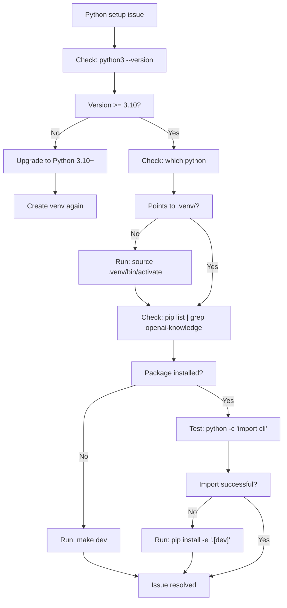
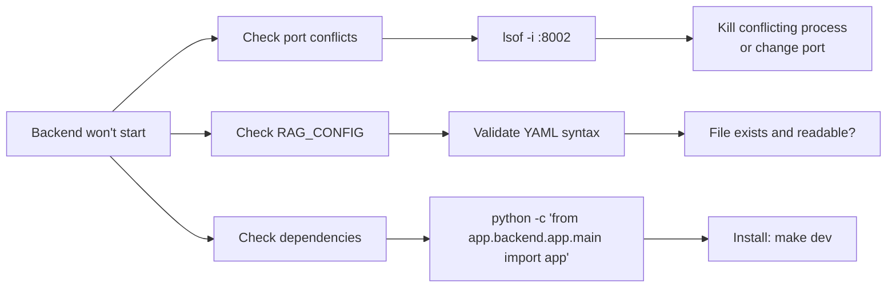
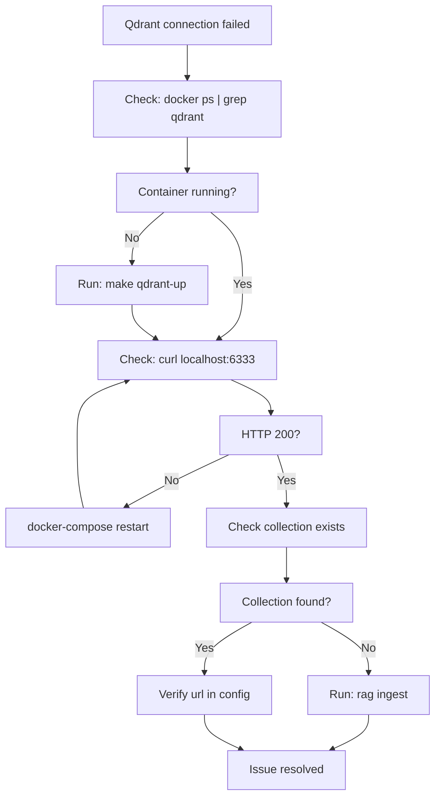
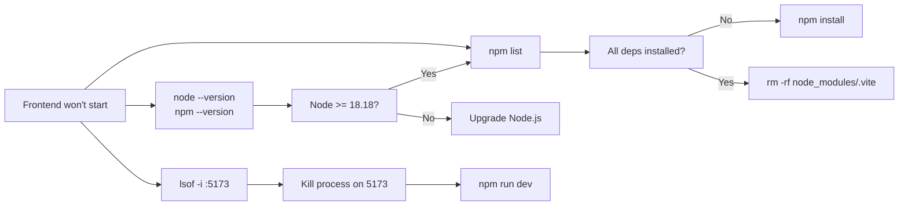
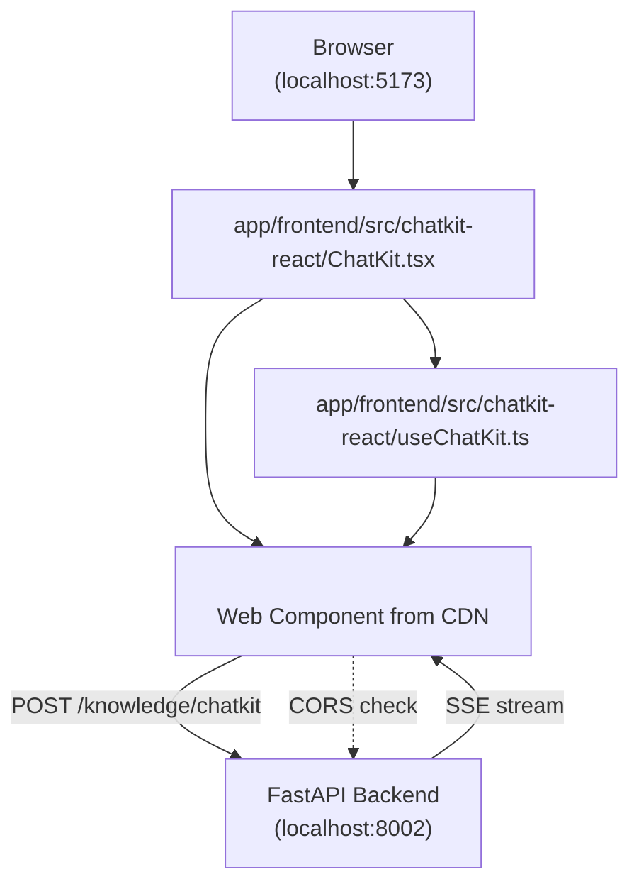
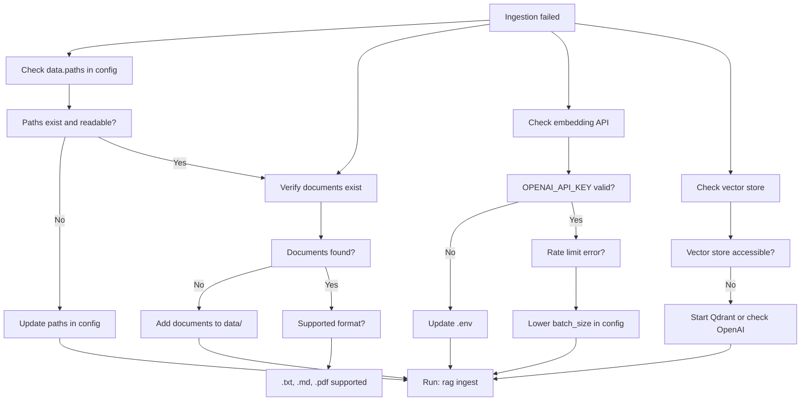
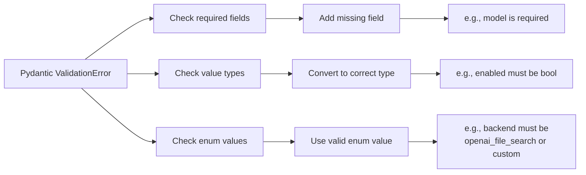
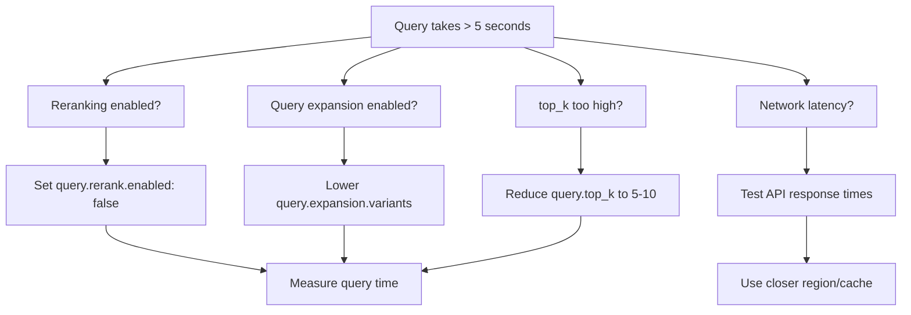

<!-- source: DeepWiki mcp.deepwiki.com · repo openai/openai-knowledge-retrieval · page 12 Troubleshooting · fetched 2026-10-26 -->

# Troubleshooting

<details>
<summary>Relevant source files</summary>

The following files were used as context for generating this wiki page:

- [CONTRIBUTING.md](CONTRIBUTING.md)
- [README.md](README.md)
- [SECURITY.md](SECURITY.md)

</details>


This page provides solutions to common issues encountered when setting up, configuring, and running the OpenAI Knowledge Retrieval starter kit. It covers problems across the backend (FastAPI), frontend (React/Vite), CLI tools, vector stores, and external service integrations.

For configuration details, see [Configuration](#7). For development setup, see [Getting Started](#2). For deployment issues, see [Deployment](#9).

---

## Common Setup Issues

### Python Version or Virtual Environment Problems

**Symptoms:**
- `ModuleNotFoundError` when running commands
- `make dev` or `make install` fails
- Package installation errors

**Diagnostic Steps:**



**Solutions:**

| Issue | Command | Notes |
|-------|---------|-------|
| Python too old | `python3.11 -m venv .venv` | Requires Python 3.10+ |
| Virtual environment not activated | `source .venv/bin/activate` | Re-activate in each new terminal |
| Dependencies not installed | `make dev` | Installs editable package + dev extras |
| Corrupted virtual environment | `rm -rf .venv && python3 -m venv .venv` | Clean reinstall |

**Sources:** [README.md:16-20](), [CONTRIBUTING.md:12-18]()

---

### Missing or Invalid Environment Variables

**Symptoms:**
- `ValidationError` when starting backend
- "API key not configured" errors
- `None` values for required configuration

**Diagnostic Steps:**

Check if `.env` file exists and contains required variables:

```bash
# Verify .env file exists
ls -la .env

# Check OPENAI_API_KEY is set
grep OPENAI_API_KEY .env

# Test key is loaded
python -c "from dotenv import load_dotenv; import os; load_dotenv(); print(os.getenv('OPENAI_API_KEY'))"
```

**Required Variables:**

| Variable | Required For | Format | Example |
|----------|-------------|--------|---------|
| `OPENAI_API_KEY` | All OpenAI API calls | `sk-...` | `sk-proj-abc123...` |
| `RAG_CONFIG` | Backend server, CLI | File path | `configs/default.openai.yaml` |
| `VECTOR_STORE_ID` | Reusing existing store | `vs_...` | `vs_abc123...` |
| `OPENAI_ORG_ID` | Organization-specific access | `org-...` | `org-xyz789...` |
| `OPENAI_PROJECT_ID` | Project-specific access | `proj_...` | `proj_def456...` |

**Solutions:**

```bash
# Copy template if .env is missing
cp .env.example .env

# Edit .env with your API key
echo "OPENAI_API_KEY=sk-your-key-here" >> .env

# Set RAG_CONFIG if using custom config
echo "RAG_CONFIG=configs/my.openai.yaml" >> .env
```

**Common Mistakes:**
- Committing `.env` to version control (should be in `.gitignore`)
- Using quotes around values (not needed in `.env`)
- Forgetting to restart servers after changing `.env`

**Sources:** [README.md:22-24](), [README.md:85-93](), [SECURITY.md:27-28]()

---

## Backend Server Issues

### FastAPI Server Won't Start

**Symptoms:**
- `make run-app-backend` fails immediately
- Port already in use errors
- Import errors or module not found



**Port Conflicts:**

```bash
# Check if port 8002 (app backend) or 8000 (API) is in use
lsof -i :8002
lsof -i :8000

# Kill process using the port
kill -9 <PID>

# Or use a different port
uvicorn app.backend.app.main:app --port 8003 --reload
```

**Configuration Errors:**

```bash
# Test configuration loading
python -c "from cli.config_loader import load_config; load_config('configs/default.openai.yaml')"

# Common YAML syntax errors to check:
# - Incorrect indentation (use 2 spaces, not tabs)
# - Missing colons after keys
# - Unquoted strings with special characters
# - Invalid boolean values (use true/false, not True/False)
```

**Import Errors:**

If you see `ModuleNotFoundError: No module named 'app'`:

```bash
# Ensure package is installed in development mode
pip install -e .

# Or reinstall
make dev
```

**Sources:** [README.md:128-131](), [app/backend/app/main.py:1-50]()

---

### OpenAI API Errors

**Common API Error Codes:**

| Error Code | Meaning | Solution |
|------------|---------|----------|
| `401 Unauthorized` | Invalid API key | Check `OPENAI_API_KEY` in `.env` |
| `403 Forbidden` | No access to resource | Verify organization/project permissions |
| `404 Not Found` | Vector store or file not found | Check `VECTOR_STORE_ID` or re-run ingestion |
| `429 Rate Limit` | Too many requests | Add retry logic or reduce request rate |
| `500 Internal Error` | OpenAI service issue | Check status.openai.com, retry later |
| `503 Service Unavailable` | Temporary outage | Implement exponential backoff |

**Debugging API Calls:**

The backend uses the OpenAI Python SDK. Enable debug logging:

```python
# Add to app/backend/app/main.py or CLI scripts
import logging
logging.basicConfig(level=logging.DEBUG)
```

**Rate Limit Handling:**

If you encounter rate limits during ingestion or heavy usage:

```yaml
# In configs/*.yaml, adjust batch sizes
data:
  batch_size: 10  # Reduce from default 20

embeddings:
  batch_size: 50  # Reduce from default 100
```

**Sources:** [README.md:74](), [app/backend/app/assistant_agent.py:1-100]()

---

### Vector Store Connection Issues

**Qdrant Connection Problems:**



**Diagnostic Commands:**

```bash
# Check Qdrant is running
docker ps | grep qdrant

# Start Qdrant if not running
make qdrant-up

# Test Qdrant API
curl http://localhost:6333/collections

# View Qdrant logs
docker logs qdrant

# Check collection exists
curl http://localhost:6333/collections/my_collection
```

**OpenAI File Search Issues:**

If using `backend: openai_file_search`:

```bash
# Verify vector store exists
python -c "
from openai import OpenAI
client = OpenAI()
vs = client.beta.vector_stores.retrieve('vs_...')
print(vs)
"

# List all vector stores
python -c "
from openai import OpenAI
client = OpenAI()
for vs in client.beta.vector_stores.list():
    print(f'{vs.id}: {vs.name}')
"
```

**Sources:** [README.md:109-114](), [README.md:186-208]()

---

## Frontend Issues

### Vite Dev Server Won't Start

**Symptoms:**
- `make run-app-frontend` fails
- Port 5173 already in use
- Module resolution errors



**Port Conflicts:**

```bash
# Check port 5173
lsof -i :5173

# Kill process
kill -9 <PID>

# Or specify different port
npm run dev -- --port 5174
```

**Dependency Issues:**

```bash
# Clean install
rm -rf node_modules package-lock.json
npm install

# Clear Vite cache
rm -rf node_modules/.vite

# Update dependencies
npm update
```

**Node Version Issues:**

```bash
# Check version (requires 18.18+)
node --version

# If too old, upgrade (using nvm)
nvm install 20
nvm use 20
```

**Sources:** [README.md:73](), [README.md:134-140](), [app/frontend/package.json:1-50]()

---

### ChatKit Integration Problems

**Symptoms:**
- ChatKit UI not rendering
- Messages not sending
- No responses from backend
- CORS errors in browser console

**Component Flow:**



**CORS Issues:**

If you see CORS errors in the browser console:

```javascript
// Browser console error:
// Access to fetch at 'http://localhost:8002/knowledge/chatkit' 
// from origin 'http://localhost:5173' has been blocked by CORS policy
```

**Solution:** The backend should have CORS enabled. Check [app/backend/app/main.py:30-40]() for CORS middleware configuration:

```python
# Verify CORS is configured
app.add_middleware(
    CORSMiddleware,
    allow_origins=["http://localhost:5173", "http://localhost:5172"],
    allow_credentials=True,
    allow_methods=["*"],
    allow_headers=["*"],
)
```

**Backend Connection Issues:**

```bash
# Test backend is reachable
curl http://localhost:8002/knowledge/health

# Check if backend is running
ps aux | grep uvicorn

# Verify config points to correct backend URL
# In app/frontend/src/lib/config.ts
grep API_BASE_URL app/frontend/src/lib/config.ts
```

**Web Component Loading Issues:**

If the ChatKit web component fails to load:

```javascript
// Check browser console for:
// Failed to load resource: https://cdn.jsdelivr.net/...

// Verify CDN is accessible
// Or host the web component locally if needed
```

**Sources:** [app/frontend/src/chatkit-react/ChatKit.tsx:1-50](), [app/frontend/src/chatkit-react/useChatKit.ts:1-100]()

---

## CLI Tool Issues

### `rag` Command Not Found

**Symptoms:**
- `rag: command not found`
- `rag` command runs wrong version

**Solutions:**

```bash
# Ensure virtual environment is activated
source .venv/bin/activate

# Verify rag is installed
which rag

# Should show: /path/to/project/.venv/bin/rag
# If not, reinstall:
pip install -e .

# Or run directly via Python
python -m cli.main ingest --config configs/default.openai.yaml
```

**Sources:** [README.md:119](), [CONTRIBUTING.md:17]()

---

### Ingestion Failures

**Common Ingestion Issues:**



**File Path Issues:**

```bash
# Check what files will be ingested
rag ingest --config configs/my.yaml --dry-run

# Verify paths in config point to real files
cat configs/my.yaml | grep -A5 "data:"

# Example valid config:
# data:
#   paths:
#     - data/example_data/
#   recursive: true
```

**Document Format Issues:**

Supported formats:
- `.txt` - Plain text
- `.md` - Markdown
- `.pdf` - PDF documents
- `.html` - HTML files (requires preprocessing)

If you have unsupported formats, you'll need to convert them or implement a custom loader.

**Chunking Errors:**

```bash
# If chunking fails with token limit errors:
# Reduce max_chunk_size_tokens in config

# Example adjustment:
# chunking:
#   strategy: hybrid
#   target_token_range: [100, 400]  # Reduced from [100, 512]
```

**Sources:** [README.md:116-123](), [README.md:166-182]()

---

### Evaluation Failures

**Dataset Generation Issues:**

```bash
# If auto-generation fails
rag eval --config configs/my.yaml --mode auto

# Common issues:
# 1. No documents ingested yet
#    Solution: Run rag ingest first

# 2. Insufficient chunks for sampling
#    Solution: Ingest more documents or reduce sample size

# 3. LLM API errors
#    Solution: Check API key and rate limits
```

**OpenAI Evals Sync Issues:**

| Error | Cause | Solution |
|-------|-------|----------|
| `401 Unauthorized` | Invalid credentials | Set `OPENAI_PROJECT_ID` and `OPENAI_API_KEY` |
| `404 Not Found` | Project doesn't exist | Create project in OpenAI dashboard first |
| `422 Validation Error` | Invalid dataset format | Check dataset matches schema in [evals/datasets/schema.py]() |
| `429 Rate Limit` | Too many uploads | Wait and retry, or reduce batch size |

**Disable OpenAI Evals sync:**

```yaml
# In configs/*.yaml
evals:
  mode: auto
  openai_evals:
    enabled: false  # Only use local grading
```

**Sources:** [README.md:142-150](), [README.md:252-286]()

---

## Configuration Issues

### YAML Syntax Errors

**Common YAML Mistakes:**

```yaml
# ❌ WRONG: Tabs instead of spaces
vector_store:
	backend: openai_file_search  # Tab character

# ✅ CORRECT: Use 2 spaces
vector_store:
  backend: openai_file_search

# ❌ WRONG: Missing colon
synthesis
  model: gpt-4o-mini

# ✅ CORRECT: Include colon
synthesis:
  model: gpt-4o-mini

# ❌ WRONG: Unquoted special characters
system_prompt: Use the following format: Q&A

# ✅ CORRECT: Quote strings with special chars
system_prompt: "Use the following format: Q&A"

# ❌ WRONG: Python-style booleans
query:
  expansion:
    enabled: True  # Python style

# ✅ CORRECT: YAML booleans
query:
  expansion:
    enabled: true  # YAML style
```

**Validate YAML:**

```bash
# Use Python to check YAML syntax
python -c "
import yaml
with open('configs/my.yaml') as f:
    config = yaml.safe_load(f)
    print('YAML is valid')
"

# Or use yamllint
pip install yamllint
yamllint configs/my.yaml
```

**Sources:** [README.md:96-105](), [README.md:151-238]()

---

### Configuration Value Validation

**Validation Errors:**



**Common Validation Errors:**

| Error Message | Fix |
|---------------|-----|
| `field required` | Add the missing field to config |
| `value is not a valid boolean` | Use `true` or `false` (lowercase) |
| `value is not a valid integer` | Remove quotes around numbers |
| `unexpected value; permitted:` | Use one of the listed enum values |
| `str type expected` | Add quotes around the value |

**Example Fix:**

```yaml
# ❌ Error: field required
synthesis:
  # Missing 'model' field

# ✅ Fixed:
synthesis:
  model: gpt-4o-mini
  
# ❌ Error: value is not a valid boolean
query:
  expansion:
    enabled: "true"  # String, not boolean

# ✅ Fixed:
query:
  expansion:
    enabled: true  # Boolean
```

**Sources:** [cli/config_loader.py:1-100]()

---

## Performance Issues

### Slow Query Responses

**Diagnostic Steps:**



**Optimization Strategies:**

1. **Disable expensive features during development:**

```yaml
query:
  expansion:
    enabled: false  # Disable if not needed
  hyde:
    enabled: false  # Disable HyDE if not beneficial
  rerank:
    enabled: false  # Most expensive operation
```

2. **Reduce retrieval scope:**

```yaml
query:
  top_k: 5  # Reduce from default (often 10-20)
  rerank:
    max_candidates: 20  # Reduce if enabled
```

3. **Use faster models:**

```yaml
synthesis:
  model: gpt-4o-mini  # Faster than gpt-4o
  
query:
  expansion:
    model: gpt-4o-mini  # Faster than gpt-4
```

**Measure Performance:**

Add timing to backend code for debugging:

```python
# In app/backend/app/main.py
import time

start = time.time()
# ... query processing ...
print(f"Query took {time.time() - start:.2f}s")
```

**Sources:** [README.md:210-223](), [app/backend/app/assistant_agent.py:1-200]()

---

### High Memory Usage

**Symptoms:**
- Backend process killed by OS
- `MemoryError` during ingestion
- System becomes unresponsive

**Solutions:**

1. **Reduce batch sizes during ingestion:**

```yaml
data:
  batch_size: 5  # Reduce from default 20

embeddings:
  batch_size: 25  # Reduce from default 100
```

2. **Process documents in smaller batches:**

```bash
# Instead of ingesting all at once:
# rag ingest --config configs/all-docs.yaml

# Split into smaller configs:
rag ingest --config configs/batch1.yaml
rag ingest --config configs/batch2.yaml
```

3. **Clear in-memory caches periodically:**

The backend uses thread-local caching. Restart the server periodically if running continuously:

```bash
# Restart backend
pkill -f "uvicorn app.backend.app.main"
make run-app-backend
```

**Sources:** [app/backend/app/main.py:100-200](), [app/backend/app/memory_store.py:1-50]()

---

## Development and Testing Issues

### Linting Failures

**Python Linting (ruff):**

```bash
# Check for issues
ruff check .

# Auto-fix issues
ruff check --fix .

# Check specific file
ruff check app/backend/app/main.py
```

**Common ruff errors:**

| Code | Meaning | Fix |
|------|---------|-----|
| F401 | Unused import | Remove the import |
| E501 | Line too long | Break line or disable for that line |
| F841 | Unused variable | Remove or prefix with `_` |
| I001 | Import order | Run `ruff check --fix` |

**Frontend Linting (ESLint):**

```bash
# From app/frontend/
npm run lint

# Auto-fix issues
npm run lint:fix
```

**Common ESLint errors:**

| Error | Fix |
|-------|-----|
| `'React' is not defined` | Import React at top of file |
| `Missing return type` | Add TypeScript return type |
| `Unused variable` | Remove or prefix with `_` |

**Sources:** [CONTRIBUTING.md:48-56](), [README.md:244-249]()

---

### Type Checking Errors

**Python Type Errors (mypy):**

```bash
# Run type checker
mypy .

# Check specific file
mypy app/backend/app/main.py

# Common issues and fixes:
```

| Error | Fix |
|-------|-----|
| `Incompatible types` | Ensure variable types match annotations |
| `Missing type parameters` | Add type params: `List[str]` not `List` |
| `Cannot determine type` | Add explicit type annotation |
| `Name is not defined` | Import the type or use string literal |

**TypeScript Errors:**

```bash
# From app/frontend/
npm run type-check

# Or let the dev server show errors
npm run dev
```

**Common fixes:**

```typescript
// ❌ Error: Property 'title' does not exist
const doc: Document = {};
doc.title = "Test";

// ✅ Fixed: Define interface or type
interface Document {
  title: string;
  content: string;
}
const doc: Document = {
  title: "Test",
  content: "..."
};
```

**Sources:** [CONTRIBUTING.md:35-40](), [app/frontend/tsconfig.json:1-30]()

---

### Test Failures

**Python Tests:**

```bash
# Run all tests
pytest

# Run specific test file
pytest tests/test_ingestion.py

# Run with verbose output
pytest -v

# Run with print statements
pytest -s

# Common issues:
```

| Issue | Solution |
|-------|----------|
| Import errors | Run `pip install -e '.[dev]'` |
| Fixture errors | Check conftest.py setup |
| API mocking failures | Verify mock configurations |
| Environment variables | Set test-specific .env values |

**Frontend Tests:**

```bash
# From app/frontend/
npm run test

# Run specific test
npm run test -- ChatKit.test.tsx

# Run in watch mode
npm run test:watch
```

**Sources:** [CONTRIBUTING.md:50-52]()

---

## Docker and Deployment Issues

### Qdrant Docker Issues

**Container Won't Start:**

```bash
# Check Docker is running
docker ps

# View Qdrant container logs
docker logs qdrant

# Restart container
docker-compose restart

# Stop and remove, then recreate
docker-compose down
make qdrant-up

# Check port is not in use
lsof -i :6333
```

**Volume Permission Issues:**

```bash
# If you see permission errors in logs:
# Check volumes in docker-compose.yml
docker-compose down -v  # Remove volumes
make qdrant-up  # Recreate with fresh volumes
```

**Data Persistence Issues:**

```bash
# Verify Qdrant data is persisted
docker inspect qdrant | grep -A5 Mounts

# If data disappears after restart:
# Check docker-compose.yml has named volume
# Example:
# volumes:
#   - qdrant_storage:/qdrant/storage
```

**Sources:** [README.md:109-114]()

---

## Logging and Debugging

### Enable Debug Logging

**Backend Debug Logging:**

Add to [app/backend/app/main.py:1-20]():

```python
import logging

# Configure root logger
logging.basicConfig(
    level=logging.DEBUG,
    format='%(asctime)s - %(name)s - %(levelname)s - %(message)s'
)

# Or configure specific loggers
logging.getLogger('app.backend').setLevel(logging.DEBUG)
logging.getLogger('openai').setLevel(logging.DEBUG)
```

**CLI Debug Output:**

```bash
# Use --verbose flag
rag ingest --config configs/my.yaml --verbose

# Or set log level via environment
export LOG_LEVEL=DEBUG
rag ingest --config configs/my.yaml
```

**Frontend Debug Logging:**

```typescript
// In app/frontend/src/lib/config.ts
export const DEBUG = true;

// Use console.debug for debug messages
if (DEBUG) {
  console.debug('ChatKit state:', state);
}
```

### Useful Debug Commands

```bash
# Backend health check
curl http://localhost:8002/knowledge/health

# List documents
curl http://localhost:8002/knowledge/documents

# Test OpenAI API connection
python -c "from openai import OpenAI; print(OpenAI().models.list())"

# Test Qdrant connection
curl http://localhost:6333/collections

# Check running processes
ps aux | grep uvicorn
ps aux | grep node

# Check ports in use
lsof -i :5173  # Frontend
lsof -i :8002  # App backend
lsof -i :8000  # API backend
lsof -i :6333  # Qdrant
```

**Sources:** [README.md:140](), [app/backend/app/main.py:1-50]()

---

## Getting Additional Help

### Diagnostic Information to Collect

When reporting issues, include:

1. **Environment details:**
```bash
python --version
node --version
pip list | grep openai
npm list --depth=0
```

2. **Configuration:**
```bash
cat .env | grep -v "API_KEY"  # Don't share API keys!
cat configs/my.yaml
```

3. **Error messages:**
- Full stack traces
- Browser console errors (for frontend)
- Server logs (for backend)

4. **Steps to reproduce:**
- Exact commands run
- Configuration changes made
- Expected vs. actual behavior

### Community Resources

- GitHub Issues: Report bugs and feature requests at the repository
- README: [README.md:1-308]() for quickstart and overview
- Contributing: [CONTRIBUTING.md:1-72]() for development setup
- Security: [SECURITY.md:1-42]() for vulnerability reporting

**Sources:** [CONTRIBUTING.md:64-67](), [SECURITY.md:9-23]()

---

## Quick Reference: Common Commands

| Issue | Command | Notes |
|-------|---------|-------|
| Reset environment | `rm -rf .venv && python3 -m venv .venv && make dev` | Clean reinstall |
| Restart backend | `pkill -f uvicorn && make run-app-backend` | Kill and restart |
| Restart frontend | `pkill -f vite && make run-app-frontend` | Kill and restart |
| Restart Qdrant | `docker-compose restart` | Restart container |
| Clear Qdrant data | `docker-compose down -v && make qdrant-up` | Delete all vectors |
| Validate config | `python -c "from cli.config_loader import load_config; load_config('configs/my.yaml')"` | Test YAML syntax |
| Test API connection | `curl http://localhost:8002/knowledge/health` | Check backend |
| Re-ingest documents | `rag ingest --config configs/my.yaml --force` | Force re-upload |
| Run linters | `ruff check . && cd app/frontend && npm run lint` | Check code quality |
| Run tests | `pytest && cd app/frontend && npm test` | Run all tests |

**Sources:** [README.md:12-42](), [Makefile:1-100]()