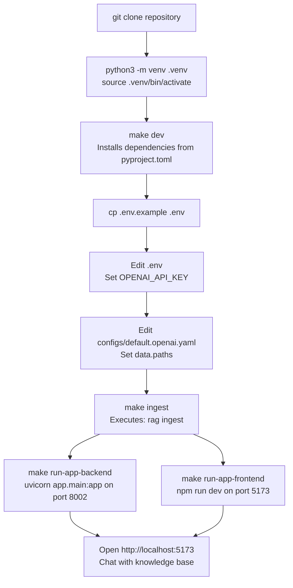
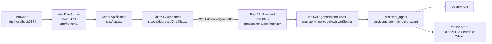
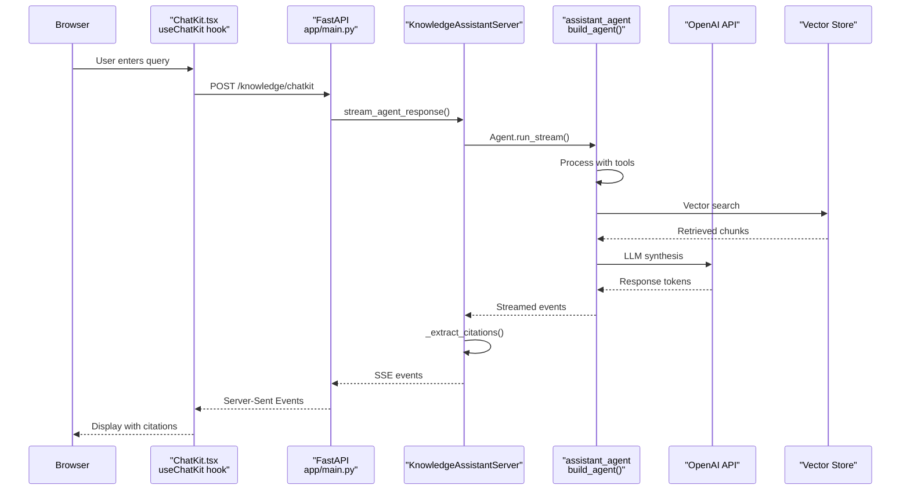

<!-- source: DeepWiki mcp.deepwiki.com · repo openai/openai-knowledge-retrieval · page 2 Getting Started · fetched 2026-10-26 -->

# Getting Started

<details>
<summary>Relevant source files</summary>

The following files were used as context for generating this wiki page:

- [.env.example](.env.example)
- [CONTRIBUTING.md](CONTRIBUTING.md)
- [Makefile](Makefile)
- [README.md](README.md)

</details>


This page guides you through setting up the OpenAI Knowledge Retrieval starter kit, from initial installation to running your first knowledge-grounded conversation. You will clone the repository, configure credentials, ingest documents, and launch both backend and frontend services.

For detailed information on specific topics, see:
- Prerequisites and dependency requirements: [Prerequisites and Environment Setup](#2.1)
- Detailed installation steps: [Installation](#2.2)
- Configuration file structure and options: [Configuration](#2.3)
- Running development and production servers: [Running the Application](#2.4)

## Overview

The setup process follows a linear progression through five phases:

1. **Environment Setup**: Clone repository, create Python virtual environment, install dependencies
2. **Credential Configuration**: Copy `.env.example` to `.env` and provide API keys
3. **Data Ingestion**: Process documents and populate vector store
4. **Service Launch**: Start backend API server and frontend development server
5. **Verification**: Access the UI and test retrieval functionality



**Sources**: [README.md:12-42](), [CONTRIBUTING.md:10-33]()

## Quick Start

### Step 1: Clone and Install Backend Dependencies

```bash
# Clone the repository
git clone https://github.com/openai/openai-knowledge-retrieval
cd openai-knowledge-retrieval

# Create and activate Python virtual environment
python3 -m venv .venv
source .venv/bin/activate  # On Windows: .venv\Scripts\activate

# Install backend dependencies with development extras
make dev
```

The `make dev` target installs the project in editable mode with development dependencies including testing frameworks, linters, and type checkers defined in [pyproject.toml]().

**Alternative**: Use `make install` for production installation without development extras.

**Sources**: [README.md:17-20](), [CONTRIBUTING.md:12-18](), [Makefile:9-10]()

### Step 2: Configure Credentials

```bash
# Copy environment template
cp .env.example .env
```

Edit `.env` and set your OpenAI API key:

```bash
OPENAI_API_KEY="sk-proj-..."
```

| Variable | Required | Purpose |
|----------|----------|---------|
| `OPENAI_API_KEY` | Yes | Authentication for OpenAI API calls |
| `OPENAI_ORG_ID` | No | Organization identifier for API requests |
| `OPENAI_PROJECT_ID` | No | Project identifier for cost tracking |
| `RAG_CONFIG` | No | Path to YAML config (defaults to `configs/default.openai.yaml`) |
| `VECTOR_STORE_ID` | No | Reuse existing OpenAI vector store instead of creating new one |
| `KNOWLEDGE_CORS_ALLOW_ORIGINS` | No | CORS origins for API (defaults to localhost ports) |

**Sources**: [README.md:22-24](), [.env.example:1-6](), [CONTRIBUTING.md:27-32]()

### Step 3: Configure Data Sources

The default configuration file `configs/default.openai.yaml` references example data. To use your own documents:

```bash
# Option 1: Edit the default config directly
nano configs/default.openai.yaml

# Option 2: Generate a new config from template
rag init --template openai > configs/my-project.yaml
```

Update the `data.paths` section to point to your document directory:

```yaml
data:
  paths:
    - "data/my_documents/"  # Your document path
```

If you created a custom config, set it in `.env`:

```bash
RAG_CONFIG="configs/my-project.yaml"
```

**Sources**: [README.md:26-27](), [README.md:95-106]()

### Step 4: Ingest Documents

```bash
make ingest
```

This executes `rag ingest --config configs/default.openai.yaml` (or your configured path), which:
1. Loads documents from paths specified in the YAML config
2. Chunks text according to the configured chunking strategy
3. Generates embeddings via OpenAI Embeddings API
4. Uploads to the configured vector store (OpenAI File Search by default)

The command outputs a `vector_store_id` upon completion. For OpenAI File Search, you can persist this ID in `.env` to reuse the vector store across ingestion runs:

```bash
VECTOR_STORE_ID="vs_abc123..."
```

**Sources**: [README.md:29-30](), [README.md:117-123](), [Makefile:31-32]()

### Step 5: Launch Backend Service

```bash
make run-app-backend
```

This starts the FastAPI application via `uvicorn app.main:app --reload --port 8002` with hot-reloading enabled. The backend service:
- Loads configuration from `$RAG_CONFIG` or `configs/default.openai.yaml`
- Initializes the `KnowledgeAssistantServer` class from [app/backend/app/main.py]()
- Exposes HTTP endpoints at `http://localhost:8002`
- Connects to OpenAI API using credentials from `.env`

The terminal will display:

```
INFO:     Uvicorn running on http://127.0.0.1:8002 (Press CTRL+C to quit)
INFO:     Started reloader process
INFO:     Started server process
INFO:     Waiting for application startup.
INFO:     Application startup complete.
```

**Sources**: [README.md:32-34](), [Makefile:18-19]()

### Step 6: Launch Frontend Service

In a separate terminal:

```bash
# Ensure you're in the project root
cd openai-knowledge-retrieval

# Start frontend development server
make run-app-frontend
```

This navigates to `app/frontend/`, installs npm dependencies if needed, and runs `npm run dev`. The Vite development server starts on `http://localhost:5173` and provides:
- Hot module replacement for instant UI updates
- Proxy configuration to backend API
- React 19 application with ChatKit integration

**Sources**: [README.md:35-36](), [Makefile:15-16]()

### Step 7: Access the Application

Open your browser to `http://localhost:5173`. The interface provides:
- Chat input for natural language queries
- Streaming response display with citations
- Document preview modal for referenced sources
- Conversation history preservation



**Sources**: [README.md:37-38]()

## Service Communication Flow

The following diagram maps the runtime interaction between components, showing how HTTP requests flow from the browser through the React application to the FastAPI backend, and how the backend orchestrates calls to external services.



**Sources**: [app/backend/app/main.py](), [app/backend/app/assistant_agent.py]()

## Verification Steps

After launching both services, verify the setup:

### Backend Health Check

```bash
curl http://localhost:8002/knowledge/health
```

Expected response:
```json
{"status": "healthy"}
```

### Document List

```bash
curl http://localhost:8002/knowledge/documents
```

Returns JSON array of ingested documents with metadata.

### Frontend Access

Navigate to `http://localhost:5173` and verify:
- Chat interface loads without errors
- Browser console shows no connection errors
- Test query returns a response with citations

**Sources**: [app/backend/app/main.py]() (health endpoint)

## Common Setup Issues

| Issue | Cause | Solution |
|-------|-------|----------|
| `ModuleNotFoundError` | Virtual environment not activated | Run `source .venv/bin/activate` |
| `401 Unauthorized` from OpenAI | Invalid or missing API key | Verify `OPENAI_API_KEY` in `.env` |
| Backend fails to start | Port 8002 already in use | Use `make stop-app-backend` or change port |
| Frontend can't connect to backend | Backend not running | Ensure `make run-app-backend` is running |
| No documents returned | Ingestion not completed | Run `make ingest` and wait for completion |
| CORS errors in browser | Origins not whitelisted | Check `KNOWLEDGE_CORS_ALLOW_ORIGINS` in `.env` |

**Sources**: [.env.example:6](), [Makefile:21-23]()

## Optional: Qdrant Vector Store

To use a local Qdrant instance instead of OpenAI File Search:

```bash
# Start Qdrant in Docker
make qdrant-up

# Generate config with Qdrant template
rag init --template custom-qdrant > configs/qdrant.yaml

# Update RAG_CONFIG in .env
echo 'RAG_CONFIG="configs/qdrant.yaml"' >> .env

# Ingest to Qdrant
make ingest
```

The Qdrant instance runs on `http://localhost:6333` and provides a web UI at the same address.

**Sources**: [README.md:108-114](), [Makefile:25-29]()

## Next Steps

After completing the setup:

1. **Customize Configuration**: Modify YAML files to adjust chunking, retrieval, and synthesis parameters. See [Configuration](#2.3) for available options.

2. **Ingest Your Data**: Replace example documents with your own corpus and re-run ingestion. See [Data Ingestion](#6.2) for details.

3. **Run Evaluations**: Generate synthetic evaluation datasets and measure retrieval quality:
   ```bash
   make eval
   ```
   See [Evaluation System](#6.3) for evaluation workflows.

4. **Explore Architecture**: Understand the system components and data flows in [Architecture](#3).

5. **Customize the Agent**: Modify tools, prompts, and retrieval logic in [Assistant Agent System](#4.2).

**Sources**: [README.md:142-150]()

---

