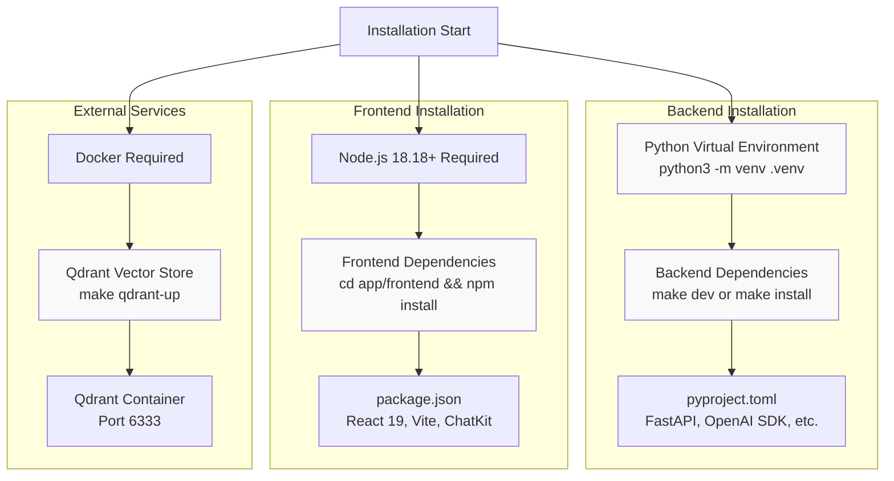
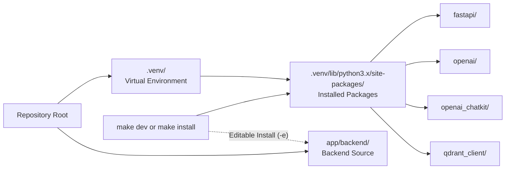
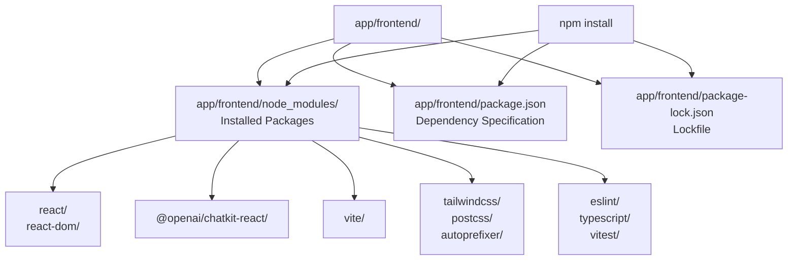
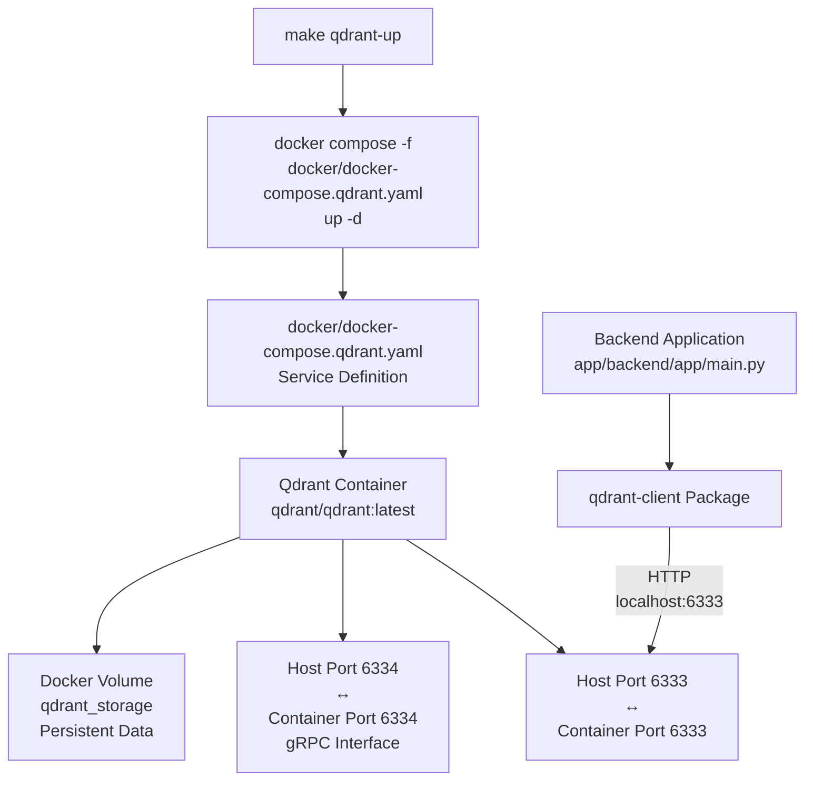
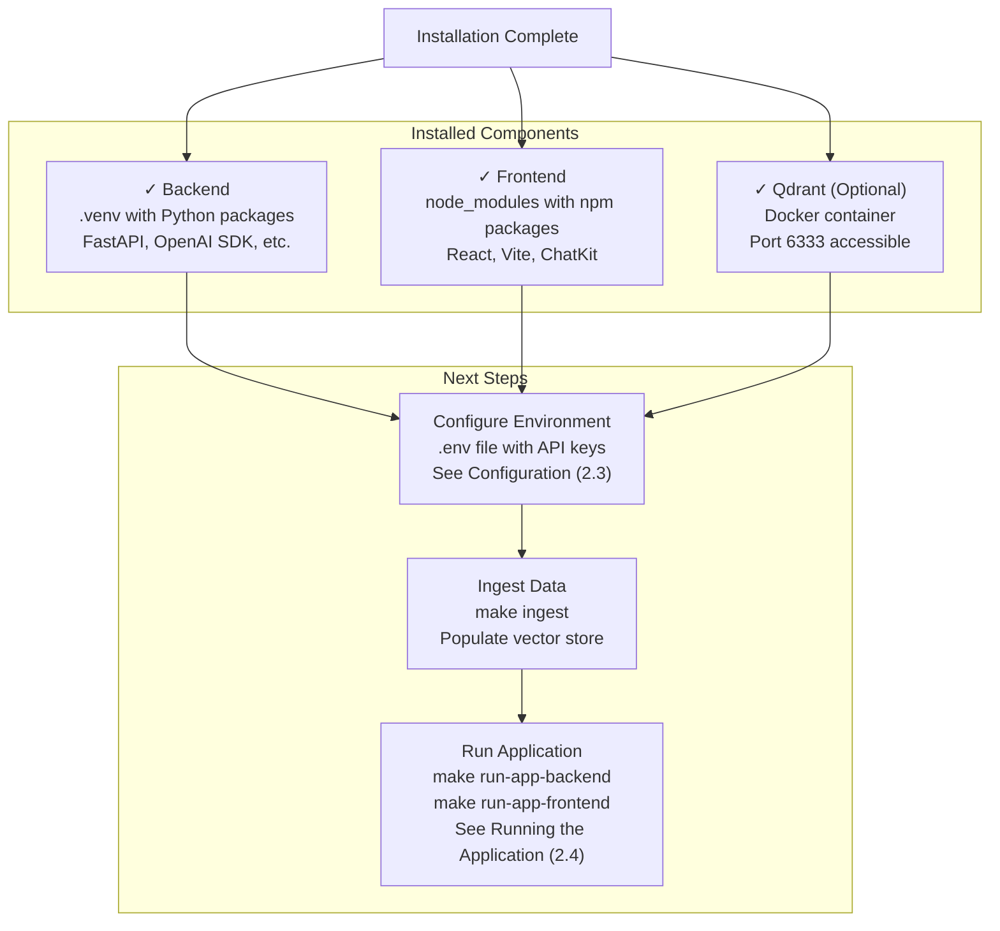

<!-- source: DeepWiki mcp.deepwiki.com · repo openai/openai-knowledge-retrieval · page 2.2 Installation · fetched 2026-10-26 -->

# Installation

<details>
<summary>Relevant source files</summary>

The following files were used as context for generating this wiki page:

- [CONTRIBUTING.md](CONTRIBUTING.md)
- [Makefile](Makefile)
- [README.md](README.md)
- [app/backend/pyproject.toml](app/backend/pyproject.toml)
- [app/frontend/package.json](app/frontend/package.json)

</details>


## Purpose and Scope

This document provides step-by-step installation instructions for all components of the OpenAI Knowledge Retrieval starter kit, including the Python backend, React frontend, and external services. Installation covers dependency management, package installation, and initial setup of the development environment.

For system requirements and environment preparation, see [Prerequisites and Environment Setup](#2.1). For configuring API keys and vector stores after installation, see [Configuration](#2.3). For instructions on starting the installed services, see [Running the Application](#2.4).

---

## Installation Overview

The installation process consists of three main components that can be installed independently:



**Installation Dependency Flow**: The backend can be installed independently, the frontend requires Node.js, and Qdrant requires Docker. All three components are optional depending on your use case—CLI-only workflows require only the backend.

**Sources**: [Makefile:1-38](), [README.md:16-82](), [CONTRIBUTING.md:10-25]()

---

## Backend Installation

### Creating the Python Virtual Environment

The backend requires Python 3.10+ and uses a virtual environment for dependency isolation:

```bash
python3 -m venv .venv
source .venv/bin/activate  # On Windows: .venv\Scripts\activate
```

**Sources**: [README.md:18-19](), [CONTRIBUTING.md:14-16]()

### Installing Backend Dependencies

The `Makefile` provides two installation targets:

| Command | Purpose | Dependencies Installed |
|---------|---------|----------------------|
| `make install` | Production installation | Core dependencies only |
| `make dev` | Development installation | Core + dev extras (ruff, mypy) |

```bash
# For production use:
make install

# For development (recommended):
make dev
```

These commands execute `pip install -e .` or `pip install -e .[dev]` respectively, installing the package in editable mode from the repository root.

**Sources**: [Makefile:6-10](), [README.md:20](), [CONTRIBUTING.md:17]()

### Backend Dependency Specification

Backend dependencies are defined in [app/backend/pyproject.toml:1-34](). The core dependencies include:

| Package | Version | Purpose |
|---------|---------|---------|
| `fastapi` | >=0.114.1,<0.116 | Web framework for REST API |
| `uvicorn[standard]` | >=0.36,<0.37 | ASGI server with WebSocket support |
| `openai` | >=1.40 | OpenAI API client |
| `openai-chatkit` | >=0.0.2 | ChatKit integration library |
| `httpx` | >=0.28,<0.29 | Async HTTP client |
| `qdrant-client` | >=1.13.3 | Qdrant vector store client |
| `rapidfuzz` | >=3.8.1 | String matching for citation lookup |
| `rich` | >=13.7.1 | Terminal formatting |
| `python-dotenv` | >=1.0.1 | Environment variable management |

Development dependencies (`dev` extra) include:

| Package | Version | Purpose |
|---------|---------|---------|
| `ruff` | >=0.6.4,<0.7 | Linting and formatting |
| `mypy` | >=1.8,<2 | Static type checking |

**Sources**: [app/backend/pyproject.toml:7-23]()

### Backend Installation Locations



**Package Installation Structure**: The `make dev` command installs packages into `.venv/lib/python3.x/site-packages/` while creating an editable link to `app/backend/` for local development.

**Sources**: [Makefile:6-10](), [app/backend/pyproject.toml:1-34]()

---

## Frontend Installation

### Prerequisites Check

Before installing frontend dependencies, verify Node.js and npm versions:

```bash
node --version  # Should be >= 18.18
npm --version   # Should be >= 9
```

**Sources**: [app/frontend/package.json:12-15]()

### Installing Frontend Dependencies

Navigate to the frontend directory and install packages:

```bash
cd app/frontend
npm install
```

Alternatively, use the Makefile target which handles directory navigation:

```bash
make run-app-frontend  # Includes npm install step
```

**Sources**: [Makefile:15-16](), [README.md:136-137](), [CONTRIBUTING.md:20-24]()

### Frontend Dependency Specification

Frontend dependencies are defined in [app/frontend/package.json:1-43](). The production dependencies include:

| Package | Version | Purpose |
|---------|---------|---------|
| `react` | ^19.2.0 | Core React library |
| `react-dom` | ^19.2.0 | React DOM rendering |
| `@openai/chatkit-react` | ^0 | ChatKit React components |
| `clsx` | ^2.1.1 | Conditional CSS class utility |
| `lucide-react` | ^0.544.0 | Icon library |

Development dependencies include:

| Package | Version | Purpose |
|---------|---------|---------|
| `vite` | ^7.1.9 | Build tool and dev server |
| `@vitejs/plugin-react-swc` | ^3.5.0 | React plugin with SWC |
| `typescript` | ^5.4.0 | TypeScript compiler |
| `eslint` | ^8.57.1 | Code linting |
| `@typescript-eslint/eslint-plugin` | ^7.18.0 | TypeScript ESLint rules |
| `@typescript-eslint/parser` | ^7.18.0 | TypeScript parser for ESLint |
| `tailwindcss` | ^3.4.13 | CSS framework |
| `postcss` | ^8.4.47 | CSS processing |
| `autoprefixer` | ^10.4.20 | CSS vendor prefixing |
| `vitest` | ^3.2.4 | Test framework |

**Sources**: [app/frontend/package.json:16-42]()

### Frontend Installation Structure



**Frontend Package Structure**: The `npm install` command reads `package.json`, resolves dependencies, and installs packages into `node_modules/` while creating or updating `package-lock.json`.

**Sources**: [app/frontend/package.json:1-43]()

---

## External Services Installation

### Qdrant Vector Store Setup

Qdrant is an optional vector database used with custom vector store configurations. It runs in a Docker container.

#### Docker Compose Configuration

The Qdrant service is configured via Docker Compose:

```bash
# Start Qdrant container
make qdrant-up

# Stop Qdrant container
make qdrant-down
```

These commands execute Docker Compose with the configuration file at [docker/docker-compose.qdrant.yaml]().

**Sources**: [Makefile:25-29](), [README.md:109-114]()

### Qdrant Service Architecture



**Qdrant Docker Architecture**: The `make qdrant-up` command starts a Qdrant container exposing port 6333 (REST API) and 6334 (gRPC). Data persists in a Docker volume named `qdrant_storage`.

**Sources**: [Makefile:25-29](), [README.md:109-114]()

### Verifying Qdrant Installation

After starting Qdrant, verify it's running:

```bash
# Check container status
docker ps | grep qdrant

# Test Qdrant API endpoint
curl http://localhost:6333/
```

Expected response: JSON with Qdrant version information.

**Sources**: [Makefile:25-29]()

---

## Installation Verification

### Backend Verification

Verify backend installation by checking the installed package and running a health check:

```bash
# Verify package installation
pip show chatkit-backend

# Expected output includes:
# Name: chatkit-backend
# Version: 0.1.0
# Location: /path/to/repo/app/backend
```

Verify core dependencies:

```bash
python -c "import fastapi; import openai; import openai_chatkit; print('Backend dependencies OK')"
```

**Sources**: [app/backend/pyproject.toml:1-6]()

### Frontend Verification

Verify frontend installation:

```bash
cd app/frontend

# Check for node_modules
ls node_modules/@openai/chatkit-react

# Verify TypeScript compilation
npx tsc --noEmit

# Run linter
npm run lint
```

**Sources**: [app/frontend/package.json:10](), [README.md:248-249]()

### External Services Verification

Verify Qdrant is accessible:

```bash
# Check if Qdrant container is running
docker ps --filter "name=qdrant"

# Test REST API
curl -X GET http://localhost:6333/collections
```

Expected response: Empty collections list `{"result": {"collections": []}}` or existing collections.

**Sources**: [Makefile:25-29]()

---

## Installation Summary



**Installation Workflow Summary**: After installing all components, proceed to configure environment variables ([Configuration](#2.3)), ingest data, and start the application ([Running the Application](#2.4)).

**Sources**: [README.md:12-42](), [Makefile:1-38]()

---

## Troubleshooting Installation Issues

### Common Backend Issues

| Issue | Solution |
|-------|----------|
| `python3: command not found` | Install Python 3.10+ or use `python` instead of `python3` |
| `No module named 'fastapi'` | Ensure virtual environment is activated and run `make dev` |
| `pip: command not found` | Use `python -m pip` instead of `pip` |
| Permission errors on Unix | Avoid `sudo pip`; use virtual environment instead |

### Common Frontend Issues

| Issue | Solution |
|-------|----------|
| `node: command not found` | Install Node.js 18.18+ from nodejs.org |
| `npm install` fails with EACCES | Fix npm permissions or use a version manager (nvm, fnm) |
| `Cannot find module 'vite'` | Delete `node_modules/` and `package-lock.json`, run `npm install` again |
| TypeScript errors | Ensure TypeScript version ^5.4.0 is installed |

### Common External Services Issues

| Issue | Solution |
|-------|----------|
| `docker: command not found` | Install Docker Desktop or Docker Engine |
| Port 6333 already in use | Stop conflicting service or change Qdrant port in docker-compose.yaml |
| `Cannot connect to Docker daemon` | Start Docker Desktop or Docker daemon service |
| Qdrant container exits immediately | Check Docker logs: `docker logs $(docker ps -aq --filter "name=qdrant")` |

**Sources**: [CONTRIBUTING.md:10-25](), [README.md:70-82]()

---

