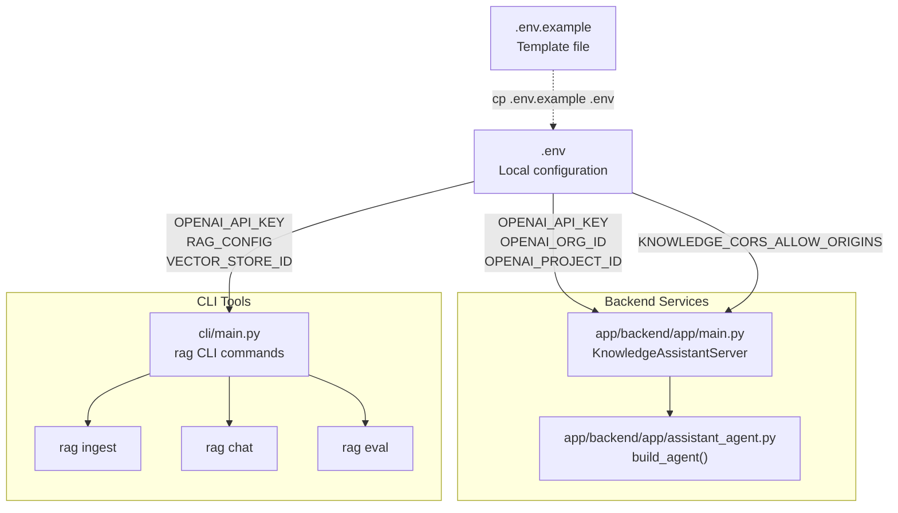
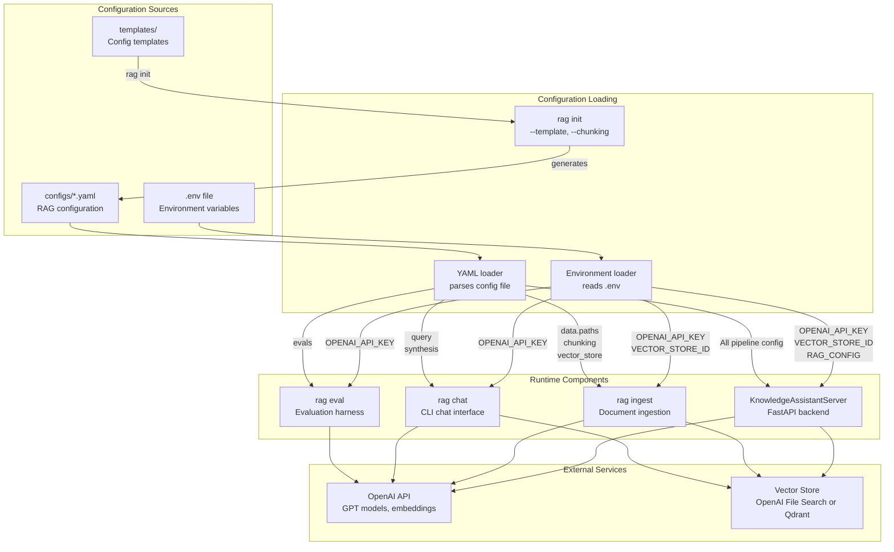

<!-- source: DeepWiki mcp.deepwiki.com · repo openai/openai-knowledge-retrieval · page 2.3 Configuration · fetched 2026-10-26 -->

# Configuration

<details>
<summary>Relevant source files</summary>

The following files were used as context for generating this wiki page:

- [.env.example](.env.example)
- [Makefile](Makefile)
- [README.md](README.md)

</details>


## Purpose and Scope

This document explains how to configure the OpenAI Knowledge Retrieval system for initial setup and operation. It covers environment variables, RAG configuration files, and vector store setup required to run the application.

For prerequisites and initial environment setup, see [Prerequisites and Environment Setup](#2.1). For detailed configuration reference including all available options and advanced customization, see [Configuration](#7) and its subsections.

**Sources:** [README.md:1-308]()

---

## Overview

The system uses a two-tier configuration approach:

1. **Environment variables** (`.env` file) - API credentials, service URLs, and runtime settings
2. **RAG configuration files** (YAML in `configs/`) - Pipeline behavior, chunking strategies, and retrieval settings

Configuration flows from these files into both the backend services and CLI tools, enabling consistent behavior across different execution contexts.

**Sources:** [.env.example:1-7](), [README.md:22-27](), [README.md:84-107]()

---

## Environment Variables

### Creating the .env File

Copy the example file to create your configuration:

```bash
cp .env.example .env
```

Then edit `.env` to add your credentials and settings.

**Sources:** [README.md:22-24]()

### Required Variables

| Variable | Purpose | Example |
|----------|---------|---------|
| `OPENAI_API_KEY` | OpenAI API authentication | `sk-proj-...` |

**Sources:** [.env.example:1](), [README.md:24](), [README.md:74]()

### Optional Variables

| Variable | Purpose | Default/Notes |
|----------|---------|---------------|
| `OPENAI_ORG_ID` | OpenAI organization identifier | Optional |
| `OPENAI_PROJECT_ID` | OpenAI project identifier | Optional |
| `RAG_CONFIG` | Path to RAG YAML configuration | `configs/default.openai.yaml` |
| `VECTOR_STORE_ID` | Reuse existing vector store | Created during ingestion if not set |
| `KNOWLEDGE_CORS_ALLOW_ORIGINS` | CORS allowed origins for backend | `http://localhost:5173,http://127.0.0.1:5173` |

**Sources:** [.env.example:1-7](), [README.md:86-93]()

### Configuration Diagram: Environment Variables Flow



**Sources:** [.env.example:1-7](), [Makefile:18-19](), [Makefile:31-38]()

---

## RAG Configuration Files

### Configuration File Location

RAG configuration files are stored in the `configs/` directory as YAML files. The default configuration is `configs/default.openai.yaml`.

**Sources:** [README.md:62](), [.env.example:4]()

### Creating a Configuration File

Use the CLI to generate a configuration from a template:

```bash
rag init --template openai > configs/my.openai.yaml
```

Available templates:
- `openai` - Uses OpenAI File Search (managed vector store)
- `custom-qdrant` - Uses local Qdrant vector database

You can also specify a chunking strategy:

```bash
rag init --template openai --chunking recursive > configs/my.openai.yaml
rag init --template custom-qdrant --chunking heading > configs/my.qdrant.yaml
```

**Sources:** [README.md:95-104](), [README.md:156-164]()

### Specifying Configuration at Runtime

Set the configuration file via environment variable:

```bash
export RAG_CONFIG=configs/my.openai.yaml
```

Or pass it directly to CLI commands:

```bash
rag ingest --config configs/my.openai.yaml
rag chat --config configs/my.openai.yaml
rag eval --config configs/my.openai.yaml
```

The backend reads from the `RAG_CONFIG` environment variable:

```bash
export RAG_CONFIG=configs/my.openai.yaml
make run-app-backend
```

**Sources:** [.env.example:4](), [Makefile:31-38](), [README.md:106](), [README.md:127-130]()

### Configuration Structure

RAG configuration files define the complete pipeline behavior using YAML format. Key sections include:

| Section | Purpose |
|---------|---------|
| `env` | Default environment variable fallbacks |
| `data` | Document paths and file patterns for ingestion |
| `chunking` | Chunking strategy and parameters |
| `vector_store` | Vector store backend configuration |
| `query` | Retrieval pipeline settings (expansion, HyDE, reranking) |
| `synthesis` | Response generation model and prompts |
| `evals` | Evaluation harness configuration |

For detailed documentation of all configuration options, see [RAG Configuration Files](#7.2).

**Sources:** [README.md:151-238]()

---

## Vector Store Configuration

The system supports two vector store backends, configured via the `vector_store.backend` field in your RAG configuration file.

### OpenAI File Search Backend

The default backend uses OpenAI's managed File Search service:

```yaml
vector_store:
  backend: openai_file_search
  vector_store_name: "my-knowledge-base"
  vector_store_id: ""  # Leave empty to create new, or reuse existing
  expiry_days: 7
  chunking:
    max_chunk_size_tokens: 800
    chunk_overlap_tokens: 400
```

The `VECTOR_STORE_ID` environment variable can override `vector_store_id` from the YAML configuration.

**Sources:** [README.md:186-191](), [.env.example:5]()

### Custom Vector Store Backend (Qdrant)

For self-hosted vector storage using Qdrant:

```yaml
vector_store:
  backend: custom
  custom:
    kind: qdrant
    qdrant:
      url: http://localhost:6333
      collection: my_collection
      distance: cosine
      ef: 64
      m: 32
```

Start the local Qdrant instance:

```bash
make qdrant-up
```

Stop the Qdrant instance:

```bash
make qdrant-down
```

**Sources:** [README.md:192-209](), [Makefile:25-29](), [README.md:108-114]()

### Custom Plugin Backend

You can integrate any vector database by implementing a custom plugin:

```yaml
vector_store:
  backend: custom
  custom:
    kind: plugin
    plugin:
      module_path: my_module.vector_store
      class_name: MyVectorStore
      init_args:
        connection_string: "..."
        api_key: "${MY_CUSTOM_API_KEY}"
```

**Sources:** [README.md:207-208]()

---

## Configuration Flow Diagram



**Sources:** [.env.example:1-7](), [README.md:95-107](), [README.md:127-130](), [Makefile:18-38]()

---

## Configuration Precedence

Configuration values are resolved in the following order (highest to lowest priority):

1. **Command-line arguments** - `--config` flag passed to CLI commands
2. **Environment variables** - Values set in `.env` or system environment
3. **YAML config file** - Values specified in the RAG configuration
4. **Default values** - Fallbacks specified in the `env` section of YAML

Example precedence resolution:

```bash
# YAML config specifies: vector_store_id: "vs_abc123"
# .env specifies: VECTOR_STORE_ID="vs_xyz789"
# Result: vs_xyz789 (environment variable wins)

# Command line: rag ingest --config configs/custom.yaml
# .env specifies: RAG_CONFIG=configs/default.openai.yaml
# Result: configs/custom.yaml (command-line argument wins)
```

**Sources:** [README.md:236-238]()

---

## Quick Start Configuration

For a minimal working setup:

1. **Create environment file:**
   ```bash
   cp .env.example .env
   echo "OPENAI_API_KEY=sk-..." >> .env
   ```

2. **Use default configuration:**
   ```bash
   # configs/default.openai.yaml is used by default
   export RAG_CONFIG=configs/default.openai.yaml
   ```

3. **Customize document paths in YAML:**
   Edit `configs/default.openai.yaml` and update the `data.paths` field to point to your documents.

4. **Run ingestion:**
   ```bash
   make ingest
   ```

5. **Start services:**
   ```bash
   make run-app-backend  # Terminal 1
   make run-app-frontend # Terminal 2
   ```

**Sources:** [README.md:14-42](), [.env.example:1-7]()

---

## Configuration Files Reference Table

| File | Purpose | Required |
|------|---------|----------|
| `.env` | Environment variables and API credentials | Yes |
| `configs/default.openai.yaml` | Default RAG configuration for OpenAI backend | Yes (generated) |
| `configs/*.yaml` | Custom RAG configurations | Optional |
| `docker/docker-compose.qdrant.yaml` | Qdrant Docker configuration | Optional (if using Qdrant) |

**Sources:** [.env.example:1-7](), [README.md:62](), [Makefile:25-29]()

---

## Next Steps

After configuring the system:

1. **Run ingestion** - Process your documents and populate the vector store (see [Data Ingestion](#6.2))
2. **Start the application** - Launch backend and frontend services (see [Running the Application](#2.4))
3. **Explore advanced configuration** - Review detailed options in [Configuration](#7)

**Sources:** [README.md:116-150]()

---

