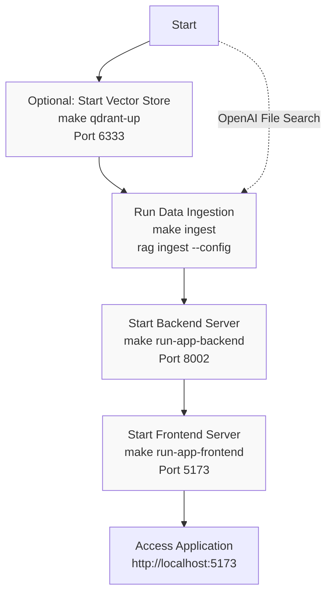
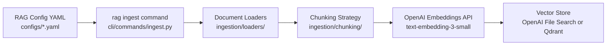
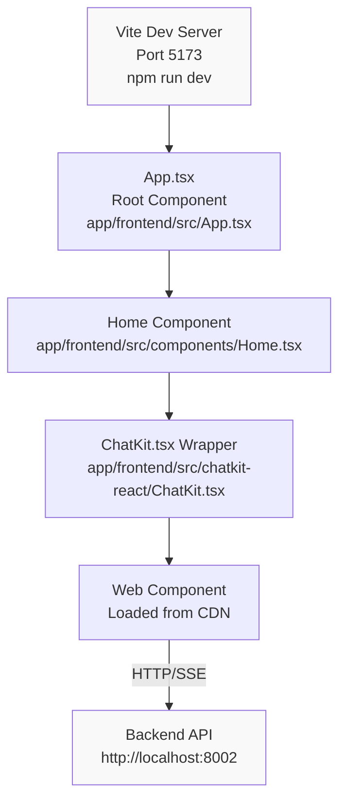
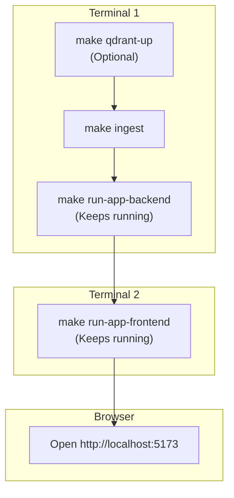

<!-- source: DeepWiki mcp.deepwiki.com · repo openai/openai-knowledge-retrieval · page 2.4 Running the Application · fetched 2026-10-26 -->

# Running the Application

<details>
<summary>Relevant source files</summary>

The following files were used as context for generating this wiki page:

- [CONTRIBUTING.md](CONTRIBUTING.md)
- [Makefile](Makefile)
- [README.md](README.md)

</details>


## Purpose and Scope

This page provides instructions for launching the OpenAI Knowledge Retrieval application in development mode. It covers starting the backend server, frontend UI, vector store services, and running data ingestion. For configuration details before running the application, see [Configuration](#2.3). For production deployment, see [Deployment](#9).

## Prerequisites

Before running the application, ensure you have completed:
- Environment setup and installation ([Prerequisites and Environment Setup](#2.1), [Installation](#2.2))
- Configuration of environment variables and RAG config files ([Configuration](#2.3))
- At least one document placed in the `data/` directory for ingestion

## Service Startup Overview

The application consists of multiple services that must be started in a specific order. The diagram below shows the startup sequence and dependencies.



**Sources:** [Makefile:1-38](), [README.md:12-42]()

## Starting the Vector Store (Optional)

If you are using a custom vector store like Qdrant instead of OpenAI File Search, start the vector store service before ingestion.

### Starting Qdrant

The repository includes a Docker Compose configuration for Qdrant:

```bash
make qdrant-up
```

This command executes [Makefile:25-26]() which runs:
```bash
docker compose -f docker/docker-compose.qdrant.yaml up -d
```

The Qdrant service will be available at `http://localhost:6333`. The Docker Compose configuration is defined in `docker/docker-compose.qdrant.yaml`.

### Stopping Qdrant

To stop the Qdrant service:

```bash
make qdrant-down
```

This executes [Makefile:28-29]() and removes all containers and orphaned resources.

### Verification

Check that Qdrant is running:

```bash
curl http://localhost:6333/healthz
# Expected response: {"title":"healthz","version":"1.x.x"}
```

**Sources:** [Makefile:25-29](), [README.md:109-114]()

## Running Data Ingestion

Before the application can answer questions, documents must be ingested into the vector store.

### Basic Ingestion

Use the Makefile command:

```bash
make ingest
```

This executes [Makefile:31-32](), which runs the CLI with the default configuration:
```bash
rag ingest --config configs/default.openai.yaml
```

### Custom Configuration Ingestion

To ingest with a specific configuration file:

```bash
rag ingest --config configs/my.custom.yaml
```

### Ingestion Process Flow



The ingestion pipeline:
1. Reads configuration from YAML file specified by `--config` or `RAG_CONFIG` environment variable
2. Loads documents from paths specified in `data.paths` configuration
3. Chunks documents according to the `chunking` strategy
4. Generates embeddings using the configured embedding model
5. Uploads to the vector store (OpenAI File Search or custom)

### Ingestion Output

For OpenAI File Search backends, ingestion outputs a `vector_store_id`:

```
✓ Created vector store: vs_abc123xyz...
✓ Uploaded 42 documents
✓ Ingestion complete
```

Save this ID to your `.env` file as `VECTOR_STORE_ID` for reuse in subsequent runs.

**Sources:** [Makefile:31-32](), [README.md:117-123](), [README.md:29-30]()

## Starting the Backend Server

The FastAPI backend serves the chat API and manages the assistant agent.

### Start Backend in Development Mode

```bash
make run-app-backend
```

This executes [Makefile:18-19]():
```bash
cd app/backend && uv run --active uvicorn app.main:app --reload --port 8002
```

The backend server:
- Runs on **port 8002** by default
- Uses `uvicorn` with `--reload` flag for hot reloading during development
- Loads configuration from `RAG_CONFIG` environment variable (defaults to `configs/default.openai.yaml`)
- Initializes the `KnowledgeAssistantServer` class from [app/backend/app/main.py]()

### Backend Endpoints

| Endpoint | Method | Purpose | Source |
|----------|--------|---------|--------|
| `/knowledge/chatkit` | POST | ChatKit conversational interface | [app/backend/app/main.py:179-216]() |
| `/knowledge/documents` | GET | List available documents | [app/backend/app/main.py:218-222]() |
| `/knowledge/documents/{doc_id}/file` | GET | Download document file | [app/backend/app/main.py:224-242]() |
| `/knowledge/threads/{thread_id}/citations` | GET | Retrieve citations for thread | [app/backend/app/main.py:244-266]() |
| `/knowledge/health` | GET | Health check | [app/backend/app/main.py:268-271]() |

### Stopping the Backend

```bash
make stop-app-backend
```

This executes [Makefile:21-23]() which kills processes on port 8002.

### Verification

Check backend health:

```bash
curl http://localhost:8002/knowledge/health
# Expected response: {"status":"ok"}
```

**Sources:** [Makefile:18-23](), [app/backend/app/main.py:1-271]()

## Starting the Frontend Server

The React-based UI provides the chat interface for interacting with the assistant.

### Start Frontend in Development Mode

```bash
make run-app-frontend
```

This executes [Makefile:15-16]():
```bash
cd app/frontend && npm install && npm run dev
```

The frontend server:
- Runs on **port 5173** by default (Vite's default development port)
- Enables hot module replacement (HMR) for instant updates during development
- Proxies API requests to the backend at `http://localhost:8002`
- Loads the ChatKit web component from CDN

### Frontend Architecture Components



### Frontend Configuration

The frontend reads backend API configuration from [app/frontend/src/lib/config.ts]():

```typescript
// Default backend API base URL
const API_BASE = "http://localhost:8002"
```

If you changed the backend port, update this configuration file accordingly.

**Sources:** [Makefile:15-16](), [README.md:33-36](), [README.md:242-249]()

## Accessing the Application

Once both servers are running, access the application in your web browser:

### Main Application URL

```
http://localhost:5173
```

This opens the ChatKit conversational interface where you can:
- Ask questions about your ingested documents
- View responses with citations
- Preview referenced documents
- Navigate conversation history

### Available Interfaces

| Interface | URL | Description |
|-----------|-----|-------------|
| Chat UI | `http://localhost:5173` | Main conversational interface |
| Backend API | `http://localhost:8002` | FastAPI backend (for debugging) |
| API Docs | `http://localhost:8002/docs` | Swagger/OpenAPI documentation |
| Qdrant Dashboard | `http://localhost:6333/dashboard` | Vector DB admin (if using Qdrant) |

**Sources:** [README.md:38-40](), [README.md:139-140]()

## Complete Development Workflow

Here is the complete sequence for running the application from a clean state:

### Step-by-Step Commands

```bash
# Terminal 1: Start vector store (if using custom backend)
make qdrant-up

# Terminal 1: Run ingestion
make ingest
# Note the vector_store_id and add to .env if needed

# Terminal 1: Start backend server
make run-app-backend
# Backend will be available at http://localhost:8002

# Terminal 2: Start frontend server (in a new terminal)
make run-app-frontend
# Frontend will be available at http://localhost:5173

# Open browser to http://localhost:5173
```

### Quick Start Command Reference



**Sources:** [README.md:14-42](), [CONTRIBUTING.md:10-33]()

## Command-Line Chat Interface (Alternative)

For testing without the web UI, use the CLI chat interface:

```bash
make chat
```

This executes [Makefile:34-35]():
```bash
rag chat --config configs/default.openai.yaml
```

The CLI chat provides:
- Interactive terminal-based conversation
- Direct access to the assistant agent
- Useful for testing retrieval quality without browser overhead
- Same backend logic as the web UI

Exit the chat by typing `exit` or pressing `Ctrl+C`.

**Sources:** [Makefile:34-35](), [README.md:1-301]()

## Port and Service Summary

This table summarizes all ports and services used during development:

| Service | Port | Started By | Process |
|---------|------|------------|---------|
| Backend API | 8002 | `make run-app-backend` | `uvicorn app.main:app` |
| Frontend UI | 5173 | `make run-app-frontend` | `npm run dev` (Vite) |
| Qdrant Vector Store | 6333 | `make qdrant-up` | Docker container |
| Alternative Backend | 8000 | `make run-api` | `uvicorn app.api:app` |

**Note:** The repository includes two backend implementations. The primary backend for the ChatKit UI runs on port 8002 (`app/backend/app/main.py`). An alternative API implementation exists at `app/api.py` (port 8000) but is not used by the default frontend.

**Sources:** [Makefile:1-38](), [app/backend/app/main.py:1-10]()

## Health Check and Verification

After starting all services, verify they are operational:

### Backend Health Check

```bash
curl http://localhost:8002/knowledge/health
```

Expected response:
```json
{"status": "ok"}
```

This endpoint is implemented in [app/backend/app/main.py:268-271]().

### Frontend Accessibility

Navigate to `http://localhost:5173` in your browser. You should see:
- The ChatKit interface loads without errors
- The chat input box is enabled
- Any previously ingested documents appear in the sidebar (if applicable)

### Backend Log Verification

Check the backend terminal for successful startup:

```
INFO:     Uvicorn running on http://0.0.0.0:8002 (Press CTRL+C to quit)
INFO:     Started reloader process
INFO:     Started server process
INFO:     Waiting for application startup.
INFO:     Application startup complete.
```

### Frontend Log Verification

Check the frontend terminal for successful compilation:

```
VITE v5.x.x  ready in XXX ms

➜  Local:   http://localhost:5173/
➜  Network: use --host to expose
```

**Sources:** [app/backend/app/main.py:268-271]()

## Troubleshooting Common Issues

### Port Already in Use

If you see `Address already in use` errors:

```bash
# Backend port 8002
make stop-app-backend

# Or manually:
lsof -ti:8002 | xargs kill -9

# Frontend port 5173
lsof -ti:5173 | xargs kill -9

# Qdrant port 6333
make qdrant-down
```

### Backend Cannot Find Configuration

Error: `Configuration file not found`

**Solution:** Set the `RAG_CONFIG` environment variable:
```bash
export RAG_CONFIG=configs/default.openai.yaml
make run-app-backend
```

Or specify inline:
```bash
RAG_CONFIG=configs/my.custom.yaml make run-app-backend
```

### No Documents Available

If the UI shows no documents or retrieval fails:

1. Verify ingestion completed successfully
2. Check that `VECTOR_STORE_ID` is set in `.env` (for OpenAI File Search)
3. Ensure the configuration file matches between ingestion and runtime
4. Verify documents exist in the paths specified by `data.paths` in your config

**Solution:**
```bash
# Re-run ingestion
make ingest

# Verify vector store ID in .env
cat .env | grep VECTOR_STORE_ID
```

### Frontend Cannot Connect to Backend

Error in browser console: `Failed to fetch` or `Network error`

**Solutions:**
1. Verify backend is running on port 8002
2. Check frontend config points to correct backend URL in [app/frontend/src/lib/config.ts]()
3. Ensure no firewall or proxy blocking local connections

### OpenAI API Errors

Error: `401 Unauthorized` or `Invalid API key`

**Solution:** Verify your `.env` file contains a valid `OPENAI_API_KEY`:
```bash
cat .env | grep OPENAI_API_KEY
# Should show: OPENAI_API_KEY=sk-...
```

**Sources:** [Makefile:21-29](), [README.md:23-24](), [CONTRIBUTING.md:27-32]()

## Next Steps

After successfully running the application:

- **Customize the assistant:** Modify system prompts and synthesis settings ([Configuration](#7.2))
- **Improve retrieval:** Enable query expansion, HyDE, or reranking ([RAG Pipeline](#3.4))
- **Evaluate quality:** Run evaluations to measure performance ([Evaluation System](#6.3))
- **Prepare for production:** Create optimized builds ([Production Build](#9.1))

For development and contribution guidelines, see [Development Guide](#8).

**Sources:** [README.md:143-150](), [README.md:151-238]()

---

