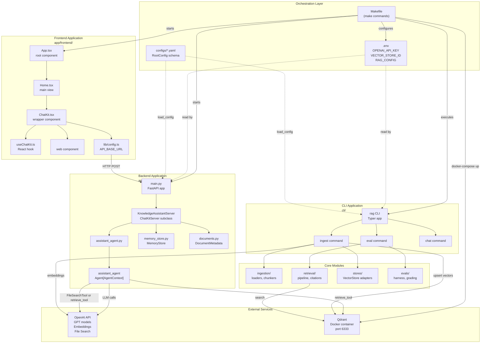
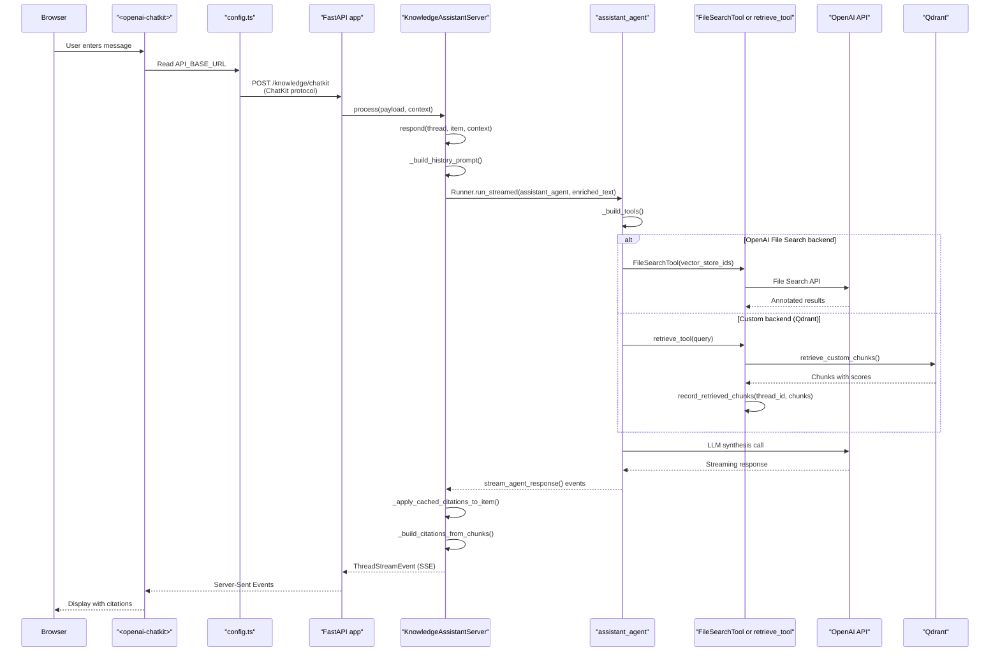
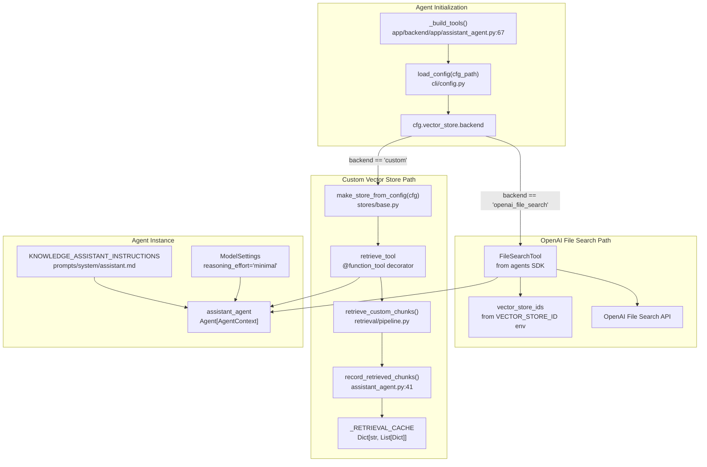
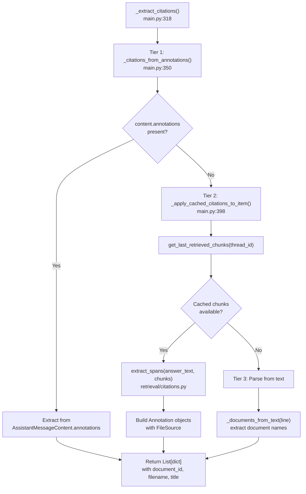
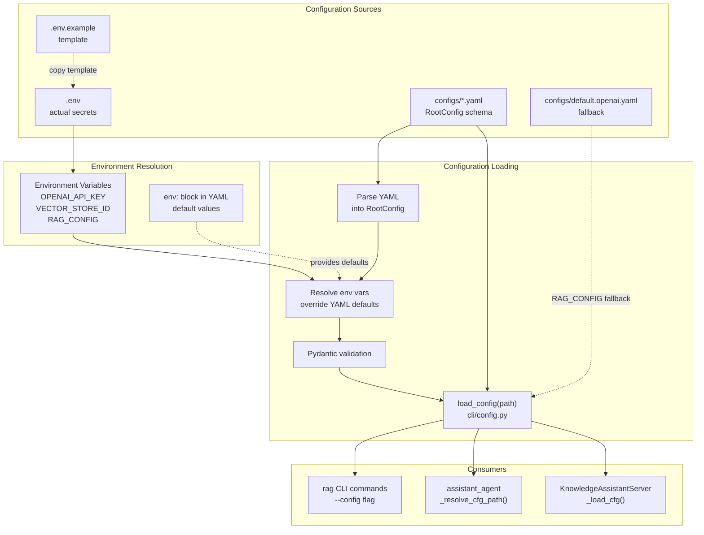

<!-- source: DeepWiki mcp.deepwiki.com · repo openai/openai-knowledge-retrieval · page 3 Architecture · fetched 2026-10-26 -->

# Architecture

Relevant source files

The following files were used as context for generating this wiki page:

- [README.md](README.md)
- [app/backend/app/assistant_agent.py](app/backend/app/assistant_agent.py)
- [app/backend/app/main.py](app/backend/app/main.py)
- [app/frontend/src/App.tsx](app/frontend/src/App.tsx)

This page provides a comprehensive overview of the OpenAI Knowledge Retrieval system architecture, including the relationships between frontend, backend, external services, and supporting tools. It describes the major components, their responsibilities, and how data flows through the system.

For detailed information on specific components, see: [Backend Components](#4), [Frontend Components](#5), [CLI Tools](#6), and [Configuration](#7).

## Purpose and Scope

The OpenAI Knowledge Retrieval starter kit is a multi-tier application that combines a React-based web interface, a FastAPI backend orchestrating AI agents and document management, external AI and vector database services, and CLI tools for data ingestion and evaluation. This document explains:

- The overall system architecture and component interactions
- The backend service layer and agent system
- The frontend application structure
- Data flow through the RAG pipeline
- Integration with external services (OpenAI API, Qdrant)
- The orchestration layer provided by the Makefile

## System Architecture Overview

The following diagram maps the complete system architecture, using actual class names, file paths, and code entities to bridge conceptual components with their implementations.

**System Component Map**

**Sources:** [README.md:54-65](), [app/backend/app/main.py:1-647](), [app/backend/app/assistant_agent.py:1-128](), [app/frontend/src/App.tsx:1-19](), [Makefile]()

## Component Responsibilities

### Frontend Application (`app/frontend/`)

The frontend is a React 19 application built with Vite, serving as the user interface for the knowledge retrieval system.

| Component | Location | Responsibility |
|-----------|----------|----------------|
| `App` | [app/frontend/src/App.tsx:6-17]() | Root component, manages theme state via `useColorScheme` |
| `Home` | [app/frontend/src/components/Home.tsx]() | Main view container, renders ChatKit and document preview |
| `ChatKit` wrapper | [app/frontend/src/chatkit-react/ChatKit.tsx]() | React wrapper for `<openai-chatkit>` web component |
| `useChatKit` hook | [app/frontend/src/chatkit-react/useChatKit.ts]() | Provides methods and event handlers for ChatKit interaction |
| Configuration | [app/frontend/src/lib/config.ts]() | Defines `API_BASE_URL` pointing to backend |

The frontend communicates with the backend via HTTP POST requests to `/knowledge/chatkit` and fetches documents via `/knowledge/documents` endpoints.

**Sources:** [app/frontend/src/App.tsx:1-19](), [README.md:242-249]()

### Backend Application (`app/backend/app/`)

The backend is a FastAPI application that orchestrates agent interactions, manages conversation threads, and serves documents.

| Component | Location | Responsibility |
|-----------|----------|----------------|
| `KnowledgeAssistantServer` | [app/backend/app/main.py:131-545]() | Main server class, extends `ChatKitServer[dict[str, Any]]` |
| `assistant_agent` | [app/backend/app/assistant_agent.py:121-127]() | Global `Agent[AgentContext]` instance with retrieval tools |
| `MemoryStore` | [app/backend/app/memory_store.py]() | In-memory storage for thread metadata and messages |
| Document management | [app/backend/app/main.py:153-245]() | Methods `_scan_documents`, `_lookup_document`, `_resolve_document_path` |
| Citation system | [app/backend/app/main.py:318-502]() | Methods `_extract_citations`, `_build_citations_from_chunks` |

**Sources:** [app/backend/app/main.py:131-545](), [app/backend/app/assistant_agent.py:121-127]()

### CLI Tools (`cli/`)

The `rag` CLI provides commands for data ingestion, evaluation, and command-line chat.

| Command | Responsibility |
|---------|----------------|
| `rag init` | Scaffolds YAML configuration from templates |
| `rag ingest` | Processes documents, generates embeddings, stores vectors |
| `rag eval` | Runs evaluation harness, generates reports |
| `rag chat` | Command-line chat interface |

**Sources:** [README.md:56](), [README.md:98-124]()

### Core Modules

| Module | Location | Responsibility |
|--------|----------|----------------|
| Ingestion | `ingestion/` | Document loaders, chunkers, preprocessors, pipeline orchestration |
| Retrieval | `retrieval/` | Query expansion, filtering, reranking, citation extraction |
| Stores | `stores/` | Vector store adapters (OpenAI File Search, Qdrant) |
| Evaluations | `evals/` | Dataset generation, grading, reporting |

**Sources:** [README.md:54-65]()

## Request Flow Architecture

The following diagram shows the complete request/response flow through the system, mapping HTTP endpoints and internal method calls to actual code entities.

**Request/Response Flow with Code Entities**

**Sources:** [app/backend/app/main.py:247-294](), [app/backend/app/main.py:580-590](), [app/backend/app/assistant_agent.py:67-115]()

## Backend API Endpoints

The FastAPI application exposes the following endpoints:

| Endpoint | Method | Handler | Responsibility |
|----------|--------|---------|----------------|
| `/knowledge/chatkit` | POST | [main.py:580-590]() | ChatKit protocol handler, returns SSE stream |
| `/knowledge/documents` | GET | [main.py:593-600]() | Lists all ingested documents |
| `/knowledge/documents/{id}/file` | GET | [main.py:603-623]() | Serves document file for preview |
| `/knowledge/threads/{id}/citations` | GET | [main.py:626-641]() | Returns citations for latest assistant message |
| `/knowledge/health` | GET | [main.py:644-646]() | Health check endpoint |

**Sources:** [app/backend/app/main.py:580-646]()

## Agent System Architecture

The agent system is built on the OpenAI Agents SDK and dynamically configures tools based on the vector store backend.

**Agent Tool Configuration**

**Sources:** [app/backend/app/assistant_agent.py:67-127]()

### Retrieval Cache Mechanism

When using custom vector stores, the `retrieve_tool` function stores retrieved chunks in a thread-local cache (`_RETRIEVAL_CACHE`) keyed by `thread_id`. This cache enables the citation system to derive annotations after the assistant generates a response, since custom backends don't automatically provide annotations like OpenAI File Search does.

**Key functions:**

- [assistant_agent.py:41-47](): `record_retrieved_chunks(thread_id, chunks)` - Stores chunks
- [assistant_agent.py:50-52](): `get_last_retrieved_chunks(thread_id)` - Retrieves cached chunks
- [assistant_agent.py:55-56](): `clear_last_retrieved_chunks(thread_id)` - Clears cache after citation derivation

**Sources:** [app/backend/app/assistant_agent.py:17-56]()

## Citation System Architecture

The citation system employs a three-tier fallback strategy to ensure users always receive source references.

**Citation Extraction Flow**

**Sources:** [app/backend/app/main.py:318-502]()

### Citation Tiers Explained

1. **Tier 1 - Annotations from OpenAI File Search**: When using `FileSearchTool`, OpenAI automatically includes annotations in `AssistantMessageContent.annotations`. The method [main.py:350-396]() extracts citations directly from these annotations.

2. **Tier 2 - Derive from cached chunks**: When using custom vector stores, the `retrieve_tool` caches chunks in `_RETRIEVAL_CACHE`. The method [main.py:413-502]() calls `extract_spans()` from `retrieval/citations.py` to find text spans in the assistant's response that match cached chunks, then builds `Annotation` objects and injects them into the message content.

3. **Tier 3 - Parse from text**: As a final fallback, [main.py:332-348]() scans the assistant's response text for document names using `_documents_from_text()`.

**Sources:** [app/backend/app/main.py:318-502]()

## Configuration Architecture

The system uses a hierarchical configuration approach with environment variables, YAML files, and runtime defaults.

**Configuration Loading Hierarchy**

**Sources:** [README.md:85-93](), [README.md:236-238](), [app/backend/app/assistant_agent.py:33-38](), [app/backend/app/main.py:137-151]()

### Configuration Resolution Order

1. **Environment variables** (highest priority): `OPENAI_API_KEY`, `VECTOR_STORE_ID`, `RAG_CONFIG`, etc.
2. **YAML `env:` block**: Default values specified in the config file
3. **Hardcoded defaults**: Fallback values in code (e.g., `configs/default.openai.yaml`)

The `RAG_CONFIG` environment variable determines which YAML file to load. If not set, defaults to `configs/default.openai.yaml`. The path is resolved relative to the project root if not absolute.

**Sources:** [README.md:85-93](), [app/backend/app/assistant_agent.py:33-38]()

## Document Management Architecture

The `KnowledgeAssistantServer` implements a document scanning and caching system to map between document IDs, filenames, and file paths.

**Document Resolution Flow**

```mermaid
flowchart LR
    ScanDocs["_scan_documents(cfg_path, cfg)<br/>main.py:153"]
    ConfigPaths["cfg.data.paths<br/>list of directories"]
    FileDiscovery["rglob('*')<br/>recursive file scan"]
    FilterExts["Filter by<br/>include_extensions"]
    FilterGlobs["Apply<br/>exclude_globs"]
    
    GenerateID["_sha1_of_path(path)<br/>generate doc_id"]
    HumanizeTitle["_humanize_title(filename)<br/>format title"]
    CreateMetadata["DocumentMetadata<br/>(id, filename, title)"]
    
    CacheDocuments["_documents_cache[cfg_path]<br/>List[DocumentMetadata]"]
    CachePathMap["_document_path_cache[cfg_path]<br/>Dict[doc_id, Path]"]
    
    LookupDoc["_lookup_document(cfg_path, cfg, identifier)<br/>main.py:224"]
    MatchID["Match by doc_id"]
    MatchFilename["Match by filename"]
    MatchTitle["Match by title slug"]
    
    ResolvePath["_resolve_document_path(cfg_path, doc_id)<br/>main.py:244"]
    
    ScanDocs --> ConfigPaths
    ConfigPaths --> FileDiscovery
    FileDiscovery --> FilterExts
    FilterExts --> FilterGlobs
    FilterGlobs --> GenerateID
    GenerateID --> HumanizeTitle
    HumanizeTitle --> CreateMetadata
    CreateMetadata --> CacheDocuments
    CreateMetadata --> CachePathMap
    
    CacheDocuments --> LookupDoc
    LookupDoc --> MatchID
    LookupDoc --> MatchFilename
    LookupDoc --> MatchTitle
    
    CachePathMap --> ResolvePath
```

**Sources:** [app/backend/app/main.py:153-245]()

### Document Caching Strategy

The server maintains two caches per configuration path:

1. **`_documents_cache: Dict[str, List[DocumentMetadata]]`** - Maps config path to list of document metadata objects
2. **`_document_path_cache: Dict[str, Dict[str, Path]]`** - Maps config path to a dictionary of document IDs to file system paths

These caches are populated lazily on first access and persist for the lifetime of the server process. The caching strategy ensures:

- Fast document lookups without repeated file system scans
- Consistent document IDs across requests
- Efficient serving of document files via the `/knowledge/documents/{id}/file` endpoint

**Sources:** [app/backend/app/main.py:138-139](), [app/backend/app/main.py:153-222]()

## Memory Store Architecture

The `MemoryStore` class ([app/backend/app/memory_store.py]()) provides in-memory storage for conversation threads and messages. It implements the `Store` interface required by the ChatKit server.

| Data Structure | Type | Purpose |
|----------------|------|---------|
| Thread metadata | `Dict[str, ThreadMetadata]` | Stores thread IDs and metadata |
| Thread items | `Dict[str, List[ThreadItem]]` | Stores messages per thread |
| Item ordering | Chronological list | Supports pagination and history |

The memory store is instantiated in [main.py:133]() and used throughout the `KnowledgeAssistantServer` for:

- Loading conversation history in `_build_history_prompt()` [main.py:504-544]()
- Storing new user and assistant messages
- Retrieving thread items for citation extraction

**Sources:** [app/backend/app/main.py:133](), [app/backend/app/main.py:504-544]()

## Orchestration Layer

The `Makefile` provides a unified interface for all development and operational tasks.

**Key Makefile targets:**

| Target | Command | Purpose |
|--------|---------|---------|
| `dev` | `pip install -e ".[dev]"` | Install backend with dev dependencies |
| `install` | `pip install -e .` | Install backend without dev dependencies |
| `qdrant-up` | `docker-compose up -d` | Start Qdrant container |
| `qdrant-down` | `docker-compose down` | Stop Qdrant container |
| `ingest` | `rag ingest` | Run data ingestion |
| `eval` | `rag eval` | Run evaluation harness |
| `run-app-backend` | `uvicorn ... --reload` | Start FastAPI with hot reload |
| `run-app-frontend` | `npm run dev` | Start Vite dev server |
| `run-api` | `uvicorn ... --port 8000` | Alternative backend port |

**Sources:** [README.md:16-42](), [Makefile]()

## External Services Integration

### OpenAI API Integration

The system integrates with OpenAI API for:

- **LLM synthesis**: The `assistant_agent` uses GPT models (configurable via `synthesis.model`) to generate responses
- **Embeddings**: The ingestion pipeline calls `client.embeddings.create()` to generate vector embeddings
- **File Search**: When `vector_store.backend: openai_file_search`, the agent uses `FileSearchTool` which calls OpenAI's File Search API
- **Evaluations**: The evals harness can mirror results to OpenAI Evals dashboard

The OpenAI client is instantiated in [assistant_agent.py:15]() as `client = OpenAI()`, which reads `OPENAI_API_KEY` from environment variables.

**Sources:** [app/backend/app/assistant_agent.py:15](), [README.md:186-192]()

### Qdrant Integration

When using custom vector stores with Qdrant:

- **Docker deployment**: `make qdrant-up` starts Qdrant on port 6333
- **Configuration**: Set `vector_store.backend: custom` and `vector_store.custom.kind: qdrant`
- **Ingestion**: The `rag ingest` command upserts vectors to the configured collection
- **Retrieval**: The `retrieve_tool` searches Qdrant via the adapter in `stores/qdrant.py`

**Sources:** [README.md:108-115](), [README.md:192-208]()

## Architectural Patterns

### Config-First Design

The entire pipeline is driven by YAML configuration ([README.md:46-47]()). This enables:

- Non-technical users to customize behavior without code changes
- Easy A/B testing of retrieval strategies
- Template-based quickstart via `rag init --template`

### Pluggable Vector Stores

The `stores/` module defines a `VectorStore` interface. The system ships with two implementations:

1. **OpenAI File Search**: Managed service with automatic deduplication and metadata handling
2. **Qdrant**: Local vector database with custom retrieval pipeline

New vector stores can be added by implementing the interface and registering via `custom.kind: plugin`.

**Sources:** [README.md:186-208]()

### Streaming Response Architecture

The backend uses Server-Sent Events (SSE) to stream assistant responses in real-time:

1. `Runner.run_streamed()` yields events from the agent [main.py:280-285]()
2. `stream_agent_response()` converts agent events to ChatKit protocol [main.py:287]()
3. FastAPI returns `StreamingResponse` with `media_type="text/event-stream"` [main.py:587]()

**Sources:** [app/backend/app/main.py:280-287](), [app/backend/app/main.py:586-587]()

### Layered Citation Strategy

The three-tier citation fallback ensures robustness across different backend configurations:

- **Tier 1** works seamlessly with OpenAI File Search
- **Tier 2** provides equivalent functionality for custom backends via caching
- **Tier 3** ensures some citations are always available even if retrieval fails

**Sources:** [app/backend/app/main.py:318-502]()

---

For implementation details on specific subsystems, see:
- [Backend Components](#4) - Detailed documentation of backend modules
- [Frontend Components](#5) - React application structure
- [CLI Tools](#6) - Command-line interface usage
- [RAG Pipeline](#3.4) - Retrieval augmented generation flow
- [Configuration](#7) - Comprehensive configuration guide

---

