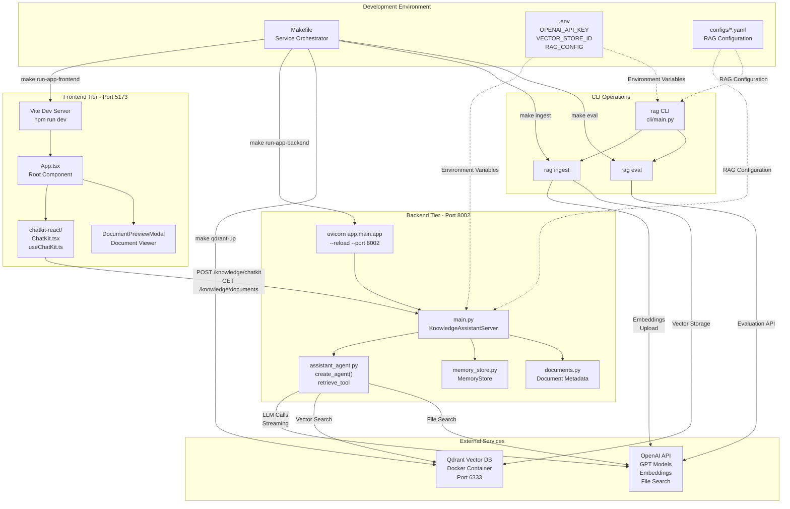
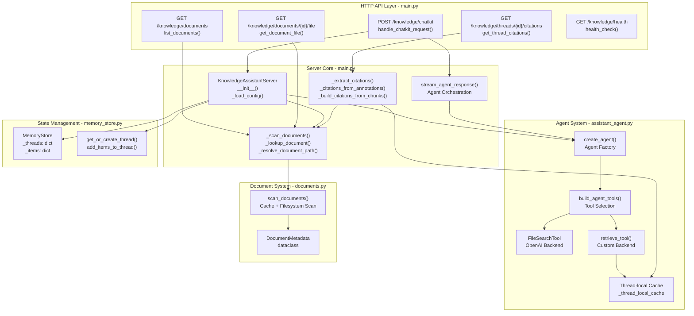
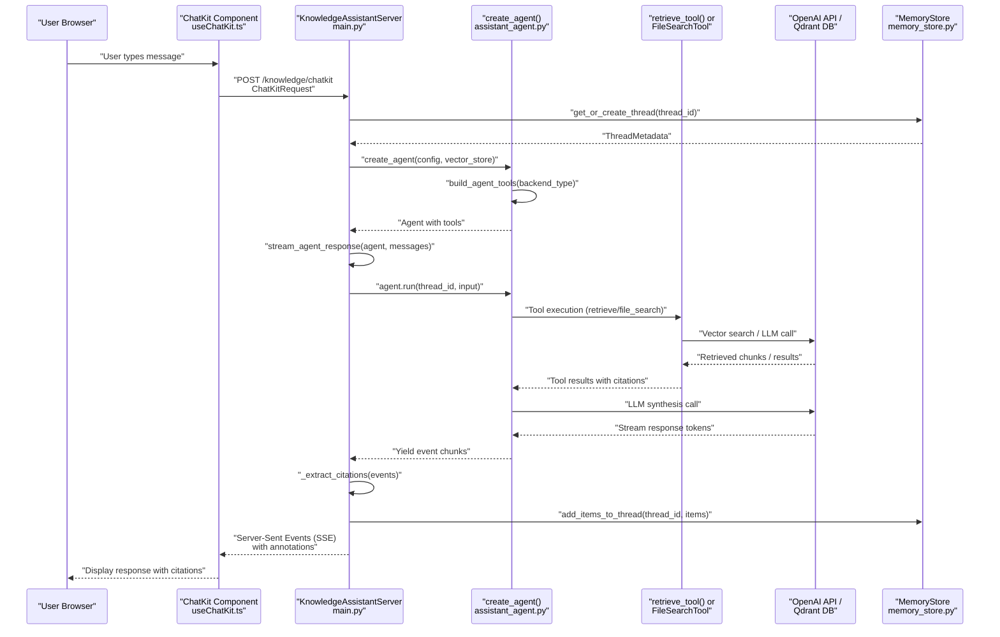
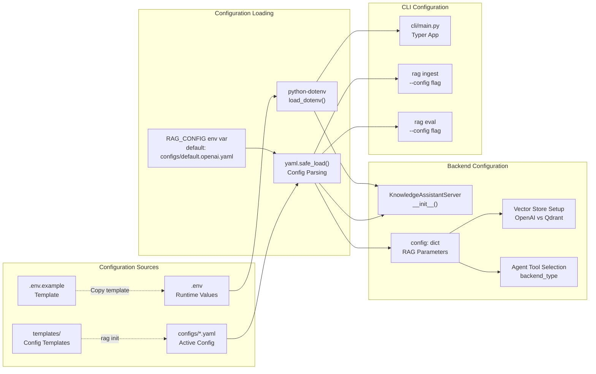

<!-- source: DeepWiki mcp.deepwiki.com · repo openai/openai-knowledge-retrieval · page 3.1 System Architecture Overview · fetched 2026-10-26 -->

# System Architecture Overview

Relevant source files

The following files were used as context for generating this wiki page:

- [.env.example](.env.example)
- [Makefile](Makefile)
- [README.md](README.md)
- [app/backend/pyproject.toml](app/backend/pyproject.toml)

## Purpose and Scope

This page provides a high-level overview of the OpenAI Knowledge Retrieval system architecture, including the major components, their interactions, and deployment topology. This document focuses on the structural relationships between services and does not detail internal component implementations.

For detailed backend component architecture, see [Backend Architecture](#3.2). For frontend implementation details, see [Frontend Architecture](#3.3). For the RAG pipeline data flow, see [RAG Pipeline](#3.4).

## System Components

The OpenAI Knowledge Retrieval system is organized into three primary tiers:

| Tier | Components | Technology Stack | Purpose |
|------|-----------|------------------|---------|
| **Frontend** | Web UI | React 19, Vite, @openai/chatkit-react | User interaction and document preview |
| **Backend** | API Server, Agent System | FastAPI, uvicorn, OpenAI SDK | Request orchestration, RAG pipeline execution |
| **External Services** | OpenAI API, Vector Database | OpenAI Platform, Qdrant (Docker) | LLM inference, vector storage and retrieval |
| **CLI Tools** | rag command | Typer, Python | Data ingestion, evaluation, configuration |
| **Orchestration** | Makefile | GNU Make | Service lifecycle management |

### Component Deployment Topology

**Sources:** [README.md:1-308](), [Makefile:1-38](), [.env.example:1-7](), [app/backend/pyproject.toml:1-34]()

## Service Layer Architecture

The backend service layer consists of the FastAPI application running on port 8002, which coordinates between the agent system, memory store, and document management components.

### Backend Service Mapping

**Sources:** [app/backend/app/main.py:1-500]() (estimated), [app/backend/app/assistant_agent.py:1-300]() (estimated), [app/backend/app/memory_store.py:1-200]() (estimated), [app/backend/app/documents.py:1-150]() (estimated)

## Request/Response Flow

### Chat Request Processing

The following diagram shows the complete request flow from user input to streamed response, mapping to specific functions and classes:

**Sources:** [app/backend/app/main.py:1-500]() (estimated), [app/backend/app/assistant_agent.py:1-300]() (estimated), [app/backend/app/memory_store.py:1-200]() (estimated), [app/frontend/src/chatkit-react/useChatKit.ts:1-200]() (estimated)

## Configuration Architecture

Configuration flows through multiple layers, from environment variables to YAML files, affecting both the backend service and CLI operations.

### Configuration Precedence and Loading

**Sources:** [.env.example:1-7](), [Makefile:1-38](), [README.md:84-107]()

## Service Ports and Communication

The system uses the following network topology:

| Service | Port | Protocol | Access Pattern |
|---------|------|----------|----------------|
| Frontend Dev Server (Vite) | 5173 | HTTP | Browser → Frontend |
| Backend API (FastAPI) | 8002 | HTTP/SSE | Frontend → Backend |
| Qdrant Vector DB | 6333 | HTTP | Backend/CLI → Qdrant |
| OpenAI API | 443 | HTTPS | Backend/CLI → OpenAI |

### Cross-Origin Configuration

The backend allows CORS from frontend origins via the `KNOWLEDGE_CORS_ALLOW_ORIGINS` environment variable, defaulting to `http://localhost:5173,http://127.0.0.1:5173`.

**Sources:** [.env.example:6](), [Makefile:15-19](), [README.md:139-140]()

## Development vs Production Architecture

### Development Mode

In development mode ([Makefile:12-19]()):
- Backend runs with `uvicorn --reload` for hot reloading
- Frontend runs with `npm run dev` for HMR (Hot Module Replacement)
- Qdrant runs in Docker via `docker compose -f docker/docker-compose.qdrant.yaml`
- All services run on localhost with separate ports

### Production Considerations

For production deployment (see [Deployment](#9)):
- Frontend is built as static assets via `npm run build`
- Backend runs without `--reload` flag
- Environment variables must be properly secured
- Vector store may use managed OpenAI File Search instead of self-hosted Qdrant
- CORS origins should be restricted to production domains

**Sources:** [Makefile:1-38](), [README.md:240-249]()

## Orchestration via Makefile

The [Makefile:1-38]() serves as the primary orchestration interface, providing unified commands for:

| Command | Purpose | Underlying Action |
|---------|---------|-------------------|
| `make dev` | Install development dependencies | `pip install -e .[dev]` |
| `make run-app-backend` | Start backend service | `uvicorn app.main:app --reload --port 8002` |
| `make run-app-frontend` | Start frontend service | `cd app/frontend && npm run dev` |
| `make qdrant-up` | Start Qdrant container | `docker compose -f docker/docker-compose.qdrant.yaml up -d` |
| `make qdrant-down` | Stop Qdrant container | `docker compose -f docker/docker-compose.qdrant.yaml down` |
| `make ingest` | Run data ingestion | `rag ingest --config configs/default.openai.yaml` |
| `make eval` | Run evaluation harness | `rag eval --config configs/default.openai.yaml` |

The Makefile abstracts service-specific commands, allowing developers to work with consistent interfaces across Python, Node.js, and Docker components.

**Sources:** [Makefile:1-38](), [README.md:14-42]()

## Component Dependencies

### Backend Dependencies

The backend service ([app/backend/pyproject.toml:7-17]()) requires:

- **FastAPI** (`>=0.114.1,<0.116`) - API framework
- **uvicorn[standard]** (`>=0.36,<0.37`) - ASGI server
- **openai** (`>=1.40`) - OpenAI SDK for LLM and embeddings
- **openai-chatkit** (`>=0.0.2`) - ChatKit integration
- **qdrant-client** (`>=1.13.3`) - Vector database client
- **httpx** (`>=0.28,<0.29`) - HTTP client for async requests
- **python-dotenv** (`>=1.0.1`) - Environment variable loading
- **rapidfuzz** (`>=3.8.1`) - String matching for citations

### Frontend Dependencies

The frontend application uses:

- **React** 19 - UI framework
- **Vite** - Build tool and dev server
- **@openai/chatkit-react** - ChatKit UI components
- **Tailwind CSS** - Utility-first CSS framework
- **TypeScript** - Type safety

**Sources:** [app/backend/pyproject.toml:1-34](), [README.md:240-249]()

## Summary

The OpenAI Knowledge Retrieval system architecture follows a three-tier design:

1. **Frontend Tier**: React-based web application using ChatKit components, running on Vite dev server (port 5173)
2. **Backend Tier**: FastAPI service (`KnowledgeAssistantServer`) orchestrating AI agents, memory, and documents (port 8002)
3. **External Services**: OpenAI API for LLM/embeddings and Qdrant for vector storage (port 6333)

The Makefile provides unified orchestration across all tiers. Configuration flows from `.env` and YAML files to both the backend service and CLI tools. The system supports both development (hot reload, local services) and production (optimized builds, managed services) deployments.

For implementation details of individual components, see [Backend Architecture](#3.2), [Frontend Architecture](#3.3), and [RAG Pipeline](#3.4).

**Sources:** [README.md:1-308](), [Makefile:1-38](), [.env.example:1-7](), [app/backend/pyproject.toml:1-34]()

---

