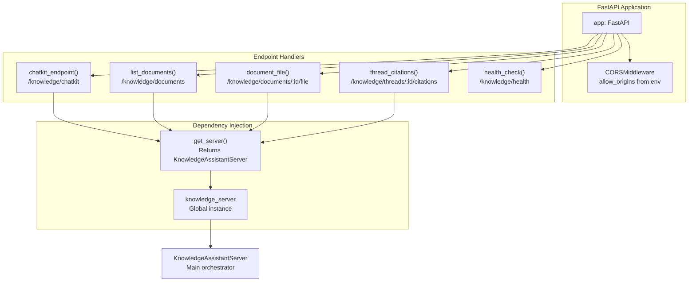
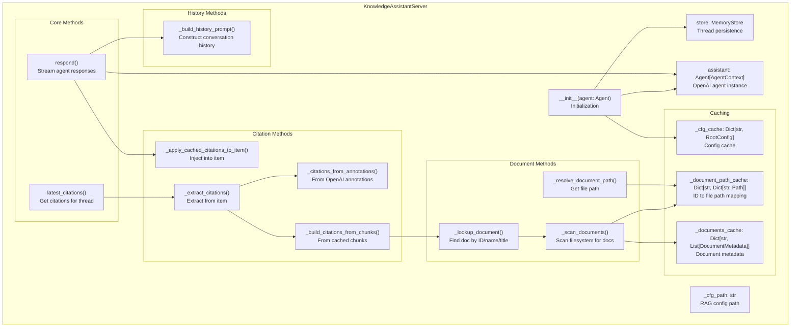
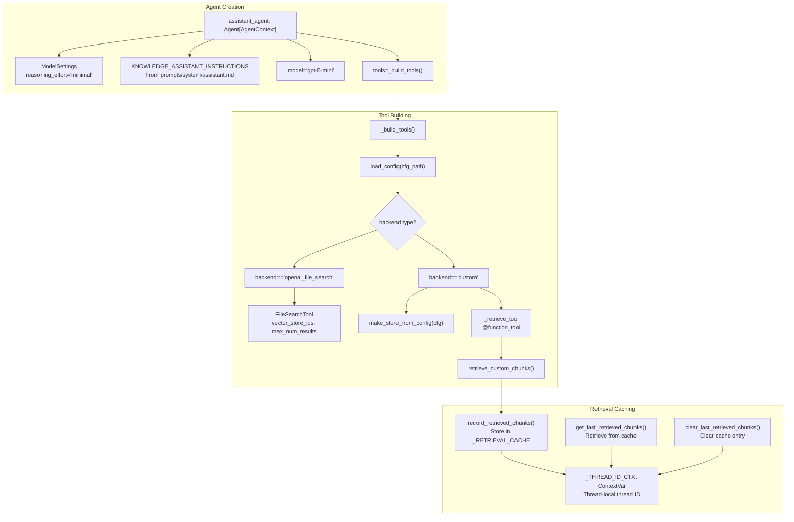
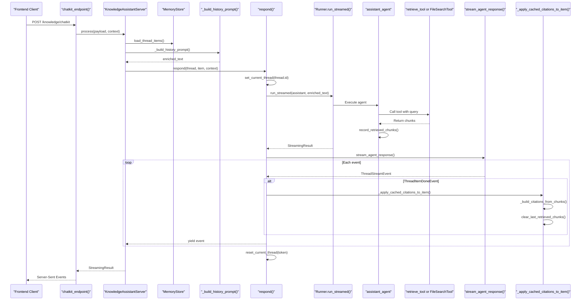
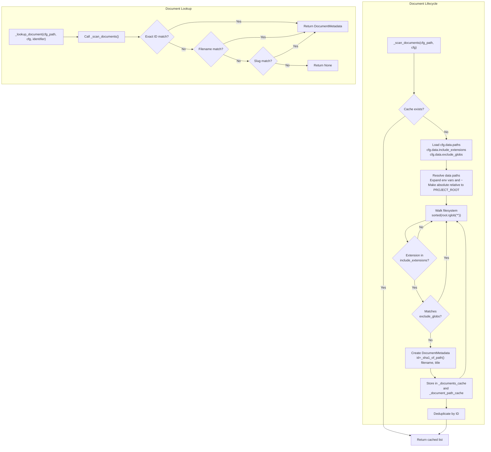
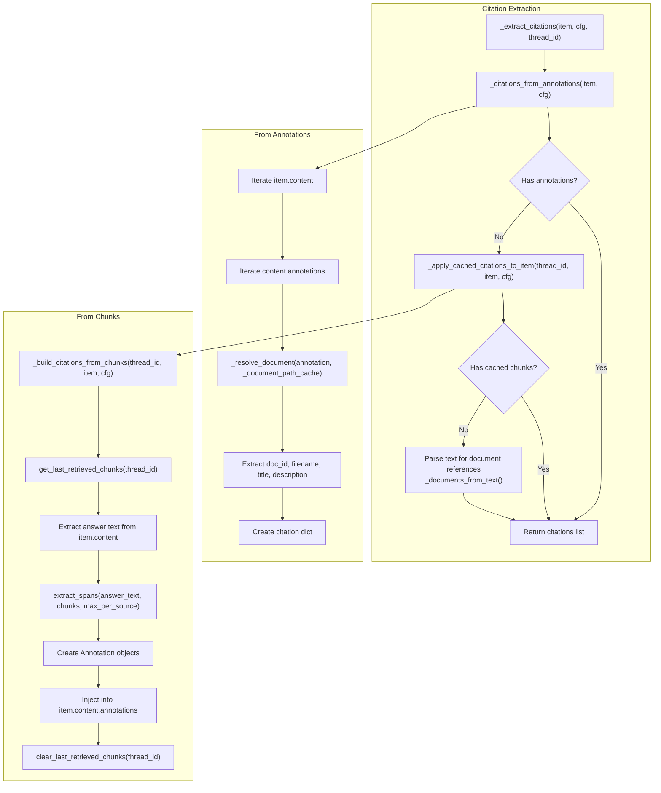
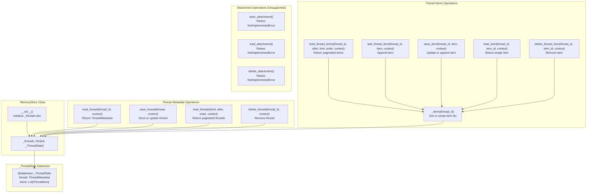

<!-- source: DeepWiki mcp.deepwiki.com · repo openai/openai-knowledge-retrieval · page 3.2 Backend Architecture · fetched 2026-10-26 -->

# Backend Architecture

Relevant source files

The following files were used as context for generating this wiki page:

- [app/backend/app/__init__.py](app/backend/app/__init__.py)
- [app/backend/app/assistant_agent.py](app/backend/app/assistant_agent.py)
- [app/backend/app/main.py](app/backend/app/main.py)
- [app/backend/app/memory_store.py](app/backend/app/memory_store.py)

## Purpose and Scope

This document details the FastAPI-based backend architecture, including the HTTP API layer, service orchestration, agent system, document management, and citation extraction mechanisms. The backend serves as the core orchestrator between the frontend ChatKit UI, the OpenAI API, and the vector store.

For frontend-backend integration patterns, see [Frontend Architecture](#3.3). For the complete RAG pipeline including ingestion and retrieval, see [RAG Pipeline](#3.4). For external service integration details, see [External Services Integration](#3.5).

**Sources:** [app/backend/app/main.py:1-647](), [app/backend/app/assistant_agent.py:1-128](), [app/backend/app/memory_store.py:1-177]()

---

## HTTP API Layer

The backend exposes five RESTful endpoints through a FastAPI application instance named `app`. All endpoints are prefixed with `/knowledge` and implement CORS middleware for cross-origin requests from the frontend.

### API Endpoints

| Endpoint | Method | Purpose | Response Type |
|----------|--------|---------|---------------|
| `/knowledge/chatkit` | POST | ChatKit protocol handler | SSE stream or JSON |
| `/knowledge/documents` | GET | List available documents | JSON |
| `/knowledge/documents/{document_id}/file` | GET | Download document file | Binary file |
| `/knowledge/threads/{thread_id}/citations` | GET | Retrieve citations for thread | JSON |
| `/knowledge/health` | GET | Health check | JSON |

### Endpoint Implementation Diagram

**Sources:** [app/backend/app/main.py:549-647]()

### CORS Configuration

The backend configures CORS via the `KNOWLEDGE_CORS_ALLOW_ORIGINS` environment variable. The `_parse_cors_allow_origins()` function [app/backend/app/main.py:551-554]() parses comma-separated origins, defaulting to `http://localhost:5172` and `http://127.0.0.1:5172`.

**Sources:** [app/backend/app/main.py:551-574]()

---

## Core Service Architecture

The `KnowledgeAssistantServer` class [app/backend/app/main.py:131-545]() inherits from `ChatKitServer[dict[str, Any]]` and serves as the central orchestrator for all backend operations. It integrates the agent system, memory store, document management, and citation extraction.

### KnowledgeAssistantServer Class Structure

**Sources:** [app/backend/app/main.py:131-545]()

### Server Initialization

The `__init__()` method [app/backend/app/main.py:132-143]() performs the following:

1. Creates a `MemoryStore` instance for thread persistence
2. Calls `ChatKitServer.__init__(self.store)` to initialize the parent
3. Stores the `assistant_agent` instance
4. Initializes configuration and document caches
5. Loads the RAG configuration via `_load_cfg()` [app/backend/app/main.py:144-151]()
6. Extracts the `vector_store_backend` for tool selection

**Sources:** [app/backend/app/main.py:132-143]()

---

## Agent System

The agent system is defined in `assistant_agent.py` and creates an `Agent[AgentContext]` instance that integrates with OpenAI's API. The agent's behavior is determined by system instructions and dynamically built tools based on the vector store backend configuration.

### Agent Configuration

**Sources:** [app/backend/app/assistant_agent.py:1-128]()

### Tool Selection Logic

The `_build_tools()` function [app/backend/app/assistant_agent.py:67-115]() implements the following logic:

1. Load RAG configuration via `_resolve_cfg_path()` [app/backend/app/assistant_agent.py:33-38]()
2. Extract `vector_store.backend` from configuration
3. **If backend is `openai_file_search`:**
   - Retrieve `VECTOR_STORE_ID` from environment or config
   - Return a `FileSearchTool` with `vector_store_ids` and `max_num_results` (from `cfg.query.top_k`)
4. **If backend is `custom`:**
   - Create a vector store via `make_store_from_config(cfg)` [app/backend/app/assistant_agent.py:85]()
   - Define `_retrieve_tool` as a `@function_tool` [app/backend/app/assistant_agent.py:87-111]()
   - The tool calls `retrieve_custom_chunks()` [app/backend/app/assistant_agent.py:92-97]()
   - Cache retrieved chunks via `record_retrieved_chunks()` [app/backend/app/assistant_agent.py:110]()
   - Return the tool function
5. **Otherwise:** Return an empty tool list

**Sources:** [app/backend/app/assistant_agent.py:67-115]()

### Retrieval Cache Mechanism

The module maintains a thread-local retrieval cache using three global structures:

| Variable | Type | Purpose |
|----------|------|---------|
| `_RETRIEVAL_CACHE` | `Dict[str, List[Dict[str, Any]]]` | Maps thread IDs to retrieved chunks |
| `_THREAD_ID_CTX` | `ContextVar[Optional[str]]` | Context variable for current thread ID |

**Functions:**
- `record_retrieved_chunks(thread_id, chunks)` [app/backend/app/assistant_agent.py:41-47](): Stores chunks for a thread
- `get_last_retrieved_chunks(thread_id)` [app/backend/app/assistant_agent.py:50-52](): Retrieves cached chunks
- `clear_last_retrieved_chunks(thread_id)` [app/backend/app/assistant_agent.py:55-56](): Removes cache entry
- `set_current_thread(thread_id)` [app/backend/app/assistant_agent.py:59-60](): Sets context variable
- `reset_current_thread(token)` [app/backend/app/assistant_agent.py:63-64](): Resets context variable

**Sources:** [app/backend/app/assistant_agent.py:17-64]()

---

## Request Flow

The following diagram illustrates the complete request flow from HTTP request to streaming response:

### Chat Request Processing

**Sources:** [app/backend/app/main.py:247-295](), [app/backend/app/main.py:580-591]()

### Key Steps in `respond()` Method

The `respond()` method [app/backend/app/main.py:247-295]() orchestrates the agent execution:

1. **Validation:** Check if the item is a `UserMessageItem` [app/backend/app/main.py:254-264]()
2. **Text Extraction:** Extract text via `_user_message_text()` [app/backend/app/main.py:75-81]()
3. **History Enrichment:** Call `_build_history_prompt()` [app/backend/app/main.py:266-270]() to construct conversation context
4. **Agent Context:** Create `AgentContext` with thread, store, and request context [app/backend/app/main.py:272-276]()
5. **Thread Setup:** Set current thread via `set_current_thread()` [app/backend/app/main.py:278]()
6. **Agent Execution:** Run `Runner.run_streamed()` [app/backend/app/main.py:280-285]()
7. **Event Streaming:** Stream events via `stream_agent_response()` [app/backend/app/main.py:287]()
8. **Citation Injection:** On `ThreadItemDoneEvent`, call `_apply_cached_citations_to_item()` [app/backend/app/main.py:288-291]()
9. **Cleanup:** Reset thread context via `reset_current_thread()` [app/backend/app/main.py:294]()

**Sources:** [app/backend/app/main.py:247-295]()

---

## Document Management

The backend scans the filesystem for documents and maintains in-memory caches of metadata and file paths. Document scanning is triggered lazily on first access and respects configuration-defined include/exclude patterns.

### Document Scanning Architecture

**Sources:** [app/backend/app/main.py:153-242]()

### Document Scanning Implementation

The `_scan_documents()` method [app/backend/app/main.py:153-222]() implements the following steps:

1. **Check Cache:** Return cached list if `cfg_path` exists in `_documents_cache` [app/backend/app/main.py:155-157]()
2. **Extract Configuration:**
   - `cfg.data.include_extensions` [app/backend/app/main.py:159-162]()
   - `cfg.data.exclude_globs` [app/backend/app/main.py:163-165]()
   - `cfg.data.paths` [app/backend/app/main.py:168-177]()
3. **Resolve Roots:** Expand environment variables and `~`, resolve relative paths against `PROJECT_ROOT` [app/backend/app/main.py:172-177]()
4. **Walk Filesystem:** Use `root.rglob("*")` sorted [app/backend/app/main.py:187]()
5. **Filter Extensions:** Check against `include_extensions` [app/backend/app/main.py:191-192]()
6. **Apply Exclude Globs:** Use `fnmatch.fnmatch()` on relative and absolute paths [app/backend/app/main.py:194-200]()
7. **Create Metadata:**
   - Generate `doc_id` via `_sha1_of_path()` [app/backend/app/main.py:201]()
   - Generate `title` via `_humanize_title()` [app/backend/app/main.py:69-72]()
   - Create `DocumentMetadata` instance [app/backend/app/main.py:204-208]()
8. **Store Mappings:** Populate `_documents_cache` and `_document_path_cache` [app/backend/app/main.py:220-221]()
9. **Deduplicate:** Remove duplicates by ID [app/backend/app/main.py:211-218]()

**Sources:** [app/backend/app/main.py:153-222]()

### Document Lookup Strategy

The `_lookup_document()` method [app/backend/app/main.py:224-242]() tries multiple matching strategies:

1. **Exact ID Match:** Compare identifier against `document.id` [app/backend/app/main.py:231-233]()
2. **Filename Match:** Normalize and compare against `filename` or stem [app/backend/app/main.py:234-237]()
3. **Slug Match:** Strip non-alphanumeric characters and compare against title [app/backend/app/main.py:238-241]()

**Sources:** [app/backend/app/main.py:224-242]()

---

## Citation System

The citation system employs a multi-strategy fallback approach to derive document references from assistant responses. Citations can originate from OpenAI annotations, cached retrieval chunks, or text parsing.

### Citation Extraction Flow

**Sources:** [app/backend/app/main.py:318-502]()

### Citation Extraction Strategies

The `_extract_citations()` method [app/backend/app/main.py:318-348]() implements a three-tier fallback:

1. **Strategy 1: From Annotations** [app/backend/app/main.py:324-326]()
   - Call `_citations_from_annotations()` [app/backend/app/main.py:350-396]()
   - Iterate through `item.content[].annotations`
   - Resolve document metadata via `_resolve_document()` [app/backend/app/main.py:98-120]()
   - Extract `doc_id`, `filename`, `title`, `description` from `annotation.source`
   - If document not found, lookup via `_lookup_document()` using `annotation.source.group`
   - Return list of citation dictionaries

2. **Strategy 2: From Cached Chunks** [app/backend/app/main.py:328-330]()
   - Call `_apply_cached_citations_to_item()` [app/backend/app/main.py:398-411]()
   - Delegates to `_build_citations_from_chunks()` [app/backend/app/main.py:413-502]()
   - Retrieve chunks via `get_last_retrieved_chunks()` [app/backend/app/main.py:419]()
   - Extract answer text from `item.content` [app/backend/app/main.py:423-432]()
   - Call `extract_spans()` from `retrieval.citations` module [app/backend/app/main.py:434-440]()
   - Create `Annotation` objects with `FileSource` [app/backend/app/main.py:483-499]()
   - Inject annotations into `item.content[].annotations` [app/backend/app/main.py:406-410]()
   - Clear cache via `clear_last_retrieved_chunks()` [app/backend/app/main.py:501]()

3. **Strategy 3: Text Parsing** [app/backend/app/main.py:332-347]()
   - Parse text lines for document references via `_documents_from_text()` (not shown in provided files)
   - Return basic citation dictionaries without annotation indices

**Sources:** [app/backend/app/main.py:318-502]()

### Citation Data Structure

Citations are returned as dictionaries with the following fields:

| Field | Type | Description |
|-------|------|-------------|
| `document_id` | `str` | Document identifier (SHA1 hash of path) |
| `filename` | `str` | Original filename |
| `title` | `str` | Humanized title |
| `description` | `str | None` | Optional description |
| `annotation_index` | `int | None` | Index in annotations array |

**Sources:** [app/backend/app/main.py:387-499]()

---

## Memory Store

The `MemoryStore` class [app/backend/app/memory_store.py:22-177]() provides an in-memory implementation of the ChatKit `Store[dict[str, Any]]` interface. It persists thread metadata and items in memory without authentication or authorization.

### MemoryStore Architecture

**Sources:** [app/backend/app/memory_store.py:1-177]()

### Thread and Item Storage

The `_threads` dictionary [app/backend/app/memory_store.py:26]() maps thread IDs to `_ThreadState` dataclass instances [app/backend/app/memory_store.py:16-19](), which contain:

| Field | Type | Description |
|-------|------|-------------|
| `thread` | `ThreadMetadata` | Thread metadata (ID, created_at, etc.) |
| `items` | `List[ThreadItem]` | List of user and assistant messages |

**Key Methods:**

- **`_items(thread_id)`** [app/backend/app/memory_store.py:83-91](): Lazily creates thread state if not exists
- **`load_thread_items()`** [app/backend/app/memory_store.py:93-117](): Sorts by `created_at`, implements pagination via `after` parameter
- **`save_thread()`** [app/backend/app/memory_store.py:38-48](): Deep copies metadata to prevent external mutations
- **`load_threads()`** [app/backend/app/memory_store.py:50-77](): Returns paginated list sorted by `created_at`

**Sources:** [app/backend/app/memory_store.py:16-147]()

### Attachment Handling

The store explicitly does not support file attachments. Methods `save_attachment()`, `load_attachment()`, and `delete_attachment()` [app/backend/app/memory_store.py:148-176]() raise `NotImplementedError` with messages directing implementers to provide authentication-aware storage.

**Sources:** [app/backend/app/memory_store.py:148-177]()

---

## Configuration Loading

The backend loads RAG configuration from YAML files specified by the `RAG_CONFIG` environment variable, defaulting to `configs/default.openai.yaml`. Configuration is cached in `_cfg_cache` to avoid repeated file I/O.

### Configuration Resolution

The `_resolve_cfg_path()` function [app/backend/app/assistant_agent.py:33-38]() resolves the configuration path:

1. Read `RAG_CONFIG` environment variable or use default
2. If absolute, return as-is
3. If relative, resolve against `PROJECT_ROOT` (three levels up from `assistant_agent.py`)

The `_load_cfg()` method [app/backend/app/main.py:144-151]() implements the same logic and caches loaded configurations in `_cfg_cache`.

**Sources:** [app/backend/app/assistant_agent.py:33-38](), [app/backend/app/main.py:144-151]()

---

## Backend Dependencies

The backend relies on several key dependencies for agent execution, HTTP serving, and data management:

| Package | Purpose |
|---------|---------|
| `fastapi` | HTTP framework and routing |
| `uvicorn` | ASGI server for FastAPI |
| `agents` | OpenAI agent SDK (Runner, Agent, tools) |
| `chatkit.server` | ChatKit server protocol implementation |
| `chatkit.agents` | Agent context and streaming utilities |
| `chatkit.types` | Type definitions for threads, items, annotations |
| `openai` | OpenAI API client |
| `python-dotenv` | Environment variable loading |
| `cli.config` | Configuration loading from YAML |
| `retrieval.pipeline` | Custom chunk retrieval |
| `retrieval.citations` | Citation span extraction |
| `stores.base` | Vector store factory |

**Sources:** [app/backend/app/main.py:1-58](), [app/backend/app/assistant_agent.py:1-14]()

---

## Summary

The backend architecture centers on the `KnowledgeAssistantServer` class, which orchestrates agent execution, document management, and citation extraction. The HTTP API layer exposes five RESTful endpoints through FastAPI, with the `/knowledge/chatkit` endpoint handling conversational interactions via Server-Sent Events.

The agent system dynamically builds tools based on the vector store backend (OpenAI FileSearch vs. custom), maintaining a thread-local retrieval cache for citation derivation. Document management scans the filesystem with configurable include/exclude patterns, caching metadata and file paths. The citation system employs a three-tier fallback strategy: OpenAI annotations, cached retrieval chunks, and text parsing.

The `MemoryStore` provides in-memory thread and item persistence without authentication, while configuration loading resolves YAML paths and caches parsed configurations. This architecture enables flexible RAG pipelines with pluggable vector stores and citation strategies.

**Sources:** [app/backend/app/main.py:1-647](), [app/backend/app/assistant_agent.py:1-128](), [app/backend/app/memory_store.py:1-177]()

---

