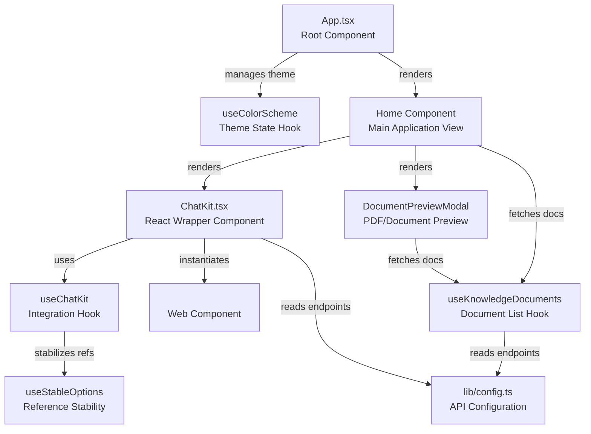
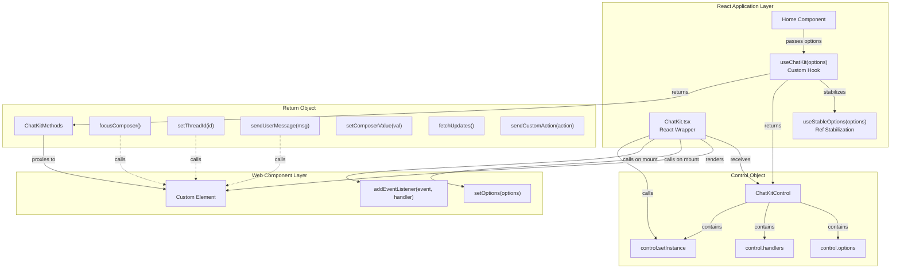
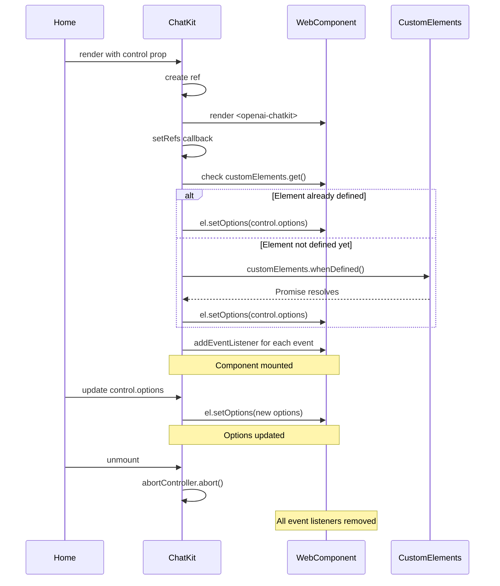
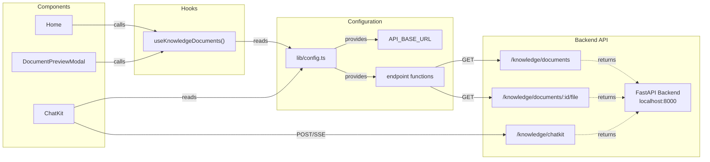
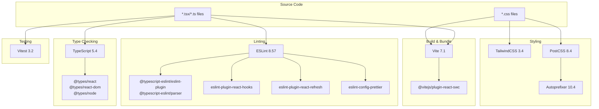
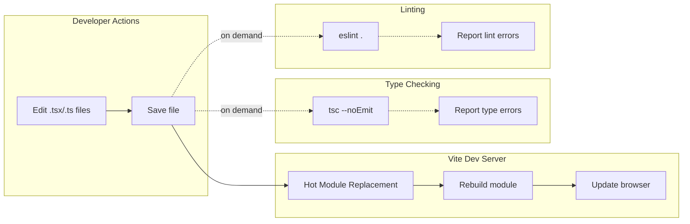

<!-- source: DeepWiki mcp.deepwiki.com · repo openai/openai-knowledge-retrieval · page 3.3 Frontend Architecture · fetched 2026-10-26 -->

# Frontend Architecture

<details>
<summary>Relevant source files</summary>

The following files were used as context for generating this wiki page:

- [app/frontend/package.json](app/frontend/package.json)
- [app/frontend/src/App.tsx](app/frontend/src/App.tsx)
- [app/frontend/src/chatkit-react/ChatKit.tsx](app/frontend/src/chatkit-react/ChatKit.tsx)
- [app/frontend/src/chatkit-react/index.ts](app/frontend/src/chatkit-react/index.ts)
- [app/frontend/src/chatkit-react/useChatKit.ts](app/frontend/src/chatkit-react/useChatKit.ts)

</details>


## Purpose and Scope

This document describes the frontend application architecture for the OpenAI Knowledge Retrieval starter kit. The frontend is a React 19 application built with Vite that integrates the OpenAI ChatKit web component to provide a conversational interface for querying the knowledge base.

This document covers the component hierarchy, ChatKit integration layer, state management patterns, and build tooling. For backend API endpoint specifications, see [Backend API Endpoints](#11.1). For detailed ChatKit component API documentation, see [Frontend Hooks and Components API](#11.2).

---

## Technology Stack

The frontend is built using the following core technologies:

| Technology | Version | Purpose |
|------------|---------|---------|
| React | ^19.2.0 | Core UI framework |
| Vite | ^7.1.9 | Build tool and dev server |
| TypeScript | ^5.4.0 | Type safety |
| @openai/chatkit-react | ^0 | ChatKit integration |
| TailwindCSS | ^3.4.13 | Styling framework |
| Lucide React | ^0.544.0 | Icon library |

The application uses React 19's modern features and requires Node.js >=18.18 and npm >=9.

**Sources:** [app/frontend/package.json:12-21]()

---

## Application Structure

### Component Hierarchy



The application has a shallow component hierarchy with `App.tsx` as the root. The `App` component manages global color scheme state and delegates rendering to the `Home` component, which orchestrates the ChatKit integration and document preview functionality.

**Sources:** [app/frontend/src/App.tsx:1-18](), Diagram 4

---

### Root Component (App.tsx)

The `App` component serves as the application entry point and provides theme management:

```typescript
// Structure from app/frontend/src/App.tsx
export default function App() {
  const { scheme, setScheme } = useColorScheme();
  
  const handleThemeChange = useCallback(
    (value: ColorScheme) => {
      setScheme(value);
    },
    [setScheme],
  );

  return <Home scheme={scheme} onThemeChange={handleThemeChange} />;
}
```

The component:
- Uses `useColorScheme` hook to manage light/dark/system theme preferences
- Provides memoized theme change callback using `useCallback`
- Passes theme state and callback to the `Home` component

**Sources:** [app/frontend/src/App.tsx:1-18]()

---

## ChatKit Integration Layer

The ChatKit integration layer is the most complex part of the frontend architecture. It bridges React's component model with OpenAI's custom web component (`<openai-chatkit>`), providing type-safe event handling, method proxying, and lifecycle management.

### Integration Architecture



**Sources:** [app/frontend/src/chatkit-react/ChatKit.tsx:1-100](), [app/frontend/src/chatkit-react/useChatKit.ts:1-102]()

---

### useChatKit Hook

The `useChatKit` hook is the primary integration interface. It accepts a combined options object containing both ChatKit configuration and React event handlers, then separates them into appropriate structures.

#### Hook Interface

```typescript
// Type definitions from useChatKit.ts
type UseChatKitOptions = ChatKitOptions & ChatKitEventHandlers;

type UseChatKitReturn = ChatKitMethods & {
  control: ChatKitControl;
};

export function useChatKit(options: UseChatKitOptions): UseChatKitReturn;
```

#### Method Proxying

The hook creates proxy methods for all ChatKit element methods defined in `CHATKIT_METHOD_NAMES`:

| Method | Description |
|--------|-------------|
| `focusComposer()` | Focuses the message composer input |
| `setThreadId(id)` | Changes the active conversation thread |
| `sendUserMessage(msg)` | Programmatically sends a user message |
| `setComposerValue(val)` | Sets the composer input value |
| `fetchUpdates()` | Manually triggers update fetch |
| `sendCustomAction(action)` | Sends a custom action to the backend |

All methods are memoized and include safety checks:

```typescript
// Logic from app/frontend/src/chatkit-react/useChatKit.ts:59-72
const methods: ChatKitMethods = React.useMemo(() => {
  return CHATKIT_METHOD_NAMES.reduce((acc, key) => {
    acc[key] = (...args: any[]) => {
      if (!ref.current) {
        console.warn("ChatKit element is not mounted");
        return;
      }
      return (ref.current as any)[key](...args);
    };
    return acc;
  }, {} as ChatKitMethods);
}, []);
```

**Sources:** [app/frontend/src/chatkit-react/useChatKit.ts:13-26](), [app/frontend/src/chatkit-react/useChatKit.ts:55-72]()

---

### Event Handler Transformation

The hook transforms React-style event handlers (e.g., `onError`, `onResponseStart`) into ChatKit event listeners (e.g., `chatkit.error`, `chatkit.response.start`):

#### Event Handler Mapping

| ChatKit Event | React Handler | Detail Type |
|--------------|---------------|-------------|
| `chatkit.error` | `onError` | Error details |
| `chatkit.response.start` | `onResponseStart` | Response metadata |
| `chatkit.response.end` | `onResponseEnd` | Final response data |
| `chatkit.log` | `onLog` | Log message |
| `chatkit.thread.change` | `onThreadChange` | Thread ID |

The transformation uses TypeScript's template literal types:

```typescript
// Type transformation from useChatKit.ts:28-31
type ToEventHandlerKey<K extends keyof ChatKitElementEventMap> =
  DotToCamelCase<K> extends `chatkit${infer EventName}`
    ? `on${Capitalize<EventName>}`
    : never;
```

**Sources:** [app/frontend/src/chatkit-react/useChatKit.ts:28-41]()

---

### ChatKit.tsx Wrapper Component

The `ChatKit` wrapper component handles the lifecycle of the `<openai-chatkit>` web component:

#### Lifecycle Management



#### Implementation Details

The component uses three React lifecycle hooks:

1. **`useLayoutEffect`** ([app/frontend/src/chatkit-react/ChatKit.tsx:26-45]()): Synchronously sets options when the element is mounted or updated. Handles the case where the custom element may not be defined yet by waiting for `customElements.whenDefined()`.

2. **`useEffect`** ([app/frontend/src/chatkit-react/ChatKit.tsx:47-82]()): Attaches event listeners using an `AbortController` for cleanup. Maps ChatKit events to handler callbacks from the control object:

```typescript
const events = {
  "chatkit.error": "onError",
  "chatkit.response.end": "onResponseEnd",
  "chatkit.response.start": "onResponseStart",
  "chatkit.log": "onLog",
  "chatkit.thread.change": "onThreadChange",
} satisfies {
  [K in keyof ChatKitElementEventMap]: ToEventHandlerKey<K>;
};
```

3. **`useCallback`** ([app/frontend/src/chatkit-react/ChatKit.tsx:84-95]()): Manages ref forwarding to support both function refs and ref objects.

**Sources:** [app/frontend/src/chatkit-react/ChatKit.tsx:22-99]()

---

### JSX IntrinsicElements Extension

To enable TypeScript support for the custom `<openai-chatkit>` element, the module augments React's JSX namespace:

```typescript
// Declaration from app/frontend/src/chatkit-react/ChatKit.tsx:10-20
declare module "react" {
  namespace JSX {
    interface IntrinsicElements {
      "openai-chatkit": React.DetailedHTMLProps<
        React.HTMLAttributes<ChatKitElement>,
        ChatKitElement
      >;
    }
  }
}
```

This allows TypeScript to recognize `<openai-chatkit>` as a valid JSX element and provides type checking for props.

**Sources:** [app/frontend/src/chatkit-react/ChatKit.tsx:10-20]()

---

### Reference Stability (useStableOptions)

The `useStableOptions` hook ensures that ChatKit options maintain stable references across re-renders, preventing unnecessary web component updates. While the implementation is not shown in the provided files, it is used by `useChatKit` to wrap the options object before returning it in the control object.

**Sources:** [app/frontend/src/chatkit-react/useChatKit.ts:2](), [app/frontend/src/chatkit-react/useChatKit.ts:57]()

---

## State Management and Data Flow

The frontend uses React hooks for state management with no global state library. Data flows unidirectionally from the backend API through hooks to components.

### API Communication Flow



The `lib/config.ts` file centralizes API configuration, providing:
- Base URL configuration (defaults to `http://localhost:8000`)
- Endpoint builder functions
- Type-safe API route definitions

ChatKit communicates directly with the backend's `/knowledge/chatkit` endpoint using Server-Sent Events (SSE) for streaming responses.

**Sources:** Diagram 4

---

## Build System and Development Tools

### Build Configuration

The frontend uses Vite as the build tool and development server. Key configuration aspects:

#### Package Scripts

| Script | Command | Purpose |
|--------|---------|---------|
| `dev` | `vite` | Start dev server on port 5173 |
| `build` | `vite build` | Create production build |
| `preview` | `vite preview` | Preview production build |
| `lint` | `eslint . --ext ts,tsx` | Run ESLint |

**Sources:** [app/frontend/package.json:6-11]()

---

### Development Tooling



#### TypeScript Configuration

The application uses TypeScript 5.4 with React 19 type definitions. All source files are strictly typed, with type definitions imported from:
- `@types/react` for React APIs
- `@types/react-dom` for ReactDOM APIs
- `@types/node` for Node.js APIs
- `@openai/chatkit` for ChatKit type definitions

**Sources:** [app/frontend/package.json:23-42]()

---

#### ESLint Configuration

The linting setup includes:

| Plugin/Config | Purpose |
|---------------|---------|
| `@eslint/js` | Core ESLint rules |
| `@typescript-eslint/*` | TypeScript-specific linting |
| `eslint-plugin-react-hooks` | React Hooks rules enforcement |
| `eslint-plugin-react-refresh` | Fast Refresh compatibility |
| `eslint-config-prettier` | Disable conflicting Prettier rules |

**Sources:** [app/frontend/package.json:24-35]()

---

#### Styling Pipeline

The styling system uses:
- **TailwindCSS**: Utility-first CSS framework for component styling
- **PostCSS**: CSS processing pipeline
- **Autoprefixer**: Automatic vendor prefix addition

CSS is processed through the PostCSS pipeline configured in `postcss.config.cjs`, which applies Tailwind directives and autoprefixing.

**Sources:** [app/frontend/package.json:31-38]()

---

#### Vite Configuration

Vite provides:
- Fast Hot Module Replacement (HMR) during development
- Optimized production builds with code splitting
- React Fast Refresh via `@vitejs/plugin-react-swc`
- Development server on port 5173 with proxy support

The SWC plugin provides faster TypeScript transpilation and React Fast Refresh compared to Babel.

**Sources:** [app/frontend/package.json:30-40]()

---

## Module Exports and Public API

The `chatkit-react` integration layer exports a clean public API through [app/frontend/src/chatkit-react/index.ts]():

```typescript
// Public exports
export type * from "@openai/chatkit";
export { ChatKit } from "./ChatKit";
export {
  useChatKit,
  type UseChatKitOptions,
  type UseChatKitReturn,
  type ChatKitControl,
} from "./useChatKit";
```

This structure allows consumers to:
1. Import ChatKit types directly from the OpenAI package
2. Use the `ChatKit` wrapper component
3. Use the `useChatKit` hook with full type safety
4. Reference the control object type

**Sources:** [app/frontend/src/chatkit-react/index.ts:1-9]()

---

## Development Workflow

### Local Development



The development server provides instant feedback through HMR. Type checking and linting are typically run on-demand or in CI rather than blocking the development server.

**Sources:** [app/frontend/package.json:6-10]()

---

## Dependencies Summary

### Core Dependencies

| Package | Version | Purpose |
|---------|---------|---------|
| `@openai/chatkit-react` | ^0 | ChatKit React integration |
| `react` | ^19.2.0 | UI framework |
| `react-dom` | ^19.2.0 | React DOM renderer |
| `clsx` | ^2.1.1 | Conditional className utility |
| `lucide-react` | ^0.544.0 | Icon components |

### Development Dependencies

| Category | Packages |
|----------|----------|
| Build | `vite`, `@vitejs/plugin-react-swc` |
| TypeScript | `typescript`, `@types/*` |
| Linting | `eslint`, `@typescript-eslint/*`, `eslint-plugin-*` |
| Styling | `tailwindcss`, `postcss`, `autoprefixer` |
| Testing | `vitest` |

**Sources:** [app/frontend/package.json:16-42]()

---

