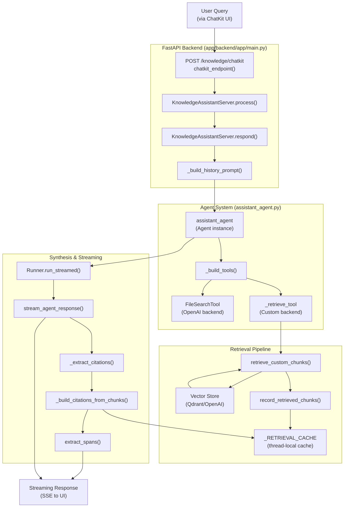
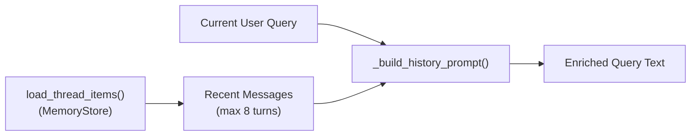
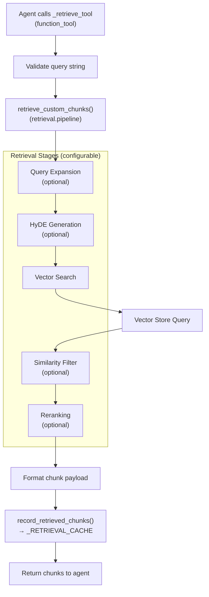
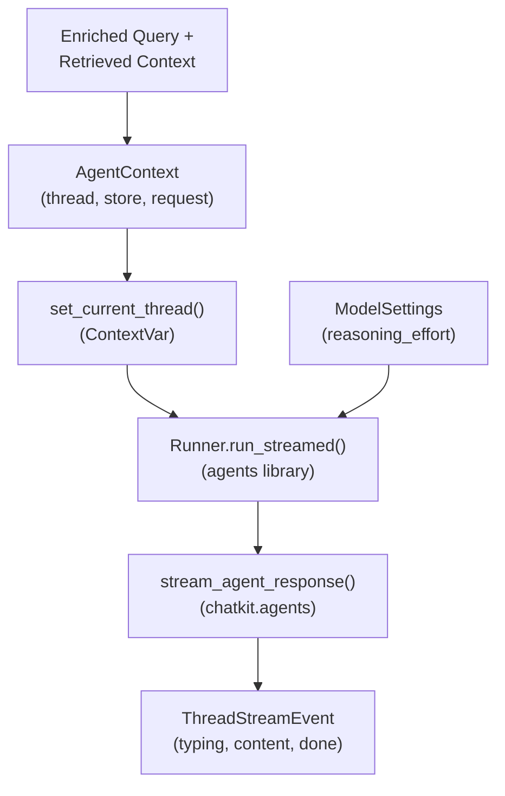
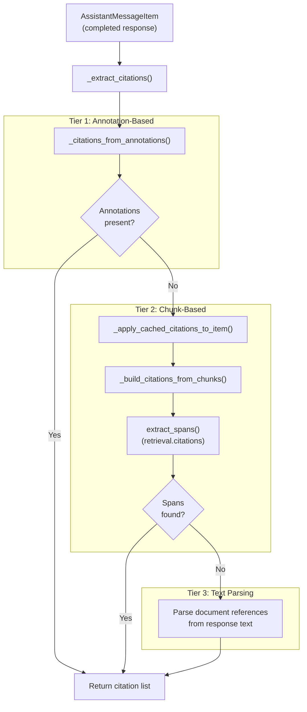
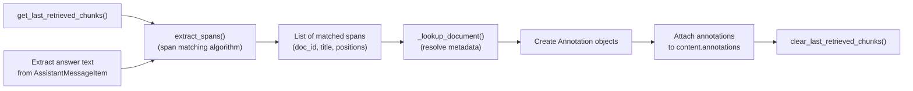
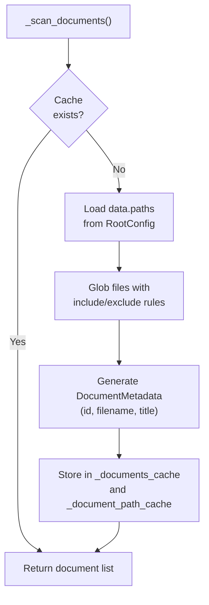

<!-- source: DeepWiki mcp.deepwiki.com · repo openai/openai-knowledge-retrieval · page 3.4 RAG Pipeline · fetched 2026-10-26 -->

# RAG Pipeline

<details>
<summary>Relevant source files</summary>

The following files were used as context for generating this wiki page:

- [Makefile](Makefile)
- [README.md](README.md)
- [app/backend/app/assistant_agent.py](app/backend/app/assistant_agent.py)
- [app/backend/app/main.py](app/backend/app/main.py)

</details>


## Purpose and Scope

This document explains the Retrieval Augmented Generation (RAG) pipeline that powers the knowledge retrieval system. The pipeline processes user queries, retrieves relevant context from document stores, and synthesizes grounded responses with citations. It covers the complete data flow from query reception through response streaming.

For initial setup and configuration of the pipeline, see [Configuration](#2.3). For details on the ingestion process, see [Data Ingestion](#6.2). For evaluation of pipeline quality, see [Evaluation System](#6.3).

---

## Pipeline Overview

The RAG pipeline consists of four major phases:

| Phase | Purpose | Key Components |
|-------|---------|----------------|
| **Ingestion** | Process documents and populate vector store | CLI ingestion, embeddings generation, vector storage |
| **Query Processing** | Accept user queries and prepare for retrieval | Request handling, history contextualization, agent initialization |
| **Retrieval** | Find relevant context from document store | Tool execution, vector search, optional query expansion/reranking |
| **Synthesis** | Generate response and extract citations | LLM generation, citation extraction, response streaming |

The pipeline is configurable via YAML files that control which features are enabled, which models are used, and how retrieval is performed.

**Sources:** [README.md:44-66](), [Diagram 2 from high-level architecture]()

---

## Pipeline Architecture

### End-to-End Data Flow



**Sources:** [app/backend/app/main.py:1-647](), [app/backend/app/assistant_agent.py:1-128]()

---

## Query Processing Phase

### Request Handling

When a user submits a query through the ChatKit UI, the request flows through the following components:

1. **HTTP Endpoint**: `POST /knowledge/chatkit` handled by `chatkit_endpoint()` [app/backend/app/main.py:580-590]()
2. **Server Processing**: `KnowledgeAssistantServer.process()` parses the ChatKit payload
3. **Response Generation**: `KnowledgeAssistantServer.respond()` orchestrates the retrieval and synthesis [app/backend/app/main.py:247-294]()

### Conversation History Integration

The pipeline enriches the current query with conversation history to maintain context across turns:



The `_build_history_prompt()` method [app/backend/app/main.py:504-544]() constructs a structured prompt containing:
- Conversation history (up to 8 recent turns)
- User and Assistant message pairs in chronological order
- The latest user message

**Sources:** [app/backend/app/main.py:247-294](), [app/backend/app/main.py:504-544]()

---

## Retrieval Phase

### Agent Tool Selection

The retrieval mechanism is determined by the configured vector store backend. The `_build_tools()` function [app/backend/app/assistant_agent.py:67-115]() creates the appropriate tool:

| Backend | Tool | Description |
|---------|------|-------------|
| `openai_file_search` | `FileSearchTool` | Uses OpenAI's managed File Search API |
| `custom` | `_retrieve_tool` | Uses custom vector store (e.g., Qdrant) with configurable pipeline |

### Custom Retrieval Tool

When using a custom backend, the `_retrieve_tool` function [app/backend/app/assistant_agent.py:87-111]() executes the retrieval pipeline:



The retrieved chunks are cached thread-locally in `_RETRIEVAL_CACHE` [app/backend/app/assistant_agent.py:19]() for later citation extraction. Each chunk contains:

```python
{
    "doc_id": str,           # Document identifier
    "title": str,            # Document title
    "text": str,             # Chunk text content
    "score": float,          # Relevance score
    "similarity_score": float,  # Cosine similarity
    "metadata": dict,        # Additional metadata
    "page": int | None       # Page number (if applicable)
}
```

**Sources:** [app/backend/app/assistant_agent.py:67-115](), [app/backend/app/assistant_agent.py:87-111]()

### Retrieval Cache Management

The pipeline maintains thread-local caches to support citation extraction:

| Function | Purpose | Location |
|----------|---------|----------|
| `record_retrieved_chunks()` | Store chunks for a thread | [app/backend/app/assistant_agent.py:41-47]() |
| `get_last_retrieved_chunks()` | Retrieve cached chunks | [app/backend/app/assistant_agent.py:50-52]() |
| `clear_last_retrieved_chunks()` | Clean up cache after use | [app/backend/app/assistant_agent.py:55-56]() |

The cache is populated during retrieval and consumed during citation extraction, then cleared to prevent memory leaks.

**Sources:** [app/backend/app/assistant_agent.py:19-56]()

---

## Synthesis Phase

### Agent Response Generation

Once retrieval completes, the agent generates a response using the LLM:



The synthesis process [app/backend/app/main.py:280-294]():
1. Creates an `AgentContext` with thread metadata and memory store
2. Sets the current thread ID in a `ContextVar` for retrieval tracking
3. Invokes `Runner.run_streamed()` to generate the response
4. Streams events via `stream_agent_response()` from the chatkit-agents library
5. Cleans up the thread context when complete

**Sources:** [app/backend/app/main.py:247-294](), [app/backend/app/assistant_agent.py:117-127]()

### System Instructions

The agent uses system instructions loaded from [prompts/system/assistant.md]() [app/backend/app/assistant_agent.py:25-30](). These instructions guide the model to:
- Answer questions using retrieved context
- Cite sources appropriately
- Maintain conversation context
- Handle multi-turn interactions

**Sources:** [app/backend/app/assistant_agent.py:25-30](), [app/backend/app/assistant_agent.py:121-126]()

---

## Citation Extraction

### Three-Tier Fallback Strategy

The pipeline employs a three-tier fallback strategy to extract citations from assistant responses:



**Sources:** [app/backend/app/main.py:318-348]()

### Tier 1: Annotation-Based Citations

For OpenAI File Search backend, citations come from the `annotations` field in `AssistantMessageContent` [app/backend/app/main.py:350-396]():

1. Iterate through `content.annotations` in the assistant message
2. Extract `source.filename` and `source.group` (document ID)
3. Resolve document metadata using `_resolve_document()` and `_lookup_document()`
4. Build citation records with `document_id`, `filename`, `title`, and `annotation_index`

### Tier 2: Chunk-Based Citations

For custom backends, citations are derived from cached retrieval chunks [app/backend/app/main.py:398-502]():



The `extract_spans()` function (from `retrieval.citations`) performs substring matching to identify which chunks contributed to the response text. The pipeline:
1. Retrieves cached chunks via `get_last_retrieved_chunks()` [app/backend/app/assistant_agent.py:50-52]()
2. Extracts answer text from `AssistantMessageContent`
3. Calls `extract_spans()` to match chunk text to answer text [app/backend/app/main.py:434-440]()
4. Looks up document metadata for each matched span
5. Creates `Annotation` objects with `FileSource`
6. Attaches annotations to the message content
7. Clears the retrieval cache to prevent memory leaks

**Sources:** [app/backend/app/main.py:413-502](), [app/backend/app/assistant_agent.py:50-56]()

### Tier 3: Text Parsing Fallback

If no annotations or cached chunks are available, the pipeline falls back to parsing document references from the response text [app/backend/app/main.py:332-348]().

**Sources:** [app/backend/app/main.py:332-348]()

---

## Configuration

### Pipeline Configuration Options

The RAG pipeline is controlled by YAML configuration files. Key sections:

| Configuration Section | Controls | Example Path |
|----------------------|----------|--------------|
| `vector_store.backend` | Which retrieval tool to use | `configs/default.openai.yaml` |
| `query.expansion` | Query expansion with LLM variants | `README.md:214-215` |
| `query.hyde` | HyDE (Hypothetical Document Embeddings) | `README.md:216-217` |
| `query.similarity_filter` | Threshold-based result filtering | `README.md:218-219` |
| `query.rerank` | LLM-based reranking | `README.md:220-221` |
| `synthesis.model` | Response generation model | `README.md:229` |
| `synthesis.system_prompt` | Agent instructions | `README.md:230-231` |

### Configuration Loading

The backend loads configuration from the `RAG_CONFIG` environment variable [app/backend/app/assistant_agent.py:33-38]() [app/backend/app/main.py:137](), defaulting to `configs/default.openai.yaml`.

**Sources:** [README.md:210-236](), [app/backend/app/assistant_agent.py:33-38](), [app/backend/app/main.py:137]()

---

## Response Streaming

### Server-Sent Events

The pipeline streams responses back to the UI using Server-Sent Events (SSE) [app/backend/app/main.py:580-590]():

1. `chatkit_endpoint()` receives the POST request
2. `server.process()` handles the ChatKit payload
3. If the result is a `StreamingResult`, return a `StreamingResponse` with `media_type="text/event-stream"`
4. The UI receives incremental updates as the agent generates text

### Citation Application During Streaming

Citations are applied when the `ThreadItemDoneEvent` is emitted [app/backend/app/main.py:287-291]():

```python
if isinstance(event, ThreadItemDoneEvent) and isinstance(
    event.item, AssistantMessageItem
):
    self._apply_cached_citations_to_item(thread.id, event.item, cfg)
    yield event
```

This ensures citations are attached before the final response is sent to the client.

**Sources:** [app/backend/app/main.py:580-590](), [app/backend/app/main.py:287-294]()

---

## Pipeline Execution Example

### Custom Backend Flow

For a custom Qdrant backend, the complete pipeline execution:

1. **User submits query**: "What are the key features?"
2. **History enrichment**: Previous 8 turns are prepended to query
3. **Agent initialization**: `assistant_agent` with `_retrieve_tool`
4. **Tool execution**: Agent decides to call `retrieve_context` tool
5. **Retrieval pipeline**:
   - Optional query expansion generates alternate phrasings
   - Optional HyDE generates synthetic passage
   - Vector search queries Qdrant with query embedding
   - Results filtered by similarity threshold
   - Optional reranking with LLM cross-encoder
6. **Cache population**: Chunks stored via `record_retrieved_chunks()`
7. **Synthesis**: `Runner.run_streamed()` generates response
8. **Citation extraction**: `extract_spans()` matches chunks to answer
9. **Annotation attachment**: `Annotation` objects added to message content
10. **Cache cleanup**: `clear_last_retrieved_chunks()` frees memory
11. **SSE streaming**: Response chunks sent to UI with citations

**Sources:** [app/backend/app/assistant_agent.py:87-111](), [app/backend/app/main.py:247-294](), [app/backend/app/main.py:413-502]()

---

## Document Metadata Resolution

### Document Scanning and Caching

The server maintains an in-memory cache of document metadata [app/backend/app/main.py:153-222]():



Document IDs are generated as SHA1 hashes of file paths [app/backend/app/main.py:63-66]():

```python
def _sha1_of_path(path: Path) -> str:
    import hashlib
    return hashlib.sha1(str(path).encode()).hexdigest()
```

### Document Lookup

The `_lookup_document()` method [app/backend/app/main.py:224-242]() supports lookups by:
- Exact document ID match
- Normalized filename match
- Filename stem match
- Title slug match (alphanumeric-only)

This flexible lookup enables citation resolution even when chunk metadata contains partial identifiers.

**Sources:** [app/backend/app/main.py:153-242]()

---

## Thread Context Management

### ContextVar for Thread Tracking

The pipeline uses a `ContextVar` to track the current thread during retrieval [app/backend/app/assistant_agent.py:20-22]():

```python
_THREAD_ID_CTX: ContextVar[Optional[str]] = ContextVar(
    "assistant_thread_id", default=None
)
```

This enables the `_retrieve_tool` function to cache chunks without explicit thread parameter passing [app/backend/app/assistant_agent.py:110]():

```python
record_retrieved_chunks(_THREAD_ID_CTX.get(), payload_chunks)
```

The thread context is set at the beginning of `respond()` and reset afterward [app/backend/app/main.py:278-294]():

```python
token = set_current_thread(thread.id)
try:
    # ... agent execution ...
finally:
    reset_current_thread(token)
```

This ensures thread safety across concurrent requests.

**Sources:** [app/backend/app/assistant_agent.py:20-64](), [app/backend/app/main.py:278-294]()

---

## Integration Points

### Vector Store Abstraction

The pipeline abstracts vector store operations through the `make_store_from_config()` function [app/backend/app/assistant_agent.py:85](). This allows swapping between:
- OpenAI File Search (managed, annotation-based)
- Qdrant (self-hosted, chunk-based)
- Custom implementations via plugin system

### Retrieval Pipeline Integration

Custom retrieval logic is implemented in `retrieval.pipeline.retrieve_custom_chunks()` [app/backend/app/assistant_agent.py:92-96](). This function orchestrates:
- Query expansion
- HyDE generation
- Vector search
- Similarity filtering
- Reranking

All stages are configurable via YAML.

**Sources:** [app/backend/app/assistant_agent.py:85-96](), [README.md:210-223]()

---

## Key Design Patterns

### Caching Strategy

The pipeline uses multiple caching layers:

| Cache | Scope | Purpose |
|-------|-------|---------|
| `_RETRIEVAL_CACHE` | Module-level dict | Thread-local chunk storage for citations |
| `_cfg_cache` | Server instance | Avoid re-parsing YAML configs |
| `_documents_cache` | Server instance | Avoid re-scanning file system |
| `_document_path_cache` | Server instance | Fast ID-to-path lookups |

**Sources:** [app/backend/app/assistant_agent.py:19](), [app/backend/app/main.py:136-139]()

### Fallback Hierarchy

Both retrieval and citation extraction employ fallback hierarchies:
- **Retrieval**: Try OpenAI File Search → Custom vector store → No retrieval
- **Citations**: Try annotations → Cached chunks → Text parsing

This resilience ensures the pipeline degrades gracefully when components are unavailable.

**Sources:** [app/backend/app/main.py:318-348]()

### Streaming-First Design

The pipeline is designed for streaming responses:
- `Runner.run_streamed()` returns an async iterator
- `stream_agent_response()` wraps agent events as ChatKit events
- Citations are applied during the `ThreadItemDoneEvent`
- SSE protocol enables real-time UI updates

**Sources:** [app/backend/app/main.py:280-294](), [app/backend/app/main.py:580-590]()

---

