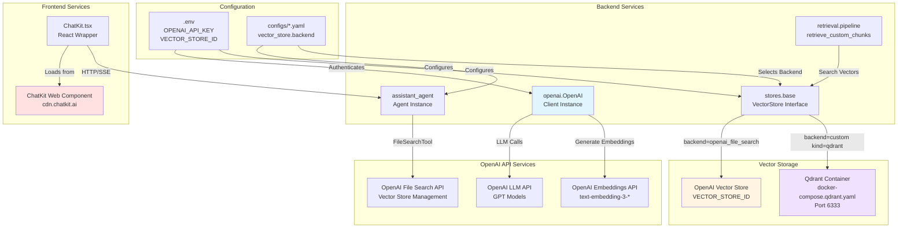
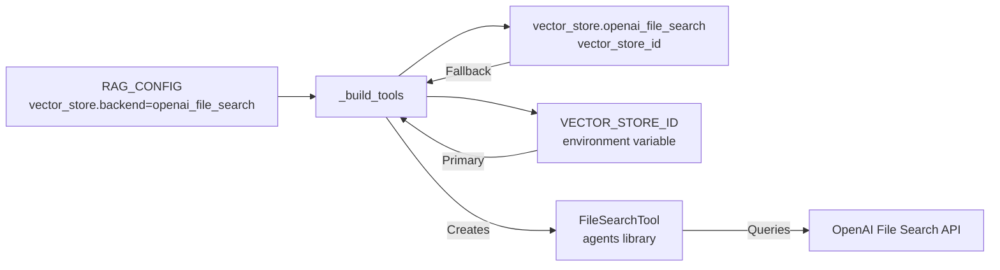
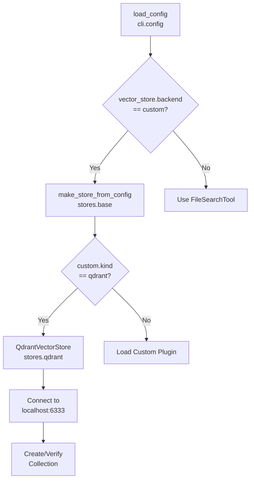
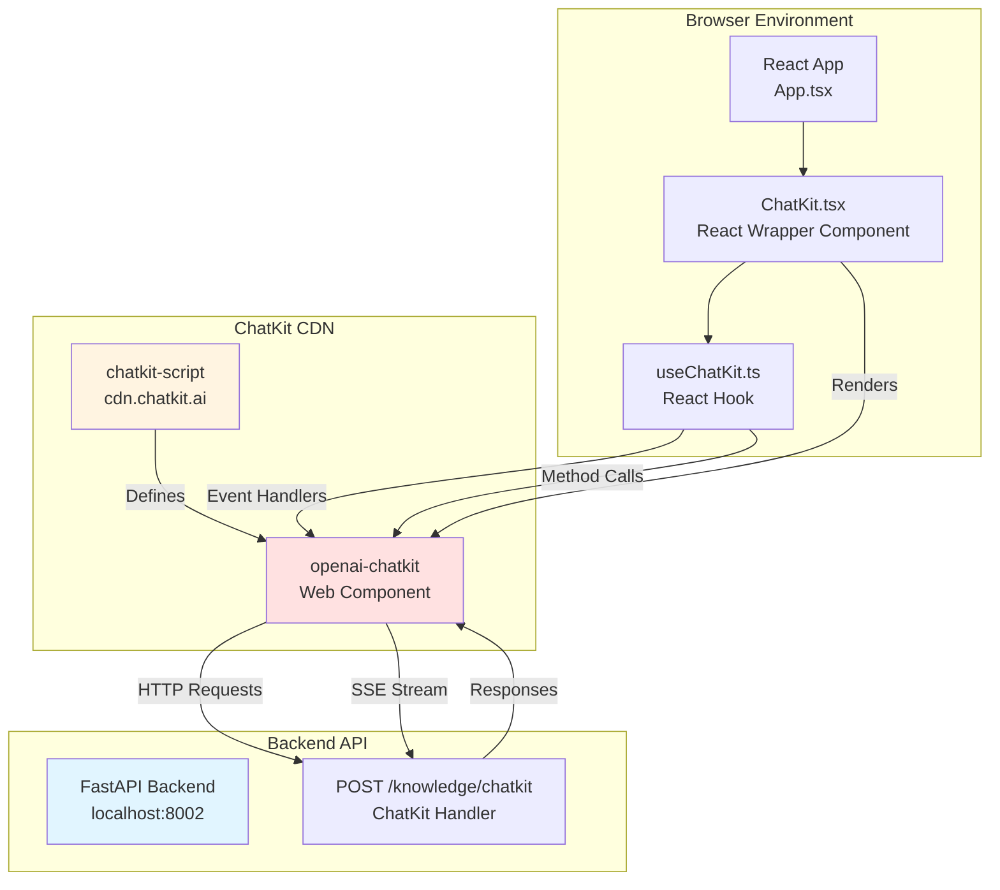
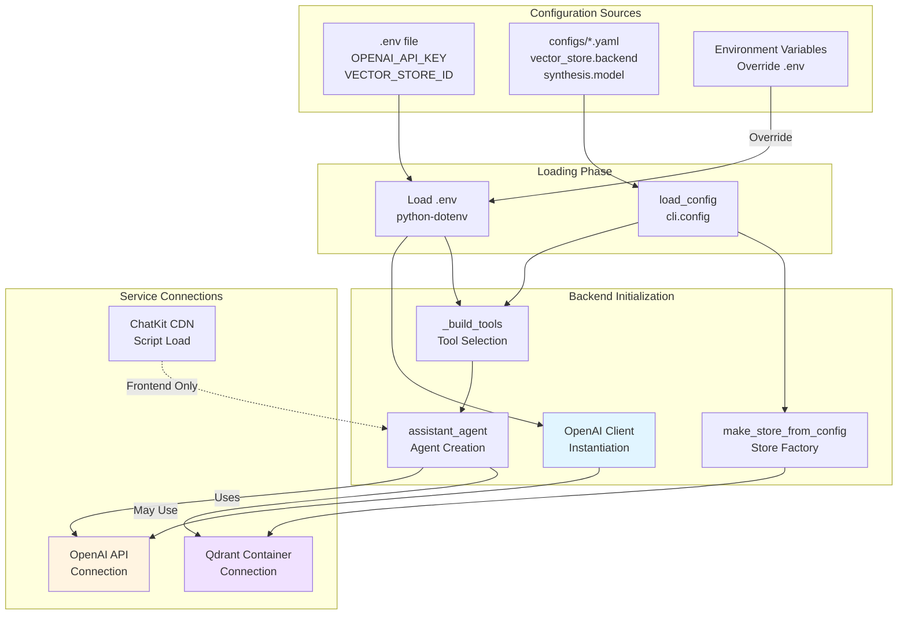

<!-- source: DeepWiki mcp.deepwiki.com · repo openai/openai-knowledge-retrieval · page 3.5 External Services Integration · fetched 2026-10-26 -->

# External Services Integration

<details>
<summary>Relevant source files</summary>

The following files were used as context for generating this wiki page:

- [.env.example](.env.example)
- [Makefile](Makefile)
- [README.md](README.md)
- [app/backend/app/assistant_agent.py](app/backend/app/assistant_agent.py)

</details>


## Purpose and Scope

This document describes how the OpenAI Knowledge Retrieval system integrates with external services. The system depends on three primary external services: the **OpenAI API** (for language models, embeddings, and optional File Search), **Qdrant Vector Database** (for custom vector storage), and the **ChatKit platform** (for the conversational UI component). 

For backend architecture details, see [Backend Architecture](#3.2). For frontend ChatKit integration specifics, see [Frontend Architecture](#3.3). For vector store configuration options, see [Vector Store Configuration](#7.3).

---

## External Service Architecture

The following diagram shows how external services integrate with the system's core components:



**Sources**: [app/backend/app/assistant_agent.py:1-128](), [.env.example:1-7](), [Makefile:25-29](), [README.md:44-52]()

---

## OpenAI API Integration

### Authentication and Client Configuration

The system authenticates with the OpenAI API using credentials stored in environment variables. The OpenAI client is instantiated globally in the assistant agent module:

```python
# app/backend/app/assistant_agent.py:15
client = OpenAI()
```

The `OpenAI()` constructor automatically reads the following environment variables:

| Environment Variable | Purpose | Required |
|---------------------|---------|----------|
| `OPENAI_API_KEY` | API authentication key | Yes |
| `OPENAI_ORG_ID` | Organization identifier | No |
| `OPENAI_PROJECT_ID` | Project identifier | No |

**Sources**: [app/backend/app/assistant_agent.py:15](), [.env.example:1-3]()

### LLM and Embeddings Services

The OpenAI API is used for two primary purposes:

1. **Language Model Inference**: The agent uses GPT models for response generation, query expansion, HyDE generation, and reranking. Model selection is configured via YAML:

```yaml
# configs/default.openai.yaml
synthesis:
  model: gpt-4o-mini  # or gpt-5-mini, o4-mini-high, etc.
```

2. **Embeddings Generation**: The retrieval pipeline uses OpenAI's embedding models to convert text into vectors during both ingestion and query time. The embedding model is specified in the configuration:

```yaml
embeddings:
  model: text-embedding-3-small  # or text-embedding-3-large
```

The `client` instance is passed to the retrieval pipeline for embedding generation during custom vector search operations.

**Sources**: [README.md:227-234](), [app/backend/app/assistant_agent.py:88-97]()

### File Search Tool Integration

When using OpenAI's managed File Search backend, the system integrates with the File Search API through the `FileSearchTool`:



The tool construction logic in [app/backend/app/assistant_agent.py:67-83]():

1. Checks if `vector_store.backend` is set to `"openai_file_search"`
2. Retrieves the vector store ID from `VECTOR_STORE_ID` environment variable
3. Falls back to the configured `vector_store.openai_file_search.vector_store_id` if not set
4. Creates a `FileSearchTool` instance with the vector store ID and query parameters
5. The tool is attached to the agent and invoked automatically during conversations

**Sources**: [app/backend/app/assistant_agent.py:67-83](), [README.md:186-191]()

### Agent Model Configuration

The assistant agent is configured with OpenAI model settings:

```python
# app/backend/app/assistant_agent.py:117-127
model_settings = ModelSettings(
    reasoning_effort="minimal",
)

assistant_agent = Agent[AgentContext](
    model="gpt-5-mini",
    model_settings=model_settings,
    name="Knowledge Retrieval",
    instructions=KNOWLEDGE_ASSISTANT_INSTRUCTIONS,
    tools=_build_tools(),
)
```

**Sources**: [app/backend/app/assistant_agent.py:117-127]()

---

## Qdrant Vector Database Integration

### Docker Deployment

Qdrant runs as a Docker container, managed through Docker Compose. The deployment configuration is located in `docker/docker-compose.qdrant.yaml`.

**Makefile Commands**:

| Command | Action | Description |
|---------|--------|-------------|
| `make qdrant-up` | Start Qdrant | Launches container on port 6333 |
| `make qdrant-down` | Stop Qdrant | Stops and removes container |

```bash
# Start Qdrant
docker compose -f docker/docker-compose.qdrant.yaml up -d

# Stop Qdrant
docker compose -f docker/docker-compose.qdrant.yaml down --remove-orphans
```

The container exposes port **6333** for the Qdrant REST API and gRPC interface.

**Sources**: [Makefile:25-29](), [README.md:109-114]()

### Custom Vector Store Configuration

To use Qdrant as the vector storage backend, the YAML configuration must specify:

```yaml
vector_store:
  backend: custom
  custom:
    kind: qdrant
    qdrant:
      url: http://localhost:6333
      collection: my_collection
      distance: cosine  # or euclidean, dot
      ef: 64           # HNSW search parameter
      m: 32            # HNSW index parameter
```

**Sources**: [README.md:192-209]()

### Store Instantiation Flow

The following diagram shows how Qdrant is instantiated when using the custom backend:



The instantiation occurs in [app/backend/app/assistant_agent.py:84-113]():

1. Configuration is loaded from the path specified in `RAG_CONFIG`
2. If `backend == "custom"`, the system calls `make_store_from_config(cfg)`
3. The store factory examines `custom.kind` to determine the implementation
4. For Qdrant, a connection is established to the configured URL
5. The store is used by the custom retrieval tool

**Sources**: [app/backend/app/assistant_agent.py:84-113](), [README.md:192-209]()

### Retrieval Tool with Custom Store

When using a custom vector store (like Qdrant), a function tool is dynamically created:

```python
# app/backend/app/assistant_agent.py:87-112
@function_tool(name_override="retrieve_context")
def _retrieve_tool(query: str) -> Dict[str, Any]:
    resolved_query = (query or "").strip()
    if not resolved_query:
        raise ValueError("retrieve_context tool requires a non-empty query")
    chunks = retrieve_custom_chunks(
        cfg=cfg,
        store=store,  # Qdrant instance
        client=client,
        query=resolved_query,
    )
    payload_chunks = [...]
    record_retrieved_chunks(_THREAD_ID_CTX.get(), payload_chunks)
    return {"chunks": payload_chunks}
```

This tool:
- Accepts a query string from the agent
- Calls `retrieve_custom_chunks()` which orchestrates query expansion, embedding, vector search, and reranking
- Stores results in the thread-local cache for citation extraction
- Returns chunks to the agent as structured data

**Sources**: [app/backend/app/assistant_agent.py:87-113]()

---

## ChatKit Platform Integration

### Web Component Architecture

The frontend integrates with OpenAI's ChatKit platform through a web component loaded from CDN:



The ChatKit web component is loaded from the CDN and wrapped in a React component for easier integration. The web component handles its own HTTP communication with the backend.

**Sources**: [README.md:240-249](), High-Level Diagram 4

### Backend Endpoint Configuration

The ChatKit component communicates with the backend through configuration specified in `app/frontend/src/lib/config.ts`:

```typescript
// API endpoint configuration
const API_BASE_URL = "http://localhost:8002"
const CHATKIT_ENDPOINT = `${API_BASE_URL}/knowledge/chatkit`
```

The backend endpoint is configured to accept CORS requests from the frontend origins:

```bash
# .env
KNOWLEDGE_CORS_ALLOW_ORIGINS="http://localhost:5173,http://127.0.0.1:5173"
```

**Sources**: [.env.example:6](), [README.md:139-140]()

---

## Service Dependencies Summary

The following table summarizes all external service dependencies:

| Service | Purpose | Required | Configuration | Default Endpoint |
|---------|---------|----------|---------------|------------------|
| **OpenAI API** | LLM inference, embeddings, File Search | Yes | `OPENAI_API_KEY` | `api.openai.com` |
| **Qdrant** | Custom vector storage | No* | `qdrant.url`, `qdrant.collection` | `localhost:6333` |
| **ChatKit CDN** | Conversational UI component | No** | Loaded automatically | `cdn.chatkit.ai` |

\* Required only if using `vector_store.backend: custom` with `kind: qdrant`  
\** Required only for the web frontend; backend and CLI work independently

**Sources**: [.env.example:1-7](), [README.md:44-52]()

---

## Configuration Management Flow

The following diagram shows how external service configuration flows through the system:



**Configuration Priority** (highest to lowest):
1. Environment variables (runtime)
2. `.env` file values
3. YAML file defaults
4. Hard-coded fallbacks

**Sources**: [app/backend/app/assistant_agent.py:33-38](), [app/backend/app/assistant_agent.py:67-116]()

---

## Error Handling and Service Availability

### OpenAI API Errors

The system relies on the OpenAI Python SDK's built-in error handling. Common error scenarios:

| Error Type | Cause | Handling |
|------------|-------|----------|
| `AuthenticationError` | Invalid API key | Fails immediately; requires valid credentials |
| `RateLimitError` | API rate limits exceeded | SDK automatically retries with exponential backoff |
| `APIConnectionError` | Network issues | SDK retries; long outages will fail requests |
| `APIError` | Service-side errors | Propagated to caller; logged for debugging |

**Sources**: OpenAI SDK documentation (external)

### Qdrant Connection Failures

When using Qdrant as a custom backend, connection failures are handled during store instantiation:

- If Qdrant is unreachable during initialization, the application will fail to start
- Run `make qdrant-up` before starting the backend when using custom Qdrant backend
- Connection health can be verified by accessing `http://localhost:6333/dashboard`

**Sources**: [Makefile:25-29]()

### ChatKit Component Loading

The ChatKit web component is loaded asynchronously from CDN:

- If the CDN is unreachable, the frontend may display a loading state indefinitely
- The component loading happens in the browser; backend functionality is not affected
- No fallback UI is provided for CDN failures

**Sources**: High-Level Diagram 4

---

## Service-Specific Configuration Files

The following table maps configuration files to each external service:

| Service | Configuration File(s) | Key Parameters |
|---------|----------------------|----------------|
| **OpenAI API** | `.env`, `configs/*.yaml` | `OPENAI_API_KEY`, `synthesis.model`, `embeddings.model` |
| **Qdrant** | `docker/docker-compose.qdrant.yaml`, `configs/*.yaml` | `qdrant.url`, `qdrant.collection`, HNSW parameters |
| **ChatKit** | `app/frontend/src/lib/config.ts` | Backend API URL, endpoint paths |

**Sources**: [.env.example:1-7](), [README.md:186-209]()

---

